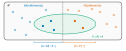
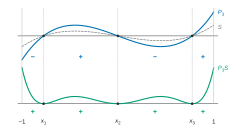
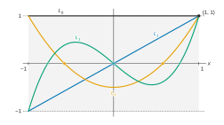

# Centrale-Supélec PSI — Mathématiques 2 2026 · Corrigé brut

*Corrigé rédigé par IA, non officiel. Signalez toute erreur.*

**Polynômes de Jacobi.** Durée 4 heures, calculatrice autorisée. 42 questions.

Notations : $\mathbb R_k[X]=\mathrm{Vect}(1,X,\dots,X^k)$ ; $w(t)=(1-t)^\alpha(1+t)^\beta$ ; $\alpha,\beta>-1$ sauf mention contraire.

## Partie A — Un produit scalaire

### Q1

L'intégrale de Riemann $\displaystyle\int_0^1\frac{dt}{t^\delta}$ converge si et seulement si $\delta<1$, et alors

$$\boxed{\begin{aligned}\int_0^1\frac{dt}{t^\delta}&=\Big[\frac{t^{1-\delta}}{1-\delta}\Big]_0^1\\&=\frac1{1-\delta}.\end{aligned}}$$

### Q2

Soit $a>0$. La fonction $t\mapsto(a-t)^{-\delta}$ est continue sur $[0,a[$. L'intégrale n'est donc impropre qu'en $a$, et seulement si $\delta>0$.

Le changement de variable $u=a-t$ est une bijection de classe $\mathcal C^1$ strictement décroissante de $]0,a[$ sur lui-même. Les deux intégrales suivantes sont donc de même nature, et égales en cas de convergence :

$$\int_0^a\frac{dt}{(a-t)^\delta}\quad\text{et}\quad\int_0^a\frac{du}{u^\delta}.$$

Le changement de variable $u=av$ ramène ensuite à Q1 :

$$\int_0^a\frac{du}{u^\delta}=a^{1-\delta}\int_0^1\frac{dv}{v^\delta}.$$

Par Q1 :

$$\boxed{\begin{aligned}&\int_0^a\frac{dt}{(a-t)^\delta}\ \text{converge}\iff\delta<1,\\&\text{et alors elle vaut }\frac{a^{1-\delta}}{1-\delta}.\end{aligned}}$$

Cas restants. Si $a=0$, l'intégrale est nulle.

Si $a<0$, la quantité $a-t$ est négative sur l'intervalle d'intégration. La puissance $(a-t)^\delta$ n'est alors définie que pour $\delta$ entier.

On trouve encore la condition $\delta<1$. En effet, pour $\delta\leqslant 0$, on intègre un polynôme. Pour $\delta\geqslant1$, l'intégrale diverge en $t=a$.

Seul le cas $a>0$ sert dans la suite.

### Q3

Posons $h(t)=(1-t)^\alpha(1+t)^\beta f(t)$, continue sur $]-1,1[$. On coupe en $0$.

*En $1$.* La fonction $t\mapsto(1+t)^\beta f(t)$ est continue sur le segment $[0,1]$. Elle y est donc bornée par un réel $M_1$, et, sur $[0,1[$ :

$$|h(t)|\leqslant M_1(1-t)^\alpha.$$

On applique Q2 avec $a=1$ et $\delta=-\alpha$. Comme $-\alpha<1$, l'intégrale $\int_0^1(1-t)^\alpha dt$ converge. Par comparaison de fonctions positives, $\int_0^1|h|$ converge.

*En $-1$.* De même, sur $]-1,0]$ :

$$|h(t)|\leqslant M_2(1+t)^\beta.$$

Le changement de variable $u=-t$ donne $\int_{-1}^0(1+t)^\beta dt=\int_0^1(1-u)^\beta du$. Cette intégrale converge car $-\beta<1$.

Donc $h$ est intégrable sur $]-1,1[$ : **l'intégrale $\int_{-1}^1(1-t)^\alpha(1+t)^\beta f(t)\,dt$ converge (absolument).**

### Q4

*Bonne définition* : soient $P,Q\in\mathbb R[X]$. Le produit $PQ$ est continu sur $[-1,1]$, donc $\langle P,Q\rangle$ existe par Q3.

*Symétrie* : évidente. *Bilinéarité* : par symétrie, la linéarité à gauche suffit ; elle découle de la linéarité de l'intégrale (toutes les intégrales en jeu convergent).

*Positivité* : $w(t)P(t)^2\geqslant0$ sur $]-1,1[$, donc $\langle P,P\rangle\geqslant0$.

*Caractère défini* : supposons $\langle P,P\rangle=0$. Pour tout segment $[c,d]\subset]-1,1[$, on a

$$\begin{aligned}0&\leqslant\int_c^d wP^2\\&\leqslant\int_{-1}^1wP^2\\&=0.\end{aligned}$$

La fonction $wP^2$ est continue et positive sur le segment $[c,d]$, et d'intégrale nulle : elle y est nulle. Comme $w>0$, $P$ s'annule sur $[c,d]$. Il a donc une infinité de racines : $P=0$.

**$\langle\cdot,\cdot\rangle$ est un produit scalaire sur $\mathbb R[X]$.**

### I – Un premier exemple ($\alpha=\beta=-\tfrac12$)

### Q5

On a $\langle1,X\rangle=\displaystyle\int_{-1}^1\frac{t\,dt}{\sqrt{1-t^2}}$, convergente par Q3. Une primitive sur $]-1,1[$ est $-\sqrt{1-t^2}$. Elle tend vers $0$ en $\pm1$ :

$$\boxed{\langle1,X\rangle=0.}$$

(Variante : intégrande impair et intégrale convergente.)

### Q6

$$\begin{aligned}\|1\|^2&=\int_{-1}^1\frac{dt}{\sqrt{1-t^2}}\\&=\big[\arcsin t\big]_{-1}^1\\&=\pi.\end{aligned}$$

Posons $t=\sin u$. C'est une bijection de classe $\mathcal C^1$ croissante de $]-\frac\pi2,\frac\pi2[$ sur $]-1,1[$. Sur le premier intervalle, $\sqrt{1-t^2}=\cos u>0$, d'où

$$\begin{aligned}\|X\|^2&=\int_{-\pi/2}^{\pi/2}\sin^2u\,du\\&=\int_{-\pi/2}^{\pi/2}\frac{1-\cos2u}2\,du\\&=\frac\pi2.\end{aligned}$$

$$\boxed{\begin{aligned}\|1\|&=\sqrt\pi\\\|X\|&=\sqrt{\frac\pi2}\end{aligned}}$$

### II – Un second exemple ($\alpha=\beta=0$)

### Q7

$$\begin{aligned}\langle X^i,X^j\rangle&=\int_{-1}^1t^{i+j}dt\\&=\frac{1-(-1)^{i+j+1}}{i+j+1},\end{aligned}$$

soit

$$\boxed{\langle X^i,X^j\rangle=\begin{cases}\dfrac{2}{i+j+1}&\text{si }i+j\text{ est pair},\\[2mm]0&\text{si }i+j\text{ est impair.}\end{cases}}$$

### Q8

Avec $j=i$ : $\|X^i\|^2=\dfrac{2}{2i+1}$, donc $\boxed{\|X^i\|=\sqrt{\dfrac{2}{2i+1}}.}$

## Partie B — Autour des coefficients binomiaux

### Q9

Soient $(m,p)\in\mathbb N^2$ et $k\in\{0,\dots,m+p\}$. Soit $\mathcal F$ un ensemble à $m+p$ éléments.

On l'écrit $\mathcal F=M\sqcup P$, réunion disjointe de deux parties. On a $|M|=m$ et $|P|=p$.

Il y a $\binom{m+p}{k}$ parties de $\mathcal F$ à $k$ éléments.

Soit $j\in\{0,\dots,k\}$. On note $\mathcal A_j$ l'ensemble des parties de $\mathcal F$ à $k$ éléments vérifiant $|A\cap P|=j$.

Comme $0\leqslant|A\cap P|\leqslant k$, les $\mathcal A_j$ forment une partition des parties à $k$ éléments (certains pouvant être vides).

Une partie $A\in\mathcal A_j$ est déterminée par le couple $(A\cap M,A\cap P)$. Le premier terme est une partie de $M$ à $k-j$ éléments. Le second est une partie de $P$ à $j$ éléments. Ces deux choix sont indépendants, donc

$$|\mathcal A_j|=\binom{m}{k-j}\binom pj,$$

avec la convention $\binom nr=0$ si $r>n$, qui correspond à $\mathcal A_j=\varnothing$. En sommant :

$$\boxed{\binom{m+p}{k}=\sum_{j=0}^k\binom{m}{k-j}\binom pj.}$$

### Q10

Si $k=0$ : $B^n_0=1=\binom n0$. Si $1\leqslant k\leqslant n$ :

$$\begin{aligned}B^n_k&=\frac{n(n-1)\cdots(n-k+1)}{k!}\\&=\frac{n!}{k!\,(n-k)!}\\&=\binom nk.\end{aligned}$$

**Les deux nombres sont égaux : $B^n_k=\binom nk$.**

## Partie C — Une famille de polynômes

### I – Premières propriétés des $P_k$

### Q11

D'après (i), $P_k\in\mathrm{Vect}(P_0,\dots,P_k)=\mathbb R_k[X]$, donc $\deg P_k\leqslant k$.

Pour $k=0$, $P_0$ est de norme $1$, donc non nul : $\deg P_0=0$.

Pour $k\geqslant1$, supposons $P_k\in\mathbb R_{k-1}[X]=\mathrm{Vect}(P_0,\dots,P_{k-1})$. Alors $\mathbb R_k[X]=\mathrm{Vect}(P_0,\dots,P_k)\subset\mathbb R_{k-1}[X]$. Cela contredit $\dim\mathbb R_k[X]=k+1>k$. **Donc $\deg P_k=k$.**

### Q12

Par (i), $\mathrm{Vect}(1,\dots,X^{k-1})=\mathrm{Vect}(P_0,\dots,P_{k-1})$. La famille $\mathcal B$ étant orthonormale, $\langle P_k,P_j\rangle=0$ pour $j\leqslant k-1$. Par linéarité, $P_k$ est orthogonal à toute combinaison linéaire de $P_0,\dots,P_{k-1}$ :

$$\boxed{P_k\in\mathrm{Vect}(1,X,\dots,X^{k-1})^\perp.}$$

### Q13

Comme $\deg Q=k$, on a $Q\in\mathbb R_k[X]=\mathrm{Vect}(P_0,\dots,P_k)$. La base étant orthonormale :

$$Q=\sum_{j=0}^k\langle Q,P_j\rangle P_j.$$

Pour $j\leqslant k-1$, $P_j\in\mathbb R_{k-1}[X]$ (Q11). Comme $Q\perp\mathbb R_{k-1}[X]$, on a $\langle Q,P_j\rangle=0$.

Ainsi $Q=\alpha_kP_k$ avec $\alpha_k=\langle Q,P_k\rangle$ (non nul puisque $Q\neq0$).

### II – Une relation entre $P_{k-1}$, $P_k$ et $P_{k+1}$

### Q14

Notons $\lambda_j\neq0$ le coefficient dominant de $P_j$ (Q11).

Les polynômes $P_{k+1}$ et $XP_k$ sont de degré $k+1$. Leurs coefficients dominants sont $\lambda_{k+1}$ et $\lambda_k$. Avec

$$\boxed{a_k=\frac{\lambda_{k+1}}{\lambda_k},}$$

le coefficient de $X^{k+1}$ dans $P_{k+1}-a_kXP_k$ est nul, donc $\deg(P_{k+1}-a_kXP_k)\leqslant k$.

### Q15

Soit $R=P_{k+1}-a_kXP_k\in\mathbb R_k[X]$, donc $R=\sum_{j=0}^k\langle R,P_j\rangle P_j$.

Pour tous $A,B\in\mathbb R[X]$ :

$$\begin{aligned}\langle XA,B\rangle&=\int_{-1}^1w(t)\,tA(t)B(t)\,dt\\&=\langle A,XB\rangle.\end{aligned}$$

Pour $j\in\{0,\dots,k-2\}$ (ensemble vide si $k=1$) :

$$\begin{aligned}\langle R,P_j\rangle&=\langle P_{k+1},P_j\rangle-a_k\langle P_k,XP_j\rangle\\&=0-0\\&=0,\end{aligned}$$

car $j\neq k+1$ et $XP_j\in\mathbb R_{k-1}[X]$ est orthogonal à $P_k$ (Q12). Il reste $R=b_kP_k+c_kP_{k-1}$, avec $b_k=\langle R,P_k\rangle$ et $c_k=\langle R,P_{k-1}\rangle$ :

$$\boxed{P_{k+1}=(a_kX+b_k)P_k+c_kP_{k-1}.}$$

La preuve n'utilise que l'orthogonalité et $\deg P_j=j$. Elle vaut donc pour toute famille orthogonale échelonnée en degré, avec les coordonnées $\langle R,P_j\rangle/\|P_j\|^2$.

### III – Racines des polynômes $P_k$

### Q16

$P_k$ est non nul de degré $k$ : il a au plus $k$ racines comptées avec multiplicité. **Donc $m\leqslant k$.**

### Q17

Si $\mathcal R=\varnothing$, $P_kS=P_k$ est continue et ne s'annule pas sur l'intervalle $]-1,1[$. Par le théorème des valeurs intermédiaires, elle y garde un signe strict constant.

Supposons $m\geqslant1$. Le polynôme $S$ regroupe les racines de $P_k$ situées dans $]-1,1[$, avec leurs multiplicités. Donc $S$ divise $P_k$.

Écrivons $P_k=ST$, où $T$ n'a aucune racine dans $]-1,1[$. Par le théorème des valeurs intermédiaires, $T$ garde un signe strict constant $\varepsilon$ sur $]-1,1[$. Alors

$$P_kS=S^2T.$$

**La fonction $x\mapsto P_k(x)S(x)$ est de signe constant sur $]-1,1[$**, celui de $T$. Elle ne s'y annule qu'en $x_1,\dots,x_m$.

### Q18

La fonction $\varphi=\varepsilon\,wP_kS$ est continue et positive sur $]-1,1[$, et

$$\varepsilon\langle P_k,S\rangle=\int_{-1}^1\varphi.$$

Supposons cette intégrale nulle. L'argument de segment de Q4 donne $\varphi=0$ sur $]-1,1[$. Comme $w>0$, on a $P_kS=0$ sur cet intervalle.

Le polynôme $P_kS$ a alors une infinité de racines : $P_kS=0$. Comme $S\neq0$, on obtient $P_k=0$, ce qui contredit $\deg P_k=k$. **Donc $\langle P_k,S\rangle\neq0$.**

### Q19

$S$ est de degré $m$. Si $m\leqslant k-1$, alors $S\in\mathbb R_{k-1}[X]$ et $\langle P_k,S\rangle=0$ par Q12, ce qui contredit Q18. Donc $m\geqslant k$ et, avec Q16 :

$$\boxed{m=k.}$$

**Toutes les racines de $P_k$ sont réelles et situées dans $]-1,1[$.**

Elles sont de plus simples. Soient $y_1,\dots,y_r$ les racines de $P_k$ dans $]-1,1[$ de multiplicité impaire. Posons $U=\prod(X-y_i)$.

Toutes les racines de $P_kU$ dans cet intervalle sont de multiplicité paire.

Donc $P_kU$ est de signe constant sur $]-1,1[$, et non identiquement nulle. On en tire $\langle P_k,U\rangle\neq0$, puis $r\geqslant k$ ; donc $P_k$ a $k$ racines distinctes.

## Partie D — Polynômes de Jacobi

### I – Définition

### Q20

On a $g_0(x)=(1-x)^\alpha(1+x)^\beta$ et $g_1(x)=(1-x)^{\alpha+1}(1+x)^{\beta+1}$. Donc $J_0=1$. Puis

$$\begin{aligned}g_1'(x)&=(1-x)^\alpha(1+x)^\beta\big[-(\alpha+1)(1+x)+(\beta+1)(1-x)\big]\\&=(1-x)^\alpha(1+x)^\beta\big[(\beta-\alpha)-(\alpha+\beta+2)x\big],\end{aligned}$$

et $J_1=-\dfrac{g_1'}{2(1-x)^\alpha(1+x)^\beta}$ :

$$\boxed{\begin{aligned}J_0&=1\\J_1&=\frac{(\alpha+\beta+2)X+\alpha-\beta}{2}\end{aligned}}$$

### Q21

Montrons par récurrence sur $p$ que, sur $]-1,1[$ :

$$\frac{d^p}{dx^p}(1-x)^j=(-1)^p\,p!\,B^j_p\,(1-x)^{j-p}.$$

C'est vrai pour $p=0$. Si c'est vrai au rang $p$, en dérivant :

$$\begin{aligned}\frac{d^{p+1}}{dx^{p+1}}(1-x)^j&=(-1)^p\,p!\,B^j_p\,(j-p)(-1)(1-x)^{j-p-1}\\&=(-1)^{p+1}(p+1)!\,B^j_{p+1}(1-x)^{j-p-1},\end{aligned}$$

car $(p+1)!\,B^j_{p+1}=j(j-1)\cdots(j-p)$, qui vaut $p!\,B^j_p\,(j-p)$ (valable aussi pour $p=0$). D'où

$$\boxed{\frac{d^p}{dx^p}(1-x)^j=(-1)^p\,p!\,B^j_p\,(1-x)^{j-p}.}$$

De même, $\dfrac{d^p}{dx^p}(1+x)^j=p!\,B^j_p\,(1+x)^{j-p}$.

### Q22

Par la formule de Leibniz et Q21, pour $p\in\{0,\dots,k\}$ :

$$g_k^{(p)}(x)=\sum_{i=0}^p\binom pi(-1)^ii!\,B^{\alpha+k}_i(1-x)^{\alpha+k-i}\,(p-i)!\,B^{\beta+k}_{p-i}(1+x)^{\beta+k-p+i}.$$

Avec $\binom pi i!(p-i)!=p!$, on obtient

$$g_k^{(p)}(x)=(1-x)^{\alpha+k-p}(1+x)^{\beta+k-p}\,h_p(x),$$

où

$$h_p(x)=p!\sum_{i=0}^p(-1)^iB^{\alpha+k}_iB^{\beta+k}_{p-i}(1-x)^{p-i}(1+x)^i$$

est polynomiale de degré au plus $p$. En particulier :

$$\boxed{g_k^{(k)}(x)=k!\,(1-x)^\alpha(1+x)^\beta\sum_{i=0}^k(-1)^iB^{\alpha+k}_iB^{\beta+k}_{k-i}(1-x)^{k-i}(1+x)^i.}$$

### Q23

En reportant dans la définition de $J_k$, le poids et $k!$ se simplifient :

$$J_k(x)=\frac1{2^k}\sum_{i=0}^k(-1)^{k+i}B^{\alpha+k}_iB^{\beta+k}_{k-i}(1-x)^{k-i}(1+x)^i.$$

Comme $(-1)^{k+i}=(-1)^{k-i}$, on a $(-1)^{k+i}(1-x)^{k-i}=(x-1)^{k-i}$. Le changement d'indice $i\mapsto k-i$ donne

$$\boxed{J_k(x)=\frac1{2^k}\sum_{i=0}^kB^{k+\alpha}_{k-i}B^{k+\beta}_i(x-1)^i(x+1)^{k-i}.}$$

(Le calcul vaut pour tout $k\geqslant0$.)

### Q24

Chaque $(x-1)^i(x+1)^{k-i}$ est polynomial, de degré $k$ et unitaire. Donc $J_k$ coïncide sur $]-1,1[$ avec un polynôme de degré au plus $k$. Son coefficient de $X^k$ est

$$\lambda_k=\frac1{2^k}\sum_{i=0}^kB^{k+\alpha}_{k-i}B^{k+\beta}_i.$$

Pour $k\geqslant2$, on a $k\leqslant2k+\alpha+\beta$ (car $\alpha+\beta>-2$). La formule de Vandermonde généralisée, avec $s=k+\alpha$ et $t=k+\beta$, donne

$$\boxed{\begin{aligned}\lambda_k&=\frac{B^{2k+\alpha+\beta}_k}{2^k}\\&=\frac1{2^kk!}\prod_{r=0}^{k-1}(2k+\alpha+\beta-r).\end{aligned}}$$

Chaque facteur vérifie

$$2k+\alpha+\beta-r\geqslant k+1+\alpha+\beta>k-1>0,$$

donc $\lambda_k>0$ : **$J_k$ est polynomiale de degré exactement $k$.**

Pour $k=0$ et $k=1$, Q20 donne directement les valeurs suivantes, que la formule encadrée redonne :

$$\begin{aligned}\lambda_0&=1,\\\lambda_1&=\frac{\alpha+\beta+2}2>0.\end{aligned}$$

### II – Orthogonalité des polynômes de Jacobi

### Q25

*Convergence.* Par Q22 :

$$\begin{aligned}x^ig_k^{(k)}(x)&=(1-x)^\alpha(1+x)^\beta\,x^ih_k(x),\\x^{i-1}g_k^{(k-1)}(x)&=(1-x)^{\alpha+1}(1+x)^{\beta+1}\,x^{i-1}h_{k-1}(x).\end{aligned}$$

La fonction $x^ih_k$ est continue sur $[-1,1]$. Pour $i\geqslant1$, il en va de même de $x^{i-1}h_{k-1}$. Les exposants $\alpha,\beta,\alpha+1,\beta+1$ sont $>-1$. Q3 donne donc la convergence des deux intégrales.

*Intégration par parties* sur $[u,v]\subset]-1,1[$ :

$$\int_u^vx^ig_k^{(k)}=\Big[x^ig_k^{(k-1)}(x)\Big]_u^v-i\int_u^vx^{i-1}g_k^{(k-1)}.$$

*Termes de bord* : on a la majoration

$$|x^ig_k^{(k-1)}(x)|\leqslant\|h_{k-1}\|_\infty(1-x)^{\alpha+1}(1+x)^{\beta+1},$$

dont le second membre tend vers $0$ en $\pm1$. En effet, $\alpha+1>0$ et $\beta+1>0$.

En faisant $u\to-1$ et $v\to1$ :

$$\boxed{\int_{-1}^1x^ig_k^{(k)}(x)\,dx=-i\int_{-1}^1x^{i-1}g_k^{(k-1)}(x)\,dx.}$$

Pour $i=0$, la seconde intégrale n'a pas de sens en général : pour $k=1$, l'intégrande est équivalent à $1/x$ en $0$. L'identité se lit alors $\int_{-1}^1g_k^{(k)}=0$, ce que donne le même calcul :

$$\begin{aligned}\int_{-1}^1g_k^{(k)}&=\big[g_k^{(k-1)}\big]_{-1}^1\\&=0.\end{aligned}$$

### Q26

Par définition de $J_k$, $w(t)J_k(t)t^i=\dfrac{(-1)^k}{2^kk!}t^ig_k^{(k)}(t)$, donc

$$\langle J_k,X^i\rangle=\dfrac{(-1)^k}{2^kk!}\displaystyle\int_{-1}^1t^ig_k^{(k)}.$$

Le raisonnement de Q25 s'applique à tout ordre $p\in\{1,\dots,k\}$. En effet, par Q22 :

$$g_k^{(p-1)}=(1-x)^{\alpha+k-p+1}(1+x)^{\beta+k-p+1}h_{p-1},$$

avec des exposants $\geqslant\alpha+1>0$ et $\geqslant\beta+1>0$. D'où, pour $j\geqslant1$ :

$$\int_{-1}^1x^jg_k^{(p)}=-j\int_{-1}^1x^{j-1}g_k^{(p-1)}.$$

On l'applique $i$ fois, aux ordres $k,k-1,\dots,k-i+1$, tous $\geqslant1$ :

$$\begin{aligned}\int_{-1}^1x^ig_k^{(k)}&=(-1)^ii!\int_{-1}^1g_k^{(k-i)}\\&=(-1)^ii!\Big[g_k^{(k-i-1)}\Big]_{-1}^1\\&=0,\end{aligned}$$

car $k-i-1\geqslant0$, et $g_k^{(k-i-1)}$ tend vers $0$ aux deux bornes. Ses exposants sont en effet $\alpha+i+1>0$ et $\beta+i+1>0$.

**Donc $\langle J_k,X^i\rangle=0$.**

### Q27

Les $J_k$ sont non nuls et de degrés $0,1,\dots,n$ deux à deux distincts (Q24) : la famille est libre. Elle compte $n+1=\dim E$ vecteurs : c'est une base de $E$.

Pour $i<k$, $J_i\in\mathbb R_{k-1}[X]$ est combinaison linéaire de $1,\dots,X^{k-1}$. Donc $\langle J_k,J_i\rangle=0$ par Q26. **$(J_0,\dots,J_n)$ est une base orthogonale de $E$.**

### Q28

Chaque $J_k$ est non nul, donc $\|J_k\|>0$. La famille $\Big(\dfrac{J_k}{\|J_k\|}\Big)_{0\leqslant k\leqslant n}$ est orthogonale, formée de vecteurs unitaires : **c'est une base orthonormale de $E$.**

C'est même la base $\mathcal B$ de la partie C. En effet, $J_k/\|J_k\|$ est de degré $k$ et orthogonal à $\mathbb R_{k-1}[X]$. Il vaut donc $\pm P_k$ par Q13.

Écrivons $X^k=J_k/\lambda_k+$ termes de degré $<k$. On obtient

$$\langle J_k,X^k\rangle=\frac{\|J_k\|^2}{\lambda_k}>0,$$

ce qui fixe le signe $+$ par (ii).

## Partie E — Le cas particulier $(\alpha,\beta)=(0,0)$

Pour $\alpha=\beta=0$, on a $g_k=(1-x^2)^k=(-1)^k(x^2-1)^k$, d'où

$$\begin{aligned}J_k&=\frac{1}{2^kk!}\big[(X^2-1)^k\big]^{(k)}\\&=L_k.\end{aligned}$$

Les $L_k$ sont les $J_k$, orthogonaux mais non normés ($\|L_0\|^2=2$). Les résultats de Q14–Q15 restent valables pour eux (remarque de Q15).

### I – Premières propriétés des polynômes $L_k$

### Q29

On a $(X^2-1)^2=X^4-2X^2+1$, de dérivée seconde $12X^2-4$.

De même, $(X^2-1)^3=X^6-3X^4+3X^2-1$, de dérivée troisième $120X^3-72X$. D'où

$$\boxed{\begin{aligned}L_0&=1\\L_1&=X\\L_2&=\frac{3X^2-1}2\\L_3&=\frac{5X^3-3X}2\end{aligned}}$$

### Q30

$L_1$ : racine $0$.

$L_2$ : racines $\pm\frac1{\sqrt3}\approx\pm0{,}577$.

$L_3=\frac{X(5X^2-3)}2$ : racines $0$ et $\pm\sqrt{\frac35}\approx\pm0{,}775$.

Dans chaque cas, les $k$ racines sont réelles, simples et dans $]-1,1[$ : **$m=k$, conformément à Q19.**

### Q31

On a $(X^2-1)^k=X^{2k}+(\text{termes de degré}<2k)$.

La dérivée $k$-ième de $X^{2k}$ est $\frac{(2k)!}{k!}X^k$. Celle d'un monôme de degré $r<2k$ est de degré $<k$ (ou nulle). Donc $\deg L_k=k$ et

$$\boxed{\begin{aligned}\text{coefficient dominant de }L_k&=\frac{(2k)!}{2^k(k!)^2}\\&=\frac1{2^k}\binom{2k}k.\end{aligned}}$$

(On retrouve $B^{2k}_k/2^k$ de Q24, par Q10.)

### Q32

Soit $Q$ pair. En dérivant $Q^{(p)}(-x)=(-1)^pQ^{(p)}(x)$, une récurrence donne cette relation pour tout $p$. Avec $Q=(X^2-1)^k$ et $p=k$ :

$$\boxed{L_k(-X)=(-1)^kL_k(X)}$$

**$L_k$ a la parité de $k$.**

### Q33

La formule de Leibniz appliquée à $(X-1)^k(X+1)^k$ donne

$$\big[(X^2-1)^k\big]^{(k)}=\sum_{i=0}^k\binom ki\big[(X-1)^k\big]^{(i)}\big[(X+1)^k\big]^{(k-i)}.$$

En $x=1$, seul subsiste le terme $i=k$ : les autres contiennent $(x-1)^{k-i}$, avec $k-i\geqslant1$. Ce terme vaut $k!\,2^k$. Avec Q32 :

$$\boxed{\begin{aligned}L_k(1)&=1\\L_k(-1)&=(-1)^k\end{aligned}}$$

### II – Une équation différentielle vérifiée par les $L_k$

### Q34

Pour $k\geqslant1$, $g_k'(x)=-2kx(1-x^2)^{k-1}$ ; pour $k=0$, $g_0'=0$. Dans tous les cas :

$$\boxed{(1-x^2)g_k'(x)=-2kx\,g_k(x).}$$

### Q35

Notons $u=g_k$. Dérivons $k+1$ fois $(1-x^2)u'+2kxu=0$ par Leibniz.

Les dérivées de $1-x^2$ sont nulles à partir de l'ordre 3, celles de $x$ à partir de l'ordre 2 :

$$(1-x^2)u^{(k+2)}-2(k+1)xu^{(k+1)}-k(k+1)u^{(k)}+2k\big(xu^{(k+1)}+(k+1)u^{(k)}\big)=0,$$

soit

$$(1-x^2)\big(u^{(k)}\big)''-2x\big(u^{(k)}\big)'+k(k+1)u^{(k)}=0.$$

Comme $u^{(k)}=(-1)^k2^kk!\,L_k$, on divise par cette constante non nulle :

$$\boxed{(1-x^2)L_k''-2xL_k'+k(k+1)L_k=0\ \text{ sur }]-1,1[.}$$

### III – Une majoration des $L_k$ sur $[-1,1]$

### Q36

$f_k$ n'est définie que pour $k\geqslant1$. Alors

$$f_k'=2L_kL_k'+\frac{2L_k'}{k(k+1)}\big[(1-x^2)L_k''-xL_k'\big].$$

L'équation de Q35, identité polynomiale vraie sur $]-1,1[$, est vraie sur $\mathbb R$. Elle donne

$$(1-x^2)L_k''-xL_k'=xL_k'-k(k+1)L_k.$$

D'où

$$\boxed{f_k'(x)=\frac{2x}{k(k+1)}L_k'(x)^2\geqslant0\ \text{ sur }[0,1]}$$

**$f_k$ est croissante sur $[0,1]$.**

### Q37

Pour $k=0$, $L_0=1$. Pour $k\geqslant1$ et $x\in[0,1]$, comme $1-x^2\geqslant0$ :

$$\begin{aligned}L_k(x)^2&\leqslant f_k(x)\\&\leqslant f_k(1)\\&=L_k(1)^2\\&=1\end{aligned}$$

(Q36 puis Q33). Pour $x\in[-1,0]$, $|L_k(x)|=|L_k(-x)|\leqslant1$ par Q32. **Donc $|L_k(x)|\leqslant1$ sur $[-1,1]$.**

### IV – Relation entre $L_{k-1}$, $L_k$ et $L_{k+1}$

### Q38

Pour la famille orthogonale échelonnée $(L_j)$, $a_k$ est le quotient des coefficients dominants (Q14, Q31) :

$$\begin{aligned}a_k&=\frac{(2k+2)!}{2^{k+1}((k+1)!)^2}\cdot\frac{2^k(k!)^2}{(2k)!}\\&=\frac{(2k+2)(2k+1)}{2(k+1)^2},\end{aligned}$$

$$\boxed{a_k=\frac{2k+1}{k+1}.}$$

### Q39

Par Q15 (valable pour la famille orthogonale $(L_j)$) :

$$L_{k+1}=(a_kX+b_k)L_k+c_kL_{k-1}.$$

*$b_k=0$* : par Q32, les polynômes $L_{k+1}$, $XL_k$ et $L_{k-1}$ ont tous la parité de $k+1$.

Donc $b_kL_k=L_{k+1}-a_kXL_k-c_kL_{k-1}$ a la parité de $k+1$ et celle de $k$. Il est donc nul, et $L_k\neq0$ impose $b_k=0$.

*$c_k$* : en $x=1$, Q33 donne $1=a_k+c_k$, soit

$$\begin{aligned}c_k&=1-\frac{2k+1}{k+1}\\&=-\frac k{k+1}.\end{aligned}$$

$$\boxed{L_{k+1}=\frac{2k+1}{k+1}XL_k-\frac k{k+1}L_{k-1}.}$$

### V – Un développement en série entière faisant intervenir les $L_k$

### Q40

Par Q37, $|L_k(x)|\leqslant1$ pour tout $k$. Soit $r\in[0,1[$ : la suite $(L_k(x)r^k)$ est bornée.

Le rayon $R_x$ vérifie donc $R_x\geqslant r$. Ceci vaut pour tout $r<1$ :

$$\boxed{R_x\geqslant1.}$$

### Q41

Sur $]-1,1[$, $S$ est dérivable terme à terme :

$$S'(t)=\sum_{k\geqslant0}(k+1)L_{k+1}(x)t^k.$$

On utilise la relation suivante, vraie pour $k\geqslant1$ par Q39, et pour $k=0$ car $L_1=xL_0$ :

$$(k+1)L_{k+1}=(2k+1)xL_k-kL_{k-1}.$$

Toutes les séries ci-dessous ont un rayon $\geqslant1$ :

$$\begin{aligned}S'(t)&=2x\sum_{k\geqslant0}kL_kt^k+x\sum_{k\geqslant0}L_kt^k-\sum_{k\geqslant1}kL_{k-1}t^k\\&=2xtS'(t)+xS(t)-t\big(tS'(t)+S(t)\big),\end{aligned}$$

car

$$\begin{aligned}\sum_{k\geqslant1}kL_{k-1}t^k&=\sum_{j\geqslant0}(j+1)L_jt^{j+1}\\&=t\big(tS'+S\big).\end{aligned}$$

En regroupant :

$$\boxed{(1-2tx+t^2)S'(t)+(t-x)S(t)=0.}$$

### Q42

Soit $\varphi(t)=1-2tx+t^2$. On a

$$\varphi(t)=(t-x)^2+1-x^2.$$

Si $|x|<1$, $\varphi>0$. Si $x=\pm1$, $\varphi(t)=(t\mp1)^2>0$ pour $t\in]-1,1[$.

Ainsi $\varphi>0$ sur $]-1,1[$, avec $\varphi'(t)=2(t-x)$.

Posons $H=S\sqrt\varphi$. Alors

$$\begin{aligned}H'&=S'\sqrt\varphi+S\frac{\varphi'}{2\sqrt\varphi}\\&=\frac{\varphi S'+(t-x)S}{\sqrt\varphi}\\&=0\end{aligned}$$

par Q41. Donc $H$ est constante sur l'intervalle $]-1,1[$, égale à $H(0)=S(0)=L_0(x)=1$. Donc, pour tout $t\in]-1,1[$ :

$$\boxed{\sum_{k=0}^{+\infty}L_k(x)t^k=\frac1{\sqrt{1-2tx+t^2}}.}$$
