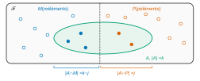
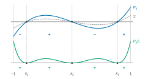
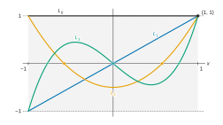

# Centrale-Supélec PSI — Mathématiques 2 2026 · Corrigé guidé

*Corrigé rédigé par IA, non officiel. Signalez toute erreur.*

## Présentation du sujet

**Thème.** Le problème construit une famille classique de polynômes orthogonaux, les **polynômes de Jacobi**, associés au poids $w(t)=(1-t)^\alpha(1+t)^\beta$ sur $]-1,1[$ ($\alpha,\beta>-1$). Il en établit les propriétés structurelles (degré, relation de récurrence à trois termes, racines réelles dans $]-1,1[$), puis une formule explicite dite *de Rodrigues*, et termine sur le cas particulier $\alpha=\beta=0$ : les **polynômes de Legendre**.

**Découpage.**

| Partie | Questions | Contenu | Outils |
|---|---|---|---|
| A | Q1–Q8 | existence du produit scalaire à poids, deux exemples de calcul | intégrales impropres, Riemann, produit scalaire |
| B | Q9–Q10 | formule de Vandermonde, coefficient binomial généralisé $B^\lambda_\ell$ | dénombrement |
| C | Q11–Q19 | base orthonormale échelonnée : degré, relation à trois termes, racines | espaces préhilbertiens, orthogonal, TVI |
| D | Q20–Q28 | polynômes de Jacobi : formule explicite, orthogonalité | Leibniz, dérivées $p$-ièmes, intégration par parties sur un intervalle ouvert |
| E | Q29–Q42 | polynômes de Legendre : valeurs, parité, équation différentielle, $\lvert L_k\rvert\leqslant1$, récurrence, fonction génératrice | Leibniz, étude de fonction, séries entières, équation différentielle linéaire d'ordre 1 |

**Notions du programme PSI mobilisées.** Intégrales impropres et critère de Riemann ; produit scalaire, orthonormalisation, orthogonal d'un sous-espace ; polynômes (degré, racines, multiplicité, divisibilité) ; théorème des valeurs intermédiaires ; formule de Leibniz ; intégration par parties ; séries entières (rayon, dérivation terme à terme) ; équations différentielles linéaires.

**Difficulté et longueur.** Sujet long (42 questions) mais très progressif, sans piège calculatoire majeur. Les questions Q1–Q10 et Q29–Q34 sont des applications directes du cours, à ne surtout pas laisser passer. Les points délicats sont Q22–Q23 (double Leibniz avec les coefficients $B^\lambda_\ell$), Q25–Q26 (intégrations par parties répétées sur un intervalle ouvert), Q36 (dérivée de $f_k$, où il faut réinjecter l'équation différentielle) et Q41–Q42 (manipulation de séries entières puis résolution d'une équation différentielle).

**Gestion du temps.** La partie B est indépendante ; la partie E, sous-parties I à III, n'utilise de la partie D que la formule de Rodrigues, rappelée par l'énoncé. Un ordre efficace : A, B, C, puis E I–III, puis D, puis E IV–V. Compter environ 40 minutes pour A et B, 50 pour C, 60 pour D, 70 pour E.

**Deux défauts d'énoncé à connaître.** En Q25, pour $i=0$, la seconde intégrale contient $x^{-1}$ et n'a en général pas de sens : on traite ce cas à part. Dans la partie E, l'énoncé présente les $L_k$ comme une base *orthonormale*, alors qu'ils sont seulement orthogonaux ($\|L_0\|^2=2$) ; cela ne change rien aux raisonnements, à condition de le dire.

## Partie A — Un produit scalaire

On vérifie que la formule $\langle P,Q\rangle=\int_{-1}^1(1-t)^\alpha(1+t)^\beta P(t)Q(t)\,dt$ a un sens et définit un produit scalaire, puis on calcule quelques produits scalaires dans deux cas particuliers.

### Question 1

> [!INDICATION]
> C'est un résultat de cours : on demande l'énoncé, pas la preuve. N'oubliez pas la valeur.

#### Solution

L'intégrale $\displaystyle\int_0^1\frac{dt}{t^\delta}$ converge si et seulement si $\delta<1$, et alors

$$\begin{aligned}\int_0^1\frac{dt}{t^\delta}&=\Big[\frac{t^{1-\delta}}{1-\delta}\Big]_0^1\\&=\frac1{1-\delta}.\end{aligned}$$

> [!PIEGE]
> En $0^+$ la condition est $\delta<1$ ; c'est l'inverse du critère en $+\infty$ ($\delta>1$). Confondre les deux fausse toute la partie A.

### Question 2

> [!INDICATION]
> Où est la singularité ? Un changement de variable affine la ramène en $0$.

> [!INDICATION]
> Posez $u=a-t$, puis éventuellement $u=av$. Le sujet dit « $a\in\mathbb R$ » : regardez ce qui se passe si $a\leqslant0$.

#### Solution

Supposons $a>0$. La fonction $t\mapsto(a-t)^{-\delta}$ est continue sur $[0,a[$ ; seule la borne $a$ pose problème.

Le changement de variable $u=a-t$ est une bijection de classe $\mathcal C^1$ strictement décroissante de $]0,a[$ sur lui-même. Il montre que

$$\int_0^a\frac{dt}{(a-t)^\delta}\quad\text{et}\quad\int_0^a\frac{du}{u^\delta}$$

sont de même nature (et égales en cas de convergence). Avec $u=av$, la seconde vaut $a^{1-\delta}\int_0^1\frac{dv}{v^\delta}$.

Par Q1, **l'intégrale converge si et seulement si $\delta<1$**, et vaut alors $\dfrac{a^{1-\delta}}{1-\delta}$.

Si $a=0$, l'intégrale est nulle.

Si $a<0$, la quantité $a-t$ est négative sur l'intervalle d'intégration. Donc $(a-t)^\delta$ n'a de sens que pour $\delta$ entier ; on retrouve alors la même condition $\delta<1$.

Seul le cas $a>0$ sert à la question suivante.

> [!METHODE]
> Pour une CNS, il faut une équivalence : le théorème de changement de variable dans les intégrales impropres affirme que les deux intégrales sont *de même nature*, ce qui donne les deux sens à la fois.

### Question 3

> [!INDICATION]
> L'intégrale est impropre aux deux bornes : coupez-la en un point intérieur.

> [!INDICATION]
> Près de $1$, le facteur $(1+t)^\beta f(t)$ est continu sur un *segment* qui contient $1$ : il est borné. Comparez alors à une intégrale de Q2.

#### Solution

Posons $h(t)=(1-t)^\alpha(1+t)^\beta f(t)$, continue sur $]-1,1[$. On étudie séparément $[0,1[$ et $]-1,0]$.

*Au voisinage de $1$.* La fonction $t\mapsto(1+t)^\beta f(t)$ est continue sur le segment $[0,1]$. Elle y est donc bornée par un réel $M_1$, et ainsi, sur $[0,1[$ :

$$|h(t)|\leqslant M_1(1-t)^\alpha.$$

Comme $\alpha>-1$, on a $-\alpha<1$. On applique Q2 avec $a=1$ et $\delta=-\alpha$ : l'intégrale $\int_0^1(1-t)^\alpha\,dt$ converge. Par comparaison de fonctions positives, $\int_0^1|h|$ converge.

*Au voisinage de $-1$.* De même, $(1-t)^\alpha f(t)$ est bornée sur le segment $[-1,0]$, par un réel $M_2$. Donc, sur $]-1,0]$ :

$$|h(t)|\leqslant M_2(1+t)^\beta.$$

Le changement de variable $u=-t$ transforme $\int_{-1}^0(1+t)^\beta\,dt$ en $\int_0^1(1-u)^\beta\,du$. Cette dernière converge car $-\beta<1$.

$h$ est donc intégrable sur $]-1,1[$ et l'intégrale proposée converge (absolument).

> [!PIEGE]
> « $f$ est continue donc bornée » est faux sur un intervalle ouvert ; ici on borne sur le segment $[0,1]$ ou $[-1,0]$. C'est légitime car $f$ est continue sur $[-1,1]$. Et la comparaison ne s'applique qu'à des fonctions positives : on passe par $|h|$.

### Question 4

> [!INDICATION]
> Quatre points : bonne définition, symétrie, bilinéarité, caractère défini positif. Un seul est délicat.

> [!INDICATION]
> Pour le caractère défini, le théorème « fonction continue positive d'intégrale nulle » est un énoncé sur un segment. Placez-vous sur $[c,d]\subset]-1,1[$.

#### Solution

*Bonne définition.* Pour $P,Q\in\mathbb R[X]$, $PQ$ est continue sur $[-1,1]$ ; Q3 assure que $\langle P,Q\rangle$ est un réel bien défini.

*Symétrie* : immédiate. *Bilinéarité* : par symétrie, il suffit de la linéarité à gauche, qui résulte de la linéarité de l'intégrale (toutes les intégrales en jeu convergent par Q3).

*Positivité* : $w(t)P(t)^2\geqslant0$ sur $]-1,1[$, donc $\langle P,P\rangle\geqslant0$.

*Caractère défini.* Supposons $\langle P,P\rangle=0$. Pour tout segment $[c,d]\subset]-1,1[$, la positivité de l'intégrande donne

$$\begin{aligned}0&\leqslant\int_c^dw(t)P(t)^2\,dt\\&\leqslant\int_{-1}^1w(t)P(t)^2\,dt\\&=0.\end{aligned}$$

La fonction $wP^2$ est continue, positive et d'intégrale nulle sur le segment $[c,d]$. Elle est donc nulle sur ce segment.

Comme $w>0$, $P$ s'annule sur $[c,d]$. Ayant une infinité de racines, $P=0$.

Donc $\langle\cdot,\cdot\rangle$ est une forme bilinéaire symétrique définie positive : **c'est un produit scalaire sur $\mathbb R[X]$.**

> [!JURY]
> La bonne définition (convergence des intégrales) fait partie de la question : on la rattache explicitement à Q3. Sur $\mathbb R[X]$, on parle d'espace préhilbertien, pas d'espace euclidien (dimension infinie).

### I – Un premier exemple

### Question 5

> [!INDICATION]
> Cherchez une primitive explicite de $t/\sqrt{1-t^2}$, ou utilisez une parité, après avoir justifié la convergence.

#### Solution

L'intégrale $\langle1,X\rangle=\displaystyle\int_{-1}^1\frac{t}{\sqrt{1-t^2}}\,dt$ converge par Q3. Sur $]-1,1[$, une primitive est $t\mapsto-\sqrt{1-t^2}$. Elle a une limite nulle en $\pm1$. Donc

$$\langle1,X\rangle=0.$$

> [!PIEGE]
> « L'intégrande est impair, donc l'intégrale est nulle » n'est valable que si l'intégrale converge. Ici la convergence vient de Q3 : il faut le dire.

### Question 6

> [!INDICATION]
> $\|1\|^2$ fait apparaître une primitive usuelle. Pour $\|X\|^2$, un changement de variable trigonométrique s'impose.

> [!INDICATION]
> Avec $t=\sin u$, vérifiez le signe de $\cos u$ avant d'écrire $\sqrt{1-t^2}=\cos u$.

#### Solution

$$\begin{aligned}\|1\|^2&=\int_{-1}^1\frac{dt}{\sqrt{1-t^2}}\\&=\big[\arcsin t\big]_{-1}^1\\&=\pi.\end{aligned}$$

On pose $t=\sin u$. Ce changement de variable est une bijection de classe $\mathcal C^1$ croissante de $]-\frac\pi2,\frac\pi2[$ sur $]-1,1[$. Sur le premier intervalle, $\sqrt{1-t^2}=\cos u>0$ :

$$\begin{aligned}\|X\|^2&=\int_{-\pi/2}^{\pi/2}\sin^2u\,du\\&=\int_{-\pi/2}^{\pi/2}\frac{1-\cos2u}2\,du\\&=\frac\pi2.\end{aligned}$$

$$\begin{aligned}\|1\|&=\sqrt\pi\\\|X\|&=\sqrt{\frac\pi2}\end{aligned}$$

> [!PIEGE]
> On demande les normes, pas leurs carrés.

### II – Un second exemple

### Question 7

> [!INDICATION]
> Le poids vaut $1$ ; tout dépend de la parité de $i+j$.

#### Solution

$$\begin{aligned}\langle X^i,X^j\rangle&=\int_{-1}^1t^{i+j}\,dt\\&=\frac{1-(-1)^{i+j+1}}{i+j+1}\\&=\begin{cases}\dfrac2{i+j+1}&\text{si }i+j\text{ est pair,}\\[2mm]0&\text{si }i+j\text{ est impair.}\end{cases}\end{aligned}$$

> [!PIEGE]
> $i\neq j$ n'entraîne pas l'orthogonalité : $\langle1,X^2\rangle=\frac23$. La base canonique n'est pas orthogonale, d'où la construction de la partie C.

### Question 8

> [!INDICATION]
> Cas $j=i$ du calcul précédent.

#### Solution

$\|X^i\|^2=\displaystyle\int_{-1}^1t^{2i}\,dt=\frac2{2i+1}$, donc

$$\|X^i\|=\sqrt{\frac2{2i+1}}.$$

En particulier $\|1\|^2=2$ : ce résultat resservira en partie E.

## Partie B — Autour des coefficients binomiaux

Partie indépendante : une preuve combinatoire de la formule de Vandermonde, puis l'introduction de $B^\lambda_\ell$, qui prolonge $\binom{n}{\ell}$ à un « haut » réel et permettra de dériver des puissances non entières.

### Question 9

> [!INDICATION]
> Dénombrez de deux façons les parties à $k$ éléments d'un ensemble à $m+p$ éléments.

> [!INDICATION]
> Coupez l'ensemble en un bloc de $m$ éléments et un bloc de $p$ éléments, et classez les parties selon le nombre d'éléments pris dans le second bloc.

#### Solution

Soient $(m,p)\in\mathbb N^2$ et $k\in\{0,\dots,m+p\}$. Soit $\mathcal F$ un ensemble à $m+p$ éléments.

On l'écrit $\mathcal F=M\sqcup P$, réunion disjointe de deux parties, avec $|M|=m$ et $|P|=p$.

On note $\mathcal P_k$ l'ensemble des parties de $\mathcal F$ à $k$ éléments. Son cardinal est $\binom{m+p}k$.

Pour $j\in\{0,\dots,k\}$, posons $\mathcal A_j=\{A\in\mathcal P_k:\ |A\cap P|=j\}$.

Pour $A\in\mathcal P_k$, on a $0\leqslant|A\cap P|\leqslant k$. Les $\mathcal A_j$ sont donc deux à deux disjoints et recouvrent $\mathcal P_k$, ils en forment une partition (certains peuvent être vides).

Une partie $A\in\mathcal A_j$ est déterminée par $A\cap P$ et $A\cap M$, choisies indépendamment.

La première est une partie de $P$ à $j$ éléments. La seconde est une partie de $M$ à $k-j$ éléments.

Par le principe multiplicatif :

$$|\mathcal A_j|=\binom pj\binom m{k-j}.$$

On utilise la convention $\binom nr=0$ si $r>n$, qui correspond exactement à $\mathcal A_j=\varnothing$. En sommant :

$$\binom{m+p}k=\sum_{j=0}^k\binom m{k-j}\binom pj.$$

> [!METHODE]
> Le double comptage : on compte un même ensemble de deux manières, la seconde en le partitionnant selon un paramètre. Une preuve algébrique (coefficient de $X^k$ dans $(1+X)^m(1+X)^p$) est aussi correcte, mais l'énoncé oriente vers le dénombrement.

### Question 10

> [!INDICATION]
> Écrivez le produit $n(n-1)\cdots(n-k+1)$ comme un quotient de factorielles.

#### Solution

Si $k=0$, $B^n_0=1=\binom n0$.

Si $1\leqslant k\leqslant n$, le produit $n(n-1)\cdots(n-k+1)$ compte $k$ facteurs entiers. Il vaut $\frac{n!}{(n-k)!}$ :

$$\begin{aligned}B^n_k&=\frac{n!}{k!\,(n-k)!}\\&=\binom nk.\end{aligned}$$

**Les deux nombres sont égaux.**

> [!PIEGE]
> Pour $\lambda$ réel non entier, on ne peut pas écrire $B^\lambda_\ell$ avec des factorielles : il faut garder la forme « produit descendant sur $\ell!$ », et ne pas noter $\binom\lambda\ell$ sans précaution.

## Partie C — Une famille de polynômes

On travaille avec une base orthonormale $(P_0,\dots,P_n)$ de $\mathbb R_n[X]$ échelonnée en degré, sans formule explicite. Tout se déduit des deux propriétés (i) et (ii) : degré, orthogonalité à $\mathbb R_{k-1}[X]$, relation à trois termes, puis localisation des racines par un argument de signe.

### I – Premières propriétés des $P_k$

### Question 11

> [!INDICATION]
> La condition (i) enferme $P_k$ dans $\mathbb R_k[X]$. Que se passerait-il si $P_k$ était dans $\mathbb R_{k-1}[X]$ ?

> [!INDICATION]
> Argument de dimension.

#### Solution

Par (i), $P_k\in\mathrm{Vect}(P_0,\dots,P_k)=\mathbb R_k[X]$, donc $\deg P_k\leqslant k$.

Pour $k=0$ : $P_0\neq0$ (il est de norme $1$), donc $\deg P_0=0$.

Pour $k\geqslant1$, supposons $P_k\in\mathbb R_{k-1}[X]$. Par (i) au rang $k-1$, on a $\mathbb R_{k-1}[X]=\mathrm{Vect}(P_0,\dots,P_{k-1})$. Ce sous-espace contient alors $P_0,\dots,P_k$, d'où

$$\mathbb R_k[X]=\mathrm{Vect}(P_0,\dots,P_k)\subset\mathbb R_{k-1}[X].$$

Cela contredit $\dim\mathbb R_k[X]=k+1>k=\dim\mathbb R_{k-1}[X]$.

**Donc $\deg P_k=k$ pour tout $k$.**

> [!PIEGE]
> L'énoncé ne décrit pas le procédé de Gram-Schmidt : il en donne deux propriétés, et c'est sur elles seules qu'il faut raisonner.

### Question 12

> [!INDICATION]
> Réécrivez $\mathrm{Vect}(1,\dots,X^{k-1})$ à l'aide de (i).

#### Solution

Par (i), $\mathrm{Vect}(1,X,\dots,X^{k-1})=\mathrm{Vect}(P_0,\dots,P_{k-1})$. Comme la famille est orthonormale, $\langle P_k,P_j\rangle=0$ pour tout $j\leqslant k-1$.

Par linéarité, $P_k$ est orthogonal à toute combinaison linéaire des $P_j$, $j\leqslant k-1$ :

$$P_k\in\mathrm{Vect}(1,X,\dots,X^{k-1})^\perp.$$

> [!METHODE]
> Être orthogonal à un sous-espace équivaut à être orthogonal à une famille génératrice de ce sous-espace (par bilinéarité).

### Question 13

> [!INDICATION]
> Décomposez $Q$ dans la base orthonormale : ses coordonnées sont des produits scalaires.

> [!INDICATION]
> Le degré de $Q$ élimine les coordonnées d'indice $>k$, l'orthogonalité celles d'indice $<k$.

#### Solution

Comme $\deg Q=k$, on a $Q\in\mathbb R_k[X]=\mathrm{Vect}(P_0,\dots,P_k)$, et, la famille étant orthonormale,

$$Q=\sum_{j=0}^k\langle Q,P_j\rangle P_j.$$

Soit $j\leqslant k-1$. Le polynôme $P_j$ est de degré $j$ (Q11), donc appartient à $\mathbb R_{k-1}[X]$. Comme $Q\perp\mathbb R_{k-1}[X]$, on a $\langle Q,P_j\rangle=0$.

Il reste $Q=\alpha_kP_k$ avec $\alpha_k=\langle Q,P_k\rangle$, non nul car $Q\neq0$.

> [!METHODE]
> C'est une propriété d'unicité : à un scalaire près, il n'existe qu'un polynôme de degré $k$ orthogonal à $\mathbb R_{k-1}[X]$. Elle permettra d'identifier les polynômes de Jacobi normalisés aux $P_k$ (Q28).

### II – Une relation entre $P_{k-1}$, $P_k$ et $P_{k+1}$

### Question 14

> [!INDICATION]
> $P_{k+1}$ et $XP_k$ ont le même degré : choisissez $a_k$ pour faire disparaître le terme de plus haut degré.

#### Solution

Notons $\lambda_j$ le coefficient dominant de $P_j$, non nul par Q11.

Les polynômes $P_{k+1}$ et $XP_k$ sont de degré $k+1$. Leurs coefficients dominants sont $\lambda_{k+1}$ et $\lambda_k$. En posant

$$a_k=\frac{\lambda_{k+1}}{\lambda_k},$$

le coefficient de $X^{k+1}$ dans $P_{k+1}-a_kXP_k$ vaut $\lambda_{k+1}-a_k\lambda_k=0$. Donc $\deg(P_{k+1}-a_kXP_k)\leqslant k$.

### Question 15

> [!INDICATION]
> Décomposez $R=P_{k+1}-a_kXP_k$ dans la base $(P_0,\dots,P_k)$ et montrez que la plupart des coordonnées sont nulles.

> [!INDICATION]
> Pour ce produit scalaire, la multiplication par $X$ « passe d'un côté à l'autre » : comparez $\langle XA,B\rangle$ et $\langle A,XB\rangle$.

#### Solution

$R=P_{k+1}-a_kXP_k$ est dans $\mathbb R_k[X]=\mathrm{Vect}(P_0,\dots,P_k)$ par Q14, donc $R=\sum_{j=0}^k\langle R,P_j\rangle P_j$.

Pour tous $A,B\in\mathbb R[X]$ :

$$\begin{aligned}\langle XA,B\rangle&=\int_{-1}^1w(t)\,tA(t)B(t)\,dt\\&=\langle A,XB\rangle.\end{aligned}$$

Soit $j\in\{0,\dots,k-2\}$ (il n'y a rien à faire si $k=1$). Alors

$$\begin{aligned}\langle R,P_j\rangle&=\langle P_{k+1},P_j\rangle-a_k\langle XP_k,P_j\rangle\\&=0-a_k\langle P_k,XP_j\rangle\\&=0,\end{aligned}$$

car $j\neq k+1$. De plus, $XP_j$ est de degré $j+1\leqslant k-1$, donc orthogonal à $P_k$ (Q12).

Il ne reste que les indices $k-1$ et $k$. Avec $b_k=\langle R,P_k\rangle$ et $c_k=\langle R,P_{k-1}\rangle$ :

$$P_{k+1}=(a_kX+b_k)P_k+c_kP_{k-1}.$$

> [!METHODE]
> La preuve n'utilise que l'orthogonalité et l'échelonnement des degrés. Elle vaut donc pour toute famille orthogonale (non nécessairement normée) avec $\deg P_j=j$, les coordonnées devenant $\langle R,P_j\rangle/\|P_j\|^2$. C'est ce qui permettra de l'appliquer aux $L_k$ en partie E.

### III – Racines des polynômes $P_k$

### Question 16

> [!INDICATION]
> Combien de racines, comptées avec multiplicité, un polynôme non nul de degré $k$ peut-il avoir ?

#### Solution

$P_k$ est non nul de degré $k$ (Q11) : il admet au plus $k$ racines réelles comptées avec multiplicité, et celles de $]-1,1[$ en font partie. **Donc $m\leqslant k$.**

### Question 17

> [!INDICATION]
> $S$ divise $P_k$. Que dire du quotient sur $]-1,1[$ ?

> [!INDICATION]
> Le quotient n'a pas de racine dans $]-1,1[$ : le théorème des valeurs intermédiaires fixe son signe. Écrivez ensuite $P_kS$ à l'aide de $S^2$.

#### Solution

Si $\mathcal R=\varnothing$, on a $S=1$ et $P_kS=P_k$. C'est une fonction continue qui ne s'annule pas sur l'intervalle $]-1,1[$ : par le théorème des valeurs intermédiaires, elle y garde un signe strict constant.

Supposons $m\geqslant1$. Les racines de $P_k$ dans $]-1,1[$ sont exactement $x_1,\dots,x_m$, répétées selon leur multiplicité. Donc $S$ divise $P_k$.

Écrivons $P_k=ST$, où $T$ n'a aucune racine dans $]-1,1[$. Chaque racine y a en effet été « consommée » par $S$ à l'ordre exact de sa multiplicité.

La fonction $T$ est continue et ne s'annule pas sur l'intervalle $]-1,1[$. Par le théorème des valeurs intermédiaires, elle y garde un signe strict constant $\varepsilon\in\{-1,1\}$. Alors

$$P_k(x)S(x)=S(x)^2\,T(x),$$

**donc $P_kS$ est de signe constant sur $]-1,1[$**, celui de $T$. Il ne s'y annule qu'en $x_1,\dots,x_m$.

> [!PIEGE]
> Le signe n'est pas forcément positif : c'est celui de $T$. Et la divisibilité de $P_k$ par $S$ exige que les multiplicités soient respectées, d'où la précision de l'énoncé.

### Question 18

> [!INDICATION]
> Une fonction continue de signe constant, non identiquement nulle, a une intégrale non nulle. Reprenez l'argument de segment de Q4.

#### Solution

Soit $\varphi=\varepsilon\,w\,P_kS$, continue et positive sur $]-1,1[$. L'intégrale suivante converge par Q3 :

$$\varepsilon\langle P_k,S\rangle=\int_{-1}^1\varphi.$$

Supposons $\langle P_k,S\rangle=0$. L'argument de Q4, appliqué sur tout segment $[c,d]\subset]-1,1[$, donnerait $\varphi=0$ sur $]-1,1[$. Puisque $w>0$, on aurait $P_kS=0$ sur cet intervalle.

Le polynôme $P_kS$ aurait une infinité de racines, donc serait nul. Comme $S\neq0$, cela imposerait $P_k=0$ : c'est absurde. **Donc $\langle P_k,S\rangle\neq0$.**

### Question 19

> [!INDICATION]
> Comparez Q18 avec Q12 : quel est le degré de $S$ ?

#### Solution

$S$ est de degré $m$. Si $m\leqslant k-1$, alors $S\in\mathbb R_{k-1}[X]$ et Q12 donne $\langle P_k,S\rangle=0$, contredisant Q18. Donc $m\geqslant k$, et avec Q16 :

$$m=k.$$

**Toutes les racines de $P_k$ sont réelles et appartiennent à $]-1,1[$.**

On peut aller plus loin : ces racines sont simples. Soient $y_1,\dots,y_r$ les racines distinctes de $P_k$ dans $]-1,1[$ de multiplicité impaire. On pose $U=\prod_{i=1}^r(X-y_i)$, avec $U=1$ si $r=0$.

Dans $P_kU$, toutes les racines situées dans $]-1,1[$ sont de multiplicité paire. Donc $P_kU$ ne change pas de signe sur cet intervalle.

Le raisonnement de Q18 donne $\langle P_k,U\rangle\neq0$, puis Q12 donne $r\geqslant k$. Ainsi $P_k$ a $k$ racines distinctes, toutes simples.

> [!PIEGE]
> Avec le $S$ de l'énoncé, qui compte les multiplicités, on obtient $m=k$ mais pas la simplicité. Pour la simplicité, il faut changer de polynôme auxiliaire.

## Partie D — Polynômes de Jacobi

On construit explicitement des polynômes orthogonaux : on dérive $k$ fois $g_k=(1-x)^{\alpha+k}(1+x)^{\beta+k}$ et on divise par le poids. La formule de Leibniz et les coefficients $B^\lambda_\ell$ donnent la forme polynomiale ; des intégrations par parties répétées donnent l'orthogonalité.

### I – Définition

### Question 20

> [!INDICATION]
> Dérivez $g_1$ comme un produit et factorisez par $(1-x)^\alpha(1+x)^\beta$.

#### Solution

On a $g_0(x)=(1-x)^\alpha(1+x)^\beta$ et $g_1(x)=(1-x)^{\alpha+1}(1+x)^{\beta+1}$. Donc

$$\begin{aligned}J_0&=\dfrac{g_0}{(1-x)^\alpha(1+x)^\beta}\\&=1.\end{aligned}$$

Puis

$$\begin{aligned}g_1'(x)&=-(\alpha+1)(1-x)^\alpha(1+x)^{\beta+1}+(\beta+1)(1-x)^{\alpha+1}(1+x)^\beta\\&=(1-x)^\alpha(1+x)^\beta\big[(\beta-\alpha)-(\alpha+\beta+2)x\big].\end{aligned}$$

Comme $J_1=-\dfrac{g_1'}{2(1-x)^\alpha(1+x)^\beta}$ :

$$\begin{aligned}J_0&=1\\J_1&=\frac{(\alpha+\beta+2)X+\alpha-\beta}{2}\end{aligned}$$

> [!METHODE]
> Contrôle : pour $\alpha=\beta=0$, on trouve $J_1=X$, qui sera $L_1$ en partie E.

### Question 21

> [!INDICATION]
> Calculez les premières dérivées, conjecturez, démontrez par récurrence.

> [!INDICATION]
> Le point clé de l'hérédité est la relation entre $B^j_{p+1}$ et $B^j_p$.

#### Solution

Soit $j\in\mathbb R$. Montrons par récurrence sur $p$ que, sur $]-1,1[$,

$$\frac{d^p}{dx^p}(1-x)^j=(-1)^p\,p!\,B^j_p\,(1-x)^{j-p}.$$

Pour $p=0$ : $B^j_0=1$, c'est vrai. Si c'est vrai au rang $p$, en dérivant :

$$\frac{d^{p+1}}{dx^{p+1}}(1-x)^j=(-1)^p\,p!\,B^j_p\,(j-p)\,(-1)\,(1-x)^{j-p-1}.$$

Or on a, y compris pour $p=0$ (où $1!\,B^j_1=j$) :

$$\begin{aligned}(p+1)!\,B^j_{p+1}&=j(j-1)\cdots(j-p)\\&=p!\,B^j_p\,(j-p).\end{aligned}$$

D'où le rang $p+1$ ; par récurrence, pour tout $p\in\mathbb N$ :

$$\frac{d^{p}}{dx^{p}}(1-x)^j=(-1)^p\,p!\,B^j_p\,(1-x)^{j-p}.$$

Le même calcul sans le signe donne $\dfrac{d^p}{dx^p}(1+x)^j=p!\,B^j_p\,(1+x)^{j-p}$.

### Question 22

> [!INDICATION]
> $g_k$ est un produit de deux facteurs : formule de Leibniz, puis Q21 sur chaque facteur.

> [!INDICATION]
> Simplifiez $\binom pi\,i!\,(p-i)!$ et mettez en facteur le poids. Faites-le pour un ordre $p\leqslant k$ quelconque, cela servira en Q25.

#### Solution

Pour $p\in\{0,\dots,k\}$, la formule de Leibniz et Q21 donnent

$$g_k^{(p)}(x)=\sum_{i=0}^p\binom pi\Big[(-1)^ii!\,B^{\alpha+k}_i(1-x)^{\alpha+k-i}\Big]\Big[(p-i)!\,B^{\beta+k}_{p-i}(1+x)^{\beta+k-p+i}\Big].$$

On utilise $\binom pi\,i!\,(p-i)!=p!$. On met en facteur $(1-x)^{\alpha+k-p}(1+x)^{\beta+k-p}$ : les exposants restants $p-i$ et $i$ sont des entiers positifs. On obtient

$$g_k^{(p)}(x)=(1-x)^{\alpha+k-p}(1+x)^{\beta+k-p}\,h_p(x),$$

où

$$h_p(x)=p!\sum_{i=0}^p(-1)^iB^{\alpha+k}_iB^{\beta+k}_{p-i}(1-x)^{p-i}(1+x)^i$$

est polynomiale de degré au plus $p$. Pour $p=k$ :

$$g_k^{(k)}(x)=k!\,(1-x)^\alpha(1+x)^\beta\sum_{i=0}^k(-1)^iB^{\alpha+k}_iB^{\beta+k}_{k-i}(1-x)^{k-i}(1+x)^i.$$

> [!PIEGE]
> Le signe $(-1)^i$ ne porte que sur le facteur $(1-x)^{\alpha+k}$. L'oublier fausse Q23 et Q24.

### Question 23

> [!INDICATION]
> Reportez dans la définition de $J_k$ : le poids se simplifie.

> [!INDICATION]
> Absorbez le signe dans $(1-x)^{k-i}$, puis changez d'indice pour obtenir exactement la forme demandée.

#### Solution

En reportant Q22 dans la définition de $J_k$, le poids et $k!$ se simplifient :

$$J_k(x)=\frac1{2^k}\sum_{i=0}^k(-1)^{k+i}B^{\alpha+k}_iB^{\beta+k}_{k-i}(1-x)^{k-i}(1+x)^i.$$

Comme $k+i$ et $k-i$ ont même parité :

$$\begin{aligned}(-1)^{k+i}(1-x)^{k-i}&=\big(-(1-x)\big)^{k-i}\\&=(x-1)^{k-i}.\end{aligned}$$

Le changement d'indice $i\mapsto k-i$ donne

$$J_k(x)=\frac1{2^k}\sum_{i=0}^kB^{k+\alpha}_{k-i}B^{k+\beta}_i(x-1)^i(x+1)^{k-i}.$$

Ce calcul vaut en fait pour tout $k\geqslant0$ : pour $k=1$, il redonne le $J_1$ de Q20.

### Question 24

> [!INDICATION]
> Chaque terme de la somme est un polynôme de degré $k$ : quel est son coefficient dominant ?

> [!INDICATION]
> Vandermonde généralisée avec $s=k+\alpha$, $t=k+\beta$ ; vérifiez l'hypothèse $k\leqslant s+t$. Pour conclure au degré exact, il faut montrer que le coefficient obtenu n'est pas nul.

#### Solution

Pour chaque $i$, $(x-1)^i(x+1)^{k-i}$ est polynomial, unitaire, de degré $k$.

Donc $J_k$ coïncide sur $]-1,1[$ avec un polynôme de degré au plus $k$. Son coefficient de $X^k$ est

$$\lambda_k=\frac1{2^k}\sum_{i=0}^kB^{k+\alpha}_{k-i}B^{k+\beta}_i.$$

Pour $k\geqslant2$, on a $s+t=2k+\alpha+\beta>2k-2\geqslant k$. La formule de Vandermonde généralisée s'applique et

$$\begin{aligned}\lambda_k&=\frac{B^{2k+\alpha+\beta}_k}{2^k}\\&=\frac1{2^k\,k!}\prod_{r=0}^{k-1}(2k+\alpha+\beta-r).\end{aligned}$$

Chaque facteur vérifie

$$2k+\alpha+\beta-r\geqslant k+1+\alpha+\beta>k-1>0.$$

Donc $\lambda_k>0$ : **$J_k$ est polynomiale de degré exactement $k$, de coefficient dominant $B^{2k+\alpha+\beta}_k/2^k$.**

Pour $k=0$ et $k=1$, Q20 donne directement les valeurs suivantes, conformes à la même formule :

$$\begin{aligned}\lambda_0&=1,\\\lambda_1&=\frac{\alpha+\beta+2}2>0.\end{aligned}$$

> [!PIEGE]
> Majorer le degré par $k$ ne suffit pas : la question demande le degré $k$, donc la non-nullité de $\lambda_k$, qui repose sur $\alpha,\beta>-1$.

### II – Orthogonalité des polynômes de Jacobi

### Question 25

> [!INDICATION]
> Pour la convergence, utilisez la forme factorisée de Q22 : chaque intégrande est « poids de type Q3 × fonction continue sur $[-1,1]$ ».

> [!INDICATION]
> Intégrez par parties sur un segment $[u,v]\subset]-1,1[$, puis passez à la limite. Les termes de bord tendent vers $0$ grâce aux exposants $\alpha+1>0$, $\beta+1>0$. Regardez à part le cas $i=0$.

#### Solution

*Convergence.* Par Q22,

$$\begin{aligned}x^ig_k^{(k)}(x)&=(1-x)^\alpha(1+x)^\beta\,x^ih_k(x),\\x^{i-1}g_k^{(k-1)}(x)&=(1-x)^{\alpha+1}(1+x)^{\beta+1}\,x^{i-1}h_{k-1}(x).\end{aligned}$$

La fonction $x^ih_k$ est continue sur $[-1,1]$. Pour $i\geqslant1$, il en va de même de $x^{i-1}h_{k-1}$.

Les exposants $\alpha,\beta,\alpha+1,\beta+1$ sont $>-1$ : Q3 donne la convergence des deux intégrales.

*Intégration par parties* sur $[u,v]\subset]-1,1[$ (fonctions de classe $\mathcal C^1$) :

$$\int_u^vx^ig_k^{(k)}(x)\,dx=\Big[x^ig_k^{(k-1)}(x)\Big]_u^v-i\int_u^vx^{i-1}g_k^{(k-1)}(x)\,dx.$$

*Termes de bord.* $h_{k-1}$ est bornée sur $[-1,1]$ et

$$|x^ig_k^{(k-1)}(x)|\leqslant\|h_{k-1}\|_\infty(1-x)^{\alpha+1}(1+x)^{\beta+1}\xrightarrow[x\to\pm1]{}0,$$

puisque $\alpha+1>0$ et $\beta+1>0$. Les intégrales convergeant, on fait $u\to-1$ et $v\to1$ :

$$\int_{-1}^1x^ig_k^{(k)}(x)\,dx=-i\int_{-1}^1x^{i-1}g_k^{(k-1)}(x)\,dx.$$

*Cas $i=0$.* La seconde intégrale contient $x^{-1}$ et diverge en général. Pour $k=1$, par exemple, l'intégrande est équivalent à $1/x$ en $0$.

Le même calcul donne alors

$$\begin{aligned}\int_{-1}^1g_k^{(k)}&=\big[g_k^{(k-1)}\big]_{-1}^1\\&=0.\end{aligned}$$

C'est la seule lecture cohérente de l'identité (le facteur $-i$ est nul).

> [!METHODE]
> Intégration par parties sur un intervalle ouvert : on l'écrit sur un segment, on justifie séparément la convergence des intégrales et la limite des termes de bord, puis on passe à la limite.

> [!JURY]
> Signaler un défaut d'énoncé (ici, le cas $i=0$) et l'interpréter de façon raisonnable est préférable à une démonstration de convergence fausse.

### Question 26

> [!INDICATION]
> Exprimez $\langle J_k,X^i\rangle$ à l'aide de $\int x^ig_k^{(k)}$ : le poids se simplifie.

> [!INDICATION]
> Le calcul de Q25 marche à tout ordre de dérivation $p\leqslant k$. Itérez-le jusqu'à faire disparaître la puissance de $x$ ; il reste une intégrale de dérivée.

#### Solution

Par définition de $J_k$, on a $w(t)J_k(t)\,t^i=\dfrac{(-1)^k}{2^kk!}\,t^ig_k^{(k)}(t)$. Donc

$$\langle J_k,X^i\rangle=\frac{(-1)^k}{2^kk!}\int_{-1}^1t^ig_k^{(k)}(t)\,dt.$$

*Généralisation de Q25.* Pour $p\in\{1,\dots,k\}$, Q22 donne

$$g_k^{(p-1)}=(1-x)^{\alpha+k-p+1}(1+x)^{\beta+k-p+1}h_{p-1},$$

avec des exposants $\geqslant\alpha+1>0$ et $\geqslant\beta+1>0$. Le raisonnement de Q25 s'applique mot pour mot. Pour $j\geqslant1$ :

$$\int_{-1}^1x^jg_k^{(p)}(x)\,dx=-j\int_{-1}^1x^{j-1}g_k^{(p-1)}(x)\,dx.$$

*Itération.* On applique cette relation $i$ fois, aux ordres $k,k-1,\dots,k-i+1$. Ils sont tous $\geqslant1$ car $i\leqslant k-1$ :

$$\int_{-1}^1x^ig_k^{(k)}(x)\,dx=(-1)^i\,i!\int_{-1}^1g_k^{(k-i)}(x)\,dx.$$

*Conclusion.* Comme $k-i\geqslant1$, $g_k^{(k-i-1)}$ est une primitive de $g_k^{(k-i)}$. Elle tend vers $0$ aux deux bornes, car ses exposants sont $\alpha+i+1>0$ et $\beta+i+1>0$ :

$$\begin{aligned}\int_{-1}^1g_k^{(k-i)}(x)\,dx&=\Big[g_k^{(k-i-1)}\Big]_{-1}^1\\&=0.\end{aligned}$$

**Donc $\langle J_k,X^i\rangle=0$ pour tout $i\in\{0,\dots,k-1\}$.**

> [!PIEGE]
> La condition $i\leqslant k-1$ est essentielle : c'est elle qui laisse une dérivée d'ordre $\geqslant1$ à intégrer. Pour $i=k$ le résultat est faux ($\langle J_k,X^k\rangle>0$).

### Question 27

> [!INDICATION]
> « Base » : degrés échelonnés et dimension. « Orthogonale » : décomposez $J_i$ sur les monômes.

#### Solution

Par Q24, les $J_k$ sont non nuls et de degrés $0,1,\dots,n$ deux à deux distincts : la famille $(J_0,\dots,J_n)$ est libre. Elle compte $n+1=\dim E$ vecteurs, c'est donc une base de $E$.

Soit $0\leqslant i<k\leqslant n$. Le polynôme $J_i$ est de degré $i\leqslant k-1$, donc s'écrit $\sum_{r=0}^{k-1}\mu_rX^r$. Par bilinéarité et Q26 :

$$\begin{aligned}\langle J_k,J_i\rangle&=\sum_{r=0}^{k-1}\mu_r\langle J_k,X^r\rangle\\&=0.\end{aligned}$$

**$(J_0,\dots,J_n)$ est une base orthogonale de $E$.**

### Question 28

> [!INDICATION]
> Comment rend-on unitaire un vecteur non nul ?

#### Solution

Chaque $J_k$ est non nul, donc $\|J_k\|>0$ (produit scalaire défini). La famille

$$\Big(\frac{J_0}{\|J_0\|},\dots,\frac{J_n}{\|J_n\|}\Big)$$

reste orthogonale et ses vecteurs sont unitaires : **c'est une base orthonormale de $E$**, obtenue en normalisant la base orthogonale de Q27.

Cette base est exactement celle de la partie C. En effet, $J_k/\|J_k\|$ est de degré $k$ et orthogonal à $\mathbb R_{k-1}[X]$. Il vaut donc $\pm P_k$ par Q13 (les deux sont unitaires).

Écrivons $X^k=J_k/\lambda_k+(\text{degré}<k)$. Q26 donne alors

$$\langle J_k,X^k\rangle=\frac{\|J_k\|^2}{\lambda_k}>0,$$

et la condition (ii) impose le signe $+$.

## Partie E — Le cas particulier $(\alpha,\beta)=(0,0)$

Pour $\alpha=\beta=0$, $g_k(x)=(1-x^2)^k=(-1)^k(x^2-1)^k$, donc

$$\begin{aligned}J_k&=\frac{(-1)^k}{2^kk!}g_k^{(k)}\\&=\frac1{2^kk!}\big[(X^2-1)^k\big]^{(k)}\\&=L_k.\end{aligned}$$

Les $L_k$ sont donc les polynômes de Jacobi eux-mêmes : **orthogonaux mais pas normés** ($\|L_0\|^2=\|1\|^2=2$ par Q8), contrairement à ce qu'affirme le préambule. Les raisonnements de Q14–Q15 restent valables pour eux (ils n'utilisent que l'orthogonalité et les degrés).

### I – Premières propriétés des polynômes $L_k$

### Question 29

> [!INDICATION]
> Développez $(X^2-1)^k$ et dérivez $k$ fois. Contrôlez avec $L_k(1)$.

#### Solution

On a $L_0=1$ et $L_1=\frac12(X^2-1)'=X$.

Puis $(X^2-1)^2=X^4-2X^2+1$, de dérivée seconde $12X^2-4$.

De même, $(X^2-1)^3=X^6-3X^4+3X^2-1$, de dérivée troisième $120X^3-72X$.

Avec $2^2\cdot2!=8$ et $2^3\cdot3!=48$ :

$$\begin{aligned}L_0&=1\\L_1&=X\\L_2&=\frac{3X^2-1}2\\L_3&=\frac{5X^3-3X}2\end{aligned}$$

> [!METHODE]
> Contrôles gratuits : $L_k(1)=1$ dans les quatre cas (ce sera Q33), et $L_k$ a la parité de $k$ (Q32).

### Question 30

> [!INDICATION]
> Résolvez, puis vérifiez les trois points de Q19 : racines réelles, dans $]-1,1[$, au nombre de $k$.

#### Solution

$L_1=X$ : racine $0$.

$L_2=\frac{3X^2-1}2$ : racines $\pm\frac1{\sqrt3}\approx\pm0{,}577$.

$L_3=\frac{X(5X^2-3)}2$ : racines $0$ et $\pm\sqrt{\frac35}\approx\pm0{,}775$.

Dans chaque cas, $L_k$ a $k$ racines réelles, simples, toutes dans $]-1,1[$ : **$m=k$, ce qui confirme Q19.**

### Question 31

> [!INDICATION]
> Seul le monôme de plus haut degré de $(X^2-1)^k$ contribue au coefficient dominant après $k$ dérivations.

#### Solution

On a $(X^2-1)^k=X^{2k}+(\text{termes de degré}<2k)$. La dérivée $k$-ième de $X^{2k}$ est

$$2k(2k-1)\cdots(k+1)X^k=\frac{(2k)!}{k!}X^k.$$

Celle d'un monôme de degré $r<2k$ est de degré $r-k<k$ (ou nulle). Donc $\big[(X^2-1)^k\big]^{(k)}$ est de degré $k$, de coefficient dominant $\frac{(2k)!}{k!}\neq0$. Ainsi $\deg L_k=k$, et

$$\begin{aligned}\text{coefficient dominant}&=\frac{(2k)!}{2^k(k!)^2}\\&=\frac1{2^k}\binom{2k}k.\end{aligned}$$

On retrouve $B^{2k}_k/2^k$ de Q24, par Q10.

### Question 32

> [!INDICATION]
> $(X^2-1)^k$ est pair. Que fait la dérivation à la parité ?

#### Solution

Soit $Q$ pair. On montre par récurrence que $Q^{(p)}(-x)=(-1)^pQ^{(p)}(x)$. En dérivant cette relation, on obtient en effet

$$-Q^{(p+1)}(-x)=(-1)^pQ^{(p+1)}(x).$$

Avec $Q=(X^2-1)^k$ et $p=k$, puis division par $2^kk!$ :

$$L_k(-X)=(-1)^kL_k(X).$$

**$L_k$ est pair si $k$ est pair, impair si $k$ est impair.**

### Question 33

> [!INDICATION]
> Factorisez $X^2-1$ et appliquez Leibniz ; en $x=1$, presque tous les termes s'annulent.

> [!INDICATION]
> Pour $L_k(-1)$, inutile de recommencer : utilisez Q32.

#### Solution

Par Leibniz,

$$\big[(X-1)^k(X+1)^k\big]^{(k)}=\sum_{i=0}^k\binom ki\big[(X-1)^k\big]^{(i)}\big[(X+1)^k\big]^{(k-i)}.$$

Pour $i\leqslant k-1$, le facteur $\big[(X-1)^k\big]^{(i)}=\frac{k!}{(k-i)!}(X-1)^{k-i}$ s'annule en $1$. Pour $i=k$, il vaut $k!$.

En $x=1$, il reste $k!\cdot2^k$, d'où $L_k(1)=1$. Par Q32, $L_k(-1)=(-1)^kL_k(1)$ :

$$\begin{aligned}L_k(1)&=1\\L_k(-1)&=(-1)^k\end{aligned}$$

### II – Une équation différentielle vérifiée par les $L_k$

### Question 34

> [!INDICATION]
> Dérivez et reconnaissez $g_k$. Pensez au cas $k=0$.

#### Solution

Pour $k\geqslant1$, $g_k'(x)=-2kx(1-x^2)^{k-1}$, donc $(1-x^2)g_k'(x)=-2kx(1-x^2)^k$.

Pour $k=0$, $g_0'=0$. Dans tous les cas :

$$(1-x^2)g_k'(x)=-2kx\,g_k(x).$$

### Question 35

> [!INDICATION]
> Dérivez la relation de Q34 un certain nombre de fois par Leibniz. Combien de fois faut-il dériver pour faire apparaître $g_k^{(k)}$, $g_k^{(k+1)}$ et $g_k^{(k+2)}$ ?

> [!INDICATION]
> Dans chaque Leibniz, un facteur est un polynôme de petit degré : seuls deux ou trois termes subsistent. Reliez enfin $g_k^{(k)}$ à $L_k$.

#### Solution

Notons $u=g_k$, de sorte que $(1-x^2)u'+2kxu=0$ sur $]-1,1[$. Dérivons $k+1$ fois.

On a $(1-x^2)'=-2x$ et $(1-x^2)''=-2$, et les dérivées suivantes sont nulles :

$$\big[(1-x^2)u'\big]^{(k+1)}=(1-x^2)u^{(k+2)}-2(k+1)x\,u^{(k+1)}-2\binom{k+1}2u^{(k)},$$

avec $2\binom{k+1}2=k(k+1)$. De même :

$$\big[2kxu\big]^{(k+1)}=2k\big(xu^{(k+1)}+(k+1)u^{(k)}\big).$$

En sommant :

$$(1-x^2)u^{(k+2)}-2x\,u^{(k+1)}+k(k+1)u^{(k)}=0.$$

Or $u^{(k)}=g_k^{(k)}=(-1)^k2^kk!\,L_k$. En divisant par cette constante non nulle :

$$(1-x^2)L_k''-2xL_k'+k(k+1)L_k=0\quad\text{sur }]-1,1[.$$

> [!METHODE]
> Multiplier par $1-x^2$ en Q34 donne une relation à coefficients polynomiaux, que Leibniz dérive à un ordre quelconque en ne gardant que quelques termes. C'est la technique standard pour obtenir l'équation différentielle d'une famille définie par une formule de Rodrigues.

### III – Une majoration des $L_k$ sur $[-1,1]$

### Question 36

> [!INDICATION]
> Dérivez $f_k$ ; un terme en $L_k''$ apparaît, dont on ne connaît pas le signe.

> [!INDICATION]
> Éliminez $(1-x^2)L_k''$ grâce à l'équation de Q35. Remarquez aussi que $f_k$ n'est pas définie pour toutes les valeurs de $k$.

#### Solution

$f_k$ n'est définie que pour $k\geqslant1$ (dénominateur $k(k+1)$). Pour $x\in[0,1]$ :

$$\begin{aligned}f_k'(x)&=2L_kL_k'+\frac{1}{k(k+1)}\Big(-2xL_k'^2+2(1-x^2)L_k'L_k''\Big)\\&=2L_kL_k'+\frac{2L_k'}{k(k+1)}\Big[(1-x^2)L_k''-xL_k'\Big].\end{aligned}$$

L'équation de Q35 est une égalité entre fonctions polynomiales sur $]-1,1[$, donc sur $\mathbb R$. Elle donne $(1-x^2)L_k''=2xL_k'-k(k+1)L_k$, d'où

$$(1-x^2)L_k''-xL_k'=xL_k'-k(k+1)L_k.$$

En reportant, les termes en $L_kL_k'$ se compensent :

$$f_k'(x)=\frac{2x}{k(k+1)}\,L_k'(x)^2\geqslant0\quad\text{sur }[0,1].$$

**$f_k$ est croissante sur $[0,1]$.**

> [!PIEGE]
> L'équation de Q35 est établie sur $]-1,1[$ ; pour l'utiliser en $x=1$, on invoque le prolongement des identités polynomiales (ou la continuité).

### Question 37

> [!INDICATION]
> Comparez $L_k^2$ et $f_k$ sur $[0,1]$, puis utilisez la croissance et la valeur en $1$.

> [!INDICATION]
> Pour $[-1,0]$, une symétrie suffit.

#### Solution

Pour $k=0$, $L_0=1$ et le résultat est immédiat. Soit $k\geqslant1$ et $x\in[0,1]$. Comme $1-x^2\geqslant0$,

$$\begin{aligned}L_k(x)^2&\leqslant f_k(x)\\&\leqslant f_k(1)\\&=L_k(1)^2+0\\&=1,\end{aligned}$$

par Q36 puis Q33 : le facteur $1-x^2$ annule le terme en $L_k'$ en $x=1$. Donc $|L_k(x)|\leqslant1$ sur $[0,1]$.

Pour $x\in[-1,0]$, $|L_k(x)|=|L_k(-x)|\leqslant1$ par Q32.

**Ainsi $|L_k(x)|\leqslant1$ pour tout $x\in[-1,1]$.**

> [!METHODE]
> Fonction auxiliaire « énergie » : $f_k$ combine $L_k^2$ et $L_k'^2$ de sorte que l'équation différentielle rende sa dérivée de signe connu. On majore alors $L_k^2$ par la valeur de $f_k$ en un point où elle est connue.

### IV – Relation entre $L_{k-1}$, $L_k$ et $L_{k+1}$

### Question 38

> [!INDICATION]
> Dans Q14, $a_k$ est un quotient de coefficients dominants ; ceux des $L_k$ sont connus par Q31.

#### Solution

La relation de Q14 vaut pour la famille orthogonale échelonnée $(L_j)$ (voir le préambule de la partie E). Le réel $a_k$ y est le quotient des coefficients dominants de $L_{k+1}$ et $L_k$ :

$$\begin{aligned}a_k&=\frac{(2k+2)!}{2^{k+1}((k+1)!)^2}\cdot\frac{2^k(k!)^2}{(2k)!}\\&=\frac{(2k+2)(2k+1)}{2}\cdot\frac1{(k+1)^2}\\&=\frac{2k+1}{k+1}.\end{aligned}$$

> [!PIEGE]
> Si l'on prenait l'énoncé au pied de la lettre (polynômes orthonormés $P_k=\sqrt{\frac{2k+1}2}L_k$), on obtiendrait un autre $a_k$. Seule la lecture « $a_k$ relatif aux $L_k$ » est cohérente avec Q39.

### Question 39

> [!INDICATION]
> Partez de la relation à trois termes de Q15 avec le $a_k$ de Q38. Il reste deux constantes.

> [!INDICATION]
> Une parité élimine $b_k$ ; une valeur particulière connue des $L_j$ donne $c_k$.

#### Solution

Par Q15 (valable pour la famille orthogonale $(L_j)$), il existe $(b_k,c_k)$ tels que

$$L_{k+1}=(a_kX+b_k)L_k+c_kL_{k-1},$$

avec, par Q38,

$$a_k=\frac{2k+1}{k+1}.$$

*Calcul de $b_k$.* Par Q32, les polynômes $L_{k+1}$, $XL_k$ et $L_{k-1}$ ont la parité de $k+1$.

Donc $b_kL_k=L_{k+1}-a_kXL_k-c_kL_{k-1}$ a la parité de $k+1$, tout en ayant celle de $k$.

Un polynôme à la fois pair et impair est nul. Comme $L_k\neq0$, on obtient $b_k=0$.

*Calcul de $c_k$.* En $x=1$, Q33 donne $1=a_k+c_k$, donc

$$\begin{aligned}c_k&=1-\frac{2k+1}{k+1}\\&=-\frac k{k+1}.\end{aligned}$$

$$L_{k+1}=\frac{2k+1}{k+1}XL_k-\frac k{k+1}L_{k-1}.$$

Vérification pour $k=1$ : $\frac32X^2-\frac12=L_2$.

> [!METHODE]
> Pour identifier des constantes dans une relation polynomiale, parité et valeurs particulières sont souvent plus rapides qu'un calcul de produits scalaires.

### V – Un développement en série entière faisant intervenir les $L_k$

### Question 40

> [!INDICATION]
> Utilisez la majoration de Q37 et la définition du rayon de convergence.

#### Solution

Fixons $x\in[-1,1]$. Par Q37, étendue à tout $k\in\mathbb N$ comme l'énoncé l'autorise, on a $|L_k(x)|\leqslant1$.

Soit $r\in[0,1[$. Alors $|L_k(x)r^k|\leqslant1$ : la suite $(L_k(x)r^k)$ est bornée. Le rayon $R_x$ vérifie donc $R_x\geqslant r$. Ceci valant pour tout $r<1$ :

$$R_x\geqslant1.$$

En particulier $S(t)$ est bien définie pour $t\in]-1,1[$.

> [!PIEGE]
> On demande une minoration du rayon, pas sa valeur. Ne pas affirmer $R_x=1$ sans preuve.

### Question 41

> [!INDICATION]
> Dérivez $S$ terme à terme et écrivez $S'(t)=\sum(k+1)L_{k+1}(x)t^k$.

> [!INDICATION]
> Injectez la relation de Q39 écrite sous la forme $(k+1)L_{k+1}=\dots$ ; vérifiez qu'elle vaut aussi pour $k=0$. Exprimez chaque somme obtenue avec $S$ et $S'$ par décalage d'indice.

#### Solution

Le rayon étant $\geqslant1$, $S$ est dérivable sur $]-1,1[$ et

$$\begin{aligned}S'(t)&=\sum_{k\geqslant1}kL_k(x)t^{k-1}\\&=\sum_{k\geqslant0}(k+1)L_{k+1}(x)t^k.\end{aligned}$$

On utilise la relation suivante :

$$(k+1)L_{k+1}=(2k+1)xL_k-kL_{k-1}.$$

Elle vaut pour $k\geqslant1$ par Q39. Pour $k=0$, elle se réduit à $L_1=xL_0$, le terme $kL_{k-1}$ étant nul. Toutes les séries ci-dessous ont un rayon $\geqslant1$ (multiplier les coefficients par $k$ ne change pas le rayon), on peut donc séparer :

$$S'(t)=2x\sum_{k\geqslant0}kL_kt^k+x\sum_{k\geqslant0}L_kt^k-\sum_{k\geqslant1}kL_{k-1}t^k.$$

Or $\sum_{k\geqslant0}kL_kt^k=tS'(t)$ et, avec $j=k-1$,

$$\begin{aligned}\sum_{k\geqslant1}kL_{k-1}t^k&=\sum_{j\geqslant0}(j+1)L_jt^{j+1}\\&=t\big(tS'(t)+S(t)\big).\end{aligned}$$

D'où

$$S'=2xtS'+xS-t^2S'-tS,$$

c'est-à-dire

$$(1-2tx+t^2)S'(t)+(t-x)S(t)=0.$$

> [!METHODE]
> Contrôle sur le terme constant : en $t=0$, on trouve $S'(0)=xS(0)$, c'est-à-dire $L_1(x)=x$.

### Question 42

> [!INDICATION]
> C'est une équation différentielle linéaire d'ordre 1. Vérifiez d'abord que $1-2tx+t^2$ ne s'annule pas sur $]-1,1[$.

> [!INDICATION]
> Plutôt que de diviser par $S$, étudiez le produit de $S$ par une fonction bien choisie, dont la dérivée est nulle. La constante se trouve en $t=0$.

#### Solution

Posons $\varphi(t)=1-2tx+t^2$. On a

$$\varphi(t)=(t-x)^2+(1-x^2).$$

Si $|x|<1$, $\varphi(t)\geqslant1-x^2>0$. Si $x=\pm1$, $\varphi(t)=(t\mp1)^2>0$ pour $t\in]-1,1[$.

Donc $\varphi>0$ sur $]-1,1[$, et $\varphi'(t)=2(t-x)$.

Soit $H=S\sqrt\varphi$, dérivable sur $]-1,1[$ :

$$\begin{aligned}H'(t)&=S'(t)\sqrt{\varphi(t)}+S(t)\frac{\varphi'(t)}{2\sqrt{\varphi(t)}}\\&=\frac{\varphi(t)S'(t)+(t-x)S(t)}{\sqrt{\varphi(t)}}\\&=0\end{aligned}$$

par Q41. $H$ est donc constante sur l'intervalle $]-1,1[$. Sa valeur est $H(0)=S(0)\sqrt{\varphi(0)}=L_0(x)=1$. Ainsi, pour tout $t\in]-1,1[$ :

$$\sum_{k=0}^{+\infty}L_k(x)t^k=\frac1{\sqrt{1-2tx+t^2}}.$$

> [!METHODE]
> Pour $y'=a(t)y$, multiplier par $e^{-A(t)}$ (ici $\sqrt\varphi$) et montrer que le produit est constant évite toute division par la fonction inconnue.

> [!PIEGE]
> Les cas $x=\pm1$ sont ceux où le trinôme peut s'annuler ; il s'annule en $t=\pm1$, hors de l'intervalle ouvert. Il faut le dire. Contrôle : pour $x=1$, on retrouve $\sum t^k=\frac1{1-t}$, cohérent avec $L_k(1)=1$.

## Bilan

**Méthodes à retenir.**

- Intégrabilité d'un poids singulier aux bornes : couper l'intervalle, borner le facteur continu sur un segment, comparer à une intégrale de Riemann (Q3).
- Caractère défini d'un produit scalaire intégral sur un intervalle ouvert : se ramener à des segments intérieurs (Q4, Q18).
- Polynômes orthogonaux échelonnés : orthogonalité à $\mathbb R_{k-1}[X]$, unicité à un scalaire près, relation à trois termes grâce à $\langle XA,B\rangle=\langle A,XB\rangle$ (Q12–Q15).
- Racines dans l'intervalle d'orthogonalité : argument de signe avec le polynôme auxiliaire $S$ (Q17–Q19).
- Formule de Leibniz quand un facteur est polynomial de petit degré : la somme se réduit à deux ou trois termes (Q33, Q35).
- Intégrations par parties répétées sur un intervalle ouvert, avec annulation des termes de bord (Q25–Q26).
- Utiliser une équation différentielle pour éliminer une dérivée seconde (Q36) ou pour identifier la somme d'une série entière (Q41–Q42).

**Prérequis à revoir.** Critère de Riemann ; théorème de changement de variable pour les intégrales impropres ; multiplicité des racines et divisibilité ; dérivation terme à terme des séries entières ; résolution d'une équation différentielle linéaire d'ordre 1.

**Questions classiques transposables.** La démonstration que les racines d'un polynôme orthogonal sont réelles, simples et dans l'intervalle (Q16–Q19) vaut pour tout poids positif ; la récurrence à trois termes (Q14–Q15) et la formule de Rodrigues avec orthogonalité par intégrations par parties (Q25–Q26) se retrouvent pour les polynômes de Tchebychev, de Laguerre ou d'Hermite ; la fonction génératrice des polynômes de Legendre (Q42) est un exemple type d'identification d'une série entière par une équation différentielle.
