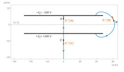
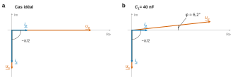
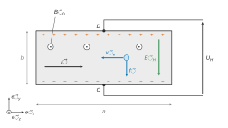
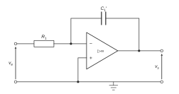
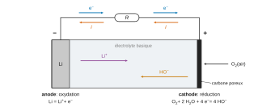
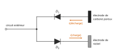

# Centrale-Supélec PSI — Physique-chimie 1 2026 · Corrigé guidé

*Corrigé rédigé par IA, non officiel. Signalez toute erreur.*

## Présentation du sujet

**Thème.** « Transferts, mesures et stockage d'énergie électrique ». Le sujet suit la puissance électrique à trois étapes : on la **transfère** (avec ou sans fil), on la **mesure** (multiplication $u\times i$), on la **stocke** (accumulateur lithium-air). L'épreuve dure 4 heures, avec calculatrice. Elle compte **44 questions** réparties en quatre parties **indépendantes**, et un document réponse (figures 5 et 15b) est à rendre avec la copie.

- **Partie A — Transfert filaire (Q1 à Q10).** Adaptation d'impédance en continu puis en régime sinusoïdal, avec une propriété mathématique fournie qui sert en Q4. Puis transfert résonnant à travers une bobine vers un récepteur $RC$ parallèle : fonction de transfert du second ordre, courbe de puissance, lecture du facteur de qualité, dimensionnement.
- **Partie B — Transfert sans contact (Q11 à Q18).** Couplage capacitif : lecture d'une carte d'équipotentielles, capacité d'un condensateur plan par l'énergie, effets de bord, linéarisation d'une loi de puissance et incertitudes par Monte-Carlo en Python. Couplage magnétique : inductance mutuelle, compensation par des condensateurs, diagramme de Fresnel, effet d'un désaccord.
- **Partie C — Mesures de puissances (Q19 à Q34).** Effet Hall (modèle de Drude, constante de Hall, circuit magnétique avec entrefer). Cristallographie de l'arséniure d'indium (structure blende). Multiplicateur numérique : échantillonnage, comparateur et rampe (modulation de largeur d'impulsion), convertisseur courant-tension, inverseur commandé, intégrateur. Oscillateur à réseau déphaseur et stabilisation de son amplitude.
- **Partie D — Accumulateur lithium-air (Q35 à Q44).** Stabilité thermodynamique du lithium dans l'eau (enthalpie libre, constante d'équilibre, formule de Nernst), fonctionnement de l'accumulateur, précipitation de la lithine, dimensionnement d'une batterie de véhicule, électrode double à dioxygène.

**Notions du programme mobilisées.** Puissance en régime sinusoïdal, impédances complexes ; filtres du second ordre, résonance, facteur de qualité ; électrostatique (champ et potentiel, énergie électrique, condensateur plan) ; incertitudes-types, régression linéaire et Monte-Carlo en Python ; induction mutuelle ; force de Lorentz, loi d'Ohm locale ; milieux ferromagnétiques doux et circuits magnétiques ; cristallographie (cfc, sites tétraédriques, compacité et masse volumique) ; échantillonnage et critère de Shannon ; ALI en régime linéaire et en comparateur, oscillateurs quasi sinusoïdaux ; thermodynamique de l'oxydoréduction, formule de Nernst, piles et accumulateurs.

**Difficulté et longueur.** Le sujet est long, mais la plupart des questions sont classiques et bien guidées. Les questions à **initiative** (numéro souligné) sont **Q18, Q23, Q34 et Q42** : il faut y annoncer les hypothèses retenues. Les questions délicates sont Q10 (données incohérentes, voir plus bas), Q15 (le facteur $\sqrt3$ de la loi uniforme), Q16 (signes des termes mutuels) et Q22 (géométrie de la plaquette).

**Questions abordables à ne pas laisser passer.** Q1, Q2, Q7, Q8, Q12, Q19, Q20, Q24, Q26, Q28, Q30, Q35, Q36, Q39, Q40 : ce sont des questions de cours ou des calculs directs, qui représentent une part importante du barème.

**Gestion du temps.** Les parties sont indépendantes : on peut commencer par la chimie (partie D, courte et rentable) ou par la partie C, très guidée. Compter environ 50 minutes pour A, 55 pour B, 80 pour C et 45 pour D.

## Partie A — Transfert filaire

On cherche la charge qui reçoit le plus de puissance d'un générateur réel (adaptation d'impédance), puis on montre qu'une résonance permet de transmettre beaucoup de puissance à travers un élément réactif. Outils : loi des mailles, puissance moyenne en régime sinusoïdal, fonction de transfert du second ordre.

### Question 1

> [!INDICATION]
> Écrire le courant dans l'unique maille, puis la puissance reçue par $r_e$.

> [!INDICATION]
> Étudier le signe de la dérivée de $P_g$ par rapport à $r_e$, à générateur fixé.

#### Solution

La maille unique donne $i=\dfrac{e_0}{r_i+r_e}$. La puissance fournie par le générateur au récepteur est celle que reçoit $r_e$ :

$$\boxed{P_g=r_e\,i^2=\frac{r_e\,e_0^2}{(r_i+r_e)^2}}$$

On dérive par rapport à $r_e$ :

$$\begin{aligned}
\frac{\mathrm{d}P_g}{\mathrm{d}r_e}&=e_0^2\,\frac{(r_i+r_e)^2-2r_e(r_i+r_e)}{(r_i+r_e)^4}\\
&=e_0^2\,\frac{r_i-r_e}{(r_i+r_e)^3}.
\end{aligned}$$

La dérivée est positive pour $r_e<r_i$, nulle en $r_e=r_i$ et négative au-delà : c'est bien un maximum.

$$\boxed{r_e=r_i}$$

$$\boxed{P_{g,\max}=\frac{e_0^2}{4r_i}}$$

> [!PIEGE]
> Ne pas confondre la puissance reçue par le récepteur ($r_ei^2$) avec la puissance fournie par la source idéale ($e_0i$), qui décroît avec $r_e$ et n'a pas de maximum intérieur. Annuler la dérivée ne suffit pas : il faut vérifier qu'il s'agit d'un maximum.

### Question 2

> [!INDICATION]
> C'est une maille unique en notation complexe : diviseur de tension.

#### Solution

L'impédance totale de la maille est $\underline{Z_i}+\underline{Z_e}$ :

$$\boxed{\underline{i_e}=\frac{\underline{e}}{\underline{Z_i}+\underline{Z_e}}}$$

$$\boxed{\underline{u_e}=\underline{Z_e}\,\underline{i_e}=\frac{\underline{Z_e}}{\underline{Z_i}+\underline{Z_e}}\,\underline{e}}$$

### Question 3

> [!INDICATION]
> Seule la partie réelle de l'impédance consomme : $P=\mathrm{Re}(\underline{Z})\,I_{\text{eff}}^2$.

> [!INDICATION]
> Pour exprimer $I_{e,\text{eff}}$, développer le module au carré de $\underline{Z_i}+\underline{Z_e}$ en séparant parties réelles et imaginaires.

#### Solution

La puissance moyenne reçue par le récepteur s'écrit $P_a=U_{e,\text{eff}}I_{e,\text{eff}}\cos\varphi_e$, avec $U_{e,\text{eff}}=Z_eI_{e,\text{eff}}$ :

$$\boxed{P_a=Z_e\cos\varphi_e\,I_{e,\text{eff}}^2}$$

D'après Q2, $I_{e,\text{eff}}=E_{0,\text{eff}}/|\underline{Z_i}+\underline{Z_e}|$, avec

$$\begin{aligned}
|\underline{Z_i}+\underline{Z_e}|^2&=(Z_i\cos\varphi_i+Z_e\cos\varphi_e)^2+(Z_i\sin\varphi_i+Z_e\sin\varphi_e)^2\\
&=Z_i^2+Z_e^2+2Z_iZ_e\cos(\varphi_e-\varphi_i).
\end{aligned}$$

$$\boxed{P_a=\frac{E_{0,\text{eff}}^2\,Z_e\cos\varphi_e}{Z_i^2+Z_e^2+2Z_iZ_e\cos(\varphi_e-\varphi_i)}}$$

> [!PIEGE]
> Les modules ne s'additionnent pas : $|\underline{Z_i}+\underline{Z_e}|\neq Z_i+Z_e$. Le double produit contient le cosinus de la différence des phases.

### Question 4

> [!INDICATION]
> La propriété mathématique donnée en tête d'énoncé n'est pas là par hasard : à quelle variable la fonction $f$ correspond-elle ici ?

> [!INDICATION]
> Avec $\varphi_i=-\varphi_e$, identifier les trois paramètres de $f$, puis vérifier l'hypothèse $k>-1$. Pour la puissance dissipée en interne, remarquer que le même courant traverse les deux impédances.

#### Solution

Avec $\varphi_i=-\varphi_e$, on a $\cos(\varphi_e-\varphi_i)=\cos2\varphi_e$ et

$$P_a=E_{0,\text{eff}}^2\cos\varphi_e\,\frac{Z_e}{Z_e^2+2\cos(2\varphi_e)\,Z_iZ_e+Z_i^2}.$$

On reconnaît $f(x)=\dfrac{x}{x^2+2kax+a^2}$ avec $x=Z_e\geqslant0$ et $a=Z_i>0$. Ici $k=\cos2\varphi_e$.

On a bien $k>-1$ dès que $\varphi_e\neq\pm\pi/2$. Dans le cas contraire, $\cos\varphi_e=0$ et le récepteur ne consomme rien. Le maximum est atteint en $x=a$ :

$$\boxed{Z_e=Z_i}$$

soit, avec $\varphi_e=-\varphi_i$ :

$$\underline{Z_e}=\underline{Z_i}^{*}.$$

Le dénominateur vaut alors $2Z_i^2(1+\cos2\varphi_e)=4Z_i^2\cos^2\varphi_e$, d'où

$$\boxed{P_{a,\max}=\frac{E_{0,\text{eff}}^2}{4Z_i\cos\varphi_e}}$$

L'impédance interne, de partie réelle $Z_i\cos\varphi_i=Z_i\cos\varphi_e$, est traversée par le même courant. Celui-ci vérifie $I_{e,\text{eff}}^2=E_{0,\text{eff}}^2/(4Z_i^2\cos^2\varphi_e)$ :

$$\begin{aligned}
P_{\text{diss}}&=\frac{E_{0,\text{eff}}^2}{4Z_i\cos\varphi_e}\\
&=\boxed{P_{a,\max}}
\end{aligned}$$

*Commentaire.* À l'adaptation, le générateur perd en interne autant de puissance qu'il en transmet : le rendement vaut $1/2$. L'adaptation maximise la puissance transmise, pas le rendement. On adapte en électronique du signal (antennes, amplificateurs audio). Pour le transport d'énergie, on cherche au contraire $Z_e\gg Z_i$. Pour $\varphi_e=0$, on retrouve $E_{0,\text{eff}}^2/(4Z_i)$, c'est-à-dire Q1.

> [!METHODE]
> Quand l'énoncé fournit un résultat d'analyse, l'utiliser après avoir vérifié **toutes** ses hypothèses ($x\geqslant0$, $a>0$, $k>-1$). C'est plus rapide et plus sûr qu'une dérivation.

> [!PIEGE]
> Le commentaire demandé porte sur l'égalité $P_{\text{diss}}=P_{a,\max}$ (rendement de 50 %). L'oublier, c'est passer à côté du sens de la question.

### Question 5

> [!INDICATION]
> La condition d'adaptation est une conjugaison : calculer $\underline{Z_e}$ à 1 kHz, puis prendre son conjugué.

> [!INDICATION]
> Quel dipôle a une réactance négative ?

#### Solution

À $f=1$ kHz, $\omega=2\pi f=6{,}28\times10^3\ \text{rad}\cdot\text{s}^{-1}$. Le récepteur a pour impédance $\underline{Z_e}=r_e+j\ell_e\omega$, avec

$$\begin{aligned}
\ell_e\omega&=0{,}5\times10^{-3}\times6{,}28\times10^3\\
&=3{,}14\ \Omega.
\end{aligned}$$

L'adaptation impose $\underline{Z_i}=\underline{Z_e}^*=r_e-j\ell_e\omega$. La réactance négative est celle d'un condensateur de capacité $C_i$ telle que $\dfrac{1}{C_i\omega}=\ell_e\omega$ :

$$\begin{aligned}
C_i&=\frac{1}{\ell_e\omega^2}\\
&=\frac{1}{0{,}5\times10^{-3}\times(6{,}28\times10^3)^2}\\
&=5{,}1\times10^{-5}\ \text{F}.
\end{aligned}$$

**$\underline{Z_i}$ est formée d'une résistance $R_i=6\ \Omega$ en série avec un condensateur $C_i\approx51\ \mu\text{F}$.** Cette adaptation ne vaut qu'à 1 kHz.

> [!PIEGE]
> Écrire $\underline{Z_i}=\underline{Z_e}$ (une bobine pour compenser une bobine) est l'erreur classique. Autre piège : $C_i=1/(\ell_e\omega)$ n'est pas homogène.

### Question 6

> [!INDICATION]
> Que vaut l'impédance interne du générateur de la figure 2 ? Appliquer la condition de Q4.

#### Solution

L'impédance interne du générateur est nulle : $\underline{Z_i}=0$. L'adaptation imposerait $\underline{Z_e}=\underline{Z_i}^*=0$, ce que le récepteur $R\parallel C$ n'est jamais : **il n'y a pas adaptation d'impédance.**

Si l'on rattache la bobine au générateur (impédance interne $jL\omega$), il faudrait $\underline{Z_e}=-jL\omega$, purement imaginaire. Or $\mathrm{Re}\,\underline{Z_e}=R/(1+R^2C^2\omega^2)>0$ : la réponse reste négative au sens strict.

Près de $\omega_0$ et pour $Q\gg1$, on a toutefois $\underline{Z_e}\approx1/(jC\omega_0)=-jL\omega_0$. La résonance réalise donc une adaptation approchée, ce qui annonce la suite.

### Question 7

> [!INDICATION]
> Bien lire le schéma : $R$ et $C$ sont en parallèle, la bobine est en série avec eux.

> [!INDICATION]
> Diviseur de tension entre $jL\omega$ et l'impédance du parallèle, puis identification terme à terme avec la forme imposée.

#### Solution

L'impédance du récepteur vaut $\underline{Z_p}=\dfrac{R}{1+jRC\omega}$. Le générateur est idéal, donc le diviseur de tension donne

$$\begin{aligned}
\underline{H}&=\frac{\underline{Z_p}}{jL\omega+\underline{Z_p}}\\
&=\frac{R}{R+jL\omega(1+jRC\omega)}\\
&=\frac{1}{1+j\dfrac{L\omega}{R}-LC\omega^2}.
\end{aligned}$$

Par identification avec $\dfrac{H_0}{1+j\frac{\omega}{Q\omega_0}-\frac{\omega^2}{\omega_0^2}}$ :

$$\boxed{H_0=1}$$

$$\boxed{\omega_0=\frac{1}{\sqrt{LC}}}$$

$$\boxed{Q=\frac{R}{L\omega_0}=R\sqrt{\frac{C}{L}}}$$

> [!PIEGE]
> Ici $Q$ croît avec $R$, à l'inverse du $RLC$ série. Si l'on lit à tort $R$ et $C$ en série, on obtient un numérateur en $j\omega$, incompatible avec la forme imposée : celle-ci permet de contrôler la lecture du schéma.

### Question 8

> [!INDICATION]
> Quel dipôle a une puissance moyenne nulle en régime sinusoïdal ?

> [!INDICATION]
> Exprimer $P_a$ avec $U_{s,\text{eff}}$, puis utiliser $U_{s,\text{eff}}=|\underline{H}|E_{0,\text{eff}}$.

#### Solution

La puissance instantanée reçue par le condensateur est la dérivée de l'énergie $\frac12Cu_s^2$, qui est périodique : sa moyenne est nulle. **Seule la résistance $R$ consomme**, et elle est soumise à $u_s$ :

$$\boxed{P_a=\frac{U_{s,\text{eff}}^2}{R}}$$

Avec $U_{s,\text{eff}}=|\underline{H}|E_{0,\text{eff}}$ et $|\underline{H}|^2=\dfrac{1}{(1-\omega^2/\omega_0^2)^2+\omega^2/(Q^2\omega_0^2)}$ :

$$P_a=\frac{P_{a,0}}{\left(1-\dfrac{\omega^2}{\omega_0^2}\right)^2+\dfrac{\omega^2}{Q^2\omega_0^2}}$$

$$\boxed{P_{a,0}=\frac{E_{0,\text{eff}}^2}{R}}$$

$P_{a,0}$ est la puissance reçue à très basse fréquence, quand $\underline{H}\to1$.

### Question 9

> [!INDICATION]
> Que vaut $y$ exactement en $x=1$ ? Le graphe de droite permet de lire cette valeur précisément.

> [!INDICATION]
> Pour trouver le maximum, poser $X=x^2$ : le dénominateur devient un trinôme en $X$.

#### Solution

On pose $y=\dfrac{1}{(1-x^2)^2+x^2/Q^2}$. En $x=1$, $y(1)=Q^2$. L'agrandissement donne $y(1)\approx16$ :

$$\boxed{Q=4}$$

On pose $X=x^2$. Le dénominateur $D(X)=(1-X)^2+X/Q^2$ a pour dérivée $D'(X)=-2(1-X)+1/Q^2$.

Elle s'annule en $X^\star=1-\dfrac{1}{2Q^2}$. C'est un minimum de $D$ (trinôme de coefficient dominant positif), donc un maximum de $y$. Il existe si $Q>1/\sqrt2$. Ainsi

$$x_{\max}=\sqrt{1-\frac{1}{2Q^2}}$$

$$\begin{aligned}
\frac{\delta\omega}{\omega_0}&=1-\sqrt{1-\frac{1}{2Q^2}}\\
&\underset{Q\gg1}{\approx}\frac{1}{4Q^2}.
\end{aligned}$$

Pour $Q=4$, $x_{\max}=\sqrt{31/32}=0{,}984$ et

$$\boxed{\frac{\delta\omega}{\omega_0}\approx1{,}6\times10^{-2}}$$

ce qui correspond au graphe (maximum vers $x=0{,}98$). On vérifie aussi $y_{\max}=1/D(X^\star)=\dfrac{4Q^4}{4Q^2-1}=16{,}25$, conforme à la lecture.

**L'écart décroît comme $1/Q^2$** : c'est le développement $1-\sqrt{1-\varepsilon}\approx\varepsilon/2$ avec $\varepsilon=1/(2Q^2)$. Plus la résonance est aiguë, plus le maximum est proche de $\omega_0$.

> [!METHODE]
> Pour une résonance, le point $x=1$ donne souvent une valeur exacte simple ($Q^2$ ici), plus sûre à exploiter que la position du maximum, qui n'est qu'approchée.

### Question 10

> [!INDICATION]
> Le maximum étant quasiment en $\omega_0$, $L$ s'obtient par la condition de résonance. Pour $R$, relier $P_{a,\max}$ à $P_{a,0}$ grâce à la figure 3.

> [!INDICATION]
> Pour la tolérance, développer $y$ au voisinage du maximum en posant $x=1+\varepsilon$, puis traduire la condition $y\geqslant0{,}9\,y_{\max}$.

> [!INDICATION]
> Comment $f_0$ dépend-il de $C$ ? Quelle grandeur du générateur peut-on ajuster pour suivre la résonance ?

#### Solution

*Inductance.* L'écart entre le maximum et $\omega_0$ n'est que de 1,6 %, donc $\omega_0\approx2\pi f_0$ :

$$\begin{aligned}
L&=\frac{1}{C(2\pi f_0)^2}\\
&=\frac{1}{20\times10^{-12}\times(2\pi\times2{,}00\times10^5)^2}
\end{aligned}$$

$$\boxed{L\approx3{,}2\times10^{-2}\ \text{H}}$$

Si l'on impose exactement $\omega_{\max}=2\pi f_0$, on trouve $L\approx31$ mH, à 3 % près.

*Résistance.* Dans les conditions de la figure 3, $P_{a,\max}=y_{\max}P_{a,0}=16{,}25\,E_{0,\text{eff}}^2/R$ :

$$R=\frac{16{,}25\times100^2}{1{,}0\times10^3}$$

$$\boxed{R\approx1{,}6\times10^2\ \Omega}$$

Contrôle : $U_{s,\text{eff}}=\sqrt{P_{a,\max}R}\approx400\ \text{V}\approx Q\,E_{0,\text{eff}}$, c'est la surtension de résonance.

*Remarque sur les données.* Avec $L=32$ mH et $C=20$ pF, la condition $Q=R\sqrt{C/L}=4$ imposerait une résistance de 159 kΩ. La puissance maximale ne serait alors que d'environ 1 W.

Les trois exigences (résonance à 200 kHz, $Q=4$, 1 kW sous 100 V) ne sont compatibles que pour $C=20$ **nF**. Alors $L=31{,}7\ \mu$H et $R=Q\sqrt{L/C}=159\ \Omega$, d'où $P_{a,\max}=1{,}02$ kW. Il s'agit très probablement d'une coquille de l'énoncé. La valeur de $R$ trouvée ci-dessus reste la bonne.

*Tolérance en fréquence.* Au voisinage de $x=1$, on pose $x=1+\varepsilon$. Alors $1-x^2\approx-2\varepsilon$ et $D\approx4\varepsilon^2+1/Q^2$, alors que $D_{\min}\approx1/Q^2$. Donc

$$\begin{aligned}
\frac{y}{y_{\max}}&\approx\frac{1}{1+4Q^2\varepsilon^2}\geqslant0{,}9\\
\iff|\varepsilon|&\leqslant\frac{1}{2Q}\sqrt{\frac{1}{0{,}9}-1}\\
&=\frac{1}{6Q}\\
&\approx4{,}2\times10^{-2}.
\end{aligned}$$

La résolution exacte donne $0{,}941\leqslant x\leqslant1{,}025$, soit la même demi-largeur :

$$\boxed{\left|\frac{\delta f}{f_0}\right|\lesssim4\ \%}$$

$$\boxed{|\delta f|\lesssim8\ \text{kHz}}$$

*Commentaire et solution.* Comme $f_0=1/(2\pi\sqrt{LC})$, on a $\dfrac{\delta f_0}{f_0}=-\dfrac12\dfrac{\delta C}{C}$. Une variation de $C$ d'environ 8 % suffit donc à sortir de la tolérance. Par exemple, pour $x=0{,}9$, $y$ tombe à 11,5 au lieu de 16,25 (perte d'environ 30 %).

Si la capacité varie beaucoup (géométrie variable d'un couplage, par exemple), une fréquence fixe ne convient pas.

**On asservit la fréquence du générateur sur la résonance** : boucle de rétroaction qui annule le déphasage entre $e$ et le courant, ou qui recherche le maximum de puissance. Autres solutions : réaccorder par une capacité variable commandée, ou diminuer $Q$, ce qui élargit la bande (en $1/Q$) mais réduit la surtension (en $Q^2$).

> [!PIEGE]
> La tolérance de 10 % en puissance n'est pas la bande passante à −3 dB (qui correspond à 50 % de la puissance). Ici la demi-largeur vaut $1/(6Q)$, et non $1/(2Q)$.

> [!JURY]
> Quand des données conduisent à une incohérence, il est apprécié de la signaler en une phrase, de proposer une explication et de poursuivre avec une hypothèse clairement annoncée, plutôt que de s'y attarder.

## Partie B — Transfert d'énergie sans contact

On remplace la liaison filaire par un couplage, d'abord capacitif (électrostatique du condensateur plan réel, puis traitement de données expérimentales), ensuite magnétique (inductance mutuelle et compensation par des condensateurs).

### Question 11

> [!INDICATION]
> Le champ est perpendiculaire aux équipotentielles et dirigé vers les potentiels décroissants. Quelle armature est positive ?

> [!INDICATION]
> La norme s'estime par $\|\vec E\|\approx\Delta V/\Delta n$ avec $\Delta V=10$ V : mesurer l'écart $\Delta n$ entre deux équipotentielles voisines avec l'échelle des axes. Utiliser la symétrie par rapport à l'axe $x=0$.

#### Solution

L'armature inférieure ($y\approx-5{,}5$ cm) est à $+V_0=+100$ V (équipotentielles en trait plein). L'armature supérieure ($y\approx+5{,}5$ cm) est à −100 V, et le plan $y=0$ est l'équipotentielle 0 V. Comme $\vec E=-\overrightarrow{\text{grad}}\,V$, le champ va de l'armature du bas vers celle du haut.

- **Point $A$** $(0;\,3{,}5\ \text{cm})$. Les équipotentielles sont horizontales et régulièrement espacées : 10 intervalles de 10 V entre $y=0$ et $y=5{,}5$ cm, soit $\Delta n=5{,}5$ mm. Le champ est vertical, vers le haut ($+\vec e_y$) :

  $$\begin{aligned}
  \|\vec E(A)\|&\approx\frac{10}{5{,}5\times10^{-3}}\\
  &\approx1{,}8\times10^3\ \text{V}\cdot\text{m}^{-1},
  \end{aligned}$$

  ce qui correspond au champ uniforme $2V_0/d=200/0{,}11$.

- **Point $C$** $(0;\,-9{,}5\ \text{cm})$. Il est situé entre les équipotentielles +90 V ($y\approx-8{,}1$ cm) et +80 V ($y\approx-11{,}0$ cm), soit $\Delta n\approx2{,}9$ cm. Sur l'axe de symétrie, le champ est vertical et dirigé vers le bas ($-\vec e_y$), puisqu'on s'éloigne de l'armature positive :

  $$\begin{aligned}
  \|\vec E(C)\|&\approx\frac{10}{2{,}9\times10^{-2}}\\
  &\approx3{,}5\times10^2\ \text{V}\cdot\text{m}^{-1}.
  \end{aligned}$$

- **Point $B$** $(30;\,2{,}3\ \text{cm})$, au-delà du bord droit, sur une équipotentielle négative inclinée. $\vec E(B)$ lui est perpendiculaire et pointe vers le haut et vers la gauche, vers le bord de l'armature négative.

*Lignes de champ à tracer sur le document réponse.*

- Par $A$ : un segment vertical de l'armature + vers l'armature −.
- Par $C$ : la demi-droite $x=0$ issue de la face externe de l'armature +, orientée vers le bas.
- Par $B$ : une courbe issue de la face inférieure de l'armature +, qui contourne le bord droit et rejoint la face supérieure de l'armature −.

Chaque ligne est orientée de + vers − et coupe les équipotentielles à angle droit.



> [!PIEGE]
> Ici l'armature du **bas** est positive : le champ intérieur monte. Ne pas affirmer non plus que le champ extérieur est nul : c'est faux pour un condensateur de taille finie, et c'est justement l'objet de Q13.

### Question 12

> [!INDICATION]
> Intégrer la densité d'énergie sur le volume entre les armatures, avec $E=U/d$.

> [!INDICATION]
> Identifier avec l'énergie d'un condensateur exprimée à l'aide de sa capacité.

#### Solution

La densité volumique d'énergie électrique vaut

$$\boxed{u_E=\frac{\varepsilon_0E^2}{2}}$$

Le champ est uniforme, $E=U/d$, et localisé dans le volume $\ell^2d$ :

$$\begin{aligned}
U_E&=u_E\,\ell^2d\\
&=\frac{\varepsilon_0U^2}{2d^2}\,\ell^2d\\
&=\frac12\,\frac{\varepsilon_0\ell^2}{d}\,U^2.
\end{aligned}$$

L'identification avec $U_E=\frac12C_0U^2$ donne

$$\boxed{C_0=\frac{\varepsilon_0\ell^2}{d}}$$

Pour le condensateur de la figure 5 ($d=11$ cm, $\ell=48$ cm) :

$$\begin{aligned}
C_0&=\frac{8{,}85\times10^{-12}\times0{,}48^2}{0{,}11}\\
&=1{,}85\times10^{-11}\ \text{F}\\
&=\boxed{18{,}5\ \text{pF}}
\end{aligned}$$

> [!PIEGE]
> La question demande de **déduire** $C_0$ de l'énergie : citer directement $C=\varepsilon_0S/d$ ne répond pas. Penser aussi à convertir les centimètres en mètres.

### Question 13

> [!INDICATION]
> À tension fixée, comparer l'énergie stockée dans le condensateur réel à celle du modèle idéal. Que montre la figure à l'extérieur des armatures ?

#### Solution

À tension $U$ fixée, la figure montre que le champ entre les armatures reste pratiquement égal à $U/d$. Mais il existe aussi un champ non nul à l'extérieur (les équipotentielles s'y prolongent largement).

Ce champ de fuite stocke une énergie supplémentaire, positive. Donc $U_{E,\text{réel}}>\frac12C_0U^2$, et comme $C_{\text{réel}}=2U_{E,\text{réel}}/U^2$ :

$$\boxed{C_{\text{réel}}>C_0}$$

On peut aussi raisonner sur les charges : les lignes de champ extérieures partent de charges portées par les faces externes et les bords des armatures, qui s'ajoutent à $C_0U$.

### Question 14

> [!INDICATION]
> Isoler $\dfrac{C_{\text{réel}}-C_0}{C_0}$ et prendre le logarithme : la loi devient affine en $x=\ln(d/\ell)$.

> [!INDICATION]
> Que représentent la pente et l'ordonnée à l'origine de la droite de régression ?

#### Solution

$$\frac{C_{\text{réel}}-C_0}{C_0}=\kappa\left(\frac{d}{\ell}\right)^{\beta}$$

En prenant le logarithme :

$$y=\ln\kappa+\beta x.$$

L'identification avec $y=0{,}927x+0{,}819$ donne

$$\boxed{\beta\approx0{,}93}$$

$$\boxed{\kappa=e^{0{,}819}\approx2{,}27}$$

Pour le condensateur de la figure 5, $d/\ell=11/48=0{,}229$ et $(d/\ell)^{\beta}=\exp(0{,}927\ln0{,}229)=0{,}255$ :

$$\begin{aligned}
C_{\text{réel}}&=C_0(1+2{,}27\times0{,}255)\\
&=1{,}58\,C_0
\end{aligned}$$

$$\boxed{C_{\text{réel}}\approx29\ \text{pF}}$$

Les effets de bord augmentent la capacité de près de 60 %, ce qui est cohérent avec Q13.

> [!PIEGE]
> L'ordonnée à l'origine vaut $\ln\kappa$, pas $\kappa$.

### Question 15

> [!INDICATION]
> La seule loi aléatoire disponible est uniforme. Quel est l'écart-type d'une loi uniforme sur $[m-\Delta,\,m+\Delta]$ ?

> [!INDICATION]
> Chaque tirage simule les dix mesures, puis on refait la régression avec `np.polyfit` sur la liste simulée. Pour $\kappa=e^b$, propager l'incertitude par la dérivée.

#### Solution

Une variable uniforme sur $[y_j-\Delta,\,y_j+\Delta]$ a pour écart-type $\Delta/\sqrt3$. Pour simuler l'incertitude-type $u_y$, il faut donc prendre une demi-largeur $\Delta=u_y\sqrt3$ :

```python
    for j in range(len(x)):                                          # ligne 19
        Y_i.append(np.random.uniform(y[j]-u_y*np.sqrt(3), y[j]+u_y*np.sqrt(3)))  # ligne 20
    a_i,b_i = np.polyfit(x, Y_i, 1)                                  # ligne 21
```

*Lignes 30 et 31.* L'ordonnée à l'origine vaut $b=\ln\kappa$, donc $\kappa=e^b$. La meilleure estimation est $\kappa=e^{b_m}$ (ligne 30). Comme $u_b\ll1$, on linéarise $e^b\approx e^{b_m}\left(1+(b-b_m)\right)$, d'où

$$\begin{aligned}
u_\kappa&=\left|\frac{\mathrm{d}\kappa}{\mathrm{d}b}\right|_{b_m}u_b\\
&=e^{b_m}u_b\\
&=\kappa\,u_b\quad\text{(ligne 31)}.
\end{aligned}$$

L'incertitude absolue sur $b$ devient l'incertitude relative sur $\kappa$. Pour $\beta=a$, la moyenne et l'écart-type des pentes donnent directement le résultat.

Contrôle : exécuté sur les dix points du code, le programme donne $\beta\approx0{,}865\pm0{,}023$ et $\kappa\approx2{,}21\pm0{,}05$. La différence avec la droite imprimée sur la figure 6 ($0{,}927$ et $0{,}819$) vient des données, pas de la méthode.

> [!PIEGE]
> Tirer sur $[y_j-u_y,\,y_j+u_y]$ sous-estime toutes les incertitudes d'un facteur $\sqrt3$. Autre erreur fréquente : passer `y` au lieu de `Y_i` à `polyfit`. Les $N$ régressions sont alors identiques et les écarts-types nuls.

> [!METHODE]
> Monte-Carlo : simuler $N$ jeux de mesures compatibles avec les incertitudes, refaire le calcul sur chacun, puis prendre la moyenne et l'écart-type des résultats. Une loi uniforme de demi-largeur $\Delta$ a pour écart-type $\Delta/\sqrt3$.

### Question 16

> [!INDICATION]
> Écrire la loi des mailles dans chaque circuit. La tension aux bornes d'une bobine couplée comporte un terme propre et un terme mutuel.

> [!INDICATION]
> Pour les signes, partir des flux $\phi_1=L_1i_e+Mi_s$ et $\phi_2=L_2i_s+Mi_e$. Repérer dans quelle convention est chaque bobine par rapport à son courant. Que vaut $jL\omega+1/(jC\omega)$ quand $LC\omega^2=1$ ?

#### Solution

Les flux sont orientés par les courants de la figure 7. Le courant $\underline{i_e}$ entre dans $L_1$ par le haut. Le courant $\underline{i_s}$ sort de $L_2$ par le haut vers $C_2$, et le couplage est positif pour ces orientations. Alors :

$$\begin{aligned}
\phi_1&=L_1i_e+Mi_s\\
\phi_2&=L_2i_s+Mi_e
\end{aligned}$$

- $L_1$ est en convention récepteur pour $i_e$ : $u_{L_1}=jL_1\omega\,\underline{i_e}+jM\omega\,\underline{i_s}$.
- $L_2$ est en convention générateur pour $i_s$ : sa tension (borne haute moins borne basse) vaut $-jL_2\omega\,\underline{i_s}-jM\omega\,\underline{i_e}$.

Les lois des mailles donnent :

$$\boxed{\begin{aligned}\underline{u_e}&=\left(jL_1\omega+\frac{1}{jC_1\omega}\right)\underline{i_e}+jM\omega\,\underline{i_s}\\ \underline{u_s}&=-\left(jL_2\omega+\frac{1}{jC_2\omega}\right)\underline{i_s}-jM\omega\,\underline{i_e}\end{aligned}}$$

Comme $jL\omega+\dfrac{1}{jC\omega}=j\left(L\omega-\dfrac{1}{C\omega}\right)$ s'annule pour $LC\omega^2=1$, il reste dans le cas idéal

$$\boxed{\underline{u_e}=jM\omega\,\underline{i_s}}$$

$$\boxed{\underline{u_s}=-jM\omega\,\underline{i_e}}$$

*Rôle des condensateurs.* Chaque condensateur compense la réactance de la bobine avec laquelle il est en série : chaque circuit fonctionne à la résonance série. Les grandes réactances propres ne limitent plus les courants, le générateur voit une charge purement résistive (facteur de puissance égal à 1) et le transfert est maximal malgré une mutuelle modeste.

*Application numérique.* $\omega=2\pi\times1{,}20\times10^5=7{,}54\times10^5\ \text{rad}\cdot\text{s}^{-1}$ :

$$\begin{aligned}
C_1&=\frac{1}{L_1\omega^2}\\
&=\frac{1}{50\times10^{-6}\times(7{,}54\times10^5)^2}
\end{aligned}$$

$$\boxed{C_1\approx35\ \text{nF}}$$

On calcule aussi $M=\eta\sqrt{L_1L_2}=0{,}7\sqrt{50\times30}\ \mu\text{H}=27{,}1\ \mu$H, soit $M\omega=20{,}4\ \Omega$.

> [!PIEGE]
> Le signe du terme mutuel dépend des orientations, mais le contrôle « le générateur doit fournir de la puissance » ne permet pas de le vérifier. Avec l'autre jeu de signes, on trouve aussi $\underline{u_e}=(M\omega)^2\underline{i_e}/R$, puisque le signe intervient au carré. Il faut justifier les signes par l'écriture des flux et des conventions.

### Question 17

> [!INDICATION]
> Fermer le système avec la loi d'Ohm de la batterie, puis exprimer tout en fonction de $\underline{i_e}$.

> [!INDICATION]
> Multiplier par $\pm j$, c'est tourner de $\pm\pi/2$ dans le plan de Fresnel. Quelle impédance le générateur voit-il ?

#### Solution

La batterie impose $\underline{u_s}=R\,\underline{i_s}$. En combinant avec $\underline{u_s}=-jM\omega\,\underline{i_e}$ :

$$\begin{aligned}
\underline{i_s}&=-j\frac{M\omega}{R}\,\underline{i_e}\\
\underline{u_s}&=-jM\omega\,\underline{i_e}\\
\underline{u_e}&=jM\omega\,\underline{i_s}\\
&=\frac{(M\omega)^2}{R}\,\underline{i_e}.
\end{aligned}$$

*Diagramme de Fresnel*, avec $\underline{i_e}$ sur l'axe réel :

- $\underline{u_e}$ est colinéaire à $\underline{i_e}$ et de même sens : le générateur voit la résistance ramenée $R_{\text{eq}}=(M\omega)^2/R=41{,}8\ \Omega$ ;
- $\underline{i_s}$ et $\underline{u_s}$ sont colinéaires entre eux (charge résistive) et en quadrature retard ($-\pi/2$) sur le courant primaire.



Numériquement : $I_{e,\text{eff}}=9/41{,}8=0{,}215$ A et $I_{s,\text{eff}}=U_{e,\text{eff}}/(M\omega)=0{,}440$ A. On en tire $U_{s,\text{eff}}=RI_{s,\text{eff}}=4{,}40$ V.

$$\begin{aligned}
P&=\frac{U_{s,\text{eff}}^2}{R}\\
&=\frac{R\,U_{e,\text{eff}}^2}{(M\omega)^2}
\end{aligned}$$

$$\boxed{P\approx1{,}9\ \text{W}}$$

On retrouve $P=U_{e,\text{eff}}I_{e,\text{eff}}=1{,}9$ W : les bobines et les condensateurs ne consomment rien en moyenne.

> [!METHODE]
> Un secondaire accordé et chargé par $R$ ramène au primaire une résistance pure $(M\omega)^2/R$. C'est le résultat clé des chargeurs par induction.

### Question 18

> [!INDICATION]
> Annoncer les hypothèses : qu'est-ce qui change, et qu'est-ce qui reste accordé ? Calculer la réactance résiduelle du primaire.

> [!INDICATION]
> L'impédance d'entrée devient $R_{\text{eq}}+jX_1$. À tension efficace imposée, exprimer la puissance consommée par la partie réelle.

#### Solution

*Hypothèses.* Seul $C_1$ change, le secondaire reste accordé ($L_2C_2\omega^2=1$) et $U_{e,\text{eff}}=9$ V est maintenue. La relation $\underline{i_s}=-j(M\omega/R)\,\underline{i_e}$ ne change donc pas.

La réactance résiduelle du primaire vaut

$$\begin{aligned}
X_1&=L_1\omega-\frac{1}{C_1\omega}\\
&=37{,}70-\frac{1}{40\times10^{-9}\times7{,}54\times10^5}\\
&=37{,}70-33{,}16\\
&=4{,}54\ \Omega,
\end{aligned}$$

et elle est inductive. La première relation de Q16 devient $\underline{u_e}=\left(R_{\text{eq}}+jX_1\right)\underline{i_e}$.

*Diagramme de Fresnel modifié.* $\underline{i_s}$ et $\underline{u_s}$ restent en quadrature retard sur $\underline{i_e}$. En revanche, $\underline{u_e}$ n'est plus colinéaire à $\underline{i_e}$ : il est **en avance** de

$$\begin{aligned}
\varphi&=\arctan\frac{X_1}{R_{\text{eq}}}\\
&=\arctan\frac{4{,}54}{41{,}8}\\
&\approx6{,}2^\circ.
\end{aligned}$$

À $U_{e,\text{eff}}$ fixée, tous les courants sont multipliés par $R_{\text{eq}}/\sqrt{R_{\text{eq}}^2+X_1^2}=0{,}994$.

*Variation de puissance.*

$$\begin{aligned}
P'&=R_{\text{eq}}I_{e,\text{eff}}^2\\
&=\frac{R_{\text{eq}}U_{e,\text{eff}}^2}{R_{\text{eq}}^2+X_1^2}\\
&=\frac{P}{1+(X_1/R_{\text{eq}})^2}\\
&=1{,}92\ \text{W}
\end{aligned}$$

$$\boxed{\frac{\Delta P}{P}\approx-1{,}2\ \%}$$

La perte est faible parce qu'elle est du second ordre en $X_1/R_{\text{eq}}$ et que la résistance ramenée (42 Ω) est grande devant $X_1$. Le facteur de puissance passe de 1 à $0{,}994$.

> [!PIEGE]
> Ne pas garder le courant fixé : c'est la tension $U_{e,\text{eff}}$ qui est imposée, donc le courant diminue. Il faut aussi chiffrer la variation de puissance, et pas seulement affirmer qu'elle est faible.

## Partie C — Mesures de puissances

Pour mesurer une puissance, il faut multiplier $u$ par $i$. La sous-partie I le fait par effet Hall (modèle des porteurs, circuit magnétique), la sous-partie II étudie le cristal du semi-conducteur, et la sous-partie III construit un multiplicateur électronique (échantillonnage, modulation de largeur d'impulsion, ALI), puis l'oscillateur qui le cadence.

### Question 19

> [!INDICATION]
> Faire le bilan des forces sur un porteur. Que signifie « régime stationnaire » pour son accélération ?

#### Solution

La force de Lorentz subie par un porteur de charge $q_i$ et de vitesse $\vec v_i$ vaut

$$\boxed{\vec f_{L,i}=q_i\left(\vec E+\vec v_i\wedge\vec B_0\right)}$$

En régime stationnaire, la vitesse est constante. Le principe fondamental de la dynamique (poids négligé) donne

$$\vec0=q_i(\vec E+\vec v_{i,s}\wedge\vec B_0)-\lambda_i\vec v_{i,s},$$

soit

$$\vec v_{i,s}=\frac{q_i}{\lambda_i}\left(\vec E+\vec v_{i,s}\wedge\vec B_0\right)$$

$$\boxed{\mu_i=\frac{q_i}{\lambda_i}}$$

La mobilité a le signe de la charge : $\mu_e<0$, comme l'indiquent les données.

### Question 20

> [!INDICATION]
> Relier $\vec j$ à la vitesse des électrons, sans oublier le signe de leur charge, puis éliminer la vitesse dans la relation de Q19.

#### Solution

Seuls les électrons contribuent : $\vec j=-n_ee\,\vec v_{e,s}$, donc $\vec v_{e,s}=-\vec j/(n_ee)$. En reportant dans Q19 :

$$-\frac{\vec j}{n_ee}=\mu_e\left(\vec E-\frac{\vec j\wedge\vec B_0}{n_ee}\right)$$

donc

$$\begin{aligned}
\vec j&=-n_ee\mu_e\vec E+\mu_e\,\vec j\wedge\vec B_0\\
&=-n_ee\mu_e\left(\vec E-\frac{1}{n_ee}\vec j\wedge\vec B_0\right).
\end{aligned}$$

$$\boxed{\gamma=-n_ee\mu_e=n_ee|\mu_e|}$$

$$\boxed{K_H=-\frac{1}{n_ee}}$$

Pour $\vec B_0=\vec0$, on retrouve la loi d'Ohm locale.

> [!PIEGE]
> Écrire $\vec j=n_ee\vec v$ inverse le signe de $K_H$, donc celui de la tension de Hall.

### Question 21

> [!INDICATION]
> $K_H$ ne dépend que de $n_e$. Pour comparer à un métal, rappeler les ordres de grandeur pour le cuivre. Comment la tension de Hall dépend-elle de $n_e$ ?

#### Solution

$$\begin{aligned}
n_e&=\frac{1}{e|K_H|}\\
&=\frac{1}{1{,}602\times10^{-19}\times9{,}98\times10^{-5}}
\end{aligned}$$

$$\boxed{n_e\approx6{,}3\times10^{22}\ \text{m}^{-3}}$$

$$\begin{aligned}
\gamma&=n_ee|\mu_e|\\
&=\frac{|\mu_e|}{|K_H|}\\
&=\frac{3{,}3}{9{,}98\times10^{-5}}
\end{aligned}$$

$$\boxed{\gamma\approx3{,}3\times10^4\ \text{S}\cdot\text{m}^{-1}}$$

Pour le cuivre, $\gamma\approx6\times10^7\ \text{S}\cdot\text{m}^{-1}$ et $n_e\approx10^{29}\ \text{m}^{-3}$ (environ un électron libre par atome). L'arséniure d'indium est environ $2\times10^3$ fois moins conducteur et possède $10^6$ fois moins de porteurs.

On utilise un semi-conducteur parce que la tension de Hall est proportionnelle à $|K_H|=1/(n_ee)$. À courant et champ égaux, elle y est environ $10^6$ fois plus grande que dans un métal (des millivolts au lieu de nanovolts), donc mesurable.

### Question 22

> [!INDICATION]
> En régime établi, il n'y a pas de courant selon $\vec e_y$ : projeter la relation de Q20 sur cet axe.

> [!INDICATION]
> Relier $U_H$ à $E_y$ par la circulation du champ entre les faces portant $C$ et $D$.
>
> Relier ensuite $j_x$ à $I$ par la section traversée. Relier enfin $I$ à $u$ par la loi d'Ohm dans la plaquette. Quelle dimension de la plaquette doit tenir dans l'entrefer de 2 mm ?

#### Solution

Avec $\vec j=j_x\vec e_x$ et $\vec B_0=B_0\vec e_z$, on a $\vec j\wedge\vec B_0=-j_xB_0\vec e_y$. Comme $j_y=0$, la projection sur $\vec e_y$ donne

$$0=\gamma(E_y-K_HB_0j_x),$$

$$\boxed{E_y=K_HB_0\,j_x}$$

*Géométrie.* La longueur $a$ est selon $\vec e_x$ et la largeur $b$ selon $\vec e_y$.

L'épaisseur $c=0{,}5$ mm est selon $\vec e_z$ : c'est elle, parallèle à $\vec B_0$, qui doit tenir dans l'entrefer (figure 9).

Le point $C$ est sur la face $y=0$. Le point $D$ est sur la face $y=b$. Le champ $E_y$ est uniforme et $I=j_xbc$ :



$$\begin{aligned}
U_H&=V(D)-V(C)\\
&=-\int_0^bE_y\,\mathrm{d}y\\
&=-K_HB_0j_xb
\end{aligned}$$

$$\boxed{U_H=-\frac{K_HB_0I}{c}=\frac{B_0I}{n_eec}}$$

*Relation avec la tension.* Dans la plaquette, $j_x=\gamma E_x$ et $u=E_xa$, donc $I=\gamma\dfrac{bc}{a}u$ et

$$U_H=-K_H\gamma\,\frac{b}{a}\,B_0u$$

$$\boxed{A_H=-K_H\gamma\frac{b}{a}=-\mu_e\frac{b}{a}}$$

car $K_H\gamma=\mu_e$. Numériquement, $A_H=3{,}3\times\dfrac{3}{5}\approx2{,}0\ \text{T}^{-1}$.

Cette constante a la dimension d'une mobilité ($\text{m}^2\cdot\text{V}^{-1}\cdot\text{s}^{-1}=\text{T}^{-1}$), ce qui est cohérent avec $U_H=A_HB_0u$.

> [!PIEGE]
> Le courant traverse la section $b\times c$, perpendiculaire à $\vec e_x$. La circulation du champ de Hall se fait sur la largeur $b$. Intervertir les dimensions change le résultat. Le signe de $U_H$ dépend de la convention choisie pour $C$ et $D$ : il faut l'annoncer.

### Question 23

> [!INDICATION]
> Établir d'abord que $B_0$ est proportionnel à $i$ : théorème d'Ampère sur la ligne moyenne du tore, avec un entrefer, en utilisant l'excitation $\vec H$.

> [!INDICATION]
> Comparer les longueurs « magnétiques » $\ell_e$ et $(l-\ell_e)/\mu_r$. Pour le protocole, nommer les appareils, les grandeurs mesurées et l'exploitation, sans oublier la tension de décalage de la sonde.

#### Solution

*Champ dans l'entrefer.* La ligne moyenne du tore, de longueur $l$, enlace une fois le fil :

$$\begin{aligned}
\oint\vec H\cdot\mathrm{d}\vec\ell&=H_{\text{fer}}(l-\ell_e)+H_e\ell_e\\
&=i.
\end{aligned}$$

La conservation du flux (section constante, fuites négligées) donne $B_{\text{fer}}=B_e=B_0$. On a de plus $H_{\text{fer}}=B_0/(\mu_0\mu_r)$ et $H_e=B_0/\mu_0$ :

$$B_0=\frac{\mu_0\,i}{\ell_e+(l-\ell_e)/\mu_r}.$$

Or $(l-\ell_e)/\mu_r=48\times10^{-3}/10^5=4{,}8\times10^{-7}$ m, négligeable devant $\ell_e=2\times10^{-3}$ m. Toute la réluctance est dans l'entrefer, et $B_0\approx\mu_0i/\ell_e$.

*Proportionnalité au produit.* D'après Q22, $U_H=A_HB_0u$, donc

$$\boxed{U_H=\alpha\,u\,i}$$

$$\boxed{\alpha=\frac{A_H\mu_0}{\ell_e}=-\frac{\mu_e\,b\,\mu_0}{a\,\ell_e}}$$

$$\begin{aligned}
\alpha&=\frac{2{,}0\times1{,}26\times10^{-6}}{2\times10^{-3}}\\
&\approx\boxed{1{,}2\times10^{-3}\ \text{A}^{-1}}
\end{aligned}$$

La tension de Hall est proportionnelle à la puissance instantanée $u\,i$ : le dispositif est un wattmètre.

*Protocole de mesure de $\alpha$ (étalonnage en continu).*

1. Alimenter la plaquette par une source de tension continue réglable $u$, mesurée au voltmètre. La plaquette a une résistance de $a/(\gamma bc)\approx0{,}1\ \Omega$, donc on limite $u$ à quelques dizaines de mV pour éviter l'échauffement.
2. Faire passer dans le fil un courant continu réglable $i$, mesuré à l'ampèremètre.
3. Mesurer $U_H$ entre $D$ et $C$ avec un millivoltmètre de grande impédance d'entrée.
4. Éliminer la tension de décalage (contacts imparfaitement alignés) en inversant $i$ : on retient $[U_H(+i)-U_H(-i)]/2$.
5. Relever une dizaine de couples $(u,i)$, puis tracer $U_H$ en fonction de $u\,i$. Vérifier que les points s'alignent sur une droite passant par l'origine. La pente, obtenue par régression linéaire, donne $\alpha$, et son incertitude s'évalue par Monte-Carlo comme en Q15.

> [!METHODE]
> Circuit magnétique avec entrefer : $B\approx\mu_0Ni/\ell_e$ dès que $\ell_e\gg l/\mu_r$. Il faut justifier cette approximation numériquement.

> [!JURY]
> Sur une question à initiative, un protocole est évalué sur la précision : grandeurs mesurées, appareils, précautions et exploitation quantitative (graphe, régression, incertitude). Une phrase générale ne suffit pas.

### Question 24

> [!INDICATION]
> Règles de partage dans la maille cubique : sommet, face, intérieur. Combien de sites tétraédriques compte une maille cfc ?

#### Solution

*Population.* In$^{3+}$ (cfc) : 8 sommets comptant pour $1/8$ et 6 faces comptant pour $1/2$, soit 4 ions.

La maille compte 8 sites tétraédriques, aux centres des 8 petits cubes d'arête $a/2$, tous intérieurs. La moitié est occupée par As$^{3-}$, soit 4 ions. **La maille contient 4 In$^{3+}$ et 4 As$^{3-}$, soit 4 motifs InAs.**

*Électroneutralité.* $4\times(+3e)+4\times(-3e)=0$ : la maille, donc le cristal, est neutre, conformément à la formule InAs.

*Coordinence.* Un site tétraédrique est entouré de 4 ions In$^{3+}$ aux sommets d'un tétraèdre : **la coordinence As–In vaut 4.** Par stœchiométrie 1:1, la coordinence In–As vaut aussi 4 (structure blende).

> [!PIEGE]
> Il y a 8 sites tétraédriques par maille cfc, mais 4 sites octaédriques. Les confondre conduit à une maille chargée, ce que le contrôle d'électroneutralité permet de détecter.

### Question 25

> [!INDICATION]
> Le contact cation-anion se fait entre un site tétraédrique et un sommet du petit cube d'arête $a/2$ : quelle est cette distance ?

> [!INDICATION]
> La masse volumique est la masse des motifs de la maille divisée par $a^3$.

#### Solution

Le centre d'un site tétraédrique, en $(a/4,a/4,a/4)$, est à la distance $\dfrac{a\sqrt3}{4}$ d'un sommet In$^{3+}$ (demi-diagonale du petit cube).

La tangence des ions donne $r_{\text{In}^{3+}}+r_{\text{As}^{3-}}=\dfrac{a\sqrt3}{4}$, donc

$$\boxed{a=\frac{4\left(r_{\text{In}^{3+}}+r_{\text{As}^{3-}}\right)}{\sqrt3}}$$

$$\begin{aligned}
a&=\frac{4\times240}{\sqrt3}\ \text{pm}\\
&=\boxed{554\ \text{pm}}
\end{aligned}$$

$$\boxed{\rho_{\text{InAs}}=\frac{4(M_{\text{In}}+M_{\text{As}})}{\mathcal{N}_Aa^3}}$$

$$\begin{aligned}
\rho_{\text{InAs}}&=\frac{4\times189{,}7\times10^{-3}}{6{,}02\times10^{23}\times(5{,}54\times10^{-10})^3}\\
&=\boxed{7{,}4\times10^3\ \text{kg}\cdot\text{m}^{-3}}
\end{aligned}$$

La valeur réelle est d'environ $5{,}7\times10^3\ \text{kg}\cdot\text{m}^{-3}$, avec $a=606$ pm. Le modèle ionique de sphères tangentes sous-estime la distance In–As, car la liaison est en grande partie covalente.

> [!PIEGE]
> Le contact se fait selon $a\sqrt3/4$ (site tétraédrique), et non $a\sqrt2/4$ ou $a/2$. Bien convertir les pm en m et les g en kg.

### Question 26

> [!INDICATION]
> C'est une question de cours : comparer la fréquence d'échantillonnage à la plus haute fréquence du signal.

#### Solution

Le spectre de $u$ est contenu dans $[0,F]$. Le critère de Nyquist-Shannon impose

$$\boxed{f_e=\frac{1}{T_e}>2F}$$

Sinon, les motifs spectraux translatés de $kf_e$ se recouvrent (repliement de spectre) et le signal ne peut plus être reconstitué.

### Question 27

> [!INDICATION]
> Repérer sur la figure 11 quelle entrée du comparateur reçoit $u_{\text{ech}}$ et laquelle reçoit $s_r$.

> [!INDICATION]
> Écrire l'équation de la rampe sur $[nT_e,(n+1)T_e]$ et chercher l'instant où elle croise $u_n$.

#### Solution

Sur $[nT_e,(n+1)T_e]$, la rampe s'écrit $s_r(t)=-U_0+2U_0\dfrac{t-nT_e}{T_e}$.

Le comparateur reçoit $u_{\text{ech}}=u_n$ (constant sur l'intervalle) sur l'entrée + et $s_r$ sur l'entrée −. On a donc $S=+V_{\text{sat}}$ tant que $s_r(t)<u_n$, c'est-à-dire en début d'intervalle, puisque $|u_n|<U_0$.

La bascule a lieu à $t=nT_e+\alpha_nT_e$, avec $-U_0+2U_0\alpha_n=u_n$ :

$$\boxed{\alpha_n=\frac12\left(1+\frac{u_n}{U_0}\right)}$$

On a bien $\alpha_n\in\,]0,1[$, et $\alpha_n=1/2$ pour $u_n=0$ : le rapport cyclique code linéairement $u_n$.

### Question 28

> [!INDICATION]
> Justifier le régime linéaire de l'ALI, puis exploiter la masse virtuelle.

> [!INDICATION]
> Pour l'intérêt du montage, que voit le circuit dont on mesure le courant ?

#### Solution

L'ALI est idéal et rebouclé sur son entrée inverseuse : il fonctionne en régime linéaire, avec $V_-=V_+=0$ et des courants d'entrée nuls. Tout le courant $i$ traverse $R$, de l'entrée − vers la sortie : $0-v_i=Ri$.

$$\boxed{v_i(t)=-R\,i(t)}$$

*Intérêt.* C'est un convertisseur courant-tension dont l'entrée est une masse virtuelle. Il présente une impédance d'entrée nulle, comme un ampèremètre idéal : il ne modifie pas le courant mesuré. Il délivre une tension image de $i$ sous une faible impédance de sortie, ce qui permet d'attaquer l'échantillonneur sans effet de charge.

> [!PIEGE]
> Dire seulement « il convertit un courant en tension » ne suffit pas, puisqu'une simple résistance le ferait. L'intérêt propre du montage est la masse virtuelle, qui ne perturbe pas le circuit mesuré.

### Question 29

> [!INDICATION]
> Traiter séparément $K$ fermé et $K$ ouvert. Dans chaque cas, que vaut $V_+$ ?

> [!INDICATION]
> Quand $K$ est ouvert, aucun courant ne traverse la résistance reliée à l'entrée +. Qu'en déduire pour le courant dans les deux autres résistances ?

#### Solution

L'ALI est en régime linéaire (rétroaction sur l'entrée −) : $V_+=V_-$, courants d'entrée nuls.

- **$K$ fermé ($S>0$).** L'entrée + est à la masse : le montage est un inverseur de gain $-R/R=-1$, et $v_{i,\text{mod}}=-v_{i,\text{ech}}$.
- **$K$ ouvert ($S<0$).** Aucun courant ne traverse la résistance de la branche du bas, donc $V_+=v_{i,\text{ech}}=V_-$. Le courant dans la résistance d'entrée du haut, $(v_{i,\text{ech}}-V_-)/R$, est nul. Celui de la résistance de rétroaction l'est donc aussi : $v_{i,\text{mod}}=V_-=v_{i,\text{ech}}$.

$$\boxed{v_{i,\text{mod}}=\begin{cases}-v_{i,\text{ech}}&\text{si }S>0\ (K\text{ fermé})\\ +v_{i,\text{ech}}&\text{si }S<0\ (K\text{ ouvert})\end{cases}}$$

Le modulateur multiplie $v_{i,\text{ech}}$ par $\pm1$ selon le signe de $S$.

### Question 30

> [!INDICATION]
> Dans le montage inverseur, remplacer la résistance de rétroaction par un condensateur.

#### Solution

Montage intégrateur inverseur : une résistance $R_1$ entre $v_e$ et l'entrée −, un condensateur $C_1'$ entre l'entrée − et la sortie, l'entrée + à la masse.



L'entrée − est une masse virtuelle : le courant $v_e/R_1$ traverse intégralement le condensateur, donc

$$\frac{v_e}{R_1}=-C_1'\frac{\mathrm{d}v_s}{\mathrm{d}t}$$

et

$$\boxed{v_s(t)=-\frac{1}{R_1C_1'}\int v_e(t')\,\mathrm{d}t'}$$

avec $\tau=R_1C_1'$.

En pratique, on ajoute une grande résistance en parallèle sur $C_1'$ (ou une remise à zéro à chaque période) pour éviter que la moindre composante continue sature la sortie.

### Question 31

> [!INDICATION]
> Sur un intervalle, $v_{i,\text{ech}}$ est constant et $v_{i,\text{mod}}$ ne prend que deux valeurs opposées : l'intégrale se calcule sans primitive.

> [!INDICATION]
> Faire apparaître $1-2\alpha_n$ et utiliser Q27 et Q28.

#### Solution

Sur $]nT_e,(n+1)T_e]$, $v_{i,\text{ech}}=v_{i,n}=-Ri_n$ (Q28).

D'après Q27 et Q29, $v_{i,\text{mod}}=-v_{i,n}$ pendant $\alpha_nT_e$ (quand $S>0$). Elle vaut ensuite $+v_{i,n}$ pendant $(1-\alpha_n)T_e$ :

$$\begin{aligned}
\int_{nT_e}^{(n+1)T_e}v_{i,\text{mod}}\,\mathrm{d}t&=-v_{i,n}\alpha_nT_e+v_{i,n}(1-\alpha_n)T_e\\
&=v_{i,n}T_e(1-2\alpha_n).
\end{aligned}$$

Or $1-2\alpha_n=-u_n/U_0$, donc

$$\begin{aligned}
v_{m,n}&=-\frac{1}{\tau}\,v_{i,n}T_e\left(-\frac{u_n}{U_0}\right)\\
&=\frac{T_e}{\tau U_0}\,u_n\,(-Ri_n)
\end{aligned}$$

$$\boxed{v_{m,n}=-\frac{R\,T_e}{\tau\,U_0}\,u_n\,i_n}$$

La tension obtenue en fin d'intervalle est proportionnelle au produit $u_ni_n$, avec une constante $-RT_e/(\tau U_0)$ indépendante des signaux : on obtient bien la puissance instantanée échantillonnée, à une constante près. Le résultat suppose que $u$ et $i$ varient peu sur $T_e$, ce qui renvoie au critère de Q26.

> [!METHODE]
> Principe du multiplicateur : un rapport cyclique proportionnel à $u$ commande le **signe** d'un signal proportionnel à $i$, et la valeur moyenne vaut alors $i\times(1-2\alpha)\propto u\,i$.

### Question 32

> [!INDICATION]
> Étudier les comportements asymptotiques de $\underline{H}$ à basse et à haute fréquence.

#### Solution

- Quand $\omega\to\infty$, les termes en $1/(RC\omega)$ tendent vers 0 et $\underline{H}\to1$.
- Quand $\omega\to0$, le terme dominant du dénominateur est $\dfrac{1}{jRC\omega}\cdot\left(-\dfrac{1}{(RC\omega)^2}\right)=\dfrac{j}{(RC\omega)^3}$. Donc $|\underline{H}|\sim(RC\omega)^3\to0$ (pente de +60 dB/décade).

**C'est un filtre passe-haut d'ordre 3**, de gain unité à haute fréquence.

### Question 33

> [!INDICATION]
> Identifier le montage amplificateur, puis écrire la condition de bouclage quand $K'$ est fermé.

> [!INDICATION]
> $G$ est réel : que doit vérifier $\underline{H}$ ? Traiter d'abord la condition de phase, ensuite celle de module.

#### Solution

*Gain.* L'entrée + est à la masse, donc $V_-=0$. Le courant $v/R$ traverse $R'$, et $v_s=-R'v/R$ :

$$\boxed{G=\frac{v_s}{v}=-\frac{R'}{R}}$$

*Condition d'oscillation.* $K'$ fermé : $v_e=v_s$ et $\underline{v}=\underline{H}\,\underline{v_e}$. L'amplificateur impose $\underline{v_s}=G\underline{v}$, donc $\underline{v_s}=G\underline{H}\,\underline{v_s}$. Une solution sinusoïdale non nulle existe si et seulement si

$$\boxed{G\,\underline{H}(\omega_{\text{osc}})=1}$$

$G$ étant réel, $\underline{H}$ doit l'être, d'où la condition de phase :

$$6-\frac{1}{(RC\omega)^2}=0$$

$$\boxed{\omega_{\text{osc}}=\frac{1}{\sqrt6\,RC}}$$

À cette pulsation, $5/(RC\omega_{\text{osc}})^2=30$, donc $\underline{H}=\dfrac{1}{1-30}=-\dfrac{1}{29}$, et la condition de module donne

$$\boxed{G=-29}$$

soit $R'=29R$.

Le réseau déphase de $\pi$ à $\omega_{\text{osc}}$, et l'inverseur apporte le $\pi$ manquant.

> [!METHODE]
> Oscillateur quasi sinusoïdal : on écrit la condition de Barkhausen $\underline{G}\,\underline{H}=1$. La condition de phase donne la pulsation, la condition de module donne le gain.

### Question 34

> [!INDICATION]
> Que doit-il se passer si l'amplitude augmente un peu au-dessus de sa valeur d'équilibre ? Et si elle diminue ? Comment $|G|=R_{\text{com}}/R$ doit-il donc varier avec $A_{\text{osc}}$ ?

> [!INDICATION]
> En régime établi, la condition de Barkhausen fixe la valeur de $R_{\text{com}}$.

#### Solution

Le gain vaut $|G|=R_{\text{com}}/R$, et le gain critique est 29. L'amplitude est stable si :

- pour une amplitude faible, $|G|>29$ : les oscillations croissent (démarrage) ;
- pour une amplitude forte, $|G|<29$ : les oscillations décroissent.

$R_{\text{com}}$ doit donc être une fonction **décroissante** de $A_{\text{osc}}$. Or

$$\frac{\mathrm{d}}{\mathrm{d}A_{\text{osc}}}\left(R_0+\frac{r}{1+A_{\text{osc}}/V_0}\right)=-\frac{r/V_0}{(1+A_{\text{osc}}/V_0)^2}<0,$$

alors que l'expression 2) est croissante. Avec 2), on aurait même toujours $R_{\text{com}}<R_0=125\ \text{k}\Omega$, valeur inférieure à $29R=145\ \text{k}\Omega$ : les oscillations ne démarreraient pas.

$$\boxed{R_{\text{com}}=R_0+\frac{r}{1+A_{\text{osc}}/V_0}\quad\text{(expression 1)}}$$

En régime établi, $R_{\text{com}}=29R$ pour $A_{\text{osc}}=7$ V :

$$\begin{aligned}
r&=(29R-R_0)\left(1+\frac{A_{\text{osc}}}{V_0}\right)\\
&=(145-125)\times\left(1+\frac75\right)\ \text{k}\Omega
\end{aligned}$$

$$\boxed{r=48\ \text{k}\Omega}$$

Contrôle : à amplitude nulle, $R_{\text{com}}=R_0+r=173\ \text{k}\Omega>145\ \text{k}\Omega$, donc les oscillations démarrent. À amplitude infinie, $R_{\text{com}}\to125\ \text{k}\Omega<145\ \text{k}\Omega$. L'équilibre existe et il est stable.

> [!PIEGE]
> $29R$ vaut 145 kΩ ($R=5$ kΩ), pas 29 kΩ. L'argument de stabilité doit être donné dans les deux sens (démarrage et limitation).

## Partie D — Accumulateur lithium-air

Partie de chimie : on montre que le lithium est thermodynamiquement instable dans l'eau à tout pH (d'où la protection cinétique), puis on étudie le fonctionnement de l'accumulateur et ses limites (précipitation de LiOH, électrode double).

### Question 35

> [!INDICATION]
> Écrire les deux demi-équations, puis les combiner pour faire disparaître les électrons, avec deux atomes de lithium.

> [!INDICATION]
> Relier $\Delta_rG^o$ au nombre d'électrons échangés et à la différence des potentiels standard (couple réduit moins couple oxydé).

#### Solution

$$\mathrm{Li^+_{(aq)}}+\mathrm{e^-}=\mathrm{Li_{(s)}}$$

$$2\,\mathrm{H^+_{(aq)}}+2\,\mathrm{e^-}=\mathrm{H_{2(g)}}$$

$$\boxed{2\,\mathrm{Li_{(s)}}+2\,\mathrm{H^+_{(aq)}}=2\,\mathrm{Li^+_{(aq)}}+\mathrm{H_{2(g)}}}$$

Deux électrons sont échangés :

$$\boxed{\Delta_rG^o=-2F\left[E^o(\mathrm{H^+/H_2})-E^o(\mathrm{Li^+/Li})\right]}$$

$$\begin{aligned}
\Delta_rG^o&=-2\times9{,}65\times10^4\times3{,}045\\
&\approx-5{,}88\times10^5\ \text{J}\cdot\text{mol}^{-1}.
\end{aligned}$$

> [!PIEGE]
> $\Delta_rG^o$ est proportionnel au nombre d'électrons, donc à l'ajustement choisi : l'énoncé impose deux atomes de lithium.

### Question 36

> [!INDICATION]
> Utiliser $\Delta_rG^o=-RT\ln K^o$, et la forme décimale avec $0{,}059$ V pour éviter un dépassement de capacité de la calculatrice.

#### Solution

$$\boxed{K^o=\exp\left(-\frac{\Delta_rG^o}{RT}\right)}$$

$$\begin{aligned}
\log K^o&=\frac{2\left[E^o(\mathrm{H^+/H_2})-E^o(\mathrm{Li^+/Li})\right]}{0{,}059}\\
&=\frac{2\times3{,}045}{0{,}059}\\
&\approx103
\end{aligned}$$

$$\boxed{K^o\approx10^{103}}$$

La réaction est totale. Sans blocage cinétique, le lithium au contact de la solution aqueuse serait entièrement oxydé, même à faible concentration en $\mathrm{H^+}$ (l'eau suffit). L'accumulateur se déchargerait spontanément et l'électrode serait détruite. Le dégagement de dihydrogène, inflammable, dans un milieu qui s'échauffe, présente en outre un risque d'incendie ou d'explosion. D'où le revêtement protecteur décrit plus loin.

### Question 37

> [!INDICATION]
> $\mathrm{H^+}$ est un réactif. Comment le quotient de réaction varie-t-il quand le pH augmente ?

#### Solution

Augmenter le pH, c'est diminuer $[\mathrm{H^+}]$, réactif de la réaction. Le quotient

$$Q_r=\frac{[\mathrm{Li^+}]^2\,p(\mathrm{H_2})/p^o}{[\mathrm{H^+}]^2}$$

augmente, donc $\Delta_rG=\Delta_rG^o+RT\ln Q_r$ augmente aussi : la réaction est thermodynamiquement moins favorisée.

De façon équivalente, le potentiel du couple $\mathrm{H^+/H_2}$ diminue avec le pH, alors que celui du couple $\mathrm{Li^+/Li}$ n'en dépend pas.

> [!PIEGE]
> $K^o$ ne dépend pas du pH : c'est $Q_r$ qui varie.

### Question 38

> [!INDICATION]
> Formule de Nernst pour chaque couple (le lithium solide a une activité égale à 1), puis $\Delta_rG=-2F(E_2-E_1)$.

> [!INDICATION]
> Pour conclure, comparer le terme en pH à $|\Delta_rG^o|$.

#### Solution

$$\begin{aligned}
E_1&=E^o(\mathrm{Li^+/Li})+0{,}059\log[\mathrm{Li^+}]\\
&=\boxed{-3{,}045+0{,}059\log[\mathrm{Li^+}]}
\end{aligned}$$

Avec $p(\mathrm{H_2})=1$ bar :

$$E_2=0+\frac{0{,}059}{2}\log\frac{[\mathrm{H^+}]^2}{p(\mathrm{H_2})/p^o}$$

$$\boxed{E_2=-0{,}059\,\mathrm{pH}}$$

$$\begin{aligned}
\Delta_rG&=-2F(E_2-E_1)\\
&=-2F\left(-0{,}059\,\mathrm{pH}+3{,}045-0{,}059\log[\mathrm{Li^+}]\right),
\end{aligned}$$

$$\boxed{\Delta_rG=\Delta_rG^o+2F\times0{,}059\left(\mathrm{pH}+\log[\mathrm{Li^+}]\right)}$$

Pour $\mathrm{pH}=14$ et $[\mathrm{Li^+}]=1{,}0\ \text{mol}\cdot\text{L}^{-1}$ :

$$\begin{aligned}
\Delta_rG&=-588+2\times9{,}65\times10^4\times0{,}059\times14\times10^{-3}\\
&=-588+159
\end{aligned}$$

$$\boxed{\Delta_rG\approx-4{,}3\times10^2\ \text{kJ}\cdot\text{mol}^{-1}}$$

**La réaction n'est pas évitée en milieu basique** : $\Delta_rG$ reste très négatif, et il faudrait $\mathrm{pH}\approx3{,}045/0{,}059\approx52$ pour l'annuler. Seul un obstacle cinétique (le revêtement étanche) protège le lithium.

> [!JURY]
> Une question fermée (« la réaction est-elle évitée ? ») appelle une réponse explicite, justifiée par le calcul, et pas seulement une valeur numérique.

### Question 39

> [!INDICATION]
> Écrire la demi-équation en milieu basique avec $\mathrm{HO^-}$. Le potentiel est celui du couple $\mathrm{O_2/H_2O}$, quelle que soit la façon d'écrire l'équation.

> [!INDICATION]
> Ne pas oublier le terme en pH dans la formule de Nernst. La f.é.m. est la différence entre le potentiel de l'électrode positive et celui de l'électrode négative.

#### Solution

Électrode de nickel (électrode à dioxygène), en milieu basique :

$$\boxed{\mathrm{O_2}+2\mathrm{H_2O}+4\mathrm{e^-}=4\mathrm{HO^-}}$$

La formule de Nernst, écrite avec le couple en milieu acide ($E^o=1{,}23$ V), donne :

$$\begin{aligned}
E_{\mathrm{O_2}}&=1{,}23+\frac{0{,}059}{4}\log\left(\frac{p(\mathrm{O_2})}{p^o}[\mathrm{H^+}]^4\right)\\
&=1{,}23+0{,}0148\log0{,}2-0{,}059\times14\\
&=1{,}23-0{,}010-0{,}826
\end{aligned}$$

$$\boxed{E_{\mathrm{O_2}}\approx0{,}39\ \text{V}}$$

$$E_{\mathrm{Li}}=-3{,}045+0{,}059\log0{,}1$$

$$\boxed{E_{\mathrm{Li}}\approx-3{,}10\ \text{V}}$$

$$\boxed{e=E_{\mathrm{O_2}}-E_{\mathrm{Li}}\approx3{,}5\ \text{V}}$$

Cette valeur est cohérente avec les 3 V du tableau 1 : en fonctionnement, les surpotentiels et les chutes ohmiques réduisent la tension.

> [!PIEGE]
> Oublier $-0{,}059\,\mathrm{pH}$ fausse le résultat de 0,83 V. Le terme en $p(\mathrm{O_2})$, lui, ne vaut que 10 mV.

### Question 40

> [!INDICATION]
> En décharge, l'accumulateur est un générateur : où a lieu l'oxydation ? Quelle électrode est donc le pôle − ?

> [!INDICATION]
> Traiter les six items un par un. Les cations migrent vers la cathode.

#### Solution

En décharge (à reporter sur le document réponse) :

- **Électrode de lithium** : oxydation $\mathrm{Li}=\mathrm{Li^+}+\mathrm{e^-}$, c'est l'**anode** et le **pôle −** (potentiel le plus bas, Q39).
- **Électrode de carbone poreux** : réduction $\mathrm{O_2}+2\mathrm{H_2O}+4\mathrm{e^-}=4\mathrm{HO^-}$, c'est la **cathode** et le **pôle +**.
- **Électrons** : dans le circuit extérieur, ils vont de l'électrode de lithium vers l'électrode de carbone, en traversant $R$.
- **Courant** : dans le circuit extérieur, il circule en sens inverse, du carbone (+) vers le lithium (−).
- **Ions dans l'électrolyte** : $\mathrm{Li^+}$ migre vers la cathode (carbone), $\mathrm{HO^-}$ vers l'anode (lithium). À l'intérieur, le courant va du − vers le +.



> [!PIEGE]
> « Anode = pôle + » n'est vrai qu'en électrolyse. La règle générale est : anode = siège de l'oxydation.

### Question 41

> [!INDICATION]
> Le précipité apparaît là où $\mathrm{Li^+}$ et $\mathrm{HO^-}$ sont tous deux abondants. Où $\mathrm{HO^-}$ est-il produit, et vers où migrent les ions $\mathrm{Li^+}$ ?

> [!INDICATION]
> Pourquoi un dépôt solide est-il particulièrement gênant sur une électrode poreuse ?

#### Solution

La lithine précipite là où le produit $[\mathrm{Li^+}][\mathrm{HO^-}]$ est le plus grand. **En décharge**, $\mathrm{HO^-}$ est produit à l'électrode à dioxygène (carbone poreux). C'est vers elle que migrent les ions $\mathrm{Li^+}$ (Q40). **Le précipité se forme donc au voisinage de l'électrode à dioxygène poreuse, pendant la décharge.** En charge, au contraire, $\mathrm{HO^-}$ y est consommé et $\mathrm{Li^+}$ s'en éloigne.

*Problème.* Le solide obstrue les pores et recouvre la surface active de l'électrode. L'arrivée du dioxygène est bloquée et le courant disponible chute. La résistance interne et les surpotentiels augmentent, donc la tension et le rendement diminuent. À terme, la capacité est perdue de façon irréversible si le dépôt ne se redissout pas.

### Question 42

> [!INDICATION]
> Construire la chaîne : énergie embarquée, puis charge électrique, puis quantité d'ions $\mathrm{Li^+}$ produits. Annoncer les hypothèses.

> [!INDICATION]
> Les cellules sont en série : quelle est la charge qui traverse chacune d'elles ? Le volume de la batterie se déduit de la densité d'énergie, et $c_{\max}$ indique ce qui reste dissous.

#### Solution

*Hypothèses.* On considère une décharge complète correspondant à l'autonomie maximale, un rendement faradique de 1 et un volume d'électrolyte assimilé à $V=W/W_{\max}$. Tout $\mathrm{Li^+}$ au-delà de $c_{\max}$ précipite sous forme de LiOH.

*Énergie.*

$$\begin{aligned}
W&=\frac{600}{100}\times15\ \text{kW}\cdot\text{h}\\
&=90\ \text{kW}\cdot\text{h}\\
&=90\times3{,}6\times10^6\ \text{J}\\
&=3{,}24\times10^8\ \text{J}.
\end{aligned}$$

*Charge et quantité de lithium.* Les $N=400/3\approx133$ cellules sont en série : elles sont traversées par la même charge

$$\begin{aligned}
Q&=\frac{W}{U}\\
&=\frac{3{,}24\times10^8}{400}\\
&=8{,}1\times10^5\ \text{C}.
\end{aligned}$$

Chaque cellule produit $Q/F=8{,}4$ mol de $\mathrm{Li^+}$ (un électron par ion). Au total :

$$\begin{aligned}
n&=N\frac{Q}{F}\\
&=\frac{W}{e_{\text{cell}}F}\\
&=\frac{3{,}24\times10^8}{3\times9{,}65\times10^4}\\
&\approx1{,}12\times10^3\ \text{mol}.
\end{aligned}$$

*Fraction dissoute.* $V=\dfrac{90}{2{,}2}\approx41$ L, donc il reste au plus $c_{\max}V=5{,}25\times41\approx2{,}1\times10^2$ mol en solution.

*Masse de lithine.* Avec $M(\mathrm{LiOH})=6{,}9+16+1=23{,}9\ \text{g}\cdot\text{mol}^{-1}$ :

$$m=(1119-215)\times23{,}9\ \text{g}$$

$$\boxed{m\approx22\ \text{kg}}$$

Si l'on néglige la fraction dissoute, on obtient la borne supérieure de 27 kg. Une vingtaine de kilogrammes de solide dans une batterie d'une quarantaine de litres, c'est considérable : la masse de lithium consommée n'est que de 7,7 kg. La gestion de ce dépôt est un verrou de la filière.

> [!PIEGE]
> En série, la charge est la même dans toutes les cellules et c'est le nombre de cellules qui multiplie la quantité de matière. Le résultat global $n=W/(e_{\text{cell}}F)$ ne dépend pas de $N$, ce qui permet de contrôler le calcul.

### Question 43

> [!INDICATION]
> Regarder le sens des flèches $\mathrm{O_2}$ sur la figure 15a : où le dioxygène est-il consommé, où est-il produit ?

> [!INDICATION]
> Dans chaque mode de fonctionnement, se demander ce qui limite la vitesse de la réaction : l'apport de réactif ou le transfert d'électrons.

#### Solution

**C'est à la charge qu'une réaction rapide est nécessaire.**

- *En charge*, l'électrode à dioxygène est le siège de l'oxydation $4\mathrm{HO^-}=\mathrm{O_2}+2\mathrm{H_2O}+4\mathrm{e^-}$. Le dioxygène est produit et se dégage (flèche montante sur l'électrode de nickel) : l'électrode n'a pas besoin d'être poreuse. La réaction de dégagement de $\mathrm{O_2}$ présente en revanche un fort surpotentiel (système lent). Il faut une électrode électrocatalytique et stable aux potentiels élevés : **l'électrode de nickel**, alors que le carbone serait corrodé à ces potentiels. Une réaction rapide abaisse la tension de charge, améliore le rendement énergétique et permet une recharge rapide.
- *En décharge*, le dioxygène est consommé et doit venir de l'air (flèche entrante sur l'électrode de droite). L'étape limitante est son transport jusqu'aux sites réactionnels. On utilise donc **l'électrode de carbone poreux**, à grande surface d'échange, à travers laquelle diffuse le dioxygène.

### Question 44

> [!INDICATION]
> « Spontanée » signifie sans commande extérieure. Quelle grandeur change de signe entre la charge et la décharge ?

> [!INDICATION]
> Quel composant ne laisse passer le courant que dans un sens ?

#### Solution

Entre la charge et la décharge, le sens du courant dans l'accumulateur s'inverse. On relie le circuit extérieur aux deux électrodes à dioxygène par **deux diodes montées en sens opposés** :



- En décharge, le courant **sort** de l'accumulateur par l'électrode à dioxygène (pôle +) : $D_1$, orientée de l'électrode de carbone vers le circuit extérieur, conduit, et $D_2$ est bloquée. Seule l'électrode poreuse travaille.
- En charge, le courant **entre** par l'électrode à dioxygène : $D_2$, orientée du circuit extérieur vers le nickel, conduit, et $D_1$ est bloquée. Seule l'électrode de nickel travaille.

La commutation suit le sens du courant, sans capteur ni commande. Le seuil d'une diode au silicium ($\approx0{,}6$ V) n'est pas négligeable devant 3 V : on choisira des diodes à faible chute de tension (Schottky).

> [!PIEGE]
> Une seule diode interdirait l'un des deux modes. Il en faut deux, montées en sens opposés, une par électrode.

## Bilan

**Méthodes à retenir.**

- *Adaptation d'impédance* : $\underline{Z_e}=\underline{Z_i}^*$, avec un rendement de 50 %. On l'emploie pour transmettre un signal, pas pour transporter de l'énergie.
- *Résonance* : $y(1)=Q^2$ permet de lire $Q$, et le décalage du maximum vaut $\approx1/(4Q^2)$. La largeur relative est en $1/Q$ et l'amplification en $Q^2$.
  Une tolérance de $p$ % en puissance correspond à $|\varepsilon|\leqslant\frac{1}{2Q}\sqrt{1/(1-p)-1}$.
- *Lecture d'une carte de potentiel* : $\vec E\perp$ équipotentielles, orienté vers les potentiels décroissants, $\|\vec E\|\approx\Delta V/\Delta n$.
- *Capacité par l'énergie* : $U_E=\frac12CU^2$ ; les effets de bord ajoutent de l'énergie, donc augmentent la capacité.
- *Linéarisation* d'une loi de puissance par le logarithme. Monte-Carlo avec une loi uniforme de demi-largeur $u\sqrt3$. Propagation $u_\kappa=\kappa u_b$ pour $\kappa=e^b$.
- *Couplage inductif compensé* : un secondaire accordé ramène au primaire la résistance $(M\omega)^2/R$, et un désaccord n'a qu'un effet du second ordre.
- *Effet Hall* : $K_H=-1/(n_ee)$ et $U_H=B_0I/(n_eec)$, d'où l'intérêt des semi-conducteurs (peu de porteurs).
- *Circuit magnétique avec entrefer* : $B\approx\mu_0Ni/\ell_e$ si $l/\mu_r\ll\ell_e$.
- *Structure blende* : contact selon $a\sqrt3/4$, avec $Z=4$.
- *ALI* : masse virtuelle (convertisseur courant-tension, intégrateur, inverseur commandé) ; Barkhausen pour les oscillateurs (la phase donne $\omega$, le module donne $G$) ; stabilité de l'amplitude si le gain décroît avec l'amplitude.
- *Oxydoréduction* : $\Delta_rG^o=-nF\Delta E^o$ et $\log K^o=n\Delta E^o/0{,}059$. Formule de Nernst avec le terme en pH, polarités d'une pile (anode = oxydation).

**Prérequis à revoir.** Puissance en régime sinusoïdal ; filtres du second ordre ; énergie électrostatique ; incertitudes-types et Monte-Carlo ; induction mutuelle et conventions de signe ; modèle de Drude ; théorème d'Ampère dans les milieux ferromagnétiques ; dénombrement en cristallographie ; montages fondamentaux à ALI ; formule de Nernst et diagrammes potentiel-pH.

**Questions classiques transposables.** Adaptation d'impédance (Q4, Q5) ; lecture de $Q$ sur une courbe de résonance (Q9) ; capacité du condensateur plan par l'énergie (Q12) ; Monte-Carlo en Python (Q15) ; mutuelle compensée et impédance ramenée (Q16, Q17) ; effet Hall et constante de Hall (Q20 à Q22) ; entrefer (Q23) ; blende (Q24, Q25) ; oscillateur à réseau déphaseur (Q33, Q34) ; stabilité d'un métal dans l'eau et f.é.m. d'une pile (Q35 à Q39) ; dimensionnement d'une batterie par la charge échangée (Q42).
