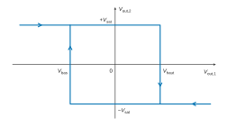
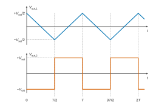
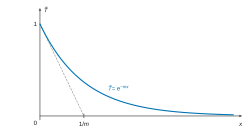
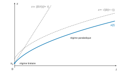

# Centrale-Supélec PSI — Physique-chimie 2 2026 · Corrigé brut

*Corrigé rédigé par IA, non officiel. Signalez toute erreur.*

*Création d'un synthétiseur analogique rudimentaire.* Durée 4 h, calculatrice autorisée. Données utilisées :

- $k_B=1{,}38\times10^{-23}\ \mathrm{J\cdot K^{-1}}$ et $q=1{,}60\times10^{-19}\ \mathrm{C}$ ;
- $h=50\ \mathrm{W\cdot m^{-2}\cdot K^{-1}}$ et $\lambda=215\ \mathrm{W\cdot m^{-1}\cdot K^{-1}}$ ;
- $N_A=6{,}02\times10^{23}\ \mathrm{mol^{-1}}$, d'où $R=k_BN_A=8{,}31\ \mathrm{J\cdot K^{-1}\cdot mol^{-1}}$.

Deux coquilles de l'énoncé : la masse volumique de $\mathrm{SiO_2}$ vaut $2{,}20\ \mathrm{g\cdot cm^{-3}}$ (et non $\mathrm{kg\cdot m^{-3}}$). La « figure 13 » de la partie C-II est la figure 12.

## Partie A — Création d'un synthétiseur analogique

### I — Des touches de clavier à l'oscillateur

#### I.1 — Convertisseur « Linéaire/Exponentiel »

**Q1.** Le clavier délivre une tension affine en l'octave : $V_{\mathrm{in},0}=-5+n$ (en V) pour le La$_n$. La hauteur musicale, elle, est géométrique : $f(\mathrm{La}_n)=f(\mathrm{La}_0)\,2^n$.

L'OCT donnant $f=\kappa V_{\mathrm{in},1}$ (linéaire), une chaîne entièrement linéaire rendrait $f$ affine en $V_{\mathrm{in},0}$ : les octaves seraient équidistantes en fréquence et non en rapport, la gamme serait fausse. Il faut un bloc qui change une progression arithmétique de tension en progression géométrique de fréquence, c'est-à-dire une exponentielle.

Avec $n=V_{\mathrm{in},0}+5$ :

$$\kappa V_{\mathrm{in},1}=f(\mathrm{La}_0)\,2^{5}\,\mathrm{e}^{V_{\mathrm{in},0}\ln2}$$

soit $V_{\mathrm{in},1}=V_{\mathrm{ref}}\exp(\alpha V_{\mathrm{in},0})$, avec $V_{\mathrm{ref}}=32f(\mathrm{La}_0)/\kappa$ et

$$\boxed{\alpha=\ln2\simeq0{,}693\ \mathrm{V^{-1}}}$$

**Q2.** $f\propto V_{\mathrm{in},1}\propto I_C$ : monter d'une octave revient à doubler $I_C$ à température fixée. Le facteur $I_S(T)$ se simplifie dans le rapport :

$$\begin{aligned}
2&=\frac{I_S\,\mathrm{e}^{(V_{BE}+\Delta V_{BE})/v}}{I_S\,\mathrm{e}^{V_{BE}/v}}\\
&=\mathrm{e}^{\Delta V_{BE}/v}
\end{aligned}$$

d'où

$$\boxed{\Delta V_{BE}=v(T)\ln2}$$

À $T=293{,}15\ \mathrm{K}$, on a $v=k_BT/q=25{,}3\ \mathrm{mV}$, d'où $\boxed{\Delta V_{BE}=17{,}5\ \mathrm{mV}}$.

**Q3.** Comme $I_B=0$, $R$ et $R'$ sont parcourues par le même courant :

$$V_{BE}=\frac{R'}{R+R'}V_{\mathrm{in},0}$$

Avec $V_{\mathrm{in},1}=\mu I_C$ ($\mu$ constante) :

$$V_{\mathrm{in},1}=\mu I_S(T)\exp\!\Big(\frac{R'}{(R+R')v(T)}V_{\mathrm{in},0}\Big)$$

$$\boxed{\alpha=\frac{R'}{(R+R')\,v(T)}}$$

On obtient bien la forme $V_{\mathrm{ref}}\exp(\alpha V_{\mathrm{in},0})$ avec $V_{\mathrm{ref}}=\mu I_S(T)$.

À $20\ ^\circ\mathrm{C}$, on a $R'/(R+R')=1/57=1{,}754\times10^{-2}$, d'où

$$\begin{aligned}
\alpha&=\frac{1{,}754\times10^{-2}}{2{,}528\times10^{-2}}\\
&=0{,}694\ \mathrm{V^{-1}}
\end{aligned}$$

soit un écart de $0{,}1\ \%$ à $\ln2$. **Le montage réalise donc le convertisseur voulu** : $\Delta V_{\mathrm{in},0}=1\ \mathrm{V}$ donne $\Delta V_{BE}=17{,}5\ \mathrm{mV}$, comme exigé en Q2.

#### I.2 — Compensation de température

**Q4.** Pour le La$_3$, $V_{\mathrm{in},0}=-2\ \mathrm{V}$, donc $V_{BE}=-2/57=-35{,}1\ \mathrm{mV}$. Cette tension est indépendante de $T$. On a $f\propto I_C=I_S(T)\exp(V_{BE}/v(T))$.

*Effet de $I_S$ seul.* Ce courant double entre 20 et 30 °C, donc $f$ double : $\boxed{\Delta f/f=+100\ \%}$.

Le La$_3$ devient un La$_4$, à $880\ \mathrm{Hz}$. L'écart vaut 286 fois le seuil de $0{,}0035$.

*Effet de $v$ seul.* On a $v(303{,}15\ \mathrm{K})=26{,}1\ \mathrm{mV}$ et

$$\begin{aligned}
\frac{f(30)}{f(20)}&=\exp\!\Big[V_{BE}\Big(\frac1{v(303)}-\frac1{v(293)}\Big)\Big]\\
&=\mathrm{e}^{0{,}0458}
\end{aligned}$$

d'où $\boxed{\Delta f/f=+4{,}7\ \%}$, soit 13 fois le seuil et près d'un demi-ton ($5{,}9\ \%$). Comme $V_{BE}<0$, l'augmentation de $v$ rapproche l'exposant de zéro et fait monter $f$.

Les deux effets font monter la note et celui de $I_S$ domine largement. Le premier multiplie toutes les notes par le même facteur (transposition globale). Le second dépend de $V_{BE}$, donc de la note, et désaccorde les intervalles.

**Q5.** Émetteurs reliés au potentiel $V_E$. Le transistor 1 a sa base en $V_B$, le transistor 2 a sa base à la masse, et tous deux ont le même $I_S(T)$ :

$$\begin{aligned}
I_{C1}&=I_S\,\mathrm{e}^{(V_B-V_E)/v}\\
I_{C2}&=I_S\,\mathrm{e}^{-V_E/v}
\end{aligned}$$

En faisant le rapport :

$$\boxed{I_{C2}=I_{C1}\exp\!\Big(-\frac{V_B}{v(T)}\Big)}$$

**Q6.** $I_S(T)$, responsable de la dérive dominante (facteur 2 tous les $10\ ^\circ\mathrm{C}$), a disparu : **la dérive due au courant de saturation est entièrement compensée.** La fréquence ne dépend plus que du courant imposé $I_{C1}$ et de $v(T)$, ce qui ne laisse qu'une dérive beaucoup plus faible, par l'exposant.

**Q7.** On a $\ln f=\mathrm{cste}-qV_B/(k_BT)$, avec $V_B=V_{\mathrm{in},0}/57$ indépendant de $T$. Donc

$$\begin{aligned}
\Big|\frac{\Delta f}{f}\Big|&=\frac{|V_B|}{v(T_0)}\frac{|\Delta T|}{T_0}\\
&=\alpha|V_{\mathrm{in},0}|\frac{|\Delta T|}{T_0}\\
&\leqslant0{,}0035
\end{aligned}$$

d'où

$$\begin{aligned}
|\Delta T|&\leqslant\frac{0{,}0035\,T_0}{\ln2\,|V_{\mathrm{in},0}|}\\
&=\boxed{\frac{1{,}48\ \mathrm{K\cdot V}}{|V_{\mathrm{in},0}|}}
\end{aligned}$$

Pour le La$_3$, cela donne $|\Delta T|\leqslant0{,}74\ \mathrm{K}$. Pour $|V_{\mathrm{in},0}|=5\ \mathrm{V}$, la tolérance tombe à $0{,}30\ \mathrm{K}$.

Pour $10\ \mathrm{K}$ d'échauffement, la dérive est de $+4{,}7\ \%$ (contre $+109\ \%$ avec le montage de la figure 4) : le progrès est net, mais une tolérance inférieure au kelvin reste **insuffisante** pour un appareil qui s'échauffe de plusieurs dizaines de degrés. Il faut compenser aussi le terme en $v(T)$ ou refroidir le composant.

**Q8.** *Critère.* La fréquence dépend de $T$ par $u=V_B/v(T)=qV_B/(k_BT)$. Elle devient indépendante de $T$ si $V_B\propto T$.

*Modification.* Comme $R'\ll R$, on a $V_B\simeq(R'/R)V_{\mathrm{in},0}$. On remplace $R'$ par une thermistance CTP et on garde $R$ fixe :

$$R'(T)=R'_{T_0}\big(1+K(T-T_0)\big)$$

Alors $V_B\propto1+K(T-T_0)$, à comparer à $T=T_0\big(1+(T-T_0)/T_0\big)$. La compensation est exacte au premier ordre si

$$\begin{aligned}
K&=\frac1{T_0}\\
&=3{,}41\times10^{-3}\ \mathrm{K^{-1}}\\
&=3411\times10^{-6}\ \mathrm{K^{-1}}
\end{aligned}$$

*Choix.* La valeur la plus proche dans la table est

$$\boxed{K=3300\times10^{-6}\ \mathrm{K^{-1}}\ (\pm10\ \%)}$$

avec $\boxed{R'_{20}=500\ \Omega}$. L'écart vaut $111\times10^{-6}$, contre $189\times10^{-6}$ pour 3600.

Pour garder $\alpha=\ln2$, il faut $R'/(R+R')=1/57$, donc $R=56R'=28{,}0\ \mathrm{k\Omega}$.

*Tolérance.* Avec $\theta=T-T_0$ :

$$\begin{aligned}
\frac{u(T)}{u(T_0)}&=\frac{1+K\theta}{1+\theta/T_0}\\
&\simeq1+\Big(K-\frac1{T_0}\Big)\theta
\end{aligned}$$

d'où

$$\begin{aligned}
\Big|\frac{\Delta f}{f}\Big|&=\ln2\,|V_{\mathrm{in},0}|\,\Big|K-\frac1{T_0}\Big|\,|\theta|\\
&\leqslant0{,}0035
\end{aligned}$$

donc

$$|\theta|\leqslant\frac{0{,}0035}{\ln2\,|V_{\mathrm{in},0}|\,|K-1/T_0|}$$

Avec $|K-1/T_0|=111\times10^{-6}\ \mathrm{K^{-1}}$, on obtient :

$$\boxed{|\Delta T|\leqslant23\ \mathrm{K}\ \text{(La}_3\text{)}}$$

$$\boxed{|\Delta T|\leqslant9\ \mathrm{K}\ (|V_{\mathrm{in},0}|=5\ \mathrm{V})}$$

On gagne un facteur $3411/111\approx31$ par rapport à Q7.

*Conclusion.* La précision de $\pm10\ \%$ sur $K$ ($\pm330\times10^{-6}$) dépasse l'écart résiduel. Dans le pire cas ($K=2970\times10^{-6}$), la tolérance tombe à $5{,}7\ \mathrm{K}$ pour le La$_3$.

**La compensation par CTP améliore la stabilité d'un facteur 8 à 30 selon la dispersion, sans dispenser d'un tri des thermistances ni du refroidissement de la partie B.**

(Sans l'approximation $R'\ll R$, le coefficient effectif vaut $KR/(R+R')$ et la valeur idéale devient $3472\times10^{-6}$. Ce changement reste inférieur à la dispersion de fabrication.)

#### I.3 — Transposition d'octave

**Q9.** Pour l'ALI 1, la sortie est reliée directement à l'entrée $-$. Pour l'ALI 2, la sortie est reliée à l'entrée $-$ par $R_C$. Les deux sont en contre-réaction, sans aucune boucle vers $+$ : **régime linéaire**. Modèle idéal : $i_+=i_-=0$, impédance de sortie nulle, gain infini et sortie non saturée, donc $\boxed{V_+=V_-}$.

**Q10.** Le commutateur attaque l'entrée $+$ de l'ALI 1, qui ne prélève aucun courant. Le pont $R_A$, $4R_B$, $R_A$ est donc parcouru par un courant unique :

$$I=\frac{20}{2R_A+4R_B}$$

Un pas de $1\ \mathrm{V}$ entre prises impose $R_BI=1\ \mathrm{V}$, soit $I=0{,}100\ \mathrm{mA}$. On en tire $2R_A+4R_B=200\ \mathrm{k\Omega}$, et

$$\boxed{R_A=80{,}0\ \mathrm{k\Omega}}$$

Vérification : la première prise est à $-10+R_AI=-2\ \mathrm{V}$. Les prises suivantes montent de 1 V en 1 V jusqu'à $+2\ \mathrm{V}$, et la dernière résistance ramène à $+2+R_AI=+10\ \mathrm{V}$.

**Q11.** L'ALI 1 est un **suiveur** ($V_s=V_{SW}$). Son impédance d'entrée est infinie et son impédance de sortie nulle : il adapte les impédances. Sans lui, la branche $R_B$ du sommateur chargerait le pont, et les tensions des prises ne vaudraient plus $-2,\dots,+2\ \mathrm{V}$.

**Q12.** Au nœud $+$ (avec $i_+=0$), la loi des nœuds s'écrit

$$\frac{V_{SW}-V_+}{R_B}+\frac{V_{\mathrm{in},0}-V_+}{R_B}=0$$

donc $V_+=(V_{SW}+V_{\mathrm{in},0})/2$. Au nœud $-$, le diviseur formé des deux résistances $R_C$ donne $V_-=V'_{\mathrm{in},0}/2$. Le régime est linéaire, d'où

$$\boxed{V'_{\mathrm{in},0}=V_{\mathrm{in},0}+V_{SW}}$$

C'est un **sommateur** (non inverseur). Comme $V_{SW}=p\in\{-2,-1,0,1,2\}\ \mathrm{V}$ et qu'un volt correspond à une octave (Q1), la fréquence est multipliée par $2^p$. **La note est transposée de $p$ octaves**, sans changer les intervalles.

### II — Oscillateur commandé en tension

**Q13.** La sortie de l'ALI 4 est ramenée sur l'entrée $+$ par $R_6$ (avec $R_7$ vers la masse). Aucune branche ne la ramène sur l'entrée $-$ : la rétroaction est positive, donc **régime saturé**.

Conséquences : la sortie vaut $V_{\mathrm{out},2}=\pm V_{\mathrm{sat}}$, soit $\pm15\ \mathrm{V}$. On a $V_+\neq V_-$, et le signe de $V_+-V_-$ fixe l'état de sortie. Le montage est un comparateur à hystérésis.

**Q14.** L'ALI 3 est en contre-réaction par $C_1$, donc en régime linéaire. Le diviseur n'étant pas chargé, on a

$$\begin{aligned}
V_{A_1}&=V_{A_2}\\
&=\frac{R_3}{R_2+R_3}V_{\mathrm{in},1}
\end{aligned}$$

Cette tension est constante. Le transistor étant bloqué, $I_C=0$. La loi des nœuds en $A_1$ s'écrit :

$$\begin{aligned}
\frac{V_{\mathrm{in},1}-V_{A_1}}{R_1}&=C_1\frac{\mathrm{d}(V_{A_1}-V_{\mathrm{out},1})}{\mathrm{d}t}\\
&=-C_1\frac{\mathrm{d}V_{\mathrm{out},1}}{\mathrm{d}t}
\end{aligned}$$

$$\boxed{V_{\mathrm{out},1}(t)=V_0-\frac{R_2}{R_1C_1(R_2+R_3)}V_{\mathrm{in},1}\,t}$$

C'est une rampe descendante de pente $-s$, avec $s=\dfrac{R_2V_{\mathrm{in},1}}{R_1C_1(R_2+R_3)}$. La constante $V_0=V_{\mathrm{out},1}(0)$ est fixée en Q16.

**Q15.** Les potentiels des entrées de l'ALI 4 sont

$$V_+=\frac{R_7}{R_6+R_7}V_{\mathrm{out},2}$$

et $V_-=V_{\mathrm{out},1}$.

Dans l'état $+V_{\mathrm{sat}}$, la sortie bascule quand $V_{\mathrm{out},1}$ dépasse $V_{\mathrm{haut}}$. Dans l'état $-V_{\mathrm{sat}}$, elle bascule quand $V_{\mathrm{out},1}$ descend sous $V_{\mathrm{bas}}$ :

$$\boxed{V_{\mathrm{haut}}=\frac{R_7}{R_6+R_7}V_{\mathrm{sat}}}$$

$$\boxed{V_{\mathrm{bas}}=-\frac{R_7}{R_6+R_7}V_{\mathrm{sat}}}$$

Graphe : cycle d'hystérésis **inverseur**, parcouru dans le sens horaire (figure 1). Chaque seuil n'est actif que dans un état de sortie.

**Q16.** Le transistor est bloqué, donc $V_{BE}<0$ et $V_{\mathrm{out},2}=-V_{\mathrm{sat}}$ (même signe que $V_{BE}$). Le seuil actif est donc $V_{\mathrm{bas}}$.

On part de $V_{\mathrm{out},1}(0)=-V_{\mathrm{bas}}=V_{\mathrm{haut}}$. La rampe $V_{\mathrm{haut}}-st$ atteint $V_{\mathrm{bas}}$ quand $st_1=2V_{\mathrm{haut}}$ :

$$\boxed{t_1=\frac{2R_7}{R_6+R_7}\,\frac{R_1C_1(R_2+R_3)}{R_2}\,\frac{V_{\mathrm{sat}}}{V_{\mathrm{in},1}}}$$

À cet instant, l'ALI 4 passe à $+V_{\mathrm{sat}}$, et $V_{BE}>0$. Le transistor devient actif : $C$ est relié à $E$, donc à la masse.

La résistance $R_4$ dérive alors vers la masse le courant $V_{A_1}/R_4$, et la pente de $V_{\mathrm{out},1}$ change de signe.

**Q17.** Pour $t>t_1$, $V_{A_1}$ garde la même valeur et la loi des nœuds en $A_1$ devient

$$\frac{V_{\mathrm{in},1}-V_{A_1}}{R_1}=\frac{V_{A_1}}{R_4}-C_1\frac{\mathrm{d}V_{\mathrm{out},1}}{\mathrm{d}t}$$

d'où

$$\frac{\mathrm{d}V_{\mathrm{out},1}}{\mathrm{d}t}=\frac{V_{\mathrm{in},1}}{C_1(R_2+R_3)}\Big(\frac{R_3}{R_4}-\frac{R_2}{R_1}\Big)$$

$$\boxed{V_{\mathrm{out},1}(t)=V_{\mathrm{bas}}+\frac{V_{\mathrm{in},1}}{C_1(R_2+R_3)}\Big(\frac{R_3}{R_4}-\frac{R_2}{R_1}\Big)(t-t_1)}$$

Les oscillations sont symétriques si la pente montante vaut $+s$, soit $\dfrac{R_3}{R_4}-\dfrac{R_2}{R_1}=\dfrac{R_2}{R_1}$ :

$$\boxed{R_4=\frac{R_1R_3}{2R_2}}$$

**Q18.** Avec $R_6=R_7$, $V_{\mathrm{haut}}=-V_{\mathrm{bas}}=V_{\mathrm{sat}}/2$. Chaque demi-période correspond au parcours de $V_{\mathrm{sat}}$ à la pente $s$ : $T/2=V_{\mathrm{sat}}/s$, d'où

$$\boxed{f=\frac1{2R_1C_1}\,\frac{R_2}{R_2+R_3}\,\frac{V_{\mathrm{in},1}}{V_{\mathrm{sat}}}}$$

**Q19.** $V_{\mathrm{out},1}$ est un **triangle** symétrique entre $\pm V_{\mathrm{sat}}/2$, soit $\pm7{,}5\ \mathrm{V}$. Il descend sur $[0,T/2]$ et monte sur $[T/2,T]$.

$V_{\mathrm{out},2}$ est un **créneau** $\pm V_{\mathrm{sat}}$ de rapport cyclique $1/2$. Il vaut $-V_{\mathrm{sat}}$ quand le triangle descend et $+V_{\mathrm{sat}}$ quand il monte. Il bascule exactement aux sommets du triangle.

**Q20.** La vitesse de balayage $\sigma=0{,}3\ \mathrm{V\cdot\mu s^{-1}}$ est la valeur maximale de $|\mathrm{d}V_s/\mathrm{d}t|$ que peut atteindre la sortie d'un ALI réel. C'est une limitation non linéaire de l'étage de sortie : au-delà, les signaux sont déformés.

La sortie de l'ALI 3 (en contre-réaction) a une pente de valeur absolue

$$\begin{aligned}
s&=\frac{V_{\mathrm{sat}}}{T/2}\\
&=2fV_{\mathrm{sat}}
\end{aligned}$$

Il faut donc $2fV_{\mathrm{sat}}\leqslant\sigma$ :

$$\begin{aligned}
f&\leqslant\frac{\sigma}{2V_{\mathrm{sat}}}\\
&=\frac{0{,}3\times10^6}{30}\\
&=\boxed{1{,}0\times10^{4}\ \mathrm{Hz}}
\end{aligned}$$

*Commentaire.* $10\ \mathrm{kHz}$ couvre le fondamental de toutes les notes usuelles (La$_0=55\ \mathrm{Hz}$, soit environ 7,5 octaves au-dessus), mais pas tout le domaine audible ($20\ \mathrm{kHz}$) ni les harmoniques des notes aiguës.

L'ALI 4 est lui aussi limité : un front de $30\ \mathrm{V}$ dure $100\ \mu\mathrm{s}$. Cette durée n'est négligeable devant $T/2$ que pour $f\ll5\ \mathrm{kHz}$. Au-delà, le créneau devient trapézoïdal.

## Partie B — Contrôle de température au sein d'un synthétiseur analogique

**Q21.** La surface de la tranche en contact avec l'air comprend les deux grandes faces ($2L\,\mathrm{d}x$) et les deux chants ($2e\,\mathrm{d}x$). Les sections droites sont internes à l'ailette :

$$\boxed{\begin{aligned}
\delta P&=2h(L+e)\big(T(x,t)-T_a\big)\,\mathrm{d}x\\
&\simeq2hL\big(T(x,t)-T_a\big)\,\mathrm{d}x\quad(e\ll L)
\end{aligned}}$$

**Q22.** Loi de Fourier :

$$\Phi(x)=-\lambda Le\,\frac{\partial T}{\partial x}$$

Le bilan stationnaire sur la tranche (rien ne s'accumule) s'écrit

$$0=\Phi(x)-\Phi(x+\mathrm{d}x)-2h(L+e)(T-T_a)\mathrm{d}x$$

avec

$$\Phi(x)-\Phi(x+\mathrm{d}x)=\lambda Le\,T''\mathrm{d}x$$

On obtient

$$\frac{\mathrm{d}^2T}{\mathrm{d}x^2}-m^2T=-m^2T_a$$

avec

$$\begin{aligned}
m^2&=\frac{2h(L+e)}{\lambda Le}\\
&\simeq\frac{2h}{\lambda e}
\end{aligned}$$

$$\boxed{m=\sqrt{\frac{2h}{\lambda e}}}$$

A.N. : $m=\sqrt{100/(215\times2{,}0\times10^{-3})}=15{,}2\ \mathrm{m^{-1}}$.

**Q23.** Contact parfait avec le transistor à $T_1$ : $\boxed{T(0)=T_1}$.

**Q24.**
- Hypothèse 1 : ailette semi-infinie, $T$ bornée, soit $\boxed{T(\ell)\simeq T_a}$ (en pratique $T(x\to\infty)=T_a$).
- Hypothèse 2 : flux nul, $\boxed{\dfrac{\mathrm{d}T}{\mathrm{d}x}(\ell)=0}$.
- Hypothèse 3 : continuité du flux en bout d'ailette, $\boxed{-\lambda\dfrac{\mathrm{d}T}{\mathrm{d}x}(\ell)=h\big(T(\ell)-T_a\big)}$.

La plus réaliste est **l'hypothèse 3** : l'extrémité est baignée par l'air comme le reste de l'ailette. L'hypothèse 1 est ici fausse ($m\ell=15{,}2\times0{,}015=0{,}23\ll1$). L'hypothèse 2 est une bonne approximation de la 3, car la surface d'extrémité $Le$ ne représente que $e/(2\ell)=7\ \%$ de la surface latérale.

**Q25.** On a $T=T_a+A\mathrm{e}^{-mx}+B\mathrm{e}^{mx}$. La condition bornée impose $B=0$, et $T(0)=T_1$ donne $A=T_1-T_a$ :

$$\boxed{T(x)=T_a+(T_1-T_a)\mathrm{e}^{-mx}}$$

$$\boxed{\widetilde T(x)=\mathrm{e}^{-mx}}$$

Tracé (figure 3) : exponentielle décroissante de 1 à 0 ; la tangente à l'origine, de pente $-m$, coupe l'axe en $x=1/m\approx6{,}6\ \mathrm{cm}$.

**Q26.** On cherche $\theta=T-T_a$ sous la forme $P\cosh(m(\ell-x))+Q\sinh(m(\ell-x))$. La condition $\theta'(\ell)=0$ donne $Q=0$. Puis $\theta(0)=T_1-T_a$ donne $P$ :

$$\boxed{\widetilde T(x)=\frac{\cosh\big(m(\ell-x)\big)}{\cosh(m\ell)}}$$

(Le profil a une tangente horizontale en $\ell$ et $\widetilde T(\ell)=1/\cosh(0{,}229)=0{,}974$ : l'ailette est quasi isotherme.)

**Q27.** En régime stationnaire, sans flux en bout d'ailette, tout ce qui entre par la base est évacué par les faces :

$$\Phi=-\lambda Le\,T'(0)$$

avec $T'(0)=-m(T_1-T_a)\tanh(m\ell)$. D'où

$$\boxed{\begin{aligned}
\Phi&=\lambda Le\,m\,(T_1-T_a)\tanh(m\ell)\\
&=\frac{2hL}{m}(T_1-T_a)\tanh(m\ell)
\end{aligned}}$$

On retrouve le même résultat en intégrant les pertes latérales. A.N. : $\Phi=2{,}9\times10^{-2}\ \mathrm{W\cdot K^{-1}}\times(T_1-T_a)$.

**Q28.** La température décroît le long de l'ailette ($\widetilde T<1$ pour $x>0$, car la chaleur est perdue en chemin). L'écart local $T-T_a$, moteur de la loi de Newton, est donc partout inférieur à $T_1-T_a$ : $\boxed{\Phi<\Phi_u}$. L'égalité correspondrait à une ailette de conductivité infinie.

**Q29.** $\eta$ est un rapport de deux puissances, donc sans dimension, et il est compris entre 0 et 1 d'après Q28. Il compare le flux réellement évacué au flux maximal possible pour la même surface et les mêmes conditions : c'est la définition d'un rendement. La « perte » chiffrée par $\eta$ vient de la résistance thermique interne de l'ailette.

**Q30.** $\Phi_u=2hL\ell(T_1-T_a)$ (même surface d'échange que pour $\Phi$). Avec $\lambda e=2h/m^2$ :

$$\begin{aligned}
\eta&=\frac{\lambda Le\,m\tanh(m\ell)}{2hL\ell}\\
&=\frac{\lambda e\,m}{2h\ell}\tanh(m\ell)\\
&=\boxed{\frac{\tanh(m\ell)}{m\ell}}
\end{aligned}$$

**Q31.** Valeurs utiles : $m=15{,}2\ \mathrm{m^{-1}}$ et $m\ell=0{,}229$. Pour les deux autres profils, $m\ell_c=m(\ell+e/2)=0{,}244$ et $2m\ell=0{,}457$.

| Ailette | Calcul | $\eta$ |
|---|---|---|
| rectangulaire | $\tanh(0{,}244)/0{,}244$ | $0{,}981$ |
| triangulaire | $I_1/I_0(0{,}457)\approx0{,}223$ (graphe), puis $0{,}223/0{,}229$ | $0{,}975$ |
| parabolique | $2/(1+\sqrt{1+0{,}209})$ | $0{,}953$ |

Les trois profils ont les mêmes dimensions $L$, $\ell$, $e$. Leurs surfaces d'échange sont égales à moins de $1\ \%$ près, car $2L\sqrt{\ell^2+e^2/4}\simeq2L\ell$. Le classement des flux suit donc celui des rendements : **l'ailette rectangulaire dissipe le plus.**

Les écarts restent faibles ($m\ell\ll1$, ailette quasi isotherme), alors que l'ailette triangulaire utilise deux fois moins de métal. Rapporté à la masse, le profil triangulaire serait le plus avantageux.

**Q32.** Il faut une **convection forcée en écoulement turbulent** (ventilateur, nombre de Reynolds élevé). Le coefficient $h$ est d'autant plus grand que la couche limite thermique, où le transfert se fait par diffusion, est mince : $h\sim\lambda_{\mathrm{air}}/\delta$. Une grande vitesse amincit la couche limite, et le régime turbulent brasse l'air et renouvelle sans cesse l'air chaud au contact de la paroi.

Augmenter $h$ fait un peu baisser $\eta$, car $m\propto\sqrt h$. Mais le flux $\Phi=\eta h\,2L\ell(T_1-T_a)$ augmente nettement.

## Partie C — Protection par couches minces de composés du silicium

### I — Thermodynamique et cinétique de formation du nitrure de silicium

**Q33.**

$$\boxed{3\,\mathrm{Si(s)}+2\,\mathrm{N_2(g)}=\mathrm{Si_3N_4(s)}}$$

On a $\Delta_rH^\circ=-828\ \mathrm{kJ\cdot mol^{-1}}$, car $\Delta_fH^\circ=0$ pour les corps simples. Puis

$$\begin{aligned}
\Delta_rS^\circ&=113-3\times18{,}8-2\times192\\
&=-327{,}4\ \mathrm{J\cdot K^{-1}\cdot mol^{-1}}
\end{aligned}$$

On en déduit

$$\begin{aligned}
\Delta_rG^\circ(298)&=-828+298\times0{,}3274\\
&=-730\ \mathrm{kJ\cdot mol^{-1}}
\end{aligned}$$

et

$$\begin{aligned}
\ln K^\circ&=\frac{-\Delta_rG^\circ}{RT}\\
&=\frac{7{,}30\times10^5}{8{,}31\times298}\\
&=295
\end{aligned}$$

$$\boxed{K^\circ\approx10^{128}}$$

$K^\circ\gg10^4$ : à l'équilibre, $P_{\mathrm{N_2}}=P^\circ K^{\circ\,-1/2}\approx10^{-64}\ \mathrm{bar}$. **La réaction est quantitative.**

**Q34.** Réacteur adiabatique et isobare, donc $\Delta H=0$. On suit un chemin fictif : réaction totale à $298\ \mathrm{K}$ ($\xi=1\ \mathrm{mol}$), puis échauffement du seul produit $\mathrm{Si_3N_4}$ (proportions stœchiométriques, réaction totale) :

$$\Delta_rH^\circ+C_{pm}(\mathrm{Si_3N_4})(T_f-298)=0$$

d'où

$$\begin{aligned}
T_f&=298+\frac{828\times10^3}{99{,}5}\\
&\approx\boxed{8{,}6\times10^3\ \mathrm{K}}
\end{aligned}$$

*Conclusion.* Cette valeur est irréaliste. Elle dépasse largement $T_{\mathrm{fus}}(\mathrm{Si})=1687\ \mathrm{K}$ et $T_{\mathrm{fus}}(\mathrm{Si_3N_4})=2173\ \mathrm{K}$ (changements d'état ignorés). Elle dépasse aussi la température d'inversion $\Delta_rH^\circ/\Delta_rS^\circ\approx2{,}5\times10^3\ \mathrm{K}$, au-delà de laquelle $\Delta_rG^\circ>0$ et la réaction n'est plus quantitative.

La réaction est très exothermique : **elle ne peut pas être conduite en réacteur calorifugé** sans emballement ni destruction du produit. Il faut évacuer la chaleur (réacteur isotherme, comme dans la suite de l'énoncé).

**Q35.** Pour un avancement $\xi$, la masse de silicium consommée vaut $\Delta W_{\mathrm{Si}}=3\xi M_{\mathrm{Si}}$. La prise de masse correspond à l'azote fixé, $\Delta W=4\xi M_{\mathrm{N}}$, en supposant que seul le silicium réagit. Enfin $W^0_{\mathrm{Si}}=0{,}6856\,W^0$. D'où

$$\alpha=\frac{3M_{\mathrm{Si}}}{4M_{\mathrm{N}}\times0{,}6856}\,\frac{\Delta W}{W^0}$$

et

$$\begin{aligned}
\beta&=\frac{3\times28{,}1}{4\times14{,}0\times0{,}6856}\\
&=\boxed{2{,}20}
\end{aligned}$$

**Q36.** D'après la figure 11-a), le taux atteint plafonne vers 40 % à 1500 °C, contre environ 60 % à 1350 et 1400 °C. Deux phénomènes peuvent l'expliquer :
1. **La fusion du silicium** ($T_{\mathrm{fus}}=1414\ ^\circ\mathrm{C}$, entre 1400 et $1500\ ^\circ\mathrm{C}$). Les grains fondent et coalescent, la surface de contact avec le gaz chute, et le liquide se recouvre de nitrure.
2. **La formation rapide d'une couche dense et passivante de $\mathrm{Si_3N_4}$** autour des grains. Elle bloque la diffusion de $\mathrm{N_2}$ vers le silicium non converti. La forte exothermicité l'aggrave, car elle crée des surchauffes locales au-dessus de la température du four.

L'argument thermodynamique ($\Delta_rH^\circ<0$, donc $K^\circ$ décroît avec $T$ selon la loi de van 't Hoff) va dans le même sens.

Mais il est faible : à $1773\ \mathrm{K}$, $\Delta_rG^\circ\approx-2{,}5\times10^2\ \mathrm{kJ\cdot mol^{-1}}$ et $K^\circ\approx\mathrm{e}^{17}$, la réaction reste favorable.

**Q37.** Ordre 0 : la vitesse molaire est constante, $\mathrm{d}\xi/\mathrm{d}t=k$, donc $\xi=kt$. Comme $\alpha=3M_{\mathrm{Si}}\xi/W^0_{\mathrm{Si}}$ :

$$\boxed{\begin{aligned}
\alpha(t)&=\frac{3M_{\mathrm{Si}}}{W^0_{\mathrm{Si}}}\,k\,t\\
&=\frac{3M_{\mathrm{Si}}}{0{,}6856\,W^0}\,k\,t
\end{aligned}}$$

C'est une droite passant par l'origine, ce que confirme la figure 11-b). Ici $k$ s'exprime en $\mathrm{mol\cdot min^{-1}}$.

**Q38.** Loi d'Arrhenius :

$$\boxed{k(T)=A\exp\!\Big(-\frac{E_a}{RT}\Big)}$$

- $k$ est la constante de vitesse, ici en $\mathrm{mol\cdot s^{-1}}$ (ordre 0, vitesse molaire).
- $A$ est le facteur préexponentiel, de même unité que $k$.
- $E_a>0$ est l'énergie d'activation, en $\mathrm{J\cdot mol^{-1}}$.
- $R=8{,}31\ \mathrm{J\cdot K^{-1}\cdot mol^{-1}}$, et $T$ est la température absolue en K.

Sous forme linéarisée :

$$\ln k=\ln A-\frac{E_a}{RT}$$

**Q39.** Pentes lues sur la figure 11-b) (points à $30\ \mathrm{min}$) : 13,8 %, 20,7 % et 25,2 %. On en tire $a=0{,}460$, $0{,}690$ et $0{,}840\ \%\cdot\mathrm{min^{-1}}$.

Avec $k=aW^0_{\mathrm{Si}}/(3M_{\mathrm{Si}})$ et $W^0_{\mathrm{Si}}=571{,}8\ \mathrm{g}$ :

| $T$ (K) | $10^4/T$ ($\mathrm{K^{-1}}$) | $k$ ($\mathrm{mol\cdot min^{-1}}$) | $\ln k$ |
|---|---|---|---|
| 1573 | 6,357 | $3{,}12\times10^{-2}$ | $-3{,}47$ |
| 1623 | 6,161 | $4{,}68\times10^{-2}$ | $-3{,}06$ |
| 1673 | 5,977 | $5{,}70\times10^{-2}$ | $-2{,}87$ |

La régression de $\ln k$ en fonction de $1/T$ donne une pente et une ordonnée à l'origine :

$$\begin{aligned}
-\frac{E_a}{R}&=-1{,}59\times10^4\ \mathrm{K}\\
\ln A&=6{,}7
\end{aligned}$$

d'où

$$\boxed{E_a\approx1{,}3\times10^2\ \mathrm{kJ\cdot mol^{-1}}}$$

$$\boxed{A\approx8\times10^2\ \mathrm{mol\cdot min^{-1}}\approx13\ \mathrm{mol\cdot s^{-1}}}$$

Avec trois points sur une plage étroite de $1/T$, $E_a$ n'est connue qu'à environ $30\ \%$ près. Les pentes deux à deux donnent en effet 172 et $89\ \mathrm{kJ\cdot mol^{-1}}$, et $A$ n'est connu qu'en ordre de grandeur.

### II — Formation de dioxyde de silicium sur un circuit imprimé

**Q40.**

$$\boxed{\mathrm{Si(s)}+\mathrm{O_2(g)}=\mathrm{SiO_2(s)}}$$

$$\boxed{\mathrm{Si(s)}+2\,\mathrm{H_2O(g)}=\mathrm{SiO_2(s)}+2\,\mathrm{H_2(g)}}$$

Le gaz dégagé avec la vapeur d'eau est le dihydrogène.

Dans les deux cas, le silicium passe du nombre d'oxydation 0 à +IV : il est oxydé. Son partenaire est donc l'oxydant.

- Pour $\mathrm{O_2}$, l'oxygène passe de 0 à −II (couple $\mathrm{O_2}/\mathrm{SiO_2}$).
- Pour $\mathrm{H_2O}$, c'est l'hydrogène qui passe de +I à 0 (couple $\mathrm{H_2O}/\mathrm{H_2}$).

**$\mathrm{O_2}$ et $\mathrm{H_2O}$ sont bien des oxydants.**

**Q41.** $J_g$ s'exprime en $\mathrm{mol\cdot m^{-2}\cdot s^{-1}}$. La concentration $C$ s'exprime en $\mathrm{mol\cdot m^{-3}}$. Donc

$$\boxed{[h_g]=\mathrm{m\cdot s^{-1}}}$$

C'est une vitesse de transfert, de même dimension que $D/x$ et $k_i$.

**Q42.** $M(\mathrm{SiO_2})=60{,}1\ \mathrm{g\cdot mol^{-1}}$ et $\rho=2{,}20\ \mathrm{g\cdot cm^{-3}}$, donc $\rho/M=3{,}66\times10^{-2}\ \mathrm{mol\cdot cm^{-3}}$. Il faut une mole de $\mathrm{O_2}$, ou deux moles de $\mathrm{H_2O}$, par mole de $\mathrm{SiO_2}$ :

$$\boxed{N_v(\mathrm{O_2})=\frac{\rho}{M}=3{,}66\times10^4\ \mathrm{mol\cdot m^{-3}}}$$

$$\boxed{N_v(\mathrm{H_2O})=\frac{2\rho}{M}=7{,}32\times10^4\ \mathrm{mol\cdot m^{-3}}}$$

Pour former $1\ \mathrm{cm^3}$ de $\mathrm{SiO_2}$, il faut donc :

- $\boxed{3{,}66\times10^{-2}\ \mathrm{mol}\ \text{de}\ \mathrm{O_2}}$, soit $2{,}20\times10^{22}$ molécules ;
- ou $\boxed{7{,}32\times10^{-2}\ \mathrm{mol}\ \text{de}\ \mathrm{H_2O}}$.

**Q43.** Le régime est quasi stationnaire, et l'oxydant n'est ni produit ni consommé entre le gaz et l'interface $\mathrm{Si/SiO_2}$ (il ne réagit qu'à celle-ci). La géométrie est plane : par conservation de la matière, le flux surfacique est le même à toute abscisse, $J_g=J_d=J_r=J$. Alors

$$\begin{aligned}
C_g-C_s&=\frac{J}{h_g}\\
C_s-C_i&=\frac{Jx}{D}\\
C_i&=\frac{J}{k_i}
\end{aligned}$$

En sommant :

$$J=\frac{C_g}{\dfrac1{h_g}+\dfrac1{k_i}+\dfrac{x}{D}}$$

Pour former une épaisseur $\mathrm{d}x$, il faut $N_v\,\mathrm{d}x$ moles d'oxydant par unité d'aire : $N_v\,\mathrm{d}x/\mathrm{d}t=J$. En intégrant de $x_0$ (à $t=0$) à $x$ :

$$N_v\Big[\Big(\frac1{h_g}+\frac1{k_i}\Big)(x-x_0)+\frac{x^2-x_0^2}{2D}\Big]=C_gt$$

soit

$$x^2+Ax=B(t+\tau)$$

avec

$$\boxed{\begin{aligned}
A&=2D\Big(\frac1{h_g}+\frac1{k_i}\Big)\\
B&=\frac{2DC_g}{N_v}\\
\tau&=\frac{x_0^2+Ax_0}{B}
\end{aligned}}$$

**Q44.** On garde la racine positive :

$$\boxed{x(t)=\frac A2\left[\sqrt{1+\frac{4B(t+\tau)}{A^2}}-1\right]}$$

- Pour $t+\tau\ll A^2/4B$ : $\sqrt{1+u}\simeq1+u/2$, d'où $\boxed{x\simeq\dfrac BA(t+\tau)}$, **régime linéaire**. La couche est mince et la croissance est limitée par le transfert gazeux et la réaction d'interface.
- Pour $t+\tau\gg A^2/4B$ : $\boxed{x\simeq\sqrt{B(t+\tau)}}$, **régime parabolique**. La croissance est limitée par la diffusion à travers l'oxyde et ralentit (couche auto-limitante).

Allure (figure 4) : $x(t)$ part de $x_0$. Elle quitte la droite de pente $B/A$ vers $t+\tau\sim A^2/4B$, pour s'infléchir vers la parabole.

**Q45.** Le temps de diffusion à travers la couche est $\tau_D\sim x^2/D$. Le temps de croissance vaut $\tau_c=x/\dot x=xN_v/J$, avec

$$\begin{aligned}
\tau_c&=\frac{xN_v}{C_g}\Big(\frac1{h_g}+\frac1{k_i}+\frac xD\Big)\\
&\geqslant\frac{N_v}{C_g}\frac{x^2}{D}
\end{aligned}$$

d'où

$$\boxed{\frac{\tau_c}{\tau_D}\geqslant\frac{N_v}{C_g}}$$

Le régime quasi stationnaire exige que le profil de concentration s'établisse bien plus vite que l'interface ne se déplace, $\tau_D\ll\tau_c$, d'où la condition $\boxed{C_g\ll N_v}$.

Elle est largement vérifiée. Un gaz à 1 bar et 1000 °C a $C_g=P/RT\approx9\ \mathrm{mol\cdot m^{-3}}$, contre $N_v\approx4\times10^4\ \mathrm{mol\cdot m^{-3}}$.
