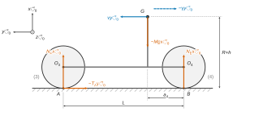
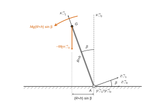
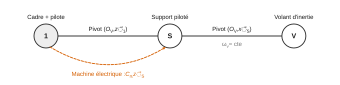
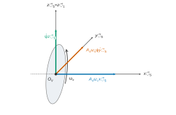

# Centrale-Supélec PSI — Sciences industrielles 2026 · Corrigé

*Corrigé rédigé par IA, non officiel. Signalez toute erreur.*

Épreuve de 4 heures, calculatrice autorisée. Sujet : « Véhicule à deux roues, gyrostabilisé ». Notations : $\Lambda=A_V\omega_v$, $J=I_{1y}+B_V$, $m=Mgh_2$ quand cela allège les calculs.

## Partie A — Temps de stabilisation maximal pour la mise en action de l'assistance

**Q1.** On isole la roue arrière (4). Elle subit trois actions extérieures :

- l'action de (1) par la liaison pivot parfaite d'axe $(O_4,\vec z_1)$, dont le moment en $O_4$ n'a pas de composante sur $\vec z_1$ ;
- le couple moteur, nul par hypothèse ;
- l'action du sol $\{N_B\vec x_0-T_B\vec y_0\,;\,\vec 0\}_B$.

La masse et l'inertie de (4) sont négligées, donc son torseur dynamique est nul. Le théorème du moment dynamique en $O_4$, projeté sur $\vec z_1=\vec z_0$, donne avec $\overrightarrow{O_4B}=-R\vec x_0$ :

$$\begin{aligned}0&=\big[(-R\vec x_0)\wedge(N_B\vec x_0-T_B\vec y_0)\big]\cdot\vec z_0\\&=R\,T_B .\end{aligned}$$

Comme $R\neq0$ :

$$\boxed{T_B=0}$$

Une roue ni motrice ni freinée, sans inertie, ne transmet aucun effort tangentiel.

**Q2.** On isole $\Sigma=\{1+2+3+4\}$, qui est en translation rectiligne : $\vec\Gamma_{G}=-\gamma\vec y_0$. Les roues sont sans masse, donc le moment dynamique en $G$ est nul.

Actions extérieures :

- le poids $-Mg\vec x_0$ en $G$ ;
- l'action du sol $N_A\vec x_0-T_A\vec y_0$ en $A$ ;
- l'action du sol $N_B\vec x_0$ en $B$ (d'après Q1).



Théorème de la résultante dynamique :

- sur $\vec x_0$ : $N_A+N_B-Mg=0$ ;
- sur $\vec y_0$ : $-T_A=-M\gamma$.

Théorème du moment dynamique en $G$, projeté sur $\vec z_0$. On a $\overrightarrow{GA}=-(R+h)\vec x_0+(L-a_4)\vec y_0$ et $\overrightarrow{GB}=-(R+h)\vec x_0-a_4\vec y_0$, d'où :

$$(R+h)T_A-(L-a_4)N_A+a_4N_B=0 .$$

Avec $N_B=Mg-N_A$ et $T_A=M\gamma$, il vient $-LN_A+a_4Mg+(R+h)M\gamma=0$, soit :

$$\begin{aligned}&\boxed{N_A=\frac{M\big[a_4\,g+(R+h)\gamma\big]}{L}}\\&\boxed{N_B=\frac{M\big[(L-a_4)\,g-(R+h)\gamma\big]}{L}}\\&\boxed{T_A=M\gamma}\end{aligned}$$

Contrôle : à l'arrêt, la roue arrière porte $945/1350=70\,\%$ du poids. Le freinage reporte de la charge sur l'avant.

**Q3.** Le contact sphère-plan est unilatéral, donc la roue arrière reste au sol si et seulement si $N_B\geq0$, c'est-à-dire $\gamma\leq\gamma_{\text{déc}}$, avec :

$$\begin{aligned}\gamma_{\text{déc}}&=\frac{(L-a_4)g}{R+h}\\&=\frac{0{,}945\times9{,}81}{0{,}810}\\&=11{,}4\ \text{m·s}^{-2}.\end{aligned}$$

Or l'adhérence limite l'effort tangentiel total :

$$\begin{aligned}M\gamma&=T_A\\&\leq fN_A\\&\leq f(N_A+N_B)\\&=fMg .\end{aligned}$$

On a donc $\gamma\leq fg$. Or $fg=5{,}89\ \text{m·s}^{-2}$, valeur inférieure à $\gamma_{\text{déc}}$. Même dans ce cas extrême, $N_B=934\ \text{N}>0$.

**La roue arrière reste toujours en contact avec le sol : l'exigence 1.3 est satisfaite.**

**Q4.** Le freinage est efficace à la limite du glissement en $A$, c'est-à-dire pour $T_A=fN_A$. Avec Q2, $M\gamma=fM\big[a_4g+(R+h)\gamma\big]/L$, d'où :

$$\boxed{\gamma_{\max}=\frac{f\,a_4\,g}{L-f(R+h)}}$$

Numériquement :

$$\begin{aligned}\gamma_{\max}&=\frac{0{,}6\times0{,}405\times9{,}81}{1{,}350-0{,}486}\\&=2{,}76\ \text{m·s}^{-2}.\end{aligned}$$

Le dénominateur est bien positif. On a alors $N_A=1{,}29\cdot10^3$ N, $N_B=1{,}46\cdot10^3$ N et $T_A=7{,}7\cdot10^2$ N. La décélération est constante, donc :

$$\begin{aligned}t_{fr}&=\frac{v_0-v_1}{\gamma_{\max}}\\&=\frac{(50-35)/3{,}6}{2{,}759}\\&=\boxed{1{,}51\ \text{s}}\end{aligned}$$

$t_{fr}$ est le temps **minimal** pour passer sous 35 km/h. C'est donc le temps dont dispose l'assistance pour entrer en action. L'exigence 1.1 ($t_{\max}\leq1{,}5$ s) est cohérente avec ce cas le plus défavorable, mais sans marge : $t_{fr}=1{,}51$ s ne dépasse $1{,}5$ s que de très peu.

## Partie B — Modélisation comportementale à petite vitesse

**Q5.** On isole $\Sigma=\{1+2+3+4\}$, l'air étant négligé. Les pivots $(O_2,\vec x_2)$, $(O_3,\vec z_2)$ et $(O_4,\vec z_1)$ lui sont intérieurs. Actions mécaniques extérieures à $\Sigma$ :

- pesanteur : $\mathcal T_{\text{pes}\to\Sigma}=\{-Mg\,\vec x_0\,;\,\vec 0\}_G$ (seul (1) est pesant) ;
- sol sur roue avant, sphère-plan avec frottement : $\mathcal T_{0\to3}=\{X_A\vec x_0+Y_A\vec y_0+Z_A\vec z_0\,;\,\vec 0\}_A$ ;
- sol sur roue arrière : $\mathcal T_{0\to4}=\{X_B\vec x_0+Y_B\vec y_0+Z_B\vec z_0\,;\,\vec 0\}_B$.

Le mouvement n'est plus plan : les composantes latérales $Z_A$ et $Z_B$ sont a priori non nulles.

**Q6.** On repère $G$ à partir du point de contact arrière $B$, qui se déplace sur la droite de la trajectoire à la vitesse $v\,\vec y_0$. Avec $\overrightarrow{BO_4}=R\vec x_1$ et $\overrightarrow{O_4G}=h\vec x_1+a_4\vec y_1$ :

$$\overrightarrow{O_0G}=\overrightarrow{O_0B}+(R+h)\vec x_1+a_4\vec y_1 .$$

Le paramétrage par la roue avant donne le même point : $\overrightarrow{AG}=(R+h_3+d\sin\alpha)\vec x_1-(a_3+d\cos\alpha)\vec y_1$, avec $R+h_3+d\sin\alpha=R+h$.

On a $\vec\Omega(1/0)=\dot\beta\,\vec y_1$, avec $\vec y_1=\vec y_0$ fixe. Les dérivées dans $\mathcal B_0$ sont :

$$\begin{aligned}\frac{\text d\vec x_1}{\text dt}\Big|_{0}&=-\dot\beta\,\vec z_1\\ \frac{\text d\vec z_1}{\text dt}\Big|_{0}&=\dot\beta\,\vec x_1\end{aligned}$$

D'où :

$$\vec V(G\in1/0)=v\,\vec y_1-(R+h)\dot\beta\,\vec z_1,$$

$$\boxed{\vec\Gamma_{G,1/0}=-(R+h)\dot\beta^2\,\vec x_1+\dot v\,\vec y_1-(R+h)\ddot\beta\,\vec z_1}$$

**Q7.** Seul (1) est massique. Avec $\vec\Omega(1/0)=\dot\beta\vec y_1$ :

$$\begin{aligned}\vec\sigma(G,1/0)&=I_{G,1}\,\vec\Omega(1/0)\\&=-F_1\dot\beta\,\vec x_1+B_1\dot\beta\,\vec y_1 .\end{aligned}$$

$G$ est le centre d'inertie, donc $\vec\delta(G,1/0)=\dfrac{\text d\vec\sigma(G,1/0)}{\text dt}\Big|_0$ :

$$\boxed{\vec\delta(G,1/0)=-F_1\ddot\beta\,\vec x_1+B_1\ddot\beta\,\vec y_1+F_1\dot\beta^2\,\vec z_1}$$

On transporte au point $A$ par la relation suivante, valable pour tout point :

$$\vec\delta(A,1/0)=\vec\delta(G,1/0)+\overrightarrow{AG}\wedge M\vec\Gamma_{G,1/0} .$$

Ici $\overrightarrow{AG}=(R+h)\vec x_1+\mu\,\vec y_1$, avec $\mu=a_4-L$. La composante sur $\vec y_1$ de $\overrightarrow{AG}\wedge\vec\Gamma_G$ vaut :

$$\begin{aligned}(\overrightarrow{AG}\wedge\vec\Gamma_G)\cdot\vec y_1&=-(R+h)\times\big(-(R+h)\ddot\beta\big)\\&=(R+h)^2\ddot\beta .\end{aligned}$$

D'où :

$$\boxed{\vec\delta(A,1/0)\cdot\vec y_1=\big[B_1+M(R+h)^2\big]\ddot\beta}$$

On reconnaît le moment d'inertie de (1) autour de l'axe $(A,\vec y_1)$, par le théorème de Huygens.

**Q8.** On applique le théorème du moment dynamique à $\Sigma$, en $A$ et en projection sur $\vec y_1$, dans $\mathcal R_0$ galiléen :

- l'action en $A$ a un moment nul en $A$ ;
- l'action en $B$ a pour moment $\overrightarrow{AB}\wedge\vec R_{0\to4}$ avec $\overrightarrow{AB}=-L\vec y_1$. Ce moment est orthogonal à $\vec y_1$, donc sa projection est nulle ;
- le poids : avec $\vec x_0=\cos\beta\,\vec x_1+\sin\beta\,\vec z_1$, on obtient :

$$\begin{aligned}\big[\overrightarrow{AG}\wedge(-Mg\vec x_0)\big]\cdot\vec y_1&=-Mg(R+h)\sin\beta\,(\vec x_1\wedge\vec z_1)\cdot\vec y_1\\&=Mg(R+h)\sin\beta .\end{aligned}$$



D'où :

$$\boxed{\ddot\beta=q(\beta)=\frac{Mg(R+h)}{B_1+M(R+h)^2}\,\sin\beta}$$

C'est l'équation d'un pendule inversé.

**Q9.** Linéarisée, l'équation s'écrit $\ddot\beta=K_1\beta$ avec $K_1=\dfrac{Mg(R+h)}{B_1+M(R+h)^2}>0$. Avec $\mathcal L[\ddot\beta]=p^2\beta(p)-p\beta(0)-\dot\beta(0)$, $\beta(0)=0$ et $\dot\beta(0)=\Omega_0$ :

$$p^2\beta(p)-\Omega_0=K_1\beta(p) .$$

Donc :

$$\begin{aligned}\beta(p)&=\frac{\Omega_0}{p^2-K_1}\\&=\frac{-1/K_1}{1-p^2/K_1}\,\Omega_0 .\end{aligned}$$

Par identification :

$$\boxed{\begin{aligned}c&=\frac1{K_1}\\&=\frac{B_1+M(R+h)^2}{Mg(R+h)}\\K&=-\frac1{K_1}\\&=-c\end{aligned}}$$

On a bien $c>0$.

**Q10.** Les pôles sont $p=\pm\sqrt{K_1}$, puisque $1/\sqrt c=\sqrt{K_1}$. Le pôle $+\sqrt{K_1}$ est réel positif : le système est instable.

On le vérifie en résolvant directement l'équation $\ddot\beta=K_1\beta$, d'équation caractéristique $r^2=K_1$, avec les conditions initiales de l'énoncé :

$$\beta(t)=\frac{\Omega_0}{\sqrt{K_1}}\sinh(\sqrt{K_1}\,t)$$

Cette solution diverge. **Le scooter est instable en roulis à basse vitesse : la moindre perturbation provoque la chute. Un dispositif anti-chute actif est nécessaire.**

## Partie C — Modélisation de l'ensemble {scooter + pilote + gyroscope}

### I — Modélisation du gyroscope

**Q11.** Graphe de structure :



Les deux pivots ont des axes orthogonaux : $\vec z_S=\vec z_1$ pour la liaison 1–S, et $\vec x_V=\vec x_S$ pour la liaison S–V.

Les actions extérieures à $\{S,V\}$ sont $\mathcal T_{1\to S}$ et $\mathcal T_{m\to S}$. La liaison S–V leur est intérieure.

La machine électrique exerce $-C_m\vec z_S$ sur (1). La pesanteur et la masse de (S) sont négligées.

**Q12.** Démarche :

1. isoler $\{S+V\}$, ce qui rend la pivot $S$–$V$ intérieure ;
2. bilan des actions extérieures : $\mathcal T_{1\to S}$ et $\mathcal T_{m\to S}=\{\vec0\,;\,C_m\vec z_S\}$. Le moment de $\mathcal T_{1\to S}$ en $O_V$ n'a pas de composante sur $\vec z_S$ (pivot parfaite) ; la pesanteur est négligée ;
3. appliquer le théorème du moment dynamique en $O_V$, dans $\mathcal R_1$ galiléen et projeté sur $\vec z_S$. Il donne $C_m=\vec\delta(O_V,\{S+V\}/1)\cdot\vec z_S$. Le moment dynamique de (S) étant négligé, ce terme se réduit à $\vec\delta(O_V,V/1)\cdot\vec z_S$ ;
4. $O_V$ est fixe dans $\mathcal R_1$ et c'est le centre d'inertie de (V). On calcule donc $\vec\sigma(O_V,V/1)$, puis on le dérive dans $\mathcal R_1$.

**Q13.** $\vec\Omega(V/1)=\omega_v\vec x_S+\dot\psi\,\vec z_S$. La matrice est donnée dans $\mathcal B_S$, ce qui est licite puisque (V) est de révolution d'axe $\vec x_S$ :

$$\boxed{\vec\sigma(O_V,V/1)=A_V\,\omega_v\,\vec x_S+B_V\,\dot\psi\,\vec z_S}$$

**Q14.** On dérive dans $\mathcal R_1$ :

$$\begin{aligned}\vec\delta(O_V,V/1)&=\frac{\text d\vec\sigma}{\text dt}\Big|_S+\dot\psi\vec z_S\wedge\vec\sigma\\&=B_V\ddot\psi\,\vec z_S+A_V\omega_v\dot\psi\,\vec y_S .\end{aligned}$$



En projection sur $\vec z_S$ : $C_m+(L_{1S}\vec x_S+M_{1S}\vec y_S)\cdot\vec z_S=B_V\ddot\psi$, d'où :

$$\boxed{C_m=B_V\,\ddot\psi}$$

Le couple gyroscopique $A_V\omega_v\dot\psi\,\vec y_S$ est repris par la liaison ($M_{1S}$) et transmis au cadre : c'est lui qui redresse le scooter.

Si le cadre roule ($\vec\Omega(1/0)=\dot\beta\vec y_1$, avec $\psi\approx0$), on refait le même calcul dans $\mathcal R_0$. Il apparaît un terme supplémentaire $-A_V\omega_v\dot\beta$ sur $\vec z_S$, et l'on retrouve l'équation (2).

### II — Étude d'une loi de commande avec un retour sur l'angle de roulis

**Q15.** La figure 9 donne :

$$\begin{aligned}Jp^2\beta&=-\Lambda p\psi+m\beta\\B_Vp^2\psi&=C_m+\Lambda p\beta\\C_m&=K_{\text{cor}}(\beta_c-\beta)\end{aligned}$$

La première relation donne $\Lambda p\psi=(m-Jp^2)\beta$. On reporte dans la seconde, multipliée par $\Lambda/p$ :

$$\Lambda C_m=\big[B_Vmp-B_VJp^3-\Lambda^2p\big]\beta .$$

D'où :

$$\frac{\beta(p)}{\beta_c(p)}=\frac{\Lambda K_{\text{cor}}}{\Lambda K_{\text{cor}}+(B_Vm-\Lambda^2)p-B_VJp^3},$$

$$\boxed{\frac{\beta(p)}{\beta_c(p)}=\frac{1}{1+\dfrac{B_VMgh_2-(A_V\omega_v)^2}{A_V\omega_vK_{\text{cor}}}\,p-\dfrac{B_V(I_{1y}+B_V)}{A_V\omega_vK_{\text{cor}}}\,p^3}}$$

Le gain statique vaut 1 et **le terme en $p^2$ est absent**.

**Q16.** Les pôles sont les racines de $P(p)=B_VJp^3+(\Lambda^2-B_Vm)p-\Lambda K_{\text{cor}}$, dont le coefficient de $p^2$ est nul. La somme des racines vaut donc $0$. Si les trois pôles étaient à partie réelle strictement négative, cette somme serait strictement négative : c'est impossible. Plus précisément, pour $K_{\text{cor}}>0$, le produit des racines $\Lambda K_{\text{cor}}/(B_VJ)$ est positif, ce qui impose une racine réelle strictement positive. Pour $K_{\text{cor}}=0$, il y a un pôle nul.

**Une correction proportionnelle ne stabilise le scooter pour aucune valeur de $K_{\text{cor}}$.** Aucune exigence n'est alors accessible : ni 1.2.1 (marge de phase, $\xi\geq0{,}9$), ni 1.2 (robustesse), ni 1.1 (temps de réponse). Il faut enrichir la commande par d'autres mesures.

## Partie D — Étude de la loi de commande

### I — Mise en place d'une loi de commande stabilisante

**Q17.** Sur la figure 10, le retour $k_2$ est prélevé sur $\dot\beta$.

Le retour $k_3$ est prélevé en sortie du bloc $1/p$ qui suit $1/B_V$. Ce signal est $W=\dot\psi$ : c'est le même nœud que l'entrée du bloc $A_V\omega_v$ de l'équation (1).

Les comparateurs donnent :

$$\begin{aligned}C_m&=\beta_c-k_1\beta-k_2p\beta-k_3W\\B_VpW&=C_m+\Lambda p\beta\\Jp^2\beta&=m\beta-\Lambda W .\end{aligned}$$

On a $W=(m-Jp^2)\beta/\Lambda$, donc $C_m=\big[B_Vp(m-Jp^2)/\Lambda-\Lambda p\big]\beta$. En égalant et en multipliant par $\Lambda$ :

$$\Big[(\Lambda k_1+mk_3)+(\Lambda k_2+B_Vm-\Lambda^2)p-Jk_3p^2-B_VJp^3\Big]\beta=\Lambda\beta_c .$$

$$\boxed{\begin{aligned}A(k_1,k_3)&=A_V\omega_v\,k_1+Mgh_2\,k_3\\B(k_2)&=A_V\omega_v\,k_2+B_VMgh_2-(A_V\omega_v)^2\\C(k_3)&=(I_{1y}+B_V)\,k_3\\D&=B_V(I_{1y}+B_V)\end{aligned}}$$

**Q18.** En regroupant les termes selon $k_1$, $k_2$ et $k_3$ :

$$\boxed{\begin{aligned}E_0(p_i)&=\big[B_VMgh_2-(A_V\omega_v)^2\big]p_i-B_V(I_{1y}+B_V)\,p_i^3\\E_1(p_i)&=A_V\omega_v\\E_2(p_i)&=A_V\omega_v\,p_i\\E_3(p_i)&=Mgh_2-(I_{1y}+B_V)\,p_i^2\end{aligned}}$$

On en déduit :

$$\begin{aligned}e_{01}&=B_VMgh_2-(A_V\omega_v)^2\\e_{03}&=B_V(I_{1y}+B_V)\\e_{10}&=A_V\omega_v\\e_{21}&=A_V\omega_v\\e_{30}&=Mgh_2\\e_{32}&=I_{1y}+B_V\end{aligned}$$

**Q19.**

```python
import numpy as np
P=[p1,p2,p3]
E=[e01,e03,e10,e21,e30,e32]
A=np.zeros((3,3),dtype=complex)
B=np.zeros((3,1),dtype=complex)
for i,p in enumerate(P):
    A[i,0]=E[2]                   # E1(pi) = e10
    A[i,1]=E[3]*p                 # E2(pi) = e21*pi
    A[i,2]=E[4]-E[5]*p**2         # E3(pi) = e30 - e32*pi**2
    B[i,0]=-(E[0]*p-E[1]*p**3)    # -E0(pi)
L=np.linalg.solve(A,B)
```

Le type `complex` est indispensable, car $p_1$ et $p_2$ sont complexes. $L$ est un tableau $3\times1$, comme l'affichage de l'énoncé.

**Q20.** Les coefficients $e_{ij}$ sont réels et $p_2=\overline{p_1}$ : la deuxième équation est la conjuguée de la première, et la solution est réelle. Les parties imaginaires affichées ($10^{-14}$ à $10^{-19}$) sont des résidus d'arrondi. On retient :

$$\boxed{\begin{aligned}k_1&\simeq-128{,}9\ \text{N·m·rad}^{-1}\\k_2&\simeq-15{,}62\ \text{N·m·s·rad}^{-1}\\k_3&\simeq3{,}186\cdot10^{-2}\ \text{N·m·s·rad}^{-1}\end{aligned}}$$

Contrôle par identification des coefficients en $p^2$ :

$$\begin{aligned}\frac CD&=\frac{k_3}{B_V}\\&=-(p_1+p_2+p_3)\\&=70{,}8\ \text{s}^{-1}\end{aligned}$$

d'où $B_V=4{,}5\cdot10^{-4}\ \text{kg·m}^2$.

**Q21.** L'échelon de $10^{-2}$ rad est appliqué à $t=0{,}1$ s. Sur la figure 11 (zoom à droite) :

- **stabilité** : $\beta$ converge, ce qui est conforme aux pôles placés $-5{,}4\pm2{,}62j$ et $-60$ ;
- **amortissement** : pas de dépassement visible, ce qui est cohérent avec $\xi=0{,}9$ (dépassement théorique de $0{,}15\,\%$) ; le pôle $-60$ est négligeable ; la tangente à l'origine est horizontale (ordre 3) ;
- **rapidité** : $t_{5\%}\approx0{,}7$ s après l'échelon, un peu plus que les $0{,}5$ s visés par $\omega_0t_e\approx3$ ;
- **précision** : $\beta_\infty\approx-2{,}05\cdot10^{-4}$ rad, donc $H(0)\approx-2{,}05\cdot10^{-2}$. L'écart statique vaut pratiquement $100\,\%$ de la consigne, avec un signe opposé.

**La boucle stabilise le scooter autour de $\beta=0$, mais elle ne suit pas la consigne.**

**Q22.** $\beta=K_gH\beta^*$. $H$ est stable, donc le théorème de la valeur finale donne $\beta_\infty=K_gH(0)\beta_0^*$. L'écart statique est nul si $K_gH(0)=1$ :

$$\begin{aligned}K_g&=\frac1{H(0)}\\&=k_1+\frac{Mgh_2}{A_V\omega_v}k_3\end{aligned}$$

Avec la valeur finale lue sur la figure 11 :

$$\boxed{K_g\approx\frac{10^{-2}}{-2{,}05\cdot10^{-4}}\approx-49}$$

Le gain est négatif parce que $H(0)<0$. La figure 13 le confirme : la réponse atteint $10^{-2}$ rad, avec le même temps de réponse. La pré-compensation ne change pas les pôles.

### II — Analyse de la robustesse paramétrique

**Q23.** On ouvre la boucle en $\beta^*$ avec $\beta_{\text{ref}}=0$. On a $\beta=K_gH\beta^*$ et $\varepsilon_z=-\beta$, puis :

$$\begin{aligned}S&=\frac{K_i}{T_ip}\varepsilon_z-K_i\beta\\&=-K_i\frac{1+T_ip}{T_ip}\beta\end{aligned}$$

D'où :

$$\boxed{\begin{aligned}H_{bo}(p)&=-\frac{S(p)}{\beta^*(p)}\\&=K_i\,\frac{1+T_ip}{T_ip}\,K_g\,H(p)\end{aligned}}$$

En boucle ouverte, on retrouve un correcteur PI. En boucle fermée, il n'y a pas de zéro, et la classe 1 annule l'écart statique.

**Q24.** La figure 18 donne, à $\omega_{c\,\text{ext}}=4$ rad/s, $|K_gH|\approx-2{,}5$ dB et $\arg K_gH\approx-70°$. Le calcul donne $-2{,}45$ dB et $-69°$. Pour $K_i>0$ :

$$\arg H_{bo}(4j)=-90°+\arctan(4T_i)-70° .$$

La marge de phase vaut $\Delta\Phi=180°+\arg H_{bo}(4j)$. La condition $\Delta\Phi\geq70°$ s'écrit :

$$\begin{aligned}\arctan(4T_i)&\geq50°\\4T_i&\geq\tan50°\approx1{,}19\end{aligned}$$

D'où :

$$\boxed{T_i\geq0{,}30\ \text{s}}$$

**Q25.** Pour $T_i=0{,}3$ s, on a $T_i\omega=1{,}2$. Le module de $\dfrac{1+T_ip}{T_ip}$ vaut alors $\dfrac{\sqrt{1+1{,}2^2}}{1{,}2}=1{,}30$, soit $+2{,}3$ dB. La condition $|H_{bo}(4j)|=1$ donne :

$$\begin{aligned}K_i&=\frac{1}{1{,}30\times10^{-2{,}5/20}}\\&=\frac1{1{,}30\times0{,}75}\end{aligned}$$

$$\boxed{K_i\approx1{,}0}$$

La valeur calculée est $1{,}02$. $T_i=0{,}3$ s assure la marge de phase, et $K_i$ place la coupure à 4 rad/s.

**Q26.** Sur la courbe corrigée de la figure 18 :

- coupure à 0 dB vers $4$ rad/s : exigence respectée ;
- phase d'environ $-109°$ à la coupure, donc $\Delta\Phi\approx71°\geq70°$ : exigence respectée, de justesse ;
- la phase atteint $-180°$ vers $21$ rad/s. Le module y vaut environ $-23$ dB, d'où une marge de gain d'environ $23$ dB.

La boucle ouverte n'a pas de pôle à partie réelle positive : ses pôles sont $0$, $-5{,}4\pm2{,}62j$ et $-60$. Les marges de gain et de phase lues sur le tracé sont donc significatives, et toutes deux positives : **le système bouclé est stable**.

Les pôles de la boucle fermée calculés au nominal en Q28, tous à partie réelle négative, le confirment. En basse fréquence, la pente de $-20$ dB/décade et la phase proche de $-90°$ traduisent l'intégrateur.

**Q27.**

*Figure 19, rejet d'une perturbation $\beta(0)=0{,}1$ rad.*

- $\beta$ s'annule vers $0{,}27$ s.
- Il passe par un minimum de $-3{,}7\cdot10^{-2}$ rad vers $0{,}5$ s, soit $37\,\%$ de la perturbation.
- Il rentre dans la bande $\pm5\,\%$ vers $1$ s, puis tend vers 0.

**La fonction anti-chute est assurée en environ une seconde**, mais avec une oscillation qui révèle un amortissement effectif bien inférieur à $0{,}9$.

*Figures 20 et 21, échelon de $10^{-2}$ rad.*

| Cas | Valeur finale | Dépassement | $t_{5\%}$ après l'échelon |
|---|---|---|---|
| $\omega_v=2000$ rad/s, $M=280$ kg (nominal) | $10^{-2}$ rad | nul | $\approx1{,}4$ s |
| $\omega_v=1800$ rad/s | $10^{-2}$ rad | nul | $\approx1{,}2$ à $1{,}3$ s |
| $\omega_v=2200$ rad/s | $10^{-2}$ rad | nul | $\approx1{,}5$ à $1{,}6$ s |
| $M=300$ kg | $10^{-2}$ rad | nul | $\approx1{,}3$ s |
| $M=260$ kg | $10^{-2}$ rad | nul | $\approx1{,}6$ s |

Confrontation au cahier des charges :

- **précision** : écart statique nul dans tous les cas, donc la robustesse en précision est acquise. Avant l'action intégrale (figures 14 et 15), la valeur finale dérivait :
  - de $+18\,\%$ pour $\omega_v=1800$ rad/s ;
  - de $-11\,\%$ pour $\omega_v=2200$ rad/s ;
  - de $+10\,\%$ pour $M=300$ kg ;
  - de $-18\,\%$ pour $M=260$ kg ;
- **amortissement** : pas de dépassement sur les échelons, mais un dépassement de $37\,\%$ sur la figure 19. Le critère $\xi\geq0{,}9$ n'est pas réellement tenu ;
- **rapidité** : $t_{5\%}\approx1{,}4$ s au nominal, contre $0{,}7$ s sans intégrateur. L'exigence $t_{\max}\leq1{,}5$ s est tenue de justesse au nominal et dépassée aux extrémités ($\omega_v=2200$ rad/s, $M=260$ kg).

**L'action intégrale apporte la précision et la robustesse en gain statique, au prix d'une réponse deux fois plus lente.**

**Q28.**

*Sans action intégrale (figure 22).*

À $M_0=280$ kg, les pôles dominants sont $-5{,}4\pm2{,}6j$. Ils sont exactement sur la droite $\xi=0{,}9$, à $\omega_0=6$ rad/s : le placement est réussi.

Quand $M$ augmente, la partie réelle reste voisine de $-5{,}4$ et la partie imaginaire diminue. L'amortissement croît, puis les pôles deviennent réels vers $M\approx310$–$320$ kg.

L'un part vers $-9{,}8$, l'autre se rapproche de l'origine jusqu'à environ $-1{,}2$ à $420$ kg. Ce pôle lent devient dominant, avec $t_{5\%}\approx3/1{,}2\approx2{,}5$ s.

Quand $M$ diminue, les pôles montent vers $-5{,}4\pm3{,}2j$ à $260$ kg. L'amortissement vaut alors $\xi\approx0{,}86<0{,}9$.

L'exigence 1.2.1 n'est pas tenue sur toute la plage $260$–$300$ kg, et la précision n'est pas robuste.

*Avec action intégrale (figure 23).* Il y a un pôle de plus.

À $260$ kg, on lit un pôle réel en $-2{,}2$ et une paire en $-4{,}1\pm6{,}3j$. Cette paire a un amortissement $\xi\approx0{,}54$.

Quand $M$ croît, le pôle réel s'éloigne jusqu'à $-6{,}1$ à $420$ kg. La paire se rapproche de l'axe imaginaire jusqu'à $-2{,}1\pm3{,}9j$, soit $\xi\approx0{,}47$.

Leurs parties réelles se croisent vers $340$–$350$ kg. Au-delà, la paire mal amortie devient dominante, avec un dépassement attendu d'environ $20\,\%$.

Tous les pôles restent à partie réelle négative : **la stabilité est assurée de $260$ à $420$ kg**. En revanche, les pôles complexes ont $\xi\approx0{,}5$ partout, et l'exigence $\xi\geq0{,}9$ n'est jamais respectée au sens strict.

Sur la plage $260$–$300$ kg, le pôle réel est plus lent que la paire et domine la réponse indicielle. Il varie de $-2{,}2$ à $-2{,}6$. Cela explique l'absence de dépassement aux figures 20 et 21, et des temps de réponse de $1{,}2$ à $1{,}6$ s.

Au nominal, le calcul donne des pôles en $-2{,}34$, $-3{,}89\pm6{,}04j$ et $-60{,}7$.

| Exigence | Sans action intégrale | Avec action intégrale |
|---|---|---|
| Écart statique nul | non (de $-18\,\%$ à $+10\,\%$, sauf avec $K_g$ au nominal) | oui |
| $\xi\geq0{,}9$ | oui pour $M\geq280$ kg seulement | non ($\xi\approx0{,}5$) |
| $\Delta\Phi\geq70°$ | sans objet | oui ($71°$) |
| $t_{\max}\leq1{,}5$ s | oui ($0{,}7$ s) sur $260$–$300$ kg | de justesse ($1{,}2$ à $1{,}6$ s) |
| Stabilité sur $260$–$420$ kg | oui, mais $\approx2{,}5$ s à $420$ kg | oui, mais mal amortie à forte masse |

## Partie E — Synthèse

**Q29.**

*a) Plage du cahier des charges, $260\ \text{kg}\leq M\leq300$ kg.*

- **Exigence 1.3 (contact)** : satisfaite (Q3), puisque $\gamma\leq fg<\gamma_{\text{déc}}$.
- **Exigence 1.1 ($t_{\max}\leq1{,}5$ s)** : le temps disponible est $t_{fr}=1{,}51$ s (Q4). La chaîne complète (retour d'état, $K_g$, IP) répond en $1{,}4$ s au nominal. Aux bornes ($M=260$ kg ou $\omega_v=2200$ rad/s), elle répond en 1,5 à 1,6 s. L'exigence est tenue au nominal, sans marge, et dépassée aux bornes. C'est insuffisant pour une fonction de sécurité.
- **Exigence 1.2.1** : la marge de phase de $71°$ est respectée, de justesse. L'amortissement $\xi\geq0{,}9$ n'est pas respecté :
  - $\xi\approx0{,}86$ à $260$ kg sans intégrateur ;
  - environ $0{,}5$ pour la paire complexe avec intégrateur ;
  - $37\,\%$ de dépassement sur la figure 19.
- **Exigence 1.2 (robustesse)** : l'action intégrale rend la précision insensible à $\omega_v$ et à $M$, ce qui est satisfait. La rapidité reste sensible aux paramètres.
- **Fonction anti-chute** : une perturbation de $0{,}1$ rad est rejetée en environ 1 s.

**Sur la plage nominale, l'architecture est pertinente** : elle stabilise un système naturellement instable (Q10, Q16), assure précision et robustesse en gain statique, et rejette les perturbations. Mais elle n'a de marge ni en rapidité ni en amortissement.

*b) Plage étendue, $260\ \text{kg}\leq M\leq420$ kg.*

- La stabilité est conservée dans les deux architectures (figures 22 et 23).
- Sans intégrateur, le pôle dominant tend vers $-1{,}2$ à $420$ kg, soit $t_{5\%}\approx2{,}5$ s : l'exigence 1.1 est violée, et la précision dérive.
- Avec intégrateur, la paire dominante $-2{,}1\pm3{,}9j$ donne $\xi\approx0{,}47$. Le dépassement atteint environ $20\,\%$ et $t_{5\%}\approx1{,}5$ s. Les exigences 1.1 et 1.2.1 ne sont plus tenues.

**Sur la plage étendue, l'architecture à gains fixes, réglée pour $M_0=280$ kg, ne respecte plus le cahier des charges** : elle reste stable, mais elle est trop lente ou trop peu amortie.

**Q30.** Les quatre coefficients du dénominateur de Q17 dépendent de $M$ par $Mgh_2$ et $I_{1y}$, alors que les gains sont figés. Évolutions proposées :

1. **Séquencement de gains (solution retenue).** On estime la masse embarquée $\hat M$ (enfoncement des suspensions, ou identification à partir du couple $C_m$ nécessaire à l'équilibre) et on tabule hors ligne $(k_1,k_2,k_3,K_g)$ de 260 à 420 kg par pas de 10 kg, avec le calcul de Q19. Une interpolation donne ensuite les gains en ligne. Les pôles restent en $-5{,}4\pm2{,}62j$ et $-60$ sur toute la plage, et l'IP peut garder un réglage unique.
2. **Augmenter l'autorité gyroscopique.** On fait croître $A_V\omega_v$ dans le rapport $420/280=1{,}5$, avec un volant plus inerte ou une vitesse $\omega_v$ plus élevée. Cela suppose de faire évoluer la borne de 2200 rad/s du cahier des charges.
3. **Réduire l'instabilité à la source.** On abaisse le centre de gravité (batteries en plancher, charge placée bas) : le taux d'instabilité $Mgh_2/(I_{1y}+B_V)$ diminue avec $h_2$.
4. **Réglage robuste unique.** On place les pôles pour le cas le plus défavorable, ou on ajoute une avance de phase pour relever $\omega_{c\,\text{ext}}$ et récupérer la rapidité perdue par l'intégrateur.

**Solution recommandée : séquencement de $(k_1,k_2,k_3,K_g)$ sur une estimation de la masse, éventuellement complété par un volant de moment cinétique $A_V\omega_v$ plus élevé.**
