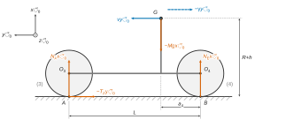
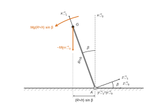
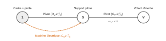
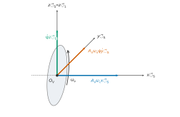

# Centrale-Supélec PSI — Sciences industrielles 2026 · Corrigé guidé

*Corrigé rédigé par IA, non officiel. Signalez toute erreur.*

## Présentation du sujet

**Thème.** Un scooter urbain à basse vitesse est un pendule inversé : sous 35 km/h, l'effet gyroscopique des roues ne suffit plus et la moindre perturbation de roulis le fait tomber. Le sujet étudie un dispositif anti-chute. Un **actionneur gyroscopique** est fixé au cadre : un volant tourne à vitesse constante $\omega_v$ sur un support dont l'orientation $\psi$ est pilotée par une machine électrique. Faire précesser le volant crée un couple de redressement sur le cadre. Il faut concevoir la loi de commande qui calcule $C_m$ à partir des mesures disponibles. L'épreuve dure 4 heures, avec calculatrice. Elle comporte **30 questions** et pas de document réponse.

- **Partie A — Temps disponible (Q1 à Q4).** Dynamique plane du freinage sur la roue avant : transfert de charge, condition de non-décollage de la roue arrière, décélération maximale à la limite d'adhérence, temps pour passer de 50 à 35 km/h. Partie courte, entièrement autonome, très rentable.
- **Partie B — Modèle de roulis (Q5 à Q10).** Bilan d'actions en 3D, accélération d'un point d'un solide en rotation autour de la droite de contact, moment dynamique avec une matrice d'inertie non diagonale, théorème du moment dynamique bien projeté. On obtient $\ddot\beta=K_1\sin\beta$, puis la transformée de Laplace **avec condition initiale**, et l'instabilité.
- **Partie C — Gyroscope et première commande (Q11 à Q16).** Graphe de structure, démarche d'isolement, moment cinétique et dynamique du volant, couple moteur. Puis une boucle à correcteur proportionnel dont la fonction de transfert n'a pas de terme en $p^2$ : instabilité structurelle.
- **Partie D — Loi de commande (Q17 à Q28).** Retour sur trois mesures, mise en équation d'un schéma-bloc à boucles imbriquées, placement de pôles par un système linéaire complexe résolu en Python, lecture de réponses indicielles, gain de pré-compensation, correcteur IP réglé dans Bode, robustesse en $\omega_v$ et en masse, lieux des pôles.
- **Partie E — Synthèse (Q29, Q30).** Bilan argumenté exigence par exigence, puis proposition d'évolution.

**Notions du programme mobilisées.** Statique et dynamique du solide (torseurs, théorèmes généraux, frottement de Coulomb), cinématique du solide (dérivation vectorielle en base mobile), cinétique (matrice d'inertie, moment cinétique et dynamique, transport, Huygens), graphe de structure. Transformée de Laplace avec conditions initiales, schémas-blocs, stabilité par les pôles et par les marges, précision (théorème de la valeur finale, classe), correcteur à action intégrale, placement de pôles, lecture de lieux de pôles et de droites iso-amortissement. Python : `numpy`, `np.linalg.solve`.

**Difficulté et longueur.** Le sujet est de longueur raisonnable pour 4 heures, mais il est exigeant en rigueur sur trois points : Q6 à Q8 (mécanique 3D), Q17 (lecture des prélèvements sur la figure 10) et les questions de lecture de courbes, qui demandent des valeurs chiffrées. Les questions Q1 à Q4, Q9 à Q14, Q19 à Q25 sont **abordables et ne doivent pas être laissées**. Les lectures de figures (Q21, Q26, Q27, Q28) restent faisables même si les calculs qui les précèdent ont échoué.

**Gestion du temps conseillée.** Partie A : 25 min. Partie B : 45 min. Partie C : 40 min. Partie D : 1 h 45. Partie E : 20 min. La partie C.I (gyroscope) est indépendante de la partie B et peut être traitée avant.

## Partie A — Temps de stabilisation maximal pour la mise en action de l'assistance

On modélise un freinage d'urgence en ligne droite, roue avant seule, à la limite d'adhérence. Outils : isolements successifs, principe fondamental de la dynamique en translation, loi de Coulomb.

### Question 1

> [!INDICATION]
> Faites le bilan complet des actions sur la roue arrière, sans oublier ce que l'énoncé dit du moteur et de la masse des roues.

> [!INDICATION]
> Choisissez un point et un axe qui éliminent les inconnues de la liaison pivot.

#### Solution

On isole la roue arrière (4). Actions extérieures :

- liaison pivot parfaite d'axe $(O_4,\vec z_1)$ avec (1) : moment en $O_4$ sans composante sur $\vec z_1$ ;
- couple moteur : nul par hypothèse ;
- sol : $\{N_B\vec x_0-T_B\vec y_0\,;\,\vec0\}_B$.

La masse et l'inertie de (4) sont négligées, donc son torseur dynamique est nul. Le théorème du moment dynamique en $O_4$, projeté sur $\vec z_1=\vec z_0$, donne avec $\overrightarrow{O_4B}=-R\vec x_0$ :

$$\begin{aligned}0&=\big[(-R\vec x_0)\wedge(N_B\vec x_0-T_B\vec y_0)\big]\cdot\vec z_0\\&=R\,T_B\end{aligned}$$

Comme $R\neq0$ :

$$\boxed{T_B=0}$$

> [!METHODE]
> Pour annuler une composante d'effort sur une roue sans masse, on écrit le moment sur l'axe de la pivot, au centre de la roue : seules les actions qui ont un bras de levier subsistent.

> [!PIEGE]
> Le théorème de la résultante ne donne rien ici : les inconnues de la pivot absorbent tout. Il faut aussi citer les trois hypothèses utilisées (pivot parfaite, couple moteur nul, inertie négligée).

### Question 2

> [!INDICATION]
> L'ensemble est en translation et les roues sont sans masse : que vaut le moment dynamique en $G$ ?

> [!INDICATION]
> Deux équations de résultante et une équation de moment. Pour le moment, choisissez le point qui élimine le poids et le moment dynamique.

#### Solution

On isole $\Sigma$. On a $\vec\Gamma_G=-\gamma\vec y_0$ et $\vec\delta(G,\Sigma/0)=\vec0$.

Actions extérieures :

- le poids $-Mg\vec x_0$ en $G$ ;
- $N_A\vec x_0-T_A\vec y_0$ en $A$ ;
- $N_B\vec x_0$ en $B$ (Q1).



Résultante :

- sur $\vec x_0$ : $N_A+N_B=Mg$ ;
- sur $\vec y_0$ : $T_A=M\gamma$.

Moment en $G$ sur $\vec z_0$. On a $\overrightarrow{GA}=-(R+h)\vec x_0+(L-a_4)\vec y_0$ et $\overrightarrow{GB}=-(R+h)\vec x_0-a_4\vec y_0$, d'où :

$$(R+h)T_A-(L-a_4)N_A+a_4N_B=0 .$$

En reportant :

$$\begin{aligned}&\boxed{N_A=\frac{M\big[a_4g+(R+h)\gamma\big]}{L}}\\&\boxed{N_B=\frac{M\big[(L-a_4)g-(R+h)\gamma\big]}{L}}\\&\boxed{T_A=M\gamma}\end{aligned}$$

Contrôles : $N_A+N_B=Mg$ ne dépend pas de $\gamma$. À l'arrêt, $70\,\%$ du poids est sur l'arrière. Le freinage transfère de la charge vers l'avant.

> [!PIEGE]
> Le point $A$ est au sol et $G$ à la hauteur $R+h$, pas $h$. En effet, $\overrightarrow{O_4G}=h\vec x_0+a_4\vec y_0$ part du centre de la roue. Oublier le rayon sous-estime le transfert de charge.

### Question 3

> [!INDICATION]
> Une liaison sphère-plan est unilatérale : traduisez « rester en contact » par une inégalité.

> [!INDICATION]
> Pour borner $\gamma$ sans utiliser Q4, la loi de Coulomb appliquée à l'ensemble des contacts suffit.

#### Solution

Le contact arrière est maintenu si et seulement si $N_B\geq0$, c'est-à-dire $\gamma\leq\gamma_{\text{déc}}$, avec :

$$\begin{aligned}\gamma_{\text{déc}}&=\frac{(L-a_4)g}{R+h}\\&=\frac{0{,}945\times9{,}81}{0{,}810}\\&=11{,}4\ \text{m·s}^{-2}.\end{aligned}$$

Or :

$$\begin{aligned}M\gamma&=T_A\\&\leq fN_A\\&\leq fMg\end{aligned}$$

Donc $\gamma\leq fg$, avec $fg=5{,}89\ \text{m·s}^{-2}$. Même dans ce cas, $N_B=934$ N reste positif. **La roue arrière ne décolle pas : l'exigence 1.3 est satisfaite.**

> [!JURY]
> Une conclusion du type « le scooter ne bascule pas » doit toujours s'appuyer sur un critère écrit ($N_B\geq0$, unilatéralité) et se rattacher explicitement à l'exigence du diagramme concernée.

### Question 4

> [!INDICATION]
> « À la limite du glissement » se traduit par une égalité de Coulomb en $A$. Attention : $N_A$ dépend lui-même de $\gamma$.

> [!INDICATION]
> Le mouvement est uniformément décéléré. Convertissez les vitesses en m/s.

#### Solution

$T_A=fN_A$ s'écrit $M\gamma=fM\big[a_4g+(R+h)\gamma\big]/L$, d'où :

$$\boxed{\gamma_{\max}=\frac{f\,a_4\,g}{L-f(R+h)}}$$

Numériquement :

$$\begin{aligned}\gamma_{\max}&=\frac{0{,}6\times0{,}405\times9{,}81}{1{,}350-0{,}6\times0{,}810}\\&=2{,}76\ \text{m·s}^{-2}.\end{aligned}$$

Puis :

$$\begin{aligned}t_{fr}&=\frac{(50-35)/3{,}6}{2{,}759}\\&=\frac{4{,}17}{2{,}759}\\&=\boxed{1{,}51\ \text{s}}\end{aligned}$$

$t_{fr}$ est le temps minimal avant de passer sous 35 km/h : c'est le temps dont dispose l'assistance pour agir. L'exigence 1.1 ($t_{\max}\leq1{,}5$ s) est donc cohérente avec le freinage le plus violent, sans marge.

> [!PIEGE]
> Prendre $N_A$ à sa valeur statique $Mga_4/L$ donne $\gamma=1{,}77\ \text{m·s}^{-2}$. On trouverait alors $t_{fr}=2{,}4$ s, et la conclusion serait faussement rassurante. Autre contresens : conclure « $t_{fr}>t_{\max}$ donc c'est mauvais ». On compare un temps disponible à un temps de mise en action, et un freinage plus lent laisse plus de temps.

## Partie B — Modélisation comportementale à petite vitesse

On établit l'équation du roulis du scooter seul. Le scooter tourne autour de la droite de contact $(AB)$, dirigée selon $\vec y_1=\vec y_0$. Tout le travail consiste à exploiter cette géométrie pour éliminer les efforts de contact inconnus.

### Question 5

> [!INDICATION]
> Ne retenez que les actions extérieures à $\Sigma$. Quelles liaisons sont intérieures ?

> [!INDICATION]
> Le problème n'est plus plan : combien de composantes faut-il pour chaque action de contact ?

#### Solution

Les pivots $(O_2,\vec x_2)$, $(O_3,\vec z_2)$ et $(O_4,\vec z_1)$ sont intérieures. Il reste trois actions :

- pesanteur : $\{-Mg\,\vec x_0\,;\,\vec0\}_G$ ;
- sol sur (3) : $\{X_A\vec x_0+Y_A\vec y_0+Z_A\vec z_0\,;\,\vec0\}_A$ ;
- sol sur (4) : $\{X_B\vec x_0+Y_B\vec y_0+Z_B\vec z_0\,;\,\vec0\}_B$.

Le moment de chaque action de contact est nul au point de contact (sphère-plan). Les composantes latérales $Z_A$ et $Z_B$ ne sont pas nulles a priori.

> [!METHODE]
> Le bilan d'actions prépare le choix du théorème : six inconnues de contact, toutes à moment nul en $A$ ou portées par un point de l'axe $(A,\vec y_1)$. On devine déjà le point et l'axe de projection de Q8.

### Question 6

> [!INDICATION]
> Décomposez $\overrightarrow{O_0G}$ en passant par un point de contact, qui décrit la trajectoire rectiligne, puis par des vecteurs liés à (1).

> [!INDICATION]
> $\vec\Omega(1/0)=\dot\beta\vec y_1$ avec $\vec y_1$ fixe. Calculez les dérivées de $\vec x_1$ et de $\vec z_1$ dans $\mathcal B_0$, et dérivez deux fois.

#### Solution

On passe par $B$, qui avance à $v\,\vec y_0$ : $\overrightarrow{O_0G}=\overrightarrow{O_0B}+(R+h)\vec x_1+a_4\vec y_1$. Le paramétrage par la roue avant mène au même point $G$.

On a :

$$\begin{aligned}\frac{\text d\vec x_1}{\text dt}\Big|_0&=\dot\beta\vec y_1\wedge\vec x_1\\&=-\dot\beta\vec z_1\\ \frac{\text d\vec z_1}{\text dt}\Big|_0&=\dot\beta\vec x_1\end{aligned}$$

Donc :

$$\vec V(G\in1/0)=v\,\vec y_1-(R+h)\dot\beta\,\vec z_1 ,$$

$$\boxed{\vec\Gamma_{G,1/0}=-(R+h)\dot\beta^2\,\vec x_1+\dot v\,\vec y_1-(R+h)\ddot\beta\,\vec z_1}$$

On retrouve un pendule de longueur $R+h$ : terme centripète, terme orthoradial, et la translation $\dot v$ selon l'axe de rotation.

> [!PIEGE]
> Oublier le terme centripète en $\dot\beta^2$ revient à ne dériver $\vec z_1$ qu'une fois. Le déport $a_4\vec y_1$ ne produit rien, puisque $\vec y_1$ est fixe : il faut le dire.

### Question 7

> [!INDICATION]
> Le moment cinétique en $G$ s'obtient avec la matrice d'inertie. Elle n'est pas diagonale : le produit $F_1$ intervient.

> [!INDICATION]
> Pour passer de $G$ à $A$, utilisez la relation de transport du torseur dynamique, valable pour tout point, et ne gardez que la composante sur $\vec y_1$.

#### Solution

$$\begin{aligned}\vec\sigma(G,1/0)&=\begin{pmatrix}A_1&-F_1&0\\-F_1&B_1&0\\0&0&C_1\end{pmatrix}\begin{pmatrix}0\\\dot\beta\\0\end{pmatrix}_{\mathcal B_1}\\&=-F_1\dot\beta\,\vec x_1+B_1\dot\beta\,\vec y_1 .\end{aligned}$$

$G$ est le centre d'inertie, donc on dérive dans $\mathcal B_0$ :

$$\boxed{\vec\delta(G,1/0)=-F_1\ddot\beta\,\vec x_1+B_1\ddot\beta\,\vec y_1+F_1\dot\beta^2\,\vec z_1}$$

On transporte au point $A$ :

$$\vec\delta(A,1/0)=\vec\delta(G,1/0)+\overrightarrow{AG}\wedge M\vec\Gamma_G .$$

Ici $\overrightarrow{AG}=(R+h)\vec x_1+(a_4-L)\vec y_1$. Sur $\vec y_1$, le produit vectoriel donne :

$$\begin{aligned}(\overrightarrow{AG}\wedge\vec\Gamma_G)\cdot\vec y_1&=AG_z\Gamma_x-AG_x\Gamma_z\\&=(R+h)^2\ddot\beta\end{aligned}$$

D'où :

$$\boxed{\vec\delta(A,1/0)\cdot\vec y_1=\big[B_1+M(R+h)^2\big]\ddot\beta}$$

C'est le moment d'inertie autour de l'axe $(A,\vec y_1)$, par le théorème de Huygens.

> [!PIEGE]
> Écrire $\vec\delta(A)=\dfrac{\text d\vec\sigma(A)}{\text dt}$ est faux, car $A$ n'est pas fixe. La relation $\vec\delta(A)=\vec\delta(G)+\overrightarrow{AG}\wedge M\vec\Gamma_G$ est toujours vraie.

### Question 8

> [!INDICATION]
> Montrez que les actions du sol en $A$ et en $B$ ont un moment nul en projection sur $\vec y_1$, au point $A$.

> [!INDICATION]
> Pour le poids, exprimez $\vec x_0$ dans la base $\mathcal B_1$.

#### Solution

On applique le théorème du moment dynamique en $A$, sur $\vec y_1$ :

- l'action en $A$ a un moment nul en $A$ ;
- l'action en $B$ a pour moment $\overrightarrow{AB}\wedge\vec R_{0\to4}$. Or $\overrightarrow{AB}=-L\vec y_1$ est colinéaire à $\vec y_1$ : la projection est nulle ;
- le poids : avec $\vec x_0=\cos\beta\,\vec x_1+\sin\beta\,\vec z_1$, on obtient $\big[\overrightarrow{AG}\wedge(-Mg\vec x_0)\big]\cdot\vec y_1=Mg(R+h)\sin\beta$.



$$\boxed{\ddot\beta=q(\beta)=\frac{Mg(R+h)}{B_1+M(R+h)^2}\sin\beta}$$

> [!METHODE]
> Pour un solide qui bascule autour d'une droite de contact, on écrit le moment sur cette droite : toutes les actions de contact disparaissent d'un coup.

> [!PIEGE]
> Le signe : pour $\beta>0$, le poids éloigne le scooter de la verticale, donc $\ddot\beta$ a le signe de $\beta$. Un signe moins conduirait à conclure à tort à la stabilité.

### Question 9

> [!INDICATION]
> Transformez l'équation en gardant les conditions initiales : c'est $\dot\beta(0)$ qui joue le rôle d'entrée.

> [!INDICATION]
> Pour identifier avec $K/(1-cp^2)$, factorisez le dénominateur pour faire apparaître un terme constant égal à 1.

#### Solution

On a $K_1=\dfrac{Mg(R+h)}{B_1+M(R+h)^2}$. La transformée de Laplace donne $p^2\beta(p)-p\beta(0)-\dot\beta(0)=K_1\beta(p)$, avec $\beta(0)=0$ et $\dot\beta(0)=\Omega_0$. Donc :

$$\begin{aligned}\beta(p)&=\frac{\Omega_0}{p^2-K_1}\\&=\frac{-1/K_1}{1-p^2/K_1}\Omega_0\end{aligned}$$

Par identification :

$$\boxed{\begin{aligned}c&=\frac1{K_1}\\&=\frac{B_1+M(R+h)^2}{Mg(R+h)}\\K&=-\frac{1}{K_1}\\&=-c\end{aligned}}$$

$K$ est négatif parce que la forme imposée a un gain statique égal à $+1$. En résolvant directement $\ddot\beta=K_1\beta$ (équation caractéristique $r^2=K_1$) avec les conditions initiales de l'énoncé :

$$\beta(t)=\frac{\Omega_0}{\sqrt{K_1}}\sinh(\sqrt{K_1}t)$$

> [!PIEGE]
> Annuler les conditions initiales « par habitude » fait disparaître l'entrée et vide la question de son sens.

### Question 10

> [!INDICATION]
> Où sont les pôles de $1/(1-cp^2)$ quand $c>0$ ?

#### Solution

Les pôles sont $\pm\sqrt{K_1}$. Le pôle $+\sqrt{K_1}>0$ rend le système instable, et $\beta(t)$ diverge en sinus hyperbolique. **Le scooter tombe à la moindre perturbation : un système anti-chute actif est indispensable.**

> [!PIEGE]
> Ne confondez pas $1/(1-cp^2)$ (pôles réels opposés, divergence) avec $1/(1+cp^2)$ (pôles imaginaires, oscillation).

## Partie C — Modélisation de l'ensemble {scooter + pilote + gyroscope}

On établit la loi du couple moteur du gyroscope, puis on montre qu'un retour sur le seul angle $\beta$ ne peut pas stabiliser le scooter. Outils : cinétique d'un solide de révolution, dérivation en base mobile, algèbre de schéma-bloc, relations coefficients-racines.

### Question 11

> [!INDICATION]
> Un graphe de structure, c'est le graphe des liaisons plus les actions mécaniques extérieures. Précisez les axes des liaisons.

#### Solution



Les deux axes de rotation, $\vec z_S=\vec z_1$ et $\vec x_V=\vec x_S$, sont orthogonaux : c'est ce qui rend l'effet gyroscopique exploitable. La machine électrique exerce $-C_m\vec z_S$ sur (1). La pesanteur est négligée, ainsi que la masse et le moment dynamique de (S).

### Question 12

> [!INDICATION]
> On cherche $C_m$ seul : quel ensemble isoler pour que la liaison $S$–$V$ disparaisse ?

> [!INDICATION]
> Sur quel axe le moment de la pivot $1$–$S$ est-il nul ?

#### Solution

1. On isole $\{S+V\}$.
2. Bilan : $\mathcal T_{1\to S}$ et $\mathcal T_{m\to S}$, de moment $C_m\vec z_S$. Le moment de $\mathcal T_{1\to S}$ en $O_V$ n'a pas de composante sur $\vec z_S$.
3. Théorème du moment dynamique en $O_V$, dans $\mathcal R_1$ galiléen et projeté sur $\vec z_S$. Il donne $C_m=\vec\delta(O_V,\{S+V\}/1)\cdot\vec z_S$. Le moment dynamique de (S) étant négligé, ce terme se réduit à $\vec\delta(O_V,V/1)\cdot\vec z_S$.
4. $O_V$ est fixe dans $\mathcal R_1$ et c'est le centre d'inertie de (V). On calcule donc $\vec\sigma(O_V,V/1)$ et on le dérive dans $\mathcal R_1$.

> [!JURY]
> Une démarche se juge sur sa précision : l'ensemble isolé, le bilan, le théorème, le point et l'axe de projection, chacun justifié par l'inconnue qu'il élimine. « On applique le PFD » ne suffit pas.

### Question 13

> [!INDICATION]
> Composez les rotations, puis appliquez la matrice d'inertie dans la base où elle est donnée.

#### Solution

$\vec\Omega(V/1)=\omega_v\vec x_S+\dot\psi\vec z_S$. Le volant est de révolution d'axe $\vec x_S$, donc sa matrice garde la même forme dans $\mathcal B_S$ :

$$\boxed{\vec\sigma(O_V,V/1)=A_V\omega_v\,\vec x_S+B_V\dot\psi\,\vec z_S}$$

> [!PIEGE]
> Oublier $\dot\psi\vec z_S$ fait disparaître le terme $B_V\ddot\psi$, c'est-à-dire tout le résultat de Q14.

### Question 14

> [!INDICATION]
> Dérivez dans $\mathcal R_1$ en passant par $\mathcal R_S$ : $\dfrac{\text d}{\text dt}\Big|_1=\dfrac{\text d}{\text dt}\Big|_S+\vec\Omega(S/1)\wedge$.

> [!INDICATION]
> Projetez ensuite sur $\vec z_S$, comme prévu en Q12.

#### Solution

$$\begin{aligned}\vec\delta(O_V,V/1)&=B_V\ddot\psi\,\vec z_S+\dot\psi\vec z_S\wedge A_V\omega_v\vec x_S\\&=B_V\ddot\psi\,\vec z_S+A_V\omega_v\dot\psi\,\vec y_S .\end{aligned}$$



En projection sur $\vec z_S$ :

$$\boxed{C_m=B_V\ddot\psi}$$

Le couple gyroscopique $A_V\omega_v\dot\psi\,\vec y_S$ est repris par la liaison et transmis au cadre. Un petit couple moteur produit donc un grand couple de redressement. Si l'on tient compte du roulis du cadre ($\dot\beta\vec y_1$, $\psi\approx0$), on obtient un terme supplémentaire $-A_V\omega_v\dot\beta$, et l'on retrouve l'équation (2) de l'énoncé.

> [!METHODE]
> Contrôler un résultat intermédiaire sur une équation fournie plus loin par l'énoncé est le meilleur filet de sécurité.

### Question 15

> [!INDICATION]
> Écrivez les trois relations de la figure 9 dans le domaine de Laplace et éliminez $\psi$.

> [!INDICATION]
> « Forme canonique » : un dénominateur dont le terme constant vaut 1. Regardez quelles puissances de $p$ apparaissent.

#### Solution

On note $J=I_{1y}+B_V$, $\Lambda=A_V\omega_v$ et $m=Mgh_2$. Les relations sont :

$$\begin{aligned}Jp^2\beta&=-\Lambda p\psi+m\beta\\B_Vp^2\psi&=C_m+\Lambda p\beta\\C_m&=K_{\text{cor}}(\beta_c-\beta)\end{aligned}$$

On tire $\Lambda p\psi=(m-Jp^2)\beta$ de la première. En reportant dans la deuxième, on obtient :

$$\Lambda C_m=\big[B_Vmp-B_VJp^3-\Lambda^2p\big]\beta .$$

Avec la troisième :

$$\boxed{\frac{\beta(p)}{\beta_c(p)}=\frac{1}{1+\dfrac{B_VMgh_2-(A_V\omega_v)^2}{A_V\omega_vK_{\text{cor}}}p-\dfrac{B_V(I_{1y}+B_V)}{A_V\omega_vK_{\text{cor}}}p^3}}$$

Le gain statique vaut 1, et il n'y a pas de terme en $p^2$.

### Question 16

> [!INDICATION]
> Un coefficient du polynôme caractéristique est nul. Que vaut alors la somme des racines ?

> [!INDICATION]
> Si les trois racines étaient à partie réelle strictement négative, que vaudrait le signe de leur somme ?

#### Solution

Le dénominateur, à un facteur près, est $P(p)=B_VJp^3+(\Lambda^2-B_Vm)p-\Lambda K_{\text{cor}}$. La somme des racines vaut $0$, ce qui est incompatible avec trois racines à partie réelle strictement négative. Pour $K_{\text{cor}}>0$, le produit $\Lambda K_{\text{cor}}/(B_VJ)>0$ impose même une racine réelle positive. **Le système est instable quel que soit $K_{\text{cor}}$** : l'instabilité est structurelle. Aucune exigence n'est accessible (1.2.1, 1.2, 1.1). Il faut des mesures supplémentaires.

> [!PIEGE]
> Conclure « instable si $K_{\text{cor}}$ est trop grand » est faux : aucun réglage ne convient. Il faut aussi répondre à la seconde moitié de la question, qui porte sur le cahier des charges.

> [!METHODE]
> Un polynôme dont un coefficient est nul, ou dont deux coefficients sont de signes opposés, a au moins une racine à partie réelle positive ou nulle. En effet, un polynôme réel dont toutes les racines sont à partie réelle strictement négative se factorise en facteurs $(p+a)$ et $(p^2+bp+c)$ avec $a,b,c>0$, et tous ses coefficients sont alors strictement de même signe.

## Partie D — Étude de la loi de commande

On remplace le retour proportionnel par un retour sur trois mesures, dont on règle les gains par placement de pôles. On ajoute ensuite une pré-compensation, puis un correcteur IP pour la robustesse. Outils : algèbre de schémas-blocs, Python, lecture de réponses temporelles, diagramme de Bode, lieux des pôles.

### I — Mise en place d'une loi de commande stabilisante

### Question 17

> [!INDICATION]
> Repérez sur la figure 10 où chaque gain prélève son signal. Le gain $A_V\omega_v$ placé après le premier $1/p$ vous dit ce qui circule à cet endroit : comparez avec l'équation (1).

> [!INDICATION]
> Écrivez trois relations (comparateurs, chaîne gyroscope, chaîne scooter), puis exprimez la variable intermédiaire en fonction de $\beta$.

> [!INDICATION]
> Vérifiez que $A$ ne dépend que de $k_1$ et $k_3$.
>
> De même, $B$ ne doit dépendre que de $k_2$, et $C$ que de $k_3$ : c'est le test de votre lecture du schéma.

#### Solution

Les trois retours portent sur :

- $k_1$ : $\beta$ ;
- $k_2$ : $\dot\beta$ ;
- $k_3$ : $W=\dot\psi$, sortie du $1/p$ qui suit $1/B_V$.

Les comparateurs donnent :

$$\begin{aligned}C_m&=\beta_c-k_1\beta-k_2p\beta-k_3W\\B_VpW&=C_m+\Lambda p\beta\\Jp^2\beta&=m\beta-\Lambda W .\end{aligned}$$

On en tire $W=(m-Jp^2)\beta/\Lambda$, puis $C_m=\big[B_Vp(m-Jp^2)/\Lambda-\Lambda p\big]\beta$. En égalant les deux expressions de $C_m$ et en multipliant par $\Lambda$ :

$$\Big[(\Lambda k_1+mk_3)+(\Lambda k_2+B_Vm-\Lambda^2)p-Jk_3p^2-B_VJp^3\Big]\beta=\Lambda\beta_c$$

$$\boxed{\begin{aligned}A&=A_V\omega_vk_1+Mgh_2k_3\\B&=A_V\omega_vk_2+B_VMgh_2-(A_V\omega_v)^2\\C&=(I_{1y}+B_V)k_3\\D&=B_V(I_{1y}+B_V)\end{aligned}}$$

Avec $k_2=0$, $k_3=0$ et $k_1=K_{\text{cor}}$, on retrouve le dénominateur de Q15. C'est le retour $k_3$ qui crée le terme en $p^2$ et rend la stabilisation possible.

> [!PIEGE]
> L'énoncé parle de la mesure de « l'angle $\psi$ », mais le schéma prélève $k_3$ sur $\dot\psi$ : seule cette lecture donne la forme imposée. Les comparateurs sont soustractifs pour les trois retours.

### Question 18

> [!INDICATION]
> Il ne s'agit que de regrouper les termes selon $k_1$, $k_2$ et $k_3$ au lieu des puissances de $p_i$. Tout ce qui ne dépend d'aucun gain va dans $E_0$.

#### Solution

$$\boxed{\begin{aligned}E_0(p_i)&=\big[B_VMgh_2-(A_V\omega_v)^2\big]p_i-B_V(I_{1y}+B_V)p_i^3\\E_1(p_i)&=A_V\omega_v\\E_2(p_i)&=A_V\omega_vp_i\\E_3(p_i)&=Mgh_2-(I_{1y}+B_V)p_i^2\end{aligned}}$$

D'où :

$$\begin{aligned}e_{01}&=B_VMgh_2-(A_V\omega_v)^2\\e_{03}&=B_V(I_{1y}+B_V)\\e_{10}&=A_V\omega_v\\e_{21}&=A_V\omega_v\\e_{30}&=Mgh_2\\e_{32}&=I_{1y}+B_V\end{aligned}$$

Ces expressions ont bien la forme annoncée par l'énoncé.

### Question 19

> [!INDICATION]
> Une ligne par pôle, une colonne par gain. Les pôles sont complexes : quel type donner aux tableaux ?

> [!INDICATION]
> `enumerate` fournit à la fois l'indice de ligne et le pôle. La résolution se fait avec une seule fonction de l'annexe.

#### Solution

```python
import numpy as np
P=[p1,p2,p3]
E=[e01,e03,e10,e21,e30,e32]
A=np.zeros((3,3),dtype=complex)
B=np.zeros((3,1),dtype=complex)
for i,p in enumerate(P):
    A[i,0]=E[2]                   # E1(pi) = e10
    A[i,1]=E[3]*p                 # E2(pi) = e21*pi
    A[i,2]=E[4]-E[5]*p**2         # E3(pi) = e30 - e32*pi**2
    B[i,0]=-(E[0]*p-E[1]*p**3)    # -E0(pi) = -(e01*pi - e03*pi**3)
L=np.linalg.solve(A,B)
```

$L$ est de forme $3\times1$, comme l'affichage de l'énoncé. Ce code, exécuté sur un jeu de paramètres fictif, redonne bien des gains qui placent les pôles en $-5{,}4\pm2{,}62j$ et $-60$.

> [!PIEGE]
> Sans `dtype=complex`, l'affectation d'un complexe dans un tableau réel échoue ou perd la partie imaginaire. N'oubliez pas non plus le signe moins du second membre.

### Question 20

> [!INDICATION]
> Comparez l'ordre de grandeur des parties imaginaires à la précision machine. Pourquoi la solution exacte est-elle réelle ?

#### Solution

Les $e_{ij}$ sont réels et $p_2=\overline{p_1}$ : les deux premières équations sont conjuguées, donc la solution est réelle. Les parties imaginaires ($10^{-14}$ à $10^{-19}$) sont des erreurs d'arrondi.

$$\boxed{\begin{aligned}k_1&\simeq-128{,}9\\k_2&\simeq-15{,}62\\k_3&\simeq3{,}186\cdot10^{-2}\end{aligned}}$$

Unités : N·m/rad, N·m·s/rad et N·m·s/rad. Contrôle :

$$\begin{aligned}\frac CD&=\frac{k_3}{B_V}\\&=-(p_1+p_2+p_3)\\&=70{,}8\ \text{s}^{-1}\end{aligned}$$

d'où $B_V=4{,}5\cdot10^{-4}\ \text{kg·m}^2$.

> [!METHODE]
> La somme des pôles imposés fixe directement le rapport $C/D$ : c'est un contrôle immédiat de la cohérence entre $k_3$ et le placement de pôles.

### Question 21

> [!INDICATION]
> Analysez quatre critères : stabilité, amortissement, rapidité, précision. Utilisez le zoom de droite.

> [!INDICATION]
> Comparez la valeur finale à la consigne, en valeur et en signe.

#### Solution

L'échelon de $10^{-2}$ rad est appliqué à $t=0{,}1$ s.

- **Stable** : $\beta$ converge.
- **Bien amorti** : pas de dépassement visible ($\xi=0{,}9$ donne $0{,}15\,\%$) ; tangente horizontale à l'origine (ordre 3).
- **Rapidité** : $t_{5\%}\approx0{,}7$ s après l'échelon (la simulation donne $0{,}69$ s), un peu plus que les $0{,}5$ s visés.
- **Précision très mauvaise** : $\beta_\infty\approx-2{,}05\cdot10^{-4}$ rad, soit $H(0)\approx-2{,}05\cdot10^{-2}$. L'écart vaut environ $100\,\%$ de la consigne, avec un signe opposé.

**La boucle stabilise le scooter autour de zéro, mais elle ne suit pas une consigne d'inclinaison.**

> [!PIEGE]
> Lire la figure de gauche et écrire « $\beta$ reste nul ». Ou bien juger l'écart « faible » parce que $2\cdot10^{-4}$ est petit : un écart se compare toujours à la consigne.

### Question 22

> [!INDICATION]
> Le pré-compensateur multiplie le gain statique. Quelle condition sur $K_gH(0)$ annule l'écart en régime permanent ?

> [!INDICATION]
> Les paramètres physiques ne sont pas donnés : la valeur de $H(0)$ se lit sur la figure 11.

#### Solution

$H$ est stable, donc par le théorème de la valeur finale $\beta_\infty=K_gH(0)\beta^*_0$. On impose $K_gH(0)=1$ :

$$\begin{aligned}K_g&=\frac{1}{H(0)}\\&=k_1+\frac{Mgh_2}{A_V\omega_v}k_3\end{aligned}$$

Avec la valeur finale lue sur la figure 11 :

$$\boxed{K_g\approx\frac{10^{-2}}{-2{,}05\cdot10^{-4}}\approx-49}$$

La figure 13 le confirme : la réponse atteint $10^{-2}$ rad avec le même temps de réponse, puisque les pôles sont inchangés.

> [!PIEGE]
> $K_g$ est négatif. Un $K_g$ positif inclinerait le scooter du mauvais côté. L'expression littérale montre aussi que $K_g$ dépend de $M$ et de $\omega_v$ : c'est ce qui annonce la fragilité des figures 14 et 15.

### II — Analyse de la robustesse paramétrique

### Question 23

> [!INDICATION]
> Annulez la consigne $\beta_{\text{ref}}$ et suivez le signal depuis $\beta^*$ jusqu'à $S$. N'oubliez pas la branche $K_i$ qui prélève directement $\beta$.

#### Solution

On a $\beta=K_gH\beta^*$ et $\varepsilon_z=-\beta$, donc :

$$\begin{aligned}S&=\frac{K_i}{T_ip}\varepsilon_z-K_i\beta\\&=-K_i\frac{1+T_ip}{T_ip}\beta\end{aligned}$$

D'où :

$$\boxed{H_{bo}(p)=K_i\frac{1+T_ip}{T_ip}K_gH(p)}$$

En boucle ouverte, on a l'expression d'un PI. En boucle fermée, la structure IP n'introduit pas de zéro, ce qui limite le dépassement. La classe 1 garantit un écart statique nul, quelles que soient les dérives de $K_g$.

> [!PIEGE]
> Oublier la branche $K_i$ donne $K_iK_gH/(T_ip)$ : on perd le zéro $-1/T_i$, donc la remontée de phase dont dépendent Q24 et Q25.

### Question 24

> [!INDICATION]
> La phase de $H_{bo}$ est la somme de trois contributions. Laquelle se lit sur la figure 18 ?

> [!INDICATION]
> Écrivez la marge de phase à la pulsation imposée $\omega_{c\,\text{ext}}=4$ rad/s.

#### Solution

À $4$ rad/s, on lit $\arg(K_gH)\approx-70°$ (le calcul donne $-69°$). Donc :

$$\Delta\Phi=180°-90°+\arctan(4T_i)-70° .$$

La condition $\Delta\Phi\geq70°$ s'écrit donc :

$$\begin{aligned}\arctan(4T_i)&\geq50°\\4T_i&\geq1{,}19\end{aligned}$$

$$\boxed{T_i\geq0{,}30\ \text{s}}$$

> [!JURY]
> Dans un « montrer que », la valeur relevée sur la figure et la décomposition de la phase doivent apparaître explicitement : c'est ce qui rend la démonstration vérifiable.

### Question 25

> [!INDICATION]
> La marge est acquise. Il reste à amener le module à 0 dB à 4 rad/s. Lisez $|K_gH(4j)|$ et calculez le module du correcteur, sans approximation asymptotique.

#### Solution

On a $T_i\omega=1{,}2$, donc $\dfrac{\sqrt{1+1{,}44}}{1{,}2}=1{,}30$ (soit $+2{,}3$ dB). On lit $|K_gH(4j)|\approx-2{,}5$ dB, soit $0{,}75$. Donc :

$$K_i=\frac1{1{,}30\times0{,}75}$$

$$\boxed{K_i\approx1{,}0}$$

La valeur calculée est $1{,}02$. $T_i$ assure la marge de phase, et $K_i$ assure la pulsation de coupure.

> [!PIEGE]
> Ne mélangez pas décibels et valeurs linéaires. L'approximation $1/(T_i\omega)$ ferait une erreur d'un facteur $1{,}3$.

### Question 26

> [!INDICATION]
> Relevez sur la courbe corrigée la pulsation de coupure, la phase à cette pulsation, puis la pulsation où la phase vaut $-180°$.

> [!INDICATION]
> Pour conclure sur la stabilité à partir des marges, vérifiez d'abord que la boucle ouverte n'a aucun pôle à partie réelle positive.

#### Solution

- La coupure est à environ $4$ rad/s : exigence respectée.
- La phase vaut environ $-109°$ à la coupure, donc $\Delta\Phi\approx71°$ : exigence respectée, de justesse.
- La phase atteint $-180°$ vers $21$ rad/s. Le module y vaut environ $-23$ dB, d'où une marge de gain d'environ $23$ dB.

La boucle ouverte n'a pas de pôle à partie réelle positive (pôles : $0$, $-5{,}4\pm2{,}62j$, $-60$). Les marges de gain et de phase sont donc significatives, et toutes deux positives : **le système bouclé est stable**.

Les pôles de la boucle fermée calculés au nominal en Q28, tous à partie réelle négative, le confirment. En basse fréquence, la pente de $-20$ dB/décade et la phase de $-90°$ sont la signature de l'intégrateur.

> [!PIEGE]
> Ne parlez pas de « pulsation de coupure de la boucle non corrigée » : $K_gH$ part de 0 dB et décroît, elle ne coupe jamais l'axe 0 dB pour $\omega>0$.

### Question 27

> [!INDICATION]
> La figure 19 est une réponse à une condition initiale, pas à un échelon. Les figures 20 et 21 testent le suivi de consigne face aux variations de paramètres.

> [!INDICATION]
> Chiffrez chaque courbe (valeur finale, dépassement, temps de réponse), puis confrontez les valeurs aux exigences nommées, en comparant avec les figures 14 et 15.

#### Solution

*Figure 19.*

- $\beta$ passe par zéro vers $0{,}27$ s.
- Il atteint $-3{,}7\cdot10^{-2}$ rad vers $0{,}5$ s, soit $37\,\%$ de la perturbation.
- Il rentre dans $\pm5\,\%$ vers 1 s.

**Le rejet de la perturbation est assuré en environ 1 s**, mais l'oscillation révèle un amortissement effectif nettement inférieur à $0{,}9$.

*Figures 20 et 21.*

| Cas | Valeur finale | Dépassement | $t_{5\%}$ après l'échelon |
|---|---|---|---|
| nominal ($2000$ rad/s, $280$ kg) | $10^{-2}$ rad | nul | $\approx1{,}4$ s |
| $\omega_v=1800$ rad/s | $10^{-2}$ rad | nul | $\approx1{,}2$ à $1{,}3$ s |
| $\omega_v=2200$ rad/s | $10^{-2}$ rad | nul | $\approx1{,}5$ à $1{,}6$ s |
| $M=300$ kg | $10^{-2}$ rad | nul | $\approx1{,}3$ s |
| $M=260$ kg | $10^{-2}$ rad | nul | $\approx1{,}6$ s |

- **Précision** : écart statique nul partout, alors que les figures 14 et 15 montraient des écarts de $-18\,\%$ à $+18\,\%$. Robustesse en précision acquise.
- **Amortissement** : pas de dépassement sur les échelons, mais $37\,\%$ sur la figure 19. $\xi\geq0{,}9$ n'est pas vraiment tenu.
- **Rapidité** : $1{,}4$ s au nominal contre $0{,}7$ s avant l'IP (la simulation donne $1{,}43$ s). L'exigence de $1{,}5$ s est tenue de justesse, et dépassée pour $\omega_v=2200$ rad/s et $M=260$ kg.

**L'IP achète la précision robuste au prix d'un temps de réponse doublé.**

> [!PIEGE]
> Pour le temps de réponse, prenez la valeur finale égale à la consigne (l'intégrateur la garantit). Sur la figure 19, le « dépassement » se rapporte à $\beta(0)$.

### Question 28

> [!INDICATION]
> Trois lectures sur un lieu des pôles : la partie réelle (rapidité), la droite iso-amortissement la plus proche (amortissement), et le pôle le plus proche de l'axe imaginaire (dominance).

> [!INDICATION]
> Suivez le sens de variation avec $M$ grâce aux étiquettes. Regardez quel pôle devient dominant à $420$ kg dans chaque cas.

> [!INDICATION]
> Un pôle réel n'est pas forcément rapide, et des pôles complexes mal amortis ne dominent pas toujours la réponse.

#### Solution

*Sans action intégrale (figure 22).*

À $280$ kg, les pôles $-5{,}4\pm2{,}6j$ sont sur la droite $\xi=0{,}9$. Avec $\omega_0=6$ rad/s, le placement est réussi.

Quand $M$ croît, la partie réelle reste vers $-5{,}4$ et la partie imaginaire diminue. Les pôles deviennent réels vers $310$–$320$ kg, puis se séparent.

L'un part vers $-9{,}8$, l'autre tend vers environ $-1{,}2$ à $420$ kg. Ce dernier devient dominant, avec $t_{5\%}\approx2{,}5$ s.

Quand $M$ diminue, les pôles atteignent $-5{,}4\pm3{,}2j$ à $260$ kg. L'amortissement vaut alors $\xi\approx0{,}86<0{,}9$.

L'exigence 1.2.1 n'est donc pas tenue sur toute la plage $260$–$300$ kg, et la précision n'est pas robuste.

*Avec action intégrale (figure 23).* Il y a un pôle de plus.

À $260$ kg, on lit un pôle réel vers $-2{,}2$ et une paire vers $-4{,}1\pm6{,}3j$. Cette paire a un amortissement $\xi\approx0{,}54$.

Quand $M$ croît, le pôle réel s'éloigne jusqu'à $-6{,}1$. À $420$ kg, la paire s'est rapprochée de l'axe jusqu'à $-2{,}1\pm3{,}9j$, soit $\xi\approx0{,}47$.

Leurs parties réelles se croisent vers $340$–$350$ kg. **La stabilité est garantie sur toute la plage.** En revanche, $\xi\geq0{,}9$ n'est jamais respecté pour la paire complexe.

Sur la plage $260$–$300$ kg, le pôle réel domine. Il varie de $-2{,}2$ à $-2{,}6$. Cela explique les réponses sans dépassement et les temps de réponse de $1{,}2$ à $1{,}6$ s.

Au nominal, le calcul donne $-2{,}34$, $-3{,}89\pm6{,}04j$ et $-60{,}7$.

| Exigence | Sans intégrateur | Avec intégrateur |
|---|---|---|
| Écart statique nul | non (dérive de $-18\,\%$ à $+10\,\%$ en masse) | oui |
| $\xi\geq0{,}9$ | seulement pour $M\geq280$ kg | non ($\xi\approx0{,}5$) |
| $\Delta\Phi\geq70°$ | sans objet | oui ($71°$) |
| $t_{\max}\leq1{,}5$ s ($260$–$300$ kg) | oui ($0{,}7$ s) | de justesse ($1{,}2$ à $1{,}6$ s) |
| Stabilité jusqu'à $420$ kg | oui, mais lent ($\approx2{,}5$ s) | oui, mais mal amorti |

> [!METHODE]
> Sur une droite iso-amortissement d'angle $\theta$ avec l'axe réel négatif, $\xi=\cos\theta$. Pour un pôle $-a\pm jb$, on a $\xi=a/\sqrt{a^2+b^2}$ et $t_{5\%}\approx3/a$ s'il est dominant.

## Partie E — Synthèse

On fait le bilan exigence par exigence, puis on propose une évolution justifiée par le modèle.

### Question 29

> [!INDICATION]
> Reprenez chaque exigence du diagramme (1.1, 1.2, 1.2.1, 1.3, plus la précision ajoutée en Q22) et associez-lui un relevé chiffré.

> [!INDICATION]
> Distinguez les deux plages de masse, comme l'énoncé le demande, et ne confondez pas stabilité et performance.

#### Solution

*a) Plage $260$–$300$ kg.*

- 1.3 (contact) : satisfaite (Q3).
- 1.1 : temps disponible $1{,}51$ s (Q4). Réponse en $1{,}4$ s au nominal, mais en $1{,}5$ à $1{,}6$ s aux bornes. Tenue sans marge au nominal, dépassée aux bornes.
- 1.2.1 : marge de phase de $71°$, respectée de justesse. L'amortissement $\xi\geq0{,}9$ n'est pas respecté : $0{,}86$ sans IP à $260$ kg. Avec IP, il vaut environ $0{,}5$, et la figure 19 montre $37\,\%$ de dépassement.
- 1.2 et précision : écart statique nul et insensible à $\omega_v$ et $M$ grâce à l'IP.
- Rejet de perturbation : environ 1 s.

**L'architecture est pertinente sur la plage nominale** : elle stabilise un système instable par nature et assure une précision robuste. Mais elle n'a de marge ni en rapidité ni en amortissement.

*b) Plage $260$–$420$ kg.*

- La stabilité est conservée (figures 22 et 23).
- Sans IP, le pôle lent tend vers $-1{,}2$ ($t_{5\%}\approx2{,}5$ s) et la précision dérive.
- Avec IP, la paire $-2{,}1\pm3{,}9j$ donne $\xi\approx0{,}47$. Le dépassement atteint environ $20\,\%$ et $t_{5\%}\approx1{,}5$ s.

**Avec des gains fixes réglés pour $280$ kg, le cahier des charges n'est plus respecté sur la plage étendue.**

> [!JURY]
> Une synthèse se juge sur ses renvois précis : chaque affirmation cite un résultat chiffré et l'exigence visée par son numéro. « Les pôles sont à gauche, donc le cahier des charges est respecté » confond stabilité et performance.

### Question 30

> [!INDICATION]
> D'où vient la sensibilité à la masse ? Regardez de quoi dépendent $A$, $B$, $C$ et $D$ en Q17.

> [!INDICATION]
> Agissez soit sur la loi de commande (gains adaptés), soit sur l'actionneur, soit sur le système lui-même. Précisez pour chaque proposition l'exigence récupérée et son coût.

#### Solution

Les coefficients de Q17 dépendent de $M$ par $Mgh_2$ et $I_{1y}$, alors que les gains sont fixes.

1. **Séquencement de gains (solution recommandée).** On estime $\hat M$ (suspensions, ou couple $C_m$ nécessaire à l'équilibre) et on tabule hors ligne $(k_1,k_2,k_3,K_g)$ de 260 à 420 kg avec le calcul de Q19, puis on interpole. Les pôles restent en $-5{,}4\pm2{,}62j$ et $-60$ sur toute la plage. Coût : un capteur et une table.
2. **Plus d'autorité gyroscopique.** On augmente $A_V\omega_v$ d'environ $50\,\%$ ($420/280$). Cela suppose de faire évoluer la borne de $\omega_v$ ou la masse du volant.
3. **Moins d'instabilité.** On abaisse le centre de gravité : le taux $Mgh_2/(I_{1y}+B_V)$ diminue avec $h_2$.
4. **Réglage robuste unique.** On place les pôles pour le pire cas, ou on ajoute une avance de phase pour relever $\omega_{c\,\text{ext}}$.

**Évolution retenue : séquencement de $(k_1,k_2,k_3,K_g)$ sur une estimation de la masse embarquée.**

> [!METHODE]
> Une proposition d'évolution convaincante s'appuie sur le modèle construit dans le sujet : on identifie le paramètre responsable de l'écart, puis on agit dessus.

## Bilan

**Méthodes à retenir.**

- Roue sans masse, ni motrice ni freinée : effort tangentiel nul (moment sur l'axe de la pivot).
- Transfert de charge au freinage et limite d'adhérence : $N_A$ dépend de $\gamma$, à résoudre de façon couplée.
- Basculement autour d'une droite de contact : théorème du moment dynamique en un point de la droite, projeté sur elle. Toutes les actions de contact disparaissent, et l'on obtient un pendule inversé.
- $\vec\delta(A)=\vec\delta(G)+\overrightarrow{AG}\wedge M\vec\Gamma_G$ pour tout point $A$. La dérivée du moment cinétique ne vaut le moment dynamique qu'en un point fixe ou au centre d'inertie.
- Laplace avec conditions initiales : une condition initiale devient une entrée.
- Gyroscope : $\vec\delta=B_V\ddot\psi\,\vec z_S+A_V\omega_v\dot\psi\,\vec y_S$. Le couple de précession est repris par la liaison.
- Coefficient manquant ou de signe opposé dans le polynôme caractéristique : instabilité. La preuve passe par les relations coefficients-racines.
- Placement de pôles : identifier les coefficients, écrire un système linéaire, `np.linalg.solve` en complexes.
- Pré-compensation $K_g=1/H(0)$ : écart nul mais pas robuste. Action intégrale : classe 1, écart nul robuste, mais réponse plus lente.
- Réglage d'un PI ou IP dans Bode : $T_i$ par la marge de phase, $K_i$ par la coupure.
- Lieux des pôles : rapidité par $|\mathrm{Re}|$, amortissement par les droites iso-$\xi$, dominance.

**Prérequis à revoir.** Dérivation vectorielle en base mobile, matrice d'inertie non diagonale, théorème de Huygens, marges de stabilité, abaques du second ordre ($\xi$, dépassement, $\omega_0t_{5\%}$).

**Questions classiques transposables.** Freinage et adhérence d'un véhicule (Q2 à Q4), pendule inversé (Q8 à Q10), couple d'un gyroscope piloté (Q13, Q14), retour d'état et placement de pôles (Q17 à Q20), réglage d'un correcteur à action intégrale dans Bode (Q24, Q25), robustesse lue sur un lieu des pôles (Q28).
