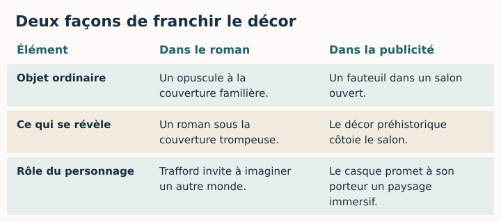

# Centrale-Supélec TSI — Anglais 2026 · Corrigé brut

*Corrigé rédigé par IA, non officiel. Signalez toute erreur.*

**Rédaction** · Claude Opus 5.5 · effort non renseigné · vitesse non renseignée

**Révision** · modèle non renseigné · effort non renseigné · vitesse non renseignée

**Révision** · GPT-6.2 Astra Ultra · vitesse non renseignée

**Révision (tour 3)** · GPT-6.2 Astra Ultra · vitesse non renseignée

Épreuve de 4 heures, sans calculatrice ni système électronique. Consigne : rédiger en anglais une synthèse de 400 mots des quatre documents, avec un titre obligatoire ; indiquer à la fin le nombre de mots, titre inclus ; un écart de 10 % est accepté, soit **360 à 440 mots**.

Documents : Rose Horowitch, « The Elite College Students Who Can't Read Books », *The Atlantic*, 1er octobre 2024 ; Joshua Rothman, « What's Happening to Reading? », *The New Yorker*, 17 juin 2025 ; Ben Elton, *Blind Faith*, roman, 2007 (extrait) ; publicité « Metaverse — It's just the beginning » de l'agence DPM, novembre 2021.

Convention de décompte retenue : un mot est une suite de caractères entre deux espaces ; un mot à trait d'union (*thirteen-year-olds*, *hyper-literacy*), un nombre (*55*, *2021*) et une forme à apostrophe (*Elton's*) comptent chacun pour un mot. Le titre est compté.

**Problématique** : que perd-on lorsque la lecture longue et attentive des livres cède la place aux expériences numériques ?

## Synthèse

**Turning the Page on Books?**

In a world of screens, is reading books becoming a thing of the past? Two American articles, by Rose Horowitch in The Atlantic and Joshua Rothman in The New Yorker, examine the decline of reading, while an extract from Ben Elton's dystopian novel Blind Faith and a 2021 advertisement for the Metaverse offer two contrasting visions of escape. They raise the question of what is lost when sustained reading gives way to digital experiences.

First, the articles describe a striking decline. Rothman notes that the share of American adults who read at least one book a year fell from 55 to 48 percent in a decade, while the proportion of thirteen-year-olds reading for fun almost every day fell from 27 to 14 percent over roughly the same period. Horowitch adds that even students at elite universities such as Columbia, who can decode texts perfectly well, now feel overwhelmed by the idea of reading several books a semester, so that some professors have shortened their reading lists.

Both journalists examine the competition for attention. Smartphones and streaming platforms offer constant distractions, and, as a psychologist quoted by Horowitch puts it, "being bored has become unnatural". Yet the problem is not only technical: many students choose not to read because they care more about their future careers. Rothman also insists that reading is changing rather than disappearing: some people enjoy a kind of "hyper-literacy", others switch between e-books and audio narration, and theorists even speak of a return to an oral culture of comments, podcasts and memes. The Metaverse advertisement goes further, promising total immersion: the open walls of a furnished room place a seated headset user face to face with prehistoric creatures, under the slogan "It's just the beginning".

For Horowitch and Elton, following a whole book makes distinctive demands on the imagination. In Horowitch’s account, "deep reading" develops critical thinking, self-reflection and empathy, by transporting readers into other minds, but only if they read whole works rather than excerpts. Elton's novel turns this idea into fiction: in a society where private thought is forbidden, Trafford reveals a copy of Wuthering Heights disguised as a pamphlet and presents it as "a door" to "a thousand universes", a way to escape through "reason and imagination". The advertisement promises a similar escape, yet one delivered by technology rather than built by the reader's own imagination.

the articles document the decline of sustained reading, even if reading itself is taking new forms. What is at stake is not just an old habit, but our capacity to concentrate, to imagine and to understand others.

**Number of words (title included): 434**

[Sujet officiel](https://www.concours-centrale-supelec.fr/sites/default/files/documents/G078-LV009.pdf)
