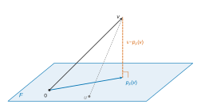
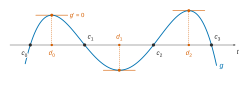
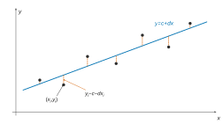
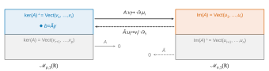
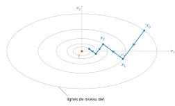

# Centrale-Supélec TSI — Mathématiques 1 2026 · Corrigé

*Corrigé rédigé par IA, non officiel. Signalez toute erreur.*

Sujet : *La méthode des moindres carrés* (4 heures, calculatrice autorisée). Notations de l'énoncé : $\langle\cdot,\cdot\rangle$ et $\|\cdot\|_2$ désignent les produits scalaires et normes canoniques.

Pour un sous-espace $F$ de dimension finie, $p_F$ désigne la projection orthogonale sur $F$.

## Partie A — Quelques problèmes de minimisation et de convergence

### I — Distance entre un vecteur et un sous-espace vectoriel

### Question 1

Les trois vecteurs sont non nuls et
$$\begin{aligned}
\langle e_1,e_2\rangle&=1-2+1+0=0,\\
\langle e_1,e_3\rangle&=1+0-1+0=0,\\
\langle e_2,e_3\rangle&=1+0-1+0=0.
\end{aligned}$$
Une famille orthogonale de vecteurs non nuls est libre. Comme $(e_1,e_2,e_3)$ engendre $F$ par définition, c'est une base orthogonale de $F$, et $\dim F=3$.

Les normes valent
$$\begin{aligned}
\|e_1\|_2&=\sqrt6,\\
\|e_2\|_2&=\sqrt3,\\
\|e_3\|_2&=\sqrt2,
\end{aligned}$$
d'où la base orthonormée
$$\boxed{\left(\tfrac{1}{\sqrt6}e_1,\ \tfrac{1}{\sqrt3}e_2,\ \tfrac{1}{\sqrt2}e_3\right).}$$

### Question 2

Soit $w=(x,y,z,t)^T$. Dans la base orthogonale $(e_1,e_2,e_3)$ de $F$,
$$\begin{aligned}
p_F(w)&=\sum_{i=1}^3\frac{\langle w,e_i\rangle}{\|e_i\|_2^2}e_i\\
&=\frac{x-2y+z}{6}e_1+\frac{x+y+z}{3}e_2+\frac{x-z}{2}e_3.
\end{aligned}$$
En réduisant au dénominateur $6$, les quatre coordonnées valent
$$\begin{aligned}
\tfrac16\big[(x-2y+z)+2(x+y+z)+3(x-z)\big]&=x,\\
\tfrac16\big[-2(x-2y+z)+2(x+y+z)\big]&=y,\\
\tfrac16\big[(x-2y+z)+2(x+y+z)-3(x-z)\big]&=z,\\
0&=0.
\end{aligned}$$
$$\boxed{p_F\begin{pmatrix}x\\y\\z\\t\end{pmatrix}=\begin{pmatrix}x\\y\\z\\0\end{pmatrix}.}$$
C'est cohérent : les $e_i$ ont une quatrième coordonnée nulle, donc $F\subset\{t=0\}$. L'égalité des dimensions donne alors $F=\{t=0\}$.

### Question 3

$F$ est de dimension finie, donc $\min_{u\in F}\|v-u\|_2$ existe. Il est atteint en $u=p_F(v)$ et vaut $\|v-p_F(v)\|_2$.

Par Q2, $p_F(v)=(1,1,1,0)^T$ et $v-p_F(v)=(0,0,0,1)^T$, d'où
$$\boxed{\min_{u\in F}\|v-u\|_2=1.}$$

### II — Séries de Fourier

### Question 4

*$f\in E$.* Sur $]-\pi,\pi]$, $f$ coïncide avec $t\mapsto\cos(\alpha t)$, continue. Au point $-\pi$, on a
$$\begin{aligned}
f(-\pi)&=f(\pi)=\cos(\alpha\pi),\\
\lim_{x\to-\pi^+}f(x)&=\cos(-\alpha\pi)=\cos(\alpha\pi).
\end{aligned}$$
Donc $f$ est continue sur $\mathbb R$ et $2\pi$-périodique ; elle est de plus $\mathcal C^1$ par morceaux.

*Parité.* Pour $x\in]-\pi,\pi[$, $f(-x)=\cos(-\alpha x)=f(x)$, et $f(-\pi)=f(\pi)$. Par périodicité, $f$ est paire.

Pour $n\geqslant1$, $t\mapsto f(t)\sin(nt)$ est impaire et $2\pi$-périodique. L'intégrale sur une période ne dépendant pas de la période choisie,
$$b_n(f)=\frac1\pi\int_{-\pi}^{\pi}f(t)\sin(nt)\,dt=0.$$

*Calcul de $a_0$.* Comme $\alpha\neq0$ :
$$\begin{aligned}
a_0(f)&=\frac1{2\pi}\int_{-\pi}^{\pi}\cos(\alpha t)\,dt\\
&=\frac1{2\pi}\cdot\frac{2\sin(\alpha\pi)}{\alpha}\\
&=\frac{\sin(\alpha\pi)}{\alpha\pi}.
\end{aligned}$$

*Calcul de $a_n$, $n\geqslant1$.* On linéarise :
$$\cos(\alpha t)\cos(nt)=\tfrac12\big[\cos((\alpha+n)t)+\cos((\alpha-n)t)\big].$$
Comme $\alpha\notin\mathbb Z$, on a $\alpha\pm n\neq0$. De plus $\sin((\alpha\pm n)\pi)=(-1)^n\sin(\alpha\pi)$, donc
$$\begin{aligned}
a_n(f)&=\frac1{2\pi}\left[\frac{2\sin((\alpha+n)\pi)}{\alpha+n}+\frac{2\sin((\alpha-n)\pi)}{\alpha-n}\right]\\
&=\frac{(-1)^n\sin(\alpha\pi)}{\pi}\left(\frac1{\alpha+n}+\frac1{\alpha-n}\right).
\end{aligned}$$
$$\boxed{\begin{aligned}
b_n(f)&=0,\\
a_0(f)&=\frac{\sin(\alpha\pi)}{\alpha\pi},\\
a_n(f)&=\frac{(-1)^n}{\pi}\,\frac{2\alpha\sin(\alpha\pi)}{\alpha^2-n^2}.
\end{aligned}}$$

### Question 5

*Convergence.* Comme $\alpha\notin\mathbb Z$, les termes sont définis, et $n^2-\alpha^2\sim n^2$. Donc
$$\begin{aligned}
\left|\frac1{n^2-\alpha^2}\right|&\sim\frac1{n^2},\\
\frac1{(n^2-\alpha^2)^2}&\sim\frac1{n^4}.
\end{aligned}$$
Par comparaison à des séries de Riemann convergentes, les deux séries convergent absolument.

*Première somme.* $f$ est continue, $2\pi$-périodique et $\mathcal C^1$ par morceaux. Par le théorème de Dirichlet, $S_N(f)(x)\to f(x)$ pour tout réel $x$.

En $x=\pi$, avec $\cos(n\pi)=(-1)^n$ :
$$\begin{aligned}
\cos(\alpha\pi)&=\frac{\sin(\alpha\pi)}{\alpha\pi}+\frac{2\alpha\sin(\alpha\pi)}{\pi}\sum_{n=1}^{+\infty}\frac{1}{\alpha^2-n^2}\\
&=\frac{\sin(\alpha\pi)}{\alpha\pi}-\frac{2\alpha\sin(\alpha\pi)}{\pi}\sum_{n=1}^{+\infty}\frac{1}{n^2-\alpha^2}.
\end{aligned}$$
Comme $\sin(\alpha\pi)\neq0$ :
$$\boxed{\sum_{n=1}^{+\infty}\frac1{n^2-\alpha^2}=\frac1{2\alpha^2}-\frac{\pi\cos(\alpha\pi)}{2\alpha\sin(\alpha\pi)}.}$$

*Seconde somme.* La formule de Parseval s'applique à $f$, continue par morceaux et $2\pi$-périodique :
$$\frac1{2\pi}\int_0^{2\pi}f^2=a_0(f)^2+\frac12\sum_{n=1}^{+\infty}\big(a_n(f)^2+b_n(f)^2\big).$$
D'une part, avec $\cos^2(\alpha t)=\frac{1+\cos(2\alpha t)}2$,
$$\begin{aligned}
\frac1{2\pi}\int_{-\pi}^{\pi}\cos^2(\alpha t)\,dt&=\frac12+\frac{\sin(2\alpha\pi)}{4\alpha\pi}\\
&=\frac12+\frac{\sin(\alpha\pi)\cos(\alpha\pi)}{2\alpha\pi}.
\end{aligned}$$
D'autre part, notons $S=\sum_{n\geqslant1}\frac1{(n^2-\alpha^2)^2}$. Puisque
$$a_n(f)^2=\frac{4\alpha^2\sin^2(\alpha\pi)}{\pi^2(n^2-\alpha^2)^2},$$
le membre de droite vaut
$$\frac{\sin^2(\alpha\pi)}{\alpha^2\pi^2}+\frac{2\alpha^2\sin^2(\alpha\pi)}{\pi^2}S.$$
D'où
$$S=\frac{\pi^2}{2\alpha^2\sin^2(\alpha\pi)}\left[\frac12+\frac{\sin(\alpha\pi)\cos(\alpha\pi)}{2\alpha\pi}-\frac{\sin^2(\alpha\pi)}{\alpha^2\pi^2}\right],$$
$$\boxed{\sum_{n=1}^{+\infty}\frac1{(n^2-\alpha^2)^2}=\frac{\pi^2}{4\alpha^2\sin^2(\alpha\pi)}+\frac{\pi\cos(\alpha\pi)}{4\alpha^3\sin(\alpha\pi)}-\frac1{2\alpha^4}.}$$
(Contrôle pour $\alpha=0{,}3$ : $1{,}751388$ et $1{,}293131$.)

### Question 6

Soit $t\in\mathbb R\setminus\pi\mathbb Z$ et $\alpha=t/\pi\in\mathbb R\setminus\mathbb Z$. La relation obtenue en $x=\pi$ à la question 5, divisée par $\sin(\alpha\pi)\neq0$ et multipliée par $\pi$, s'écrit
$$\frac{\pi\cos(\alpha\pi)}{\sin(\alpha\pi)}=\frac1\alpha+\sum_{n=1}^{+\infty}\frac{2\alpha}{\alpha^2-n^2}.$$
Avec $\alpha=t/\pi$, on a
$$\begin{aligned}
\frac{2\alpha}{\alpha^2-n^2}&=\frac{2t\pi}{t^2-(n\pi)^2},\\
\frac1\alpha&=\frac\pi t.
\end{aligned}$$
En divisant par $\pi$ :
$$\boxed{\frac{\cos t}{\sin t}=\frac1t+\sum_{n=1}^{+\infty}\frac{2t}{t^2-(n\pi)^2}.}$$

### Question 7

Soit $n\in\mathbb N^*$. Par linéarité de l'intégrale et $e^{\mp int}=\cos(nt)\mp i\sin(nt)$ :
$$\begin{aligned}
c_n(f)&=\frac12\cdot\frac1\pi\int_0^{2\pi}f(t)\cos(nt)\,dt-\frac i2\cdot\frac1\pi\int_0^{2\pi}f(t)\sin(nt)\,dt\\
&=\frac{a_n(f)-ib_n(f)}2,
\end{aligned}$$
$$c_{-n}(f)=\frac1{2\pi}\int_0^{2\pi}f(t)e^{int}\,dt=\frac{a_n(f)+ib_n(f)}2.$$
En additionnant : $c_n(f)+c_{-n}(f)=a_n(f)$.

En soustrayant : $c_n(f)-c_{-n}(f)=-ib_n(f)$, puis on multiplie par $i$ :
$$\boxed{\begin{aligned}
a_n(f)&=c_n(f)+c_{-n}(f),\\
b_n(f)&=i\big(c_n(f)-c_{-n}(f)\big).
\end{aligned}}$$

### Question 8

Soit $n\in\mathbb Z$. La fonction $f$ est $\mathcal C^2$ et $2\pi$-périodique. Donc $f(2\pi)=f(0)$ et $f'(2\pi)=f'(0)$.

De plus $e^{-2in\pi}=1$. Deux intégrations par parties donnent
$$\begin{aligned}
\int_0^{2\pi}f''(t)e^{-int}dt&=\big[f'(t)e^{-int}\big]_0^{2\pi}+in\int_0^{2\pi}f'(t)e^{-int}dt\\
&=in\Big(\big[f(t)e^{-int}\big]_0^{2\pi}+in\int_0^{2\pi}f(t)e^{-int}dt\Big),
\end{aligned}$$
les crochets étant nuls. Donc $c_n(f'')=(in)^2c_n(f)=-n^2c_n(f)$.

Par $(\mathcal E)$, $f''(t)=-e^{it}f(t)$, donc
$$c_n(f'')=-\frac1{2\pi}\int_0^{2\pi}f(t)e^{-i(n-1)t}dt=-c_{n-1}(f).$$
En comparant : $\boxed{c_{n-1}(f)=n^2c_n(f)}$ pour tout $n\in\mathbb Z$.

*Indices négatifs.* Pour $n=0$, on obtient $c_{-1}(f)=0$. Supposons $c_{-k}(f)=0$ pour un $k\geqslant1$. La relation en $n=-k$ donne alors
$$c_{-k-1}(f)=k^2c_{-k}(f)=0.$$
Par récurrence, $c_n(f)=0$ pour tout $n<0$.

*Indices positifs.* Pour $n\geqslant1$, $c_n(f)=\frac{c_{n-1}(f)}{n^2}$. Par récurrence (vrai en $n=0$), et puisque $n!=n\,(n-1)!$, on obtient $c_n(f)=\frac{c_0(f)}{(n!)^2}$.
$$\boxed{c_n(f)=\begin{cases}\dfrac{c_0(f)}{(n!)^2}&\text{si }n\geqslant0\\[2mm]0&\text{si }n<0.\end{cases}}$$

### Question 9

Posons $u=\operatorname{Re}f$ et $v=\operatorname{Im}f$. Ces fonctions réelles sont $2\pi$-périodiques et de classe $\mathcal C^2$, donc continues et $\mathcal C^1$ par morceaux.

Par le théorème de Dirichlet, $S_N(u)(x)\to u(x)$ et $S_N(v)(x)\to v(x)$ pour tout $x$. Par linéarité des coefficients, $S_N(f)=S_N(u)+iS_N(v)$, qui converge simplement vers $f$.

Par Q7, pour $n\geqslant1$,
$$\begin{aligned}
a_n(f)\cos(nx)+b_n(f)\sin(nx)&=(c_n+c_{-n})\cos(nx)+i(c_n-c_{-n})\sin(nx)\\
&=c_n(f)e^{inx}+c_{-n}(f)e^{-inx},
\end{aligned}$$
et $a_0(f)=c_0(f)$. Donc
$$S_N(f)(x)=c_0(f)+\sum_{n=1}^N\big(c_n(f)e^{inx}+c_{-n}(f)e^{-inx}\big).$$
En passant à la limite puis en utilisant Q8 :
$$\boxed{\begin{aligned}
f(x)&=c_0(f)+\sum_{n=1}^{+\infty}\big(c_n(f)e^{inx}+c_{-n}(f)e^{-inx}\big)\\
&=c_0(f)\sum_{n=0}^{+\infty}\frac{e^{inx}}{(n!)^2}.
\end{aligned}}$$
(La série converge absolument car $\sum\frac1{(n!)^2}$ converge.)

### Question 10

*Dimension.* L'équation $(\mathcal E)$ s'écrit $y''+a(x)y'+b(x)y=0$. Les coefficients $a=0$ et $b:x\mapsto e^{ix}$ sont continus sur l'intervalle $\mathbb R$.

Par le théorème de Cauchy linéaire, pour tout $(\mu,\nu)\in\mathbb C^2$, il existe une unique solution $g$ telle que $g(0)=\mu$ et $g'(0)=\nu$.

L'application linéaire $g\mapsto(g(0),g'(0))$ est donc un isomorphisme de l'espace $\mathcal S$ des solutions sur $\mathbb C^2$ :
$$\boxed{\dim_{\mathbb C}\mathcal S=2.}$$

*Solutions non périodiques.* Soit $g_0:x\mapsto\sum_{n\geqslant0}\frac{e^{inx}}{(n!)^2}$, solution admise. Elle est $2\pi$-périodique et non nulle, car $g_0(0)=\sum\frac1{(n!)^2}>0$.

Soit $\mathcal P$ le sous-espace des solutions $2\pi$-périodiques. Toute $g\in\mathcal P$ est $\mathcal C^2$ et $2\pi$-périodique, donc Q9 donne $g=c_0(g)g_0$.

Ainsi $\mathcal P=\mathbb Cg_0$ est de dimension 1.

Comme $\dim\mathcal S=2>1$, il existe des solutions non $2\pi$-périodiques.

Par exemple, soit $g_1$ la solution telle que $g_1(0)=0$ et $g_1'(0)=1$.

Si elle valait $cg_0$, alors $cg_0(0)=0$ imposerait $c=0$. On aurait $g_1=0$, ce qui contredit $g_1'(0)=1$.

**Oui, $(\mathcal E)$ admet des solutions qui ne sont pas $2\pi$-périodiques.**

### Question 11

Toutes ces fonctions sont dans $E$. Pour $n\neq m$ dans $\mathbb N$, les entiers $n+m$ et $n-m$ sont non nuls.

Or $\int_0^{2\pi}\cos(kx)\,dx=0$ pour $k\in\mathbb Z^*$, donc
$$\varphi(e_n,e_m)=\frac1{4\pi}\int_0^{2\pi}\big[\cos((n+m)x)+\cos((n-m)x)\big]dx=0.$$
De même, pour $1\leqslant n\neq m$,
$$\varphi(f_n,f_m)=\frac1{4\pi}\int_0^{2\pi}\big[\cos((n-m)x)-\cos((n+m)x)\big]dx=0.$$
Soient $n\in[\![0,N]\!]$ et $m\in[\![1,N]\!]$. Comme $\int_0^{2\pi}\sin(kx)\,dx=0$ pour tout $k\in\mathbb Z$,
$$\varphi(e_n,f_m)=\frac1{4\pi}\int_0^{2\pi}\big[\sin((n+m)x)-\sin((n-m)x)\big]dx=0.$$
La famille est orthogonale. Elle n'est pas orthonormale : $\|e_0\|^2=1$, mais pour $n\geqslant1$,
$$\|e_n\|^2=\frac1{4\pi}\int_0^{2\pi}(1+\cos(2nx))\,dx=\frac12,$$
et de même $\|f_n\|^2=\frac12$.
**La famille est orthogonale, non orthonormale :**
$$\boxed{\begin{aligned}
&\|e_0\|=1,\\
&\|e_n\|=\|f_n\|=\tfrac1{\sqrt2}\quad(n\geqslant1).
\end{aligned}}$$

### Question 12

D'après Q11, $(e_0,\dots,e_N,f_1,\dots,f_N)$ est une base orthogonale de $V_N$ (vecteurs non nuls orthogonaux, générateurs par définition). Donc
$$p_{V_N}(g)=\frac{\varphi(g,e_0)}{\|e_0\|^2}e_0+\sum_{n=1}^N\left(\frac{\varphi(g,e_n)}{\|e_n\|^2}e_n+\frac{\varphi(g,f_n)}{\|f_n\|^2}f_n\right).$$
Or, pour $n\geqslant1$,
$$\begin{aligned}
\frac{\varphi(g,e_0)}{1}&=a_0(g),\\
\frac{\varphi(g,e_n)}{1/2}&=\frac1\pi\int_0^{2\pi}g(t)\cos(nt)\,dt=a_n(g),\\
\frac{\varphi(g,f_n)}{1/2}&=b_n(g).
\end{aligned}$$
$$\boxed{\begin{aligned}
p_{V_N}(g)&=a_0(g)+\sum_{n=1}^N\big(a_n(g)e_n+b_n(g)f_n\big)\\
&=S_N(g).
\end{aligned}}$$
$V_N$ étant de dimension finie, le projeté orthogonal est l'unique élément de $V_N$ qui minimise la distance à $g$. Ainsi **$h=S_N(g)\in E$ vérifie $\|g-h\|=\min_{v\in V_N}\|g-v\|$**.

## Partie B — Limites de suites de matrices

### Question 13

*Cas de $A$.* On a $A^2=I_2$. Donc $A^{2k}=I_2$ et $A^{2k+1}=A$.

Supposons que $(A^k)$ converge vers $L$. Les suites extraites $(A^{2k})$ et $(A^{2k+1})$ convergent aussi vers $L$ (coefficient par coefficient).

On a alors $L=I_2$ et $L=A$, ce qui est absurde puisque $A\neq I_2$. Donc $(A^k)$ diverge.

*Cas de $B$.* Avec $\theta=\frac{2\pi}3$,
$$B=\begin{pmatrix}\cos\theta&-\sin\theta\\\sin\theta&\cos\theta\end{pmatrix}.$$
Par récurrence, grâce aux formules d'addition,
$$B^k=\begin{pmatrix}\cos k\theta&-\sin k\theta\\\sin k\theta&\cos k\theta\end{pmatrix}.$$
Donc $B^3=I_2$, d'où $B^{3k}=I_2$ et $B^{3k+1}=B$. Le même raisonnement donne $I_2=B$, ce qui est absurde.
$$\boxed{(A^k)_{k\in\mathbb N}\text{ et }(B^k)_{k\in\mathbb N}\text{ divergent.}}$$

### Question 14

Soit $A=PDP^{-1}$ avec $P\in GL_n(\mathbb R)$ et $D=\operatorname{Diag}(\mu_1,\dots,\mu_n)$ réelle. Alors $\operatorname{Sp}(A)=\{\mu_1,\dots,\mu_n\}\subset\mathbb R$ et
$$\begin{aligned}
A^k&=PD^kP^{-1},\\
D^k&=\operatorname{Diag}(\mu_1^k,\dots,\mu_n^k).
\end{aligned}$$

*Lemme.* Pour $\mu\in\mathbb R$, $(\mu^k)$ converge si et seulement si $\mu\in]-1,1]$. En effet :
- si $|\mu|<1$, $\mu^k\to0$ ;
- si $\mu=1$, la suite est constante ;
- si $\mu=-1$, elle vaut alternativement $1$ et $-1$ ;
- si $|\mu|>1$, elle n'est pas bornée.

*Sens direct.* Supposons que $(A^k)$ converge. Par le résultat admis (avec $P^{-1}$ à gauche et $P$ à droite), $(D^k)=(P^{-1}A^kP)$ converge. Donc chaque $(\mu_i^k)$ converge et $\mu_i\in]-1,1]$.

*Réciproque.* Si $\operatorname{Sp}(A)\subset]-1,1]$, chaque $(\mu_i^k)$ converge, donc $(D^k)$ converge (coefficients non diagonaux nuls). Puis $(PD^kP^{-1})=(A^k)$ converge.
$$\boxed{(A^k)\text{ converge}\iff\operatorname{Sp}(A)\subset]-1,1].}$$

### Question 15

$A$ est symétrique réelle, donc diagonalisable sur $\mathbb R$ (théorème spectral).

Plus précisément, soit $J$ la matrice dont tous les coefficients valent 1 : $2A=J-I_3$.
- Pour $w=(1,1,1)^T$, $Jw=3w$, donc $Aw=w$.
- Pour $x$ dans le plan $H=\{x_1+x_2+x_3=0\}$, $Jx=0$, donc $Ax=-\frac12x$.

Comme $\dim H=2$ et $w\notin H$, on a $\mathcal M_{3,1}(\mathbb R)=\mathbb Rw\oplus H$. C'est une somme de sous-espaces propres, ce qui redonne la diagonalisabilité. Enfin $\operatorname{Sp}(A)=\{1,-\frac12\}\subset]-1,1]$. Par Q14 :
$$\boxed{A\text{ est diagonalisable sur }\mathbb R\text{ et }(A^k)\text{ converge.}}$$
(Sa limite est le projecteur sur $\mathbb Rw$ parallèlement à $H$, soit $\frac13J$.)

### Question 16

Pour $x=(x_1,x_2,x_3)^T$, $Ax=(x_2,x_3,x_1+x_2-x_3)^T$. La lecture des colonnes de $T$ conduit à chercher $u,v,w$ avec
$$\begin{aligned}
Au&=u,\\
Av&=-v,\\
Aw&=v-w.
\end{aligned}$$

- $Au=u$ : $u_2=u_1$, $u_3=u_2$, la troisième équation suit ; $u=(1,1,1)^T$.
- $Av=-v$ : $v_2=-v_1$, $v_3=-v_2$, la troisième suit ; $v=(1,-1,1)^T$.
- $(A+I_3)w=v$ : $w_1+w_2=1$, $w_2+w_3=-1$ (la troisième équation répète la première) ; $w=(1,0,-1)^T$.

Soit
$$P=\begin{pmatrix}1&1&1\\1&-1&0\\1&1&-1\end{pmatrix}.$$
On a $\det P=1\cdot1-1\cdot(-1)+1\cdot2=4\neq0$, donc $P$ est inversible. Par construction,
$$AP=\begin{pmatrix}1&-1&0\\1&1&-1\\1&-1&2\end{pmatrix}=PT.$$
Donc
$$\boxed{A=PTP^{-1}:\ A\text{ et }T\text{ sont semblables.}}$$

*Convergence.* Considérons le bloc
$$N=\begin{pmatrix}-1&1\\0&-1\end{pmatrix}=-I_2+F,$$
où
$$F=\begin{pmatrix}0&1\\0&0\end{pmatrix}.$$
On a $F^2=0$, et $-I_2$ commute avec $F$. Par la formule du binôme, $N^k=(-1)^kI_2+k(-1)^{k-1}F$, donc
$$T^k=\begin{pmatrix}1&0&0\\0&(-1)^k&(-1)^{k-1}k\\0&0&(-1)^k\end{pmatrix}.$$
Le coefficient $(2,3)$ n'est pas borné : $(T^k)$ diverge. Si $(A^k)$ convergeait, $(P^{-1}A^kP)=(T^k)$ convergerait (résultat admis). Donc **$(A^k)$ diverge**.

(Q14 ne s'applique pas : $A+I_3$ est de rang 2, donc $A$ n'est pas diagonalisable.)

## Partie C — Interpolation polynômiale et moindres carrés

### Question 17

Les $x_j$ étant distincts, les dénominateurs sont non nuls et $L_i\in\mathbb R_n[X]$ (degré $n$).

Si $k\neq i$, le facteur d'indice $j=k$ vaut $\frac{x_k-x_k}{x_i-x_k}=0$. Si $k=i$, chaque facteur vaut $1$.
$$\boxed{L_i(x_k)=\begin{cases}1&\text{si }k=i\\0&\text{sinon.}\end{cases}}$$

### Question 18

L'application est symétrique. Elle est linéaire à gauche, car $(\lambda P+P')(x_k)=\lambda P(x_k)+P'(x_k)$, donc bilinéaire. Elle est positive : $\langle P,P\rangle=\sum_kP(x_k)^2\geqslant0$.

Si $\langle P,P\rangle=0$, chaque $P(x_k)$ est nul. Alors $P$ admet $n+1$ racines distinctes.

Comme $\deg P\leqslant n$, on obtient $P=0$. **C'est un produit scalaire sur $\mathbb R_n[X]$.**

### Question 19

Par Q17, la somme $\langle L_i,L_j\rangle=\sum_kL_i(x_k)L_j(x_k)$ n'a au plus qu'un terme non nul, celui où $k=i=j$, qui vaut 1. Donc $\langle L_i,L_j\rangle=\delta_{ij}$ : la famille est orthonormée, donc libre.

Elle a $n+1=\dim\mathbb R_n[X]$ éléments, c'est donc une base. **$(L_0,\dots,L_n)$ est une base orthonormée de $\mathbb R_n[X]$.**

### Question 20

Par Q17, $\langle L_i,P\rangle=\sum_kL_i(x_k)P(x_k)=P(x_i)$. La décomposition dans la base orthonormée $(L_i)$ donne
$$\boxed{\begin{aligned}
\langle L_i,P\rangle&=P(x_i),\\
P&=\sum_{i=0}^n\langle L_i,P\rangle L_i=\sum_{i=0}^nP(x_i)L_i.
\end{aligned}}$$
En particulier $P_f(x_k)=f(x_k)$ pour tout $k$.

### Question 21

Comme $m\leqslant n$, $\mathbb R_m[X]$ est un sous-espace de $\mathbb R_n[X]$, de dimension finie. Pour $Q\in\mathbb R_m[X]$, puisque $P_f(x_i)=f(x_i)$,
$$\begin{aligned}
\langle P_f-Q,P_f-Q\rangle&=\sum_{i=0}^n\big(P_f(x_i)-Q(x_i)\big)^2\\
&=\sum_{i=0}^n\big(f(x_i)-Q(x_i)\big)^2.
\end{aligned}$$
Minimiser cette somme revient donc à minimiser $\|P_f-Q\|$ sur $\mathbb R_m[X]$. D'après le théorème de la projection orthogonale, ce minimum est atteint en un unique point, $R=p_{\mathbb R_m[X]}(P_f)$.

**Il existe un unique $R\in\mathbb R_m[X]$ tel que**
$$\boxed{\begin{aligned}
&\sum_{i=0}^n(f(x_i)-R(x_i))^2\\
={}&\min_{Q\in\mathbb R_m[X]}\sum_{i=0}^n(f(x_i)-Q(x_i))^2,
\end{aligned}}$$
**à savoir $R=p_{\mathbb R_m[X]}(P_f)$.**

### Question 22

Pour $n\in\mathbb N$, notons $H_n$ la propriété suivante. Pour toute fonction $g\in\mathcal C^{n+1}([a,b],\mathbb R)$ ayant au moins $n+2$ zéros distincts, la dérivée $g^{(n+1)}$ s'annule sur $[a,b]$.

*$H_0$.* Soit $g\in\mathcal C^1$ qui s'annule en $c<d$. Le théorème de Rolle sur $[c,d]$ donne un zéro de $g'$.

*$H_n\Rightarrow H_{n+1}$.* Soit $g\in\mathcal C^{n+2}([a,b])$ ayant des zéros $c_0<\dots<c_{n+2}$.

Pour $j\in[\![0,n+1]\!]$, Rolle sur $[c_j,c_{j+1}]$ donne $d_j\in]c_j,c_{j+1}[$ avec $g'(d_j)=0$.

Les intervalles étant disjoints, $g'\in\mathcal C^{n+1}$ a $n+2$ zéros distincts. $H_n$ appliquée à $g'$ fournit un zéro de $g^{(n+2)}$.

**Par récurrence, $H_n$ est vraie pour tout $n$ : $g^{(n+1)}$ s'annule au moins une fois sur $[a,b]$.**

### Question 23

$K$ est défini car $x\neq x_i$ pour tout $i$.

$W$ est de classe $\mathcal C^{n+1}$ sur $[a,b]$. Pour tout $k$, et au point $x$,
$$\begin{aligned}
W(x_k)&=f(x_k)-P_f(x_k)-0=0,\\
W(x)&=f(x)-P_f(x)-(f(x)-P_f(x))=0.
\end{aligned}$$
Les points $x_0,\dots,x_n,x$ sont $n+2$ points distincts de $[a,b]$ où $W$ s'annule.

Par Q22, il existe $\xi_x\in[a,b]$ avec $W^{(n+1)}(\xi_x)=0$. Or $\deg P_f\leqslant n$ donne $P_f^{(n+1)}=0$.

Et $\prod_i(t-x_i)$ est unitaire de degré $n+1$, de dérivée $(n+1)$-ième égale à $(n+1)!$. Donc
$$W^{(n+1)}(t)=f^{(n+1)}(t)-K(n+1)!,$$
d'où $K=\frac{f^{(n+1)}(\xi_x)}{(n+1)!}$ et
$$\boxed{f(x)-P_f(x)=\frac{\prod_{i=0}^n(x-x_i)}{(n+1)!}f^{(n+1)}(\xi_x).}$$

## Partie D — Régression linéaire et moindres carrés

### I — Le cas particulier de la dimension 2

### Question 24

La $i$-ème composante de $A\binom ab-Y$ est $a+bx_i-y_i$, donc
$$E(a,b)=\left\|A\binom ab-Y\right\|_2^2.$$
Quand $(a,b)$ décrit $\mathbb R^2$, le vecteur $A\binom ab=aC_1+bC_2$ décrit $\operatorname{Col}(A)$. C'est un sous-espace de dimension finie de $\mathcal M_{n,1}(\mathbb R)$.

Le projeté $z_0=p_{\operatorname{Col}(A)}(Y)$ s'écrit $A\binom{a_0}{b_0}$.

Il vérifie $\|z_0-Y\|_2\leqslant\|z-Y\|_2$ pour tout $z\in\operatorname{Col}(A)$. Donc $E(a_0,b_0)\leqslant E(a,b)$ pour tout $(a,b)$ : $E$ admet un minimum et
$$\boxed{\begin{aligned}
m&=\min_{(a,b)\in\mathbb R^2}E(a,b)\\
&=\min_{(a,b)\in\mathbb R^2}\left\|A\begin{pmatrix}a\\b\end{pmatrix}-Y\right\|_2^2\\
&=\big\|Y-p_{\operatorname{Col}(A)}(Y)\big\|_2^2.
\end{aligned}}$$

### Question 25

$$A^TA=\begin{pmatrix}n&\sum x_k\\\sum x_k&\sum x_k^2\end{pmatrix},$$
$$\boxed{\det(A^TA)=n\sum_{1\leqslant k\leqslant n}x_k^2-\Big(\sum_{1\leqslant k\leqslant n}x_k\Big)^2.}$$
Posons $X=(x_1,\dots,x_n)$ et $U=(1,\dots,1)$. L'inégalité de Cauchy-Schwarz donne $\langle X,U\rangle^2\leqslant\|X\|^2\|U\|^2$, soit $(\sum x_k)^2\leqslant n\sum x_k^2$. Il y a égalité si et seulement si $(X,U)$ est liée. L'hypothèse de non-colinéarité rend l'inégalité stricte : $\boxed{\det(A^TA)>0.}$

### Question 26

$E$ est polynomiale, donc $\mathcal C^1$ sur $\mathbb R^2$, et
$$\begin{aligned}
\frac{\partial E}{\partial a}&=-2\sum_{i=1}^n(y_i-a-bx_i),\\
\frac{\partial E}{\partial b}&=-2\sum_{i=1}^nx_i(y_i-a-bx_i),
\end{aligned}$$
$$\boxed{\nabla E(a,b)=2\left(A^TA\begin{pmatrix}a\\b\end{pmatrix}-A^TY\right).}$$
Un point critique $(a_0,b_0)$ vérifie donc $\boxed{A^TA\binom{a_0}{b_0}=A^TY.}$

Par Q25, $A^TA$ est inversible : il y a au plus un point critique, $(A^TA)^{-1}A^TY$.

Par Q24, $E$ atteint son minimum en un point $(c,d)$. $\mathbb R^2$ étant ouvert et $E$ de classe $\mathcal C^1$, $(c,d)$ est un point critique. Tout point de minimum est donc égal à l'unique point critique.

**Il existe un unique $(c,d)\in\mathbb R^2$ tel que $E(c,d)=\min E$, à savoir $\binom cd=(A^TA)^{-1}A^TY$.**

### II — Les moindres carrés : le cas général

### Question 27

On a
$$\begin{aligned}
\|Ax\|_2^2&=(Ax)^T(Ax)\\
&=x^T(A^TAx)\\
&=0,
\end{aligned}$$
donc $\boxed{\|Ax\|_2=0.}$

### Question 28

Si $Ax=0$, alors $A^TAx=0$. Si $A^TAx=0$, alors $\|Ax\|_2=0$ (Q27), donc $Ax=0$. Ainsi $\ker(A^TA)=\ker A$.

Les deux matrices définissent des applications linéaires de source $\mathcal M_{p,1}(\mathbb R)$. Le théorème du rang donne
$$\begin{aligned}
\operatorname{rg}(A)&=p-\dim\ker A\\
&=p-\dim\ker(A^TA)\\
&=\operatorname{rg}(A^TA).
\end{aligned}$$
$$\boxed{\begin{aligned}
\ker(A^TA)&=\ker(A),\\
\operatorname{rg}(A^TA)&=\operatorname{rg}(A).
\end{aligned}}$$

### Question 29

$\operatorname{Col}(A)$ est de dimension finie, donc $\mathcal M_{n,1}(\mathbb R)=\operatorname{Col}(A)\oplus\operatorname{Col}(A)^\perp$. On a donc, de manière unique, $y=z+d$ avec $z=p_{\operatorname{Col}(A)}(y)$ et $d\in\operatorname{Col}(A)^\perp$.

Comme $Ax=\sum_jx_jC_j$, on a $\operatorname{Col}(A)=\operatorname{Im}(A)$. Il existe donc $u$ avec $Au=z$, d'où $y=Au+d$.

Soit $y=Au'+d'$ une autre décomposition du même type. L'unicité de la décomposition dans la somme directe donne $Au'=Au$ et $d'=d$.

**Le vecteur $d$ et le vecteur $Au=p_{\operatorname{Col}(A)}(y)$ sont uniques ; $u$ est unique à un élément de $\ker A$ près.**

*Remarque sur l'énoncé.* L'unicité de $u$ lui-même n'a lieu que si $\ker A=\{0\}$ : sinon $(u+h,d)$ convient pour tout $h\in\ker A$. C'est cohérent avec Q30, et seules l'existence et l'unicité de $d$ servent dans la suite.

### Question 30

On écrit $Ax-y=A(x-u)-d$, avec $A(x-u)\in\operatorname{Col}(A)$ et $d\in\operatorname{Col}(A)^\perp$. Par Pythagore,
$$\begin{aligned}
\|Ax-y\|_2^2&=\|A(x-u)\|_2^2+\|d\|_2^2\\
&\geqslant\|d\|_2^2,
\end{aligned}$$
avec égalité si et seulement si $A(x-u)=0$.
$$\boxed{\|Ax-y\|_2\geqslant\|d\|_2,\ \text{avec égalité si et seulement si } x-u\in\ker A.}$$
En particulier $\min_x\|Ax-y\|_2$ existe et vaut $\|d\|_2$.

### Question 31

$d$ est orthogonal à chaque colonne $C_j$. Or la $j$-ème composante de $A^Td$ est $C_j^Td=0$. Donc $A^Td=0$.

En multipliant $y=Au+d$ par $A^T$ : $\boxed{A^Ty=A^TAu.}$

### Question 32

Par Q30, $\|Ax_0-y\|_2=\min\|Ax-y\|_2$ équivaut à $x_0-u\in\ker A$. Par Q28 puis Q31,
$$\begin{aligned}
x_0-u\in\ker A&\iff A^TA(x_0-u)=0\\
&\iff A^TAx_0=A^TAu\\
&\iff A^TAx_0=A^Ty.
\end{aligned}$$
$$\boxed{\begin{aligned}
&\|Ax_0-y\|_2=\min_{x}\|Ax-y\|_2\\
\iff{}&A^TAx_0=A^Ty.
\end{aligned}}$$

### Question 33

Par Q28, $\operatorname{rg}(A^TA)=\operatorname{rg}A=p$. Comme $A^TA$ est carrée d'ordre $p$, elle est **inversible**.

Par Q32, $b$ réalise le minimum si et seulement si $A^TAb=A^Ty$, c'est-à-dire
$$\boxed{b=(A^TA)^{-1}A^Ty,}$$
qui est donc l'unique solution.

### III — La décomposition en valeurs singulières

### Question 34

On a
$$\begin{aligned}
X^TA^TAX&=(AX)^T(AX)=\|AX\|_2^2\geqslant0,\\
X^TX&=\|X\|_2^2\geqslant0.
\end{aligned}$$

### Question 35

$(A^TA)^T=A^TA$ : la matrice est symétrique réelle. Par le théorème spectral, elle est semblable à une matrice diagonale réelle via une matrice orthogonale réelle. Ses valeurs propres sont réelles et admettent des vecteurs propres réels.

Soit $A^TAX=\lambda X$ avec $X\in\mathcal M_{p,1}(\mathbb R)$ non nul. Alors, par Q34,
$$\|AX\|_2^2=X^TA^TAX=\lambda\|X\|_2^2,$$
d'où $\lambda=\frac{\|AX\|_2^2}{\|X\|_2^2}\geqslant0$. **Toutes les valeurs propres de $A^TA$ sont positives ou nulles.**

### Question 36

Par le théorème spectral, $A^TA=WD_0W^T$ avec $W\in O_p(\mathbb R)$ et $D_0=\operatorname{Diag}(\mu_1,\dots,\mu_p)$, où $\mu_i\geqslant0$ (Q35).

$W$ étant inversible, $\operatorname{rg}D_0=\operatorname{rg}(A^TA)=r$. Exactement $r$ des $\mu_i$ sont donc non nuls.

Soit $P_\sigma$ la matrice de permutation qui range les $\mu_i$ par ordre décroissant ; elle est orthogonale. On a
$$P_\sigma^TD_0P_\sigma=\operatorname{Diag}(\lambda_1,\dots,\lambda_r,0,\dots,0),$$
avec $\lambda_1\geqslant\dots\geqslant\lambda_r>0$. Avec $V=WP_\sigma\in O_p(\mathbb R)$ :
$$\boxed{A^TA=V\operatorname{Diag}_{p,p}(\lambda_1,\dots,\lambda_r,0,\dots,0)V^T.}$$
($r\geqslant1$ car $A\neq0$.)

### Question 37

Posons $\lambda_i=0$ pour $i>r$. De $A^TAV=V\operatorname{Diag}(\lambda_i)$ on tire $A^TAv_i=\lambda_iv_i$, et $v_i^Tv_j=\delta_{ij}$. Donc
$$\langle Av_i,Av_j\rangle=v_i^T(A^TAv_j)=\lambda_j\delta_{ij}.$$
La famille $(Av_1,\dots,Av_r)$ est orthogonale et $\|Av_i\|_2^2=\lambda_i$ :
$$\boxed{\|Av_i\|_2=\begin{cases}\sqrt{\lambda_i}&\text{si }i\leqslant r\\0&\text{si }i\geqslant r+1.\end{cases}}$$
Pour $i\leqslant r$, $u_i=\frac1{\sqrt{\lambda_i}}Av_i$ est bien défini, et
$$\langle u_i,u_j\rangle=\frac{\lambda_j\delta_{ij}}{\sqrt{\lambda_i\lambda_j}}=\delta_{ij}.$$
Ainsi $(u_1,\dots,u_r)$ est orthonormée. Soit $G=\operatorname{Vect}(u_1,\dots,u_r)$ ; $G^\perp$, de dimension $n-r$, admet une base orthonormée $(u_{r+1},\dots,u_n)$.

**La famille $(u_1,\dots,u_n)$ est orthonormée de cardinal $n$ : c'est une base orthonormée de $\mathcal M_{n,1}(\mathbb R)$. Elle vérifie $u_i=\frac1{\sqrt{\lambda_i}}Av_i$ pour $i\leqslant r$.**

### Question 38

Le coefficient $(i,j)$ de $U^TU$ est $u_i^Tu_j=\delta_{ij}$. Donc $U^TU=I_n$ et $U\in O_n(\mathbb R)$.

La $j$-ème colonne de $AV$ est $Av_j$.

Celle de $UD$ vaut $\sqrt{\lambda_j}u_j$ si $j\leqslant r$, et $0$ sinon.
- Pour $j\leqslant r$, $\sqrt{\lambda_j}u_j=Av_j$.
- Pour $j>r$, $\|Av_j\|_2=0$, donc $Av_j=0$.

$$\boxed{\begin{aligned}
&U\in O_n(\mathbb R),\\
&AV=UD,\\
&A=UDV^T.
\end{aligned}}$$

### Question 39

On a
$$\begin{aligned}
A\tilde A&=UDV^TV\Delta U^T\\
&=UD\Delta U^T,
\end{aligned}$$
et $D\Delta=\operatorname{Diag}_{n,n}(1,\dots,1,0,\dots,0)$, avec $r$ coefficients égaux à 1.

$(v_j)$ étant une base, $\operatorname{Im}A=\operatorname{Vect}(Av_1,\dots,Av_p)=\operatorname{Vect}(u_1,\dots,u_r)$ (Q38).

Pour $x\in\mathcal M_{n,1}(\mathbb R)$, $U^Tx=(\langle u_1,x\rangle,\dots,\langle u_n,x\rangle)^T$, donc
$$\begin{aligned}
A\tilde Ax&=U\,(\langle u_1,x\rangle,\dots,\langle u_r,x\rangle,0,\dots,0)^T\\
&=\sum_{i=1}^r\langle u_i,x\rangle u_i.
\end{aligned}$$
C'est l'expression du projeté orthogonal de $x$ sur $\operatorname{Vect}(u_1,\dots,u_r)$ en base orthonormée. **$A\tilde A$ est la matrice de la projection orthogonale sur $\operatorname{Im}(A)$.**

### Question 40

Par Q39, $Ab=A\tilde Ay=p_{\operatorname{Im}A}(y)$. Pour tout $x$, $Ax\in\operatorname{Im}A$, donc
$$\begin{aligned}
\|Ab-y\|_2&=\|p_{\operatorname{Im}A}(y)-y\|_2\\
&\leqslant\|Ax-y\|_2,
\end{aligned}$$
l'égalité ayant lieu pour $x=b$.
$$\boxed{\|Ab-y\|_2=\min_{x\in\mathcal M_{p,1}(\mathbb R)}\|Ax-y\|_2.}$$

### Question 41

On a $Ab-y=-(y-p_{\operatorname{Im}A}(y))\in(\operatorname{Im}A)^\perp$.

Ensuite $Ax_0-y=A(x_0-b)+(Ab-y)$ avec $A(x_0-b)\in\operatorname{Im}A$. Par Pythagore,
$$\|Ax_0-y\|_2^2=\|A(x_0-b)\|_2^2+\|Ab-y\|_2^2.$$
Comme $\|Ax_0-y\|_2=\|Ab-y\|_2$ (les deux réalisent le minimum), $A(x_0-b)=0$ : $\boxed{x_0-b\in\ker A.}$

### Question 42

Pour $j\in[\![1,n]\!]$, $U^Tu_j=\varepsilon_j$ (vecteur de la base canonique). Donc $\tilde Au_j=V\Delta\varepsilon_j$ vaut $\frac1{\sqrt{\lambda_j}}v_j$ si $j\leqslant r$, et $0$ sinon.

$(u_j)$ étant une base, $\operatorname{Im}\tilde A=\operatorname{Vect}(v_1,\dots,v_r)$.

Pour $x=\sum_j\beta_jv_j$, on a $Ax=\sum_{j\leqslant r}\beta_j\sqrt{\lambda_j}u_j$. Ce vecteur est nul si et seulement si $\beta_1=\dots=\beta_r=0$. Donc $\ker A=\operatorname{Vect}(v_{r+1},\dots,v_p)$.

$(v_j)$ étant orthonormée, $\operatorname{Vect}(v_1,\dots,v_r)\subset(\ker A)^\perp$. Donc
$$\boxed{b=\tilde Ay\in\operatorname{Im}\tilde A=\operatorname{Vect}(v_1,\dots,v_r)\subset\ker(A)^\perp.}$$
(Les dimensions étant égales à $r$, il y a même égalité.)

### Question 43

On écrit $x_0=b+(x_0-b)$, avec $b\in(\ker A)^\perp$ (Q42) et $x_0-b\in\ker A$ (Q41). Par Pythagore,
$$\begin{aligned}
\|x_0\|_2^2&=\|b\|_2^2+\|x_0-b\|_2^2\\
&\geqslant\|b\|_2^2,
\end{aligned}$$
avec égalité si et seulement si $x_0-b=0$.
$$\boxed{\|x_0\|_2\geqslant\|b\|_2,\ \text{avec égalité si et seulement si } x_0=b.}$$

## Partie E — La méthode du gradient

Dans cette partie, $\lambda_1\leqslant\dots\leqslant\lambda_p$ (ordre croissant), tous strictement positifs, et $S=A^TA$.

### Question 44

$0$ n'est pas valeur propre de $S$, donc $S$ est inversible. Par conséquent $\ker S=\{0\}$, et $\ker A=\ker S$ (Q28).
$$\boxed{A^TA\text{ inversible et }\ker A=\{0\}.}$$

### Question 45

Notons $\Phi(x,z)=\langle Sx,z\rangle=x^TSz$. $\Phi$ est bilinéaire.

Elle est symétrique : $x^TSz$ est un réel, égal à sa transposée $z^TS^Tx=z^TSx$.

Elle est positive : $\Phi(x,x)=\|Ax\|_2^2\geqslant0$. Enfin, si $\Phi(x,x)=0$, alors $Ax=0$, donc $x=0$ (Q44). **$\Phi$ est un produit scalaire sur $\mathcal M_{p,1}(\mathbb R)$.**

### Question 46

On a $\frac14(\alpha+\beta)^2-\alpha\beta=\frac14(\alpha-\beta)^2\geqslant0$, d'où $\boxed{\alpha\beta\leqslant\frac14(\alpha+\beta)^2.}$

Comme $Se_i=\lambda_ie_i$ et $S^{-1}e_i=\frac1{\lambda_i}e_i$, et la base $(e_i)$ étant orthonormée,
$$\begin{aligned}
\langle Sv,v\rangle&=\sum_{i=1}^p\lambda_iv_i^2,\\
\langle S^{-1}v,v\rangle&=\sum_{i=1}^p\frac{v_i^2}{\lambda_i}.
\end{aligned}$$
Posons
$$\begin{aligned}
\alpha&=\frac1{\lambda_1}\sum_{i=1}^p\lambda_iv_i^2,\\
\beta&=\lambda_p\sum_{i=1}^p\frac{v_i^2}{\lambda_i}.
\end{aligned}$$
Alors
$$\begin{aligned}
\alpha\beta&=\frac{\lambda_p}{\lambda_1}\langle Sv,v\rangle\langle S^{-1}v,v\rangle,\\
\alpha+\beta&=\sum_{i=1}^p\left(\frac{\lambda_i}{\lambda_1}+\frac{\lambda_p}{\lambda_i}\right)v_i^2.
\end{aligned}$$
En multipliant l'inégalité par $\frac{\lambda_1}{\lambda_p}>0$ :
$$\boxed{\langle A^TAv,v\rangle\langle(A^TA)^{-1}v,v\rangle\leqslant\frac14\frac{\lambda_1}{\lambda_p}\left(\sum_{i=1}^p\left(\frac{\lambda_i}{\lambda_1}+\frac{\lambda_p}{\lambda_i}\right)v_i^2\right)^2.}$$

### Question 47

$\psi$ est dérivable sur $[\lambda_1,\lambda_p]\subset\mathbb R_+^*$ et
$$\psi'(t)=\frac{t^2-\lambda_1\lambda_p}{\lambda_1t^2}.$$
Ainsi $\psi$ décroît sur $[\lambda_1,\sqrt{\lambda_1\lambda_p}]$ puis croît sur $[\sqrt{\lambda_1\lambda_p},\lambda_p]$. Son maximum est donc atteint en une borne. Or
$$\psi(\lambda_1)=1+\frac{\lambda_p}{\lambda_1}=\psi(\lambda_p).$$
$$\boxed{\max_{[\lambda_1,\lambda_p]}\psi=1+\frac{\lambda_p}{\lambda_1}.}$$

### Question 48

Pour tout $i$, $\lambda_i\in[\lambda_1,\lambda_p]$, donc
$$\frac{\lambda_i}{\lambda_1}+\frac{\lambda_p}{\lambda_i}=\psi(\lambda_i)\leqslant1+c(A).$$
Comme $v_i^2\geqslant0$ et $\sum v_i^2=\|v\|_2^2$ (base orthonormée), la somme de Q46 est majorée par $(1+c(A))\|v\|_2^2$.

Les deux membres étant positifs, on élève au carré. Avec $\frac{\lambda_1}{\lambda_p}=\frac1{c(A)}$, on obtient
$$\boxed{\langle A^TAv,v\rangle\langle(A^TA)^{-1}v,v\rangle\leqslant\frac{(c(A)+1)^2}{4c(A)}\|v\|_2^4.}$$

### Question 49

On a $S\ell=A^Ty$. Par bilinéarité et symétrie de $\Phi$,
$$\begin{aligned}
\langle S(x-\ell),x-\ell\rangle&=\langle Sx,x\rangle-2\langle Sx,\ell\rangle+\langle S\ell,\ell\rangle\\
&=\langle Sx,x\rangle-2\langle x,A^Ty\rangle+\langle S\ell,\ell\rangle\\
&=f(x)+\langle S\ell,\ell\rangle,
\end{aligned}$$
car $\langle Sx,\ell\rangle=\langle x,S\ell\rangle=\langle x,A^Ty\rangle$. De plus
$$f(\ell)=\langle S\ell,\ell\rangle-2\langle\ell,S\ell\rangle=-\langle S\ell,\ell\rangle.$$
$$\boxed{f(x)-f(\ell)=\langle A^TA(x-\ell),x-\ell\rangle.}$$

### Question 50

Posons $w_k=x_k-\ell$. Comme $A^Ty=S\ell$, on a $d_k=Sw_k$, soit $w_k=S^{-1}d_k$. De plus $x_{k+1}-\ell=w_k-t_kd_k$. Par Q49,
$$f(x_{k+1})-f(\ell)=\Phi(w_k,w_k)-2t_k\Phi(w_k,d_k)+t_k^2\Phi(d_k,d_k).$$
Or
$$\begin{aligned}
\Phi(w_k,d_k)&=\langle Sw_k,d_k\rangle=\|d_k\|_2^2,\\
\Phi(d_k,d_k)&=\langle Sd_k,d_k\rangle>0\quad(d_k\neq0,\ \text{Q45}).
\end{aligned}$$
Donc, avec $t_k=\frac{\|d_k\|_2^2}{\langle Sd_k,d_k\rangle}$,
$$f(x_{k+1})-f(\ell)=\Phi(w_k,w_k)-\frac{\|d_k\|_2^4}{\langle Sd_k,d_k\rangle}.$$
Enfin $\Phi(w_k,w_k)=\langle Sw_k,w_k\rangle=\langle d_k,S^{-1}d_k\rangle=f(x_k)-f(\ell)$. Cette quantité est strictement positive, car $w_k\neq0$ puisque $d_k\neq0$. En factorisant :
$$\boxed{f(x_{k+1})-f(\ell)=\big(f(x_k)-f(\ell)\big)\left(1-\frac{\|d_k\|_2^4}{\langle A^TAd_k,d_k\rangle\langle(A^TA)^{-1}d_k,d_k\rangle}\right).}$$

### Question 51

*À gauche.* Écrivons $x_k-\ell=\sum\gamma_ie_i$. Alors
$$\begin{aligned}
f(x_k)-f(\ell)&=\sum\lambda_i\gamma_i^2\\
&\geqslant\lambda_1\sum\gamma_i^2\\
&=\lambda_1\|x_k-\ell\|_2^2.
\end{aligned}$$

*À droite.* Par Q48 appliquée à $v=d_k$, les deux membres étant strictement positifs,
$$\frac{\|d_k\|_2^4}{\langle Sd_k,d_k\rangle\langle S^{-1}d_k,d_k\rangle}\geqslant\frac{4c(A)}{(c(A)+1)^2},$$
donc
$$\begin{aligned}
1-\frac{\|d_k\|_2^4}{\langle Sd_k,d_k\rangle\langle S^{-1}d_k,d_k\rangle}&\leqslant1-\frac{4c(A)}{(c(A)+1)^2}\\
&=\left(\frac{c(A)-1}{c(A)+1}\right)^2.
\end{aligned}$$
Notons $q=\left(\frac{c(A)-1}{c(A)+1}\right)^2$. Comme $f(x_k)-f(\ell)\geqslant0$, Q50 donne
$$f(x_{k+1})-f(\ell)\leqslant q\,(f(x_k)-f(\ell)).$$
Une récurrence immédiate donne $f(x_k)-f(\ell)\leqslant q^k(f(x_0)-f(\ell))$.
$$\boxed{\lambda_1\|x_k-\ell\|_2^2\leqslant f(x_k)-f(\ell)\leqslant\big(f(x_0)-f(\ell)\big)\left(\frac{c(A)-1}{c(A)+1}\right)^{2k}.}$$

### Question 52

$c(A)=\frac{\lambda_p}{\lambda_1}\geqslant1$, donc $0\leqslant\frac{c(A)-1}{c(A)+1}<1$ et $q^k\to0$. Par Q51,
$$0\leqslant\|x_k-\ell\|_2^2\leqslant\frac{f(x_0)-f(\ell)}{\lambda_1}q^k\xrightarrow[k\to+\infty]{}0.$$
Par encadrement, $\|x_k-\ell\|_2\to0$, et par le critère admis en fin de partie B, $\boxed{\lim_{k\to+\infty}x_k=\ell.}$

Pour tout $x$, $\|Ax-y\|_2^2=f(x)+\langle y,y\rangle$. Par Q49, $f(x)-f(\ell)=\|A(x-\ell)\|_2^2\geqslant0$. Donc $\|A\ell-y\|_2\leqslant\|Ax-y\|_2$ pour tout $x$ :
$$\boxed{\|A\ell-y\|_2=\min_{x\in\mathcal M_{p,1}(\mathbb R)}\|Ax-y\|_2.}$$
(On peut aussi invoquer Q32, puisque $A^TA\ell=A^Ty$.)
