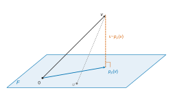
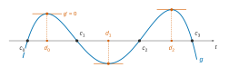
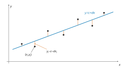
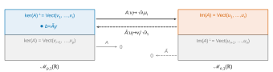
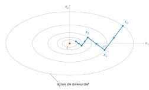

# Centrale-Supélec TSI — Mathématiques 1 2026 · Corrigé guidé

*Corrigé rédigé par IA, non officiel. Signalez toute erreur.*

## Présentation du sujet

**Thème.** Le sujet s'intitule *La méthode des moindres carrés* (4 heures, calculatrice autorisée, 52 questions). Une seule idée le traverse : **minimiser $\|z-u\|$ quand $u$ parcourt un sous-espace de dimension finie, c'est projeter orthogonalement $z$ sur ce sous-espace.** Le sujet la décline cinq fois : distance d'un vecteur de $\mathcal M_{4,1}(\mathbb R)$ à un hyperplan, somme partielle de Fourier, régression polynomiale, équations normales $A^TAx=A^Ty$ et pseudo-inverse issue de la décomposition en valeurs singulières. Il se termine par un algorithme : la méthode du gradient à pas optimal, dont la vitesse dépend du conditionnement $c(A)=\lambda_p/\lambda_1$ (inégalité de Kantorovich).

**Découpage.**
- **Partie A (Q1–Q12).** I : base orthogonale, projeté et distance dans $\mathcal M_{4,1}(\mathbb R)$. II : séries de Fourier. Coefficients de $\cos(\alpha x)$, sommes $\sum\frac1{n^2-\alpha^2}$ et $\sum\frac1{(n^2-\alpha^2)^2}$ par Dirichlet et Parseval, développement de la cotangente, puis équation $f''+e^{ix}f=0$ traitée par les coefficients exponentiels. On termine sur $S_N(g)$ vu comme un projeté orthogonal.
- **Partie B (Q13–Q16).** Convergence de $(A^k)$ : contre-exemples, critère spectral pour une matrice diagonalisable, un cas convergent et un cas non diagonalisable traité par trigonalisation.
- **Partie C (Q17–Q23).** Polynômes de Lagrange, produit scalaire d'évaluation dont ils forment une base orthonormée, moindres carrés polynomiaux, puis erreur d'interpolation par le théorème de Rolle.
- **Partie D (Q24–Q43).** I : droite de régression ($p=2$). II : cas général, $\ker A^TA=\ker A$, équations normales. III : décomposition en valeurs singulières $A=UDV^T$, pseudo-inverse $\tilde A=V\Delta U^T$, solution de norme minimale.
- **Partie E (Q44–Q52).** Produit scalaire $\langle A^TAx,y\rangle$, inégalité de Kantorovich, convergence géométrique de la méthode du gradient à pas optimal.

**Notions du programme mobilisées.** Espaces préhilbertiens : familles orthogonales, projection orthogonale et meilleure approximation, Pythagore, Cauchy-Schwarz. Séries de Fourier : coefficients, théorème de Dirichlet, formule de Parseval. Équations différentielles linéaires d'ordre 2 (théorème de Cauchy). Réduction : diagonalisation, matrices semblables, théorème spectral. Rang, noyau, théorème du rang. Polynômes, racines. Théorème de Rolle et récurrence. Fonctions de deux variables : gradient, point critique, extremum sur un ouvert. Suites géométriques.

**Difficulté et longueur.** Le sujet est long mais très guidé, et les parties A, B, C, D sont indépendantes (E utilise D et le critère de fin de B). Les questions les plus sélectives sont Q5 (Dirichlet et Parseval avec des calculs lourds), Q8–Q10 (coefficients exponentiels et dimension de l'espace des solutions), Q16 (matrice de passage), Q23 (erreur d'interpolation), Q36–Q38 (construction de la SVD), Q42, Q46 et Q50–Q51.

**À ne pas laisser passer.** Q1–Q3, Q11–Q12, Q13, Q15, Q17–Q20, Q24–Q28, Q31, Q34, Q44–Q45, Q47 : ce sont des applications directes du cours. Le bloc Q27–Q33 est le cœur du sujet et se traite presque mécaniquement une fois Q28 acquise.

**Gestion du temps.** Environ 1 h pour A (dont 25 min pour Q4–Q6), 25 min pour B, 35 min pour C, 1 h 10 pour D, 40 min pour E, et 10 min de relecture. Si le bloc Fourier résiste, passez à B ou C : rien de la suite n'en dépend.

## Partie A — Quelques problèmes de minimisation et de convergence

La partie A illustre deux fois le principe du sujet : d'abord dans $\mathcal M_{4,1}(\mathbb R)$ avec des vecteurs explicites, puis dans l'espace $E$ des fonctions continues $2\pi$-périodiques, où la somme de Fourier $S_N(g)$ apparaît comme un projeté orthogonal. Entre les deux, une série de calculs de Fourier : sommes de séries numériques et équation différentielle.

### I — Distance entre un vecteur et un sous-espace vectoriel

### Question 1

> [!INDICATION]
> Calculez les trois produits scalaires deux à deux. Quelle propriété d'une famille orthogonale permet d'en déduire qu'elle est libre ?

> [!INDICATION]
> Pour la base orthonormée, divisez chaque vecteur par sa norme.

#### Solution

Les trois vecteurs sont non nuls et
$$\begin{aligned}
\langle e_1,e_2\rangle&=1-2+1+0=0,\\
\langle e_1,e_3\rangle&=1+0-1+0=0,\\
\langle e_2,e_3\rangle&=1+0-1+0=0.
\end{aligned}$$
Une famille orthogonale de vecteurs non nuls est libre. Comme $(e_1,e_2,e_3)$ engendre $F$ par définition, c'est une base orthogonale de $F$, et $\dim F=3$.

Les normes valent
$$\begin{aligned}
\|e_1\|_2&=\sqrt6,\\
\|e_2\|_2&=\sqrt3,\\
\|e_3\|_2&=\sqrt2,
\end{aligned}$$
d'où la base orthonormée
$$\boxed{\left(\tfrac{1}{\sqrt6}e_1,\ \tfrac{1}{\sqrt3}e_2,\ \tfrac{1}{\sqrt2}e_3\right).}$$

> [!PIEGE]
> L'hypothèse « vecteurs non nuls » est indispensable : le vecteur nul est orthogonal à tout. Et une famille libre n'est une base de $F$ que si elle engendre $F$ : ici c'est la définition de $\operatorname{Vect}$, mais il faut l'écrire.

### Question 2

> [!INDICATION]
> Vous disposez d'une base orthogonale de $F$ : utilisez la formule du projeté dans une telle base.

> [!INDICATION]
> La base n'est qu'orthogonale : chaque coefficient est divisé par le carré d'une norme. Regardez ensuite la quatrième coordonnée des $e_i$ pour contrôler le résultat.

#### Solution

Soit $w=(x,y,z,t)^T$. Dans la base orthogonale $(e_1,e_2,e_3)$,
$$\begin{aligned}
p_F(w)&=\sum_{i=1}^3\frac{\langle w,e_i\rangle}{\|e_i\|_2^2}e_i\\
&=\frac{x-2y+z}{6}e_1+\frac{x+y+z}{3}e_2+\frac{x-z}{2}e_3.
\end{aligned}$$
En réduisant au dénominateur $6$, les quatre coordonnées valent
$$\begin{aligned}
\tfrac16\big[(x-2y+z)+2(x+y+z)+3(x-z)\big]&=x,\\
\tfrac16\big[-2(x-2y+z)+2(x+y+z)\big]&=y,\\
\tfrac16\big[(x-2y+z)+2(x+y+z)-3(x-z)\big]&=z,\\
0&=0.
\end{aligned}$$
$$\boxed{p_F\begin{pmatrix}x\\y\\z\\t\end{pmatrix}=\begin{pmatrix}x\\y\\z\\0\end{pmatrix}.}$$
Contrôle : les $e_i$ ont une quatrième coordonnée nulle, donc $F\subset\{t=0\}$, et l'égalité des dimensions (3 de part et d'autre) donne $F=\{t=0\}$. Projeter sur $F$ revient bien à annuler la dernière coordonnée.

> [!METHODE]
> Avant un calcul de projeté, cherchez une description simple du sous-espace (équation, coordonnée nulle). Elle donne souvent le résultat directement, et sert au moins de vérification.

### Question 3

> [!INDICATION]
> Quel théorème du cours relie le minimum de $\|v-u\|_2$ sur un sous-espace de dimension finie au projeté orthogonal ?

#### Solution

$F$ est de dimension finie, donc $\min_{u\in F}\|v-u\|_2$ existe, est atteint en $u=p_F(v)$ et vaut $\|v-p_F(v)\|_2$. Par Q2, $p_F(v)=(1,1,1,0)^T$, donc $v-p_F(v)=(0,0,0,1)^T$ et
$$\boxed{\min_{u\in F}\|v-u\|_2=1.}$$

> [!JURY]
> Remplacer un minimum par un calcul explicite demande de citer le théorème de meilleure approximation. Sans cette justification, la réponse numérique seule vaut peu.

### II — Séries de Fourier

### Question 4

> [!INDICATION]
> Vérifiez d'abord que $f$ est continue (le raccord en $\pm\pi$) et paire. Que dit la parité sur les $b_n$ ?

> [!INDICATION]
> Intégrez sur $[-\pi,\pi]$ plutôt que sur $[0,2\pi]$, en le justifiant par la périodicité, et linéarisez $\cos(\alpha t)\cos(nt)$. Pour simplifier, développez $\sin((\alpha\pm n)\pi)$.

#### Solution

*$f\in E$.* Sur $]-\pi,\pi]$, $f$ coïncide avec la fonction continue $t\mapsto\cos(\alpha t)$. Au point $-\pi$, on a
$$\begin{aligned}
f(-\pi)&=f(\pi)=\cos(\alpha\pi),\\
\lim_{x\to-\pi^+}f(x)&=\cos(-\alpha\pi)=\cos(\alpha\pi).
\end{aligned}$$
Donc $f$ est continue sur $\mathbb R$ et $2\pi$-périodique. Elle est de plus $\mathcal C^1$ par morceaux.

*Parité.* Pour $x\in]-\pi,\pi[$, $f(-x)=\cos(-\alpha x)=f(x)$, et $f(-\pi)=f(\pi)$. Par périodicité, $f$ est paire.

Pour $n\geqslant1$, $t\mapsto f(t)\sin(nt)$ est impaire et $2\pi$-périodique. L'intégrale sur une période ne dépendant pas de la période choisie,
$$b_n(f)=\frac1\pi\int_{-\pi}^{\pi}f(t)\sin(nt)\,dt=0.$$

*Calcul de $a_0$.* Comme $\alpha\neq0$ :
$$\begin{aligned}
a_0(f)&=\frac1{2\pi}\int_{-\pi}^{\pi}\cos(\alpha t)\,dt\\
&=\frac1{2\pi}\cdot\frac{2\sin(\alpha\pi)}{\alpha}\\
&=\frac{\sin(\alpha\pi)}{\alpha\pi}.
\end{aligned}$$

*Calcul de $a_n$, $n\geqslant1$.* On linéarise :
$$\cos(\alpha t)\cos(nt)=\tfrac12\big[\cos((\alpha+n)t)+\cos((\alpha-n)t)\big].$$
On a $\alpha\pm n\neq0$ car $\alpha\notin\mathbb Z$. De plus
$$\begin{aligned}
\sin((\alpha\pm n)\pi)&=\sin(\alpha\pi)\cos(n\pi)\pm\cos(\alpha\pi)\sin(n\pi)\\
&=(-1)^n\sin(\alpha\pi).
\end{aligned}$$
Donc
$$\begin{aligned}
a_n(f)&=\frac1{2\pi}\left[\frac{2\sin((\alpha+n)\pi)}{\alpha+n}+\frac{2\sin((\alpha-n)\pi)}{\alpha-n}\right]\\
&=\frac{(-1)^n\sin(\alpha\pi)}{\pi}\cdot\frac{2\alpha}{\alpha^2-n^2}.
\end{aligned}$$
$$\boxed{\begin{aligned}
b_n(f)&=0,\\
a_0(f)&=\frac{\sin(\alpha\pi)}{\alpha\pi},\\
a_n(f)&=\frac{(-1)^n}{\pi}\,\frac{2\alpha\sin(\alpha\pi)}{\alpha^2-n^2}.
\end{aligned}}$$

> [!PIEGE]
> L'hypothèse $\alpha\notin\mathbb Z$ sert deux fois : pour diviser par $\alpha$ et par $\alpha\pm n$. Citez-la aux deux endroits.
>
> Contrôle utile : quand $\alpha\to0$, on trouve $a_0\to1$ et $a_n\to0$, ce qui correspond à $f\equiv1$.

### Question 5

> [!INDICATION]
> La convergence s'obtient par équivalents et séries de Riemann. Pour les sommes, deux théorèmes du cours relient une fonction à ses coefficients de Fourier : lequel fait apparaître les $a_n$, lequel les $a_n^2$ ?

> [!INDICATION]
> Appliquez le théorème de Dirichlet en un point bien choisi, où le $(-1)^n$ de $a_n(f)$ est compensé par $\cos(nx)$. Pour la seconde somme, utilisez la formule de Parseval et calculez $\frac1{2\pi}\int f^2$ en linéarisant $\cos^2$.

#### Solution

*Convergence.* Les termes sont définis car $\alpha\notin\mathbb Z$, et $n^2-\alpha^2\sim n^2$. Donc
$$\begin{aligned}
\left|\frac1{n^2-\alpha^2}\right|&\sim\frac1{n^2},\\
\frac1{(n^2-\alpha^2)^2}&\sim\frac1{n^4}.
\end{aligned}$$
Par comparaison à des séries de Riemann convergentes (exposants $2>1$ et $4>1$), les deux séries convergent absolument.

*Première somme.* $f$ est continue, $2\pi$-périodique et $\mathcal C^1$ par morceaux. Par le théorème de Dirichlet, comme $f$ est continue, $S_N(f)(x)\to f(x)$ pour tout réel $x$.

En $x=\pi$, avec $\cos(n\pi)=(-1)^n$ et $(-1)^n(-1)^n=1$ :
$$\begin{aligned}
\cos(\alpha\pi)&=\frac{\sin(\alpha\pi)}{\alpha\pi}+\frac{2\alpha\sin(\alpha\pi)}{\pi}\sum_{n=1}^{+\infty}\frac{1}{\alpha^2-n^2}\\
&=\frac{\sin(\alpha\pi)}{\alpha\pi}-\frac{2\alpha\sin(\alpha\pi)}{\pi}\sum_{n=1}^{+\infty}\frac{1}{n^2-\alpha^2}.
\end{aligned}$$
Comme $\sin(\alpha\pi)\neq0$, on isole la somme :
$$\boxed{\sum_{n=1}^{+\infty}\frac1{n^2-\alpha^2}=\frac1{2\alpha^2}-\frac{\pi\cos(\alpha\pi)}{2\alpha\sin(\alpha\pi)}.}$$

*Seconde somme.* La formule de Parseval s'applique à $f$, continue par morceaux et $2\pi$-périodique :
$$\frac1{2\pi}\int_0^{2\pi}f^2=a_0(f)^2+\frac12\sum_{n=1}^{+\infty}\big(a_n(f)^2+b_n(f)^2\big).$$
À gauche, avec $\cos^2(\alpha t)=\frac{1+\cos(2\alpha t)}2$ :
$$\begin{aligned}
\frac1{2\pi}\int_{-\pi}^{\pi}\cos^2(\alpha t)\,dt&=\frac12+\frac{\sin(2\alpha\pi)}{4\alpha\pi}\\
&=\frac12+\frac{\sin(\alpha\pi)\cos(\alpha\pi)}{2\alpha\pi}.
\end{aligned}$$
À droite, notons $S=\sum_{n\geqslant1}\frac1{(n^2-\alpha^2)^2}$. Puisque
$$a_n(f)^2=\frac{4\alpha^2\sin^2(\alpha\pi)}{\pi^2(n^2-\alpha^2)^2},$$
on obtient
$$\frac{\sin^2(\alpha\pi)}{\alpha^2\pi^2}+\frac{2\alpha^2\sin^2(\alpha\pi)}{\pi^2}S.$$
En isolant $S$ (licite car $\alpha\sin(\alpha\pi)\neq0$) :
$$S=\frac{\pi^2}{2\alpha^2\sin^2(\alpha\pi)}\left[\frac12+\frac{\sin(\alpha\pi)\cos(\alpha\pi)}{2\alpha\pi}-\frac{\sin^2(\alpha\pi)}{\alpha^2\pi^2}\right],$$
$$\boxed{\sum_{n=1}^{+\infty}\frac1{(n^2-\alpha^2)^2}=\frac{\pi^2}{4\alpha^2\sin^2(\alpha\pi)}+\frac{\pi\cos(\alpha\pi)}{4\alpha^3\sin(\alpha\pi)}-\frac1{2\alpha^4}.}$$
Contrôle numérique pour $\alpha=0{,}3$ : les deux formules donnent $1{,}751388$ et $1{,}293131$, en accord avec les sommes partielles.

> [!METHODE]
> Pour calculer $\sum u_n$ avec $u_n$ rationnel en $n$, on cherche une fonction dont les coefficients de Fourier sont proportionnels à $u_n$.
>
> Dirichlet donne alors les sommes en $a_n$, Parseval les sommes en $a_n^2$.

> [!PIEGE]
> Trois erreurs classiques : manipuler les sommes avant d'avoir prouvé leur convergence ; oublier le facteur $\frac12$ devant la somme ou le terme $a_0^2$ dans Parseval ; se tromper de signe en passant de $\alpha^2-n^2$ à $n^2-\alpha^2$.
>
> Faire tendre $\alpha$ vers $0$ dans la première formule redonne $\frac{\pi^2}6$ : c'est un bon test.

### Question 6

> [!INDICATION]
> C'est la relation obtenue en $x=\pi$ à la question précédente, réécrite. Quel changement de paramètre fait passer de $\alpha\in\mathbb R\setminus\mathbb Z$ à $t\in\mathbb R\setminus\pi\mathbb Z$ ?

#### Solution

Soit $t\in\mathbb R\setminus\pi\mathbb Z$ et $\alpha=t/\pi$, qui est dans $\mathbb R\setminus\mathbb Z$. La relation de Dirichlet en $x=\pi$ (Q5), divisée par $\sin(\alpha\pi)\neq0$ et multipliée par $\pi$, s'écrit
$$\frac{\pi\cos(\alpha\pi)}{\sin(\alpha\pi)}=\frac1\alpha+\sum_{n=1}^{+\infty}\frac{2\alpha}{\alpha^2-n^2}.$$
Avec $\alpha=t/\pi$, on a $\frac1\alpha=\frac\pi t$ et
$$\begin{aligned}
\frac{2\alpha}{\alpha^2-n^2}&=\frac{2t/\pi}{t^2/\pi^2-n^2}\\
&=\frac{2t\pi}{t^2-(n\pi)^2}.
\end{aligned}$$
En divisant par $\pi$ :
$$\boxed{\frac{\cos t}{\sin t}=\frac1t+\sum_{n=1}^{+\infty}\frac{2t}{t^2-(n\pi)^2}.}$$

> [!METHODE]
> Lors d'un changement de paramètre, vérifiez que les domaines se correspondent exactement : ici $t\notin\pi\mathbb Z\iff t/\pi\notin\mathbb Z$, ce qui garantit à la fois $\sin t\neq0$ et l'applicabilité de Q5.

### Question 7

> [!INDICATION]
> Écrivez $e^{-int}=\cos(nt)-i\sin(nt)$ et reconnaissez les intégrales définissant $a_n$ et $b_n$. Attention aux constantes $\frac1\pi$ et $\frac1{2\pi}$.

#### Solution

Soit $n\in\mathbb N^*$. Par linéarité de l'intégrale :
$$\begin{aligned}
c_n(f)&=\frac12\cdot\frac1\pi\int_0^{2\pi}f(t)\cos(nt)\,dt-\frac i2\cdot\frac1\pi\int_0^{2\pi}f(t)\sin(nt)\,dt\\
&=\frac{a_n(f)-ib_n(f)}2,
\end{aligned}$$
et de même, avec $e^{int}=\cos(nt)+i\sin(nt)$,
$$c_{-n}(f)=\frac{a_n(f)+ib_n(f)}2.$$
En additionnant : $c_n(f)+c_{-n}(f)=a_n(f)$.

En soustrayant : $c_n(f)-c_{-n}(f)=-ib_n(f)$, puis on multiplie par $i$ :
$$\boxed{\begin{aligned}
a_n(f)&=c_n(f)+c_{-n}(f),\\
b_n(f)&=i\big(c_n(f)-c_{-n}(f)\big).
\end{aligned}}$$

> [!PIEGE]
> $f$ est à valeurs complexes : $a_n(f)$ et $b_n(f)$ sont des complexes, et il n'y a aucune relation de conjugaison entre $c_n$ et $c_{-n}$.

### Question 8

> [!INDICATION]
> Pour $c_n(f'')$, intégrez deux fois par parties : les crochets disparaissent grâce à la périodicité.

> [!INDICATION]
> Calculez ensuite $c_n(f'')$ d'une seconde manière à l'aide de l'équation : $e^{it}e^{-int}$ est encore une exponentielle d'un indice voisin. Pour la formule finale, amorcez en $n=0$ et descendez pour les indices négatifs, puis montez pour les positifs.

#### Solution

Soit $n\in\mathbb Z$. La fonction $f$ est $\mathcal C^2$ et $2\pi$-périodique. Donc $f(2\pi)=f(0)$ et $f'(2\pi)=f'(0)$.

De plus $e^{-2in\pi}=1$. Deux intégrations par parties donnent
$$\begin{aligned}
\int_0^{2\pi}f''(t)e^{-int}dt&=\big[f'(t)e^{-int}\big]_0^{2\pi}+in\int_0^{2\pi}f'(t)e^{-int}dt\\
&=in\Big(\big[f(t)e^{-int}\big]_0^{2\pi}+in\int_0^{2\pi}f(t)e^{-int}dt\Big),
\end{aligned}$$
les crochets étant nuls. Donc $c_n(f'')=(in)^2c_n(f)=-n^2c_n(f)$.

Par $(\mathcal E)$, $f''(t)=-e^{it}f(t)$, donc
$$c_n(f'')=-\frac1{2\pi}\int_0^{2\pi}f(t)e^{-i(n-1)t}dt=-c_{n-1}(f).$$
En comparant les deux expressions :
$$\boxed{c_{n-1}(f)=n^2c_n(f)\quad\text{pour tout }n\in\mathbb Z.}$$

*Indices négatifs.* Pour $n=0$, on obtient $c_{-1}(f)=0$. Supposons $c_{-k}(f)=0$ pour un $k\geqslant1$. La relation en $n=-k$ donne alors
$$c_{-k-1}(f)=k^2c_{-k}(f)=0.$$
Par récurrence, $c_n(f)=0$ pour tout $n<0$.

*Indices positifs.* Pour $n\geqslant1$, $c_n(f)=\frac{c_{n-1}(f)}{n^2}$. Par récurrence (c'est vrai en $n=0$), et puisque $n!=n\,(n-1)!$, on obtient $c_n(f)=\frac{c_0(f)}{(n!)^2}$.
$$\boxed{c_n(f)=\begin{cases}\dfrac{c_0(f)}{(n!)^2}&\text{si }n\geqslant0\\[2mm]0&\text{si }n<0.\end{cases}}$$

> [!PIEGE]
> Le décalage d'indice : $e^{it}e^{-int}=e^{-i(n-1)t}$ fait apparaître $c_{n-1}$, pas $c_{n+1}$. Pour les indices négatifs, toute l'information vient de $n=0$ : le coefficient $n^2$ ne s'annule qu'en ce point.

### Question 9

> [!INDICATION]
> Le théorème de Dirichlet s'énonce pour des fonctions réelles : appliquez-le à la partie réelle et à la partie imaginaire de $f$.

> [!INDICATION]
> Transformez ensuite $a_n\cos(nx)+b_n\sin(nx)$ à l'aide de Q7, puis remplacez les $c_n$ par leurs valeurs (Q8).

#### Solution

Posons $u=\operatorname{Re}f$ et $v=\operatorname{Im}f$. Ces fonctions réelles sont $2\pi$-périodiques et de classe $\mathcal C^2$, donc continues et $\mathcal C^1$ par morceaux.

Par le théorème de Dirichlet, $S_N(u)(x)\to u(x)$ et $S_N(v)(x)\to v(x)$ pour tout $x$. Les coefficients étant linéaires en la fonction, $S_N(f)=S_N(u)+iS_N(v)$, qui converge simplement vers $f$.

Par Q7, pour $n\geqslant1$,
$$\begin{aligned}
a_n(f)\cos(nx)+b_n(f)\sin(nx)&=(c_n+c_{-n})\cos(nx)+i(c_n-c_{-n})\sin(nx)\\
&=c_n(f)e^{inx}+c_{-n}(f)e^{-inx},
\end{aligned}$$
et $a_0(f)=c_0(f)$. Donc
$$S_N(f)(x)=c_0(f)+\sum_{n=1}^N\big(c_n(f)e^{inx}+c_{-n}(f)e^{-inx}\big).$$
En passant à la limite puis en utilisant Q8 :
$$\boxed{\begin{aligned}
f(x)&=c_0(f)+\sum_{n=1}^{+\infty}\big(c_n(f)e^{inx}+c_{-n}(f)e^{-inx}\big)\\
&=c_0(f)\sum_{n=0}^{+\infty}\frac{e^{inx}}{(n!)^2}.
\end{aligned}}$$
La dernière série converge absolument car $\left|\frac{e^{inx}}{(n!)^2}\right|=\frac1{(n!)^2}$ et $\sum\frac1{(n!)^2}$ converge (règle de d'Alembert).

> [!JURY]
> Pour identifier la limite des sommes de Fourier à $f(x)$ (et non à la demi-somme des limites à gauche et à droite), il faut dire que $f$ est continue. C'est une ligne, mais elle est attendue.

### Question 10

> [!INDICATION]
> La dimension se lit sur le théorème de Cauchy linéaire : quelles données déterminent une solution de façon unique ?

> [!INDICATION]
> Comparez cette dimension à celle de l'espace des solutions $2\pi$-périodiques, que Q8–Q9 décrivent complètement.

#### Solution

*Dimension.* L'équation $(\mathcal E)$ s'écrit $y''+a(x)y'+b(x)y=0$. Les coefficients $a=0$ et $b:x\mapsto e^{ix}$ sont continus sur l'intervalle $\mathbb R$.

Par le théorème de Cauchy linéaire, pour tout $(\mu,\nu)\in\mathbb C^2$, il existe une unique solution $g$ telle que $g(0)=\mu$ et $g'(0)=\nu$.

L'application linéaire $g\mapsto(g(0),g'(0))$ est donc surjective (existence) et injective (unicité) : c'est un isomorphisme de l'espace $\mathcal S$ des solutions sur $\mathbb C^2$.
$$\boxed{\dim_{\mathbb C}\mathcal S=2.}$$

*Solutions non périodiques.* Soit $g_0:x\mapsto\sum_{n\geqslant0}\frac{e^{inx}}{(n!)^2}$, solution admise par l'énoncé. Elle est $2\pi$-périodique et non nulle, puisque $g_0(0)=\sum\frac1{(n!)^2}>0$.

Soit $\mathcal P$ le sous-espace des solutions $2\pi$-périodiques. Toute $g\in\mathcal P$ est $\mathcal C^2$ et $2\pi$-périodique, donc Q9 donne $g=c_0(g)g_0$.

Ainsi $\mathcal P=\mathbb Cg_0$ est de dimension 1.

Comme $\dim\mathcal S=2>1$, il existe des solutions qui ne sont pas $2\pi$-périodiques. Exemple : la solution $g_1$ telle que $g_1(0)=0$ et $g_1'(0)=1$.

Si elle était égale à $cg_0$, alors $cg_0(0)=0$ imposerait $c=0$. On aurait $g_1=0$, ce qui contredit $g_1'(0)=1$.

**Oui, $(\mathcal E)$ admet des solutions qui ne sont pas $2\pi$-périodiques.**

> [!METHODE]
> Pour prouver l'existence d'un objet sans l'exhiber, un argument de dimension suffit souvent : un sous-espace strict ne peut pas contenir tout l'espace.

### Question 11

> [!INDICATION]
> Linéarisez les produits $\cos\cdot\cos$, $\sin\cdot\sin$ et $\cos\cdot\sin$. Il y a trois types de produits scalaires à traiter.

> [!INDICATION]
> Pour l'orthonormalité, comparez $\|e_0\|$ et $\|e_1\|$ en tenant compte du facteur $\frac1{2\pi}$ dans $\varphi$.

#### Solution

Toutes ces fonctions appartiennent à $E$. Pour $n\neq m$ dans $\mathbb N$, les entiers $n+m$ et $n-m$ sont non nuls.

Or $\int_0^{2\pi}\cos(kx)\,dx=0$ pour $k\in\mathbb Z^*$. Donc
$$\varphi(e_n,e_m)=\frac1{4\pi}\int_0^{2\pi}\big[\cos((n+m)x)+\cos((n-m)x)\big]dx=0,$$
et de même, pour $1\leqslant n\neq m$,
$$\varphi(f_n,f_m)=\frac1{4\pi}\int_0^{2\pi}\big[\cos((n-m)x)-\cos((n+m)x)\big]dx=0.$$
Soient $n\in[\![0,N]\!]$ et $m\in[\![1,N]\!]$. Comme $\int_0^{2\pi}\sin(kx)\,dx=0$ pour tout $k\in\mathbb Z$ (y compris $k=0$),
$$\varphi(e_n,f_m)=\frac1{4\pi}\int_0^{2\pi}\big[\sin((n+m)x)-\sin((n-m)x)\big]dx=0.$$
La famille est orthogonale. Elle n'est pas orthonormale : $\|e_0\|^2=1$, mais pour $n\geqslant1$,
$$\|e_n\|^2=\frac1{4\pi}\int_0^{2\pi}(1+\cos(2nx))\,dx=\frac12,$$
et de même $\|f_n\|^2=\frac12$.
**La famille est orthogonale, non orthonormale :**
$$\boxed{\begin{aligned}
&\|e_0\|=1,\\
&\|e_n\|=\|f_n\|=\tfrac1{\sqrt2}\quad(n\geqslant1).
\end{aligned}}$$

> [!PIEGE]
> Par habitude, on répond souvent « orthonormale ». Ici le produit scalaire porte le facteur $\frac1{2\pi}$, ce qui donne $\|e_n\|^2=\frac12$ pour $n\geqslant1$. Le cas $e_0$ se traite à part.

### Question 12

> [!INDICATION]
> Appliquez la formule du projeté dans la base orthogonale de Q11, en tenant compte des normes calculées.

> [!INDICATION]
> Comparez $\frac{\varphi(g,e_n)}{\|e_n\|^2}$ à la définition de $a_n(g)$. Quel théorème donne le minimum ?

#### Solution

D'après Q11, $(e_0,\dots,e_N,f_1,\dots,f_N)$ est une base orthogonale de $V_N$ : ses vecteurs sont non nuls et orthogonaux, et ils engendrent $V_N$ par définition. Donc
$$p_{V_N}(g)=\frac{\varphi(g,e_0)}{\|e_0\|^2}e_0+\sum_{n=1}^N\left(\frac{\varphi(g,e_n)}{\|e_n\|^2}e_n+\frac{\varphi(g,f_n)}{\|f_n\|^2}f_n\right).$$
Or, pour $n\geqslant1$,
$$\begin{aligned}
\frac{\varphi(g,e_0)}{1}&=\frac1{2\pi}\int_0^{2\pi}g=a_0(g),\\
\frac{\varphi(g,e_n)}{1/2}&=\frac1\pi\int_0^{2\pi}g(t)\cos(nt)\,dt=a_n(g),\\
\frac{\varphi(g,f_n)}{1/2}&=b_n(g).
\end{aligned}$$
$$\boxed{\begin{aligned}
p_{V_N}(g)&=a_0(g)+\sum_{n=1}^N\big(a_n(g)e_n+b_n(g)f_n\big)\\
&=S_N(g).
\end{aligned}}$$
$V_N$ étant de dimension finie, le projeté orthogonal est l'unique élément de $V_N$ qui minimise la distance à $g$. Ainsi **$h=S_N(g)$, qui appartient bien à $E$, vérifie $\|g-h\|=\min_{v\in V_N}\|g-v\|$**.

> [!METHODE]
> La somme de Fourier d'ordre $N$ est la meilleure approximation de $g$ en moyenne quadratique par un polynôme trigonométrique de degré au plus $N$. C'est un problème de moindres carrés dans un espace de fonctions.

## Partie B — Limites de suites de matrices

La partie B met en place la notion de limite d'une suite de matrices (coefficient par coefficient). Elle relie la convergence de $(A^k)$ au spectre lorsque $A$ est diagonalisable, puis traite un cas non diagonalisable par trigonalisation. L'outil clé est le résultat admis : multiplier une suite convergente à gauche et à droite par des matrices fixes conserve la convergence.

### Question 13

> [!INDICATION]
> Calculez les premières puissances : les deux matrices sont « périodiques » pour la multiplication.

> [!INDICATION]
> Raisonnez par l'absurde : si $(A^k)$ convergeait vers $L$, que vaudraient les limites de deux suites extraites bien choisies ? Pour $B$, reconnaissez une matrice de rotation.

#### Solution

*Cas de $A$.* On a $A^2=I_2$. Donc $A^{2k}=I_2$ et $A^{2k+1}=A$ pour tout $k$.

Supposons que $(A^k)$ converge vers une matrice $L$. Chaque suite de coefficients converge, donc aussi ses suites extraites : $(A^{2k})$ et $(A^{2k+1})$ convergent vers $L$.

On a alors $L=I_2$ et $L=A$, ce qui est absurde puisque $A\neq I_2$. Donc $(A^k)$ diverge.

*Cas de $B$.* Avec $\theta=\frac{2\pi}3$, on a $\cos\theta=-\frac12$ et $\sin\theta=\frac{\sqrt3}2$, donc
$$B=\begin{pmatrix}\cos\theta&-\sin\theta\\\sin\theta&\cos\theta\end{pmatrix}.$$
Par récurrence, grâce aux formules d'addition,
$$B^k=\begin{pmatrix}\cos k\theta&-\sin k\theta\\\sin k\theta&\cos k\theta\end{pmatrix}.$$
Donc $B^3=I_2$, d'où $B^{3k}=I_2$ et $B^{3k+1}=B$. Le même raisonnement conduit à $I_2=B$, ce qui est absurde.
$$\boxed{(A^k)_{k\in\mathbb N}\text{ et }(B^k)_{k\in\mathbb N}\text{ divergent.}}$$

> [!PIEGE]
> Inutile (et impossible) d'invoquer Q14 : elle n'est pas encore démontrée, et $B$ n'est même pas diagonalisable sur $\mathbb R$ (son polynôme caractéristique $X^2+X+1$ n'a pas de racine réelle). La forme de $B^k$ doit être justifiée par récurrence, pas seulement affirmée.

### Question 14

> [!INDICATION]
> Écrivez $A=PDP^{-1}$ et exprimez $A^k$. Le résultat admis permet de passer de $(A^k)$ à $(D^k)$ et inversement.

> [!INDICATION]
> Tout se ramène à une question sur les suites réelles : pour quels réels $\mu$ la suite $(\mu^k)$ converge-t-elle ? Examinez avec soin les cas $\mu=1$ et $\mu=-1$.

#### Solution

Soit $A=PDP^{-1}$ avec $P\in GL_n(\mathbb R)$ et $D=\operatorname{Diag}(\mu_1,\dots,\mu_n)$ réelle. Alors $\operatorname{Sp}(A)=\{\mu_1,\dots,\mu_n\}\subset\mathbb R$ et
$$\begin{aligned}
A^k&=PD^kP^{-1},\\
D^k&=\operatorname{Diag}(\mu_1^k,\dots,\mu_n^k).
\end{aligned}$$

*Lemme.* Pour $\mu\in\mathbb R$, $(\mu^k)$ converge si et seulement si $\mu\in]-1,1]$. En effet :
- si $|\mu|<1$, $\mu^k\to0$ ;
- si $\mu=1$, la suite est constante ;
- si $\mu=-1$, elle vaut alternativement $1$ et $-1$ ;
- si $|\mu|>1$, elle n'est pas bornée.

*Sens direct.* Si $(A^k)$ converge, le résultat admis (avec $P^{-1}$ à gauche et $P$ à droite) montre que $(D^k)=(P^{-1}A^kP)$ converge. Chaque $(\mu_i^k)$ converge donc, et $\mu_i\in]-1,1]$ par le lemme.

*Réciproque.* Si $\operatorname{Sp}(A)\subset]-1,1]$, chaque $(\mu_i^k)$ converge, donc $(D^k)$ converge (ses coefficients non diagonaux sont nuls), puis $(PD^kP^{-1})=(A^k)$ converge.
$$\boxed{(A^k)\text{ converge}\iff\operatorname{Sp}(A)\subset]-1,1].}$$

> [!PIEGE]
> L'intervalle est semi-ouvert : $1$ est inclus (suite constante), $-1$ est exclu (oscillation). Et l'on ne peut pas écrire « $A^k$ converge donc $D^k$ converge » sans citer le résultat admis en tête de partie.

### Question 15

> [!INDICATION]
> Quelle propriété de $A$ donne la diagonalisabilité sans calcul ?

> [!INDICATION]
> Pour le spectre, écrivez $2A$ à l'aide de la matrice $J$ dont tous les coefficients valent 1, puis concluez avec Q14.

#### Solution

$A$ est symétrique réelle, donc diagonalisable sur $\mathbb R$ (théorème spectral).

Plus précisément, soit $J$ la matrice dont tous les coefficients valent 1 : $2A=J-I_3$.
- Pour $w=(1,1,1)^T$, $Jw=3w$, donc $Aw=w$.
- Pour $x$ dans le plan $H=\{x_1+x_2+x_3=0\}$, $Jx=0$, donc $Ax=-\frac12x$.

Comme $\dim H=2$ et $w\notin H$, on a $\mathcal M_{3,1}(\mathbb R)=\mathbb Rw\oplus H$. C'est une somme de sous-espaces propres, ce qui redonne la diagonalisabilité sans le théorème spectral. De plus $\operatorname{Sp}(A)=\{1,-\frac12\}\subset]-1,1]$. Par Q14 :
$$\boxed{A\text{ est diagonalisable sur }\mathbb R\text{ et }(A^k)\text{ converge.}}$$
La limite est le projecteur sur $\mathbb Rw$ parallèlement à $H$, c'est-à-dire $\frac13J$.

> [!METHODE]
> Une matrice de la forme $aJ+bI_n$ se réduit à vue. La matrice $J$ a pour valeurs propres $n$ (vecteur $(1,\dots,1)^T$) et $0$ (hyperplan $\sum x_i=0$).
>
> Cela évite un déterminant $3\times3$.

### Question 16

> [!INDICATION]
> Lisez $T$ comme la matrice d'un endomorphisme dans une base $(u,v,w)$ : chaque colonne de $T$ donne une équation vectorielle à résoudre pour $A$.

> [!INDICATION]
> Une fois $P$ construite, vérifiez qu'elle est inversible. Pour la convergence, calculez $T^k$ en écrivant le bloc $2\times2$ comme $-I_2$ plus une matrice nilpotente.

#### Solution

Pour $x=(x_1,x_2,x_3)^T$, $Ax=(x_2,x_3,x_1+x_2-x_3)^T$. La lecture des colonnes de $T$ conduit à chercher $u,v,w$ tels que
$$\begin{aligned}
Au&=u,\\
Av&=-v,\\
Aw&=v-w.
\end{aligned}$$

- $Au=u$ : $u_2=u_1$, $u_3=u_2$, et la troisième équation en découle ; on prend $u=(1,1,1)^T$.
- $Av=-v$ : $v_2=-v_1$, $v_3=-v_2$, et la troisième équation en découle ; on prend $v=(1,-1,1)^T$.
- $(A+I_3)w=v$ : $w_1+w_2=1$ et $w_2+w_3=-1$ (la troisième équation répète la première) ; on prend $w=(1,0,-1)^T$.

Soit
$$P=\begin{pmatrix}1&1&1\\1&-1&0\\1&1&-1\end{pmatrix}.$$
En développant selon la première ligne, $\det P=1\cdot1-1\cdot(-1)+1\cdot2=4\neq0$, donc $P$ est inversible. Par construction,
$$AP=\begin{pmatrix}1&-1&0\\1&1&-1\\1&-1&2\end{pmatrix}=PT.$$
Donc
$$\boxed{A=PTP^{-1}:\ A\text{ et }T\text{ sont semblables.}}$$

*Convergence.* Le bloc
$$N=\begin{pmatrix}-1&1\\0&-1\end{pmatrix}$$
s'écrit $-I_2+F$, où
$$F=\begin{pmatrix}0&1\\0&0\end{pmatrix}.$$
On a $F^2=0$, et $-I_2$ commute avec $F$. La formule du binôme donne $N^k=(-1)^kI_2+k(-1)^{k-1}F$, donc
$$T^k=\begin{pmatrix}1&0&0\\0&(-1)^k&(-1)^{k-1}k\\0&0&(-1)^k\end{pmatrix}.$$
Le coefficient $(2,3)$ n'est pas borné : $(T^k)$ diverge. Si $(A^k)$ convergeait, $(P^{-1}A^kP)=(T^k)$ convergerait par le résultat admis. Donc **$(A^k)$ diverge**.

Q14 ne s'appliquait pas : $A+I_3$ est de rang 2, donc le sous-espace propre associé à $-1$ est une droite. Or $-1$ est racine double de $\chi_A=(X-1)(X+1)^2$ : $A$ n'est pas diagonalisable.

> [!PIEGE]
> Avoir le même polynôme caractéristique ne suffit pas pour être semblables (penser à $I_2$ et $\begin{pmatrix}1&1\\0&1\end{pmatrix}$). On exhibe une matrice de passage et on vérifie qu'elle est inversible.

> [!METHODE]
> Pour obtenir la divergence de $(A^k)$ à partir de celle de $(T^k)$, on raisonne par contraposée, à l'aide du résultat de transfert admis.

## Partie C — Interpolation polynômiale et moindres carrés

La partie C munit $\mathbb R_n[X]$ d'un produit scalaire « d'évaluation » pour lequel les polynômes de Lagrange forment une base orthonormée explicite. La régression polynomiale de degré $m$ devient alors une projection orthogonale. La fin de la partie, indépendante, établit la formule d'erreur d'interpolation par le théorème de Rolle.

### Question 17

> [!INDICATION]
> Si $k\neq i$, l'un des facteurs du produit s'annule. Lequel ?

#### Solution

Les $x_j$ étant deux à deux distincts, les dénominateurs $x_i-x_j$ sont non nuls. $L_i$ est un polynôme de degré $n$, donc $L_i\in\mathbb R_n[X]$.

Si $k\neq i$, le facteur d'indice $j=k$ vaut $\frac{x_k-x_k}{x_i-x_k}=0$. Si $k=i$, chaque facteur vaut $\frac{x_i-x_j}{x_i-x_j}=1$.
$$\boxed{L_i(x_k)=\begin{cases}1&\text{si }k=i\\0&\text{sinon.}\end{cases}}$$

### Question 18

> [!INDICATION]
> Bilinéarité, symétrie et positivité sont immédiates. Pour le caractère défini, combien de racines a un polynôme $P$ tel que $\langle P,P\rangle=0$ ?

#### Solution

L'application est symétrique. Elle est linéaire à gauche, car $(\lambda P+P')(x_k)=\lambda P(x_k)+P'(x_k)$, donc bilinéaire par symétrie. Elle est positive : $\langle P,P\rangle=\sum_kP(x_k)^2\geqslant0$.

Si $\langle P,P\rangle=0$, une somme de carrés nulle impose $P(x_k)=0$ pour tout $k$. Ainsi $P$ a $n+1$ racines distinctes.

Comme $\deg P\leqslant n$, on obtient $P=0$. **C'est un produit scalaire sur $\mathbb R_n[X]$.**

> [!PIEGE]
> C'est la restriction aux polynômes de degré au plus $n$ qui assure le caractère défini : sur $\mathbb R[X]$, le polynôme $\prod_k(X-x_k)$ serait de « norme » nulle sans être nul.

### Question 19

> [!INDICATION]
> Calculez $\langle L_i,L_j\rangle$ avec Q17 : dans la somme sur $k$, combien de termes peuvent être non nuls ? Concluez par un argument de dimension.

#### Solution

Par Q17, dans $\langle L_i,L_j\rangle=\sum_kL_i(x_k)L_j(x_k)$, seul le terme $k=i=j$ peut être non nul, et il vaut 1. Donc $\langle L_i,L_j\rangle=\delta_{ij}$ : la famille est orthonormée, donc libre. Elle compte $n+1=\dim\mathbb R_n[X]$ éléments, c'est donc une base. **$(L_0,\dots,L_n)$ est une base orthonormée de $\mathbb R_n[X]$.**

> [!PIEGE]
> « Orthonormée » donne « libre », pas « génératrice ». C'est le cardinal égal à la dimension qui conclut.

### Question 20

> [!INDICATION]
> Le premier point est un calcul direct avec Q17. Le second est la décomposition d'un vecteur dans une base orthonormée.

#### Solution

Par Q17, $\langle L_i,P\rangle=\sum_kL_i(x_k)P(x_k)=L_i(x_i)P(x_i)=P(x_i)$. La décomposition dans la base orthonormée $(L_i)$ (Q19) donne
$$\boxed{\begin{aligned}
\langle L_i,P\rangle&=P(x_i),\\
P&=\sum_{i=0}^n\langle L_i,P\rangle L_i=\sum_{i=0}^nP(x_i)L_i.
\end{aligned}}$$
En particulier, $P_f=\sum f(x_i)L_i$ vérifie $P_f(x_k)=f(x_k)$ pour tout $k$. C'est le polynôme interpolateur de $f$ aux points $x_0,\dots,x_n$.

> [!METHODE]
> Pour ce produit scalaire, « coordonnée sur $L_i$ » et « évaluation en $x_i$ » sont la même opération. Toute la partie repose sur cette observation.

### Question 21

> [!INDICATION]
> Suivez l'énoncé : calculez $\langle P_f-Q,P_f-Q\rangle$ en utilisant ce que vaut $P_f$ aux points $x_i$.

> [!INDICATION]
> La somme à minimiser est le carré d'une distance de $P_f$ à un sous-espace de dimension finie. Quel théorème donne existence et unicité ?

#### Solution

Comme $m\leqslant n$, $\mathbb R_m[X]$ est un sous-espace de dimension finie de $\mathbb R_n[X]$. Pour $Q\in\mathbb R_m[X]$, puisque $P_f(x_i)=f(x_i)$ (Q20),
$$\begin{aligned}
\langle P_f-Q,P_f-Q\rangle&=\sum_{i=0}^n\big(P_f(x_i)-Q(x_i)\big)^2\\
&=\sum_{i=0}^n\big(f(x_i)-Q(x_i)\big)^2.
\end{aligned}$$
Minimiser la somme revient donc à minimiser $\|P_f-Q\|$ pour $Q\in\mathbb R_m[X]$ (la fonction carré est strictement croissante sur $\mathbb R_+$). Par le théorème de la projection orthogonale, ce minimum est atteint en un unique point, $R=p_{\mathbb R_m[X]}(P_f)$.
**Il existe un unique $R\in\mathbb R_m[X]$ tel que**
$$\boxed{\begin{aligned}
&\sum_{i=0}^n(f(x_i)-R(x_i))^2\\
={}&\min_{Q\in\mathbb R_m[X]}\sum_{i=0}^n(f(x_i)-Q(x_i))^2,
\end{aligned}}$$
**à savoir $R=p_{\mathbb R_m[X]}(P_f)$.**

> [!METHODE]
> Le réflexe du sujet : sous une somme de carrés d'écarts, reconnaître le carré d'une norme. L'unicité vient alors du théorème de projection, sans argument de convexité.

### Question 22

> [!INDICATION]
> Énoncez une propriété $H_n$ portant sur **toutes** les fonctions $g$ de classe $\mathcal C^{n+1}$. L'initialisation est le théorème de Rolle.

> [!INDICATION]
> Pour l'hérédité, ordonnez les zéros et appliquez Rolle entre deux zéros consécutifs : combien de zéros distincts obtient-on pour $g'$ ?

#### Solution

Pour $n\in\mathbb N$, notons $H_n$ la propriété suivante. Pour toute fonction $g\in\mathcal C^{n+1}([a,b],\mathbb R)$ ayant au moins $n+2$ zéros distincts, la dérivée $g^{(n+1)}$ s'annule sur $[a,b]$.

*$H_0$.* Soit $g\in\mathcal C^1$ qui s'annule en $c<d$.

Alors $g$ est continue sur $[c,d]$, dérivable sur $]c,d[$ et $g(c)=g(d)$.

Le théorème de Rolle donne un zéro de $g'$ dans $]c,d[$.

*$H_n\Rightarrow H_{n+1}$.* Soit $g\in\mathcal C^{n+2}([a,b])$ ayant $n+3$ zéros, ordonnés : $c_0<\dots<c_{n+2}$.

Pour $j\in[\![0,n+1]\!]$, Rolle sur $[c_j,c_{j+1}]$ donne $d_j\in]c_j,c_{j+1}[$ tel que $g'(d_j)=0$.

Les intervalles étant deux à deux disjoints, les $d_j$ sont distincts. Ainsi $g'$, qui est de classe $\mathcal C^{n+1}$, a $n+2$ zéros distincts.

$H_n$ appliquée à $g'$ fournit un zéro de $(g')^{(n+1)}=g^{(n+2)}$.

**Par récurrence, $H_n$ est vraie pour tout $n$ : $g^{(n+1)}$ s'annule au moins une fois sur $[a,b]$.**

> [!PIEGE]
> Si l'on fixe $g$ au départ, l'hypothèse de récurrence ne peut pas s'appliquer à $g'$ : la propriété doit être quantifiée sur toutes les fonctions. Et il faut justifier que les zéros de $g'$ obtenus sont distincts.

### Question 23

> [!INDICATION]
> Comptez les zéros de $W$ : les $n+1$ nœuds d'une part, et un point supplémentaire choisi grâce à la définition de $K$.

> [!INDICATION]
> Appliquez Q22 à $W$ et calculez $W^{(n+1)}$ : que vaut la dérivée $(n+1)$-ième d'un polynôme de degré au plus $n$ ? et celle d'un polynôme unitaire de degré $n+1$ ?

#### Solution

$K$ est bien défini car $x\neq x_i$ pour tout $i$, donc $\prod_i(x-x_i)\neq0$.

$W$ est de classe $\mathcal C^{n+1}$ sur $[a,b]$ (somme de $f$ et de fonctions polynomiales). Pour tout $k$, et au point $x$,
$$\begin{aligned}
W(x_k)&=f(x_k)-P_f(x_k)-0=0,\\
W(x)&=f(x)-P_f(x)-(f(x)-P_f(x))=0.
\end{aligned}$$
La première ligne vient de $P_f(x_k)=f(x_k)$ et du facteur nul $x_k-x_k$ dans le produit. Les points $x_0,\dots,x_n,x$ sont $n+2$ points distincts de $[a,b]$ où $W$ s'annule.

Par Q22, il existe $\xi_x\in[a,b]$ tel que $W^{(n+1)}(\xi_x)=0$. Or $\deg P_f\leqslant n$, donc $P_f^{(n+1)}=0$.

Et $\prod_i(t-x_i)$ est unitaire de degré $n+1$, de dérivée $(n+1)$-ième égale à $(n+1)!$. Donc
$$W^{(n+1)}(t)=f^{(n+1)}(t)-K(n+1)!,$$
d'où $K=\frac{f^{(n+1)}(\xi_x)}{(n+1)!}$ et
$$\boxed{f(x)-P_f(x)=\frac{\prod_{i=0}^n(x-x_i)}{(n+1)!}f^{(n+1)}(\xi_x).}$$

> [!PIEGE]
> La dérivée $(n+1)$-ième de $t^{n+1}$ vaut $(n+1)!$, et non $n+1$ ni $n!$.
>
> Contrôle : pour $n=0$, la formule redonne l'égalité des accroissements finis $f(x)-f(x_0)=(x-x_0)f'(\xi)$.

## Partie D — Régression linéaire et moindres carrés

La partie D est le cœur du sujet. Le cas $p=2$ (droite de régression) se traite par le calcul différentiel. Le cas général se ramène aux **équations normales** $A^TAx=A^Ty$ grâce à l'identité $\|Ax\|_2^2=x^TA^TAx$. Enfin, la décomposition en valeurs singulières fournit une solution même lorsque $A^TA$ n'est pas inversible : c'est la solution de norme minimale.

### I — Le cas particulier de la dimension 2

### Question 24

> [!INDICATION]
> Écrivez $E(a,b)$ comme le carré de la norme d'un vecteur. Que décrit $A\binom ab$ quand $(a,b)$ parcourt $\mathbb R^2$ ?

> [!INDICATION]
> L'existence du minimum se déduit alors d'un théorème de géométrie euclidienne, sans argument de compacité.

#### Solution

La $i$-ème composante de $A\binom ab-Y$ est $a+bx_i-y_i$, donc
$$E(a,b)=\left\|A\binom ab-Y\right\|_2^2.$$
Quand $(a,b)$ décrit $\mathbb R^2$, le vecteur $A\binom ab=aC_1+bC_2$ décrit $\operatorname{Col}(A)$. C'est un sous-espace de dimension finie de $\mathcal M_{n,1}(\mathbb R)$.

Le projeté $z_0=p_{\operatorname{Col}(A)}(Y)$ appartient à $\operatorname{Col}(A)$, donc s'écrit $A\binom{a_0}{b_0}$. Il vérifie $\|z_0-Y\|_2\leqslant\|z-Y\|_2$ pour tout $z\in\operatorname{Col}(A)$.

En élevant au carré, $E(a_0,b_0)\leqslant E(a,b)$ pour tout $(a,b)$ : $E$ admet un minimum et
$$\boxed{\begin{aligned}
m&=\min_{(a,b)\in\mathbb R^2}E(a,b)\\
&=\min_{(a,b)\in\mathbb R^2}\left\|A\begin{pmatrix}a\\b\end{pmatrix}-Y\right\|_2^2\\
&=\big\|Y-p_{\operatorname{Col}(A)}(Y)\big\|_2^2.
\end{aligned}}$$

> [!PIEGE]
> $\mathbb R^2$ n'est pas borné : le théorème des bornes atteintes ne s'applique pas directement. Annuler le gradient ne prouve pas non plus l'existence d'un minimum, puisqu'un point critique n'est pas forcément un extremum.

> [!METHODE]
> Autre voie, analytique : montrer que $E(a,b)\to+\infty$ quand $\|(a,b)\|\to+\infty$, puis se ramener à un disque fermé. La voie géométrique est plus courte et c'est celle que suggère la notation matricielle.

### Question 25

> [!INDICATION]
> Calculez $A^TA$, matrice $2\times2$. Pour le signe du déterminant, appliquez Cauchy-Schwarz à deux vecteurs bien choisis de $\mathbb R^n$, et examinez le cas d'égalité.

#### Solution

$$A^TA=\begin{pmatrix}n&\sum x_k\\\sum x_k&\sum x_k^2\end{pmatrix},$$
$$\boxed{\det(A^TA)=n\sum_{1\leqslant k\leqslant n}x_k^2-\Big(\sum_{1\leqslant k\leqslant n}x_k\Big)^2.}$$
Posons $X=(x_1,\dots,x_n)$ et $U=(1,\dots,1)$. L'inégalité de Cauchy-Schwarz donne $\langle X,U\rangle^2\leqslant\|X\|^2\|U\|^2$, soit $(\sum x_k)^2\leqslant n\sum x_k^2$. Il y a égalité si et seulement si $(X,U)$ est liée. L'hypothèse de non-colinéarité rend l'inégalité stricte :
$$\boxed{\det(A^TA)>0.}$$

> [!JURY]
> C'est la stricte positivité qui est demandée. Il faut énoncer le cas d'égalité de Cauchy-Schwarz et le confronter explicitement à l'hypothèse de l'énoncé.

### Question 26

> [!INDICATION]
> Dérivez $E$ par rapport à $a$ et à $b$, puis reconnaissez les composantes de $A^T\big(A\binom ab-Y\big)$.

> [!INDICATION]
> Pour l'unicité du minimiseur, enchaînez trois faits : le minimum existe (Q24), un minimum sur un ouvert est un point critique, et l'équation des points critiques a une unique solution (Q25).

#### Solution

$E$ est polynomiale, donc de classe $\mathcal C^1$ sur $\mathbb R^2$, et
$$\begin{aligned}
\frac{\partial E}{\partial a}&=-2\sum_{i=1}^n(y_i-a-bx_i),\\
\frac{\partial E}{\partial b}&=-2\sum_{i=1}^nx_i(y_i-a-bx_i).
\end{aligned}$$
Les composantes de $A^T\big(A\binom ab-Y\big)$ sont $\sum(a+bx_i-y_i)$ et $\sum x_i(a+bx_i-y_i)$, donc
$$\boxed{\nabla E(a,b)=2\left(A^TA\begin{pmatrix}a\\b\end{pmatrix}-A^TY\right).}$$
Un point critique $(a_0,b_0)$ vérifie donc $\boxed{A^TA\binom{a_0}{b_0}=A^TY.}$

Par Q25, $A^TA$ est inversible : il y a au plus un point critique, à savoir $(A^TA)^{-1}A^TY$.

Par Q24, $E$ atteint son minimum en un point $(c,d)$. Comme $\mathbb R^2$ est ouvert et $E$ de classe $\mathcal C^1$, ce point est critique.

Il est donc égal à $(A^TA)^{-1}A^TY$.

Tout point de minimum étant ainsi égal à l'unique point critique, il est unique.

**Il existe un unique $(c,d)\in\mathbb R^2$ tel que $E(c,d)=\min E$, et $\binom cd=(A^TA)^{-1}A^TY$.**

> [!PIEGE]
> Conclure « le point critique est le minimum » sans l'existence préalable du minimum est un raisonnement incomplet classique : l'annulation du gradient seule ne prouve rien.

### II — Les moindres carrés : le cas général

### Question 27

> [!INDICATION]
> Écrivez $\|Ax\|_2^2$ comme un produit matriciel et faites apparaître $A^TAx$.

#### Solution

On a
$$\begin{aligned}
\|Ax\|_2^2&=(Ax)^T(Ax)\\
&=x^T(A^TAx)\\
&=x^T\cdot0=0,
\end{aligned}$$
donc $\boxed{\|Ax\|_2=0.}$

> [!METHODE]
> L'identité $\|Ax\|_2^2=x^TA^TAx$ est la clé de presque toutes les questions matricielles du sujet (Q28, Q34, Q35, Q45, Q49).

### Question 28

> [!INDICATION]
> Double inclusion : un sens est immédiat, l'autre est Q27. Pour les rangs, quel théorème relie rang et dimension du noyau ?

#### Solution

Si $Ax=0$, alors $A^TAx=0$. Si $A^TAx=0$, alors $\|Ax\|_2=0$ (Q27), donc $Ax=0$ car la norme est définie. Ainsi $\ker(A^TA)=\ker A$.

Les deux matrices définissent des applications linéaires de même source $\mathcal M_{p,1}(\mathbb R)$, de dimension $p$. Le théorème du rang donne
$$\begin{aligned}
\operatorname{rg}(A)&=p-\dim\ker A\\
&=p-\dim\ker(A^TA)\\
&=\operatorname{rg}(A^TA).
\end{aligned}$$
$$\boxed{\begin{aligned}
\ker(A^TA)&=\ker(A),\\
\operatorname{rg}(A^TA)&=\operatorname{rg}(A).
\end{aligned}}$$

> [!PIEGE]
> On ne « simplifie » jamais par $A^T$ : cette matrice n'est en général ni carrée ni inversible. C'est Q28 qui permet de passer de $A^TAx=0$ à $Ax=0$.

### Question 29

> [!INDICATION]
> Décomposez $y$ selon $\operatorname{Col}(A)\oplus\operatorname{Col}(A)^\perp$, puis identifiez $\operatorname{Col}(A)$ à $\operatorname{Im}(A)$.

> [!INDICATION]
> Pour l'unicité, regardez ce qui est vraiment unique : $d$ ? $Au$ ? $u$ ? Que se passe-t-il si l'on ajoute à $u$ un vecteur de $\ker A$ ?

#### Solution

$\operatorname{Col}(A)$ est de dimension finie, donc $\mathcal M_{n,1}(\mathbb R)=\operatorname{Col}(A)\oplus\operatorname{Col}(A)^\perp$. On a donc, de manière unique, $y=z+d$ avec $z=p_{\operatorname{Col}(A)}(y)$ et $d\in\operatorname{Col}(A)^\perp$.

Comme $Ax=\sum_jx_jC_j$, on a $\operatorname{Col}(A)=\operatorname{Im}(A)$. Il existe donc $u$ tel que $Au=z$, d'où $y=Au+d$.

Soit $y=Au'+d'$ une autre décomposition du même type. L'unicité de la décomposition dans la somme directe donne $Au'=Au$ et $d'=d$.

**Le vecteur $d$ et le vecteur $Au=p_{\operatorname{Col}(A)}(y)$ sont uniques ; $u$ est unique à un élément de $\ker A$ près.**

*Remarque sur l'énoncé.* L'unicité de $u$ lui-même n'a lieu que si $\ker A=\{0\}$, c'est-à-dire si $\operatorname{rg}A=p$. Sinon, $(u+h,d)$ convient pour tout $h\in\ker A$.

C'est cohérent avec Q30, dont le cas d'égalité « $x-u\in\ker A$ » serait sans objet si $u$ était toujours unique. La suite n'utilise que l'existence et l'unicité de $d$.

> [!METHODE]
> Devant une affirmation d'énoncé qui n'est vraie que sous une hypothèse supplémentaire, on le signale brièvement et on démontre l'énoncé correct. On ne prouve pas un résultat faux.

### Question 30

> [!INDICATION]
> Écrivez $Ax-y$ comme somme d'un vecteur de $\operatorname{Col}(A)$ et d'un vecteur de son orthogonal, puis appliquez Pythagore.

#### Solution

$Ax-y=A(x-u)-d$ avec $A(x-u)\in\operatorname{Col}(A)$ et $d\in\operatorname{Col}(A)^\perp$. Par le théorème de Pythagore,
$$\begin{aligned}
\|Ax-y\|_2^2&=\|A(x-u)\|_2^2+\|d\|_2^2\\
&\geqslant\|d\|_2^2,
\end{aligned}$$
avec égalité si et seulement si $A(x-u)=0$.
$$\boxed{\|Ax-y\|_2\geqslant\|d\|_2,\ \text{avec égalité si et seulement si } x-u\in\ker A.}$$
En particulier, $\min_x\|Ax-y\|_2$ existe, vaut $\|d\|_2$ et est atteint en $x=u$.

### Question 31

> [!INDICATION]
> Traduisez matriciellement « $d$ est orthogonal à chaque colonne de $A$ ». Que valent les composantes de $A^Td$ ?

#### Solution

$d$ est orthogonal à chaque colonne $C_j$. Or la $j$-ème composante de $A^Td$ est $C_j^Td=\langle C_j,d\rangle=0$. Donc $A^Td=0$.

En multipliant $y=Au+d$ à gauche par $A^T$ :
$$\boxed{A^Ty=A^TAu.}$$

> [!METHODE]
> $A^Tz=0\iff z\perp\operatorname{Col}(A)$. C'est pourquoi le système $A^TAx=A^Ty$ s'appelle « équations normales » : il exprime que le résidu $Ax-y$ est orthogonal à l'image de $A$.

### Question 32

> [!INDICATION]
> Passez par la condition intermédiaire $x_0-u\in\ker A$ de Q30, puis utilisez Q28 et Q31.

#### Solution

Par Q30, $\|Ax_0-y\|_2=\min_x\|Ax-y\|_2$ équivaut à $x_0-u\in\ker A$. Par Q28 puis Q31,
$$\begin{aligned}
x_0-u\in\ker A&\iff A^TA(x_0-u)=0\\
&\iff A^TAx_0=A^TAu\\
&\iff A^TAx_0=A^Ty.
\end{aligned}$$
$$\boxed{\begin{aligned}
&\|Ax_0-y\|_2=\min_{x}\|Ax-y\|_2\\
\iff{}&A^TAx_0=A^Ty.
\end{aligned}}$$

### Question 33

> [!INDICATION]
> Que vaut le rang de $A^TA$ ? Quelle est la taille de cette matrice ? Concluez avec Q32.

#### Solution

Par Q28, $\operatorname{rg}(A^TA)=\operatorname{rg}A=p$. Comme $A^TA$ est carrée d'ordre $p$, elle est **inversible**. Par Q32, $b$ réalise le minimum si et seulement si $A^TAb=A^Ty$, c'est-à-dire
$$\boxed{b=(A^TA)^{-1}A^Ty,}$$
qui est donc l'unique solution. Pour $p=2$, on retrouve Q26. L'hypothèse $n>p$ n'intervient pas dans la preuve ; seul $\operatorname{rg}A=p$ compte, ce qui impose déjà $n\geqslant p$.

> [!PIEGE]
> « Rang $p$ implique inversible » ne vaut que pour une matrice carrée d'ordre $p$ : c'est vrai pour $A^TA$, pas pour $A$.

### III — La décomposition en valeurs singulières

### Question 34

> [!INDICATION]
> Reconnaissez deux carrés de normes.

#### Solution

On a
$$\begin{aligned}
X^TA^TAX&=(AX)^T(AX)=\|AX\|_2^2\geqslant0,\\
X^TX&=\|X\|_2^2\geqslant0.
\end{aligned}$$

### Question 35

> [!INDICATION]
> $A^TA$ est symétrique réelle : que dit le théorème spectral sur ses valeurs propres et ses vecteurs propres ?

> [!INDICATION]
> Multipliez $A^TAX=\lambda X$ à gauche par $X^T$, avec $X$ vecteur propre réel, et utilisez Q34.

#### Solution

$(A^TA)^T=A^TA$ : la matrice est symétrique réelle. Par le théorème spectral, elle est orthogonalement semblable à une matrice diagonale réelle ; ses valeurs propres sont donc réelles et admettent des vecteurs propres réels.

Soit $A^TAX=\lambda X$ avec $X\in\mathcal M_{p,1}(\mathbb R)$ non nul. Alors
$$\|AX\|_2^2=X^TA^TAX=\lambda\|X\|_2^2,$$
d'où $\lambda=\frac{\|AX\|_2^2}{\|X\|_2^2}\geqslant0$. **Toutes les valeurs propres de $A^TA$ sont positives ou nulles.**

> [!PIEGE]
> L'argument exige un vecteur propre réel : pour un vecteur complexe, $X^TX$ n'est pas un carré de norme. C'est le théorème spectral qui permet de choisir $X$ réel.

### Question 36

> [!INDICATION]
> Partez du théorème spectral. Combien de coefficients diagonaux non nuls a la matrice diagonale obtenue ? Pensez au rang.

> [!INDICATION]
> Pour ranger les valeurs propres dans l'ordre voulu, permutez les colonnes de la matrice de passage. Pourquoi reste-t-elle orthogonale ?

#### Solution

Par le théorème spectral, $A^TA=WD_0W^T$ avec $W\in O_p(\mathbb R)$ et $D_0=\operatorname{Diag}(\mu_1,\dots,\mu_p)$, où $\mu_i\geqslant0$ (Q35).

$W$ étant inversible, $\operatorname{rg}D_0=\operatorname{rg}(A^TA)=r$. Le rang d'une matrice diagonale est son nombre de coefficients diagonaux non nuls : exactement $r$ des $\mu_i$ sont non nuls.

Soit $P_\sigma$ la matrice de permutation qui range les $\mu_i$ par ordre décroissant. Ses colonnes forment une base orthonormée, donc elle est orthogonale, et
$$P_\sigma^TD_0P_\sigma=\operatorname{Diag}(\lambda_1,\dots,\lambda_r,0,\dots,0),$$
avec $\lambda_1\geqslant\dots\geqslant\lambda_r>0$. Avec $V=WP_\sigma$, produit de deux matrices orthogonales donc élément de $O_p(\mathbb R)$ :
$$\boxed{A^TA=V\operatorname{Diag}_{p,p}(\lambda_1,\dots,\lambda_r,0,\dots,0)V^T.}$$
On a $r\geqslant1$ car $A\neq0$.

### Question 37

> [!INDICATION]
> Les colonnes $v_i$ de $V$ sont des vecteurs propres orthonormés de $A^TA$. Calculez $\langle Av_i,Av_j\rangle=v_i^TA^TAv_j$.

> [!INDICATION]
> Pour compléter $(u_1,\dots,u_r)$, utilisez une base orthonormée de l'orthogonal de $\operatorname{Vect}(u_1,\dots,u_r)$.

#### Solution

Posons $\lambda_i=0$ pour $i>r$. De $A^TAV=V\operatorname{Diag}(\lambda_i)$, lue colonne par colonne, on tire $A^TAv_i=\lambda_iv_i$ ; et $v_i^Tv_j=\delta_{ij}$ car $V$ est orthogonale. Donc
$$\langle Av_i,Av_j\rangle=v_i^T(A^TAv_j)=\lambda_j\delta_{ij}.$$
La famille $(Av_1,\dots,Av_r)$ est orthogonale, et $\|Av_i\|_2^2=\lambda_i$ :
$$\boxed{\|Av_i\|_2=\begin{cases}\sqrt{\lambda_i}&\text{si }i\leqslant r\\0&\text{si }i\geqslant r+1.\end{cases}}$$
Pour $i\leqslant r$, $\lambda_i>0$, donc $u_i=\frac1{\sqrt{\lambda_i}}Av_i$ est bien défini, et
$$\langle u_i,u_j\rangle=\frac{\lambda_j\delta_{ij}}{\sqrt{\lambda_i\lambda_j}}=\delta_{ij}.$$
La famille $(u_1,\dots,u_r)$ est donc orthonormée.

Soit $G=\operatorname{Vect}(u_1,\dots,u_r)$. Son orthogonal $G^\perp$, de dimension $n-r$, est un espace euclidien : il admet une base orthonormée $(u_{r+1},\dots,u_n)$.

**La famille $(u_1,\dots,u_n)$ est orthonormée et de cardinal $n$ : c'est une base orthonormée de $\mathcal M_{n,1}(\mathbb R)$. Elle vérifie $u_i=\frac1{\sqrt{\lambda_i}}Av_i$ pour $i\leqslant r$.**

> [!PIEGE]
> On ne divise par $\sqrt{\lambda_i}$ qu'après avoir dit que $\lambda_i>0$ pour $i\leqslant r$ : c'est pour cela que Q36 range les valeurs propres non nulles en tête.

### Question 38

> [!INDICATION]
> Pour $U$, calculez le coefficient générique de $U^TU$. Pour $AV=UD$, comparez les colonnes en distinguant $j\leqslant r$ et $j>r$.

#### Solution

Le coefficient $(i,j)$ de $U^TU$ est $u_i^Tu_j=\delta_{ij}$. Donc $U^TU=I_n$ et $U\in O_n(\mathbb R)$.

La $j$-ème colonne de $AV$ est $Av_j$.

Celle de $UD$ vaut $\sqrt{\lambda_j}u_j$ si $j\leqslant r$, et $0$ sinon.
- Pour $j\leqslant r$, $\sqrt{\lambda_j}u_j=Av_j$ par définition de $u_j$.
- Pour $j>r$, $\|Av_j\|_2=0$ (Q37), donc $Av_j=0$.

$$\boxed{\begin{aligned}
&U\in O_n(\mathbb R),\\
&AV=UD,\\
&A=UDV^T.
\end{aligned}}$$

> [!PIEGE]
> Le cas $j>r$ est souvent oublié : il faut passer de « norme nulle » à « vecteur nul ».

### Question 39

> [!INDICATION]
> Calculez $A\tilde A$ en simplifiant $V^TV$, puis le produit $D\Delta$. Exprimez ensuite $\operatorname{Im}(A)$ à l'aide des $u_i$.

> [!INDICATION]
> Décomposez un vecteur $x$ dans la base orthonormée $(u_i)$ et calculez $A\tilde Ax$ : reconnaissez la formule du projeté en base orthonormée.

#### Solution

On a
$$\begin{aligned}
A\tilde A&=UDV^TV\Delta U^T\\
&=UD\Delta U^T,
\end{aligned}$$
et $D\Delta=\operatorname{Diag}_{n,n}(1,\dots,1,0,\dots,0)$, avec $r$ coefficients égaux à 1 (car $\sqrt{\lambda_i}\cdot\frac1{\sqrt{\lambda_i}}=1$ pour $i\leqslant r$).

$(v_j)$ étant une base, $\operatorname{Im}A=\operatorname{Vect}(Av_1,\dots,Av_p)=\operatorname{Vect}(u_1,\dots,u_r)$ par Q38.

Soit $x\in\mathcal M_{n,1}(\mathbb R)$. La $i$-ème ligne de $U^T$ étant $u_i^T$, on a $U^Tx=(\langle u_1,x\rangle,\dots,\langle u_n,x\rangle)^T$, donc
$$\begin{aligned}
A\tilde Ax&=U\,(\langle u_1,x\rangle,\dots,\langle u_r,x\rangle,0,\dots,0)^T\\
&=\sum_{i=1}^r\langle u_i,x\rangle u_i.
\end{aligned}$$
C'est l'expression du projeté orthogonal de $x$ sur $\operatorname{Vect}(u_1,\dots,u_r)$ en base orthonormée. **$A\tilde A$ est la matrice de la projection orthogonale sur $\operatorname{Im}(A)$.**

> [!METHODE]
> Contrôle rapide : la matrice d'une projection orthogonale est symétrique et idempotente. Ici $(A\tilde A)^T=A\tilde A$ et $(A\tilde A)^2=A\tilde A$.

### Question 40

> [!INDICATION]
> Que représente $Ab=A\tilde Ay$ d'après Q39 ? Quel ensemble décrit $Ax$ quand $x$ varie ?

#### Solution

Par Q39, $Ab=A\tilde Ay=p_{\operatorname{Im}A}(y)$. Pour tout $x$, $Ax\in\operatorname{Im}A$, donc
$$\begin{aligned}
\|Ab-y\|_2&=\|p_{\operatorname{Im}A}(y)-y\|_2\\
&\leqslant\|Ax-y\|_2,
\end{aligned}$$
l'égalité étant atteinte en $x=b$.
$$\boxed{\|Ab-y\|_2=\min_{x\in\mathcal M_{p,1}(\mathbb R)}\|Ax-y\|_2.}$$
C'est la généralisation annoncée de Q33 : aucune hypothèse de rang n'est nécessaire.

### Question 41

> [!INDICATION]
> Le premier point est une propriété du résidu d'une projection orthogonale. Pour le second, décomposez $Ax_0-y$ en faisant apparaître $Ab-y$, puis appliquez Pythagore.

#### Solution

On a $Ab-y=-(y-p_{\operatorname{Im}A}(y))\in(\operatorname{Im}A)^\perp$, car l'orthogonal est un sous-espace vectoriel.

Ensuite, $Ax_0-y=A(x_0-b)+(Ab-y)$ avec $A(x_0-b)\in\operatorname{Im}A$ ; par Pythagore,
$$\|Ax_0-y\|_2^2=\|A(x_0-b)\|_2^2+\|Ab-y\|_2^2.$$
Comme $x_0$ et $b$ réalisent tous deux le minimum, $\|Ax_0-y\|_2=\|Ab-y\|_2$, donc $\|A(x_0-b)\|_2=0$ :
$$\boxed{\begin{aligned}
&Ab-y\in(\operatorname{Im}A)^\perp,\\
&x_0-b\in\ker A.
\end{aligned}}$$

> [!METHODE]
> Variante : par Q32, $x_0$ et $b$ vérifient tous deux $A^TAx=A^Ty$, donc $x_0-b\in\ker(A^TA)=\ker A$.

### Question 42

> [!INDICATION]
> Suivez l'indication : calculez $\tilde Au_j$ pour chaque $j$, ce qui donne $\operatorname{Im}\tilde A$. Décomposez un vecteur sur les $v_j$ pour obtenir $\ker A$.

> [!INDICATION]
> Les deux sous-espaces sont engendrés par des paquets disjoints de vecteurs d'une base orthonormée.

#### Solution

Pour $j\in[\![1,n]\!]$, $U^Tu_j=\varepsilon_j$ (vecteur de la base canonique). Donc $\tilde Au_j=V\Delta\varepsilon_j$ vaut $\frac1{\sqrt{\lambda_j}}v_j$ si $j\leqslant r$, et $0$ sinon.

$(u_j)$ étant une base, $\operatorname{Im}\tilde A=\operatorname{Vect}(v_1,\dots,v_r)$.

Pour $x=\sum_j\beta_jv_j$, on a $Ax=\sum_{j\leqslant r}\beta_j\sqrt{\lambda_j}u_j$. Ce vecteur est nul si et seulement si $\beta_1=\dots=\beta_r=0$, car la famille $(u_j)$ est libre et $\lambda_j>0$. Donc $\ker A=\operatorname{Vect}(v_{r+1},\dots,v_p)$.

La famille $(v_j)$ étant orthonormée, $\operatorname{Vect}(v_1,\dots,v_r)\subset(\ker A)^\perp$. Par conséquent
$$\boxed{b=\tilde Ay\in\operatorname{Im}\tilde A=\operatorname{Vect}(v_1,\dots,v_r)\subset\ker(A)^\perp.}$$
Les deux sous-espaces étant de dimension $r$, l'inclusion est même une égalité.

### Question 43

> [!INDICATION]
> Q41 et Q42 donnent une décomposition orthogonale de $x_0$. Appliquez une dernière fois Pythagore.

#### Solution

On écrit $x_0=b+(x_0-b)$, avec $b\in(\ker A)^\perp$ (Q42) et $x_0-b\in\ker A$ (Q41). Par Pythagore,
$$\begin{aligned}
\|x_0\|_2^2&=\|b\|_2^2+\|x_0-b\|_2^2\\
&\geqslant\|b\|_2^2,
\end{aligned}$$
avec égalité si et seulement si $x_0-b=0$.
$$\boxed{\|x_0\|_2\geqslant\|b\|_2,\ \text{avec égalité si et seulement si } x_0=b.}$$
Parmi tous les minimiseurs de $\|Ax-y\|_2$, $b=\tilde Ay$ est donc l'unique vecteur de norme minimale (la « pseudo-solution » de $Ax=y$).

> [!METHODE]
> Le couple « $z\in F$, $z'\in F^\perp$ » appelle Pythagore. Le sujet utilise ce réflexe trois fois (Q30, Q41, Q43).

## Partie E — La méthode du gradient

On suppose désormais toutes les valeurs propres de $S=A^TA$ strictement positives, **rangées dans l'ordre croissant** $\lambda_1\leqslant\dots\leqslant\lambda_p$ (attention : c'est l'inverse de la partie D-III). La solution $\ell$ des équations normales est approchée par la méthode du gradient à pas optimal, et l'inégalité de Kantorovich montre que l'erreur décroît géométriquement, avec une raison qui dépend du conditionnement $c(A)=\lambda_p/\lambda_1$.

### Question 44

> [!INDICATION]
> Quand une matrice carrée est-elle inversible, en termes de valeurs propres ? Pour $\ker A$, réutilisez une question de la partie D.

#### Solution

$0$ n'est pas valeur propre de $S$, donc $S$ est inversible. Par conséquent $\ker S=\{0\}$, et $\ker A=\ker S$ par Q28.
$$\boxed{A^TA\text{ inversible et }\ker A=\{0\}.}$$

> [!PIEGE]
> $A$ n'est pas carrée : écrire « $A^TA$ inversible donc $A$ inversible » n'a pas de sens. C'est Q28 qui transporte l'information sur les noyaux.

### Question 45

> [!INDICATION]
> Vérifiez bilinéarité, symétrie, positivité et caractère défini. La symétrie repose sur $S^T=S$, et le caractère défini sur Q44.

#### Solution

Pour éviter la confusion avec le vecteur $y$ des données, notons $z$ la seconde variable et $\Phi(x,z)=\langle Sx,z\rangle=x^TSz$.

$\Phi$ est bilinéaire, car $x\mapsto Sx$ est linéaire et le produit scalaire canonique est bilinéaire. Elle est symétrique : le réel $x^TSz$ est égal à sa transposée $z^TS^Tx=z^TSx$.

Elle est positive : $\Phi(x,x)=\|Ax\|_2^2\geqslant0$. Enfin, si $\Phi(x,x)=0$, alors $Ax=0$, donc $x=0$ par Q44. **$\Phi$ est un produit scalaire sur $\mathcal M_{p,1}(\mathbb R)$.**

> [!METHODE]
> « Un réel est égal à sa transposée » est l'outil standard pour établir la symétrie d'une forme $x^TMz$ quand $M$ est symétrique.

### Question 46

> [!INDICATION]
> La première inégalité est une identité remarquable. Exprimez ensuite $\langle Sv,v\rangle$ et $\langle S^{-1}v,v\rangle$ dans la base orthonormée $(e_i)$.

> [!INDICATION]
> Découpez la somme du membre de droite en deux morceaux $\alpha$ et $\beta$, l'un proportionnel à $\langle Sv,v\rangle$, l'autre à $\langle S^{-1}v,v\rangle$, puis appliquez la première inégalité.

#### Solution

On a $\frac14(\alpha+\beta)^2-\alpha\beta=\frac14(\alpha-\beta)^2\geqslant0$, d'où $\boxed{\alpha\beta\leqslant\frac14(\alpha+\beta)^2.}$

On a $Se_i=\lambda_ie_i$ et, en appliquant $S^{-1}$, $S^{-1}e_i=\frac1{\lambda_i}e_i$. La base $(e_i)$ étant orthonormée,
$$\begin{aligned}
\langle Sv,v\rangle&=\sum_{i=1}^p\lambda_iv_i^2,\\
\langle S^{-1}v,v\rangle&=\sum_{i=1}^p\frac{v_i^2}{\lambda_i}.
\end{aligned}$$
Posons
$$\begin{aligned}
\alpha&=\frac1{\lambda_1}\sum_{i=1}^p\lambda_iv_i^2,\\
\beta&=\lambda_p\sum_{i=1}^p\frac{v_i^2}{\lambda_i}.
\end{aligned}$$
Alors
$$\begin{aligned}
\alpha\beta&=\frac{\lambda_p}{\lambda_1}\langle Sv,v\rangle\langle S^{-1}v,v\rangle,\\
\alpha+\beta&=\sum_{i=1}^p\left(\frac{\lambda_i}{\lambda_1}+\frac{\lambda_p}{\lambda_i}\right)v_i^2.
\end{aligned}$$
En multipliant l'inégalité $\alpha\beta\leqslant\frac14(\alpha+\beta)^2$ par $\frac{\lambda_1}{\lambda_p}>0$ :
$$\boxed{\langle A^TAv,v\rangle\langle(A^TA)^{-1}v,v\rangle\leqslant\frac14\frac{\lambda_1}{\lambda_p}\left(\sum_{i=1}^p\left(\frac{\lambda_i}{\lambda_1}+\frac{\lambda_p}{\lambda_i}\right)v_i^2\right)^2.}$$

> [!METHODE]
> Pour trouver le bon couple $(\alpha,\beta)$, partez du membre de droite : $(\alpha+\beta)^2$ y est écrit, il suffit de scinder la somme et de vérifier que le produit redonne le membre de gauche à une constante près.

### Question 47

> [!INDICATION]
> Étudiez les variations de $\psi$ sur le segment, puis comparez les valeurs aux deux bornes.

#### Solution

$\psi$ est dérivable sur $[\lambda_1,\lambda_p]\subset\mathbb R_+^*$ et
$$\begin{aligned}
\psi'(t)&=\frac1{\lambda_1}-\frac{\lambda_p}{t^2}\\
&=\frac{t^2-\lambda_1\lambda_p}{\lambda_1t^2}.
\end{aligned}$$
Comme $\lambda_1\leqslant\sqrt{\lambda_1\lambda_p}\leqslant\lambda_p$, $\psi$ décroît sur $[\lambda_1,\sqrt{\lambda_1\lambda_p}]$ puis croît sur $[\sqrt{\lambda_1\lambda_p},\lambda_p]$. Son maximum est donc atteint en une borne. Or
$$\psi(\lambda_1)=1+\frac{\lambda_p}{\lambda_1}=\psi(\lambda_p).$$
$$\boxed{\begin{aligned}
\max_{[\lambda_1,\lambda_p]}\psi&=1+\frac{\lambda_p}{\lambda_1}\\
&=1+c(A).
\end{aligned}}$$

> [!METHODE]
> Seconde preuve, sans étude de variations : pour $t>0$, $\lambda_1t\big(\psi(t)-1-\frac{\lambda_p}{\lambda_1}\big)=t^2-(\lambda_1+\lambda_p)t+\lambda_1\lambda_p=(t-\lambda_1)(t-\lambda_p)$, qui est négatif sur $[\lambda_1,\lambda_p]$.

### Question 48

> [!INDICATION]
> Chaque $\lambda_i$ appartient à $[\lambda_1,\lambda_p]$ : majorez chaque coefficient de la somme de Q46 grâce à Q47.

#### Solution

Pour tout $i$, $\lambda_i\in[\lambda_1,\lambda_p]$, donc
$$\frac{\lambda_i}{\lambda_1}+\frac{\lambda_p}{\lambda_i}=\psi(\lambda_i)\leqslant1+c(A).$$
Comme $v_i^2\geqslant0$ et $\sum v_i^2=\|v\|_2^2$ (base orthonormée), la somme de Q46 est majorée par $(1+c(A))\|v\|_2^2$.

Les deux membres étant positifs, on peut élever au carré ; avec $\frac{\lambda_1}{\lambda_p}=\frac1{c(A)}$, on obtient
$$\boxed{\langle A^TAv,v\rangle\langle(A^TA)^{-1}v,v\rangle\leqslant\frac{(c(A)+1)^2}{4c(A)}\|v\|_2^4.}$$

> [!PIEGE]
> On ne somme des majorations pondérées que si les poids $v_i^2$ sont positifs, et $\sum v_i^2=\|v\|_2^2$ n'est vrai que parce que la base est orthonormée. Les deux justifications doivent apparaître.

### Question 49

> [!INDICATION]
> Développez $\langle S(x-\ell),x-\ell\rangle$ par bilinéarité et symétrie, en utilisant $S\ell=A^Ty$.

#### Solution

Par définition de $\ell$, $S\ell=A^Ty$. Par bilinéarité et symétrie de $\Phi$,
$$\begin{aligned}
\langle S(x-\ell),x-\ell\rangle&=\langle Sx,x\rangle-2\langle Sx,\ell\rangle+\langle S\ell,\ell\rangle\\
&=\langle Sx,x\rangle-2\langle x,A^Ty\rangle+\langle S\ell,\ell\rangle\\
&=f(x)+\langle S\ell,\ell\rangle,
\end{aligned}$$
car $\langle Sx,\ell\rangle=\langle x,S\ell\rangle=\langle x,A^Ty\rangle$. De plus,
$$f(\ell)=\langle S\ell,\ell\rangle-2\langle\ell,S\ell\rangle=-\langle S\ell,\ell\rangle.$$
$$\boxed{f(x)-f(\ell)=\langle A^TA(x-\ell),x-\ell\rangle.}$$
En particulier, $f(x)-f(\ell)=\|A(x-\ell)\|_2^2\geqslant0$ : $\ell$ minimise $f$.

### Question 50

> [!INDICATION]
> Posez $w_k=x_k-\ell$. Exprimez $d_k$ en fonction de $w_k$, et $x_{k+1}-\ell$ en fonction de $w_k$ et $d_k$.

> [!INDICATION]
> Appliquez Q49 à $x_{k+1}$, développez, remplacez $t_k$ par sa valeur, puis reconnaissez $f(x_k)-f(\ell)$ sous la forme $\langle S^{-1}d_k,d_k\rangle$.

#### Solution

Posons $w_k=x_k-\ell$. Comme $A^Ty=S\ell$, on a $d_k=Sw_k$, soit $w_k=S^{-1}d_k$. De plus $x_{k+1}-\ell=w_k-t_kd_k$. Par Q49,
$$f(x_{k+1})-f(\ell)=\Phi(w_k,w_k)-2t_k\Phi(w_k,d_k)+t_k^2\Phi(d_k,d_k).$$
Or
$$\begin{aligned}
\Phi(w_k,d_k)&=\langle Sw_k,d_k\rangle=\|d_k\|_2^2,\\
\Phi(d_k,d_k)&=\langle Sd_k,d_k\rangle>0,
\end{aligned}$$
la stricte positivité venant de $d_k\neq0$ (Q45) ; elle donne un sens à $t_k$. Avec $t_k=\frac{\|d_k\|_2^2}{\langle Sd_k,d_k\rangle}$,
$$\begin{aligned}
f(x_{k+1})-f(\ell)&=\Phi(w_k,w_k)-2\frac{\|d_k\|_2^4}{\langle Sd_k,d_k\rangle}+\frac{\|d_k\|_2^4}{\langle Sd_k,d_k\rangle}\\
&=\Phi(w_k,w_k)-\frac{\|d_k\|_2^4}{\langle Sd_k,d_k\rangle}.
\end{aligned}$$
Enfin, par Q49,
$$\begin{aligned}
\Phi(w_k,w_k)&=\langle Sw_k,w_k\rangle\\
&=\langle d_k,S^{-1}d_k\rangle\\
&=f(x_k)-f(\ell).
\end{aligned}$$
Cette quantité est strictement positive car $w_k\neq0$ (puisque $d_k\neq0$). En la mettant en facteur :
$$\boxed{f(x_{k+1})-f(\ell)=\big(f(x_k)-f(\ell)\big)\left(1-\frac{\|d_k\|_2^4}{\langle A^TAd_k,d_k\rangle\langle(A^TA)^{-1}d_k,d_k\rangle}\right).}$$

> [!METHODE]
> Le pas $t_k$ est celui qui minimise le trinôme $t\mapsto f(x_k-td_k)$, de coefficient dominant $\langle Sd_k,d_k\rangle>0$ : c'est le sens de « pas optimal ».
>
> On vérifie aussi que $\langle d_{k+1},d_k\rangle=\|d_k\|_2^2-t_k\langle Sd_k,d_k\rangle=0$ : deux directions de descente consécutives sont orthogonales, d'où une trajectoire en zigzag vers $\ell$.

### Question 51

> [!INDICATION]
> À gauche : écrivez $x_k-\ell$ dans la base $(e_i)$ et minorez chaque $\lambda_i$ par la plus petite valeur propre.

> [!INDICATION]
> À droite : appliquez Kantorovich à $v=d_k$ pour majorer le facteur de Q50, simplifiez $1-\frac{4c}{(c+1)^2}$, puis raisonnez par récurrence.

#### Solution

*À gauche.* Écrivons $x_k-\ell=\sum\gamma_ie_i$. Alors
$$\begin{aligned}
f(x_k)-f(\ell)&=\sum\lambda_i\gamma_i^2\\
&\geqslant\lambda_1\sum\gamma_i^2\\
&=\lambda_1\|x_k-\ell\|_2^2.
\end{aligned}$$

*À droite.* Par Q48 appliquée à $v=d_k$, les deux membres étant strictement positifs, on passe aux inverses :
$$\frac{\|d_k\|_2^4}{\langle Sd_k,d_k\rangle\langle S^{-1}d_k,d_k\rangle}\geqslant\frac{4c(A)}{(c(A)+1)^2},$$
donc
$$\begin{aligned}
1-\frac{\|d_k\|_2^4}{\langle Sd_k,d_k\rangle\langle S^{-1}d_k,d_k\rangle}&\leqslant\frac{(c(A)+1)^2-4c(A)}{(c(A)+1)^2}\\
&=\left(\frac{c(A)-1}{c(A)+1}\right)^2.
\end{aligned}$$
Notons $q=\left(\frac{c(A)-1}{c(A)+1}\right)^2$. Comme $f(x_k)-f(\ell)\geqslant0$, Q50 donne
$$f(x_{k+1})-f(\ell)\leqslant q\,(f(x_k)-f(\ell)).$$
Par récurrence immédiate (l'inégalité est une égalité pour $k=0$), $f(x_k)-f(\ell)\leqslant q^k(f(x_0)-f(\ell))$.
$$\boxed{\lambda_1\|x_k-\ell\|_2^2\leqslant f(x_k)-f(\ell)\leqslant\big(f(x_0)-f(\ell)\big)\left(\frac{c(A)-1}{c(A)+1}\right)^{2k}.}$$

> [!PIEGE]
> Dans cette partie, $\lambda_1$ est la **plus petite** valeur propre. Confondre avec la convention décroissante de la partie D-III fausse la minoration. Autre point de rigueur : on multiplie l'inégalité sur le facteur par $f(x_k)-f(\ell)$, et il faut savoir que cette quantité est positive.

### Question 52

> [!INDICATION]
> Montrez que la raison $q$ de Q51 est dans $[0,1[$ et concluez par encadrement. Quel résultat de la partie B traduit $\|x_k-\ell\|_2\to0$ en convergence de la suite ?

> [!INDICATION]
> Pour la minimalité, reliez $\|Ax-y\|_2^2$ à $f(x)$ grâce à l'identité donnée en tête de partie, puis utilisez Q49.

#### Solution

$c(A)=\frac{\lambda_p}{\lambda_1}\geqslant1$, donc $0\leqslant\frac{c(A)-1}{c(A)+1}<1$ et $q^k\to0$. Par Q51, où $\lambda_1>0$,
$$0\leqslant\|x_k-\ell\|_2^2\leqslant\frac{f(x_0)-f(\ell)}{\lambda_1}q^k,$$
et le majorant tend vers 0. Par encadrement, $\|x_k-\ell\|_2\to0$, et par le critère admis en fin de partie B,
$$\boxed{\lim_{k\to+\infty}x_k=\ell.}$$
Pour tout $x$, $\|Ax-y\|_2^2=f(x)+\langle y,y\rangle$. Par Q49, $f(x)-f(\ell)=\|A(x-\ell)\|_2^2\geqslant0$. Donc $\|A\ell-y\|_2^2\leqslant\|Ax-y\|_2^2$ pour tout $x$, et en prenant la racine carrée :
$$\boxed{\|A\ell-y\|_2=\min_{x\in\mathcal M_{p,1}(\mathbb R)}\|Ax-y\|_2.}$$
On peut aussi invoquer Q32, puisque $A^TA\ell=A^Ty$ par construction. On retrouve le vecteur $b$ de Q33 : la partie E en donne une méthode de calcul approché, utile quand l'inversion de $A^TA$ coûte cher, et d'autant plus rapide que $c(A)$ est proche de 1.

> [!JURY]
> Pour conclure à la convergence d'une suite de matrices colonnes à partir de celle des normes, il faut citer le critère admis. Il faut aussi justifier que la raison est strictement inférieure à 1.

## Bilan

**Méthodes à retenir.**
- **Minimiser une distance à un sous-espace de dimension finie, c'est projeter orthogonalement.** Existence, unicité et valeur du minimum viennent du théorème de meilleure approximation, sans compacité ni convexité (Q3, Q12, Q21, Q24, Q40).
- **Formule du projeté** : en base orthogonale, on divise par $\|e_i\|^2$ ; en base orthonormée, non (Q2, Q12, Q39).
- **$\|Ax\|_2^2=x^TA^TAx$**, d'où $\ker(A^TA)=\ker A$, $\operatorname{rg}(A^TA)=\operatorname{rg}A$, la positivité des valeurs propres de $A^TA$ et la caractérisation par les équations normales $A^TAx=A^Ty$ (Q27–Q35).
- **Pythagore** dès qu'un vecteur se décompose sur $F\oplus F^\perp$ (Q30, Q41, Q43).
- **Dirichlet et Parseval** pour calculer des sommes de séries numériques (Q5) ; coefficients exponentiels et intégration par parties pour une équation différentielle à coefficients périodiques (Q8).
- **Puissances de matrices** : diagonaliser ou trigonaliser, puis transférer la convergence par $P^{-1}(\cdot)P$ (Q14, Q16).
- **Rolle itéré** pour l'erreur d'interpolation (Q22–Q23).

**Prérequis à revoir.** Espaces préhilbertiens et projection orthogonale ; théorème spectral ; théorème du rang ; séries de Fourier (Dirichlet, Parseval) ; théorème de Cauchy pour les équations linéaires d'ordre 2 ; extremum d'une fonction de deux variables sur un ouvert ; inégalité de Cauchy-Schwarz et son cas d'égalité.

**Questions classiques transposables.** La somme $\sum\frac1{n^2-\alpha^2}$ et le développement de la cotangente (Q5–Q6) ; la base de Lagrange et la formule d'erreur d'interpolation (Q17–Q23) ; la droite des moindres carrés (Q24–Q26) ; $\ker(A^TA)=\ker A$ (Q28) ; la décomposition en valeurs singulières et la pseudo-inverse (Q36–Q43) ; l'inégalité de Kantorovich et la convergence du gradient à pas optimal, en $\left(\frac{c-1}{c+1}\right)^{2k}$ (Q46–Q51).
