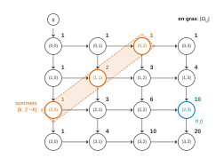
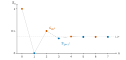
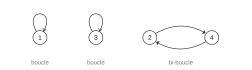

# Centrale-Supélec TSI — Mathématiques 2 2026 · Corrigé brut

*Corrigé rédigé par IA, non officiel. Signalez toute erreur.*

Notations : $\binom{j}{i}=0$ si $i>j$ (convention de l'énoncé). Deux défauts de l'énoncé sont corrigés en place. En **Q31**, « la matrice introduite en Q25 » désigne la matrice de la figure 4, introduite en **Q26**. En **Q37**, la convention cohérente est **$b_0=1$** et non $b_0=0$.

## Partie A — Matrices de Pascal

### I — Cas particulier $n=2$

### Question 1

Pour $P=a+bX+cX^2\in\mathbb R_2[X]$ :
$$\begin{aligned}
u(P)&=a+b(X+1)+c(X+1)^2\\
&=(a+b+c)+(b+2c)X+cX^2\in\mathbb R_2[X].
\end{aligned}$$
Soient $P,Q\in\mathbb R_2[X]$ et $\lambda,\mu\in\mathbb R$. Alors $(\lambda P+\mu Q)(X+1)=\lambda P(X+1)+\mu Q(X+1)$, donc $u$ est linéaire. C'est un endomorphisme de $\mathbb R_2[X]$.

$u(1)=1$, $u(X)=1+X$, $u(X^2)=1+2X+X^2$. En rangeant ces coordonnées en colonnes :
$$\boxed{\operatorname{Mat}_e(u)=\begin{pmatrix}1&1&1\\0&1&2\\0&0&1\end{pmatrix}.}$$

### Question 2

Notons $A=\operatorname{Mat}_e(u)$. Elle est triangulaire, donc $\det A=1\neq0$ : $A$ est inversible.

Soit $v:P\mapsto P(X-1)$ sur $\mathbb R_2[X]$. Pour tout $P$ :
$$\begin{aligned}
u(v(P))&=P((X+1)-1)\\
&=P,\\[4pt]
v(u(P))&=P.
\end{aligned}$$
Donc $v=u^{-1}$ et $A^{-1}=\operatorname{Mat}_e(v)$. Comme $v(1)=1$, $v(X)=-1+X$ et $v(X^2)=1-2X+X^2$ :
$$\boxed{A^{-1}=\begin{pmatrix}1&-1&1\\0&1&-2\\0&0&1\end{pmatrix}.}$$

$A$ est triangulaire : ses valeurs propres sont ses coefficients diagonaux, $\boxed{\operatorname{Sp}(A)=\{1\}}$.

Si $A$ était diagonalisable, elle serait semblable à $\operatorname{diag}(1,1,1)=I_3$, donc $A=PI_3P^{-1}=I_3$. C'est faux, car $A_{1,2}=1$. **$A$ n'est pas diagonalisable.**

De façon équivalente : $\operatorname{rg}(A-I_3)=2$, donc $\dim\ker(A-I_3)=1<3$.

### II — Des matrices semblables à leurs inverses

### Question 3

Pour $j\in[\![0,n]\!]$, la formule du binôme donne
$$\begin{aligned}
u(X^j)&=(X+1)^j\\
&=\sum_{i=0}^{j}\binom{j}{i}X^i.
\end{aligned}$$
La colonne $j$ de $U$ a donc pour coefficients $\binom{j}{i}$, nuls pour $i>j$ :
$$\boxed{\forall (i,j)\in[\![0,n]\!]^2,\quad U_{i,j}=\binom{j}{i},}$$
et **$U$ est triangulaire supérieure**, de coefficients diagonaux $\binom ii=1$. Donc $\operatorname{Sp}(U)=\{1\}$.

- Si $n=0$, $U=(1)$ est diagonale.
- Si $n\ge1$ : $U$ diagonalisable de spectre $\{1\}$ serait semblable, donc égale, à $I_{n+1}$. Or $U_{0,1}=\binom10=1$. **Dans ce cas, $U$ n'est pas diagonalisable.**

### Question 4

Pour tout $P\in\mathbb R_n[X]$, $(u\circ v)(P)=P((X-1)+1)=P$. Donc
$$\boxed{u\circ v=\mathrm{id}_{\mathbb R_n[X]}},$$
et de même $v\circ u=\mathrm{id}$.

Ainsi $u$ est bijective, d'inverse $v$. Par suite $U$ est inversible et $U^{-1}=\operatorname{Mat}_e(v)$. Comme
$$\begin{aligned}
v(X^j)&=(X-1)^j\\
&=\sum_{i=0}^{j}\binom{j}{i}(-1)^{j-i}X^i,
\end{aligned}$$
on obtient
$$\boxed{\forall (i,j)\in[\![0,n]\!]^2,\quad (U^{-1})_{i,j}=(-1)^{j-i}\binom{j}{i}.}$$
Pour $n=2$, cette formule donne
$$U^{-1}=\begin{pmatrix}1&-1&1\\0&1&-2\\0&0&1\end{pmatrix}.$$
C'est la matrice obtenue en Q2 : **le résultat est cohérent**.

### Question 5

$D$ est diagonale de coefficients $(-1)^i$. Donc $D^2$ est diagonale de coefficients $((-1)^i)^2=1$, c'est-à-dire
$$D^2=I_{n+1}.$$
Ainsi $D$ est inversible et $\boxed{D^{-1}=D}$.

### Question 6

Multiplier à gauche par $D$ multiplie la ligne $i$ par $(-1)^i$ ; multiplier à droite multiplie la colonne $j$ par $(-1)^j$. Pour $(i,j)\in[\![0,n]\!]^2$ :
$$\begin{aligned}
(DU)_{i,j}&=(-1)^i\binom ji,\\[4pt]
(U^{-1}D)_{i,j}&=(-1)^{j-i}\binom ji(-1)^j\\
&=(-1)^{2j-i}\binom ji\\
&=(-1)^i\binom ji.
\end{aligned}$$
Donc $\boxed{DU=U^{-1}D}$. En multipliant à gauche par $D$ et en utilisant $D^2=I_{n+1}$, on obtient $U=DU^{-1}D$. Comme $D=D^{-1}$ :
$$\boxed{U=DU^{-1}D^{-1}.}$$
$D$ étant inversible, **$U$ est semblable à $U^{-1}$**.

### Question 7

On a $D^\top=D$. Comme $U$ est inversible, $L=U^\top$ l'est aussi et $(U^{-1})^\top=(U^\top)^{-1}=L^{-1}$. En transposant $U=DU^{-1}D$ :
$$\begin{aligned}
L&=U^\top\\
&=D^\top(U^{-1})^\top D^\top\\
&=DL^{-1}D.
\end{aligned}$$
Comme $D=D^{-1}$ :
$$\boxed{L=DL^{-1}D=DL^{-1}D^{-1}},$$
donc **$L$ est semblable à $L^{-1}$**.

On note pour la suite : $L_{i,j}=\binom ij$ et $(L^{-1})_{i,j}=(-1)^{i-j}\binom ij$.

### III — Une matrice diagonalisable semblable à son inverse

### Question 8

Pour $n=2$, $L=\begin{pmatrix}1&0&0\\1&1&0\\1&2&1\end{pmatrix}$ et
$$\boxed{S=LU=\begin{pmatrix}1&1&1\\1&2&3\\1&3&6\end{pmatrix}.}$$
$S^\top=U^\top L^\top=LU=S$ : $S$ est symétrique réelle, donc **diagonalisable** par le théorème spectral.

En développant selon la première ligne :
$$\begin{aligned}
\chi_S(X)&=\det\begin{pmatrix}X-1&-1&-1\\-1&X-2&-3\\-1&-3&X-6\end{pmatrix}\\
&=(X-1)(X^2-8X+3)-(X-3)-(X+1)\\
&=(X-1)(X^2-8X+1).
\end{aligned}$$
Contrôles : le coefficient de $X^2$ vaut $-9=-\operatorname{tr}S$. De plus $\chi_S(0)=-1=-\det S$, car $\det S=\det L\det U=1$.

Le trinôme $X^2-8X+1$ a pour discriminant $60$. Ses racines sont $4\pm\sqrt{15}$, de produit $1$. Avec $\alpha=4+\sqrt{15}>1$, l'autre racine est $\frac1\alpha=4-\sqrt{15}$ :
$$\boxed{\operatorname{Sp}(S)=\left\{1,\ \alpha,\ \tfrac1\alpha\right\}}$$
avec $\alpha=4+\sqrt{15}>1$.

### Question 9

- $S^\top=(LU)^\top=U^\top L^\top=LU=S$ : $S$ est symétrique réelle, donc **diagonalisable** (théorème spectral).
- $S=LU$ est un produit de matrices inversibles : **$S$ est inversible** et $S^{-1}=U^{-1}L^{-1}$.
- De Q7, $LD=DL^{-1}D^2=DL^{-1}$. Avec $DU=U^{-1}D$ (Q6) et $D^{-1}=D$ :
$$\begin{aligned}
(DU)S(DU)^{-1}&=DU\,LU\,U^{-1}D\\
&=(DU)(LD)\\
&=(U^{-1}D)(DL^{-1})\\
&=U^{-1}L^{-1}\\
&=S^{-1}.
\end{aligned}$$

Donc $\boxed{S^{-1}=(DU)S(DU)^{-1}}$ avec $DU$ inversible : **$S$ est semblable à son inverse**.

### Question 10

Soit $\lambda$ une valeur propre de $S$ (réelle, $S$ étant symétrique réelle) et $X\neq0$ tel que $SX=\lambda X$.

- D'une part, $X^\top SX=\lambda X^\top X=\lambda\|X\|^2$ avec $\|X\|^2=\sum_i x_i^2>0$.
- D'autre part, $S=U^\top U$, donc $X^\top SX=(UX)^\top(UX)=\|UX\|^2$. Et $UX\neq0$, car $U$ est inversible et $X\neq0$.

Donc $\lambda=\dfrac{\|UX\|^2}{\|X\|^2}$ et $\boxed{\lambda>0}$.

### Question 11

D'après Q10, $0\notin\operatorname{Sp}(S)$ : la fonction $x\mapsto\frac1x$ est définie sur $\operatorname{Sp}(S)$.

Soit $\lambda\in\operatorname{Sp}(S)$ et $X\neq0$ tel que $SX=\lambda X$. Alors $S^{-1}X=\frac1\lambda X$, donc $\frac1\lambda\in\operatorname{Sp}(S^{-1})$.

Or $S^{-1}$ et $S$ sont semblables (Q9) : elles ont le même polynôme caractéristique, donc le même spectre. Ainsi $\frac1\lambda\in\operatorname{Sp}(S)$.

**$\operatorname{Sp}(S)$ est stable par $x\mapsto\frac1x$.**

### Question 12

$A$ est inversible, d'inverse $A^{-1}=\operatorname{diag}(\frac12,\frac12,2)$. Son spectre $\operatorname{Sp}(A)=\{2,\frac12\}$ est stable par $x\mapsto\frac1x$. Mais
$$\begin{aligned}
\operatorname{tr}A&=\tfrac92,\\
\operatorname{tr}A^{-1}&=3,
\end{aligned}$$
et deux matrices semblables ont la même trace ($\operatorname{tr}(PAP^{-1})=\operatorname{tr}(P^{-1}PA)=\operatorname{tr}A$). Donc $A$ n'est pas semblable à $A^{-1}$.

**Non** : une matrice inversible dont le spectre est stable par $x\mapsto\frac1x$ n'est pas toujours semblable à son inverse.

### IV — Calcul des coefficients de $S$ à l'aide d'un dénombrement dans un graphe

### Question 13

On suppose $n\ge2$. Après l'arc $s\to(0,0)$, un chemin vers $(2,2)$ comporte deux arcs « bas » $(i,j)\to(i+1,j)$ et deux arcs « droite » $(i,j)\to(i,j+1)$, dans un ordre quelconque :
$$\Omega_{2,2}=\left\{\begin{aligned}
&s\to(0,0)\to(1,0)\to(2,0)\to(2,1)\to(2,2),\\
&s\to(0,0)\to(1,0)\to(1,1)\to(2,1)\to(2,2),\\
&s\to(0,0)\to(1,0)\to(1,1)\to(1,2)\to(2,2),\\
&s\to(0,0)\to(0,1)\to(1,1)\to(2,1)\to(2,2),\\
&s\to(0,0)\to(0,1)\to(1,1)\to(1,2)\to(2,2),\\
&s\to(0,0)\to(0,1)\to(0,2)\to(1,2)\to(2,2)
\end{aligned}\right\}.$$
Donc $|\Omega_{2,2}|=6=\binom42$.

Cas général. Chaque arc autre que $s\to(0,0)$ augmente de $1$ exactement une coordonnée.

Un chemin de $s$ à $(i,j)$ commence donc par $s\to(0,0)$. Il se poursuit par $i+j$ arcs, dont $i$ « bas » et $j$ « droite ».

À un chemin, on associe l'ensemble des rangs (dans $[\![1,i+j]\!]$) de ses arcs « bas ». Cette application est :

- injective, car cet ensemble fixe la suite des déplacements, donc celle des sommets ;
- surjective : soit une partie à $i$ éléments de $[\![1,i+j]\!]$. Elle définit une suite de déplacements de $(0,0)$ à $(i,j)$. Les sommets visités ont leurs coordonnées dans $[\![0,\max(i,j)]\!]\subset[\![0,n]\!]$ : c'est un chemin de $G_n$.

C'est une bijection vers les parties à $i$ éléments d'un ensemble à $i+j$ éléments :
$$\boxed{\forall(i,j)\in[\![0,n]\!]^2,\quad |\Omega_{i,j}|=\binom{i+j}{i}.}$$

### Question 14

On munit $\Omega_{i,j}$ de la probabilité uniforme. Soit $k\in[\![0,i]\!]$ ; le sommet $(k,i-k)$ est dans $[\![0,n]\!]^2$.

Un chemin de $A_k$ se coupe de façon unique en deux morceaux. Le premier va de $s$ au sommet $(k,i-k)$. Le second va de ce sommet à $(i,j)$. Réciproquement, toute telle concaténation est dans $A_k$.

- Chemins de $s$ à $(k,i-k)$ : $\binom{k+(i-k)}{k}=\binom ik$ (Q13).
- Chemins de $(k,i-k)$ à $(i,j)$. Chacun comporte $i-k$ arcs « bas » et $j-(i-k)$ arcs « droite », soit $j$ arcs. Le même argument qu'en Q13 en donne $\binom{j}{i-k}$.

  Si $i-k>j$, il n'y en a aucun, car la seconde coordonnée ne décroît pas. C'est conforme à $\binom j{i-k}=0$.

$$\boxed{|A_k|=\binom ik\binom j{i-k}.}$$

Système complet. Le long d'un chemin de $\Omega_{i,j}$, la somme des coordonnées vaut $0$ en $(0,0)$. Elle augmente de $1$ à chaque arc, jusqu'à $i+j\ge i$.

Le chemin passe donc par un et un seul sommet de somme $i$. Ce sommet s'écrit $(k,i-k)$ avec $0\le k\le i$ (la première coordonnée croît jusqu'à $i$).

Chaque chemin appartient ainsi à exactement un $A_k$. Les $A_k$, pour $k\in[\![0,i]\!]$, sont deux à deux incompatibles et de réunion $\Omega_{i,j}$ : **ils forment un système complet d'événements**. Par conséquent :
$$\begin{aligned}
\binom{i+j}{i}&=|\Omega_{i,j}|\\
&=\sum_{k=0}^{i}|A_k|,
\end{aligned}$$
c'est-à-dire
$$\boxed{\binom{i+j}{i}=\sum_{k=0}^{i}\binom ik\binom j{i-k}.}$$



### Question 15

Comme $L_{i,k}=U_{k,i}=\binom ik$ et $U_{k,j}=\binom jk$ :
$$\begin{aligned}
S_{i,j}&=\sum_{k=0}^{n}\binom ik\binom jk\\
&=\sum_{k=0}^{i}\binom i{i-k}\binom jk\\
&=\sum_{m=0}^{i}\binom im\binom j{i-m}
\end{aligned}$$
(termes nuls pour $k>i$, symétrie $\binom ik=\binom i{i-k}$ pour $0\le k\le i$, puis $m=i-k$). D'après Q14 :
$$\boxed{\forall (i,j)\in[\![0,n]\!]^2,\quad S_{i,j}=\binom{i+j}{i}.}$$
Pour $n=2$ on retrouve la matrice de Q8.

## Partie B — Étude d'une suite et d'une série entière

### I — Étude d'une suite

### Question 16

$a_2=1\cdot(a_1+a_0)=1$ et $a_3=2(a_2+a_1)=2$ : $\boxed{a_2=1,\ a_3=2.}$

### Question 17

```python
def liste_an(n):
    """Renvoie la liste [a_0, a_1, ..., a_n]."""
    if n == 0:
        return [1]
    a = [1, 0]
    for k in range(1, n):          # ajoute a_{k+1} = k * (a_k + a_{k-1})
        a.append(k * (a[k] + a[k - 1]))
    return a
```

Avant l'itération d'indice $k$, `a` vaut $[a_0,\dots,a_k]$. Après la dernière ($k=n-1$), elle vaut $[a_0,\dots,a_n]$. `liste_an(6)` renvoie `[1, 0, 1, 2, 9, 44, 265]`.

### Question 18

Soit $\mathcal P(n)$ : « $a_n\in\mathbb N$ et $a_{n+1}\in\mathbb N$ ».

- $\mathcal P(0)$ est vraie, car $a_0=1$ et $a_1=0$.
- Si $\mathcal P(n)$ est vraie, $a_{n+2}=(n+1)(a_{n+1}+a_n)$ est un entier naturel, comme produit et somme d'entiers naturels. Donc $\mathcal P(n+1)$ est vraie.

Par récurrence, $\boxed{\forall n\in\mathbb N,\ a_n\in\mathbb N.}$

### Question 19

Soit $\mathcal Q(n)$ : « $a_n\le n!$ et $a_{n+1}\le(n+1)!$ ».

$\mathcal Q(0)$ est vraie ($1\le1$, $0\le1$). Si $\mathcal Q(n)$ est vraie, comme $n+1>0$ :
$$\begin{aligned}
a_{n+2}&=(n+1)(a_{n+1}+a_n)\\
&\le(n+1)\big((n+1)!+n!\big)\\
&=(n+1)\,n!\,(n+2)\\
&=(n+2)!.
\end{aligned}$$
Par récurrence, $\boxed{\forall n\in\mathbb N,\ a_n\le n!.}$

### Question 20

Le développement $e^x=\sum_{k=0}^{+\infty}\frac{x^k}{k!}$ est valable pour tout réel $x$. En $x=-1$, il montre que la série $\sum\frac{(-1)^k}{k!}$ **converge**, et
$$\boxed{\sum_{k=0}^{+\infty}\frac{(-1)^k}{k!}=\frac1e,}$$
c'est-à-dire $S_n\xrightarrow[n\to+\infty]{}\frac1e$.

Pour $p\in\mathbb N$ :
$$\begin{aligned}
S_{2p+2}-S_{2p}&=\frac1{(2p+2)!}-\frac1{(2p+1)!}\\
&\le0,\\[4pt]
S_{2p+3}-S_{2p+1}&=\frac1{(2p+2)!}-\frac1{(2p+3)!}\\
&\ge0,\\[4pt]
S_{2p}-S_{2p+1}&=\frac1{(2p+1)!}\\
&\xrightarrow[p\to+\infty]{}0.
\end{aligned}$$
Les suites $(S_{2p})$ (décroissante) et $(S_{2p+1})$ (croissante) sont donc adjacentes. Leur limite commune est $\frac1e$, et $S_{2p+1}\le\frac1e\le S_{2p}$ pour tout $p$. Ainsi, pour tout $n\in\mathbb N$ :
$$\boxed{\begin{aligned}
&S_n\le\frac1e\le S_{n+1}&&\text{si }n\text{ est impair,}\\
&S_{n+1}\le\frac1e\le S_n&&\text{si }n\text{ est pair.}
\end{aligned}}$$
Dans les deux cas, $\frac1e$ est compris entre $S_n$ et $S_{n+1}$. D'où
$$\begin{aligned}
\left|\frac1e-S_n\right|&\le|S_{n+1}-S_n|\\
&=\frac1{(n+1)!}.
\end{aligned}$$



### Question 21

Soit $\mathcal R(n)$ : « $a_n=n!S_n$ et $a_{n+1}=(n+1)!S_{n+1}$ ».

Initialisation : $0!S_0=1=a_0$ et $1!S_1=0=a_1$.

Hérédité : supposons $\mathcal R(n)$ vraie. Comme $n!S_n=n!S_{n+1}-\frac{(-1)^{n+1}}{n+1}$, on obtient :
$$\begin{aligned}
a_{n+2}&=(n+1)\left((n+1)!S_{n+1}+n!S_{n+1}-\frac{(-1)^{n+1}}{n+1}\right)\\
&=(n+1)\,n!\,(n+2)\,S_{n+1}+(-1)^{n+2}\\
&=(n+2)!\left(S_{n+1}+\frac{(-1)^{n+2}}{(n+2)!}\right)\\
&=(n+2)!\,S_{n+2}.
\end{aligned}$$
Par récurrence, $\boxed{\forall n\in\mathbb N,\ a_n=n!\,S_n.}$

Soit $n\in\mathbb N^*$. Par Q20, $\left|\frac{n!}e-a_n\right|=n!\left|\frac1e-S_n\right|\le\frac{1}{n+1}$.

- Si $n\ge2$ : $\frac1{n+1}\le\frac13<\frac12$.
- Si $n=1$ : $\left|\frac1e-a_1\right|=\frac1e<\frac12$ car $e>2$.

Donc $\left|\frac{n!}e-a_n\right|<\frac12$, avec $a_n\in\mathbb Z$ (Q18).

Unicité : si $m\in\mathbb Z$ vérifie aussi $\left|\frac{n!}e-m\right|<\frac12$, alors $|m-a_n|<1$. Comme $m-a_n$ est entier, $m=a_n$.

**Pour tout $n\in\mathbb N^*$, $a_n$ est l'unique entier tel que $\left|\frac{n!}e-a_n\right|<\frac12$.** C'est l'entier le plus proche de $\frac{n!}e$.

### Question 22

$\frac{n!}e>0$ et $\dfrac{a_n}{n!/e}=e\,S_n\xrightarrow[n\to+\infty]{}1$ (Q20, Q21), donc $\boxed{a_n\underset{n\to+\infty}{\sim}\frac{n!}e.}$

### II — Étude d'une série entière

### Question 23

Posons $c_n=\frac{a_n}{n!}=S_n$ (Q21).

- $|c_n|\le\sum_{k=0}^{n}\frac1{k!}\le e$. Pour $0\le r<1$, la suite $(c_nr^n)$ est donc bornée, d'où $R\ge r$. Ainsi $R\ge1$.
- $c_n\to\frac1e>0$, donc $c_n\ge\frac1{2e}$ à partir d'un certain rang. Pour $r>1$, on a alors $c_nr^n\ge\frac{r^n}{2e}\to+\infty$ : la suite n'est pas bornée, d'où $R\le r$. Ainsi $R\le1$.

Donc $\boxed{R=1}$.

Sur $]-1,1[$, $s$ est de classe $\mathcal C^\infty$ et se dérive terme à terme :
$$\begin{aligned}
s'(x)&=\sum_{n=1}^{+\infty}\frac{a_n}{(n-1)!}x^{n-1}\\
&=\sum_{m=0}^{+\infty}\frac{a_{m+1}}{m!}x^m.
\end{aligned}$$
D'où, toutes les séries convergeant sur $]-1,1[$ :
$$(1-x)s'(x)=\frac{a_1}{0!}+\sum_{m=1}^{+\infty}\left(\frac{a_{m+1}}{m!}-\frac{a_m}{(m-1)!}\right)x^m.$$
Pour $m\ge1$, la récurrence donne $a_{m+1}-m\,a_m=m\,a_{m-1}$. Donc
$$\begin{aligned}
\frac{a_{m+1}}{m!}-\frac{a_m}{(m-1)!}&=\frac{m\,a_{m-1}}{m!}\\
&=\frac{a_{m-1}}{(m-1)!}.
\end{aligned}$$
Avec $a_1=0$ :
$$\begin{aligned}
(1-x)s'(x)&=\sum_{m=1}^{+\infty}\frac{a_{m-1}}{(m-1)!}x^m\\
&=x\,s(x).
\end{aligned}$$
Enfin $s(0)=a_0=1$. **$s$ est solution sur $]-1,1[$ du système $(1-x)y'-xy=0$, $y(0)=1$.**

### Question 24

Sur $I=]-1,1[$, on a $1-x>0$. L'équation équivaut donc à $y'=a(x)y$, avec
$$\begin{aligned}
a(x)&=\frac{x}{1-x}\\
&=-1+\frac1{1-x},
\end{aligned}$$
continue sur $I$. Une primitive de $a$ est $A(x)=-x-\ln(1-x)$. Les solutions sur $I$ sont donc les fonctions
$$x\mapsto Ke^{A(x)}=K\frac{e^{-x}}{1-x},$$
où $K\in\mathbb R$. La condition $y(0)=1$ impose $K=1$. Comme $s$ est solution (Q23) :
$$\boxed{\forall x\in\,]-1,1[,\quad s(x)=\frac{e^{-x}}{1-x}.}$$

### Question 25

Pour $x\in\,]-1,1[$, $f(x)=e^xs(x)=\frac1{1-x}$. Par récurrence immédiate, $f^{(p)}(x)=\frac{p!}{(1-x)^{p+1}}$, donc $f^{(p)}(0)=p!$.

Les coefficients d'une série entière de rayon $R>0$ sont liés aux dérivées de sa somme en $0$ par $c_k=\frac{s^{(k)}(0)}{k!}$.

Ici $c_k=\frac{a_k}{k!}$, donc $\boxed{s^{(k)}(0)=a_k}$ pour tout $k\in\mathbb N$.

Les fonctions $\exp$ et $s$ sont indéfiniment dérivables sur $]-1,1[$. La formule de Leibniz donne
$$\begin{aligned}
f^{(p)}(0)&=\sum_{k=0}^{p}\binom pk\exp^{(p-k)}(0)\,s^{(k)}(0)\\
&=\sum_{k=0}^{p}\binom pk a_k.
\end{aligned}$$
Donc
$$\boxed{\forall p\in\mathbb N\ (\text{en particulier }\forall p\in[\![0,n]\!]),\ \ p!=\sum_{k=0}^{p}\binom pk a_k.}$$
(Contrôle $p=3$ : $1+0+3\cdot1+2=6$.)

## Partie C — Permutations de $[\![1,n]\!]$

### I — Représentations d'une permutation

### Question 26

On lit le $1$ de chaque ligne $i$ en colonne $\sigma(i)$ :

| $i$ | 1 | 2 | 3 | 4 |
|---|---|---|---|---|
| $\sigma(i)$ | 1 | 4 | 3 | 2 |

Le graphe $G(\sigma)$ a quatre sommets. Il comporte deux **boucles**, $1\to1$ et $3\to3$. Il comporte aussi une **bi-boucle** $2\to4\to2$, formée des arcs $2\to4$ et $4\to2$.



### Question 27

La figure 5 montre le cycle $1\to2\to4\to3\to1$ et la boucle $5\to5$. Donc :

| $i$ | 1 | 2 | 3 | 4 | 5 |
|---|---|---|---|---|---|
| $\sigma(i)$ | 2 | 4 | 1 | 3 | 5 |

$$\boxed{M(\sigma)=\begin{pmatrix}0&1&0&0&0\\0&0&0&1&0\\1&0&0&0&0\\0&0&1&0&0\\0&0&0&0&1\end{pmatrix}.}$$

### II — Propriétés

### Question 28

Pour $\tau\in\mathcal S_n$, $M(\tau)_{i,j}=\delta_{j,\tau(i)}$ (symbole de Kronecker). Pour $(i,j)\in[\![1,n]\!]^2$ :
$$\begin{aligned}
\big(M(\sigma)M(\sigma^{-1})\big)_{i,j}&=\sum_{k=1}^{n}\delta_{k,\sigma(i)}\,\delta_{j,\sigma^{-1}(k)}\\
&=\delta_{j,\sigma^{-1}(\sigma(i))}\\
&=\delta_{j,i},
\end{aligned}$$
seul le terme $k=\sigma(i)$ pouvant être non nul. Donc $M(\sigma)M(\sigma^{-1})=I_n$. Une matrice carrée qui admet un inverse à droite est inversible, d'inverse celui-ci :
$$\boxed{M(\sigma)^{-1}=M(\sigma^{-1}).}$$

### Question 29

Le graphe $G(\sigma^{-1})$ a un arc $i\to j$ si et seulement si $\sigma^{-1}(i)=j$. Cela équivaut à $\sigma(j)=i$, c'est-à-dire à l'existence de l'arc $j\to i$ dans $G(\sigma)$.

**$G(\sigma^{-1})$ s'obtient en renversant tous les arcs de $G(\sigma)$.**

De même, pour $(i,j)\in[\![1,n]\!]^2$ :
$$\begin{aligned}
M(\sigma^{-1})_{i,j}=1&\iff\sigma^{-1}(i)=j\\
&\iff\sigma(j)=i\\
&\iff M(\sigma)_{j,i}=1.
\end{aligned}$$
Les coefficients valant $0$ ou $1$, **$M(\sigma^{-1})$ est la transposée de $M(\sigma)$.** Avec Q28 :
$$\boxed{M(\sigma)^{-1}=M(\sigma^{-1})=M(\sigma)^\top.}$$

### Question 30

$\sigma^2=\sigma\circ\sigma\in\mathcal S_n$ et, pour $(i,j)\in[\![1,n]\!]^2$,
$$\begin{aligned}
\big(M(\sigma)^2\big)_{i,j}&=\sum_{k=1}^{n}\delta_{k,\sigma(i)}\,\delta_{j,\sigma(k)}\\
&=\delta_{j,\sigma(\sigma(i))}\\
&=M(\sigma^2)_{i,j}.
\end{aligned}$$
Donc $\boxed{M(\sigma^2)=M(\sigma)^2.}$

### III — Matrices de permutation diagonalisables

### Question 31

« La matrice introduite en Q25 » est une coquille : il s'agit de la matrice $N$ de la figure 4 (Q26), seule matrice $4\times4$ compatible avec le polynôme annoncé.
$$\begin{aligned}
\chi_N&=\det\begin{pmatrix}X-1&0&0&0\\0&X&0&-1\\0&0&X-1&0\\0&-1&0&X\end{pmatrix}\\
&=(X-1)^2\det\begin{pmatrix}X&-1\\-1&X\end{pmatrix}\\
&=(X-1)^2(X^2-1),
\end{aligned}$$
en développant selon la première colonne puis selon la ligne de $X-1$. Donc $\boxed{\chi_N=(X-1)^3(X+1)}$.

$N-I_4$ a deux lignes nulles et deux lignes opposées, $(0,-1,0,1)$ et $(0,1,0,-1)$. Donc $\operatorname{rg}(N-I_4)=1$ et $\dim\ker(N-I_4)=3$, égal à la multiplicité de $1$.

Pour $-1$, valeur propre simple, $\dim\ker(N+I_4)=1$. La somme des dimensions vaut $4$ : **$N$ est diagonalisable.**

C'est cohérent avec le théorème : d'après Q26, $G(\sigma)$ ne contient que deux boucles et une bi-boucle.

### Question 32

$M=M(\sigma)$ est supposée diagonalisable dans $\mathcal M_n(\mathbb R)$ : ses valeurs propres sont réelles. Soit $\lambda$ l'une d'elles et $X\in\mathcal M_{n,1}(\mathbb R)$ non nul avec $MX=\lambda X$. Par Q29, $M^\top M=I_n$. Alors
$$\begin{aligned}
\|X\|^2&=X^\top M^\top MX\\
&=(MX)^\top(MX)\\
&=\lambda^2\|X\|^2,
\end{aligned}$$
et $\|X\|^2>0$, donc $\boxed{\lambda^2=1.}$

### Question 33

Il existe $P\in GL_n(\mathbb R)$ et $\Delta=\operatorname{diag}(\lambda_1,\dots,\lambda_n)$ telles que $M(\sigma)=P\Delta P^{-1}$. Les $\lambda_i$ sont les valeurs propres de $M(\sigma)$ ; par Q32, $\lambda_i\in\{-1,1\}$.

Soit $q\in[\![0,n]\!]$ le nombre d'indices $i$ tels que $\lambda_i=1$. En réordonnant les colonnes de $P$ (les vecteurs propres), on place ces valeurs en tête. Ainsi **$M(\sigma)$ est semblable à $\Delta_q$**, où
$$\Delta_q=\operatorname{diag}(\underbrace{1,\dots,1}_{q},\underbrace{-1,\dots,-1}_{n-q}).$$

### Question 34

$\Delta_q^2=I_n$, donc $M(\sigma)^2=P\Delta_q^2P^{-1}=I_n$. Par Q30 :
$$\begin{aligned}
M(\sigma^2)&=M(\sigma)^2\\
&=I_n\\
&=M(\mathrm{id}).
\end{aligned}$$
Comme $M$ est injective, $\boxed{\sigma^2=\mathrm{id}.}$

Les arcs de $G(\sigma)$ sont les $i\to\sigma(i)$. Soit $i\in[\![1,n]\!]$ et $j=\sigma(i)$.

- Si $j=i$, l'arc est une boucle.
- Sinon $\sigma(j)=\sigma^2(i)=i$. L'arc $j\to i$ existe donc, et $i\to j\to i$ est une bi-boucle.

**$G(\sigma)$ ne contient que des boucles ou des bi-boucles.**

### Question 35

Réciproquement, supposons que $G(\sigma)$ ne contienne que des boucles et des bi-boucles. Soit $i\in[\![1,n]\!]$ et $j=\sigma(i)$.

- Si $j=i$, alors $\sigma^2(i)=i$.
- Sinon, l'arc $i\to j$ est dans une bi-boucle : $\sigma(j)=i$, donc $\sigma^2(i)=i$.

Ainsi $\sigma^2=\mathrm{id}$. Notons $M=M(\sigma)$ : par Q30, $M^2=I_n$.

Soit $x\in\mathcal M_{n,1}(\mathbb R)$. Posons
$$\begin{aligned}
x_+&=\frac{x+Mx}2,\\
x_-&=\frac{x-Mx}2.
\end{aligned}$$
Alors $x=x_++x_-$. Comme $M^2x=x$, on a $Mx_+=x_+$ et $Mx_-=-x_-$.

Notons $E_{\pm1}=\ker(M\mp I_n)$. On a donc $\mathcal M_{n,1}(\mathbb R)=E_1+E_{-1}$. La somme est directe, car $Mx=x=-x$ impose $x=0$.

Si $E_1$ et $E_{-1}$ sont non nuls, ce sont les deux sous-espaces propres de $M$, de somme égale à l'espace : $M$ est diagonalisable. Si l'un est nul, $M=\pm I_n$ est diagonale.

Autre preuve, explicite. Comme $\sigma=\sigma^{-1}$, on a $Me_j=e_{\sigma(j)}$ pour tout $j$.

- Pour chaque boucle $i$, $Me_i=e_i$.
- Pour chaque bi-boucle $\{i,j\}$, $M(e_i+e_j)=e_i+e_j$ et $M(e_i-e_j)=-(e_i-e_j)$.

Ces $n$ vecteurs forment une base de vecteurs propres.

**$M(\sigma)$ est diagonalisable**, ce qui achève la preuve du théorème : $M(\sigma)$ est diagonalisable si et seulement si $G(\sigma)$ ne contient que des boucles ou des bi-boucles.

## Partie D — Graphes de permutations sans boucle

### I — Introduction

### Question 36

$G$ est une bijection de $\mathcal S_n$ sur $G(\mathcal S_n)$, donc $\boxed{|G(\mathcal S_n)|=|\mathcal S_n|=n!}$.

Une boucle de $G(\sigma)$ est un point fixe de $\sigma$ : $X_n$ compte les points fixes.

Valeur exclue. Supposons que $\sigma$ fixe exactement $n-1$ éléments, et notons $i_0$ l'élément restant. Son image ne peut être aucun des $n-1$ autres, déjà atteints, car $\sigma$ est injective. Donc $\sigma(i_0)=i_0$ : contradiction.

Valeurs atteintes. Soit $j\in[\![0,n]\!]$ avec $j\neq n-1$, et $m=n-j$. On fixe $j$ éléments et l'on permute circulairement les $m$ autres :
$$c_1\to c_2\to\dots\to c_m\to c_1.$$
Il n'y a pas de point fixe parmi eux si $m\ge2$, et rien à faire si $m=0$. Donc
$$\boxed{X_n(\Omega)=[\![0,n]\!]\setminus\{n-1\}}$$
(pour $n=1$, cet ensemble est $\{1\}$).

### Question 37

**Convention.** Avec $b_0=0$, la formule serait fausse pour $j=n$. En effet, l'identité est la seule permutation à $n$ points fixes, donc $P(X_n=n)=\frac1{n!}$. Or le membre de droite vaudrait $\frac{b_0}{n!}=0$.

On adopte $\boxed{b_0=1}$ (la permutation de l'ensemble vide n'a pas de point fixe) ; c'est la seule valeur qui rend vraies les formules de Q37 et Q38.

L'univers $G(\mathcal S_n)$ est muni de la probabilité uniforme. Via $G$, cela revient à tirer $\sigma$ uniformément dans $\mathcal S_n$. Soit $j\in[\![0,n]\!]$. Une permutation à exactement $j$ points fixes est déterminée par :

- l'ensemble $F$ de ses points fixes, de cardinal $j$ : $\binom nj$ choix ;
- sa restriction au complémentaire de $F$, stable par $\sigma$ et de cardinal $n-j$. C'est une permutation sans point fixe : $b_{n-j}$ choix, ce nombre ne dépendant que du cardinal.

Réciproquement, tout tel couple définit une permutation à exactement $j$ points fixes. Donc
$$\boxed{\forall j\in[\![0,n]\!],\ \ P(X_n=j)=\frac{\binom nj\,b_{n-j}}{n!}.}$$

### Question 38

Les événements $(X_n=j)$, $j\in[\![0,n]\!]$, forment un système complet (celui d'indice $n-1$ étant impossible). Donc
$$1=\sum_{j=0}^{n}\frac{\binom nj\,b_{n-j}}{n!}.$$
En multipliant par $n!$, avec $\binom nj=\binom n{n-j}$ puis $k=n-j$ :
$$\begin{aligned}
n!&=\sum_{j=0}^{n}\binom n{n-j}b_{n-j}\\
&=\sum_{k=0}^{n}\binom nk b_k.
\end{aligned}$$
Les $b_k$ ne dépendent pas de $n$. En effet, $b_k$ est le nombre de permutations sans point fixe d'un ensemble à $k$ éléments.

Pour $p\in[\![1,n]\!]$, le même raisonnement dans $\mathcal S_p$ donne la relation au rang $p$. Pour $p=0$, elle s'écrit $0!=b_0$, vraie avec $b_0=1$. Donc
$$\boxed{\forall p\in[\![0,n]\!],\ \ p!=\sum_{k=0}^{p}\binom pk b_k.}$$

### Question 39

Le terme $k=p$ ayant pour coefficient $\binom pp=1$, la relation au rang $p\ge1$ s'écrit
$$b_p=p!-\sum_{k=0}^{p-1}\binom pk b_k.$$
Partant de $b_0=1$, elle détermine de proche en proche $b_1,\dots,b_n$ (système triangulaire à diagonale de $1$). On obtient
$$\begin{aligned}
b_1&=1-1\\
&=0,\\[4pt]
b_2&=2-1-2\cdot0\\
&=1,\\[4pt]
b_3&=6-1-3\cdot0-3\cdot1\\
&=2.
\end{aligned}$$
Ainsi $\boxed{b_1=0,\ b_2=1,\ b_3=2.}$ (Contrôle : sur $[\![1,3]\!]$, seuls les deux $3$-cycles sont sans point fixe.)

### II — Calcul d'une probabilité par deux méthodes

### Question 40

L'étude de la série entière de somme $s$ a fourni (Q25), pour tout $p$ :
$$p!=\sum_{k=0}^{p}\binom pk a_k.$$
Q38 donne la même relation pour les $b_k$, pour $p\in[\![0,n]\!]$.

Montrons par récurrence forte que $a_p=b_p$ pour $p\in[\![0,n]\!]$.

- En $p=0$ : $a_0=b_0=1$.
- Si $a_k=b_k$ pour $k<p$, la différence des deux relations au rang $p$ donne $0=\binom pp(a_p-b_p)=a_p-b_p$.

Donc $b_n=a_n=n!S_n$ (Q21). Comme $B_n=(X_n=0)$ a pour cardinal $b_n$ dans un univers équiprobable de cardinal $n!$ :
$$\boxed{\begin{aligned}
P(B_n)&=\frac{b_n}{n!}\\
&=S_n\\
&=\sum_{k=0}^{n}\frac{(-1)^k}{k!}.
\end{aligned}}$$

### Question 41

$L$ est inversible et $(L^{-1})_{i,j}=(-1)^{i-j}\binom ij$ (Q7). Pour $i\in[\![0,n]\!]$ :
$$\begin{aligned}
(L^{-1}F)_i&=\sum_{j=0}^{i}(-1)^{i-j}\frac{i!}{j!\,(i-j)!}\,j!\\
&=i!\sum_{j=0}^{i}\frac{(-1)^{i-j}}{(i-j)!}\\
&=i!\sum_{m=0}^{i}\frac{(-1)^m}{m!}\\
&=i!\,S_i,
\end{aligned}$$
$$\boxed{L^{-1}F=\begin{pmatrix}0!\,S_0\\1!\,S_1\\\vdots\\n!\,S_n\end{pmatrix}.}$$
Posons $B=(b_0,\dots,b_n)^\top$. Pour $i\in[\![0,n]\!]$, Q38 donne
$$\begin{aligned}
(LB)_i&=\sum_{j=0}^{i}\binom ij b_j\\
&=i!\\
&=F_i.
\end{aligned}$$
Donc $LB=F$, puis $B=L^{-1}F$ : $b_i=i!\,S_i$ pour tout $i$. En particulier
$$\boxed{\begin{aligned}
P(B_n)&=\frac{b_n}{n!}\\
&=\sum_{k=0}^{n}\frac{(-1)^k}{k!},
\end{aligned}}$$
retrouvé sans utiliser la partie B.
