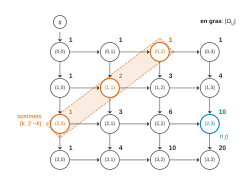
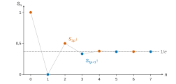
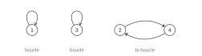

# Centrale-Supélec TSI — Mathématiques 2 2026 · Corrigé guidé

*Corrigé rédigé par IA, non officiel. Signalez toute erreur.*

## Présentation du sujet

**Thème.** Le sujet (4 heures, calculatrice autorisée, 41 questions) fait converger quatre chemins vers un même nombre : $b_n$, le nombre de permutations de $[\![1,n]\!]$ **sans point fixe** (on dit aussi « dérangements »). La conclusion du problème est la formule
$$P(\text{une permutation tirée au hasard n'a aucun point fixe})=\sum_{k=0}^{n}\frac{(-1)^k}{k!}\xrightarrow[n\to+\infty]{}\frac1e,$$
obtenue deux fois : une fois par une série entière, une fois par l'inversion d'une matrice de Pascal.

**Découpage.**
- **Partie A (Q1–Q15).** Matrices de Pascal.
  - I : l'endomorphisme $u:P\mapsto P(X+1)$ pour $n=2$.
  - II : la matrice triangulaire supérieure $U$ des coefficients binomiaux et son inverse, matrice de $P\mapsto P(X-1)$. On établit $DU=U^{-1}D$, avec $D=\operatorname{diag}((-1)^i)$. Ainsi $U$ et $L=U^\top$ sont semblables à leurs inverses.
  - III : la matrice symétrique $S=LU$ est diagonalisable, à valeurs propres strictement positives, et son spectre est stable par $x\mapsto\frac1x$. Un contre-exemple montre que la réciproque est fausse.
  - IV : un dénombrement de chemins dans un quadrillage orienté démontre la formule de Vandermonde et donne $S_{i,j}=\binom{i+j}i$.
- **Partie B (Q16–Q25).** Suite et série entière.
  - I : la suite définie par $a_0=1$, $a_1=0$ et $a_{n+1}=n(a_n+a_{n-1})$. Viennent une fonction Python, des récurrences doubles, puis $a_n=n!\sum_{k=0}^n\frac{(-1)^k}{k!}$ : $a_n$ est l'entier le plus proche de $\frac{n!}e$.
  - II : la série entière $\sum\frac{a_n}{n!}x^n$, de rayon $1$ et de somme $\frac{e^{-x}}{1-x}$. La formule de Leibniz donne ensuite la relation $p!=\sum_k\binom pk a_k$.
- **Partie C (Q26–Q35).** Permutations.
  - Une permutation est représentée par un graphe (arcs $i\to\sigma(i)$) et par une matrice ($1$ en position $(i,\sigma(i))$).
  - On montre $M(\sigma)^{-1}=M(\sigma^{-1})=M(\sigma)^\top$ et $M(\sigma^2)=M(\sigma)^2$.
  - Le théorème : $M(\sigma)$ est diagonalisable si et seulement si $\sigma^2=\mathrm{id}$ (le graphe n'a que des boucles et des bi-boucles).
- **Partie D (Q36–Q41).** Loi du nombre $X_n$ de points fixes, relation $p!=\sum_k\binom pk b_k$, et deux calculs de $P(B_n)$ : par identification $b_k=a_k$ (partie B), puis par $b=L^{-1}F$ (partie A).

**Deux défauts de l'énoncé à connaître.** En **Q31**, « la matrice introduite en Q25 » est une coquille : il s'agit de la matrice de la figure 4, introduite en **Q26**. En **Q37**, la convention « $b_0=0$ » rend fausses les formules de Q37 (pour $j=n$) et de Q38 (dès $p=0$) ; la convention cohérente est **$b_0=1$**. Le corrigé le signale et poursuit avec $b_0=1$ : c'est l'attitude attendue face à une coquille.

**Notions du programme mobilisées.** Matrice d'une application linéaire, matrices triangulaires, inverse, transposée, matrices semblables, valeurs propres et diagonalisation (dimension des sous-espaces propres), théorème spectral pour les matrices symétriques réelles, trace. Coefficients binomiaux et dénombrement (bijections, principe multiplicatif). Récurrences doubles. Séries numériques, suites adjacentes, développement en série entière de l'exponentielle. Rayon de convergence, dérivation terme à terme, lien coefficients–dérivées en $0$. Équations différentielles linéaires du premier ordre. Formule de Leibniz. Probabilités sur un univers fini, système complet d'événements. Python : listes.

**Difficulté et longueur.** Le sujet est de longueur raisonnable pour 4 heures et très progressif. Les parties A, B et C sont indépendantes ; D utilise B (Q21, Q25) et A (Q7). Les questions qui demandent le plus de soin sont Q9 (manipulation des produits sans commuter), Q13–Q14 (rédiger une bijection), Q20–Q21 (encadrement puis caractérisation, avec le cas $n=1$), Q23 (rayon et décalage d'indices), Q35 (diagonalisabilité sans critère tout fait) et Q37 (dénombrement, coquille sur $b_0$).

**À ne pas laisser passer.** Q1, Q2, Q3, Q4, Q5, Q8, Q12, Q16, Q17, Q18, Q19, Q22, Q24, Q26, Q27, Q29, Q30, Q36, Q39 : applications directes du cours ou calculs courts.

**Gestion du temps.** Environ 1 h 15 pour A (dont 25 min pour IV), 1 h pour B, 50 min pour C, 40 min pour D et 15 min de relecture. Si le dénombrement de A.IV résiste, passez à B : seule la matrice $L$ (Q7) resservira en Q41.

## Partie A — Matrices de Pascal

La partie A étudie les matrices de l'application « translation de la variable » $P\mapsto P(X+1)$. Les coefficients binomiaux apparaissent par la formule du binôme, et une simple matrice diagonale de signes $D$ suffit à relier $U$ à son inverse. On termine par une interprétation combinatoire des coefficients de $S=LU$.

### I — Cas particulier $n=2$

### Question 1

> [!INDICATION]
> Deux choses sont à montrer : $u$ est linéaire, et $u(P)$ reste dans $\mathbb R_2[X]$. Pour la matrice, calculez les images des vecteurs de la base canonique.

> [!INDICATION]
> La colonne d'indice $j$ contient les coordonnées de l'image du $j$-ième vecteur de base.

#### Solution

Pour $P=a+bX+cX^2\in\mathbb R_2[X]$ :
$$\begin{aligned}
u(P)&=a+b(X+1)+c(X+1)^2\\
&=(a+b+c)+(b+2c)X+cX^2\in\mathbb R_2[X].
\end{aligned}$$
Soient $P,Q\in\mathbb R_2[X]$ et $\lambda,\mu\in\mathbb R$. Alors $(\lambda P+\mu Q)(X+1)=\lambda P(X+1)+\mu Q(X+1)$, donc $u$ est linéaire. C'est un endomorphisme de $\mathbb R_2[X]$.

Comme $u(1)=1$, $u(X)=1+X$ et $u(X^2)=1+2X+X^2$,
$$\boxed{\operatorname{Mat}_e(u)=\begin{pmatrix}1&1&1\\0&1&2\\0&0&1\end{pmatrix}.}$$

> [!PIEGE]
> Ranger les images en lignes au lieu de colonnes donne la transposée. Et la stabilité de $\mathbb R_2[X]$ doit être dite : c'est elle qui fait de $u$ un *endo*morphisme.

### Question 2

> [!INDICATION]
> La matrice est triangulaire : que valent son déterminant et ses valeurs propres ?

> [!INDICATION]
> Plutôt qu'un pivot de Gauss, cherchez un inverse évident de $u$ parmi les translations de la variable.

> [!INDICATION]
> Pour la diagonalisabilité : à quelle matrice diagonale $A$ serait-elle semblable si elle était diagonalisable ?

#### Solution

Notons $A=\operatorname{Mat}_e(u)$. Elle est triangulaire, donc $\det A=1\neq0$ : $A$ est inversible.

Soit $v:P\mapsto P(X-1)$. Pour tout $P$ :
$$\begin{aligned}
u(v(P))&=P((X+1)-1)\\
&=P,\\[4pt]
v(u(P))&=P.
\end{aligned}$$
Donc $v=u^{-1}$ et $A^{-1}=\operatorname{Mat}_e(v)$. Avec $v(1)=1$, $v(X)=-1+X$ et $v(X^2)=1-2X+X^2$ :
$$\boxed{A^{-1}=\begin{pmatrix}1&-1&1\\0&1&-2\\0&0&1\end{pmatrix}.}$$

$A$ est triangulaire, donc ses valeurs propres sont ses coefficients diagonaux : $\boxed{\operatorname{Sp}(A)=\{1\}}$.

Si $A$ était diagonalisable, elle serait semblable à $I_3$, donc $A=PI_3P^{-1}=I_3$, ce qui est faux. **$A$ n'est pas diagonalisable.**

On peut aussi dire : $\operatorname{rg}(A-I_3)=2$, donc $\dim\ker(A-I_3)=1<3$.

> [!METHODE]
> Une matrice diagonalisable qui n'a qu'une valeur propre $\lambda$ est égale à $\lambda I$. Donc une matrice triangulaire à diagonale constante qui n'est pas diagonale n'est jamais diagonalisable.

> [!PIEGE]
> « Il n'y a qu'une valeur propre, donc elle n'est pas diagonalisable » est faux tel quel : $I_3$ n'a qu'une valeur propre et elle est diagonale. Il faut l'argument complet.

### II — Des matrices semblables à leurs inverses

### Question 3

> [!INDICATION]
> Développez $u(X^j)$ par la formule du binôme.

> [!INDICATION]
> Pour la diagonalisabilité, raisonnez comme en Q2, en traitant à part le cas $n=0$.

#### Solution

Pour $j\in[\![0,n]\!]$ :
$$\begin{aligned}
u(X^j)&=(X+1)^j\\
&=\sum_{i=0}^{j}\binom ji X^i.
\end{aligned}$$
La colonne $j$ de $U$ a pour coefficients les $\binom ji$, nuls pour $i>j$ :
$$\boxed{\forall(i,j)\in[\![0,n]\!]^2,\quad U_{i,j}=\binom ji,}$$
et **$U$ est triangulaire supérieure**, à diagonale de $1$. Donc $\operatorname{Sp}(U)=\{1\}$.

- Si $n=0$, $U=(1)$ est diagonale, donc diagonalisable.
- Si $n\ge1$, $U$ diagonalisable serait semblable, donc égale, à $I_{n+1}$ ; or $U_{0,1}=1$. **Pour $n\ge1$, $U$ n'est pas diagonalisable.**

> [!PIEGE]
> L'énoncé écrit $n\in\mathbb N$ dans cette sous-partie. Répondre « $U$ n'est jamais diagonalisable » oublie le cas $n=0$.

### Question 4

> [!INDICATION]
> Calculez $(u\circ v)(P)$ directement, par substitution.

> [!INDICATION]
> $U^{-1}$ est la matrice de $v$ : appliquez le binôme à $(X-1)^j$, en surveillant le signe.

#### Solution

Pour tout $P\in\mathbb R_n[X]$, $(u\circ v)(P)=P((X-1)+1)=P$. Donc
$$\boxed{u\circ v=\mathrm{id}_{\mathbb R_n[X]}},$$
et de même $v\circ u=\mathrm{id}$.

Ainsi $u$ est bijective d'inverse $v$. Par suite $U$ est inversible et $U^{-1}=\operatorname{Mat}_e(v)$. (En dimension finie, $u\circ v=\mathrm{id}$ suffirait : $u$ est alors surjective, donc bijective.) Comme
$$\begin{aligned}
v(X^j)&=(X-1)^j\\
&=\sum_{i=0}^{j}\binom ji(-1)^{j-i}X^i,
\end{aligned}$$
on obtient
$$\boxed{\forall(i,j)\in[\![0,n]\!]^2,\quad(U^{-1})_{i,j}=(-1)^{j-i}\binom ji.}$$
Pour $n=2$, cette formule donne
$$U^{-1}=\begin{pmatrix}1&-1&1\\0&1&-2\\0&0&1\end{pmatrix}.$$
**C'est la matrice de Q2.**

> [!METHODE]
> Pour inverser la matrice d'un endomorphisme, cherchez d'abord l'endomorphisme réciproque : ici translater de $+1$ puis de $-1$ ne change rien.

### Question 5

> [!INDICATION]
> Calculez $D^2$.

#### Solution

$D^2$ est diagonale de coefficients $((-1)^i)^2=1$ : $D^2=I_{n+1}$. Donc $D$ est inversible et $\boxed{D^{-1}=D}$.

### Question 6

> [!INDICATION]
> Que fait la multiplication à gauche par une matrice diagonale ? Et à droite ?

> [!INDICATION]
> Comparez les coefficients $(i,j)$ des deux produits en utilisant Q3 et Q4. Puis multipliez l'égalité obtenue par $D$ du bon côté.

#### Solution

Multiplier à gauche par $D$ multiplie la ligne $i$ par $(-1)^i$, à droite la colonne $j$ par $(-1)^j$. Pour $(i,j)\in[\![0,n]\!]^2$ :
$$\begin{aligned}
(DU)_{i,j}&=(-1)^i\binom ji,\\[4pt]
(U^{-1}D)_{i,j}&=(-1)^{j-i}\binom ji\,(-1)^j\\
&=(-1)^{2j-i}\binom ji\\
&=(-1)^i\binom ji.
\end{aligned}$$
Donc $\boxed{DU=U^{-1}D}$. En multipliant à gauche par $D$ et avec $D^2=I_{n+1}$, on obtient $U=DU^{-1}D$. Comme $D=D^{-1}$ :
$$\boxed{U=DU^{-1}D^{-1}.}$$
Comme $D$ est inversible, **$U$ est semblable à $U^{-1}$**.

> [!PIEGE]
> Les matrices ne commutent pas : on ne « simplifie » pas $DU=U^{-1}D$ par $D$. On multiplie les deux membres par $D$, du même côté.

> [!JURY]
> Pour conclure à une similitude, il faut nommer la matrice de passage et justifier qu'elle est inversible (ici $D$, par Q5).

### Question 7

> [!INDICATION]
> Transposez l'égalité de Q6.

> [!INDICATION]
> Deux règles utiles : $(AB)^\top=B^\top A^\top$ et $(A^{-1})^\top=(A^\top)^{-1}$.

#### Solution

$D^\top=D$ et, $U$ étant inversible, $(U^{-1})^\top=(U^\top)^{-1}=L^{-1}$. En transposant $U=DU^{-1}D$ :
$$\begin{aligned}
L&=U^\top\\
&=D^\top(U^{-1})^\top D^\top\\
&=DL^{-1}D.
\end{aligned}$$
Comme $D=D^{-1}$ :
$$\boxed{L=DL^{-1}D=DL^{-1}D^{-1}},$$
donc **$L$ est semblable à $L^{-1}$**.

On retient pour Q41 : $L_{i,j}=\binom ij$ et $(L^{-1})_{i,j}=(-1)^{i-j}\binom ij$.

### III — Une matrice diagonalisable semblable à son inverse

### Question 8

> [!INDICATION]
> Calculez $LU$, puis remarquez une propriété de symétrie qui règle la diagonalisabilité.

> [!INDICATION]
> Pour le polynôme caractéristique, $1$ est racine ; le facteur restant est un trinôme dont le produit des racines se lit sur ses coefficients.

#### Solution

Pour $n=2$, $L=\begin{pmatrix}1&0&0\\1&1&0\\1&2&1\end{pmatrix}$ et
$$\boxed{S=LU=\begin{pmatrix}1&1&1\\1&2&3\\1&3&6\end{pmatrix}.}$$
$S^\top=U^\top L^\top=LU=S$ : $S$ est symétrique réelle, donc **diagonalisable** (théorème spectral).

En développant selon la première ligne :
$$\begin{aligned}
\chi_S(X)&=\det\begin{pmatrix}X-1&-1&-1\\-1&X-2&-3\\-1&-3&X-6\end{pmatrix}\\
&=(X-1)(X^2-8X+3)-(X-3)-(X+1)\\
&=(X-1)(X^2-8X+1).
\end{aligned}$$
Le trinôme a pour discriminant $60$. Ses racines sont $4\pm\sqrt{15}$, de produit $1$. Avec $\alpha=4+\sqrt{15}>1$ :
$$\boxed{\operatorname{Sp}(S)=\left\{1,\ \alpha,\ \tfrac1\alpha\right\}}$$
avec $\alpha=4+\sqrt{15}>1$.

> [!METHODE]
> Deux contrôles gratuits d'un polynôme caractéristique de degré 3 : le coefficient de $X^2$ vaut $-\operatorname{tr}S=-9$, et $\chi_S(0)=-\det S$, ici $-1$ car $\det S=\det L\det U=1$.

### Question 9

> [!INDICATION]
> Diagonalisabilité et inversibilité : une ligne chacune, comme en Q8.

> [!INDICATION]
> Développez $(DU)S(DU)^{-1}$ en remplaçant $S$ par $LU$. Pour faire passer $D$ de l'autre côté de $L$, tirez de Q7 une identité du type $LD=D\,(\dots)$.

#### Solution

- $S^\top=U^\top L^\top=LU=S$ : $S$ est symétrique réelle, donc **diagonalisable**.
- $S=LU$ est un produit de matrices inversibles : **$S$ est inversible**, $S^{-1}=U^{-1}L^{-1}$.
- De Q7, $LD=DL^{-1}D^2=DL^{-1}$. Avec $DU=U^{-1}D$ (Q6) et $D^{-1}=D$ :
$$\begin{aligned}
(DU)S(DU)^{-1}&=DU\,LU\,U^{-1}D\\
&=(DU)(LD)\\
&=(U^{-1}D)(DL^{-1})\\
&=U^{-1}L^{-1}\\
&=S^{-1}.
\end{aligned}$$

Donc $\boxed{S^{-1}=(DU)S(DU)^{-1}}$, et $DU$ est inversible : **$S$ est semblable à son inverse.**

> [!PIEGE]
> Le calcul se mène de gauche à droite sans jamais échanger deux facteurs. Seules les identités $DU=U^{-1}D$ et $LD=DL^{-1}$ autorisent à « faire passer » $D$.

### Question 10

> [!INDICATION]
> Suivez l'énoncé : calculez $X^\top SX$ une fois avec $SX=\lambda X$, une fois avec la factorisation de $S$.

> [!INDICATION]
> $S=LU=U^\top U$ : que devient $X^\top U^\top UX$ ? Pourquoi est-ce strictement positif ?

#### Solution

Soit $\lambda$ une valeur propre de $S$ (réelle, $S$ étant symétrique réelle) et $X\neq0$ avec $SX=\lambda X$.

- $X^\top SX=\lambda X^\top X=\lambda\|X\|^2$, avec $\|X\|^2=\sum_ix_i^2>0$ car $X\neq0$.
- $S=U^\top U$, donc $X^\top SX=(UX)^\top(UX)=\|UX\|^2$. Et $UX\neq0$ car $U$ est inversible.

Donc $\lambda=\dfrac{\|UX\|^2}{\|X\|^2}$ et $\boxed{\lambda>0}$.

> [!PIEGE]
> Sans l'inversibilité de $U$, on obtient seulement $\lambda\ge0$. L'énoncé demande l'inégalité stricte.

> [!METHODE]
> Toute matrice de la forme $U^\top U$ avec $U$ inversible a des valeurs propres strictement positives : c'est l'argument « $X^\top U^\top UX=\|UX\|^2$ est le carré d'une norme ».

### Question 11

> [!INDICATION]
> Si $\lambda$ est valeur propre de $S$, de quelle matrice $\frac1\lambda$ est-elle valeur propre ?

> [!INDICATION]
> Deux matrices semblables ont même spectre. N'oubliez pas de vérifier que $x\mapsto\frac1x$ est définie sur le spectre.

#### Solution

D'après Q10, $0\notin\operatorname{Sp}(S)$ : la fonction $x\mapsto\frac1x$ est définie sur $\operatorname{Sp}(S)$.

Soit $\lambda\in\operatorname{Sp}(S)$ et $X\neq0$ tel que $SX=\lambda X$. Alors $S^{-1}X=\frac1\lambda X$, donc $\frac1\lambda\in\operatorname{Sp}(S^{-1})$.

Or $S^{-1}$ et $S$ sont semblables (Q9) : elles ont même polynôme caractéristique, donc même spectre. Ainsi $\frac1\lambda\in\operatorname{Sp}(S)$.

**$\operatorname{Sp}(S)$ est stable par $x\mapsto\frac1x$.**

### Question 12

> [!INDICATION]
> Vérifiez que $A$ satisfait l'hypothèse, puis cherchez un invariant de similitude qui distingue $A$ et $A^{-1}$.

> [!INDICATION]
> L'énoncé suggère la trace. Pensez aux multiplicités des valeurs propres.

#### Solution

$A$ est inversible, d'inverse $A^{-1}=\operatorname{diag}(\frac12,\frac12,2)$. Son spectre $\operatorname{Sp}(A)=\{2,\frac12\}$ est stable par $x\mapsto\frac1x$. Mais
$$\begin{aligned}
\operatorname{tr}A&=\tfrac92,\\
\operatorname{tr}A^{-1}&=3,
\end{aligned}$$
et deux matrices semblables ont même trace. **La réponse est non** : $A$ a un spectre stable par $x\mapsto\frac1x$ sans être semblable à son inverse.

> [!METHODE]
> Pour réfuter une réciproque, un contre-exemple suffit. Pour prouver que deux matrices ne sont pas semblables, on compare un invariant (trace, déterminant, rang, polynôme caractéristique).

> [!PIEGE]
> La stabilité du spectre ne dit rien des multiplicités : dans $A$, la valeur propre $2$ est double et $\frac12$ simple, dans $A^{-1}$ c'est l'inverse.

### IV — Calcul des coefficients de $S$ à l'aide d'un dénombrement dans un graphe

### Question 13

> [!INDICATION]
> Chaque arc (sauf le premier) fait avancer d'une case vers le bas ou vers la droite. Un chemin est entièrement déterminé par l'ordre de ces déplacements.

> [!INDICATION]
> Pour le cas général, construisez une bijection entre les chemins et les parties d'un ensemble bien choisi, et vérifiez ses deux sens.

#### Solution

Supposons $n\ge2$. Après l'arc $s\to(0,0)$, il faut deux arcs « bas » $(i,j)\to(i+1,j)$ et deux arcs « droite » $(i,j)\to(i,j+1)$ :
$$\Omega_{2,2}=\left\{\begin{aligned}
&s\to(0,0)\to(1,0)\to(2,0)\to(2,1)\to(2,2),\\
&s\to(0,0)\to(1,0)\to(1,1)\to(2,1)\to(2,2),\\
&s\to(0,0)\to(1,0)\to(1,1)\to(1,2)\to(2,2),\\
&s\to(0,0)\to(0,1)\to(1,1)\to(2,1)\to(2,2),\\
&s\to(0,0)\to(0,1)\to(1,1)\to(1,2)\to(2,2),\\
&s\to(0,0)\to(0,1)\to(0,2)\to(1,2)\to(2,2)
\end{aligned}\right\}.$$
Donc $|\Omega_{2,2}|=6=\binom42$.

Cas général : un chemin de $s$ à $(i,j)$ commence par $s\to(0,0)$. Il se poursuit par $i+j$ arcs, dont $i$ « bas » et $j$ « droite ».

On lui associe l'ensemble des rangs, dans $[\![1,i+j]\!]$, de ses arcs « bas ». Cette application est :

- injective : l'ensemble fixe la suite des déplacements, donc celle des sommets ;
- surjective : toute partie à $i$ éléments définit une suite de déplacements de $(0,0)$ à $(i,j)$. Tous ses sommets ont des coordonnées dans $[\![0,n]\!]$ : c'est un chemin de $G_n$.

Ainsi
$$\boxed{\forall(i,j)\in[\![0,n]\!]^2,\quad|\Omega_{i,j}|=\binom{i+j}i.}$$

Le tableau des $|\Omega_{i,j}|$ pour $n=2$ est exactement la matrice $S$ de Q8 :

| | $j=0$ | $j=1$ | $j=2$ |
|---|---|---|---|
| $i=0$ | 1 | 1 | 1 |
| $i=1$ | 1 | 2 | 3 |
| $i=2$ | 1 | 3 | 6 |

> [!METHODE]
> Pour dénombrer, on cherche une bijection avec un ensemble dont on connaît le cardinal. Il faut l'expliciter et justifier les deux sens.

> [!PIEGE]
> « Il faut choisir $i$ pas parmi $i+j$ » est l'intuition, pas la preuve. La surjectivité est le seul endroit où l'on vérifie que le chemin reste dans le graphe.

### Question 14

> [!INDICATION]
> Pour $|A_k|$, appliquez le principe multiplicatif à la découpe suggérée par l'énoncé, en adaptant Q13 au second morceau.

> [!INDICATION]
> Pour le système complet, suivez la somme des deux coordonnées du sommet courant le long d'un chemin : de combien augmente-t-elle à chaque arc ?

#### Solution

On munit $\Omega_{i,j}$ de la probabilité uniforme. Pour $k\in[\![0,i]\!]$, le sommet $(k,i-k)$ est dans $[\![0,n]\!]^2$.

Un chemin de $A_k$ se coupe de façon unique en deux morceaux. Le premier va de $s$ au sommet $(k,i-k)$. Le second va de ce sommet à $(i,j)$. Toute telle concaténation est dans $A_k$.

- Chemins de $s$ à $(k,i-k)$ : $\binom ik$ (Q13).
- Chemins de $(k,i-k)$ à $(i,j)$ : $i-k$ arcs « bas » parmi $j$ arcs, soit $\binom j{i-k}$.

  Si $i-k>j$, il n'y a aucun chemin (la seconde coordonnée ne décroît pas), conformément à $\binom j{i-k}=0$.

$$\boxed{|A_k|=\binom ik\binom j{i-k}.}$$

Le long d'un chemin de $\Omega_{i,j}$, la somme des coordonnées vaut $0$ en $(0,0)$. Elle augmente de $1$ à chaque arc, jusqu'à $i+j\ge i$.

Le chemin passe donc par **un et un seul** sommet de somme $i$, de la forme $(k,i-k)$ avec $0\le k\le i$.

Ainsi, les $A_k$, $k\in[\![0,i]\!]$, sont deux à deux incompatibles et de réunion $\Omega_{i,j}$ : **c'est un système complet d'événements**. En dénombrant :
$$\boxed{\begin{aligned}
\binom{i+j}i&=|\Omega_{i,j}|\\
&=\sum_{k=0}^{i}|A_k|\\
&=\sum_{k=0}^{i}\binom ik\binom j{i-k}.
\end{aligned}}$$



> [!METHODE]
> Une quantité qui augmente d'exactement $1$ à chaque étape prend chaque valeur intermédiaire une et une seule fois : c'est l'argument qui donne la partition.

### Question 15

> [!INDICATION]
> Écrivez $S_{i,j}=\sum_kL_{i,k}U_{k,j}$ avec les coefficients connus de $L$ et $U$.

> [!INDICATION]
> La somme obtenue n'a pas exactement la forme de Q14 : utilisez la symétrie des coefficients binomiaux et un changement d'indice.

#### Solution

$L_{i,k}=U_{k,i}=\binom ik$ et $U_{k,j}=\binom jk$, donc
$$\begin{aligned}
S_{i,j}&=\sum_{k=0}^{n}\binom ik\binom jk\\
&=\sum_{k=0}^{i}\binom i{i-k}\binom jk\\
&=\sum_{m=0}^{i}\binom im\binom j{i-m}
\end{aligned}$$
(termes nuls pour $k>i$, symétrie $\binom ik=\binom i{i-k}$ pour $0\le k\le i$, puis $m=i-k$). Par Q14 :
$$\boxed{\forall(i,j)\in[\![0,n]\!]^2,\quad S_{i,j}=\binom{i+j}i.}$$
Pour $n=2$ on retrouve la matrice de Q8.

> [!PIEGE]
> $L$ est la transposée de $U$ : $L_{i,k}=\binom ik$ et non $\binom ki$.

## Partie B — Étude d'une suite et d'une série entière

La partie B identifie la suite $(a_n)$ : $a_n=n!\sum_{k=0}^n\frac{(-1)^k}{k!}$, l'entier le plus proche de $\frac{n!}e$. Elle construit ensuite sa série génératrice exponentielle $s(x)=\frac{e^{-x}}{1-x}$, d'où la relation $p!=\sum_k\binom pk a_k$, qui resservira en partie D. Outils : récurrences doubles, suites adjacentes, séries entières, équations différentielles linéaires d'ordre 1, formule de Leibniz.

### I — Étude d'une suite

### Question 16

> [!INDICATION]
> Appliquez la relation de récurrence avec $n=1$, puis $n=2$.

#### Solution

$a_2=1\cdot(a_1+a_0)=1$ et $a_3=2(a_2+a_1)=2$ : $\boxed{a_2=1,\ a_3=2.}$

### Question 17

> [!INDICATION]
> Initialisez une liste avec les deux premiers termes et ajoutez les suivants un par un. Combien d'itérations faut-il ?

> [!INDICATION]
> Pensez au cas $n=0$, où la liste ne doit contenir qu'un élément.

#### Solution

```python
def liste_an(n):
    """Renvoie la liste [a_0, a_1, ..., a_n]."""
    if n == 0:
        return [1]
    a = [1, 0]
    for k in range(1, n):          # ajoute a_{k+1} = k * (a_k + a_{k-1})
        a.append(k * (a[k] + a[k - 1]))
    return a
```

Avant l'itération d'indice $k$, `a` vaut $[a_0,\dots,a_k]$. À la sortie ($k=n-1$ traité), elle vaut $[a_0,\dots,a_n]$. Pour $n=1$, la boucle est vide. `liste_an(6)` renvoie `[1, 0, 1, 2, 9, 44, 265]`.

> [!PIEGE]
> Sans le cas particulier $n=0$, la fonction renvoie $[1,0]$, qui a un terme de trop. La fonction doit *renvoyer* la liste (`return`), pas l'afficher.

### Question 18

> [!INDICATION]
> $a_{n+1}$ dépend de deux termes précédents : quelle forme de récurrence faut-il ?

> [!INDICATION]
> Faites porter la propriété sur deux rangs consécutifs à la fois.

#### Solution

Soit $\mathcal P(n)$ : « $a_n\in\mathbb N$ et $a_{n+1}\in\mathbb N$ ».

- $\mathcal P(0)$ est vraie, car $a_0=1$ et $a_1=0$.
- Si $\mathcal P(n)$ est vraie, $a_{n+2}=(n+1)(a_{n+1}+a_n)$ est un entier naturel, comme produit et somme d'entiers naturels. Donc $\mathcal P(n+1)$ est vraie.

Par récurrence, $\boxed{\forall n\in\mathbb N,\ a_n\in\mathbb N.}$

> [!METHODE]
> Récurrence double : on démontre « $\mathcal P(n)$ et $\mathcal P(n+1)$ » par une récurrence simple sur cette conjonction. On peut aussi utiliser une récurrence forte.

### Question 19

> [!INDICATION]
> Même schéma qu'en Q18. Le calcul clé consiste à factoriser $(n+1)!+n!$.

#### Solution

Soit $\mathcal Q(n)$ : « $a_n\le n!$ et $a_{n+1}\le(n+1)!$ ».

$\mathcal Q(0)$ est vraie. Si $\mathcal Q(n)$ est vraie, comme $n+1>0$ :
$$\begin{aligned}
a_{n+2}&=(n+1)(a_{n+1}+a_n)\\
&\le(n+1)\big((n+1)!+n!\big)\\
&=(n+1)\,n!\,(n+2)\\
&=(n+2)!.
\end{aligned}$$
Par récurrence, $\boxed{\forall n\in\mathbb N,\ a_n\le n!.}$

> [!PIEGE]
> L'erreur classique est $(n+1)!+n!=(n+1)\,n!$. Le bon calcul est $(n+1)!+n!=n!\,(n+1+1)=(n+2)\,n!$.

### Question 20

> [!INDICATION]
> Pour la convergence et la limite, reconnaissez un développement en série entière usuel évalué en un point.

> [!INDICATION]
> Pour l'encadrement, étudiez séparément les sommes partielles d'indice pair et d'indice impair : monotonie, écart.

> [!INDICATION]
> Des suites adjacentes encadrent leur limite commune.

#### Solution

Pour tout réel $x$, $e^x=\sum_{k=0}^{+\infty}\frac{x^k}{k!}$. En $x=-1$, la série $\sum\frac{(-1)^k}{k!}$ **converge** et
$$\boxed{\sum_{k=0}^{+\infty}\frac{(-1)^k}{k!}=\frac1e},$$
c'est-à-dire $S_n\xrightarrow[n\to+\infty]{}\frac1e$.

Pour $p\in\mathbb N$ :
$$\begin{aligned}
S_{2p+2}-S_{2p}&=\frac1{(2p+2)!}-\frac1{(2p+1)!}\\
&\le0,\\[4pt]
S_{2p+3}-S_{2p+1}&=\frac1{(2p+2)!}-\frac1{(2p+3)!}\\
&\ge0,\\[4pt]
S_{2p}-S_{2p+1}&=\frac1{(2p+1)!}\\
&\xrightarrow[p\to+\infty]{}0.
\end{aligned}$$
$(S_{2p})$ décroît, $(S_{2p+1})$ croît et leur différence tend vers zéro : elles sont adjacentes. Leur limite commune est $\frac1e$, et $S_{2p+1}\le\frac1e\le S_{2p}$ pour tout $p$. D'où, pour tout $n\in\mathbb N$ :
$$\boxed{\begin{aligned}
&S_n\le\frac1e\le S_{n+1}&&\text{si }n\text{ est impair,}\\
&S_{n+1}\le\frac1e\le S_n&&\text{si }n\text{ est pair.}
\end{aligned}}$$
Comme $\frac1e$ est entre $S_n$ et $S_{n+1}$, on a $\left|\frac1e-S_n\right|\le\frac1{(n+1)!}$.

Valeurs numériques, pour $\frac1e\simeq0{,}3679$ :

| $n$ | 0 | 1 | 2 | 3 | 4 | 5 |
|---|---|---|---|---|---|---|
| $S_n$ | 1 | 0 | 0,5 | ≃ 0,333 | 0,375 | ≃ 0,367 |



> [!METHODE]
> Pour une série alternée $\sum(-1)^ku_k$ avec $(u_k)$ décroissante de limite nulle, les sommes partielles paires et impaires sont adjacentes. On en tire la convergence, l'encadrement de la somme et la majoration du reste par le premier terme négligé.

> [!PIEGE]
> Les inégalités sont larges : $\frac1{0!}=\frac1{1!}$, et l'encadrement $S_1=0\le\frac1e\le1=S_0$ est le premier de la liste.

### Question 21

> [!INDICATION]
> Pour $a_n=n!S_n$, une récurrence double, en exprimant $S_n$ à l'aide de $S_{n+1}$ (ou l'inverse) dans l'hérédité.

> [!INDICATION]
> Pour la seconde partie, multipliez la majoration de Q20 par $n!$. Regardez de près le cas $n=1$.

> [!INDICATION]
> L'unicité de l'entier se démontre par l'inégalité triangulaire.

#### Solution

Soit $\mathcal R(n)$ : « $a_n=n!S_n$ et $a_{n+1}=(n+1)!S_{n+1}$ ».

Initialisation : $0!S_0=1=a_0$ et $1!S_1=0=a_1$.

Hérédité : supposons $\mathcal R(n)$ vraie. Comme $n!S_n=n!S_{n+1}-\frac{(-1)^{n+1}}{n+1}$, on obtient :
$$\begin{aligned}
a_{n+2}&=(n+1)\left((n+1)!S_{n+1}+n!S_{n+1}-\frac{(-1)^{n+1}}{n+1}\right)\\
&=(n+2)!\,S_{n+1}+(-1)^{n+2}\\
&=(n+2)!\left(S_{n+1}+\frac{(-1)^{n+2}}{(n+2)!}\right)\\
&=(n+2)!\,S_{n+2},
\end{aligned}$$
en utilisant $(n+1)\big((n+1)!+n!\big)=(n+2)!$. Par récurrence, $\boxed{\forall n\in\mathbb N,\ a_n=n!\,S_n.}$

Soit $n\in\mathbb N^*$. Par Q20, $\left|\frac{n!}e-a_n\right|=n!\left|\frac1e-S_n\right|\le\frac1{n+1}$.

- Si $n\ge2$ : $\frac1{n+1}\le\frac13<\frac12$.
- Si $n=1$ : la majoration donne seulement $\frac12$ ; on calcule directement $\left|\frac1e-0\right|=\frac1e<\frac12$ car $e>2$.

Donc $\left|\frac{n!}e-a_n\right|<\frac12$ avec $a_n\in\mathbb Z$.

Unicité : si $m\in\mathbb Z$ vérifie aussi $\left|\frac{n!}e-m\right|<\frac12$, alors $|m-a_n|<\frac12+\frac12=1$. Comme $m-a_n$ est entier, $m=a_n$.

**$a_n$ est l'unique entier tel que $\left|\frac{n!}e-a_n\right|<\frac12$.**

> [!PIEGE]
> Pour $n=1$, la borne générale vaut $\frac12$, ce qui ne donne pas l'inégalité stricte. Il faut traiter ce rang à part.

> [!JURY]
> Une formule de l'énoncé du type « l'unique entier tel que » contient deux affirmations, existence et unicité : il faut démontrer les deux.

### Question 22

> [!INDICATION]
> Formez le quotient de $a_n$ par l'équivalent proposé et utilisez Q20 et Q21.

#### Solution

$\frac{n!}e>0$ et $\dfrac{a_n}{n!/e}=e\,S_n\xrightarrow[n\to+\infty]{}1$, donc $\boxed{a_n\underset{n\to+\infty}{\sim}\frac{n!}e.}$

Exemple : $a_6=265$ et $\frac{720}e\simeq264{,}9$.

### II — Étude d'une série entière

### Question 23

> [!INDICATION]
> Pour le rayon, que vaut $\frac{a_n}{n!}$ d'après Q21 ? Que dire de la suite $\left(\frac{a_n}{n!}r^n\right)$ selon que $r<1$ ou $r>1$ ?

> [!INDICATION]
> Pour l'équation, dérivez terme à terme, ramenez toutes les séries aux puissances $x^m$ par décalage d'indice, et utilisez la relation de récurrence dans le coefficient de $x^m$.

#### Solution

Posons $c_n=\frac{a_n}{n!}=S_n$ (Q21).

- $|c_n|\le\sum_{k=0}^{n}\frac1{k!}\le e$. Pour $0\le r<1$, $(c_nr^n)$ est donc bornée, d'où $R\ge r$. Ainsi $R\ge1$.
- $c_n\to\frac1e>0$, donc $c_n\ge\frac1{2e}$ à partir d'un certain rang. Pour $r>1$, $c_nr^n\ge\frac{r^n}{2e}\to+\infty$, d'où $R\le r$. Ainsi $R\le1$.

Donc $\boxed{R=1}$.

Sur $]-1,1[$, $s$ est $\mathcal C^\infty$ et se dérive terme à terme :
$$\begin{aligned}
s'(x)&=\sum_{n=1}^{+\infty}\frac{a_n}{(n-1)!}x^{n-1}\\
&=\sum_{m=0}^{+\infty}\frac{a_{m+1}}{m!}x^m.
\end{aligned}$$
On en déduit
$$(1-x)s'(x)=\frac{a_1}{0!}+\sum_{m=1}^{+\infty}\left(\frac{a_{m+1}}{m!}-\frac{a_m}{(m-1)!}\right)x^m.$$
Pour $m\ge1$, $a_{m+1}-m\,a_m=m\,a_{m-1}$. Le coefficient de $x^m$ vaut donc
$$\begin{aligned}
\frac{a_{m+1}}{m!}-\frac{a_m}{(m-1)!}&=\frac{m\,a_{m-1}}{m!}\\
&=\frac{a_{m-1}}{(m-1)!}.
\end{aligned}$$
Avec $a_1=0$ :
$$\begin{aligned}
(1-x)s'(x)&=\sum_{m=1}^{+\infty}\frac{a_{m-1}}{(m-1)!}x^m\\
&=x\,s(x).
\end{aligned}$$
Et $s(0)=a_0=1$. **$s$ est solution sur $]-1,1[$ de $(1-x)y'-xy=0$, $y(0)=1$.**

> [!METHODE]
> Si $c_n\to\ell\neq0$, la série $\sum c_nx^n$ a le même rayon que $\sum x^n$, c'est-à-dire $1$. La non-nullité de la limite est indispensable pour l'inégalité $R\le1$.

> [!PIEGE]
> Les décalages d'indice sont le lieu des fautes. Contrôle simple : les termes constants des deux membres doivent coïncider (ici $a_1=0$ des deux côtés).

### Question 24

> [!INDICATION]
> Mettez l'équation sous forme résolue sur $]-1,1[$ et cherchez une primitive du coefficient.

> [!INDICATION]
> Décomposez $\frac{x}{1-x}$ en une constante plus un terme simple.

#### Solution

Sur $I=]-1,1[$, on a $1-x>0$. L'équation équivaut donc à $y'=a(x)y$, avec
$$\begin{aligned}
a(x)&=\frac{x}{1-x}\\
&=-1+\frac1{1-x},
\end{aligned}$$
continue sur $I$. Une primitive est $A(x)=-x-\ln(1-x)$. Les solutions sont donc les fonctions
$$x\mapsto K\frac{e^{-x}}{1-x},$$
où $K\in\mathbb R$. La condition $y(0)=1$ impose $K=1$. Comme $s$ est solution (Q23) :
$$\boxed{\forall x\in\,]-1,1[,\quad s(x)=\frac{e^{-x}}{1-x}.}$$
On note que $s$ tend vers $+\infty$ en $1^-$, ce qui est cohérent avec un rayon égal à $1$.

> [!PIEGE]
> On divise par $1-x$ : il faut dire que $1-x\neq0$ sur l'intervalle de travail. La primitive s'écrit sans valeur absolue parce que $1-x>0$.

### Question 25

> [!INDICATION]
> Simplifiez $e^xs(x)$ grâce à Q24 : ses dérivées successives en $0$ se calculent directement.

> [!INDICATION]
> Calculez ensuite la même dérivée par la formule de Leibniz. Pour faire apparaître les $a_k$, rappelez la relation entre les coefficients d'une série entière et les dérivées de sa somme en $0$.

#### Solution

Pour $x\in\,]-1,1[$, $f(x)=e^xs(x)=\frac1{1-x}$. Par récurrence, $f^{(p)}(x)=\frac{p!}{(1-x)^{p+1}}$, donc $f^{(p)}(0)=p!$.

Pour une série entière de rayon $R>0$, $c_k=\frac{s^{(k)}(0)}{k!}$.

Ici $c_k=\frac{a_k}{k!}$, donc $\boxed{s^{(k)}(0)=a_k}$ pour tout $k\in\mathbb N$.

La formule de Leibniz, appliquée aux fonctions $\mathcal C^\infty$ $\exp$ et $s$, donne
$$\begin{aligned}
f^{(p)}(0)&=\sum_{k=0}^{p}\binom pk\exp^{(p-k)}(0)\,s^{(k)}(0)\\
&=\sum_{k=0}^{p}\binom pk a_k.
\end{aligned}$$
D'où
$$\boxed{\forall p\in\mathbb N\ (\text{donc }\forall p\in[\![0,n]\!]),\ \ p!=\sum_{k=0}^{p}\binom pk a_k.}$$
Contrôle : pour $p=3$, $1+0+3+2=6$.

> [!METHODE]
> Calculer une même quantité de deux façons est la manière standard d'obtenir une identité. Ici, Leibniz traduit un produit de fonctions en une « convolution binomiale » de leurs dérivées.

## Partie C — Permutations de $[\![1,n]\!]$

La partie C code une permutation par un graphe et par une matrice. L'outil central est l'écriture $M(\tau)_{i,j}=\delta_{j,\tau(i)}$, qui ramène les produits de matrices à des compositions de permutations. Le but est le théorème : $M(\sigma)$ est diagonalisable si et seulement si $\sigma\circ\sigma=\mathrm{id}$.

### I — Représentations d'une permutation

### Question 26

> [!INDICATION]
> Dans la ligne $i$, le $1$ est dans la colonne $\sigma(i)$.

#### Solution

On lit :

| $i$ | 1 | 2 | 3 | 4 |
|---|---|---|---|---|
| $\sigma(i)$ | 1 | 4 | 3 | 2 |

Le graphe $G(\sigma)$ a quatre sommets. Il comporte deux **boucles**, $1\to1$ et $3\to3$. Il comporte aussi une **bi-boucle**, formée des arcs $2\to4$ et $4\to2$.



> [!PIEGE]
> Lire les colonnes au lieu des lignes donne le graphe de $\sigma^{-1}$. Ici $\sigma=\sigma^{-1}$, ce qui masquerait l'erreur : énoncez la convention avant de lire.

### Question 27

> [!INDICATION]
> Relevez, pour chaque arc, le sommet où se trouve la pointe de la flèche : cela donne $\sigma(i)$ pour chaque $i$.

#### Solution

La figure 5 montre le cycle $1\to2\to4\to3\to1$ (même sens de rotation que dans la figure 2) et la boucle $5\to5$. Donc :

| $i$ | 1 | 2 | 3 | 4 | 5 |
|---|---|---|---|---|---|
| $\sigma(i)$ | 2 | 4 | 1 | 3 | 5 |

$$\boxed{M(\sigma)=\begin{pmatrix}0&1&0&0&0\\0&0&0&1&0\\1&0&0&0&0\\0&0&1&0&0\\0&0&0&0&1\end{pmatrix}.}$$

> [!PIEGE]
> Lire le cycle à l'envers donne la transposée, c'est-à-dire la matrice de $\sigma^{-1}$. Le contrôle « un seul $1$ par ligne et par colonne » ne détecte pas cette erreur.

### II — Propriétés

### Question 28

> [!INDICATION]
> Écrivez $M(\tau)_{i,j}$ à l'aide du symbole de Kronecker, puis calculez le coefficient $(i,j)$ du produit.

> [!INDICATION]
> Dans la somme sur $k$, combien de termes peuvent être non nuls ?

#### Solution

Pour $\tau\in\mathcal S_n$, $M(\tau)_{i,j}=\delta_{j,\tau(i)}$. Pour $(i,j)\in[\![1,n]\!]^2$ :
$$\begin{aligned}
\big(M(\sigma)M(\sigma^{-1})\big)_{i,j}&=\sum_{k=1}^{n}\delta_{k,\sigma(i)}\,\delta_{j,\sigma^{-1}(k)}\\
&=\delta_{j,\sigma^{-1}(\sigma(i))}\\
&=\delta_{j,i},
\end{aligned}$$
car seul le terme $k=\sigma(i)$ peut être non nul. Donc $M(\sigma)M(\sigma^{-1})=I_n$ ; pour des matrices carrées, cela suffit :
$$\boxed{M(\sigma)\text{ est inversible et }M(\sigma)^{-1}=M(\sigma^{-1}).}$$

> [!METHODE]
> Le même calcul donne $M(\sigma)M(\tau)=M(\tau\circ\sigma)$ : l'ordre est inversé. Retenir l'écriture par symboles de Kronecker plutôt que la formule.

### Question 29

> [!INDICATION]
> Traduisez « arc de $i$ vers $j$ dans $G(\sigma^{-1})$ » à l'aide de $\sigma$.

> [!INDICATION]
> Faites de même pour le coefficient $(i,j)$ de $M(\sigma^{-1})$, puis combinez avec Q28.

#### Solution

$G(\sigma^{-1})$ a l'arc $i\to j$ si et seulement si $\sigma^{-1}(i)=j$, c'est-à-dire $\sigma(j)=i$.

**$G(\sigma^{-1})$ s'obtient en renversant tous les arcs de $G(\sigma)$.**

De même :
$$\begin{aligned}
M(\sigma^{-1})_{i,j}=1&\iff\sigma(j)=i\\
&\iff M(\sigma)_{j,i}=1.
\end{aligned}$$
Les coefficients valant $0$ ou $1$, **$M(\sigma^{-1})=M(\sigma)^\top$.** Avec Q28 :
$$\boxed{M(\sigma)^{-1}=M(\sigma^{-1})=M(\sigma)^\top.}$$
Une matrice de permutation est donc orthogonale : $M(\sigma)^\top M(\sigma)=I_n$.

### Question 30

> [!INDICATION]
> Même calcul qu'en Q28, avec $\sigma$ à la place de $\sigma^{-1}$.

#### Solution

$\sigma^2\in\mathcal S_n$ et, pour $(i,j)\in[\![1,n]\!]^2$ :
$$\begin{aligned}
\big(M(\sigma)^2\big)_{i,j}&=\sum_{k=1}^{n}\delta_{k,\sigma(i)}\,\delta_{j,\sigma(k)}\\
&=\delta_{j,\sigma(\sigma(i))}\\
&=M(\sigma^2)_{i,j}.
\end{aligned}$$
Donc $\boxed{M(\sigma^2)=M(\sigma)^2.}$

### III — Matrices de permutation diagonalisables

### Question 31

> [!INDICATION]
> L'énoncé renvoie à « Q25 », qui n'introduit aucune matrice : repérez la matrice $4\times4$ de l'énoncé dont le polynôme caractéristique peut être de degré 4.

> [!INDICATION]
> Développez $\det(XI_4-N)$ selon une ligne ou une colonne qui contient beaucoup de zéros. Pour la diagonalisabilité, comparez la dimension de $\ker(N-I_4)$ à la multiplicité de $1$.

#### Solution

Il s'agit de la matrice $N$ de la figure 4 (Q26). En développant selon la première colonne, puis selon la ligne contenant $X-1$ :
$$\begin{aligned}
\chi_N&=\det\begin{pmatrix}X-1&0&0&0\\0&X&0&-1\\0&0&X-1&0\\0&-1&0&X\end{pmatrix}\\
&=(X-1)^2\det\begin{pmatrix}X&-1\\-1&X\end{pmatrix}\\
&=(X-1)^2(X^2-1),
\end{aligned}$$
donc $\boxed{\chi_N=(X-1)^3(X+1)}$.

$N-I_4$ a deux lignes nulles et deux lignes opposées. Donc $\operatorname{rg}(N-I_4)=1$ et $\dim\ker(N-I_4)=3$, égal à la multiplicité de $1$.

La valeur propre $-1$ est simple, donc $\dim\ker(N+I_4)=1$. La somme des dimensions vaut $4$ : **$N$ est diagonalisable.**

C'est cohérent avec le théorème : $G(\sigma)$ n'a que deux boucles et une bi-boucle (Q26).

> [!METHODE]
> Contrôle du polynôme caractéristique : la somme des racines $1+1+1-1=2$ est égale à $\operatorname{tr}N$, et leur produit $-1$ à $\det N$.

> [!JURY]
> Face à une coquille d'énoncé, on la signale en une phrase, on dit comment on l'interprète et on poursuit. Une interprétation raisonnable et explicitée est toujours mieux qu'une question laissée blanche.

### Question 32

> [!INDICATION]
> Comme en Q10, calculez une même quantité de deux façons. Quelle relation entre $M^\top$ et $M$ avez-vous obtenue en Q29 ?

> [!INDICATION]
> Calculez $X^\top M^\top MX$ en utilisant d'un côté $M^\top M=I_n$, de l'autre $MX=\lambda X$.

#### Solution

$M=M(\sigma)$ étant diagonalisable dans $\mathcal M_n(\mathbb R)$, ses valeurs propres sont réelles. Soit $\lambda$ l'une d'elles, $X\in\mathcal M_{n,1}(\mathbb R)$ non nul avec $MX=\lambda X$. Par Q29, $M^\top M=I_n$, donc
$$\begin{aligned}
\|X\|^2&=X^\top M^\top MX\\
&=(MX)^\top(MX)\\
&=\lambda^2\|X\|^2,
\end{aligned}$$
et $\|X\|^2>0$ : $\boxed{\lambda^2=1.}$

> [!PIEGE]
> Le caractère réel de $\lambda$ est utilisé : sur $\mathbb C$, une matrice de permutation peut avoir des valeurs propres non réelles de module $1$ (par exemple $e^{2i\pi/3}$ pour un $3$-cycle).

### Question 33

> [!INDICATION]
> Une matrice diagonalisable est semblable à une matrice diagonale dont les coefficients sont ses valeurs propres. Que savez-vous de ces valeurs propres ?

> [!INDICATION]
> Réordonner les vecteurs d'une base de vecteurs propres est encore un changement de base.

#### Solution

Il existe $P\in GL_n(\mathbb R)$ et $\Delta=\operatorname{diag}(\lambda_1,\dots,\lambda_n)$ telles que $M(\sigma)=P\Delta P^{-1}$. Les $\lambda_i$ sont les valeurs propres de $M(\sigma)$, donc égales à $\pm1$ (Q32).

Soit $q\in[\![0,n]\!]$ le nombre d'indices $i$ tels que $\lambda_i=1$. En réordonnant les colonnes de $P$, on peut placer ces valeurs propres en tête. **$M(\sigma)$ est semblable à $\Delta_q$**, où
$$\Delta_q=\operatorname{diag}(\underbrace{1,\dots,1}_{q},\underbrace{-1,\dots,-1}_{n-q}).$$

> [!PIEGE]
> $q=0$ et $q=n$ sont permis (cas $M=-I_n$ et $M=I_n$).

### Question 34

> [!INDICATION]
> Calculez $\Delta_q^2$, puis $M(\sigma)^2$. Comment Q30 et la bijectivité de $M$ permettent-elles de remonter à $\sigma$ ?

> [!INDICATION]
> Pour le graphe, regardez l'arc issu d'un sommet $i$ selon que $\sigma(i)=i$ ou non.

#### Solution

$\Delta_q^2=I_n$, donc $M(\sigma)^2=P\Delta_q^2P^{-1}=I_n$. Par Q30, $M(\sigma^2)=I_n=M(\mathrm{id})$. Comme $M$ est injective, $\boxed{\sigma^2=\mathrm{id}.}$

Les arcs de $G(\sigma)$ sont les $i\to\sigma(i)$. Soit $i\in[\![1,n]\!]$ et $j=\sigma(i)$.

- Si $j=i$, l'arc est une boucle.
- Sinon $\sigma(j)=\sigma^2(i)=i$. L'arc $j\to i$ existe donc, et forme avec $i\to j$ une bi-boucle.

**$G(\sigma)$ ne contient que des boucles ou des bi-boucles.**

> [!PIEGE]
> L'égalité $M(\sigma^2)=M(\mathrm{id})$ est une égalité de matrices ; passer à $\sigma^2=\mathrm{id}$ demande l'injectivité de $M$, admise par l'énoncé, qu'il faut citer.

### Question 35

> [!INDICATION]
> Montrez d'abord que l'hypothèse sur le graphe donne $\sigma^2=\mathrm{id}$, puis $M(\sigma)^2=I_n$.

> [!INDICATION]
> Pour conclure sans critère tout fait, décomposez tout vecteur $x$ à l'aide de $x+Mx$ et $x-Mx$. Ou cherchez directement des vecteurs propres parmi les combinaisons simples des vecteurs de la base canonique.

#### Solution

Supposons que $G(\sigma)$ ne contienne que des boucles et des bi-boucles. Soit $i\in[\![1,n]\!]$ et $j=\sigma(i)$.

- Si $j=i$, alors $\sigma^2(i)=i$.
- Sinon, l'arc $i\to j$ appartient à une bi-boucle : $\sigma(j)=i$, donc $\sigma^2(i)=i$.

Ainsi $\sigma^2=\mathrm{id}$. Notons $M=M(\sigma)$ : par Q30, $M^2=I_n$.

Pour $x\in\mathcal M_{n,1}(\mathbb R)$, posons
$$\begin{aligned}
x_+&=\frac{x+Mx}2,\\
x_-&=\frac{x-Mx}2.
\end{aligned}$$
Alors $x=x_++x_-$. Comme $M^2x=x$, on a $Mx_+=x_+$ et $Mx_-=-x_-$.

Notons $E_{\pm1}=\ker(M\mp I_n)$. On a donc $\mathcal M_{n,1}(\mathbb R)=E_1+E_{-1}$. La somme est directe, car $Mx=x=-x$ impose $x=0$.

Si $E_1$ et $E_{-1}$ sont non nuls, ce sont les deux sous-espaces propres de $M$ et leur somme est l'espace entier : $M$ est diagonalisable. Si l'un est nul, $M=\pm I_n$ est diagonale.

Autre preuve, explicite. Comme $\sigma=\sigma^{-1}$, on a $Me_j=e_{\sigma(j)}$. En effet, la colonne $j$ de $M$ a son $1$ en ligne $\sigma^{-1}(j)=\sigma(j)$.

- Pour une boucle $i$, $Me_i=e_i$.
- Pour une bi-boucle $\{i,j\}$, $M(e_i+e_j)=e_i+e_j$ et $M(e_i-e_j)=-(e_i-e_j)$.

Ces $n$ vecteurs forment une base de vecteurs propres.

**$M(\sigma)$ est diagonalisable**, ce qui achève la preuve du théorème.

> [!METHODE]
> Une matrice $M$ telle que $M^2=I_n$ (une symétrie) est diagonalisable, avec $E_1\oplus E_{-1}$ égal à l'espace entier. La décomposition $x=\frac{x+Mx}2+\frac{x-Mx}2$ est la preuve à savoir refaire.

> [!PIEGE]
> Ne pas oublier les cas dégénérés $M=\pm I_n$, où l'un des deux noyaux est nul et n'est donc pas un sous-espace propre.

## Partie D — Graphes de permutations sans boucle

La partie D calcule la probabilité qu'une permutation uniforme n'ait aucun point fixe. On dénombre d'abord selon le nombre de points fixes, ce qui donne $p!=\sum_k\binom pk b_k$. Cette relation est ensuite exploitée deux fois : par comparaison avec la relation de Q25 (partie B), puis comme système triangulaire $Lb=F$ (partie A).

### I — Introduction

### Question 36

> [!INDICATION]
> Utilisez la bijection $G$. Qu'est-ce qu'une boucle de $G(\sigma)$ en termes de $\sigma$ ?

> [!INDICATION]
> Une permutation peut-elle avoir exactement $n-1$ points fixes ?

#### Solution

$G$ est une bijection de $\mathcal S_n$ sur $G(\mathcal S_n)$, donc $\boxed{|G(\mathcal S_n)|=n!}$.

Une boucle est un point fixe : $X_n$ compte les points fixes de $\sigma$.

Si $\sigma$ fixait exactement $n-1$ éléments, le dernier élément $i_0$ ne pourrait avoir pour image aucun des autres, déjà atteints (injectivité). Donc $\sigma(i_0)=i_0$ : contradiction.

Toute autre valeur $j\in[\![0,n]\!]$ est atteinte. On fixe $j$ éléments et l'on permute circulairement les $m=n-j$ autres :
$$c_1\to c_2\to\dots\to c_m\to c_1.$$
Il n'y a pas de point fixe parmi eux si $m\ge2$, et rien à faire si $m=0$. Donc
$$\boxed{X_n(\Omega)=[\![0,n]\!]\setminus\{n-1\}}$$
(pour $n=1$, cet ensemble est $\{1\}$).

> [!PIEGE]
> Répondre $[\![0,n]\!]$ donne un ensemble qui contient les valeurs prises, pas l'ensemble demandé. Il faut aussi montrer que chaque valeur annoncée est effectivement atteinte.

### Question 37

> [!INDICATION]
> Avant tout, testez la formule pour $j=n$ avec la convention de l'énoncé : est-elle compatible ?

> [!INDICATION]
> Pour dénombrer les permutations à exactement $j$ points fixes, choisissez d'abord l'ensemble des points fixes, puis décrivez ce que fait $\sigma$ sur le reste.

#### Solution

**Convention.** Avec $b_0=0$, le membre de droite vaudrait $0$ pour $j=n$. Or l'identité est l'unique permutation à $n$ points fixes : $P(X_n=n)=\frac1{n!}$.

On adopte donc $\boxed{b_0=1}$ (la permutation de l'ensemble vide n'a pas de point fixe), seule valeur qui rend vraies les formules de Q37 et Q38.

L'univers $G(\mathcal S_n)$ est muni de la probabilité uniforme. Cela revient à tirer $\sigma$ uniformément dans $\mathcal S_n$. Soit $j\in[\![0,n]\!]$.

Une permutation à exactement $j$ points fixes est déterminée par l'ensemble $F$ de ses points fixes ($\binom nj$ choix) et par sa restriction au complémentaire de $F$.

Ce complémentaire, de cardinal $n-j$, est stable par $\sigma$. La permutation $\sigma$ y induit une permutation sans point fixe : $b_{n-j}$ choix, ce nombre ne dépendant que du cardinal. Réciproquement, tout tel couple convient. Donc
$$\boxed{\forall j\in[\![0,n]\!],\ \ P(X_n=j)=\frac{\binom nj\,b_{n-j}}{n!}.}$$
Contrôle pour $n=3$ : $\frac26,\frac36,0,\frac16$, de somme $1$.

> [!PIEGE]
> La restriction de $\sigma$ hors de $F$ doit être *sans point fixe*, sinon $\sigma$ aurait plus de $j$ points fixes : c'est ce qui fait apparaître $b_{n-j}$ et non $(n-j)!$.

### Question 38

> [!INDICATION]
> Que vaut la somme des probabilités de la loi de $X_n$ ?

> [!INDICATION]
> Pour passer de $n$ à $p$, observez que $b_k$ ne dépend pas de l'entier $n$ du problème.

#### Solution

Les événements $(X_n=j)$, $j\in[\![0,n]\!]$, forment un système complet, donc
$$1=\sum_{j=0}^{n}\frac{\binom nj\,b_{n-j}}{n!}.$$
En multipliant par $n!$, avec $\binom nj=\binom n{n-j}$ puis $k=n-j$ :
$$\begin{aligned}
n!&=\sum_{j=0}^{n}\binom n{n-j}b_{n-j}\\
&=\sum_{k=0}^{n}\binom nk b_k.
\end{aligned}$$
$b_k$ est le nombre de permutations sans point fixe d'un ensemble à $k$ éléments, indépendamment de $n$.

Pour $p\in[\![1,n]\!]$, le même raisonnement dans $\mathcal S_p$ donne la relation au rang $p$. Pour $p=0$, elle s'écrit $0!=b_0$, vraie avec $b_0=1$. Donc
$$\boxed{\forall p\in[\![0,n]\!],\ \ p!=\sum_{k=0}^{p}\binom pk b_k.}$$

### Question 39

> [!INDICATION]
> Isolez le terme d'indice $k=p$ dans la relation : quel est son coefficient ?

#### Solution

Comme $\binom pp=1$, la relation au rang $p\ge1$ s'écrit
$$b_p=p!-\sum_{k=0}^{p-1}\binom pk b_k.$$
À partir de $b_0=1$, elle détermine de proche en proche $b_1,\dots,b_n$ (système triangulaire à diagonale de $1$). On obtient
$$\begin{aligned}
b_1&=1-1\\
&=0,\\[4pt]
b_2&=2-1-0\\
&=1,\\[4pt]
b_3&=6-1-0-3\\
&=2.
\end{aligned}$$
Ainsi $\boxed{b_1=0,\ b_2=1,\ b_3=2.}$
Contrôle direct : sur $[\![1,3]\!]$, seuls les deux $3$-cycles sont sans point fixe.

> [!METHODE]
> Les valeurs $1,0,1,2$ sont celles de $a_0,\dots,a_3$ (Q16) : c'est l'indice que les deux suites coïncident, ce que Q40 démontre.

### II — Calcul d'une probabilité par deux méthodes

### Question 40

> [!INDICATION]
> Comparez la relation de Q38 à celle que l'étude de la série entière $s$ a fournie en Q25.

> [!INDICATION]
> Deux suites qui vérifient le même système triangulaire avec le même premier terme sont égales : récurrence forte. Concluez avec Q21.

#### Solution

Q25 donne, pour tout $p$ :
$$p!=\sum_{k=0}^{p}\binom pk a_k.$$
Q38 donne la même relation pour les $b_k$. Raisonnons par récurrence forte sur $p\in[\![0,n]\!]$.

- $a_0=b_0=1$.
- Si $a_k=b_k$ pour $k<p$, la différence des deux relations au rang $p$ donne $0=\binom pp(a_p-b_p)=a_p-b_p$.

Donc $b_n=a_n=n!S_n$ (Q21). Comme $B_n=(X_n=0)$ a $b_n$ éléments dans un univers équiprobable à $n!$ éléments :
$$\boxed{\begin{aligned}
P(B_n)&=\frac{b_n}{n!}\\
&=S_n\\
&=\sum_{k=0}^{n}\frac{(-1)^k}{k!}.
\end{aligned}}$$
Par exemple, $P(B_5)=\frac{44}{120}\simeq0{,}367$, déjà très proche de $\frac1e$.

| $j$ | 0 | 1 | 2 | 3 | 4 | 5 |
|---|---|---|---|---|---|---|
| $P(X_5=j)$ | $\frac{44}{120}$ | $\frac{45}{120}$ | $\frac{20}{120}$ | $\frac{10}{120}$ | 0 | $\frac1{120}$ |

> [!PIEGE]
> Ne pas oublier l'argument d'unicité : deux suites qui vérifient « la même relation » ne sont égales que parce que le système est triangulaire, de coefficient diagonal $\binom pp=1$.

### Question 41

> [!INDICATION]
> Calculez $(L^{-1}F)_i$ avec la formule des coefficients de $L^{-1}$ obtenue en Q7, puis simplifiez $\binom ij\,j!$.

> [!INDICATION]
> Écrivez matriciellement les relations de Q38 à l'aide de $L$ et du vecteur colonne des $b_k$.

#### Solution

$(L^{-1})_{i,j}=(-1)^{i-j}\binom ij$ (Q7). Pour $i\in[\![0,n]\!]$ :
$$\begin{aligned}
(L^{-1}F)_i&=\sum_{j=0}^{i}(-1)^{i-j}\frac{i!}{j!\,(i-j)!}\,j!\\
&=i!\sum_{j=0}^{i}\frac{(-1)^{i-j}}{(i-j)!}\\
&=i!\sum_{m=0}^{i}\frac{(-1)^m}{m!}\\
&=i!\,S_i,
\end{aligned}$$
$$\boxed{L^{-1}F=\begin{pmatrix}0!\,S_0\\1!\,S_1\\\vdots\\n!\,S_n\end{pmatrix}.}$$
Posons $B=(b_0,\dots,b_n)^\top$. Pour $i\in[\![0,n]\!]$, Q38 donne
$$\begin{aligned}
(LB)_i&=\sum_{j=0}^{i}\binom ij b_j\\
&=i!\\
&=F_i.
\end{aligned}$$
Donc $LB=F$, puis $B=L^{-1}F$ : $b_i=i!\,S_i$ pour tout $i$. En particulier
$$\boxed{\begin{aligned}
P(B_n)&=\frac{b_n}{n!}\\
&=\sum_{k=0}^{n}\frac{(-1)^k}{k!},
\end{aligned}}$$
retrouvé sans utiliser la partie B.

> [!METHODE]
> Une famille de relations « triangulaires » $y_p=\sum_{k\le p}\binom pk x_k$ s'inverse en $x_p=\sum_{k\le p}(-1)^{p-k}\binom pk y_k$ : c'est exactement $L^{-1}$. Cette formule d'inversion binomiale est un outil classique de dénombrement.

## Bilan

**Méthodes à retenir.**
- Matrice d'un endomorphisme de $\mathbb R_n[X]$ : images des $X^j$ rangées en colonnes ; inverse par l'endomorphisme réciproque.
- Une matrice diagonalisable à valeur propre unique $\lambda$ est égale à $\lambda I$.
- Similitude : exhiber la matrice de passage et son inverse ; invariants (trace, spectre, polynôme caractéristique) pour prouver une non-similitude.
- Positivité des valeurs propres de $U^\top U$ par le calcul de $X^\top U^\top UX$ ; même technique pour $M^\top M=I_n$ (valeurs propres réelles $\pm1$).
- Dénombrement par bijection, découpage selon un « passage obligé », système complet d'événements.
- Récurrences doubles ; suites adjacentes pour les séries alternées.
- Série entière : rayon par comparaison de $c_n$ à une limite non nulle, dérivation terme à terme et décalage d'indices, $c_k=\frac{s^{(k)}(0)}{k!}$.
- Formule de Leibniz pour obtenir une identité binomiale.
- Une matrice $M$ telle que $M^2=I_n$ est diagonalisable : décomposition $x=\frac{x+Mx}2+\frac{x-Mx}2$.

**Prérequis à revoir.** Coefficients binomiaux (binôme, symétrie, formule de Vandermonde), produit matriciel par coefficients, transposée d'un produit et d'un inverse, critère de diagonalisabilité par les dimensions des sous-espaces propres, développement en série entière de l'exponentielle, équations différentielles linéaires d'ordre 1.

**Questions classiques transposables.** Le nombre de dérangements $b_n=n!\sum_{k=0}^n\frac{(-1)^k}{k!}$ et la limite $\frac1e$ (problème des rencontres). L'inversion binomiale par la matrice de Pascal. Les matrices de permutation sont orthogonales et $M(\sigma)M(\tau)=M(\tau\circ\sigma)$. Une symétrie ($M^2=I$) est diagonalisable. Le quadrillage orienté, où les chemins se comptent par $\binom{i+j}i$.
