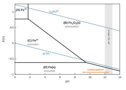
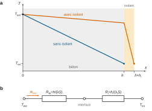
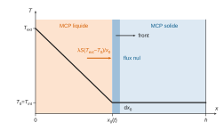
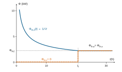

# Centrale-Supélec TSI — Physique-chimie 1 2026 · Corrigé

*Corrigé rédigé par IA, non officiel. Signalez toute erreur.*

Épreuve de 4 heures, calculatrice autorisée. « Construction d'un bâtiment » : 52 questions en quatre parties indépendantes. Axe $(Oz)$ vertical ascendant dans la partie A ; référentiel terrestre supposé galiléen.

## Partie A — Pénétrométrie dynamique

### I — La formule des Hollandais

#### Q1

Entre le lâcher (vitesse nulle) et l'instant qui précède le choc, le mouton n'est soumis qu'à son poids (frottements de l'air négligés) et descend de $H$. Le théorème de l'énergie cinétique donne $\tfrac12 MV^2 = MgH$. Le mouvement est vers le bas :

$$\boxed{\vec V = -\sqrt{2gH}\,\vec e_z}$$

de norme

$$\boxed{V = \sqrt{2\times 9{,}8\times 0{,}50} = 3{,}1\ \mathrm{m\cdot s^{-1}}}$$

#### Q2

Système {mouton + enclume + tige}, entre juste avant et juste après le choc. La quantité de mouvement globale est conservée, et après le choc mou les deux solides ont la même vitesse $\vec v$ :

$$M\vec V = (M+m)\vec v$$

d'où

$$\boxed{\vec v = \frac{M}{M+m}\vec V = -\frac{M}{M+m}\sqrt{2gH}\,\vec e_z}$$

Numériquement, $v = \dfrac{64}{88}\times 3{,}13 = 2{,}3\ \mathrm{m\cdot s^{-1}}$, vers le bas.

#### Q3

Pendant l'enfoncement, le système de masse $M+m$ passe de la vitesse $v$ à l'arrêt :

$$\Delta E_c = 0 - \frac12 (M+m)\frac{M^2}{(M+m)^2}\,2gH$$

soit

$$\boxed{\Delta E_c = -\frac{M^2 gH}{M+m} = -2{,}3\times10^{2}\ \mathrm{J}}$$

Sur les $MgH = 314$ J libérés par la chute, seule la fraction $M/(M+m) = 73\ \%$ reste disponible pour l'enfoncement : le reste a été dissipé dans le choc mou.

#### Q4

Quand la pointe est enfoncée de $\zeta \in [0,e]$, le sol exerce sur la section $S$ une force pressante verticale ascendante $\vec F = p(\zeta)S\,\vec e_z$. Le déplacement élémentaire de la pointe vaut $\mathrm{d}\vec r = -\mathrm{d}\zeta\,\vec e_z$. Donc

$$\begin{aligned}
W &= \int_0^e \vec F\cdot \mathrm{d}\vec r\\
&= -S\int_0^e p(\zeta)\,\mathrm{d}\zeta\\
&= -S\,e\left(\frac1e\int_0^e p(\zeta)\,\mathrm{d}\zeta\right).
\end{aligned}$$

La parenthèse est la pression moyenne exercée par le sol au cours de l'enfoncement, c'est-à-dire $q_d$ par définition :

$$\boxed{W = -q_d\,S\,e}$$

Le travail est résistant (force opposée au déplacement).

#### Q5

On applique le théorème de l'énergie cinétique au système {mouton + enclume + tige}, de l'instant qui suit le choc jusqu'à l'arrêt. Le poids travaille, $W_P = +(M+m)ge$ (déplacement $e$ vers le bas) ; la force du sol sur la pointe donne $W = -q_dSe$ (Q4) ; les frottements latéraux sont négligés. D'où

$$-\frac{M^2gH}{M+m} = (M+m)ge - q_dSe$$

soit

$$\boxed{q_d = \frac{(M+m)g}{S} + \frac{MgH}{Se}\,\frac{M}{M+m}}$$

#### Q6

La formule des Hollandais revient à négliger le terme « statique » (poids de l'équipage) devant le terme « dynamique » :

$$\begin{aligned}
&\frac{(M+m)g}{S} \ll \frac{MgH}{Se}\frac{M}{M+m}\\
\iff\ &e \ll H\frac{M^2}{(M+m)^2} = 0{,}26\ \mathrm{m}.
\end{aligned}$$

Numériquement, $(M+m)g/S = 4{,}3\times10^{5}\ \mathrm{Pa} = 0{,}43$ MPa, tandis que le terme dynamique vaut $1{,}14\times10^{5}/e$ (en Pa, $e$ en m). Les enfoncements par coup observés vont de 5 cm (2 coups pour 10 cm) à 2 mm (50 coups pour 10 cm), tous très inférieurs à 26 cm. L'erreur relative, rapportée à $q_d$ complet, vaut environ 16 % dans la terre meuble, 2,5 % dans les remblais et 1 % au seuil de 40 MPa.

**L'approximation est légitime là où l'on cherche à fonder (couches résistantes, erreur de l'ordre du pour cent) ; elle sous-estime $q_d$, donc va dans le sens de la sécurité.**

### II — Analyse d'un sol

#### Q7

De la surface à 0,5 m, il faut 2 à 5 coups pour 10 cm ; entre 0,5 et 0,6 m, ce nombre saute à 17, signe d'un changement de matériau.

**L'épaisseur de la terre meuble est d'environ 0,5 m** (à ±0,05 m près, le pas de mesure étant de 10 cm).

#### Q8

*Démarche.* On lit sur la figure 2(a) un nombre de coups représentatif de la couche de remblais, on en déduit l'enfoncement par coup, puis on applique la formule des Hollandais.

*Lecture.* Les remblais s'étendent d'environ 0,5 m à 1,75 m ; on y compte entre 10 et 20 coups pour 10 cm, valeur représentative $N \approx 15$.

*Enfoncement par coup.* $e = 0{,}10\ \mathrm{m}/N = 6{,}7\times10^{-3}$ m.

*Résistance.*

$$q_d = \frac{MgH}{Se}\frac{M}{M+m} = \frac{64\times9{,}8\times0{,}50}{20\times10^{-4}\times6{,}7\times10^{-3}}\times\frac{64}{88} \approx 1{,}7\times10^{7}\ \mathrm{Pa}.$$

Pour $N = 10$ et $N = 20$, on obtient 11 MPa et 23 MPa.

$$\boxed{q_d \sim 10^{7}\ \mathrm{Pa}\ \ (\text{environ } 15 \text{ à } 20\ \mathrm{MPa})}$$

#### Q9

Dans les remblais, $q_d \approx 17\ \mathrm{MPa} < 40$ MPa. De plus, un remblai de gravats est un matériau rapporté, hétérogène et susceptible de se tasser.

**Non, on ne peut pas placer la base des fondations dans les remblais.**

#### Q10

Le seuil $q_d = 40$ MPa correspond à

$$e_s = \frac{MgH}{S\,q_d}\frac{M}{M+m} = 2{,}9\times10^{-3}\ \mathrm{m},$$

soit

$$N_s = \frac{0{,}10}{e_s} \approx 35\ \text{coups pour } 10\ \mathrm{cm}.$$

Seul le dernier point de l'essai dépasse ce seuil : 50 coups à 3,0 m de profondeur, soit $e = 2{,}0$ mm et $q_d = 5{,}7\times10^{7}\ \mathrm{Pa} = 57\ \mathrm{MPa} > 40$ MPa. Entre 2,3 et 2,9 m ($N$ de 10 à 23), on a $q_d$ entre 11 et 26 MPa, ce qui reste insuffisant.

**Oui : vers 3 m de profondeur, dans la roche, la résistance dépasse 40 MPa.** Cette conclusion repose sur un seul point (au refus de l'appareil) ; d'autres sondages seraient nécessaires pour confirmer la continuité de la roche.

## Partie B — La chimie du béton

### I — Empreinte carbone de la fabrication du ciment

#### Q11

Les grandeurs standard sont supposées indépendantes de $T$. Pour $3\,\mathrm{CaCO_3(s)} + \mathrm{SiO_2(s)} = 3\,\mathrm{CO_2(g)} + \mathrm{Ca_3SiO_5(s)}$ :

$$\Delta_rS^\circ = 3(213{,}6) + 130{,}5 - 3(92{,}3) - 41{,}3$$

soit

$$\boxed{\Delta_rS^\circ(1700\ \mathrm{K}) = 4{,}53\times10^{2}\ \mathrm{J\cdot K^{-1}\cdot mol^{-1}} > 0}$$

Le signe est positif parce que la réaction produit 3 moles de gaz à partir de solides seulement ($\Delta n_{\text{gaz}} = +3$) : le désordre augmente.

#### Q12

Par la loi de Hess :

$$\Delta_rH^\circ = 3(-393) + (-2930) - 3(-1206) - (-910)$$

soit

$$\boxed{\Delta_rH^\circ(1700\ \mathrm{K}) = +419\ \mathrm{kJ\cdot mol^{-1}} > 0}$$

**La réaction est endothermique** (décarbonatation) : il faut lui fournir de la chaleur, d'où le four.

#### Q13

$\Delta_rG^\circ(T) = \Delta_rH^\circ - T\Delta_rS^\circ$ décroît avec $T$ puisque $\Delta_rS^\circ > 0$. De façon équivalente,

$$\begin{aligned}
\ln K^\circ&=-\frac{\Delta_rG^\circ}{RT}\\
&=-\frac{\Delta_rH^\circ}{RT}+\frac{\Delta_rS^\circ}{R}
\end{aligned}$$

Ce logarithme croît avec $T$, puisque $\Delta_rH^\circ>0$ et que les grandeurs standard ne dépendent pas de $T$ : $K^\circ$ croît avec $T$.

On a $\Delta_rG^\circ < 0$, donc $K^\circ > 1$, au-delà de

$$\begin{aligned}
T_i &= \frac{\Delta_rH^\circ}{\Delta_rS^\circ}\\
&= \frac{419\times10^{3}}{453}\\
&= 9{,}2\times10^{2}\ \mathrm{K}.
\end{aligned}$$

**Oui, la réaction est favorisée à haute température.** Le choix de 1700 K, bien au-delà de $T_i$, assure une constante d'équilibre très grande. Il se justifie aussi par la cinétique : une réaction entre solides est limitée par la diffusion, et il faut une température élevée (fusion partielle du mélange) pour qu'elle soit rapide.

#### Q14

$$\Delta_rG^\circ(1700) = 419\times10^{3} - 1700\times453{,}1 = -3{,}51\times10^{5}\ \mathrm{J\cdot mol^{-1}},$$

$$\begin{aligned}
K^\circ &= \exp\!\left(-\frac{\Delta_rG^\circ}{RT}\right)\\
&= \exp\!\left(\frac{3{,}51\times10^{5}}{8{,}31\times1700}\right)\\
&= \mathrm{e}^{24{,}9}
\end{aligned}$$

soit

$$\boxed{K^\circ(1700\ \mathrm{K}) \approx 6\times10^{10}}$$

Les solides étant purs (activité 1), $K^\circ = (P_{\mathrm{CO_2}}/P^\circ)^3$ : l'équilibre exigerait $P_{\mathrm{CO_2}} = (K^\circ)^{1/3}P^\circ \approx 4\times10^{3}$ bar. Dans le four ouvert à la pression atmosphérique, $P_{\mathrm{CO_2}} \leq 1$ bar, donc le quotient de réaction reste toujours très inférieur à $K^\circ$. Le système évolue dans le sens direct sans jamais atteindre l'équilibre, jusqu'à épuisement d'un réactif.

**La réaction est totale.**

#### Q15

On assimile le ciment à $\mathrm{Ca_3SiO_5}$, de masse molaire $M = 3\times40{,}0 + 28{,}0 + 5\times16{,}0 = 228\ \mathrm{g\cdot mol^{-1}}$. Une tonne de ciment correspond à l'avancement $\xi = 10^{6}/228 = 4{,}39\times10^{3}$ mol. Elle libère $3\xi = 1{,}32\times10^{4}$ mol de $\mathrm{CO_2}$, de masse molaire $M(\mathrm{CO_2}) = 44{,}0\ \mathrm{g\cdot mol^{-1}}$ :

$$\boxed{m(\mathrm{CO_2}) = 3\xi\,M(\mathrm{CO_2}) = 5{,}8\times10^{2}\ \mathrm{kg}}$$

#### Q16

La transformation est monobare et ne met en jeu que le travail des forces de pression : le premier principe donne $Q = \Delta H$. Les réactifs étant supposés déjà à 1700 K (seule l'enthalpie de réaction est comptée, aucune capacité thermique de solide n'étant fournie) :

$$Q_{1t} = \xi\,\Delta_rH^\circ = 4{,}39\times10^{3}\times419\times10^{3}$$

soit

$$\boxed{Q_{1t} = 1{,}84\times10^{9}\ \mathrm{J}}$$

#### Q17

$$\boxed{\mathrm{CH_4(g)} + 2\,\mathrm{O_2(g)} = \mathrm{CO_2(g)} + 2\,\mathrm{H_2O(g)}}$$

#### Q18

$$\Delta_rH^\circ_{\text{comb}} = -393 + 2(-242) - (-75) - 0$$

soit

$$\boxed{\Delta_rH^\circ_{\text{comb}} = -802\ \mathrm{kJ\cdot mol^{-1}}}$$

($\Delta_fH^\circ(\mathrm{O_2}) = 0$ : corps simple dans son état standard de référence.) **La combustion est fortement exothermique**, ce qui fait du méthane un bon combustible.

#### Q19

Soit $n$ la quantité de méthane brûlée. L'air stœchiométrique apporte $2n$ mol de $\mathrm{O_2}$. Il apporte aussi quatre fois plus de diazote inerte, soit $4\times2n = 8n$ mol.

Les réactifs entrent à 298 K ; $\mathrm{CO_2}$, $\mathrm{H_2O}$ et $\mathrm{N_2}$ sortent à 1700 K. La transformation est monobare, et la chambre ne cède de chaleur qu'au four : $\Delta H = -Q_{1t}$.

$H$ étant une fonction d'état, on décompose en une réaction totale à 298 K, suivie de l'échauffement des gaz sortants de 298 K à 1700 K :

$$\Delta H = n\left[\Delta_rH^\circ_{\text{comb}} + \big(C_{p}(\mathrm{CO_2}) + 2C_{p}(\mathrm{H_2O}) + 8C_{p}(\mathrm{N_2})\big)(T_f - T_i)\right].$$

$\Sigma C_p = 37{,}1 + 67{,}2 + 232{,}8 = 337{,}1\ \mathrm{J\cdot K^{-1}}$ par mole de $\mathrm{CH_4}$, d'où $\Sigma C_p\times1402 = 4{,}73\times10^{5}$ J et

$$\begin{aligned}
\Delta H &= n(-8{,}02\times10^{5} + 4{,}73\times10^{5})\\
&= -3{,}29\times10^{5}\,n\\
&= -Q_{1t},
\end{aligned}$$

d'où

$$\boxed{n(\mathrm{CH_4}) = \frac{1{,}84\times10^{9}}{3{,}29\times10^{5}} = 5{,}6\times10^{3}\ \mathrm{mol}}$$

soit **89 kg de méthane**.

#### Q20

La combustion produit une mole de $\mathrm{CO_2}$ par mole de $\mathrm{CH_4}$, soit $5{,}6\times10^{3}$ mol (246 kg). Au total :

$$\boxed{m_{\text{tot}}(\mathrm{CO_2}) = (1{,}32 + 0{,}56)\times10^{4}\times44{,}0\ \mathrm{g} \approx 8{,}2\times10^{2}\ \mathrm{kg}\ \text{par tonne de ciment}}$$

Environ 70 % de ces émissions viennent de la décarbonatation, 30 % de la combustion.

#### Q21

Un mètre cube de béton contient 300 kg de ciment, d'où $0{,}300\times825 \approx 2{,}5\times10^{2}$ kg de $\mathrm{CO_2}$ par $\mathrm{m^3}$, contre environ 200 kg estimés par la profession.

**Notre estimation a le bon ordre de grandeur et surestime d'environ 25 %.** C'est cohérent avec les simplifications du modèle :

- les fumées sont rejetées à 1700 K (59 % de l'énergie de combustion perdue), alors qu'une cimenterie récupère cette chaleur (préchauffeurs, refroidisseur de clinker). Avec des fumées ramenées à 298 K, il ne faudrait que $2{,}3\times10^{3}$ mol de $\mathrm{CH_4}$, soit environ 205 kg de $\mathrm{CO_2}$ par mètre cube ;
- un ciment réel n'est pas du clinker pur : il contient des ajouts non décarbonatés (laitiers, cendres, calcaire) ;
- on peut employer des combustibles moins carbonés.

En sens inverse, le modèle ignore le préchauffage de la farine. Il ne compte pas non plus le transport ni la production des granulats. La décarbonatation, inscrite dans la réaction elle-même, reste le poste dominant et incompressible.

### II — Corrosion d'un béton armé

#### Q22

L'oxygène est au nombre d'oxydation $-\mathrm{II}$ et les deux fers sont équivalents : $2x + 3(-2) = 0$.

$$\boxed{n.o.(\mathrm{Fe}) = +\mathrm{III}\ \text{dans } \mathrm{Fe_2O_3}}$$

#### Q23

Le nombre d'oxydation croît avec le potentiel : $\mathrm{Fe}$ (0) occupe le bas du diagramme et $\mathrm{Fe^{2+}}$ (+II) le milieu. Les espèces de degré +III, $\mathrm{Fe^{3+}}$ et $\mathrm{Fe_2O_3}$, occupent le haut. Elles sont séparées par une frontière verticale (pH ≈ 1,8, équilibre acido-basique ou de précipitation) : la forme dissoute est du côté acide.

Les pentes confirment l'attribution :

- $-0{,}18$ V/pH pour $\mathrm{Fe_2O_3} + 6\mathrm{H^+} + 2\mathrm{e^-} = 2\mathrm{Fe^{2+}} + 3\mathrm{H_2O}$ ;
- $-0{,}06$ V/pH pour $\mathrm{Fe_2O_3} + 6\mathrm{H^+} + 6\mathrm{e^-} = 2\mathrm{Fe} + 3\mathrm{H_2O}$.

$$\boxed{\begin{aligned}
(A) &= \mathrm{Fe^{3+}}\\
(B) &= \mathrm{Fe_2O_3(s)}\\
(C) &= \mathrm{Fe^{2+}}\\
(D) &= \mathrm{Fe(s)}
\end{aligned}}$$



#### Q24

*Couple $\mathrm{Fe^{3+}/Fe^{2+}}$* : la frontière (A)/(C) est horizontale à 0,77 V. On a $E = E^\circ + 0{,}06\log\dfrac{[\mathrm{Fe^{3+}}]}{[\mathrm{Fe^{2+}}]}$, et la convention impose des concentrations égales sur la frontière, donc

$$\boxed{E^\circ(\mathrm{Fe^{3+}/Fe^{2+}}) = 0{,}77\ \mathrm{V}}$$

*Couple $\mathrm{Fe^{2+}/Fe}$* : la frontière (C)/(D) est horizontale à $-0{,}62$ V. On a $E = E^\circ + 0{,}03\log[\mathrm{Fe^{2+}}]$, avec $[\mathrm{Fe^{2+}}] = c_t = 10^{-6}\ \mathrm{mol\cdot L^{-1}}$ sur la frontière :

$$-0{,}62 = E^\circ - 0{,}18$$

d'où

$$\boxed{E^\circ(\mathrm{Fe^{2+}/Fe}) = -0{,}44\ \mathrm{V}}$$

#### Q25

Au-delà de pH ≈ 9,5, la frontière $\mathrm{Fe_2O_3}/\mathrm{Fe}$ passe sous la droite $\mathrm{H^+/H_2}$. À pH 12, elle est à $-0{,}77$ V contre $-0{,}72$ V pour l'eau.

Les domaines de $\mathrm{Fe(s)}$ et de $\mathrm{H_2O}$ sont disjoints, donc l'eau oxyde le fer (le dioxygène dissous encore davantage) :

$$2\mathrm{Fe} + 3\mathrm{H_2O} \to \mathrm{Fe_2O_3} + 3\mathrm{H_2}$$

Le produit est l'oxyde solide $\mathrm{Fe_2O_3}$, qui forme une couche compacte et adhérente isolant le métal de la solution : c'est la **passivation**.

**Oui, l'eau agit sur le fer, mais elle forme une couche passivante de $\mathrm{Fe_2O_3}$ : l'acier est protégé et la structure n'est pas fragilisée.**

#### Q26

La carbonatation abaisse le pH. Sous pH ≈ 9,5, le domaine du fer devient contigu à celui de $\mathrm{Fe^{2+}}$ : le produit d'oxydation est alors un ion soluble, qui ne protège plus le métal. On passe de la passivation à la **corrosion** des armatures. La section d'acier diminue, ce qui réduit la résistance à la traction de l'ouvrage. Les produits de corrosion, plus volumineux que le fer consommé, font gonfler et fissurer le béton d'enrobage, qui résiste mal à la traction. Les fissures laissent entrer davantage d'eau, et le phénomène s'auto-entretient.

## Partie C — Jauge de contrainte à corde vibrante

### I — Modes propres de vibration

#### Q27

La bobine est formée de spires circulaires d'axe $(Oy)$, et $O$ est sur cet axe. Tout plan contenant $(Oy)$ est un plan d'antisymétrie de la distribution de courants (orthoradiaux). Or le champ magnétique est contenu dans tout plan d'antisymétrie des courants. En $O$, il appartient donc à l'intersection de ces plans :

$$\boxed{\vec B(O) = B\,\vec e_y\ \text{(selon l'axe de la bobine)}}$$

Le fil, dirigé selon $(Ox)$ et parcouru par le courant induit $i$, subit la force de Laplace :

$$\mathrm{d}\vec F = i\,\mathrm{d}x\,\vec e_x\wedge B\vec e_y = iB\,\mathrm{d}x\,\vec e_z$$

**C'est une force de Laplace, perpendiculaire au fil et à $\vec B$ (selon $\pm\vec e_z$), donc transversale.** Son sens alterne avec celui du courant, ce qui met le fil en vibration transversale.

#### Q28

L'équation s'écrit $\partial_t^2\xi = c^2\partial_x^2\xi$ avec $c^2 = \dfrac{4T}{\rho\pi d^2}$. En dimensions :

$$\left[\frac{T}{\rho d^2}\right] = \frac{\mathrm{M\,L\,T^{-2}}}{\mathrm{M\,L^{-3}\,L^{2}}} = \mathrm{L^2\,T^{-2}}$$

Ici $T$ désigne la tension dans le membre de gauche, le temps dans les dimensions.

$$\boxed{c \text{ est une vitesse, en } \mathrm{m\cdot s^{-1}}}$$

C'est la célérité des ondes transversales le long du fil.

#### Q29

Avec $s = A\cos(\omega t + \varphi)\sin(kx + \psi)$, on a $\partial_t^2 s = -\omega^2 s$ et $\partial_x^2 s = -k^2 s$. L'équation d'onde impose $\omega^2 = c^2k^2$ pour $s$ non identiquement nul :

$$\boxed{k = \frac{\omega}{c}}\quad (k > 0 \text{ par choix, le signe pouvant être absorbé dans } \psi).$$

#### Q30

Le fil est fixé aux deux coupelles : pour tout $t$, $s(-L/2,t) = s(L/2,t) = 0$. Le facteur temporel n'étant pas identiquement nul, il faut

$$\begin{aligned}
\sin(kL/2 + \psi) &= 0\\
\sin(-kL/2 + \psi) &= 0
\end{aligned}$$

soit

$$\begin{aligned}
kL/2 + \psi &= n_1\pi\\
-kL/2 + \psi &= n_2\pi
\end{aligned}$$

Par différence, $kL = p\pi$ avec $p \in \mathbb{N}^*$ ($p = 0$ donnerait une solution nulle). Par somme, $\psi = p\pi/2$ (modulo $\pi$).

$$\boxed{\begin{aligned}
\omega_p &= \frac{p\pi c}{L}\\
f_p &= \frac{pc}{2L}
\end{aligned}}$$

avec $p \in \mathbb{N}^*$.

L'équation étant linéaire, le régime libre le plus général est une superposition de modes propres :

$$\boxed{\xi(x,t) = \sum_{p\geq1} A_p\cos(\omega_pt + \varphi_p)\sin\!\left(\frac{p\pi}{L}\Big(x + \frac L2\Big)\right)}$$

Les $A_p$ et $\varphi_p$ sont fixés par les conditions initiales.

#### Q31

Le fondamental ($p = 1$) vérifie $f_1 = c/(2L)$, d'où

$$\boxed{\begin{aligned}
c &= 2Lf_1 = 2\times0{,}150\times750\\
&= 2{,}25\times10^{2}\ \mathrm{m\cdot s^{-1}}
\end{aligned}}$$

La tension s'en déduit :

$$T = \frac{\pi\rho d^2c^2}{4} = \frac{\pi\times7{,}80\times10^{3}\times(0{,}75\times10^{-3})^2\times225^2}{4}$$

soit

$$\boxed{T = 1{,}7\times10^{2}\ \mathrm{N}\ (174\ \mathrm{N})}$$

### II — Un fil sous contrainte

#### Q32

La loi de Hooke donne

$$\begin{aligned}
\varepsilon_0 &= \frac{4T}{E\pi d^2}\\
&= \frac{\rho c^2}{E}\\
&= \frac{7{,}80\times10^{3}\times225^2}{220\times10^{9}}
\end{aligned}$$

soit

$$\boxed{\varepsilon_0 = 1{,}8\times10^{-3}}$$

On a $\Delta L = \varepsilon_0L_0$ avec $L_0 = L(1+\varepsilon_0)^{-1} \approx L(1-\varepsilon_0)$, donc à l'ordre 1 :

$$\boxed{\Delta L \approx \varepsilon_0L = 2{,}7\times10^{-4}\ \mathrm{m} = 0{,}27\ \mathrm{mm}}$$

#### Q33

L'énoncé ne fournit aucune loi reliant le diamètre à l'allongement : on suppose la déformation à volume constant (masse et masse volumique inchangées). Alors $d^2L = d_0^2L_0$, donc $d = d_0(1+\varepsilon_0)^{-1/2} \approx d_0(1 - \varepsilon_0/2)$, et à l'ordre 1 :

$$\boxed{\begin{aligned}
\Delta d = d - d_0 &\approx -\frac{\varepsilon_0}{2}d\\
&= -6{,}7\times10^{-7}\ \mathrm{m}\\
&= -0{,}67\ \mu\mathrm{m}
\end{aligned}}$$

Le fil s'amincit en s'allongeant, mais la variation relative ($9\times10^{-4}$) est négligeable. Cela justifie de garder $d$ constant dans la suite.

#### Q34

Avec l'allongement total $\varepsilon_0 + \Delta\varepsilon$, la longueur et le diamètre étant inchangés, on a $T' = E\dfrac{\pi d^2}{4}(\varepsilon_0 + \Delta\varepsilon)$, donc

$$c' = \frac2d\sqrt{\frac{T'}{\pi\rho}} = \sqrt{\frac{E(\varepsilon_0+\Delta\varepsilon)}{\rho}}$$

puis

$$\boxed{\begin{aligned}
f'_1 &= \frac{1}{2L}\sqrt{\frac{E(\varepsilon_0+\Delta\varepsilon)}{\rho}}\\
&= f_1\sqrt{1 + \frac{\Delta\varepsilon}{\varepsilon_0}}
\end{aligned}}$$

Le diamètre a disparu de l'expression. Pour $\Delta\varepsilon = 0$, on retrouve bien 750 Hz.

#### Q35

$f'_1$ croît avec $\Delta\varepsilon$.

- **Compression** : le fil se raccourcit et se détend ($\Delta\varepsilon < 0$), donc **$f'_1$ diminue**.
- **Traction** : le fil est davantage tendu ($\Delta\varepsilon > 0$), donc **$f'_1$ augmente**.

#### Q36

En traction maximale, $\Delta\varepsilon = 2{,}0\times10^{-4}$ :

$$f'_1 = 750\sqrt{1 + \frac{2{,}0\times10^{-4}}{1{,}79\times10^{-3}}}$$

soit

$$\boxed{f'_1 \approx 791\ \mathrm{Hz}}$$

L'écart $\Delta f \approx 41$ Hz vaut 41 fois la résolution de 1 Hz : **la variation est largement mesurable**. La résolution en déformation est $\delta(\Delta\varepsilon) = 2\varepsilon_0\,\delta f/f_1 \approx 5\times10^{-6}$.

#### Q37

Le fil ne peut travailler qu'en traction : il faut $T' > 0$, soit $\varepsilon_0 + \Delta\varepsilon > 0$. Au-delà, le fil devient mou et ne vibre plus à une fréquence exploitable.

$$\boxed{|\Delta\varepsilon|_{\max} = \varepsilon_0 \approx 1{,}8\times10^{-3} = 0{,}18\ \%\ \text{en compression}}$$

C'est environ la moitié des 0,35 % supportables par le béton : la jauge sature avant le béton. Pour couvrir toute la plage, il faudrait une précontrainte $\varepsilon_0 \geq 3{,}5\times10^{-3}$ (soit $f_1 \geq 1{,}05$ kHz et une contrainte de 770 MPa dans l'acier).

#### Q38

Une variation de température $\Delta\theta$ modifie la longueur à vide du fil, ce qui fausse $\varepsilon$ de $\alpha\Delta\theta = 1{,}2\times10^{-5}\ \mathrm{K^{-1}}\times\Delta\theta$. Pour $\Delta\theta = 10$ K, cela donne $1{,}2\times10^{-4}$, soit 60 % de la déformation maximale en traction du béton. En fréquence, $\Delta f = f_1\,\alpha\Delta\theta/(2\varepsilon_0) \approx 25$ Hz, très supérieur à la résolution de 1 Hz.

**Il faut en tenir compte.** Deux solutions :

- mesurer la température au niveau de la jauge (thermistance intégrée) et corriger la déformation déduite de la fréquence ;
- installer une jauge de compensation identique, libre de toute contrainte mécanique mais à la même température, et retrancher sa mesure.

Le béton se dilate lui aussi (coefficient voisin de celui de l'acier), ce qui atténue l'effet, mais la différence des coefficients n'est pas connue avec précision.

## Partie D — Un mur dans tous ses états

### I — Mur avec ou sans isolation thermique

#### Q39

On considère la tranche $[x, x+\mathrm{d}x]$, de masse $\rho S\,\mathrm{d}x$ (solide incompressible, sans source). Entre $t$ et $t+\mathrm{d}t$, le premier principe s'écrit :

$$\begin{aligned}
\rho Sc\,\mathrm{d}x\,\frac{\partial T}{\partial t}\mathrm{d}t &= \big[\Phi(x,t) - \Phi(x+\mathrm{d}x,t)\big]\mathrm{d}t\\
&= -\frac{\partial\Phi}{\partial x}\mathrm{d}x\,\mathrm{d}t.
\end{aligned}$$

La loi de Fourier donne $\Phi = -\lambda S\,\partial T/\partial x$, d'où

$$\boxed{\rho c\,\frac{\partial T}{\partial t} = \lambda\frac{\partial^2T}{\partial x^2}}$$

La diffusivité vaut $D = \lambda/(\rho c) = 8{,}7\times10^{-7}\ \mathrm{m^2\cdot s^{-1}}$.

#### Q40

Par analyse dimensionnelle de l'équation de diffusion, une longueur $h$ est associée au temps

$$\boxed{\begin{aligned}
\tau &= \frac{\rho ch^2}{\lambda}\\
&= \frac{2{,}3\times10^{3}\times9{,}0\times10^{2}\times0{,}200^2}{1{,}8}\\
&= 4{,}6\times10^{4}\ \mathrm{s} \approx 13\ \mathrm{h}
\end{aligned}}$$

La canicule dure plus de trois jours (plus de 72 h, soit plus de $5\tau$). **Le régime stationnaire est donc atteint au cours de la canicule.**

#### Q41

En régime stationnaire, $\mathrm{d}^2T/\mathrm{d}x^2 = 0$ : le profil est affine. Avec $T(0) = T_{\text{ext}}$ et $T(h) = T_{\text{int}}$ :

$$\boxed{\begin{aligned}
T(x) &= T_{\text{ext}} + (T_{\text{int}} - T_{\text{ext}})\frac xh\\
&= 30 - 50\,x
\end{aligned}}$$

avec $T$ en °C et $x$ en m.

Allure : une droite décroissante de 30 °C en $x = 0$ à 20 °C en $x = h = 200$ mm.

Le flux, uniforme, vaut

$$\boxed{\begin{aligned}
\Phi_{th0} &= \frac{\lambda S(T_{\text{ext}} - T_{\text{int}})}{h}\\
&= \frac{1{,}8\times25\times10}{0{,}200}\\
&= 2{,}25\ \mathrm{kW}
\end{aligned}}$$

Par analogie avec la loi d'Ohm ($U = RI$, l'écart de température jouant le rôle de la tension et le flux celui du courant), on définit $R_{th} = (T_{\text{ext}} - T_{\text{int}})/\Phi_{th0}$ :

$$\boxed{R_{th} = \frac{h}{\lambda S} = 4{,}4\times10^{-3}\ \mathrm{K\cdot W^{-1}}}$$

#### Q42

On fait un bilan sur la pièce : sa température est constante, donc son énergie interne aussi. Elle ne reçoit que $\Phi_{th0}$ par le mur extérieur (les autres transferts sont négligés) et cède $P$ au climatiseur : $0 = \Phi_{th0} - P$.

$$\boxed{P = \Phi_{th0} = 2{,}25\ \mathrm{kW}}$$

#### Q43

En régime stationnaire, le mur et l'isolant sont traversés par le même flux : leurs résistances s'ajoutent (association série).

$$\begin{aligned}
R_i &= \frac{h_i}{\lambda_iS}\\
&= \frac{0{,}020}{3{,}8\times10^{-2}\times25}\\
&= 2{,}1\times10^{-2}\ \mathrm{K\cdot W^{-1}}\\
R_{\text{tot}} &= R_{th} + R_i = 2{,}55\times10^{-2}\ \mathrm{K\cdot W^{-1}}
\end{aligned}$$

d'où

$$\boxed{\Phi_{th1} = \frac{T_{\text{ext}} - T_{\text{int}}}{R_{\text{tot}}} = 3{,}9\times10^{2}\ \mathrm{W}}$$

et

$$\boxed{\frac{\Phi_{th0}}{\Phi_{th1}} \approx 5{,}7}$$

Deux centimètres d'isolant divisent la puissance transmise par près de 6.



### II — Un mur avec changement de phase

#### Q44

Chaque profil comporte deux zones séparées par un point anguleux $x_0(t)$, qui progresse dans le mur (environ 40 mm à 1 h, 145 mm à 12 h) :

- pour $0 \leq x \leq x_0(t)$, $T$ décroît de façon affine de 30 °C à 20 °C. Comme $T > T_0$, **le MCP y est liquide** ;
- pour $x_0(t) \leq x \leq h$, $T = T_0 = 20$ °C est uniforme. **Le MCP y est solide** (pas encore fondu) ;
- en $x_0$ se trouve le front de fusion, où les deux phases coexistent à $T_0$.

Dans la zone liquide, le profil est affine : $\partial^2T/\partial x^2 = 0$, donc $\partial T/\partial t = 0$ localement. Dans la zone solide, $T$ est uniforme et constante.

**Le régime de diffusion peut être considéré comme stationnaire dans chaque zone (régime quasi stationnaire), mais pas globalement puisque $x_0$ se déplace.** Cette approximation est raisonnable parce que l'énergie latente par unité de volume ($\rho\ell_f \approx 6{,}7\times10^{7}\ \mathrm{J\cdot m^{-3}}$, cf. Q46) domine l'énergie sensible moyenne de la zone liquide ($\rho c\,\Delta T/2 \approx 1{,}0\times10^{7}\ \mathrm{J\cdot m^{-3}}$).

#### Q45

Système : la couche $[x_0, x_0 + \mathrm{d}x_0]$, de masse $\rho S\,\mathrm{d}x_0$. Elle fond entièrement à $T_0$ entre $t$ et $t + \mathrm{d}t$.

La transformation est monobare : $\Delta H = Q$, avec $\Delta H = \rho S\ell_f\,\mathrm{d}x_0$.

- Côté liquide (en $x_0^-$), la couche reçoit le flux $\lambda S\,(T_{\text{ext}} - T_0)/x_0$. Il provient du profil affine de $T_{\text{ext}}$ à $T_0$ sur la longueur $x_0$.
- Côté solide (en $x_0^+$), la zone est isotherme ($T_0 = T_{\text{int}}$) : le flux sortant est nul.



$$\rho S\ell_f\,\mathrm{d}x_0 = \lambda S\frac{T_{\text{ext}} - T_0}{x_0}\mathrm{d}t$$

donc

$$x_0\frac{\mathrm{d}x_0}{\mathrm{d}t} = \frac{\lambda(T_{\text{ext}} - T_0)}{\rho\ell_f}$$

d'où

$$\boxed{\frac{\mathrm{d}}{\mathrm{d}t}(x_0^2) = K}$$

avec

$$\boxed{K = \frac{2\lambda(T_{\text{ext}} - T_0)}{\rho\,\ell_f}}$$

Avec $x_0(0) = 0$, on obtient $x_0(t) = \sqrt{Kt}$.

#### Q46

$$\ell_f = \frac{2\lambda(T_{\text{ext}} - T_0)}{\rho K} = \frac{2\times1{,}8\times10}{2{,}3\times10^{3}\times5{,}40\times10^{-7}}$$

soit

$$\boxed{\ell_f = 2{,}9\times10^{4}\ \mathrm{J\cdot kg^{-1}} = 29\ \mathrm{kJ\cdot kg^{-1}}}$$

C'est environ 7 fois moins que la paraffine (200 kJ/kg), ce qui est normal : seules les billes de MCP fondent, pas le béton. La valeur correspond à une fraction massique de MCP d'environ $29/200 \approx 15\ \%$, ce qui est réaliste.

#### Q47

Les deux courbes de la figure 7(b) sont confondues pendant les premières heures, puis le modèle (tirets) passe légèrement au-dessus de la simulation : 176 mm contre 170 mm à 16 h, soit un écart d'environ 3,5 %. **Le modèle est satisfaisant.** Il surestime un peu la vitesse du front parce qu'il néglige l'énergie sensible stockée dans la zone liquide (de l'ordre de 15 % de l'énergie latente) et attribue toute l'énergie reçue à la fusion.

Le front traverse le mur quand $x_0 = h$ :

$$\boxed{\begin{aligned}
t_f &= \frac{h^2}{K}\\
&= \frac{0{,}200^2}{5{,}40\times10^{-7}}\\
&= 7{,}4\times10^{4}\ \mathrm{s} \approx 21\ \mathrm{h}
\end{aligned}}$$

La simulation, un peu plus lente, donnerait une valeur légèrement supérieure (environ 22 h).

#### Q48

En $x = 0$, le gradient est celui du profil affine de la zone liquide :

$$\boxed{\Phi_{th,e}(t) = \lambda S\frac{T_{\text{ext}} - T_0}{x_0(t)} = \frac{\lambda S(T_{\text{ext}} - T_0)}{\sqrt{Kt}}}$$

Numériquement, $\Phi_{th,e} = 450/\sqrt{5{,}40\times10^{-7}\,t}$ (W, $t$ en s) : 10 kW à 1 h, 4,2 kW à 6 h, 2,25 kW à $t_f$.

Allure (figure 4) : une décroissance en $1/\sqrt t$ (divergente en $t = 0$, artefact du modèle) jusqu'à $t_f$, puis un palier.



Pour $t > t_f$, tout le MCP est fondu : le mur est en régime stationnaire entre $T_{\text{ext}}$ et $T_{\text{int}}$. Le raccord en $t_f$ est continu, car $T_0 = T_{\text{int}}$.

$$\boxed{\begin{aligned}
\Phi_{th2} &= \frac{\lambda S(T_{\text{ext}} - T_{\text{int}})}{h}\\
&= 2{,}25\ \mathrm{kW}\\
&= \Phi_{th0}
\end{aligned}}$$

#### Q49

Pour $t < t_f$, la zone $[x_0, h]$ est isotherme à $T_0 = T_{\text{int}}$. Le gradient en $x = h$ est donc nul, et $\Phi_{th,s} = 0$.

Pour $t > t_f$, $\Phi_{th,s} = \Phi_{th2} = 2{,}25$ kW.

Allure (figure 4, tirets) : nulle jusqu'à $t_f \approx 21$ h, puis échelon (lissé en réalité) vers le palier de 2,25 kW.

**Intérêt : le MCP retarde l'arrivée de la chaleur dans la pièce.** Pendant près d'une journée, toute la puissance entrante est stockée sous forme latente au lieu d'être transmise. Le climatiseur n'a rien à compenser, et les pointes de chaleur d'un cycle jour/nuit sont écrêtées (le MCP se resolidifie la nuit). En revanche, la puissance finale est inchangée.

#### Q50

On écrit l'équation sous la forme

$$\frac{\mathrm{d}x_0}{\mathrm{d}t} = \frac{\lambda}{\rho\ell_f}\,g(x_0)$$

avec

$$g(x_0) = \frac{T_{\text{ext}} - T_0}{x_0} - \frac{T_0 - T_{\text{int}}}{h - x_0},$$

où $T_{\text{ext}} - T_0 = 6$ K et $T_0 - T_{\text{int}} = 4$ K.

Sur $]0,h[$, la fonction $g$ est continue et strictement décroissante. Elle tend vers $+\infty$ à droite de 0 et vers $-\infty$ à gauche de $h$.

Elle s'annule donc en un unique point $x_{0,\max}$. Pour $x_0 < x_{0,\max}$, on a $\mathrm{d}x_0/\mathrm{d}t > 0$. Partant de $x_0 = 0$, le front avance en ralentissant et tend vers $x_{0,\max}$ sans le dépasser (équilibre stable).

$$\begin{aligned}
&g(x_{0,\max}) = 0\\
\iff\ &(T_{\text{ext}} - T_0)(h - x_{0,\max}) = (T_0 - T_{\text{int}})\,x_{0,\max},
\end{aligned}$$

$$\boxed{\begin{aligned}
x_{0,\max} &= h\,\frac{T_{\text{ext}} - T_0}{T_{\text{ext}} - T_{\text{int}}}\\
&= 0{,}200\times\frac{6}{10}\\
&= 0{,}120\ \mathrm{m}
\end{aligned}}$$

Interprétation : en $x_{0,\max}$, le flux qui arrive au front par la zone liquide est intégralement évacué par la zone solide vers la pièce. Il ne reste plus d'énergie pour la fusion, qui s'arrête. Le profil est alors le profil stationnaire affine de 30 °C à 20 °C, et $x_{0,\max}$ est l'abscisse où ce profil vaut $T_0 = 24$ °C. Les 40 % intérieurs du mur restent solides.

#### Q51

En $x = h$ (indice `Nx-1`), on a $\Phi_{th,s} = -\lambda S\,(\partial T/\partial x)_{x=h}$, approché par une différence finie avec le point d'indice `Nx-2`, pour tous les instants à la fois :

```python
Pth = -Lambda*S*(T[Nx-1, :] - T[Nx-2, :])/dx
```

`Pth` contient une valeur par instant, comme `t`. Pour un profil stationnaire de 30 à 20 °C, cette expression donne $\lambda S\times10/h = 2250$ W.

#### Q52

Les deux courbes de la figure 8(b) partent de zéro (mur initialement isotherme à 20 °C).

- **Béton simple** (tirets) : montée rapide, plateau à 2,25 kW atteint en quelques heures.
- **Mur composite** (trait plein) : montée beaucoup plus lente, 1,9 kW seulement à 22 h. La fusion progressive du MCP absorbe une partie du flux.

Dans les deux cas, le régime final est la conduction stationnaire à travers 20 cm d'un matériau de même conductivité $\lambda$. Pour le composite, on le vérifie avec Q50 : le flux dans la zone solide vaut $\lambda S\,(T_0 - T_{\text{int}})/(h - x_{0,\max}) = 1{,}8\times25\times4/0{,}080 = 2{,}25$ kW.

$$\boxed{\Phi_{th,s}(\infty) = \frac{\lambda S(T_{\text{ext}} - T_{\text{int}})}{h} = 2{,}25\ \mathrm{kW}\ \text{dans les deux cas}}$$

Le MCP n'agit que sur le régime transitoire. **Pour diminuer la puissance en régime stationnaire, il faut augmenter la résistance thermique du mur** : ajouter un isolant (2 cm de panneau ramènent la puissance à 0,39 kW, Q43), ou épaissir le mur. On peut combiner les deux : l'isolant abaisse le niveau permanent, le MCP retarde et écrête les pointes.
