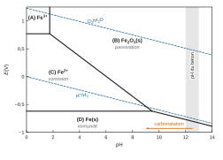
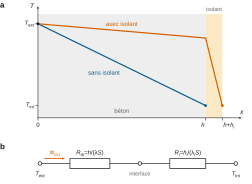
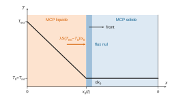
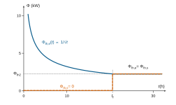

# Centrale-Supélec TSI — Physique-chimie 1 2026 · Corrigé guidé

*Corrigé rédigé par IA, non officiel. Signalez toute erreur.*

## Présentation du sujet

**Thème.** « Construction d'un bâtiment » : le sujet suit un édifice depuis l'étude du sol jusqu'au confort thermique des pièces. Il compte 52 questions en quatre parties **indépendantes**, avec des données propres à chaque partie. Durée 4 heures, calculatrice autorisée.

**Découpage.**

- **Partie A — Pénétrométrie dynamique (Q1–Q10).** Mécanique du point et des systèmes : chute libre, choc mou (conservation de la quantité de mouvement), théorème de l'énergie cinétique pendant l'enfoncement. On établit la « formule des Hollandais » donnant la résistance du sol $q_d$, puis on l'exploite sur un relevé de terrain pour choisir la profondeur des fondations. La Q8, soulignée, est la seule question à prise d'initiative du sujet.
- **Partie B — La chimie du béton (Q11–Q26).** Deux blocs indépendants. D'abord la thermochimie de la clinkérisation : $\Delta_rH^\circ$, $\Delta_rS^\circ$ et $K^\circ$, bilan de matière en dioxyde de carbone, puis un bilan enthalpique sur une chambre de combustion au méthane (avec l'échauffement des fumées, diazote compris). Ensuite la lecture du diagramme potentiel-pH du fer : attribution des domaines, potentiels standard, passivation des armatures et risque lié à la carbonatation.
- **Partie C — Jauge à corde vibrante (Q27–Q38).** Symétries du champ magnétique et force de Laplace, ondes stationnaires sur une corde fixée à ses deux extrémités, loi de Hooke et petites déformations, sensibilité et limites d'un capteur, dilatation thermique.
- **Partie D — Un mur dans tous ses états (Q39–Q52).** Équation de la diffusion thermique, temps caractéristique, résistance thermique et association série. Puis un mur contenant un matériau à changement de phase (MCP) : modèle quasi stationnaire du front de fusion ($x_0 \propto \sqrt t$), puissances entrante et sortante, position limite du front, et une ligne de Python sur un tableau numpy.

**Notions du programme TSI mobilisées.** Théorème de l'énergie cinétique, quantité de mouvement ; loi de Hess, entropie standard, enthalpie libre standard de réaction et constante d'équilibre, quotient de réaction ; premier principe en monobare ($Q = \Delta H$) ; nombres d'oxydation, relation de Nernst, diagrammes E-pH ; symétries des distributions de courants, force de Laplace ; équation de d'Alembert et modes propres ; loi de Fourier, équation de diffusion, résistance thermique ; Python et numpy.

**Difficulté et longueur.** Le sujet est long mais très progressif, et la plupart des questions sont classiques. Les questions les plus sélectives sont Q19 (bilan enthalpique complet), Q33 (hypothèse à poser soi-même), Q45 (bilan sur une couche qui fond) et Q50 (montrer l'existence d'une limite). Les nombreuses questions de commentaire (Q6, Q13, Q21, Q38, Q44, Q47, Q49, Q52) rapportent si l'on y met un argument chiffré.

**Questions à ne pas laisser passer.** Q1–Q3, Q11, Q12, Q15, Q17, Q18, Q22–Q24, Q28–Q31, Q39–Q43 : ce sont des applications directes du cours.

**Gestion du temps.** Environ 4,5 minutes par question en moyenne. Les parties étant indépendantes, on peut commencer par celle où l'on se sent le plus à l'aise. Le bloc E-pH (Q22–Q26) est rapide et indépendant de la thermochimie qui le précède.

## Partie A — Pénétrométrie dynamique

On modélise un coup de mouton en trois temps : chute libre, choc mou, enfoncement freiné par le sol. Les outils sont la conservation de la quantité de mouvement pour le choc et le théorème de l'énergie cinétique pour la chute et l'enfoncement. La sous-partie II exploite la formule obtenue sur un relevé réel.

**I — La formule des Hollandais**

### Question 1

> [!INDICATION]
> Entre le lâcher et le choc, quelles forces s'exercent sur le mouton ? Lesquelles travaillent ?

> [!INDICATION]
> Un théorème énergétique donne la norme de la vitesse ; pensez ensuite au caractère vectoriel demandé.

#### Solution

Le mouton n'est soumis qu'à son poids (frottements de l'air négligés). Il part sans vitesse et descend de $H$. Le théorème de l'énergie cinétique, dans le référentiel terrestre galiléen, donne $\tfrac12MV^2 - 0 = MgH$. Le mouvement est vers le bas :

$$\boxed{\vec V = -\sqrt{2gH}\,\vec e_z}$$

de norme

$$\boxed{V = \sqrt{2\times9{,}8\times0{,}50} = 3{,}1\ \mathrm{m\cdot s^{-1}}}$$

> [!PIEGE]
> L'énoncé écrit $\vec V$ : il attend un vecteur, donc un signe ou une direction, avec l'axe $(Oz)$ orienté vers le haut. La masse $m$ de l'enclume n'intervient pas dans la chute.

### Question 2

> [!INDICATION]
> L'énoncé donne la grandeur conservée pendant le choc. Choisissez le système qui la conserve.

> [!INDICATION]
> Après un choc parfaitement mou, combien de vitesses différentes y a-t-il ?

#### Solution

Système {mouton + enclume + tige}, entre juste avant et juste après le choc. La quantité de mouvement totale est conservée. Avant le choc, seul le mouton bouge ; après, l'ensemble se déplace à la vitesse commune $\vec v$ :

$$M\vec V = (M+m)\vec v$$

d'où

$$\boxed{\vec v = \frac{M}{M+m}\vec V = -\frac{M}{M+m}\sqrt{2gH}\,\vec e_z}$$

Numériquement, $v = \tfrac{64}{88}\times3{,}13 = 2{,}3\ \mathrm{m\cdot s^{-1}}$, vers le bas.

> [!METHODE]
> Pendant un choc bref, les forces extérieures finies (poids, réaction du sol) ont un effet négligeable sur la quantité de mouvement : on conserve $\vec p$, mais pas l'énergie cinétique, sauf si le choc est dit élastique.

### Question 3

> [!INDICATION]
> Repérez bien la phase concernée : elle commence juste après le choc et finit à l'arrêt de la tige.

#### Solution

Le système de masse $M+m$ passe de la vitesse $v$ à zéro :

$$\begin{aligned}
\Delta E_c &= -\frac12(M+m)v^2\\
&= -\frac12(M+m)\frac{M^2}{(M+m)^2}\,2gH
\end{aligned}$$

soit

$$\boxed{\Delta E_c = -\frac{M^2gH}{M+m} = -2{,}3\times10^{2}\ \mathrm{J}}$$

Sur les $MgH = 314$ J fournis par la chute, seule la fraction $M/(M+m) = 73\ \%$ reste disponible pour l'enfoncement ; le reste est dissipé dans le choc mou.

> [!PIEGE]
> Ne pas confondre avec l'énergie cinétique perdue *pendant le choc*, qui vaut $\tfrac12MV^2 - \tfrac12(M+m)v^2 = MgH\,m/(M+m)$.

### Question 4

> [!INDICATION]
> Écrivez la force exercée par le sol sur la section terminale à partir d'une pression, puis son travail élémentaire.

> [!INDICATION]
> La pression peut varier pendant l'enfoncement ; la définition de $q_d$ comme pression *moyenne* sert à sortir cette pression de l'intégrale.

#### Solution

Quand la pointe est enfoncée de $\zeta$, le sol exerce $\vec F = p(\zeta)S\,\vec e_z$, vers le haut, et la pointe se déplace de $\mathrm{d}\vec r = -\mathrm{d}\zeta\,\vec e_z$. Donc

$$\begin{aligned}
W &= \int_0^e\vec F\cdot\mathrm{d}\vec r\\
&= -S\int_0^ep(\zeta)\,\mathrm{d}\zeta\\
&= -Se\,\underbrace{\frac1e\int_0^ep(\zeta)\,\mathrm{d}\zeta}_{q_d}
\end{aligned}$$

d'où

$$\boxed{W = -q_dSe}$$

Le signe moins traduit le caractère résistant de la force : elle est opposée au déplacement.

### Question 5

> [!INDICATION]
> Appliquez le même théorème qu'en Q1, mais à un autre système et sur une autre phase.

> [!INDICATION]
> Faites l'inventaire complet des forces qui travaillent pendant l'enfoncement : il y en a une que l'on oublie souvent, et une que l'énoncé demande de négliger.

#### Solution

Système {mouton + enclume + tige}, entre l'instant qui suit le choc et l'arrêt. Le poids travaille, $W_P = +(M+m)ge$ (déplacement $e$ vers le bas) ; la force du sol en pointe donne $-q_dSe$ (Q4) ; les frottements latéraux sont négligés. Le théorème de l'énergie cinétique et Q3 donnent :

$$-\frac{M^2gH}{M+m} = (M+m)ge - q_dSe$$

soit

$$\boxed{q_d = \frac{(M+m)g}{S} + \frac{MgH}{Se}\,\frac{M}{M+m}}$$

> [!PIEGE]
> Le travail du poids porte sur le seul enfoncement $e$, et non sur $H+e$ : la chute a déjà été exploitée en Q1 et Q2, et l'énergie perdue au choc ne se retrouve pas ici.

### Question 6

> [!INDICATION]
> Comparez les deux termes de l'expression de Q5. L'un dépend de $e$, l'autre non.

> [!INDICATION]
> Pour juger la légitimité de l'approximation, il faut chiffrer les deux termes avec les enfoncements réellement observés sur la figure 2.

#### Solution

La formule des Hollandais néglige le terme statique (poids de l'équipage) devant le terme dynamique (énergie de la chute) :

$$\begin{aligned}
&\frac{(M+m)g}{S}\ll\frac{MgH}{Se}\frac{M}{M+m}\\
\iff\ &e\ll H\frac{M^2}{(M+m)^2} = 0{,}26\ \mathrm{m}.
\end{aligned}$$

Numériquement, $(M+m)g/S = 0{,}43$ MPa, et le terme dynamique vaut $1{,}14\times10^{5}/e$ (Pa, $e$ en m). Les enfoncements observés vont de 5 cm (2 coups pour 10 cm) à 2 mm (50 coups) : la condition est toujours vérifiée. L'erreur relative, rapportée à $q_d$ complet, vaut environ 16 % dans la terre meuble, 2,5 % dans les remblais et 1 % au seuil de 40 MPa.

**L'approximation est légitime dans les couches où l'on envisage de fonder.** Elle sous-estime $q_d$, ce qui va dans le sens de la sécurité.

> [!JURY]
> Une question « est-ce légitime ? » attend une comparaison chiffrée. Affirmer qu'un terme est négligeable sans ordre de grandeur ne suffit pas.

**II — Analyse d'un sol**

### Question 7

> [!INDICATION]
> La terre meuble est la couche de surface, la plus facile à traverser. Cherchez la profondeur où le nombre de coups change brusquement.

#### Solution

De 0 à 0,5 m, il faut 2 à 5 coups pour 10 cm ; à 0,6 m, il en faut 17. **L'épaisseur de la terre meuble est d'environ 0,5 m**, à ±0,05 m près, puisque le pas de mesure est de 10 cm.

### Question 8

> [!INDICATION]
> Trois étapes à enchaîner soi-même : lire un nombre de coups représentatif de la couche, le convertir en grandeur de la formule, appliquer la formule.

> [!INDICATION]
> Le relevé donne un nombre de coups pour 10 cm, alors que la formule fait intervenir l'enfoncement $e$ par coup.

> [!INDICATION]
> Un ordre de grandeur se donne avec un encadrement : utilisez les valeurs extrêmes lues dans la couche.

#### Solution

*Lecture.* Après la terre meuble, la couche de remblais s'étend d'environ 0,5 m à 1,75 m, avec 10 à 20 coups pour 10 cm. On retient $N\approx15$.

*Enfoncement par coup.* $e = 0{,}10/N = 6{,}7\times10^{-3}$ m.

*Formule des Hollandais.*

$$q_d = \frac{MgH}{Se}\frac{M}{M+m} = \frac{64\times9{,}8\times0{,}50}{20\times10^{-4}\times6{,}7\times10^{-3}}\times\frac{64}{88}\approx1{,}7\times10^{7}\ \mathrm{Pa}.$$

Pour $N = 10$ et $N = 20$, on trouve 11 et 23 MPa.

$$\boxed{q_d\sim10^{7}\ \mathrm{Pa}\ \ (\text{environ } 15 \text{ à } 20\ \mathrm{MPa})}$$

> [!METHODE]
> Pour une question à prise d'initiative, on annonce la démarche, on dit d'où vient chaque nombre lu, et l'on encadre le résultat. Le correcteur évalue le chemin autant que la valeur.

> [!PIEGE]
> $S = 20\ \mathrm{cm^2} = 20\times10^{-4}\ \mathrm{m^2}$. Une erreur d'un facteur 100 sur $S$ fausse les trois questions suivantes.

### Question 9

> [!INDICATION]
> Comparez au critère donné en début de partie.

#### Solution

$q_d\approx17\ \mathrm{MPa} < 40$ MPa, soit moins de la moitié du seuil. De plus, des remblais de gravats forment un matériau rapporté, hétérogène et susceptible de tassement. **Non, la base des fondations ne peut pas être placée dans les remblais.**

### Question 10

> [!INDICATION]
> Inversez le raisonnement : quel nombre de coups pour 10 cm correspond à 40 MPa ?

> [!INDICATION]
> Cherchez ensuite sur la figure les profondeurs où ce nombre est dépassé, en restant prudent sur la portée d'un seul point de mesure.

#### Solution

Le seuil correspond à

$$e_s = \frac{MgH}{S\,q_d}\frac{M}{M+m} = 2{,}9\ \mathrm{mm},$$

soit $N_s\approx35$ coups pour 10 cm (chaque coup par 10 cm « vaut » environ 1,14 MPa). Seul le dernier point dépasse ce seuil : 50 coups à 3,0 m, soit $e = 2{,}0$ mm et $q_d\approx57$ MPa $> 40$ MPa. Juste au-dessus (2,3 à 2,9 m), $q_d$ reste entre 11 et 26 MPa.

**Oui : vers 3 m de profondeur, dans la roche.** La conclusion repose sur un point unique, obtenu au refus de l'appareil : d'autres sondages seraient nécessaires pour confirmer l'épaisseur et la continuité de la roche.

## Partie B — La chimie du béton

La sous-partie I est une suite de calculs de thermochimie, de l'enthalpie de réaction jusqu'à l'empreinte carbone du béton. Les erreurs s'y propagent, mais la valeur imposée en Q16 sert de point de contrôle. La sous-partie II est une lecture classique du diagramme E-pH du fer.

**I — Empreinte carbone de la fabrication du ciment**

### Question 11

> [!INDICATION]
> Combinez les entropies molaires standard avec les coefficients stœchiométriques algébriques. Que dit l'énoncé sur la dépendance en température ?

> [!INDICATION]
> Pour commenter le signe, comptez les moles de gaz de chaque côté.

#### Solution

$$\Delta_rS^\circ = 3(213{,}6) + 130{,}5 - 3(92{,}3) - 41{,}3$$

soit

$$\boxed{\Delta_rS^\circ(1700\ \mathrm{K}) = 4{,}53\times10^{2}\ \mathrm{J\cdot K^{-1}\cdot mol^{-1}}>0}$$

Les données étant supposées indépendantes de $T$, la valeur à 298 K vaut à 1700 K. Le signe est positif parce que la réaction crée 3 moles de gaz à partir de solides seulement ($\Delta n_{\text{gaz}} = +3$) : le désordre augmente fortement.

> [!METHODE]
> Le signe de $\Delta_rS^\circ$ suit en général celui de $\Delta n_{\text{gaz}}$, à raison d'environ $+150\ \mathrm{J\cdot K^{-1}\cdot mol^{-1}}$ par mole de gaz créée. C'est un contrôle rapide du calcul.

### Question 12

> [!INDICATION]
> Loi de Hess. Attention aux signes des enthalpies de formation, toutes négatives.

#### Solution

$$\Delta_rH^\circ = 3(-393) + (-2930) - 3(-1206) - (-910)$$

soit

$$\boxed{\Delta_rH^\circ = +419\ \mathrm{kJ\cdot mol^{-1}}>0}$$

**La réaction est endothermique** : la décarbonatation du calcaire consomme de l'énergie, qu'il faut apporter par le four.

### Question 13

> [!INDICATION]
> Étudiez le signe de $\Delta_rG^\circ(T) = \Delta_rH^\circ - T\Delta_rS^\circ$, ou le sens de variation de $\ln K^\circ$ avec $T$.

> [!INDICATION]
> « Commenter le choix industriel » : la thermodynamique ne dit rien de la vitesse de réaction.

#### Solution

$\Delta_rG^\circ(T)$ décroît avec $T$ puisque $\Delta_rS^\circ>0$. De même,

$$\begin{aligned}
\ln K^\circ&=-\frac{\Delta_rG^\circ}{RT}\\
&=-\frac{\Delta_rH^\circ}{RT}+\frac{\Delta_rS^\circ}{R}
\end{aligned}$$

Ce logarithme croît avec $T$, puisque $\Delta_rH^\circ>0$ et que les grandeurs standard ne dépendent pas de $T$ : $K^\circ$ croît avec $T$.

On a $K^\circ > 1$ au-delà de

$$\begin{aligned}
T_i &= \frac{\Delta_rH^\circ}{\Delta_rS^\circ}\\
&= \frac{419\times10^{3}}{453}\\
&= 9{,}2\times10^{2}\ \mathrm{K}.
\end{aligned}$$

**Oui, la haute température favorise la réaction.** À 1700 K, on est très au-dessus de $T_i$. Ce choix est aussi dicté par la cinétique : une réaction entre solides est lente, limitée par la diffusion dans les phases condensées. Une température élevée, qui provoque une fusion partielle du mélange, la rend suffisamment rapide.

### Question 14

> [!INDICATION]
> Calculez $\Delta_rG^\circ(1700\ \mathrm{K})$, puis $K^\circ$.

> [!INDICATION]
> Pour conclure au caractère total, écrivez $K^\circ$ en fonction de la seule espèce gazeuse, et comparez la pression d'équilibre correspondante à celle qui règne dans le four.

#### Solution

$$\Delta_rG^\circ(1700) = 419\times10^{3} - 1700\times453{,}1 = -3{,}51\times10^{5}\ \mathrm{J\cdot mol^{-1}}$$

puis

$$K^\circ = \exp\!\left(\frac{3{,}51\times10^{5}}{8{,}31\times1700}\right) = \mathrm{e}^{24{,}9}$$

soit

$$\boxed{K^\circ(1700\ \mathrm{K})\approx6\times10^{10}}$$

Les solides purs ont une activité égale à 1, donc $K^\circ = (P_{\mathrm{CO_2}}/P^\circ)^3$. L'équilibre exigerait $P_{\mathrm{CO_2}}\approx(6\times10^{10})^{1/3}\approx4\times10^{3}$ bar. Dans le four, à la pression atmosphérique, $P_{\mathrm{CO_2}}\leq1$ bar : le quotient de réaction reste toujours très inférieur à $K^\circ$, et la réaction progresse dans le sens direct jusqu'à épuisement d'un réactif. **Elle est totale.**

> [!METHODE]
> Quand les seules espèces gazeuses sont des produits, comparer la pression d'équilibre à la pression réellement accessible est plus convaincant que le seul critère « $K^\circ\gg1$ ».

### Question 15

> [!INDICATION]
> Que représente « une tonne de ciment » en quantité de matière, avec le modèle de l'énoncé ? Utilisez ensuite la stœchiométrie.

#### Solution

On a $M(\mathrm{Ca_3SiO_5}) = 3\times40{,}0 + 28{,}0 + 5\times16{,}0 = 228\ \mathrm{g\cdot mol^{-1}}$, d'où l'avancement $\xi = 10^{6}/228 = 4{,}39\times10^{3}$ mol. Il se forme $3\xi = 1{,}32\times10^{4}$ mol de $\mathrm{CO_2}$, de masse molaire $44{,}0\ \mathrm{g\cdot mol^{-1}}$ :

$$\boxed{m(\mathrm{CO_2}) = 5{,}8\times10^{2}\ \mathrm{kg}\ \text{par tonne de ciment}}$$

> [!PIEGE]
> La tonne porte sur le produit $\mathrm{Ca_3SiO_5}$, pas sur le calcaire.

### Question 16

> [!INDICATION]
> Quel transfert thermique reçoit un système fermé lors d'une transformation monobare ?

> [!INDICATION]
> Le résultat à retrouver est donné : il vous indique quelles contributions compter.

#### Solution

Pour une transformation monobare ne faisant intervenir que le travail des forces de pression, le premier principe donne $Q = \Delta H$. Les réactifs étant supposés déjà à 1700 K (aucune capacité thermique de solide n'est fournie), seule l'enthalpie de réaction intervient :

$$Q_{1t} = \xi\,\Delta_rH^\circ = 4{,}39\times10^{3}\times419\times10^{3}$$

soit

$$\boxed{Q_{1t} = 1{,}84\times10^{9}\ \mathrm{J}}$$

> [!JURY]
> Dans un « montrer que », le résultat est connu : seule la justification est évaluée. Ici, il faut citer le caractère monobare pour écrire $Q = \Delta H$, et énoncer l'hypothèse sur la température des réactifs.

### Question 17

> [!INDICATION]
> Équilibrez successivement le carbone, l'hydrogène, puis l'oxygène, en respectant les états physiques indiqués.

#### Solution

$$\boxed{\mathrm{CH_4(g)} + 2\,\mathrm{O_2(g)} = \mathrm{CO_2(g)} + 2\,\mathrm{H_2O(g)}}$$

L'eau est gazeuse, comme l'impose l'énoncé (et seul $\Delta_fH^\circ(\mathrm{H_2O(g)})$ est fourni).

### Question 18

> [!INDICATION]
> Loi de Hess ; quelle est l'enthalpie standard de formation d'un corps simple dans son état de référence ?

#### Solution

$$\Delta_rH^\circ_{\text{comb}} = -393 + 2(-242) - (-75) - 2\times0$$

soit

$$\boxed{\Delta_rH^\circ_{\text{comb}} = -802\ \mathrm{kJ\cdot mol^{-1}}}$$

**La combustion est très exothermique** : une mole de méthane libère près de deux fois l'énergie consommée par une mole de clinkérisation.

### Question 19

> [!INDICATION]
> Faites un bilan d'enthalpie sur la chambre de combustion : quels gaz entrent, à quelle température, et quels gaz sortent, à quelle température ?

> [!INDICATION]
> L'enthalpie est une fonction d'état : décomposez en une réaction à 298 K suivie d'un échauffement des gaz sortants. Pourquoi le tableau 3 donne-t-il la capacité thermique d'un gaz qui ne réagit pas ?

> [!INDICATION]
> Le transfert thermique de la chambre vers le four est égal à $Q_{1t}$ ; faites attention à son signe vu de la chambre.

#### Solution

Soit $n$ la quantité de méthane. L'air stœchiométrique apporte $2n$ mol de $\mathrm{O_2}$. Avec 80 % de $\mathrm{N_2}$ pour 20 % de $\mathrm{O_2}$, il apporte aussi $8n$ mol de diazote inerte.

Tout entre à 298 K ; $\mathrm{CO_2}$, $\mathrm{H_2O}$ et $\mathrm{N_2}$ sortent à 1700 K. La transformation est monobare, et la chambre cède $Q_{1t}$ au four (ensemble calorifugé) : $\Delta H = -Q_{1t}$.

On choisit un chemin fictif : réaction totale à 298 K, puis échauffement des gaz sortants jusqu'à 1700 K.

$$\Delta H = n\Big[\Delta_rH^\circ_{\text{comb}} + \big(C_p(\mathrm{CO_2}) + 2C_p(\mathrm{H_2O}) + 8C_p(\mathrm{N_2})\big)(1700 - 298)\Big].$$

On a $\Sigma C_p = 37{,}1 + 67{,}2 + 232{,}8 = 337{,}1\ \mathrm{J\cdot K^{-1}}$ par mole de $\mathrm{CH_4}$, d'où $337{,}1\times1402 = 4{,}73\times10^{5}$ J, et

$$\begin{aligned}
\Delta H &= n(-8{,}02 + 4{,}73)\times10^{5}\\
&= -3{,}29\times10^{5}\,n\\
&= -Q_{1t},
\end{aligned}$$

d'où

$$\boxed{n(\mathrm{CH_4}) = \frac{1{,}84\times10^{9}}{3{,}29\times10^{5}} = 5{,}6\times10^{3}\ \mathrm{mol}\ \ (89\ \mathrm{kg})}$$

Seulement 41 % de l'énergie de combustion chauffe le four ; le reste part avec les fumées.

> [!PIEGE]
> Oublier le diazote, qui représente 69 % de la capacité thermique des fumées, donne $n\approx2{,}8\times10^{3}$ mol. Oublier l'échauffement des fumées donne $n = Q_{1t}/802\ \mathrm{kJ} = 2{,}3\times10^{3}$ mol.

> [!METHODE]
> Pour un bilan enthalpique avec réaction et changement de température, on construit un cycle : réaction à la température d'entrée, puis échauffement des produits (et des inertes) jusqu'à la température de sortie. Le résultat ne dépend pas du chemin choisi.

### Question 20

> [!INDICATION]
> Il y a deux sources de $\mathrm{CO_2}$. Additionnez-les.

#### Solution

La combustion libère une mole de $\mathrm{CO_2}$ par mole de méthane, soit $5{,}6\times10^{3}$ mol (246 kg). Avec Q15 :

$$\boxed{m_{\text{tot}}(\mathrm{CO_2})\approx5{,}8\times10^{2} + 2{,}5\times10^{2}\approx8{,}2\times10^{2}\ \mathrm{kg}\ \text{par tonne de ciment}}$$

Environ 70 % de ces émissions proviennent de la réaction elle-même, 30 % du combustible.

### Question 21

> [!INDICATION]
> Ramenez votre résultat au mètre cube de béton avec la composition donnée au début de la sous-partie.

> [!INDICATION]
> Comparez, puis identifiez les hypothèses du modèle qui majorent ou minorent l'estimation.

#### Solution

Un mètre cube de béton contient 300 kg de ciment, soit $0{,}300\times825\approx2{,}5\times10^{2}$ kg de $\mathrm{CO_2}$, contre environ 200 kg estimés par la profession. **Le modèle donne le bon ordre de grandeur et surestime d'environ 25 %.**

Les causes plausibles de cette surestimation :

- les fumées sont rejetées à 1700 K. Les cimenteries récupèrent cette chaleur ; à la limite où les fumées ressortiraient à 298 K, il ne faudrait que $2{,}3\times10^{3}$ mol de méthane, soit environ 205 kg de $\mathrm{CO_2}$ par $\mathrm{m^3}$ ;
- un ciment réel n'est pas du clinker pur : il contient des ajouts qui ne libèrent pas de $\mathrm{CO_2}$ ;
- certains combustibles sont moins carbonés que le méthane.

À l'inverse, le modèle ignore le préchauffage de la farine, le transport et les granulats. Dans tous les cas, la décarbonatation (environ 70 %) reste incompressible : elle est inscrite dans l'équation de réaction.

> [!JURY]
> « Commenter » un écart demande de l'expliquer par des hypothèses identifiées, pas seulement de le constater.

**II — Corrosion d'un béton armé**

### Question 22

> [!INDICATION]
> Nombre d'oxydation de l'oxygène dans un oxyde, et électroneutralité.

#### Solution

$2x + 3\times(-2) = 0$, d'où :

$$\boxed{n.o.(\mathrm{Fe}) = +\mathrm{III}}$$

### Question 23

> [!INDICATION]
> Classez les espèces par nombre d'oxydation : comment celui-ci évolue-t-il avec le potentiel ?

> [!INDICATION]
> Deux espèces de même nombre d'oxydation sont séparées par une frontière verticale. De quel côté se trouve la forme dissoute ?

#### Solution

Par nombre d'oxydation croissant, donc de bas en haut, on trouve $\mathrm{Fe}$ (0) puis $\mathrm{Fe^{2+}}$ (+II). Viennent ensuite les espèces +III, $\mathrm{Fe^{3+}}$ et $\mathrm{Fe_2O_3}$.

Les deux espèces +III sont séparées par la frontière verticale à pH ≈ 1,8 (précipitation $2\mathrm{Fe^{3+}} + 3\mathrm{H_2O} = \mathrm{Fe_2O_3} + 6\mathrm{H^+}$) ; l'ion libre est du côté acide.

$$\boxed{\begin{aligned}
(A) &= \mathrm{Fe^{3+}}\\
(B) &= \mathrm{Fe_2O_3(s)}\\
(C) &= \mathrm{Fe^{2+}}\\
(D) &= \mathrm{Fe(s)}
\end{aligned}}$$



Les pentes confirment cette attribution. La frontière (B)/(C) a une pente de $-0{,}18$ V/pH, ce qui correspond à $\mathrm{Fe_2O_3} + 6\mathrm{H^+} + 2\mathrm{e^-} = 2\mathrm{Fe^{2+}} + 3\mathrm{H_2O}$ (pente $-0{,}06\times6/2$). La frontière (B)/(D) a une pente de $-0{,}06$ V/pH, ce qui correspond à $\mathrm{Fe_2O_3} + 6\mathrm{H^+} + 6\mathrm{e^-} = 2\mathrm{Fe} + 3\mathrm{H_2O}$.

> [!PIEGE]
> La hauteur d'un domaine dans le diagramme traduit le degré d'oxydation, pas l'état physique : $\mathrm{Fe_2O_3}$ est en haut à droite, pas en bas.

### Question 24

> [!INDICATION]
> Écrivez la relation de Nernst sur chaque frontière horizontale.

> [!INDICATION]
> Les conventions de tracé ne sont pas les mêmes pour une frontière entre deux espèces dissoutes et pour une frontière entre un solide et une espèce dissoute.

#### Solution

*$\mathrm{Fe^{3+}/Fe^{2+}}$.* Sur la frontière (A)/(C), à 0,77 V, les concentrations sont égales, donc le terme logarithmique est nul :

$$\boxed{E^\circ(\mathrm{Fe^{3+}/Fe^{2+}}) = 0{,}77\ \mathrm{V}}$$

*$\mathrm{Fe^{2+}/Fe}$.* La frontière (C)/(D) est à $-0{,}62$ V. On y a $E = E^\circ + 0{,}03\log[\mathrm{Fe^{2+}}]$ avec $[\mathrm{Fe^{2+}}] = c_t = 10^{-6}\ \mathrm{mol\cdot L^{-1}}$ :

$$-0{,}62 = E^\circ - 0{,}18$$

d'où

$$\boxed{E^\circ(\mathrm{Fe^{2+}/Fe}) = -0{,}44\ \mathrm{V}}$$

> [!PIEGE]
> Lire $-0{,}62$ V comme potentiel standard revient à oublier le terme $0{,}03\log c_t$. Les valeurs tabulées (0,77 V et $-0{,}44$ V) servent de contrôle.

### Question 25

> [!INDICATION]
> À pH 12–13, le domaine du fer et celui de l'eau ont-ils une partie commune ?

> [!INDICATION]
> S'il y a réaction, quel est son produit ? Est-il soluble ?

#### Solution

Au-delà de pH ≈ 9,5, la frontière $\mathrm{Fe_2O_3/Fe}$ passe sous la droite $\mathrm{H^+/H_2}$. À pH 12, elle est à $-0{,}77$ V contre $-0{,}72$ V pour l'eau.

Les domaines du fer et de l'eau sont disjoints : l'eau, et plus encore le dioxygène dissous, oxyde le fer, par exemple selon

$$2\mathrm{Fe} + 3\mathrm{H_2O}\to\mathrm{Fe_2O_3} + 3\mathrm{H_2}$$

Mais le produit est un oxyde **solide** qui forme une couche compacte et adhérente, séparant le métal de la solution : c'est la passivation.

**Oui, l'eau agit sur le fer, mais l'acier se passive : la structure n'est pas fragilisée.** C'est le pH élevé du béton qui protège les armatures.

> [!METHODE]
> Corrosion, passivation, immunité : on compare le domaine du métal à celui de l'oxydant, puis on regarde si le produit d'oxydation est soluble (corrosion) ou solide (passivation).

### Question 26

> [!INDICATION]
> Suivez sur le diagramme ce que devient le produit d'oxydation du fer quand le pH diminue.

#### Solution

Sous pH ≈ 9,5, le domaine du fer devient contigu à celui de $\mathrm{Fe^{2+}}$ : l'oxydation produit alors un ion soluble, qui ne protège plus le métal. L'acier se corrode (dépassivation). La section des armatures diminue, donc la résistance à la traction de l'ouvrage aussi. Les produits de corrosion, plus volumineux que le métal, mettent le béton d'enrobage en traction, ce qui le fissure et ouvre de nouveaux chemins à l'eau : le processus s'auto-entretient.

## Partie C — Jauge de contrainte à corde vibrante

La sous-partie I établit les fréquences propres d'une corde fixée à ses deux extrémités et en déduit la tension du fil. La sous-partie II relie la fréquence à la déformation (loi de Hooke) et discute la sensibilité et les limites du capteur.

**I — Modes propres de vibration**

### Question 27

> [!INDICATION]
> Cherchez les plans de symétrie ou d'antisymétrie de la distribution de courant passant par $O$. À quels plans le champ magnétique appartient-il ?

> [!INDICATION]
> Le fil est parcouru par un courant induit : quelle force subit un conducteur parcouru par un courant dans un champ magnétique ?

#### Solution

Les spires sont circulaires, d'axe $(Oy)$, et $O$ est sur cet axe. Tout plan contenant $(Oy)$ est un plan d'antisymétrie des courants (orthoradiaux). Le champ magnétique est contenu dans tout plan d'antisymétrie des courants, donc dans leur intersection :

$$\boxed{\vec B(O) = B\,\vec e_y}$$

Le fil, selon $(Ox)$, est parcouru par le courant induit $i$ et subit la force de Laplace :

$$\mathrm{d}\vec F = i\,\mathrm{d}x\,\vec e_x\wedge B\vec e_y = iB\,\mathrm{d}x\,\vec e_z$$

**Cette force de Laplace est perpendiculaire au fil et à $\vec B$ : elle est transversale.** Son sens alterne avec le courant, ce qui fait vibrer le fil transversalement.

> [!PIEGE]
> $\vec B$ appartient aux plans d'**antisymétrie** des courants, et il est orthogonal aux plans de symétrie. Inverser les deux donnerait un champ perpendiculaire à l'axe de la bobine.

### Question 28

> [!INDICATION]
> Comparez l'équation fournie à l'équation de d'Alembert.

#### Solution

L'équation s'écrit $\partial_t^2\xi = c^2\partial_x^2\xi$ avec $c^2 = 4T/(\rho\pi d^2)$. En dimensions, une force divisée par (masse volumique × surface) donne $\dfrac{\mathrm{M\,L\,T^{-2}}}{\mathrm{M\,L^{-3}\,L^{2}}} = \mathrm{L^2\,T^{-2}}$.

$$\boxed{c\ \text{est une vitesse, en } \mathrm{m\cdot s^{-1}}}$$

C'est la célérité des ondes transversales sur le fil.

### Question 29

> [!INDICATION]
> Injectez la forme proposée dans l'équation d'onde.

#### Solution

On a $\partial_t^2s = -\omega^2s$ et $\partial_x^2s = -k^2s$, donc $\omega^2 = c^2k^2$ pour une solution non nulle :

$$\boxed{k = \frac{\omega}{c}}\quad(k>0 \text{ par convention}).$$

### Question 30

> [!INDICATION]
> Que vaut le déplacement aux coupelles, à tout instant ?

> [!INDICATION]
> Vous obtenez deux conditions sur la fonction sinus. Leur différence quantifie $k$, leur somme fixe $\psi$.

> [!INDICATION]
> Pour la forme générale, utilisez une propriété de l'équation d'onde qui permet de combiner des solutions.

#### Solution

Les conditions aux limites s'écrivent $\xi(\pm L/2,t) = 0$ pour tout $t$. Pour $s$, cela impose

$$\begin{aligned}
\sin(kL/2 + \psi) &= 0\\
\sin(-kL/2 + \psi) &= 0
\end{aligned}$$

soit

$$\begin{aligned}
kL/2 + \psi &= n_1\pi\\
-kL/2 + \psi &= n_2\pi
\end{aligned}$$

Par différence, $kL = p\pi$ avec $p\in\mathbb N^*$ ($p = 0$ donnerait une solution nulle). Par somme, $\psi = p\pi/2$ (modulo $\pi$).

$$\boxed{\begin{aligned}
\omega_p &= \frac{p\pi c}{L}\\
f_p &= \frac{pc}{2L}
\end{aligned}}$$

avec $p\in\mathbb N^*$.

L'équation étant linéaire, le régime libre est une superposition de modes propres :

$$\boxed{\xi(x,t) = \sum_{p\geq1}A_p\cos(\omega_pt + \varphi_p)\sin\!\left(\frac{p\pi}{L}\Big(x + \frac L2\Big)\right)}$$

Les amplitudes $A_p$ et les phases $\varphi_p$ sont fixées par les conditions initiales. Le mode $p$ présente $p$ ventres et $p-1$ nœuds intérieurs.

> [!METHODE]
> Corde fixée à ses deux bouts : un nombre entier de demi-longueurs d'onde tient sur la longueur, $L = p\lambda/2$. C'est un moyen rapide de retrouver $f_p = pc/(2L)$.

### Question 31

> [!INDICATION]
> Le fondamental correspond au plus petit $p$. Inversez ensuite la définition de $c$.

#### Solution

$$\boxed{\begin{aligned}
c &= 2Lf_1 = 2\times0{,}150\times750\\
&= 2{,}25\times10^{2}\ \mathrm{m\cdot s^{-1}}
\end{aligned}}$$

La tension s'en déduit :

$$T = \frac{\pi\rho d^2c^2}{4} = \frac{\pi\times7{,}80\times10^{3}\times(0{,}75\times10^{-3})^2\times225^2}{4}$$

soit

$$\boxed{T\approx1{,}7\times10^{2}\ \mathrm{N}}$$

Ordre de grandeur : c'est le poids d'environ 18 kg, et la contrainte dans l'acier vaut environ 390 MPa.

**II — Un fil sous contrainte**

### Question 32

> [!INDICATION]
> La loi de Hooke donne $\varepsilon_0$ à partir de la tension calculée en Q31.

> [!INDICATION]
> $\varepsilon_0$ est défini par rapport à $L_0$, mais la réponse est demandée en fonction de $L$ : utilisez la formule de développement fournie.

#### Solution

$$\varepsilon_0 = \frac{4T}{E\pi d^2} = \frac{\rho c^2}{E}$$

soit

$$\boxed{\varepsilon_0\approx1{,}8\times10^{-3}}$$

On a $\Delta L = \varepsilon_0L_0$ et $L_0 = L(1+\varepsilon_0)^{-1}\approx L(1-\varepsilon_0)$, donc à l'ordre 1 :

$$\boxed{\Delta L\approx\varepsilon_0L = 2{,}7\times10^{-4}\ \mathrm{m} = 0{,}27\ \mathrm{mm}}$$

### Question 33

> [!INDICATION]
> Aucune donnée ne relie directement le diamètre à la longueur. Quelle hypothèse simple sur la matière du fil permet de faire ce lien ?

> [!INDICATION]
> Avec cette hypothèse, exprimez $d/d_0$ comme une puissance de $(1+\varepsilon_0)$ et développez.

#### Solution

On suppose que la masse et la masse volumique du fil ne changent pas, c'est-à-dire que le volume est conservé. Alors $\dfrac{\pi d^2}{4}L = \dfrac{\pi d_0^2}{4}L_0$, donc $d = d_0(1+\varepsilon_0)^{-1/2}\approx d_0(1-\varepsilon_0/2)$, et à l'ordre 1 :

$$\boxed{\Delta d\approx-\frac{\varepsilon_0}{2}d = -6{,}7\times10^{-7}\ \mathrm{m} = -0{,}67\ \mu\mathrm{m}}$$

Le fil s'amincit en s'allongeant, mais de moins d'un millième en valeur relative : c'est négligeable, ce qui justifie de garder $d$ constant dans la suite.

> [!JURY]
> Quand l'énoncé ne fournit pas toutes les données, l'hypothèse ajoutée doit être écrite explicitement, puis exploitée.

### Question 34

> [!INDICATION]
> Suivez la chaîne déformation → tension → célérité → fréquence, avec la déformation totale.

> [!INDICATION]
> Simplifiez : une grandeur géométrique disparaît.

#### Solution

On a $T' = E\dfrac{\pi d^2}{4}(\varepsilon_0 + \Delta\varepsilon)$, avec $L$ et $d$ inchangés. Donc

$$c' = \frac2d\sqrt{\frac{T'}{\pi\rho}} = \sqrt{\frac{E(\varepsilon_0+\Delta\varepsilon)}{\rho}}$$

et

$$\boxed{f'_1 = \frac{1}{2L}\sqrt{\frac{E(\varepsilon_0 + \Delta\varepsilon)}{\rho}} = f_1\sqrt{1 + \frac{\Delta\varepsilon}{\varepsilon_0}}}$$

La fréquence ne dépend pas du diamètre. Pour $\Delta\varepsilon = 0$, on retrouve 750 Hz.

### Question 35

> [!INDICATION]
> Quel est le signe de $\Delta\varepsilon$ dans chaque cas, sachant que le fil se déforme avec le béton ?

#### Solution

$f'_1$ est croissante en $\Delta\varepsilon$. En compression, le fil se raccourcit et se détend ($\Delta\varepsilon<0$) : **la fréquence diminue**. En traction, le fil est davantage tendu ($\Delta\varepsilon>0$) : **la fréquence augmente**, comme une corde de guitare que l'on tend.

### Question 36

> [!INDICATION]
> Appliquez Q34 avec la déformation maximale en traction, puis comparez l'écart de fréquence à la précision de mesure annoncée.

#### Solution

$$f'_1 = 750\sqrt{1 + \frac{2{,}0\times10^{-4}}{1{,}79\times10^{-3}}}$$

soit

$$\boxed{f'_1\approx791\ \mathrm{Hz}}$$

L'écart de 41 Hz vaut 41 fois la précision de 1 Hz : **la variation est largement mesurable**. On peut en déduire la résolution en déformation : $\delta(\Delta\varepsilon) = 2\varepsilon_0\,\delta f/f_1\approx5\times10^{-6}$.

### Question 37

> [!INDICATION]
> Un fil peut-il supporter une compression ? Que devient sa tension quand le béton se raccourcit beaucoup ?

#### Solution

Le fil doit rester tendu : $T'>0$, soit $\varepsilon_0 + \Delta\varepsilon>0$. Au-delà, il devient mou et ne vibre plus de façon exploitable.

$$\boxed{|\Delta\varepsilon|_{\max} = \varepsilon_0\approx1{,}8\times10^{-3} = 0{,}18\ \%}$$

C'est environ la moitié des 0,35 % que supporte le béton : la jauge sature avant le béton. Pour couvrir toute la plage, il faudrait une précontrainte deux fois plus forte ($\varepsilon_0\geq3{,}5\times10^{-3}$, $f_1\geq1{,}05$ kHz), donc une contrainte d'environ 770 MPa dans l'acier.

> [!PIEGE]
> La limite ne vient pas du béton mais du capteur : répondre « 0,35 % » ne tient pas compte du fil.

### Question 38

> [!INDICATION]
> Chiffrez la déformation parasite d'origine thermique pour un écart de température réaliste, et comparez-la aux déformations à mesurer.

> [!INDICATION]
> Pour corriger, il faut connaître l'effet thermique seul : comment l'obtenir ?

#### Solution

Une variation $\Delta\theta$ change la longueur à vide du fil, ce qui fausse $\varepsilon$ de $\alpha\Delta\theta$. Pour $\Delta\theta = 10$ K, on obtient $1{,}2\times10^{-4}$, soit 60 % de la déformation maximale du béton en traction. En fréquence, cela fait environ $f_1\alpha\Delta\theta/(2\varepsilon_0)\approx25$ Hz, très au-dessus de la résolution. **Il faut en tenir compte.**

Deux solutions :

- intégrer un capteur de température (thermistance) à la jauge et corriger la déformation calculée ;
- placer une jauge de compensation, identique mais libre de contrainte mécanique, à la même température, et retrancher sa mesure.

Le béton se dilatant aussi, avec un coefficient voisin, l'effet est en partie compensé, mais pas exactement.

## Partie D — Un mur dans tous ses états

La sous-partie I est un problème de cours sur la diffusion thermique (équation, temps caractéristique, régime stationnaire, résistances en série). La sous-partie II modélise un mur à matériau à changement de phase avec une hypothèse de profils affines (régime quasi stationnaire). On y suit le front de fusion et les puissances échangées, avec une ligne de Python à la fin.

**I — Mur avec ou sans isolation thermique**

### Question 39

> [!INDICATION]
> Faites un bilan d'énergie sur la tranche entre $t$ et $t+\mathrm{d}t$ : variation d'énergie interne d'un côté, flux entrant moins flux sortant de l'autre.

> [!INDICATION]
> La loi de Fourier relie le flux au gradient de température.

#### Solution

La tranche a une masse $\rho S\,\mathrm{d}x$ ; c'est un solide sans source ni travail reçu. Le premier principe s'écrit :

$$\begin{aligned}
\rho Sc\,\mathrm{d}x\,\frac{\partial T}{\partial t}\mathrm{d}t &= \big[\Phi(x,t) - \Phi(x+\mathrm{d}x,t)\big]\mathrm{d}t\\
&= -\frac{\partial\Phi}{\partial x}\mathrm{d}x\,\mathrm{d}t.
\end{aligned}$$

Avec la loi de Fourier $\Phi = -\lambda S\,\partial T/\partial x$ :

$$\boxed{\rho c\frac{\partial T}{\partial t} = \lambda\frac{\partial^2T}{\partial x^2}}$$

La diffusivité vaut $D = \lambda/(\rho c) = 8{,}7\times10^{-7}\ \mathrm{m^2\cdot s^{-1}}$.

> [!JURY]
> On attend un schéma de la tranche, le système et les deux instants nommés, la loi de Fourier citée, et des notations cohérentes : flux $\Phi$ en W ou densité de flux en $\mathrm{W\cdot m^{-2}}$, sans mélanger les deux.

### Question 40

> [!INDICATION]
> Par analyse dimensionnelle de l'équation, quel temps peut-on former avec l'épaisseur $h$ et les caractéristiques du béton ?

#### Solution

$$\boxed{\begin{aligned}
\tau &= \frac{\rho ch^2}{\lambda}\\
&= \frac{2{,}3\times10^{3}\times9{,}0\times10^{2}\times0{,}200^2}{1{,}8}\\
&= 4{,}6\times10^{4}\ \mathrm{s}\approx13\ \mathrm{h}
\end{aligned}}$$

La canicule dure plus de 72 h, soit plus de cinq fois $\tau$. **Le régime stationnaire est atteint au cours de la canicule.**

> [!METHODE]
> En diffusion, le temps varie comme le carré de la longueur : doubler l'épaisseur quadruple le temps de mise en régime.

### Question 41

> [!INDICATION]
> En régime stationnaire, que devient l'équation de Q39 ? Utilisez les deux conditions aux limites.

> [!INDICATION]
> Pour la résistance, identifiez ce qui joue le rôle de la tension et ce qui joue le rôle du courant.

#### Solution

On a $\mathrm{d}^2T/\mathrm{d}x^2 = 0$, donc le profil est affine. Avec $T(0) = T_{\text{ext}}$ et $T(h) = T_{\text{int}}$ :

$$\boxed{\begin{aligned}
T(x) &= T_{\text{ext}} + (T_{\text{int}} - T_{\text{ext}})\frac xh\\
&= 30 - 50\,x
\end{aligned}}$$

avec $T$ en °C et $x$ en m.

L'allure est une droite décroissant de 30 °C en $x = 0$ à 20 °C en $x = 200$ mm.

$$\boxed{\begin{aligned}
\Phi_{th0} &= \frac{\lambda S(T_{\text{ext}} - T_{\text{int}})}{h}\\
&= \frac{1{,}8\times25\times10}{0{,}200}\\
&= 2{,}25\ \mathrm{kW}
\end{aligned}}$$

Par analogie avec la loi d'Ohm $U = RI$ (écart de température ↔ tension, flux ↔ courant), on définit $R_{th} = (T_{\text{ext}} - T_{\text{int}})/\Phi_{th0}$ :

$$\boxed{R_{th} = \frac{h}{\lambda S} = 4{,}4\times10^{-3}\ \mathrm{K\cdot W^{-1}}}$$

### Question 42

> [!INDICATION]
> Bilan d'énergie sur la pièce : que dire de son énergie interne si sa température reste constante ?

#### Solution

La pièce reçoit $\Phi_{th0}$ par le mur (les autres échanges sont négligés) et cède $P$ au climatiseur. Sa température étant constante, $\mathrm{d}U/\mathrm{d}t = \Phi_{th0} - P = 0$ :

$$\boxed{P = \Phi_{th0} = 2{,}25\ \mathrm{kW}}$$

### Question 43

> [!INDICATION]
> Mur et isolant sont traversés par le même flux : quelle association de résistances cela représente-t-il ?

#### Solution

Les résistances sont en série :

$$\begin{aligned}
R_i &= \frac{h_i}{\lambda_iS}\\
&= \frac{0{,}020}{3{,}8\times10^{-2}\times25}\\
&= 2{,}1\times10^{-2}\ \mathrm{K\cdot W^{-1}}\\
R_{\text{tot}} &= R_{th} + R_i = 2{,}55\times10^{-2}\ \mathrm{K\cdot W^{-1}}
\end{aligned}$$

d'où

$$\boxed{\Phi_{th1} = \frac{10}{2{,}55\times10^{-2}}\approx3{,}9\times10^{2}\ \mathrm{W}}$$

et

$$\boxed{\frac{\Phi_{th0}}{\Phi_{th1}}\approx5{,}7}$$

Les 2 cm d'isolant offrent à eux seuls une résistance près de 5 fois plus grande que les 20 cm de béton.



> [!PIEGE]
> $h_i = 20$ mm $= 0{,}020$ m, à ne pas confondre avec $h = 200$ mm.

**II — Un mur avec changement de phase**

### Question 44

> [!INDICATION]
> Décrivez chaque profil : combien de zones, quelle forme dans chacune ? Comparez la température de chaque zone à $T_0$.

> [!INDICATION]
> Un profil affine vérifie-t-il l'équation de la diffusion en régime stationnaire ?

#### Solution

Chaque profil présente deux zones séparées par un point anguleux $x_0(t)$, qui avance dans le mur (environ 40 mm à 1 h, 145 mm à 12 h) :

- pour $0\leq x\leq x_0$, le profil est affine de 30 °C à 20 °C. Comme $T>T_0$, **le MCP est liquide** ;
- pour $x_0\leq x\leq h$, la température est uniforme et égale à $T_0 = 20$ °C : **le MCP est encore solide** ;
- en $x_0$ se trouve le front de fusion, où les deux phases coexistent à $T_0$.

Dans la zone liquide, le profil est affine, donc $\partial^2T/\partial x^2 = 0$ et $\partial T/\partial t = 0$ localement. Dans la zone solide, $T$ est uniforme et constante. **Le régime peut être considéré comme stationnaire dans chaque zone (quasi stationnaire), mais pas globalement, puisque le front se déplace.** C'est raisonnable parce que l'énergie latente ($\rho\ell_f\approx6{,}7\times10^{7}\ \mathrm{J\cdot m^{-3}}$) domine l'énergie sensible de la zone liquide (environ $\rho c\,\Delta T/2\approx1{,}0\times10^{7}\ \mathrm{J\cdot m^{-3}}$).

### Question 45

> [!INDICATION]
> Le système est la fine couche qui fond pendant $\mathrm{d}t$. Quelle fonction d'état utiliser pour une transformation monobare, et que vaut sa variation lors d'une fusion ?

> [!INDICATION]
> Évaluez le flux reçu par la couche de chaque côté, avec le profil de la zone correspondante.

> [!INDICATION]
> Pensez à $x_0\,\mathrm{d}x_0 = \tfrac12\mathrm{d}(x_0^2)$.

#### Solution

On considère la couche $[x_0, x_0 + \mathrm{d}x_0]$, de masse $\rho S\,\mathrm{d}x_0$. Elle fond à $T_0$ entre $t$ et $t + \mathrm{d}t$.

La transformation est monobare : $\Delta H = Q$, avec $\Delta H = \rho S\ell_f\,\mathrm{d}x_0$.

- Côté liquide, le profil affine apporte le flux $\lambda S(T_{\text{ext}} - T_0)/x_0$.
- Côté solide, la zone est isotherme ($T_0 = T_{\text{int}}$) : le flux est nul.



$$\rho S\ell_f\,\mathrm{d}x_0 = \lambda S\frac{T_{\text{ext}} - T_0}{x_0}\mathrm{d}t$$

En multipliant les deux membres par $2x_0/(\rho S\ell_f\,\mathrm{d}t)$, on obtient

$$\boxed{\frac{\mathrm{d}}{\mathrm{d}t}(x_0^2) = K}$$

avec

$$\boxed{K = \frac{2\lambda(T_{\text{ext}} - T_0)}{\rho\ell_f}}$$

Avec $x_0(0) = 0$, on obtient $x_0 = \sqrt{Kt}$ : le front avance en $\sqrt t$, comme tout phénomène diffusif.

> [!METHODE]
> Problème de Stefan simplifié : on fait un bilan sur la couche qui change d'état, en égalant la chaleur latente absorbée à la différence des flux conductifs de part et d'autre du front.

### Question 46

> [!INDICATION]
> Inversez l'expression de $K$. Pour le commentaire, demandez-vous quelle fraction du matériau composite change réellement d'état.

#### Solution

$$\ell_f = \frac{2\lambda(T_{\text{ext}} - T_0)}{\rho K} = \frac{2\times1{,}8\times10}{2{,}3\times10^{3}\times5{,}40\times10^{-7}}$$

soit

$$\boxed{\ell_f\approx2{,}9\times10^{4}\ \mathrm{J\cdot kg^{-1}} = 29\ \mathrm{kJ\cdot kg^{-1}}}$$

C'est environ 7 fois moins que la paraffine, ce qui est normal : seules les billes de MCP fondent, le béton ne change pas d'état. On en déduit une fraction massique de MCP d'environ $29/200\approx15\ \%$, ce qui est réaliste.

### Question 47

> [!INDICATION]
> Comparez les deux courbes de la figure 7(b) : dans quel sens est l'écart, et d'où peut-il venir ?

> [!INDICATION]
> L'instant $t_f$ correspond à une valeur particulière de $x_0$.

#### Solution

Les deux courbes sont confondues pendant les premières heures, puis le modèle (tirets) passe légèrement au-dessus : 176 mm contre 170 mm à 16 h, soit environ 3,5 % d'écart. **Le modèle est satisfaisant.** Il surestime un peu la vitesse du front parce qu'il néglige l'énergie sensible stockée dans la zone liquide et attribue toute l'énergie reçue à la fusion.

$$\boxed{\begin{aligned}
t_f &= \frac{h^2}{K}\\
&= \frac{0{,}200^2}{5{,}40\times10^{-7}}\\
&= 7{,}4\times10^{4}\ \mathrm{s}\approx21\ \mathrm{h}
\end{aligned}}$$

La simulation, un peu plus lente, donnerait une valeur légèrement supérieure (environ 22 h).

### Question 48

> [!INDICATION]
> En $x = 0$, quel est le gradient de température ? Remplacez ensuite $x_0$ par son expression en fonction de $t$.

> [!INDICATION]
> Après $t_f$, il n'y a plus de fusion : de quel problème déjà résolu s'agit-il ?

#### Solution

$$\boxed{\Phi_{th,e}(t) = \lambda S\frac{T_{\text{ext}} - T_0}{x_0(t)} = \frac{\lambda S(T_{\text{ext}} - T_0)}{\sqrt{Kt}}}$$

Numériquement, $\Phi_{th,e} = 450/\sqrt{5{,}40\times10^{-7}\,t}$ (W, $t$ en s) : 10 kW à 1 h, 4,2 kW à 6 h, 2,25 kW à $t_f$.

Allure (figure 4, trait plein) : une décroissance en $1/\sqrt t$, infinie en $t = 0$ (artefact du modèle, qui impose un gradient infini sur une épaisseur nulle), jusqu'à $t_f$, suivie d'un palier.



Pour $t>t_f$, le mur entièrement fondu est en régime stationnaire, et le raccord en $t_f$ est continu car $T_0 = T_{\text{int}}$ :

$$\boxed{\begin{aligned}
\Phi_{th2} &= \frac{\lambda S(T_{\text{ext}} - T_{\text{int}})}{h}\\
&= 2{,}25\ \mathrm{kW}\\
&= \Phi_{th0}
\end{aligned}}$$

### Question 49

> [!INDICATION]
> Que vaut le gradient de température en $x = h$ tant qu'il reste du solide ?

#### Solution

Pour $t<t_f$, la zone $[x_0, h]$ est isotherme à $T_{\text{int}}$. Le flux sortant est donc nul : $\Phi_{th,s} = 0$.

Pour $t>t_f$, $\Phi_{th,s} = \Phi_{th2} = 2{,}25$ kW. La courbe (figure 4, tirets) est nulle jusqu'à $t_f\approx21$ h, puis passe par un échelon (lissé en réalité) au palier de 2,25 kW.

**Intérêt : le MCP retarde l'arrivée de la chaleur dans la pièce.** Pendant près d'une journée, la puissance entrante est stockée sous forme latente : le climatiseur n'a rien à compenser. Sur un cycle jour/nuit, le MCP se resolidifie la nuit et écrête les pointes. La puissance en régime permanent, elle, n'est pas réduite.

> [!PIEGE]
> L'intérêt principal est un **retard** (et un amortissement), pas une diminution de la puissance finale : Q52 le confirme.

### Question 50

> [!INDICATION]
> L'équation est de la forme $\mathrm{d}x_0/\mathrm{d}t = f(x_0)$. Étudiez le signe et la monotonie de $f$ sur $]0,h[$.

> [!INDICATION]
> Pour l'interprétation, comparez les flux qui arrivent au front et qui en repartent.

#### Solution

On écrit

$$\frac{\mathrm{d}x_0}{\mathrm{d}t} = \frac{\lambda}{\rho\ell_f}\,g(x_0)$$

avec

$$g(x_0) = \frac{T_{\text{ext}} - T_0}{x_0} - \frac{T_0 - T_{\text{int}}}{h - x_0},$$

où $T_{\text{ext}} - T_0 = 6$ K et $T_0 - T_{\text{int}} = 4$ K.

La fonction $g$ est continue et strictement décroissante sur $]0,h[$. Elle va de $+\infty$ à $-\infty$. Elle s'annule en un point unique $x_{0,\max}$, où $\mathrm{d}x_0/\mathrm{d}t$ change de signe (positif avant, négatif après) : partant de 0, le front avance en ralentissant et tend vers cet équilibre stable.

La condition $g(x_{0,\max}) = 0$ s'écrit

$$(T_{\text{ext}} - T_0)(h - x_{0,\max}) = (T_0 - T_{\text{int}})\,x_{0,\max}$$

d'où

$$\boxed{x_{0,\max} = h\frac{T_{\text{ext}} - T_0}{T_{\text{ext}} - T_{\text{int}}} = 0{,}120\ \mathrm{m}}$$

Interprétation : à cette position, le flux qui arrive au front par la zone liquide repart intégralement par la zone solide vers la pièce. Plus rien ne sert à fondre le MCP, et la fusion s'arrête. Le profil final est la droite stationnaire de 30 °C à 20 °C, et $x_{0,\max}$ est l'abscisse où elle vaut $T_0 = 24$ °C ($30 - 50\times0{,}120 = 24$). Les 40 % intérieurs du mur restent solides.

> [!JURY]
> « Montrer que le front atteint une position limite » demande un argument de convergence (signe de $\mathrm{d}x_0/\mathrm{d}t$ de part et d'autre), et pas seulement la résolution de $\mathrm{d}x_0/\mathrm{d}t = 0$.

### Question 51

> [!INDICATION]
> Écrivez la loi de Fourier en $x = h$. Quels indices du tableau correspondent à $x = h$ et au point voisin ?

> [!INDICATION]
> Le découpage en tranches de numpy permet de traiter tous les instants en une seule ligne.

#### Solution

On a $\Phi_{th,s} = -\lambda S\,(\partial T/\partial x)_{x=h}$, avec une différence finie entre les indices `Nx-1` ($x = h$) et `Nx-2` :

```python
Pth = -Lambda*S*(T[Nx-1, :] - T[Nx-2, :])/dx
```

`Pth` a autant d'éléments que `t`. Contrôle : pour le profil stationnaire de 30 à 20 °C, on obtient $\lambda S\times10/h = 2250$ W.

> [!PIEGE]
> Le dernier indice est `Nx-1` et non `Nx`. Il faut respecter l'ordre `T[i,k]` (position, puis instant), sans oublier ni le signe moins ni la surface $S$.

### Question 52

> [!INDICATION]
> Décrivez chaque courbe : départ, montée, palier éventuel. Quelle est la différence physique entre les deux murs ?

> [!INDICATION]
> En régime stationnaire, la puissance transmise ne dépend que de la résistance thermique du mur. Celle-ci change-t-elle avec le MCP ?

#### Solution

Les deux courbes partent de zéro (mur initialement isotherme à 20 °C). Le béton simple (tirets) atteint rapidement, en quelques heures, un palier à 2,25 kW. Le mur composite (trait plein) monte beaucoup plus lentement, et n'atteint que 1,9 kW à 22 h, car la fusion du MCP absorbe une partie du flux.

Dans les deux cas, le régime final est la conduction stationnaire à travers 20 cm d'un matériau de même conductivité. Pour le composite, Q50 le confirme : le flux dans la zone solide vaut $1{,}8\times25\times4/0{,}080 = 2{,}25$ kW.

$$\boxed{\Phi_{th,s}(\infty) = \frac{\lambda S(T_{\text{ext}} - T_{\text{int}})}{h} = 2{,}25\ \mathrm{kW}\ \text{dans les deux cas}}$$

**Pour réduire la puissance en régime stationnaire, il faut augmenter la résistance thermique** : un isolant (2 cm ramènent la puissance à 0,39 kW, Q43) ou un mur plus épais. L'isolant abaisse le niveau permanent, et le MCP retarde et écrête les pointes : les deux solutions se complètent.

## Bilan

**Méthodes à retenir.**

- **Choc puis mouvement** : on conserve la quantité de mouvement pendant le choc, puis on applique le théorème de l'énergie cinétique sur la phase suivante, sans mélanger les deux étapes (Q1–Q5).
- **Exploitation d'un relevé** : lire une valeur représentative, la convertir dans la grandeur de la formule, encadrer le résultat (Q8, Q10).
- **Thermochimie** : loi de Hess pour $\Delta_rH^\circ$ et $\Delta_rS^\circ$, signe de l'entropie de réaction relié à $\Delta n_{\text{gaz}}$, variation de $K^\circ$ avec $T$, caractère total jugé par la comparaison entre la pression d'équilibre et la pression réelle (Q11–Q14).
- **Bilan enthalpique en monobare** : cycle « réaction à la température d'entrée, puis échauffement des produits et des inertes » (Q19).
- **Diagramme E-pH** : classement par nombre d'oxydation, pentes des frontières, conventions de tracé dans la relation de Nernst, distinction corrosion / passivation / immunité (Q22–Q26).
- **Symétries** : $\vec B$ appartient aux plans d'antisymétrie des courants (Q27).
- **Corde fixée aux deux bouts** : $f_p = pc/(2L)$, solution générale par superposition (Q30).
- **Diffusion** : bilan sur une tranche, $\tau = \rho ch^2/\lambda$, résistances thermiques en série (Q39–Q43).
- **Front de fusion** : bilan sur la couche qui fond et régime quasi stationnaire, d'où un front en $\sqrt t$ (Q45).
- **Équation autonome $\dot x = f(x)$** : étude du signe de $f$ pour montrer la convergence vers un équilibre (Q50).

**Prérequis à revoir si besoin.** Développements limités $(1+\varepsilon)^\alpha$, conventions de tracé des diagrammes E-pH, analyse dimensionnelle, découpage de tableaux numpy (`T[i, :]`).

**Questions classiques transposables.** Le choc mou suivi d'un enfoncement (mouton, battage de pieux), le bilan enthalpique d'une combustion avec diazote, la passivation du fer, la corde vibrante comme capteur, la résistance thermique d'une paroi composite et le problème de Stefan reviennent régulièrement, avec des habillages différents, dans les épreuves de physique-chimie des filières TSI, PSI et PT.
