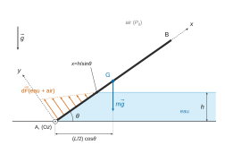
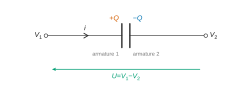
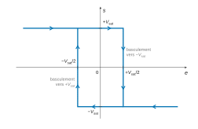
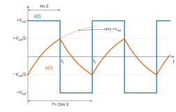
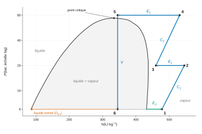

# Centrale-Supélec TSI — Physique-chimie 2 2026 · Corrigé

*Corrigé rédigé par IA, non officiel. Signalez toute erreur.*

**Faire face aux inondations.** Durée 4 h, calculatrice autorisée. Trois parties indépendantes, 48 questions. Questions à prise d'initiative : Q26, Q31, Q48.

## Partie A – Barrière anti-inondation passive

Notations de la figure 2 : A est sur le sol, au pied de la plaque, sur l'axe de rotation (Oz) orienté vers le lecteur. $\vec e_x$ est dirigé de A vers B le long de la plaque, $\vec e_y$ est normal à la plaque, du côté de l'air. L'eau occupe la région située sous la plaque, du côté $-\vec e_y$. La base $(\vec e_x,\vec e_y,\vec e_z)$ est directe, et un moment positif selon $\vec e_z$ tend à augmenter $\theta$.

### Q1

L'eau est au repos dans le référentiel terrestre galiléen et elle est incompressible dans un champ de pesanteur uniforme. On note $z$ l'altitude comptée depuis le sol. La statique des fluides donne $\dfrac{\mathrm dP}{\mathrm dz}=-\rho g$, d'où

$$P(z)=P(h)+\rho g(h-z).$$

La pression est continue à la surface libre, donc $P(h)=P_0$. Le point $M(x)$ est à l'altitude $z=x\sin\theta$, d'où

$$\boxed{P_{\text{eau}}(M)=P_0+\rho g\,(h-x\sin\theta)}$$

pour $0\le x\le h/\sin\theta$. Au-delà de $x=h/\sin\theta$, le point $M$ est hors de l'eau.

### Q2

La bande a pour surface $\mathrm dS=\ell\,\mathrm dx$. Une force pressante est normale à la paroi et dirigée du fluide vers la paroi.

- **Eau** (face inférieure, uniquement sous la ligne d'eau). Pour $0\le x\le h/\sin\theta$ :

$$\boxed{\mathrm d\vec F_{\text{eau}}=\big[P_0+\rho g(h-x\sin\theta)\big]\,\ell\,\mathrm dx\;\vec e_y}$$

Et $\mathrm d\vec F_{\text{eau}}=\vec 0$ au-dessus de la ligne d'eau.

- **Air** : il agit sur la face supérieure sur toute la longueur, soit $-P_0\ell\,\mathrm dx\,\vec e_y$ pour $0\le x\le L$. Il agit aussi sur la face inférieure au-dessus de la ligne d'eau, soit $+P_0\ell\,\mathrm dx\,\vec e_y$ pour $x>h/\sin\theta$. La force nette de l'air sur la bande vaut donc, pour $0\le x\le h/\sin\theta$,

$$\boxed{\mathrm d\vec F_{\text{air}}=-P_0\,\ell\,\mathrm dx\;\vec e_y}$$

Et $\mathrm d\vec F_{\text{air}}=\vec 0$ pour $x>h/\sin\theta$.

La résultante sur une bande immergée est $\mathrm d\vec F=\rho g(h-x\sin\theta)\,\ell\,\mathrm dx\,\vec e_y$ : la pression atmosphérique s'élimine.

### Q3

La force $\mathrm d\vec F=\mathrm dF\,\vec e_y$ s'applique en $x\,\vec e_x$. Son moment par rapport à (Oz) vaut $(x\vec e_x\wedge \mathrm dF\,\vec e_y)\cdot\vec e_z=x\,\mathrm dF$. On suppose la plaque non totalement immergée ($h\le L\sin\theta$), et l'on intègre sur la partie mouillée :

$$\begin{aligned}
\mathcal M_{\text{fluide}}&=\int_0^{h/\sin\theta}\rho g\ell\,x\,(h-x\sin\theta)\,\mathrm dx\\
&=\rho g\ell\left[\frac{hx^2}{2}-\frac{x^3\sin\theta}{3}\right]_0^{h/\sin\theta}\\
&=\rho g\ell\,\frac{h^3}{\sin^2\theta}\left(\frac12-\frac13\right)
\end{aligned}$$

$$\boxed{\mathcal M_{\text{fluide}}=\frac16\,\rho g\ell\,\frac{h^3}{\sin^2\theta}}$$

Ce moment est positif : il tend à relever la plaque. Avec la relation d'équilibre de Q5, la condition $h\le L\sin\theta$ équivaut à $\tan\theta\ge \dfrac{3m}{\rho\ell L^2}=0{,}20$, soit $\theta\ge 11^\circ$. Elle est vérifiée au voisinage de $\theta_0$.

### Q4

La masse est uniformément répartie, donc le centre d'inertie est le milieu G de [AB]. Dans le repère fixe ($\vec u_X$ horizontal, $\vec u_Y$ vertical ascendant), on a $\overrightarrow{AG}=\frac L2(\cos\theta\,\vec u_X+\sin\theta\,\vec u_Y)$, et le poids vaut $-mg\,\vec u_Y$. D'où

$$\boxed{\mathcal M_{\text{poids}}=\left(\overrightarrow{AG}\wedge(-mg\,\vec u_Y)\right)\cdot\vec e_z=-\frac12\,mgL\cos\theta}$$

Ce moment est négatif : le poids tend à rabattre la plaque. Il est nul pour $\theta=90^\circ$.

### Q5

La plaque est en équilibre et la liaison pivot est parfaite : le moment de la liaison par rapport à (Oz) est nul. La plaque subit donc seulement les forces pressantes et son poids. Le théorème du moment cinétique par rapport à l'axe fixe (Oz) donne à l'équilibre $\mathcal M_{\text{fluide}}+\mathcal M_{\text{poids}}=0$ :

$$\begin{aligned}
\frac16\rho g\ell\frac{h^3}{\sin^2\theta}&=\frac12 mgL\cos\theta\\
\iff\quad \cos\theta\sin^2\theta&=\frac13\frac{\rho\ell}{mL}h^3
\end{aligned}$$

puis, avec $\sin^2\theta=1-\cos^2\theta$ :

$$\boxed{\cos\theta\,(1-\cos^2\theta)=\frac13\,\frac{\rho\ell}{mL}\,h^3}$$

### Q6

On a $h(\theta)=\left(\dfrac{3mL}{\rho\ell}\right)^{1/3}\big(\cos\theta\sin^2\theta\big)^{1/3}$, et la racine cubique est croissante. La hauteur $h$ est donc maximale quand $f(u)=u-u^3$ l'est, avec $u=\cos\theta\in\,]0,1[$.

La dérivée $f'(u)=1-3u^2$ est positive puis négative, et s'annule en $u=1/\sqrt3$. Le maximum est donc atteint pour

$$\boxed{\theta_0=\arccos\frac{1}{\sqrt3}\approx 54{,}7^\circ}$$

Alors

$$\begin{aligned}
h(\theta_0)&=\left(\frac{3mL}{\rho\ell}\cdot\frac{1}{\sqrt3}\cdot\frac23\right)^{1/3}\\
&=\left(0{,}20\times0{,}385\right)^{1/3}\\
&=0{,}425\ \text{m},
\end{aligned}$$

ce qui est conforme à la figure 3.

### Q7

À $h=h(\theta_0)$ fixée, $\mathcal M_{\text{fluide}}=K/\sin^2\theta$ avec $K=\frac16\rho g\ell h^3=3{,}8\times10^2\ \text{N·m}$. Par ailleurs, $|\mathcal M_{\text{poids}}|=\frac12 mgL\cos\theta=981\cos\theta\ \text{N·m}$.

- Quand $\theta\to90^\circ$, $|\mathcal M_{\text{poids}}|\to0$ alors que $\mathcal M_{\text{fluide}}\to K$. La courbe qui décroît le plus vite est donc celle du poids.
- Numériquement, en $45^\circ$ : $\mathcal M_{\text{fluide}}=7{,}6\times10^2$ N·m et $|\mathcal M_{\text{poids}}|=6{,}9\times10^2$ N·m. En $65^\circ$, ces moments valent $4{,}6\times10^2$ et $4{,}1\times10^2$ N·m. Ce sont les valeurs lues sur la figure 4 pour la courbe 2 (760 puis 460) et pour la courbe 1 (695 puis 415).

$$\boxed{\text{courbe 1}=|\mathcal M_{\text{poids}}|}$$

$$\boxed{\text{courbe 2}=\mathcal M_{\text{fluide}}}$$

Les deux courbes sont tangentes en $\theta_0$. Leurs dérivées logarithmiques, $-2/\tan\theta$ et $-\tan\theta$, coïncident pour $\tan^2\theta=2$.

### Q8

À $h$ fixée, le moment résultant vaut

$$\Gamma(\theta)=\frac{\rho g\ell h^3}{6\sin^2\theta}-\frac{mgL}{2}\cos\theta.$$

En une position d'équilibre $\theta_e$, on reporte $\rho g\ell h^3/6=\frac{mgL}{2}\cos\theta_e\sin^2\theta_e$ dans la dérivée :

$$\begin{aligned}
\Gamma'(\theta_e)&=-\frac{\rho g\ell h^3}{3}\frac{\cos\theta_e}{\sin^3\theta_e}+\frac{mgL}{2}\sin\theta_e\\
&=\frac{mgL}{2}\,\frac{1-3\cos^2\theta_e}{\sin\theta_e}.
\end{aligned}$$

- Si $\theta_e<\theta_0$, alors $\cos^2\theta_e>1/3$ et $\Gamma'(\theta_e)<0$. Un écart $\delta\theta>0$ crée un moment négatif qui ramène la plaque : l'équilibre est stable.
- Si $\theta_e>\theta_0$, alors $\Gamma'(\theta_e)>0$ : le moment créé a le signe de l'écart et l'amplifie. **L'équilibre est instable.**

Physiquement, au-delà de $\theta_0$, quand $\theta$ augmente, le moment du poids diminue plus vite que celui de l'eau. La poussée l'emporte et fait encore croître $\theta$, jusqu'à la butée verticale. Sur la figure 4, la courbe 2 est au-dessus de la courbe 1 de part et d'autre de $\theta_0$. Pour $\theta>\theta_0$, le moment résultant est donc positif et éloigne la plaque de $\theta_0$.

### Q9

- **Avantage** : le déploiement est de type « tout ou rien ». Dès que $h$ atteint le seuil $h(\theta_0)\approx 0{,}43$ m, la barrière se dresse d'un coup jusqu'à la verticale, position la plus protectrice. Ce déploiement est rapide et ne demande ni énergie ni intervention, ce qui est adapté à une crue soudaine.
- **Inconvénient** : le basculement est brutal et incontrôlé. La plaque de 200 kg vient heurter la butée, ce qui use la liaison et présente un danger pour les personnes ou les véhicules à proximité. Le seuil est fixé par la construction ($m$, $L$, $\ell$) et ne peut pas être réglé.

## Partie B – Capteur de niveau d'eau

### I – Sonde de mesure

### Q10

On néglige les effets de bord et le régime est permanent. Le flux de $\vec\jmath=j(r)\vec e_r$ à travers le cylindre coaxial de rayon $r$ et de hauteur $H$ est donc l'intensité $I$, indépendante de $r$ ; les bases du cylindre ne sont pas traversées :

$$I=j(r)\,2\pi rH$$

$$\boxed{j(r)=\frac{I}{2\pi rH}}$$

### Q11

Dans l'air, $\vec E=\vec\jmath/\gamma_0=\dfrac{I}{2\pi\gamma_0Hr}\vec e_r$. Comme $\vec E=-\overrightarrow{\text{grad}}\,V$,

$$\begin{aligned}
U=V_1-V_2&=\int_{R_1}^{R_2}E(r)\,\mathrm dr\\
&=\frac{I}{2\pi\gamma_0H}\ln\frac{R_2}{R_1}\\
&=R_0I,
\end{aligned}$$

avec

$$\boxed{R_0=\frac{\ln(R_2/R_1)}{2\pi\gamma_0H}}$$

Pour $H$ de l'ordre de 10 cm, $R_0\sim10^{12}\ \Omega$ : la sonde vide est pratiquement isolante.

### Q12

On néglige les effets de bord. La distribution est invariante par rotation autour de (Oz) et par translation selon (Oz), et les plans $(M,\vec e_r,\vec e_z)$ et $(M,\vec e_r,\vec e_\theta)$ sont plans de symétrie. Le champ est donc $\vec E=E(r)\vec e_r$.

On applique le théorème de Gauss au cylindre fermé de rayon $r\in\,]R_1,R_2[$ et de hauteur $H$ : le flux à travers les bases est nul et la charge intérieure est $Q$, d'où

$$E(r)\,2\pi rH=\frac{Q}{\varepsilon_0}$$

$$\boxed{\vec E=\frac{Q}{2\pi\varepsilon_0Hr}\,\vec e_r}$$

### Q13

Pour un condensateur dont les armatures portent $+Q$ (armature 1) et $-Q$ (armature 2), on note $U=V_1-V_2$ la tension fléchée de l'armature 2 vers l'armature 1, c'est-à-dire avec la pointe de la flèche du côté de l'armature 1. En convention récepteur, le courant $i$ entre par l'armature 1. On a alors

$$\boxed{Q=C\,U}$$

$$\boxed{i=\frac{\mathrm dQ}{\mathrm dt}=C\frac{\mathrm dU}{\mathrm dt}}$$

avec $C>0$ en farads.

Le courant $i$ et la flèche de $U$ sont de sens opposés : c'est la convention récepteur.

### Q14

$$\begin{aligned}
U&=\int_{R_1}^{R_2}\frac{Q}{2\pi\varepsilon_0Hr}\,\mathrm dr\\
&=\frac{Q\ln(R_2/R_1)}{2\pi\varepsilon_0H}
\end{aligned}$$

$$\boxed{C_0=\frac{2\pi\varepsilon_0H}{\ln(R_2/R_1)}}$$

On remarque que $R_0C_0=\varepsilon_0/\gamma_0$ ne dépend que du milieu.

### Q15

Les deux cylindres sont équipotentiels. La tranche d'eau (hauteur $h$) et la tranche d'air (hauteur $H-h$) sont donc soumises à la même tension : elles sont **en parallèle** et leurs conductances s'ajoutent. Le calcul de Q11 appliqué à chaque tranche (effets de bord à l'interface négligés) donne

$$\frac{1}{R_{\text{sonde}}}=\frac{2\pi}{\ln(R_2/R_1)}\big[\gamma_{\text{eau}}h+\gamma_0(H-h)\big].$$

Or, puisque $h$ et $H$ sont du même ordre,

$$\frac{\gamma_0(H-h)}{\gamma_{\text{eau}}h}=\frac{1{,}0\times10^{-12}}{2{,}0\times10^{-2}}\cdot\frac{H-h}{h}\sim5\times10^{-11}\ll1.$$

D'où

$$\boxed{R_{\text{sonde}}\simeq\frac{\ln(R_2/R_1)}{2\pi\gamma_{\text{eau}}}\,\frac1h}$$

### Q16

Les deux condensateurs (tranche d'eau, tranche d'air) sont de même tension, donc en parallèle, et leurs capacités s'ajoutent :

$$C=\frac{2\pi\varepsilon_0}{\ln(R_2/R_1)}\big[\varepsilon_rh+(H-h)\big].$$

Le terme de l'air est dans le rapport $\dfrac{H-h}{\varepsilon_rh}\sim\dfrac1{80}$ au terme de l'eau, ce qui est négligeable quand $h$ et $H$ sont du même ordre :

$$\boxed{C_{\text{sonde}}\simeq\frac{2\pi\varepsilon_0\varepsilon_r}{\ln(R_2/R_1)}\,h}$$

Cette approximation est moins bonne que celle de Q15 et tomberait en défaut pour $h\ll H$.

### II – Circuit électronique de mesure

Lecture de la figure 6. L'entrée $-$ de l'ALI est reliée à l'armature supérieure du condensateur $C$, dont la tension est $e$.

La sortie $s$ alimente la sonde, qui est en série avec $C$ vers la masse. L'entrée $+$ est au milieu d'un pont de deux résistances $R$ placé entre la sortie et la masse.

### Q17

L'admittance de la sonde vaut $\underline Y=\dfrac1{R_{\text{sonde}}}+jC_{\text{sonde}}\omega$. La sonde se réduit à $R_{\text{sonde}}$ si $R_{\text{sonde}}C_{\text{sonde}}\,\omega\ll1$. D'après Q15 et Q16,

$$\begin{aligned}
R_{\text{sonde}}C_{\text{sonde}}&=\frac{\varepsilon_0\varepsilon_r}{\gamma_{\text{eau}}}\\
&=\frac{8{,}85\times10^{-12}\times80}{2{,}0\times10^{-2}}\\
&=3{,}5\times10^{-8}\ \text{s},
\end{aligned}$$

et ce produit est indépendant de $h$. Pour $f\sim1$ kHz, $R_{\text{sonde}}C_{\text{sonde}}\,\omega\approx2\times10^{-4}\ll1$ (encore $1\times10^{-3}$ à 5 kHz). **La sonde est équivalente à la seule résistance $R_{\text{sonde}}$.**

### Q18

Les résistances et la sonde dissipent de l'énergie, et le condensateur ne fait que la stocker et la restituer. **L'énergie qui entretient les oscillations est fournie par l'alimentation continue de l'ALI**, non représentée, qui fixe aussi les tensions $\pm V_{\text{sat}}$.

### Q19

La sortie est reliée à l'entrée non inverseuse : la rétroaction est positive et le régime linéaire est instable. **L'ALI fonctionne en régime saturé** ($s=\pm V_{\text{sat}}$), régime non linéaire. Le signal $e$ est appliqué sur l'entrée $-$ : ce montage est un **comparateur à hystérésis inverseur** (trigger de Schmitt inverseur).

### Q20

L'ALI est idéal, donc $i^+=0$ et le pont diviseur n'est pas chargé : $V^+=\dfrac{R}{R+R}\,s=\dfrac s2$. De plus $V^-=e$. D'où

$$\boxed{\varepsilon=\frac s2-e}$$

### Q21

- Si $s=+V_{\text{sat}}$, cet état exige $\varepsilon>0$, soit $e<+V_{\text{sat}}/2$. Il cesse quand $e$ dépasse $+V_{\text{sat}}/2$, et la sortie bascule alors à $-V_{\text{sat}}$.
- Si $s=-V_{\text{sat}}$, cet état exige $\varepsilon<0$, soit $e>-V_{\text{sat}}/2$. Il cesse quand $e$ descend sous $-V_{\text{sat}}/2$, et la sortie bascule alors à $+V_{\text{sat}}$.

Entre $-V_{\text{sat}}/2$ et $+V_{\text{sat}}/2$, les deux états sont possibles et la sortie dépend de l'histoire : c'est l'hystérésis.

Tracé de $s(e)$, avec $e$ en abscisse et $s$ en ordonnée :

Le cycle est rectangulaire, parcouru dans le sens horaire.

- Le palier haut $s=+V_{\text{sat}}$ s'étend pour $e<+V_{\text{sat}}/2$. Il se parcourt vers la droite, jusqu'à la chute verticale en $e=+V_{\text{sat}}/2$.
- Le palier bas $s=-V_{\text{sat}}$ s'étend pour $e>-V_{\text{sat}}/2$. Il se parcourt vers la gauche, jusqu'à la montée verticale en $e=-V_{\text{sat}}/2$.

Les grandeurs à faire figurer sont $\pm V_{\text{sat}}$ sur l'axe des $s$ et $\pm V_{\text{sat}}/2$ sur l'axe des $e$.

### Q22

Le courant d'entrée $i^-$ est nul, donc le courant $i$ qui traverse la sonde ($R_{\text{sonde}}$) traverse aussi $C$. On a $i=\dfrac{s-e}{R_{\text{sonde}}}$ et $i=C\dfrac{\mathrm de}{\mathrm dt}$, d'où

$$\boxed{\frac{\mathrm de}{\mathrm dt}+\frac1\tau e(t)=\frac1\tau s(t)}$$

avec $\tau=R_{\text{sonde}}\,C$.

### Q23

Tant que $s=+V_{\text{sat}}$, on a $e(t)=V_{\text{sat}}+A\,\mathrm e^{-t/\tau}$, et $e(0)=-V_{\text{sat}}/2$ impose $A=-\frac32V_{\text{sat}}$ :

$$e(t)=V_{\text{sat}}\left(1-\tfrac32\,\mathrm e^{-t/\tau}\right).$$

Sa dérivée est positive :

$$\dot e=\frac{3V_{\text{sat}}}{2\tau}\mathrm e^{-t/\tau}>0.$$

La tension $e$ croît vers $V_{\text{sat}}>V_{\text{sat}}/2$ : elle atteint donc le seuil $+V_{\text{sat}}/2$, et $s$ bascule à $-V_{\text{sat}}$ (Q21) quand $\frac32\mathrm e^{-t_1/\tau}=\frac12$, soit

$$\boxed{t_1=\tau\ln3}$$

### Q24

La tension aux bornes de $C$ est continue, donc $e(t_1^+)=V_{\text{sat}}/2$. Pour $s=-V_{\text{sat}}$ :

$$e(t)=-V_{\text{sat}}+\tfrac32V_{\text{sat}}\,\mathrm e^{-(t-t_1)/\tau},$$

dont la dérivée est négative. La tension $e$ décroît vers $-V_{\text{sat}}<-V_{\text{sat}}/2$ et atteint le seuil $-V_{\text{sat}}/2$ quand $\mathrm e^{-(t_2-t_1)/\tau}=\frac13$. La sortie $s$ redevient alors $+V_{\text{sat}}$, à la date

$$\boxed{t_2=2\tau\ln3}$$

### Q25

En $t_2$, on a $s=+V_{\text{sat}}$ et $e=-V_{\text{sat}}/2$ : c'est l'état initial. Le système est décrit par le couple $(e,s)$ et régi par une équation qui ne dépend pas explicitement du temps. L'évolution se reproduit donc à l'identique : le régime est périodique, de période $T=t_2$.

$$\boxed{T=2\tau\ln3}$$

$$\boxed{f=\frac1{2\tau\ln3}=\frac{1}{2R_{\text{sonde}}C\ln3}}$$

### Q26

*Démarche* : on lit la période $T$ sur l'oscillogramme, on en déduit $\tau=T/(2\ln3)$, puis $R_{\text{sonde}}=\tau/C$, puis $h$ par Q15.

- *Lecture* : la base de temps vaut 50 µs/div. Deux fronts montants successifs de $s$ (signal carré) sont séparés d'environ 3,8 divisions. D'où $T\approx3{,}8\times50=1{,}9\times10^2$ µs et $f\approx5{,}3$ kHz.
- *Contrôle* : $s$ vaut environ $\pm2{,}2$ div à 5 V/div, soit $\pm11$ V, et $e$ oscille entre environ $\pm5{,}5$ V. Cela correspond bien au rapport 2 attendu entre les tensions de saturation et les seuils de basculement. La fréquence est de l'ordre du kHz, comme supposé en Q17.
- *Exploitation* : $\tau=\dfrac{1{,}9\times10^{-4}}{2\ln3}=8{,}6\times10^{-5}$ s, puis $R_{\text{sonde}}=\dfrac{\tau}{C}=86\ \Omega$. Avec $R_2/R_1=3$ :

$$\begin{aligned}
h&=\frac{\ln(R_2/R_1)}{2\pi\gamma_{\text{eau}}R_{\text{sonde}}}\\
&=\frac{C\,\ln3\,\ln(R_2/R_1)}{\pi\gamma_{\text{eau}}T}\\
&=\frac{1{,}0\times10^{-6}\times(\ln3)^2}{\pi\times2{,}0\times10^{-2}\times1{,}9\times10^{-4}}
\end{aligned}$$

$$\boxed{h\approx0{,}10\ \text{m}}$$

La précision de lecture de $T$ ($\pm5$ µs) donne $h$ à environ 4 % près.

## Partie C – Gilet de sauvetage

### I – Dissolution de la pastille de sel

### Q27

$$\boxed{\mathrm{NaCl_{(s)}\longrightarrow Na^+_{(aq)}+Cl^-_{(aq)}}}$$

### Q28

D'après la loi de Hess :

$$\begin{aligned}
\Delta_rH^\circ&=\Delta_fH^\circ(\mathrm{Na^+_{aq}})+\Delta_fH^\circ(\mathrm{Cl^-_{aq}})-\Delta_fH^\circ(\mathrm{NaCl_s})\\
&=-240{,}12-167{,}16+411{,}18
\end{aligned}$$

$$\boxed{\Delta_rH^\circ=+3{,}90\ \text{kJ·mol}^{-1}}$$

Ce résultat est positif : la dissolution est **endothermique**. Elle prélève de l'énergie thermique au milieu, qui se refroidit, comme le montre l'expérience de Q31. Ce faible effet thermique est la petite différence entre l'énergie de destruction du réseau et l'énergie d'hydratation des ions.

### Q29

Dans l'approximation d'Ellingham ($\Delta_rH^\circ$ et $\Delta_rS^\circ$ indépendantes de $T$), $\Delta_rG^\circ=\Delta_rH^\circ-T\Delta_rS^\circ$ donne

$$\begin{aligned}
\ln K^\circ&=-\frac{\Delta_rG^\circ}{RT}\\
&=-\frac{\Delta_rH^\circ}{RT}+\frac{\Delta_rS^\circ}{R},
\end{aligned}$$

fonction croissante de $T$ puisque $\Delta_rH^\circ>0$.

La constante $K^\circ$ croît donc avec $T$. **La dissolution est thermodynamiquement favorisée à haute température.**

### Q30

On a $M(\mathrm{NaCl})=58{,}5$ g/mol, donc $n=5{,}0/58{,}5=8{,}5\times10^{-2}$ mol. La transformation est monobare et monotherme, et le seul travail est celui des forces de pression : $Q=\Delta H=n\,\Delta_rH^\circ$.

$$Q=8{,}5\times10^{-2}\times3{,}90\times10^3$$

$$\boxed{Q\approx3{,}3\times10^2\ \text{J}}$$

Cette énergie est reçue par le système qui se dissout.

### Q31

*Hypothèses* : le calorimètre est adiabatique et de capacité négligeable, et la transformation est monobare, donc $\Delta H_{\text{tot}}=0$. On décompose en deux étapes fictives : dissolution des 10 pastilles à $t_1$, puis refroidissement de la solution de $t_1$ à $t_2$. La capacité thermique de l'eau salée est assimilée à celle de l'eau pure, soit $m_{\text{eau}}c_{\text{eau}}$ :

$$\begin{aligned}
10\,Q_1+m_{\text{eau}}c_{\text{eau}}(t_2-t_1)&=0\\
Q_1&=\frac{m_{\text{eau}}c_{\text{eau}}(t_1-t_2)}{10}\\
&=\frac{0{,}200\times4{,}18\times10^3\times3{,}6}{10}
\end{aligned}$$

$$\boxed{Q_1\approx3{,}0\times10^2\ \text{J par pastille}}$$

*Comparaison* : la valeur théorique est $3{,}3\times10^2$ J, et l'écart relatif est d'environ 10 %. L'accord est satisfaisant. Le sens de l'écart s'explique : la capacité thermique du calorimètre est négligée alors qu'il cède lui aussi de l'énergie, ce qui fait que la chute de température mesurée sous-estime l'énergie absorbée. Il faut ajouter les fuites thermiques et la dépendance de l'enthalpie de dissolution à la concentration (solution à 250 g/L).

Si l'on compte la masse totale de la solution (250 g) avec $c_{\text{eau}}$, on obtient $3{,}8\times10^2$ J. L'accord est alors de 13 %, et la conclusion est la même.

### Q32

Dénombrement des ions de la maille :

- $\mathrm{Cl^-}$ : $8\times\frac18+6\times\frac12=4$ ;
- $\mathrm{Na^+}$ : $12\times\frac14+1=4$.

La maille contient donc $Z=4$ motifs NaCl, et sa masse volumique vaut $\mu=\dfrac{ZM}{\mathcal N_Aa^3}$. D'où

$$a=\left(\frac{4\times58{,}5\times10^{-3}}{6{,}02\times10^{23}\times2{,}16\times10^3}\right)^{1/3}$$

$$\boxed{a\approx5{,}6\times10^{-10}\ \text{m}}$$

### Q33

Avec l'énergie nulle à l'infini :

$$\boxed{\mathcal E_p=\frac{q_1q_2}{4\pi\varepsilon_0\,r_{12}}}$$

### Q34

On considère un ion de charge $\pm e$. Ses voisins de rang $k\ge1$ sont deux, un de chaque côté, à la distance $ka$. Ils portent une charge de même signe que l'ion si $k$ est pair, de signe opposé si $k$ est impair. Le produit des charges vaut donc $(-1)^ke^2$. On somme les interactions de paire (Q33) :

$$\begin{aligned}
\mathcal E_{\text{ion}}&=\sum_{k=1}^{+\infty}2\,\frac{(-1)^ke^2}{4\pi\varepsilon_0\,ka}\\
&=\frac{e^2}{2\pi\varepsilon_0a}\sum_{k=1}^{+\infty}\frac{(-1)^k}{k}
\end{aligned}$$

$$\boxed{\mathcal E_{\text{ion}}=-\frac{e^2}{2\pi\varepsilon_0a}\ln2}$$

Numériquement, $\mathcal E_{\text{ion}}=-5{,}7\times10^{-19}$ J, soit $-3{,}5$ eV.

### Q35

$$N=2\,\frac{m_{\text{sel}}}{M}\,\mathcal N_A=2\times8{,}5\times10^{-2}\times6{,}02\times10^{23}$$

$$\boxed{N\approx1{,}0\times10^{23}\ \text{ions}}$$

### Q36

En sommant $\mathcal E_{\text{ion}}$ sur les $N$ ions, chaque paire est comptée deux fois. L'énergie du cristal vaut donc $\mathcal E_{\text{cristal}}=\frac N2\mathcal E_{\text{ion}}$. L'énergie à fournir pour séparer tous les ions (énergie finale nulle) est

$$\begin{aligned}
\mathcal E_{\text{sép}}&=\frac N2\,\frac{e^2\ln2}{2\pi\varepsilon_0a}\\
&=\frac{1{,}03\times10^{23}}{2}\times5{,}7\times10^{-19}
\end{aligned}$$

$$\boxed{\mathcal E_{\text{sép}}\approx2{,}9\times10^4\ \text{J}}$$

Cela fait environ 340 kJ par mole de NaCl.

*Commentaire* : cette énergie est environ cent fois plus grande que l'énergie de dissolution mesurée (environ $3\times10^2$ J). Dissoudre n'est pas séparer les ions dans le vide : l'hydratation des ions par les molécules d'eau, polaires, restitue presque toute l'énergie réticulaire. Le bilan de $+3{,}9$ kJ/mol est une petite différence entre deux grandes énergies. Le modèle unidimensionnel est par ailleurs grossier : il retient 2 voisins à la distance $a$ au lieu de 6 voisins à $a/2$ dans le cristal réel. Il sous-estime l'énergie réticulaire réelle (de l'ordre de 790 kJ/mol) mais en donne le bon ordre de grandeur, quelques eV par ion.

### II – Gonflage du gilet

### Q37

La flottabilité est la poussée d'Archimède du gilet totalement immergé : $\Pi=\rho gV_f$.

$$V_f=\frac{\Pi}{\rho g}=\frac{150}{1{,}00\times10^3\times9{,}81}$$

$$\boxed{V_f\approx1{,}5\times10^{-2}\ \text{m}^3=15\ \text{L}}$$

### Q38

On a $n=33/44{,}0=0{,}75$ mol. Avec le modèle du gaz parfait à $T=293$ K :

$$P=\frac{nRT}{V_f}=\frac{0{,}75\times8{,}3\times293}{1{,}53\times10^{-2}}$$

$$\boxed{P\approx1{,}2\times10^5\ \text{Pa}=1{,}2\ \text{bar}}$$

*Commentaire* : la pression est légèrement supérieure à la pression atmosphérique. Une légère surpression suffit à tendre le boudin souple sans risque d'éclatement, et la masse de la cartouche est donc bien dimensionnée pour ce volume. À cette pression, le modèle du gaz parfait est légitime.

### III – Liquéfaction du CO₂

### Q39

- **Intérêt pratique** : le liquide est environ 400 fois plus dense que le gaz à 1,2 bar. Sa masse volumique est de l'ordre de 800 kg/m³ sous la pression de vapeur saturante, environ 57 bar à 20 °C. Les 33 g tiennent dans environ 40 mL, une petite cartouche, au lieu de 15 L. De plus, la vaporisation à l'ouverture de la cartouche libère rapidement le gaz sous une pression suffisante pour gonfler le gilet.
- **Enjeu écologique** : le CO₂ est le principal gaz à effet de serre d'origine anthropique. Le captage et le stockage du carbone imposent de le comprimer et de le liquéfier pour le transporter (canalisations, navires) et l'injecter dans des réservoirs géologiques. La liquéfaction réduit le volume de plusieurs centaines de fois, mais elle consomme de l'énergie, d'où l'intérêt d'optimiser le procédé.

### Q40

En régime stationnaire, en négligeant les variations d'énergies cinétique et potentielle, le premier principe pour un système ouvert s'écrit $\Delta h=w_u+q$. La vanne n'a pas de partie mobile ($w_u=0$) et elle est calorifugée ($q=0$), d'où

$$\boxed{h_6=h_5}$$

**La détente est isenthalpe.**

### Q41

Le second principe pour le fluide en écoulement stationnaire s'écrit $\Delta s=s_{\text{éch}}+s_{\text{créée}}$. La compression est adiabatique, donc $s_{\text{éch}}=0$, et réversible, donc $s_{\text{créée}}=0$. D'où $\Delta s=0$ :

$$\boxed{s_2=s_1}$$

$$\boxed{s_4=s_3}$$

**Les compressions sont isentropes.**

### Q42

Placement des points sur le diagramme $(P,h)$ du document-réponse :

| Point | P (bar) | Repère utilisé | h (kJ/kg) | État |
|---|---|---|---|---|
| 1 | 6 | isotherme 0 °C | ≈ 478 | vapeur sèche, s₁ ≈ 2,31 kJ/(K·kg) |
| 2 | 20 | isentrope passant par 1 | ≈ 545 | vapeur, T₂ ≈ 85 °C |
| 3 | 20 | isotherme 0 °C | ≈ 460 | vapeur, s₃ ≈ 2,03 kJ/(K·kg) |
| 4 | 80 | isentrope passant par 3 | ≈ 531 | fluide supercritique, T₄ ≈ 110 °C |
| 5 | 80 | isotherme 35 °C | ≈ 345 | fluide supercritique dense |
| 6 | 6 | isenthalpe h₆ = h₅ | ≈ 345 | diphasé, x₆ ≈ 0,75, T₆ ≈ −53 °C |

Courbe reliant les points :

- de 1 à 2, on suit l'isentrope $s\approx2{,}31$ en montant vers la droite (compression $C_1$) ;
- de 2 à 3, on trace un segment horizontal à 20 bar vers la gauche (refroidissement isobare dans $E_1$) ;
- de 3 à 4, on suit l'isentrope $s\approx2{,}03$ (compression $C_2$) ;
- de 4 à 5, on trace un segment horizontal à 80 bar vers la gauche, au-dessus du point critique (environ 74 bar), sans changement d'état franc (refroidissement isobare dans $E_2$) ;
- de 5 à 6, on trace un segment vertical $h=345$ kJ/kg, de 80 à 6 bar, qui entre sous la courbe de saturation (détente isenthalpe dans la vanne).

Au séparateur, le point 6 se partage entre le liquide saturant ($h\approx87$ kJ/kg) et la vapeur saturante ($h\approx432$ kJ/kg) à 6 bar. La vapeur est réchauffée à pression constante dans $E_3$ jusqu'au point 1. À 80 bar, 35 °C est très proche de la température pseudo-critique : l'isotherme y est presque horizontale et la lecture de $h_5$ est sensible, avec une variation de plusieurs dizaines de kJ/kg pour 1 °C.

### Q43

Pour un compresseur adiabatique, le premier principe industriel donne $w_u=\Delta h$. D'où

$$\begin{aligned}
\mathcal P_{\text{comp}}&=D_m\big[(h_2-h_1)+(h_4-h_3)\big]\\
&=0{,}1\times\big[(545-478)+(531-460)\big]\\
&=0{,}1\times138\ \text{kW}
\end{aligned}$$

$$\boxed{\mathcal P_{\text{comp}}\approx14\ \text{kW}}$$

### Q44

Pour une compression isentrope, $w_u=\int v\,\mathrm dP$. À pression donnée, le volume massique du gaz croît avec la température. Refroidir le gaz entre les deux étages (de 85 °C à 0 °C dans $E_1$) diminue $v$ pendant la seconde compression, donc le travail : la compression étagée avec refroidissement intermédiaire se rapproche d'une compression isotherme, la moins coûteuse.

Une compression directe de 6 à 80 bar le long de l'isentrope de 1 conduirait à $h\approx650$ kJ/kg et $T\approx210$ °C. Le travail serait d'environ 170 kJ/kg au lieu d'environ 138 kJ/kg. Les deux étages limitent aussi la température de refoulement, ce qui protège les lubrifiants et les joints, et réduisent le rapport de compression de chaque machine (3,3 puis 4).

### Q45

Les échangeurs sont isobares, sans partie mobile : $q=\Delta h$. La puissance thermique que la machine frigorifique prélève au CO₂ dans $E_1$ et $E_2$ vaut

$$\begin{aligned}
\mathcal P_{\text{froid}}&=D_m\big[(h_2-h_3)+(h_4-h_5)\big]\\
&=0{,}1\times\big[(545-460)+(531-345)\big]\\
&=27\ \text{kW}.
\end{aligned}$$

L'efficacité vaut $e_F=\mathcal P_{\text{froid}}/\mathcal P_F$, d'où

$$\mathcal P_F=\frac{27}{2{,}0}$$

$$\boxed{\mathcal P_F\approx14\ \text{kW}}$$

La valeur avant arrondi est 13,5 kW, à environ 1 kW près compte tenu des lectures.

### Q46

On applique la règle des moments à 6 bar, avec $h_\ell\approx87$ kJ/kg et $h_v\approx432$ kJ/kg :

$$x_6=\frac{h_6-h_\ell}{h_v-h_\ell}=\frac{345-87}{432-87}\approx0{,}75.$$

Ce titre est cohérent avec la lecture entre les courbes $x=0{,}70$ et $x=0{,}80$. Le séparateur extrait la fraction liquide $1-x_6$ :

$$D_{m1}=(1-x_6)\,D_m=0{,}25\times0{,}1$$

$$\boxed{D_{m1}\approx2{,}5\times10^{-2}\ \text{kg·s}^{-1}}$$

### Q47

En régime stationnaire, la masse de CO₂ dans l'installation est constante. Le seul débit entrant est $D_{m0}$ et le seul débit sortant est le liquide $D_{m1}$, donc

$$\boxed{D_{m0}=D_{m1}\approx2{,}5\times10^{-2}\ \text{kg·s}^{-1}}$$

Vérification au nœud d'entrée : $D_{m0}+x_6D_m=D_m$.

### Q48

*Démarche* : on calcule la masse à produire, puis la durée de fonctionnement, puis la puissance électrique, puis l'énergie et le coût.

- Masse à produire : $m=10\,000\times33$ g $=3{,}3\times10^2$ kg.
- Durée : $\Delta t=\dfrac{m}{D_{m1}}=\dfrac{330}{2{,}5\times10^{-2}}=1{,}3\times10^4$ s, soit 3,7 h.
- Puissance électrique des trois compresseurs (rendement 80 %) : $\mathcal P_{\text{élec}}=\dfrac{\mathcal P_{\text{comp}}+\mathcal P_F}{0{,}80}=\dfrac{13{,}8+13{,}5}{0{,}80}\approx34$ kW.
- Énergie : $E=34\times3{,}7\approx1{,}3\times10^2$ kWh, soit environ 0,38 kWh par kg de CO₂ liquide.

$$\text{Coût}=1{,}3\times10^2\times0{,}20$$

$$\boxed{\text{coût}\approx25\ \text{€ pour 10 000 cartouches}}$$

Cela fait environ 0,25 centime par cartouche, ce qui est négligeable devant le prix de vente d'une cartouche. Compte tenu des incertitudes de lecture sur le diagramme, le coût est compris entre 24 et 28 €.
