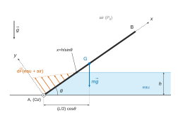
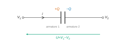
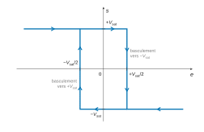
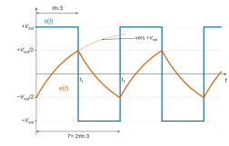
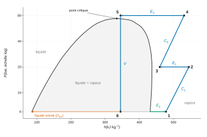

# Centrale-Supélec TSI — Physique-chimie 2 2026 · Corrigé guidé

*Corrigé rédigé par IA, non officiel. Signalez toute erreur.*

## Présentation du sujet

**Thème** : « Faire face aux inondations ». L'épreuve dure 4 heures, la calculatrice est autorisée. L'énoncé fait 10 pages, auxquelles s'ajoute un document-réponse (diagramme pression–enthalpie du CO₂) à rendre avec la copie. Il comporte **48 questions** réparties en trois parties **indépendantes**, de poids inégal.

| Partie | Questions | Contenu | Notions du programme TSI |
|---|---|---|---|
| A – Barrière anti-inondation passive | Q1–Q9 | Une plaque articulée se relève sous la poussée de l'eau et bascule brutalement au-delà d'un angle critique. | Statique des fluides, résultante et moment des forces pressantes, moment d'une force par rapport à un axe, équilibre et stabilité d'un solide en rotation |
| B – Capteur de niveau d'eau | Q10–Q26 | Une sonde coaxiale dont la résistance varie comme $1/h$, insérée dans un multivibrateur astable : la hauteur d'eau se lit sur la période. | Loi d'Ohm locale, théorème de Gauss, capacité, associations parallèles ; ALI en régime saturé, comparateur à hystérésis, circuit RC du premier ordre, oscillogramme |
| C – Gilet de sauvetage | Q27–Q48 | Dissolution de la pastille de sel déclencheuse, cristal NaCl et modèle électrostatique, gonflage, liquéfaction industrielle du CO₂. | Thermochimie (loi de Hess, variation de $K^\circ$ avec $T$), calorimétrie, cristallographie (maille cubique faces centrées), énergie électrostatique, poussée d'Archimède, gaz parfait, premier et second principes industriels, diagramme $(P,h)$, efficacité d'une machine frigorifique |

**Difficulté.** La plupart des questions sont des applications directes du cours. La difficulté tient à la longueur et à quelques passages délicats :

- la stabilité de la plaque (Q7–Q8), qui demande de raisonner à hauteur d'eau fixée ;
- la justification des approximations de la sonde (Q15–Q17), où il faut chiffrer ;
- les trois questions à prise d'initiative (numéros soulignés) : **Q26** (exploitation de l'oscillogramme), **Q31** (bilan calorimétrique) et **Q48** (coût électrique de la liquéfaction) ;
- la lecture du diagramme du CO₂ (Q42), dont dépendent toutes les questions suivantes.

**Questions abordables à ne pas laisser passer** : Q1, Q4, Q10–Q14, Q18–Q20, Q22–Q25, Q27–Q30, Q32–Q33, Q35, Q37–Q38, Q40–Q41, Q47. Elles représentent plus de la moitié du sujet.

**Gestion du temps.** Comptez environ 50 minutes pour A, 80 minutes pour B et 100 minutes pour C, et gardez 10 minutes de relecture. Une stratégie efficace consiste à traiter la partie C-I (thermochimie et cristal) avant la liquéfaction, à placer soigneusement les six points de Q42 au crayon, et à ne pas s'enliser sur Q21 (tracé du cycle) : un schéma propre avec les quatre valeurs clés suffit.

## Partie A – Barrière anti-inondation passive

On calcule le moment des forces pressantes sur une plaque inclinée, on écrit l'équilibre en rotation autour de l'axe du pivot, puis on étudie la stabilité. Outils : relation fondamentale de la statique des fluides, intégration sur une surface, moment d'une force par rapport à un axe orienté.

Convention de la figure 2 : l'axe (Oz) passe par A et est dirigé vers le lecteur. $\vec e_x$ va de A vers B, et $\vec e_y$ est normal à la plaque, du côté de l'air. L'eau est sous la plaque, du côté $-\vec e_y$. Un moment positif tend à augmenter $\theta$.

### Question 1

> [!INDICATION]
> La pression dans un liquide au repos ne dépend que de l'altitude. Quelle est l'altitude du point M(x) ?

> [!INDICATION]
> Intégrez $\mathrm dP/\mathrm dz=-\rho g$ et fixez la constante par la condition à la surface libre.

#### Solution

L'eau est au repos dans le référentiel terrestre galiléen et elle est incompressible dans un champ de pesanteur uniforme. Avec $z$ l'altitude comptée depuis le sol, on a $\dfrac{\mathrm dP}{\mathrm dz}=-\rho g$, donc

$$P(z)=P(h)+\rho g(h-z).$$

La pression est continue à la surface libre, donc $P(h)=P_0$. Le point $M(x)$ est sur la plaque inclinée de $\theta$, à l'altitude $z=x\sin\theta$ :

$$\boxed{P_{\text{eau}}(M)=P_0+\rho g\,(h-x\sin\theta)}$$

pour $0\le x\le h/\sin\theta$. Au-delà, $M$ est hors de l'eau.

> [!PIEGE]
> Écrire $P_0+\rho g x$ revient à confondre la distance le long de la plaque et la profondeur. Seule l'altitude compte. Précisez aussi le domaine de validité : il donnera la borne d'intégration en Q3.

### Question 2

> [!INDICATION]
> Une force pressante élémentaire est normale à la surface, dirigée du fluide vers la paroi, de norme $P\,\mathrm dS$.

> [!INDICATION]
> Faites l'inventaire des faces. La face supérieure est toujours au contact de l'air. La face inférieure est au contact de l'eau sous la ligne d'eau, et de l'air au-dessus.

#### Solution

La bande a pour surface $\mathrm dS=\ell\,\mathrm dx$.

*Eau* : elle agit sur la face inférieure, sous la ligne d'eau, et pousse selon $+\vec e_y$. Pour $0\le x\le h/\sin\theta$ :

$$\boxed{\mathrm d\vec F_{\text{eau}}=\big[P_0+\rho g(h-x\sin\theta)\big]\ell\,\mathrm dx\,\vec e_y}$$

Au-dessus de la ligne d'eau, $\mathrm d\vec F_{\text{eau}}=\vec 0$.

*Air* : il exerce $-P_0\ell\,\mathrm dx\,\vec e_y$ sur la face supérieure pour tout $x\in[0,L]$, et $+P_0\ell\,\mathrm dx\,\vec e_y$ sur la face inférieure pour $x>h/\sin\theta$. Bilan net, pour $0\le x\le h/\sin\theta$ :

$$\boxed{\mathrm d\vec F_{\text{air}}=-P_0\ell\,\mathrm dx\,\vec e_y}$$

Pour $x>h/\sin\theta$, $\mathrm d\vec F_{\text{air}}=\vec 0$.

Sur une bande immergée, la résultante vaut $\mathrm d\vec F=\rho g(h-x\sin\theta)\ell\,\mathrm dx\,\vec e_y$.

> [!METHODE]
> Une pression uniforme qui s'exerce sur les deux faces d'une paroi ne donne aucune résultante. On peut donc toujours raisonner en surpression $P-P_0$, ce qui allège les calculs.

### Question 3

> [!INDICATION]
> Le moment par rapport à (Oz) d'une force portée par $\vec e_y$ et appliquée à la distance $x$ de l'axe le long de $\vec e_x$ s'obtient directement avec le bras de levier.

> [!INDICATION]
> N'intégrez que sur la partie mouillée. Vérifiez ensuite que la plaque n'est pas entièrement immergée.

#### Solution

Le moment élémentaire vaut $(x\vec e_x\wedge\mathrm dF\,\vec e_y)\cdot\vec e_z=x\,\mathrm dF$. Pour $h\le L\sin\theta$ :

$$\begin{aligned}
\mathcal M_{\text{fluide}}&=\rho g\ell\int_0^{h/\sin\theta}x(h-x\sin\theta)\,\mathrm dx\\
&=\rho g\ell\left[\frac{hx^2}2-\frac{x^3\sin\theta}3\right]_0^{h/\sin\theta}\\
&=\rho g\ell\frac{h^3}{\sin^2\theta}\left(\frac12-\frac13\right),
\end{aligned}$$

$$\boxed{\mathcal M_{\text{fluide}}=\frac16\,\rho g\ell\,\frac{h^3}{\sin^2\theta}}$$

Ce moment est positif : la poussée tend à relever la plaque. Avec la relation de Q5, la condition $h\le L\sin\theta$ s'écrit $\tan\theta\ge 3m/(\rho\ell L^2)=0{,}20$, soit $\theta\ge11^\circ$. Elle est vraie autour de $\theta_0$.

> [!JURY]
> Pour un résultat à démontrer, faites apparaître les bornes, la primitive et la simplification. Terminez par un contrôle d'homogénéité : $\rho g\ell h^3$ s'exprime bien en N·m.

### Question 4

> [!INDICATION]
> Le poids s'applique au centre d'inertie. Quel est son bras de levier par rapport à l'axe ?

#### Solution

G est le milieu de [AB]. Dans le repère fixe ($\vec u_X$ horizontal, $\vec u_Y$ vertical ascendant), $\overrightarrow{AG}=\frac L2(\cos\theta\,\vec u_X+\sin\theta\,\vec u_Y)$ et $\vec P=-mg\,\vec u_Y$. D'où

$$\boxed{\mathcal M_{\text{poids}}=-\frac12\,mgL\cos\theta}$$

Ce moment est négatif : le poids rabat la plaque. Il est nul pour la plaque verticale.

> [!PIEGE]
> Le bras de levier est la distance **horizontale** $\frac L2\cos\theta$, pas $\frac L2\sin\theta$. Testez le cas $\theta=90^\circ$ : le poids passe alors par l'axe et son moment doit être nul.

### Question 5

> [!INDICATION]
> Que signifie « liaison pivot parfaite » pour le moment de l'action de liaison par rapport à l'axe ?

> [!INDICATION]
> Écrivez l'équilibre en rotation autour de l'axe fixe, puis réarrangez avec $\sin^2\theta=1-\cos^2\theta$.

#### Solution

La liaison est parfaite, donc son moment par rapport à (Oz) est nul. L'équilibre de la plaque, solide en rotation autour d'un axe fixe, impose $\mathcal M_{\text{fluide}}+\mathcal M_{\text{poids}}=0$ :

$$\begin{aligned}
\frac16\rho g\ell\frac{h^3}{\sin^2\theta}&=\frac12mgL\cos\theta\\
\iff\quad\cos\theta\sin^2\theta&=\frac13\frac{\rho\ell}{mL}h^3
\end{aligned}$$

Avec $\sin^2\theta=1-\cos^2\theta$ :

$$\boxed{\cos\theta(1-\cos^2\theta)=\frac13\frac{\rho\ell}{mL}h^3}$$

Contrôle : $\rho\ell h^3/(mL)$ est un rapport de deux masses, donc sans dimension.

### Question 6

> [!INDICATION]
> $h$ est une fonction croissante de $\cos\theta\sin^2\theta$. Il suffit donc de maximiser cette dernière.

> [!INDICATION]
> Posez $u=\cos\theta$ : la fonction devient un polynôme de degré 3.

#### Solution

On a $h=\left(\frac{3mL}{\rho\ell}\right)^{1/3}(\cos\theta\sin^2\theta)^{1/3}$ et la racine cubique est croissante. On maximise donc $f(u)=u-u^3$ sur $]0,1[$. La dérivée $f'(u)=1-3u^2$ est positive puis négative et s'annule en $u=1/\sqrt3$. C'est un maximum, et comme $\cos$ est décroissante :

$$\boxed{\theta_0=\arccos\frac1{\sqrt3}\approx54{,}7^\circ}$$

On en déduit $h(\theta_0)=\left(0{,}20\times\frac1{\sqrt3}\times\frac23\right)^{1/3}=0{,}425$ m, ce qui concorde avec le maximum de la figure 3.

> [!METHODE]
> Pour maximiser une grandeur définie implicitement, on la ramène à une fonction monotone d'une expression simple et on maximise cette expression. Un changement de variable bien choisi transforme souvent la trigonométrie en polynôme.

### Question 7

> [!INDICATION]
> À $h$ fixée, écrivez les deux moments comme fonctions explicites de $\theta$. Comment se comportent-ils quand $\theta\to90^\circ$ ?

> [!INDICATION]
> Une ou deux valeurs numériques, en $45^\circ$ et en $65^\circ$, confirment l'attribution sans ambiguïté.

#### Solution

À $h=h(\theta_0)=0{,}425$ m, $\mathcal M_{\text{fluide}}=K/\sin^2\theta$ avec $K=\frac16\rho g\ell h^3=3{,}8\times10^2$ N·m, et $|\mathcal M_{\text{poids}}|=\frac12mgL\cos\theta=981\cos\theta$ N·m.

- Quand $\theta\to90^\circ$, $|\mathcal M_{\text{poids}}|\to0$ alors que $\mathcal M_{\text{fluide}}\to K$. La courbe la plus basse aux grands angles est celle du poids.
- En $45^\circ$ : $7{,}6\times10^2$ (fluide) et $6{,}9\times10^2$ N·m (poids). En $65^\circ$ : $4{,}6\times10^2$ et $4{,}1\times10^2$ N·m. Ces valeurs correspondent à la figure 4.

$$\boxed{\text{courbe 1}=|\mathcal M_{\text{poids}}|}$$

$$\boxed{\text{courbe 2}=\mathcal M_{\text{fluide}}}$$

Les deux courbes sont tangentes en $\theta_0$ : les dérivées logarithmiques $-2/\tan\theta$ et $-\tan\theta$ y sont égales, puisque $\tan^2\theta_0=2$.

> [!PIEGE]
> Sur 20°, les deux courbes paraissent presque rectilignes : l'aspect visuel (« la plus courbée ») ne suffit pas à trancher. Il faut un argument physique (limite en 90°) ou un calcul.

### Question 8

> [!INDICATION]
> Étudier la stabilité, c'est regarder le signe du moment résultant quand on écarte la plaque de l'équilibre, à hauteur d'eau fixée.

> [!INDICATION]
> Dérivez le moment résultant par rapport à $\theta$ et utilisez la relation d'équilibre pour éliminer $h^3$. Le signe obtenu fait apparaître $1-3\cos^2\theta$.

#### Solution

À $h$ fixée, le moment résultant vaut

$$\Gamma(\theta)=\frac{\rho g\ell h^3}{6\sin^2\theta}-\frac{mgL}2\cos\theta.$$

En une position d'équilibre $\theta_e$, on a $\frac{\rho g\ell h^3}6=\frac{mgL}2\cos\theta_e\sin^2\theta_e$, donc

$$\begin{aligned}
\Gamma'(\theta_e)&=-\frac{\rho g\ell h^3}{3}\frac{\cos\theta_e}{\sin^3\theta_e}+\frac{mgL}2\sin\theta_e\\
&=\frac{mgL}2\,\frac{1-3\cos^2\theta_e}{\sin\theta_e}.
\end{aligned}$$

- Pour $\theta_e<\theta_0$, $\Gamma'(\theta_e)<0$ : un écart crée un moment de rappel et l'équilibre est stable.
- Pour $\theta_e>\theta_0$, $\Gamma'(\theta_e)>0$ : un écart $\delta\theta>0$ crée un moment positif qui l'amplifie. **L'équilibre est instable.**

Lecture physique : au-delà de $\theta_0$, une petite augmentation de $\theta$ fait chuter le moment du poids plus vite que celui de l'eau. La poussée l'emporte et la plaque bascule jusqu'à la butée. Sur la figure 4, la courbe 2 est au-dessus de la courbe 1 pour $\theta>\theta_0$ : le moment résultant y est positif et éloigne la plaque de $\theta_0$.

> [!METHODE]
> Pour un solide en rotation autour d'un axe fixe, l'équilibre $\theta_e$ est stable si $\mathrm d\Gamma/\mathrm d\theta<0$ en $\theta_e$, c'est-à-dire si le moment est de rappel. C'est l'analogue de la condition $\mathrm d^2E_p/\mathrm d\theta^2>0$.

> [!PIEGE]
> L'énoncé fixe $h$ par un dispositif annexe : raisonnez à $h$ constante. Invoquer une variation de $h$ est un contresens.

### Question 9

> [!INDICATION]
> Pensez à la fonction du dispositif (protéger sans énergie ni intervention) et aux conséquences d'un mouvement brutal.

#### Solution

- **Avantage** : le fonctionnement est en tout ou rien. Dès que $h$ atteint environ 0,43 m, la barrière passe d'un coup en position verticale, la plus protectrice, rapidement et sans énergie ni intervention humaine. Elle ne reste pas dans une position intermédiaire peu efficace.
- **Inconvénient** : le mouvement est brutal et incontrôlé. La plaque de 200 kg frappe la butée, ce qui use la liaison et la butée et met en danger une personne ou un véhicule à proximité. Le seuil de déclenchement est fixé par la construction et n'est pas réglable.

> [!JURY]
> Un avantage et un inconvénient suffisent, mais ils doivent être liés à l'instabilité étudiée en Q8, et non à la barrière en général.

## Partie B – Capteur de niveau d'eau

La partie I calcule la résistance et la capacité d'une sonde coaxiale, vide puis partiellement remplie d'eau (loi d'Ohm locale, théorème de Gauss). La partie II insère la sonde dans un multivibrateur astable : comparateur à hystérésis et circuit RC. La hauteur d'eau se déduit de la période des oscillations.

### I – Sonde de mesure

### Question 10

> [!INDICATION]
> En régime permanent, l'intensité est la même à travers toute surface qui entoure le cylindre intérieur.

> [!INDICATION]
> Calculez le flux de $\vec\jmath$ à travers un cylindre coaxial de rayon $r$ et de hauteur $H$.

#### Solution

Effets de bord négligés, $\vec\jmath=j(r)\vec e_r$ est normal à la surface latérale du cylindre de rayon $r$ et uniforme sur elle, et les bases ne sont pas traversées. La conservation de la charge en régime permanent donne

$$I=j(r)\times2\pi rH$$

$$\boxed{j(r)=\frac I{2\pi rH}}$$

### Question 11

> [!INDICATION]
> Passez de $\vec\jmath$ à $\vec E$ par la loi d'Ohm locale, puis de $\vec E$ à la tension par circulation le long d'un rayon.

#### Solution

On a $\vec E=\dfrac{I}{2\pi\gamma_0Hr}\vec e_r$ et $\vec E=-\overrightarrow{\text{grad}}V$, donc

$$\begin{aligned}
U=V_1-V_2&=\int_{R_1}^{R_2}E\,\mathrm dr\\
&=\frac{I}{2\pi\gamma_0H}\ln\frac{R_2}{R_1}\\
&=R_0I,
\end{aligned}$$

avec

$$\boxed{R_0=\frac{\ln(R_2/R_1)}{2\pi\gamma_0H}}$$

Pour $H$ de l'ordre de 10 cm (valeur non donnée), $R_0\sim10^{12}\ \Omega$ : l'air est isolant.

> [!PIEGE]
> Le sens d'intégration fixe le signe. Intégrer de $R_1$ à $R_2$ donne bien $V_1-V_2$, conformément à la définition de $U$.

### Question 12

> [!INDICATION]
> Commencez par les symétries et invariances de la distribution, puis choisissez une surface de Gauss adaptée.

> [!INDICATION]
> La charge intérieure au cylindre de rayon $r$ compris entre $R_1$ et $R_2$ est celle de l'armature intérieure seulement.

#### Solution

On néglige les effets de bord. La distribution est invariante par rotation autour de (Oz) et par translation selon (Oz). Les plans contenant (Oz) et les plans perpendiculaires à (Oz) sont des plans de symétrie, donc $\vec E=E(r)\vec e_r$. On applique le théorème de Gauss au cylindre fermé de rayon $r\in\,]R_1,R_2[$ et de hauteur $H$ ; le flux à travers les bases est nul :

$$E(r)\,2\pi rH=\frac Q{\varepsilon_0}$$

$$\boxed{\vec E=\frac{Q}{2\pi\varepsilon_0Hr}\vec e_r}$$

> [!JURY]
> Décrivez la surface de Gauss (forme, rayon, hauteur, fermeture par les bases) et justifiez la direction du champ par les symétries avant d'écrire le flux.

### Question 13

> [!INDICATION]
> La définition $Q=CU$ n'a de sens qu'avec une convention : quelle armature porte $Q$, et comment $U$ est-elle orientée ?

#### Solution

L'armature 1 porte $+Q$, l'armature 2 porte $-Q$, et $U=V_1-V_2$ est fléchée avec la pointe vers l'armature 1. En convention récepteur, le courant $i$ entre par l'armature 1. On a alors

$$\boxed{Q=CU}$$

$$\boxed{i=\frac{\mathrm dQ}{\mathrm dt}=C\frac{\mathrm dU}{\mathrm dt}}$$

avec $C>0$, exprimée en farads.

Le courant $i$ et la flèche de $U$ sont de sens opposés : c'est la convention récepteur.

### Question 14

> [!INDICATION]
> C'est la même intégrale qu'en Q11 : circulez le champ de Q12 de $R_1$ à $R_2$.

#### Solution

$$U=\frac{Q}{2\pi\varepsilon_0H}\ln\frac{R_2}{R_1}$$

$$\boxed{C_0=\frac{2\pi\varepsilon_0H}{\ln(R_2/R_1)}}$$

On remarque que $R_0C_0=\varepsilon_0/\gamma_0$ ne dépend que du milieu. Ce résultat servira en Q17.

> [!METHODE]
> Pour deux électrodes données, résistance et capacité se calculent par la même intégrale géométrique. Leur produit vaut $\varepsilon/\gamma$ quelle que soit la géométrie : c'est le temps de relaxation du milieu.

### Question 15

> [!INDICATION]
> Les armatures sont équipotentielles. Comment sont associées la tranche d'eau et la tranche d'air ?

> [!INDICATION]
> En parallèle, les conductances s'ajoutent. Comparez ensuite numériquement les deux termes en utilisant l'hypothèse « $h$ et $H$ du même ordre ».

#### Solution

La tranche d'eau (hauteur $h$) et la tranche d'air (hauteur $H-h$) sont soumises à la même tension : elles sont en parallèle. D'après Q11 appliqué à chacune,

$$\frac1{R_{\text{sonde}}}=\frac{2\pi}{\ln(R_2/R_1)}\big[\gamma_{\text{eau}}h+\gamma_0(H-h)\big].$$

Le rapport des deux termes, $\dfrac{\gamma_0}{\gamma_{\text{eau}}}\dfrac{H-h}{h}\sim5\times10^{-11}$, est négligeable, d'où

$$\boxed{R_{\text{sonde}}\simeq\frac{\ln(R_2/R_1)}{2\pi\gamma_{\text{eau}}}\,\frac1h}$$

> [!PIEGE]
> Additionner les résistances (association en série) est faux. C'est l'inverse, la conductance, qui s'ajoute ici. Écrire « l'air est isolant » sans chiffrer le rapport ne justifie pas l'approximation.

### Question 16

> [!INDICATION]
> Même découpage : deux condensateurs en parallèle. Quel facteur rend ici le terme de l'air petit ?

#### Solution

$$C=\frac{2\pi\varepsilon_0}{\ln(R_2/R_1)}\big[\varepsilon_rh+(H-h)\big]$$

Le terme de l'air est dans le rapport $\frac{H-h}{\varepsilon_rh}\sim\frac1{80}$ au terme de l'eau, ce qui est négligeable quand $h\sim H$ :

$$\boxed{C_{\text{sonde}}\simeq\frac{2\pi\varepsilon_0\varepsilon_r}{\ln(R_2/R_1)}\,h}$$

Cette approximation, à environ 1 %, est bien moins bonne qu'en Q15 et ne tient plus pour une sonde presque vide.

### II – Circuit électronique de mesure

Lecture de la figure 6 : l'entrée $-$ est reliée à l'armature haute de $C$, qui est à la tension $e$.

La sortie $s$ alimente la sonde, en série avec $C$ vers la masse. L'entrée $+$ est au milieu d'un pont de deux résistances $R$ placé entre la sortie et la masse.

### Question 17

> [!INDICATION]
> Comparez les deux termes de l'admittance de l'association parallèle à la pulsation de travail.

> [!INDICATION]
> Le produit $R_{\text{sonde}}C_{\text{sonde}}$ se calcule sans connaître $h$.

#### Solution

On a $\underline Y=\dfrac1{R_{\text{sonde}}}+jC_{\text{sonde}}\omega$. La branche capacitive est négligeable si $R_{\text{sonde}}C_{\text{sonde}}\omega\ll1$. Or

$$\begin{aligned}
R_{\text{sonde}}C_{\text{sonde}}&=\frac{\varepsilon_0\varepsilon_r}{\gamma_{\text{eau}}}\\
&=\frac{8{,}85\times10^{-12}\times80}{2{,}0\times10^{-2}}\\
&=3{,}5\times10^{-8}\ \text{s},
\end{aligned}$$

d'où $R_{\text{sonde}}C_{\text{sonde}}\omega\approx2\times10^{-4}$ à 1 kHz (et $1\times10^{-3}$ à 5 kHz). **La sonde se comporte comme la seule résistance $R_{\text{sonde}}$**, quel que soit le niveau d'eau.

> [!METHODE]
> Pour décider si un élément d'une association parallèle est négligeable, on compare les admittances. Une capacité est négligeable devant une résistance en parallèle si $RC\omega\ll1$.

### Question 18

> [!INDICATION]
> Quel est le seul composant actif du montage ?

#### Solution

Les résistances et la sonde dissipent, et le condensateur stocke puis restitue (énergie moyenne constante en régime périodique). **C'est l'alimentation continue de l'ALI**, non dessinée, qui fournit l'énergie entretenant les oscillations. Elle fixe aussi $\pm V_{\text{sat}}$.

### Question 19

> [!INDICATION]
> Sur quelle entrée la sortie est-elle rebouclée ? Que vaut alors le régime linéaire ?

#### Solution

La sortie est rebouclée sur l'entrée $+$ : la rétroaction est positive. Le régime linéaire est instable, donc **l'ALI est en régime saturé** (non linéaire), avec $s=\pm V_{\text{sat}}$. Comme $e$ attaque l'entrée $-$, il s'agit d'un **comparateur à hystérésis inverseur** (trigger de Schmitt inverseur).

> [!JURY]
> Il y a deux choses à nommer : le régime et le montage. Justifiez le régime par la nature de la rétroaction.

### Question 20

> [!INDICATION]
> Courants d'entrée nuls : le pont de résistances n'est pas chargé.

#### Solution

On a $i^+=0$, donc $V^+=\dfrac{R}{2R}s=\dfrac s2$, et $V^-=e$. D'où

$$\boxed{\varepsilon=\frac s2-e}$$

### Question 21

> [!INDICATION]
> Raisonnez par hypothèses : supposez $s=+V_{\text{sat}}$ et cherchez à quelle condition sur $e$ cet état reste compatible avec le signe de $\varepsilon$. Faites de même pour $-V_{\text{sat}}$.

> [!INDICATION]
> Les deux domaines de compatibilité se recouvrent. Le sens de parcours du cycle se déduit de ce qui se passe quand $e$ croît depuis une valeur très négative.

#### Solution

- Si $s=+V_{\text{sat}}$ : $\varepsilon=\frac{V_{\text{sat}}}2-e>0$ tant que $e<V_{\text{sat}}/2$. La sortie bascule à $-V_{\text{sat}}$ quand $e$ atteint $+V_{\text{sat}}/2$.
- Si $s=-V_{\text{sat}}$ : $\varepsilon=-\frac{V_{\text{sat}}}2-e<0$ tant que $e>-V_{\text{sat}}/2$. La sortie bascule à $+V_{\text{sat}}$ quand $e$ atteint $-V_{\text{sat}}/2$.

Pour $|e|<V_{\text{sat}}/2$, les deux états sont possibles et la sortie dépend du passé : c'est l'hystérésis.

Le cycle est rectangulaire et parcouru dans le sens horaire. Le palier haut ($+V_{\text{sat}}$) va jusqu'à $e=+V_{\text{sat}}/2$, le palier bas ($-V_{\text{sat}}$) jusqu'à $e=-V_{\text{sat}}/2$, et les basculements sont verticaux. Sur les axes, il faut indiquer $\pm V_{\text{sat}}$ et $\pm V_{\text{sat}}/2$.

> [!PIEGE]
> Deux erreurs sont classiques : placer les seuils en $\pm V_{\text{sat}}$ en oubliant le pont diviseur, et inverser le sens du cycle. Le sens trigonométrique est celui du montage non inverseur.

### Question 22

> [!INDICATION]
> La sonde est une simple résistance (Q17). Quel courant traverse $C$, sachant que $i^-=0$ ?

#### Solution

Comme $i^-=0$, le courant de la sonde traverse entièrement $C$ :

$$C\frac{\mathrm de}{\mathrm dt}=\frac{s-e}{R_{\text{sonde}}}$$

soit, avec $\tau=R_{\text{sonde}}C$,

$$\boxed{\frac{\mathrm de}{\mathrm dt}+\frac1\tau e=\frac1\tau s}$$

### Question 23

> [!INDICATION]
> Tant que $s$ est constant, l'équation est un premier ordre à second membre constant. La solution est la somme d'un régime forcé et d'une exponentielle.

> [!INDICATION]
> Le basculement se produit quand $e$ atteint le seuil haut trouvé en Q21.

#### Solution

Pour $s=+V_{\text{sat}}$ et $e(0)=-V_{\text{sat}}/2$ :

$$e(t)=V_{\text{sat}}\left(1-\tfrac32\mathrm e^{-t/\tau}\right).$$

Sa dérivée est positive :

$$\dot e=\frac{3V_{\text{sat}}}{2\tau}\mathrm e^{-t/\tau}>0.$$

La tension $e$ croît vers $V_{\text{sat}}$, au-dessus du seuil $V_{\text{sat}}/2$, qu'elle atteint donc. La condition $\frac32\mathrm e^{-t_1/\tau}=\frac12$ donne

$$\boxed{t_1=\tau\ln3}$$

et $s$ passe alors à $-V_{\text{sat}}$.

> [!PIEGE]
> « Montrer que $e$ croît » demande un argument : le signe de la dérivée, ou une asymptote au-dessus de la valeur initiale. Il faut aussi vérifier que le seuil est effectivement atteint.

### Question 24

> [!INDICATION]
> Nouvelle valeur de $s$, nouvelle condition initiale : quelle grandeur est continue aux bornes d'un condensateur ?

#### Solution

La tension aux bornes de $C$ est continue, donc $e(t_1)=V_{\text{sat}}/2$. Pour $s=-V_{\text{sat}}$ :

$$e(t)=-V_{\text{sat}}+\tfrac32V_{\text{sat}}\mathrm e^{-(t-t_1)/\tau},$$

qui décroît vers $-V_{\text{sat}}$ et atteint donc $-V_{\text{sat}}/2$ quand $\mathrm e^{-(t_2-t_1)/\tau}=\frac13$ :

$$\boxed{t_2=2\tau\ln3}$$

et $s$ redevient $+V_{\text{sat}}$.

### Question 25

> [!INDICATION]
> Comparez l'état complet du circuit, $e$ **et** $s$, en $t_2$ et en $t=0$.

#### Solution

En $t_2$, on a $(e,s)=(-V_{\text{sat}}/2,+V_{\text{sat}})$, comme en $t=0$. L'évolution est régie par une équation autonome dont l'état est entièrement décrit par $(e,s)$ : elle se reproduit à l'identique. Le régime est périodique, de période $T=t_2$ :

$$\boxed{T=2\tau\ln3}$$

$$\boxed{f=\frac1{2\tau\ln3}=\frac1{2R_{\text{sonde}}C\ln3}}$$

### Question 26

> [!INDICATION]
> Question à prise d'initiative. Écrivez d'abord la chaîne de raisonnement : quelle grandeur lire sur l'écran, et quelles relations la relient à $h$ ?

> [!INDICATION]
> Mesurez une période complète, entre deux fronts de même sens, avec la base de temps (« us » = µs). Utilisez les amplitudes pour contrôler la lecture.

#### Solution

*Démarche* : $T$ (oscillogramme), puis $\tau=T/(2\ln3)$ (Q25), puis $R_{\text{sonde}}=\tau/C$, puis $h$ (Q15).

*Lecture* : la base de temps vaut 50 µs/div. Deux fronts montants successifs de $s$ sont distants d'environ 3,8 div, d'où $T\approx1{,}9\times10^2$ µs et $f\approx5{,}3$ kHz.

*Contrôle* : $s\approx\pm2{,}2$ div à 5 V/div, soit $\pm11$ V, et $e\approx\pm5{,}5$ V. Le rapport 2 attendu est vérifié, et la fréquence est bien de l'ordre du kHz (Q17).

*Calcul* : $\tau=\dfrac{1{,}9\times10^{-4}}{2\ln3}=8{,}6\times10^{-5}$ s, puis $R_{\text{sonde}}=86\ \Omega$. Avec $R_2/R_1=3$ :

$$\begin{aligned}
h&=\frac{\ln(R_2/R_1)}{2\pi\gamma_{\text{eau}}R_{\text{sonde}}}\\
&=\frac{C(\ln3)^2}{\pi\gamma_{\text{eau}}T}
\end{aligned}$$

$$\boxed{h\approx0{,}10\ \text{m}}$$

Une incertitude de $\pm5$ µs sur $T$ donne environ $\pm4$ % sur $h$.

> [!JURY]
> Pour une question à prise d'initiative, annoncez la démarche avant les calculs, explicitez la lecture (nombre de divisions, calibre) et faites un contrôle de vraisemblance du résultat.

> [!PIEGE]
> Prendre une demi-période pour la période divise $h$ par deux. Lire « us » comme des millisecondes donne une hauteur absurde.

## Partie C – Gilet de sauvetage

On suit la chaîne du gilet gonflable. La partie I traite le déclencheur : thermochimie de la dissolution du sel, calorimétrie, structure cristalline et énergie électrostatique. La partie II traite le gonflage (Archimède, gaz parfait). La partie III traite la production industrielle du CO₂ liquide, avec les bilans des systèmes ouverts et le diagramme $(P,h)$.

### I – Dissolution de la pastille de sel

### Question 27

> [!INDICATION]
> Un solide ionique se dissout en libérant ses ions solvatés. N'oubliez pas les états physiques.

#### Solution

$$\boxed{\mathrm{NaCl_{(s)}\longrightarrow Na^+_{(aq)}+Cl^-_{(aq)}}}$$

L'équation est équilibrée en éléments et en charges.

### Question 28

> [!INDICATION]
> La loi de Hess combine les enthalpies standard de formation fournies, produits moins réactifs.

#### Solution

$$\Delta_rH^\circ=(-240{,}12)+(-167{,}16)-(-411{,}18)$$

$$\boxed{\Delta_rH^\circ=+3{,}90\ \text{kJ·mol}^{-1}}$$

Le signe est positif : la dissolution est **endothermique**. Elle absorbe de l'énergie thermique, et la solution se refroidit (voir Q31). Le faible effet thermique net est la différence entre l'énergie de destruction du réseau et l'énergie libérée par l'hydratation des ions.

> [!PIEGE]
> Attention au signe du terme du réactif. Le résultat est une petite différence entre de grands nombres : gardez toutes les décimales fournies.

### Question 29

> [!INDICATION]
> Quelle relation relie la variation de la constante d'équilibre avec la température au signe de $\Delta_rH^\circ$ ?

#### Solution

Dans l'approximation d'Ellingham ($\Delta_rH^\circ$ et $\Delta_rS^\circ$ indépendantes de $T$), $\Delta_rG^\circ=\Delta_rH^\circ-T\Delta_rS^\circ$ donne

$$\begin{aligned}
\ln K^\circ&=-\frac{\Delta_rG^\circ}{RT}\\
&=-\frac{\Delta_rH^\circ}{RT}+\frac{\Delta_rS^\circ}{R},
\end{aligned}$$

fonction croissante de $T$ puisque $\Delta_rH^\circ>0$. Donc $K^\circ$ croît avec $T$. **La dissolution est favorisée à haute température.**

> [!PIEGE]
> « Thermodynamiquement favorisée » porte sur la constante d'équilibre, pas sur la vitesse de dissolution.

### Question 30

> [!INDICATION]
> Pour une transformation monobare et monotherme, le transfert thermique reçu est égal à la variation d'enthalpie. Combien de moles de sel contient une pastille ?

#### Solution

On a $M(\mathrm{NaCl})=58{,}5$ g/mol, donc $n=5{,}0/58{,}5=8{,}5\times10^{-2}$ mol, et la dissolution complète correspond à $\xi=n$. La transformation est monobare et le seul travail est celui des forces de pression, donc

$$Q=\Delta H=n\,\Delta_rH^\circ$$

$$\boxed{Q\approx3{,}3\times10^2\ \text{J}}$$

Ce transfert est positif : il est reçu par le système.

### Question 31

> [!INDICATION]
> Question à prise d'initiative. Choisissez le système (le contenu du calorimètre), énoncez les hypothèses et écrivez que l'enthalpie totale ne varie pas.

> [!INDICATION]
> Décomposez la transformation en deux étapes fictives : dissolution à la température initiale, puis refroidissement de la solution. N'oubliez pas qu'il y a dix pastilles.

#### Solution

*Hypothèses* : le calorimètre est adiabatique et de capacité négligeable, et la transformation est monobare, donc $\Delta H_{\text{tot}}=0$. La capacité thermique de l'eau salée est assimilée à celle de l'eau pure, soit $m_{\text{eau}}c_{\text{eau}}$ :

$$\begin{aligned}
10\,Q_1+m_{\text{eau}}c_{\text{eau}}(t_2-t_1)&=0\\
Q_1&=\frac{0{,}200\times4{,}18\times10^3\times3{,}6}{10}
\end{aligned}$$

$$\boxed{Q_1\approx3{,}0\times10^2\ \text{J}}$$

*Comparaison* : la valeur théorique de Q30 est $3{,}3\times10^2$ J. L'écart est d'environ 10 %, ce qui est un accord satisfaisant. Le sens de l'écart est cohérent avec les hypothèses : le calorimètre, dont on néglige la capacité, cède lui aussi de l'énergie, si bien que la baisse de température mesurée sous-estime l'énergie absorbée. S'y ajoutent les fuites et la dépendance de l'enthalpie de dissolution à la concentration (solution à environ 250 g/L).

Si l'on prend la masse de la solution (250 g) avec $c_{\text{eau}}$, on trouve $3{,}8\times10^2$ J (écart de 13 %). La conclusion est la même, à condition d'écrire l'hypothèse choisie.

> [!METHODE]
> Pour un bilan calorimétrique, l'enthalpie est une fonction d'état : on choisit un chemin fictif commode, ici « réaction à $T$ initiale, puis échauffement ou refroidissement des produits ». On écrit que la somme des variations est nulle.

> [!JURY]
> « Comparer » demande un écart relatif chiffré et au moins une cause plausible, cohérente avec le sens de l'écart observé.

### Question 32

> [!INDICATION]
> Comptez les ions appartenant en propre à la maille en pondérant par le partage (sommet, face, arête, centre).

> [!INDICATION]
> Reliez la masse volumique à la masse d'une maille et à son volume $a^3$.

#### Solution

On compte 4 ions $\mathrm{Cl^-}$ ($8\times\frac18+6\times\frac12$) et 4 ions $\mathrm{Na^+}$ ($12\times\frac14+1$). La maille contient donc $Z=4$ motifs NaCl, et $\mu=\dfrac{ZM}{\mathcal N_Aa^3}$. Alors

$$a=\left(\frac{4\times58{,}5\times10^{-3}}{6{,}02\times10^{23}\times2{,}16\times10^3}\right)^{1/3}$$

$$\boxed{a\approx5{,}6\times10^{-10}\ \text{m}}$$

Contrôle : $a/2=0{,}28$ nm est bien de l'ordre de la somme des rayons ioniques.

> [!PIEGE]
> Exprimez $M$ en kg/mol pour obtenir $a$ en mètres. Un résultat qui n'est pas de quelques dixièmes de nanomètre doit alerter.

### Question 33

> [!INDICATION]
> C'est le cours. Précisez l'origine des énergies.

#### Solution

Avec l'énergie nulle à l'infini :

$$\boxed{\mathcal E_p=\frac{q_1q_2}{4\pi\varepsilon_0r_{12}}}$$

Cette énergie est négative pour deux charges opposées, qui s'attirent.

### Question 34

> [!INDICATION]
> Repérez les voisins de l'ion étudié par leur rang $k$ : à quelle distance sont-ils, combien y en a-t-il, et quel est le signe de leur charge ?

> [!INDICATION]
> Il y a deux voisins à chaque distance, un de chaque côté. Le signe alterne comme $(-1)^k$.

#### Solution

Pour l'ion étudié (charge $\pm e$), les deux voisins de rang $k$ sont à la distance $ka$. Le produit des charges vaut $(-1)^ke^2$. En sommant les énergies de paire :

$$\begin{aligned}
\mathcal E_{\text{ion}}&=\sum_{k\ge1}2\frac{(-1)^ke^2}{4\pi\varepsilon_0ka}\\
&=\frac{e^2}{2\pi\varepsilon_0a}\sum_{k\ge1}\frac{(-1)^k}{k}
\end{aligned}$$

$$\boxed{\mathcal E_{\text{ion}}=-\frac{e^2}{2\pi\varepsilon_0a}\ln2}$$

Numériquement, $\mathcal E_{\text{ion}}\approx-5{,}7\times10^{-19}$ J, soit $-3{,}5$ eV.

> [!PIEGE]
> Oublier le facteur 2 (les deux côtés de la chaîne) donne la moitié du résultat demandé. L'énoncé permet donc de détecter l'erreur.

### Question 35

> [!INDICATION]
> Un motif NaCl donne combien d'ions ?

#### Solution

$$N=2\frac{m_{\text{sel}}}{M}\mathcal N_A$$

$$\boxed{N\approx1{,}0\times10^{23}\ \text{ions}}$$

### Question 36

> [!INDICATION]
> Peut-on additionner les énergies $\mathcal E_{\text{ion}}$ de tous les ions sans compter certaines interactions deux fois ?

> [!INDICATION]
> Pour commenter, comparez à l'énergie de dissolution mesurée et interrogez la différence entre « séparer dans le vide » et « dissoudre dans l'eau ».

#### Solution

Chaque paire apparaît deux fois dans la somme des $N$ énergies $\mathcal E_{\text{ion}}$. L'énergie du cristal vaut donc $\frac N2\mathcal E_{\text{ion}}$, et l'énergie de séparation est

$$\mathcal E_{\text{sép}}=\frac N2\,\frac{e^2\ln2}{2\pi\varepsilon_0a}$$

$$\boxed{\mathcal E_{\text{sép}}\approx2{,}9\times10^4\ \text{J}}$$

Cela fait environ 340 kJ/mol.

*Commentaire* : c'est environ cent fois l'énergie de dissolution mesurée (environ $3\times10^2$ J par pastille). Dans l'eau, les ions ne sont pas séparés dans le vide : ils sont hydratés par les molécules d'eau, polaires, et cette hydratation restitue presque toute l'énergie réticulaire. Le modèle 1D est par ailleurs grossier : il retient 2 voisins à la distance $a$ au lieu de 6 à $a/2$. Il sous-estime donc l'énergie réticulaire réelle (environ 790 kJ/mol) mais en donne le bon ordre de grandeur, quelques eV par ion.

> [!METHODE]
> L'énergie potentielle d'un système de charges est la demi-somme, sur toutes les charges, de leur énergie dans le champ des autres. Le facteur 1/2 évite de compter deux fois chaque paire.

### II – Gonflage du gilet

### Question 37

> [!INDICATION]
> La flottabilité est la poussée d'Archimède du gilet immergé. Quel fluide est déplacé ?

#### Solution

La flottabilité vaut $\Pi=\rho gV_f$, d'où

$$V_f=\frac{150}{1{,}00\times10^3\times9{,}81}$$

$$\boxed{V_f\approx1{,}5\times10^{-2}\ \text{m}^3=15\ \text{L}}$$

### Question 38

> [!INDICATION]
> Gaz parfait : convertissez la température en kelvins et le volume en m³. Pour commenter, comparez à la pression atmosphérique.

#### Solution

On a $n=33/44{,}0=0{,}75$ mol et

$$P=\frac{nRT}{V_f}=\frac{0{,}75\times8{,}3\times293}{1{,}53\times10^{-2}}$$

$$\boxed{P\approx1{,}2\times10^5\ \text{Pa}=1{,}2\ \text{bar}}$$

*Commentaire* : la pression est légèrement supérieure à la pression atmosphérique. Le boudin souple est tendu sans risque d'éclater, et la charge de 33 g est adaptée au volume. Le modèle du gaz parfait est légitime à cette pression.

### III – Liquéfaction du CO₂

### Question 39

> [!INDICATION]
> Comparez les volumes occupés par 33 g de CO₂ liquide et par 33 g de CO₂ gazeux à 1,2 bar.

> [!INDICATION]
> Pour l'enjeu écologique, pensez au devenir du CO₂ capté dans l'industrie.

#### Solution

- **Intérêt pratique** : le liquide (environ 800 kg/m³, sous environ 57 bar à 20 °C) est environ 400 fois plus dense que le gaz du gilet. Les 33 g tiennent dans environ 40 mL, une petite cartouche, au lieu de 15 L, et la vaporisation à l'ouverture fournit rapidement le gaz.
- **Enjeu écologique** : le CO₂ est le principal gaz à effet de serre anthropique. Son captage et son stockage géologique supposent de le comprimer et de le liquéfier pour le transporter et l'injecter. Le procédé consomme de l'énergie, qu'il faut minimiser.

### Question 40

> [!INDICATION]
> Écrivez le premier principe pour un système ouvert en régime stationnaire. Quels termes sont nuls pour une vanne ?

#### Solution

En négligeant les variations d'énergies cinétique et potentielle, $\Delta h=w_u+q$. La vanne n'a pas de partie mobile, donc $w_u=0$, et elle est calorifugée, donc $q=0$. D'où

$$\boxed{h_6=h_5}$$

La détente est isenthalpe (mais irréversible).

> [!JURY]
> Énoncez le principe utilisé et justifiez chaque terme annulé par une hypothèse de l'énoncé.

### Question 41

> [!INDICATION]
> Bilan d'entropie pour un système ouvert : entropie échangée et entropie créée.

#### Solution

On a $\Delta s=s_{\text{éch}}+s_{\text{créée}}$. La compression est adiabatique, donc $s_{\text{éch}}=0$, et réversible, donc $s_{\text{créée}}=0$. D'où

$$\boxed{s_2=s_1}$$

$$\boxed{s_4=s_3}$$

### Question 42

> [!INDICATION]
> Chaque point est fixé par sa pression et une seconde information : une température (isotherme en tirets), la même entropie que le point précédent (isentrope en traits mixtes) ou la même enthalpie (vanne).

> [!INDICATION]
> Dans les échangeurs, l'évolution est isobare : segment horizontal. Dans la vanne, elle est isenthalpe : segment vertical.

#### Solution

| Point | P (bar) | Repère | h (kJ/kg) | État |
|---|---|---|---|---|
| 1 | 6 | isotherme 0 °C | ≈ 478 | vapeur sèche, s ≈ 2,31 kJ/(K·kg) |
| 2 | 20 | isentrope de 1 | ≈ 545 | vapeur, T ≈ 85 °C |
| 3 | 20 | isotherme 0 °C | ≈ 460 | vapeur, s ≈ 2,03 kJ/(K·kg) |
| 4 | 80 | isentrope de 3 | ≈ 531 | supercritique, T ≈ 110 °C |
| 5 | 80 | isotherme 35 °C | ≈ 345 | supercritique dense |
| 6 | 6 | h₆ = h₅ | ≈ 345 | diphasé, x ≈ 0,75, T ≈ −53 °C |

Tracé : de 1 à 2, on monte le long de l'isentrope $s\approx2{,}31$. De 2 à 3, segment horizontal à 20 bar vers la gauche. De 3 à 4, on suit l'isentrope $s\approx2{,}03$. De 4 à 5, segment horizontal à 80 bar vers la gauche, au-dessus du point critique (environ 74 bar). De 5 à 6, segment vertical $h=345$ kJ/kg jusqu'à 6 bar, qui pénètre sous la courbe de saturation. Le séparateur partage ensuite l'état 6 entre le liquide saturant ($h\approx87$) et la vapeur saturante ($h\approx432$ kJ/kg). La vapeur est réchauffée à 6 bar dans $E_3$ jusqu'au point 1.

> [!PIEGE]
> Ne confondez pas isentropes (traits mixtes) et isothermes (tirets) : le point 2 est sur l'isentrope de 1, pas sur son isotherme. Sous 80 bar, 35 °C est quasiment la température pseudo-critique : l'isotherme y est presque horizontale, et la lecture de $h_5$ demande du soin.

### Question 43

> [!INDICATION]
> Pour un compresseur adiabatique, le travail utile massique est égal à la variation d'enthalpie massique.

#### Solution

$$\mathcal P_{\text{comp}}=D_m\big[(h_2-h_1)+(h_4-h_3)\big]=0{,}1\times(67+71)$$

$$\boxed{\mathcal P_{\text{comp}}\approx14\ \text{kW}}$$

> [!PIEGE]
> La seconde compression part de l'état 3, refroidi, et non de l'état 2.

### Question 44

> [!INDICATION]
> Exprimez le travail de compression isentrope comme $\int v\,\mathrm dP$. Comment le volume massique dépend-il de la température ?

#### Solution

On a $w_u=\int v\,\mathrm dP$, et à pression donnée le volume massique croît avec la température. Le refroidissement intermédiaire (de 85 °C à 0 °C dans $E_1$) diminue $v$ pendant la seconde compression, donc le travail : on se rapproche de la compression isotherme, la moins coûteuse. Une compression directe de 6 à 80 bar sur l'isentrope de 1 mènerait à environ 650 kJ/kg et 210 °C, soit environ 170 kJ/kg au lieu d'environ 138 kJ/kg. L'étagement limite aussi la température de refoulement (lubrifiants, joints) et le rapport de compression de chaque machine.

> [!METHODE]
> Compression étagée avec refroidissement intermédiaire : on gagne sur le travail parce que l'on comprime un gaz plus dense. C'est un argument transposable à tous les cycles industriels.

### Question 45

> [!INDICATION]
> Calculez la puissance thermique que le CO₂ cède dans $E_1$ et $E_2$ : c'est ce que la machine frigorifique doit extraire.

> [!INDICATION]
> L'efficacité d'une machine frigorifique est le rapport de la puissance utile (prélevée à la source froide) à la puissance mécanique consommée.

#### Solution

Dans les échangeurs, $q=\Delta h$. La machine frigorifique extrait

$$\begin{aligned}
\mathcal P_{\text{froid}}&=D_m\big[(h_2-h_3)+(h_4-h_5)\big]\\
&=0{,}1\times(85+186)\\
&=27\ \text{kW},
\end{aligned}$$

donc

$$\mathcal P_F=\frac{\mathcal P_{\text{froid}}}{e_F}=\frac{27}{2{,}0}$$

$$\boxed{\mathcal P_F\approx14\ \text{kW}}$$

La valeur avant arrondi est 13,5 kW, à environ ±1 kW près selon les lectures.

> [!PIEGE]
> Multiplier par $e_F$ au lieu de diviser donnerait une machine qui consomme plus qu'elle ne transfère, ce qui est absurde pour $e_F>1$.

### Question 46

> [!INDICATION]
> Le point 6 est diphasé. Quelle fraction du débit sort du séparateur sous forme liquide ?

> [!INDICATION]
> Le titre en vapeur se lit sur les courbes $x=$ cte, ou se calcule par la règle des moments à partir des enthalpies des états saturés à 6 bar.

#### Solution

Règle des moments à 6 bar :

$$x_6=\frac{h_6-h_\ell}{h_v-h_\ell}=\frac{345-87}{432-87}\approx0{,}75.$$

Le liquide représente la fraction $1-x_6$ du débit :

$$D_{m1}=(1-x_6)D_m$$

$$\boxed{D_{m1}\approx2{,}5\times10^{-2}\ \text{kg·s}^{-1}}$$

> [!PIEGE]
> $x$ est le titre en **vapeur**. Le débit liquide correspond à $1-x$.

### Question 47

> [!INDICATION]
> Faites un bilan de matière sur l'installation entière en régime stationnaire.

#### Solution

La masse contenue dans l'installation est constante. Le débit entrant est égal au débit sortant, et le seul débit sortant est le liquide :

$$\boxed{D_{m0}=D_{m1}\approx2{,}5\times10^{-2}\ \text{kg·s}^{-1}}$$

Vérification au nœud d'entrée : $D_{m0}+x_6D_m=D_m$.

### Question 48

> [!INDICATION]
> Question à prise d'initiative. Organisez le calcul : masse à produire, durée de fonctionnement, puissance électrique, énergie en kWh, coût.

> [!INDICATION]
> Les trois compresseurs (C₁, C₂ et celui de la machine frigorifique) consomment de l'électricité. Un rendement de 80 % augmente-t-il ou diminue-t-il la puissance électrique par rapport à la puissance mécanique ?

#### Solution

- Masse : $m=10^4\times33$ g $=330$ kg.
- Durée : $\Delta t=m/D_{m1}=330/0{,}025=1{,}3\times10^4$ s, soit 3,7 h.
- Puissance électrique : $\mathcal P_{\text{élec}}=(13{,}8+13{,}5)/0{,}80\approx34$ kW.
- Énergie : $E\approx34\times3{,}7\approx1{,}3\times10^2$ kWh, soit environ 0,38 kWh par kg de CO₂ liquide.

$$\text{Coût}=1{,}3\times10^2\times0{,}20$$

$$\boxed{\text{coût}\approx25\ \text{€}}$$

Cela fait environ un quart de centime par cartouche, ce qui est négligeable devant son prix de vente. Compte tenu des lectures sur le diagramme, le coût est compris entre 24 et 28 €.

> [!PIEGE]
> Trois erreurs sont fréquentes : utiliser $D_m$ au lieu de $D_{m1}$ pour la durée, multiplier par le rendement au lieu de diviser, et oublier le compresseur de la machine frigorifique.

> [!JURY]
> Annoncez la démarche, gardez des unités cohérentes (kW et h pour obtenir des kWh) et commentez la vraisemblance du coût obtenu.

## Bilan

**Méthodes à retenir**

- Pour les forces pressantes sur une paroi, on raisonne en surpression $P-P_0$, puisque la pression atmosphérique, présente des deux côtés, s'élimine. On intègre force et moment sur la seule partie mouillée.
- Pour la stabilité d'un solide en rotation autour d'un axe fixe, on regarde le signe de $\mathrm d\Gamma/\mathrm d\theta$ à l'équilibre, en gardant fixes les paramètres que l'énoncé fige.
- Résistance et capacité entre deux électrodes se calculent par la même intégrale géométrique, et $RC=\varepsilon/\gamma$. Des tranches soumises à la même tension sont associées en parallèle.
- Le multivibrateur astable associe un comparateur à hystérésis (seuils fixés par le pont diviseur) et un circuit RC. La période s'obtient en résolvant le premier ordre entre deux seuils, avec continuité de la tension du condensateur.
- En thermochimie, on utilise la loi de Hess pour $\Delta_rH^\circ$, $\ln K^\circ=-\Delta_rH^\circ/(RT)+\Delta_rS^\circ/R$ pour l'effet de la température, et un chemin fictif en deux étapes pour la calorimétrie.
- Énergie électrostatique d'un ensemble de charges : facteur 1/2 pour ne pas compter deux fois les paires.
- Pour un système ouvert : $\Delta h=w_u+q$ (vanne isenthalpe, compresseur adiabatique avec $w_u=\Delta h$), et le bilan d'entropie donne une compression isentrope si elle est adiabatique et réversible. On lit les états sur le diagramme $(P,h)$ et on applique la règle des moments dans le domaine diphasé.

**Prérequis à revoir** : théorème de Gauss en symétrie cylindrique, conventions du condensateur, ALI idéal en régime saturé, solution d'un premier ordre à second membre constant, dénombrement dans une maille cubique, efficacité d'une machine frigorifique, lecture des isothermes, isentropes et courbes de titre sur un diagramme des frigoristes.

**Questions classiques transposables**

- Le moment des forces de pression sur une vanne ou une porte d'écluse (Q1–Q5) se retrouve dans tous les problèmes de barrage.
- La résistance et la capacité d'un câble coaxial (Q10–Q16) se transposent aux capteurs capacitifs.
- L'astable à ALI (Q19–Q25) est un grand classique des épreuves d'électronique.
- L'énergie de Madelung en 1D (Q34–Q36) est un modèle de cohésion des cristaux ioniques.
- La compression étagée avec refroidissement intermédiaire et le cycle de liquéfaction avec recyclage (Q42–Q48) se retrouvent dans les procédés de liquéfaction de Linde.
