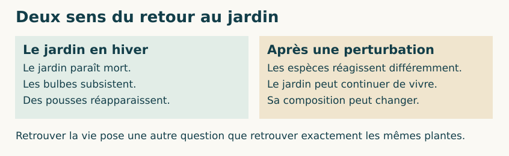
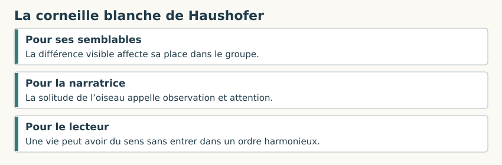

# Centrale-Supélec TSI — Rédaction 2026 · Corrigé brut

*Corrigé rédigé par IA, non officiel. Signalez toute erreur.*

**Rédaction initiale** · claude-opus-5-5 · configuration complémentaire non renseignée

**Relecture antérieure** · configuration non renseignée

**Révision** · GPT-6.2 Astra Ultra · vitesse non renseignée

**Révision (tour 3)** · GPT-6.2 Astra Ultra · vitesse non renseignée

**Révision (tour 4)** · GPT-6.2 Astra Ultra · vitesse non renseignée · 26 novembre 2026

## Sujet et consignes

R132 · Rédaction · TSI, session 2026. Quatre heures, calculatrice et systèmes électroniques ou informatiques interdits. Le feuillet exige de rédiger une ligne sur deux et de placer le résumé avant la dissertation. Les deux exercices sont obligatoires et notés à parité.

Sonia Feertchak, « Cultiver l’espoir », Philosophie Magazine, hors-série n° 65, printemps-été 2025, p. 108–110. Le passage court sur les deux pages du sujet.

Résumer en 150 mots le texte suivant. Un écart de 10 % en plus ou en moins sera accepté. Indiquer par une barre nette chaque cinquantaine de mots, puis, à la fin du résumé, le total exact.

Le résumé doit compter de 135 à 165 mots. La dissertation confronte les trois œuvres avec précision, en deux ou trois parties, dans la limite de 1 800 mots.

Selon Sonia Feertchak, dans un jardin on découvre que « tout fait sens, l’harmonie se donne à voir, rien de vivant n’est insignifiant. »

Dans quelle mesure les trois œuvres au programme permettent-elles de commenter cette formule ?

La rubrique officielle des rapports TSI consultée le 26 novembre 2026 s’arrête à la session 2025. Les consignes ci-dessus proviennent du feuillet de 2026.

Le thème est « Expériences de la nature ». Le programme réunit Vingt mille lieues sous les mers, Le Mur invisible et, dans La Connaissance de la vie, « La pensée et le vivant », la partie I, « Méthode », et les chapitres II à V de la partie III, « Philosophie ».

## Partie A — Résumé de texte

**Problématique du texte :** pourquoi le jardinage soulage-t-il le mal de vivre ? Parce que le jardin rend visibles l'interdépendance des vivants, la résilience que donne la diversité et le surgissement imprévu de la vie, qui appellent l'humilité.

Cultiver malgré la fatigue et les blessures me console. Au jardin, parfois je me sens puissante ou je reprends confiance dans la vigueur de la vie. Du sol aux feuillages, chaque être contribue aux conditions de vie des autres. Accueillir ces partenaires appelle une réciprocité qui laisse place aux prédateurs. **|** Des espèces diversement sensibles aux accidents du climat se prêtent appui. Le jardin peut reprendre vie après une épreuve, même si les plantes présentes ont changé. Reste ouverte la question de savoir en quel sens il demeure le même. Parfois une pousse que je croyais perdue manifeste une vigueur inattendue. **|** Ce qui surgit sans prévenir peut décevoir, mais le plus souvent me réjouit. La surprise me rend attentive avant de juger, puis demande une réponse. Je choisis et je plante, pourtant mes projets doivent composer avec les forces présentes. Cette vie qui se forme avec nous et nous dépasse console. **|**

**150 mots.**

## Partie B — Dissertation

**Problématique :** l'expérience de la nature livre-t-elle un ordre déjà là, que le regard n'aurait qu'à recueillir, ou le sens et la valeur qu'on lui prête sont-ils institués par le vivant qui regarde, au prix d'une violence que la formule passe sous silence ?

Le jardin est un morceau de nature enclos, assez petit pour qu'un regard en fasse le tour, assez vivant pour qu'il s'y passe toujours quelque chose. C'est de ce lieu que Sonia Feertchak tire une évidence : on y découvre que « tout fait sens, l'harmonie se donne à voir, rien de vivant n'est insignifiant ». Trois affirmations s'y superposent. La première est intellectuelle : la nature est intelligible, chaque être y tient une place et une fonction. La deuxième est sensible : cet ordre n'a pas à être démontré, il s'offre de lui-même au regard. La troisième est morale : aucun vivant n'est négligeable. Or les trois œuvres au programme mettent précisément à l'épreuve l'expérience de la nature : un savant embarqué derrière la vitre du salon du Nautilus dans *Vingt mille lieues sous les mers* de Jules Verne, un philosophe qui interroge dans *La Connaissance de la vie* les conditions auxquelles le vivant peut être connu, une femme enfermée avec quelques bêtes au fond d'une vallée autrichienne dans *Le Mur invisible* de Marlen Haushofer. L'expérience de la nature livre-t-elle un ordre déjà là, que le regard n'aurait qu'à recueillir, ou le sens et la valeur qu'on lui prête sont-ils institués par le vivant qui regarde, au prix d'une violence que la formule passe sous silence ? Les trois œuvres donnent d'abord raison à Feertchak ; elles récusent ensuite l'idée d'une harmonie simplement donnée ; il apparaît alors que la troisième proposition seule résiste, à condition de l'entendre comme une exigence du regard plutôt que comme un constat.

L'expérience de la nature commence bien par une révélation d'ordre. Le roman de Verne est bâti sur ce dispositif : le grand panneau vitré du salon fait de l'océan un spectacle continu, et Aronnax, professeur au Muséum, y reconnaît, nomme et classe. Conseil, son domestique, décline embranchements, classes, ordres, genres et espèces ; le « monstre » insaisissable des premiers chapitres, que son maître prenait pour un narval gigantesque, se résout lui-même en machine identifiable. La mer apparaît surtout comme un système où rien ne se perd. Nemo s'habille du byssus de certains coquillages, fume une algue riche en nicotine, ne se nourrit que de ce que l'océan produit ; au « royaume du corail », ce sont les polypes qui scellent la tombe du matelot mort, la nature achevant le travail des hommes. Tout, jusqu'au cadavre, entre dans un cycle : l'ordre est intelligible parce qu'il est intégral.

Dans « Le vivant et son milieu », Canguilhem reprend à Uexküll l’idée de milieu propre. Un animal répond à quelques caractères qui valent pour lui comme des signaux. Beaucoup de phénomènes qui se déroulent au même endroit ne suscitent aucune conduite de sa part. Chez Feertchak, le jardinier aussi découvre des relations en apprenant ce qui compte pour des vivants différents. De là ne suit pourtant pas que chaque chose adresse un message à chaque être. On comprend que le retrait d’un abri puisse être décisif pour une espèce en demeurant inaperçu du promeneur. L’ordre rendu visible dépend déjà de la vie que l’on observe.

Haushofer fait de cette découverte la matière même de son récit. La narratrice du *Mur invisible* est une citadine privée des ressources de sa vie habituelle ; l'enfermement la contraint à voir. Elle apprend les saisons, la fenaison, la culture des pommes de terre, l'estivage à l'alpage avec la vache Bella ; elle nomme, soigne et protège le chien Lynx, la vieille chatte, le veau, et pleure les chatons perdus. Peu à peu, elle cesse de se penser au centre et se découvre une créature parmi les autres. Le jardin de Feertchak, la vallée de Haushofer et le salon du Nautilus sont ainsi trois enclos qui rendent l'attention possible, et où l'ordre du vivant commence à se laisser lire.

Mais la formule dit davantage : l'harmonie « se donne à voir », comme si l'ordre s'offrait indépendamment de l'œil qui le reçoit. C'est là que les œuvres résistent. Verne dispose devant la même vitre trois regards incompatibles : Conseil classe sans s'émouvoir, Ned Land juge les poissons à leur qualité comestible, Aronnax s'émerveille en savant. Le spectacle est un ; le sens qu'on y lit dépend de celui qui regarde. Canguilhem l'établit en droit : le milieu propre d'un animal, l'environnement géographique et l'univers de la science ne coïncident pas, et le décentrement scientifique ruine l'évidence d'une harmonie visible. Une harmonie « à hauteur de jardinier » reste une harmonie pour le jardinier. « L'expérimentation en biologie animale » ajoute une objection décisive : on ne connaît le vivant qu'en intervenant sur lui, en l'isolant, en le séparant de la totalité qu'il forme, c'est-à-dire en altérant ce que l'on prétend observer. La contemplation pure est un mythe : il n'y a pas de spectacle du vivant sans dispositif, et le hublot du Nautilus en est un.

Surtout, cet ordre a un prix, que les deux romans font payer. Nemo refuse que Ned Land harponne les baleines franches, inoffensives et inutiles à l'équipage, car ce serait tuer pour tuer ; puis il lance l'éperon du Nautilus contre une troupe de cachalots qu'il juge malfaisants, et le récit d'Aronnax devient celui d'un carnage. La hiérarchie que l'harmonie semblait dissoudre renaît sous le nom de nuisible : l'insignifiant revient toujours par là. Chez Haushofer, la narratrice doit tuer pour vivre ; elle abat des chevreuils, les dépèce, et sa répugnance ne se résorbe jamais dans l'idée d'un équilibre. Le mur lui-même constitue l'objection majeure : rien ne l'explique, aucune cause n'en est jamais donnée, et de l'autre côté un vieil homme reste figé près de sa fontaine. L'expérience de la nature peut donc confronter à l'absolument insensé. On mesure alors ce que le propos de Feertchak doit à son cadre : le jardin est un lieu protégé, entretenu, choisi ; la vallée est une prison et l'océan un abîme. L'harmonie ne se donne pas : elle se construit, et elle suppose des conditions que l'expérience brute de la nature ne garantit pas.

Reste la troisième proposition, et c'est elle que les œuvres valident, mais en la déplaçant. Canguilhem lui donne un fondement dans « La monstruosité et le monstrueux » : la monstruosité, non la mort, est la contre-valeur vitale, car elle révèle que la forme normale était une réussite et non une nécessité ; et si le fantastique est un monde, la vie, elle, est pauvre en monstres. « Machine et organisme » complète l'analyse : la machine exécute un plan qui lui vient du dehors, tandis que l'organisme, polyvalent, improvise et répare. Il n'y a donc de réussite et d'échec, de normal et de monstrueux, que pour le vivant. La formule de Feertchak ne décrit pas un fait de la nature : elle énonce une propriété du vivant comme tel, être de valeur qui ne peut être compté pour rien sans que l'on manque ce qu'il est.

Haushofer en donne l'image la plus juste avec la corneille blanche. La narratrice observe qu’elle reste à l’écart des autres corneilles et lui laisse de la nourriture. Elle peut décrire cet isolement sans prétendre connaître la fonction de l’oiseau dans tout son milieu. L'oiseau n'est pas significatif en soi : l'attention le rend tel. De même, la fin du récit, où un inconnu tue à coups de hache le taureau puis Lynx avant d'être abattu par la narratrice, est insoutenable parce que ces vies-là n'étaient pas interchangeables ; c'est le lien tissé, non l'ordre du monde, qui interdit de les tenir pour rien. Le récit lui-même, écrit pour personne, est l'acte par lequel elle arrache à l'oubli ce que nul ne viendra compter.

Un détail de l’épisode empêche de transformer la solitude de l’oiseau en symbole tout fait. La nourriture laissée par la narratrice répond à un besoin de cet individu déterminé. Un geste peut ainsi reconnaître la valeur d’une vie sans promettre sa réintégration au groupe. Le dernier membre de la formule de Feertchak acquiert une portée que les deux premiers ne garantissent pas.

Verne opère le même déplacement. Quand Nemo affirme que la mer est l'immense désert où l'homme n'est jamais seul, car il sent frémir la vie à ses côtés, il ne constate pas une plénitude : il l'affirme contre l'apparence du désert, en homme qui a rompu avec la société. Les ruines de l'Atlantide, entrevues à la lueur d'un volcan sous-marin, montrent d'ailleurs que la nature recouvre les ordres humains sans les commenter, et le Maelström final, où le Nautilus disparaît aux yeux du narrateur, rappelle que l'ordre déborde toujours celui qui l'observe. Le dernier mot peut revenir à Canguilhem : la pensée du vivant doit tenir du vivant l'idée du vivant. Reconnaître qu'aucun vivant n'est insignifiant, ce n'est pas lire une harmonie dans les choses, c'est se savoir soi-même vivant parmi les vivants, ce que Feertchak appelle, à la fin de son texte, l'humilité.

Des trois affirmations, la première n'est donc vraie qu'en partie : la nature fait sens pour un vivant, non en soi. La deuxième ne résiste pas : l'harmonie ne se donne pas, elle se conquiert par un dispositif, une attention, et parfois une violence assumée. La troisième est vraie, mais comme exigence et non comme description. L'expérience de la nature n'est pas le spectacle d'un ordre ; elle est le travail par lequel un vivant en reconnaît d'autres et se découvre situé parmi eux. Le jardinier de Feertchak, le professeur Aronnax et la femme du *Mur invisible* font, chacun à son échelle, cette même expérience, à ceci près que le jardinier peut refermer la barrière derrière lui.

**Longueur de la dissertation** · 1676 mots, titre, figure et légende exclus. Ce décompte sépare les élisions et les mots composés et écarte le t de liaison.

## Sources

[Sujet officiel](https://www.concours-centrale-supelec.fr/sites/default/files/documents/R132.pdf) · [Annales de la session](https://www.concours-centrale-supelec.fr/sujets-rapports) · [Programme 2025–2026](https://www.enseignementsup-recherche.gouv.fr/fr/bo/2025/Hebdo23/MENS2514209A) · [Texte de Verne](https://fr.wikisource.org/wiki/Vingt_mille_lieues_sous_les_mers/Texte_entier)
