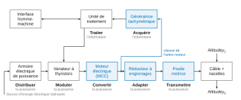
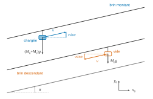
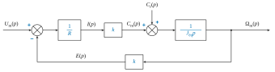
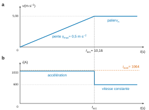
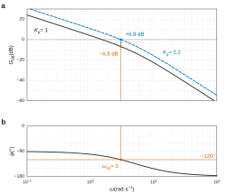

# Centrale-Supélec TSI — Sciences industrielles 2026 · Corrigé guidé

*Corrigé rédigé par IA, non officiel. Signalez toute erreur.*

## Présentation du sujet

**Thème.** Le télésiège débrayable à six places « Vologne Express » de la station de La Bresse - Hohneck (Vosges) est mû par une machine à courant continu (MCC) de 415 kW placée en gare haute. Le sujet prépare son remplacement par un moteur asynchrone (MAS). Il suit une seule grandeur de bout en bout, la puissance à fournir pour hisser les usagers. On établit d'abord le rapport cinématique $k_{tp}=v/\omega_m$, puis on ramène toutes les inerties et la pesanteur à l'axe moteur, on identifie les paramètres électriques de la MCC, on règle l'asservissement de vitesse et on choisit enfin un moteur sur catalogue.

**Format.** 4 heures, calculatrice autorisée, document réponse de quatre pages (DR1 : chaînes fonctionnelles ; DR2 : schéma-bloc de la MCC ; DR3 : code Python ; DR4 : courbes de redresseurs ; DR5 : diagramme de Bode). 37 questions. Q30 et Q37 sont annoncées comme peu guidées et valorisent l'initiative : il faut y expliciter démarche et choix.

**Découpage.**

| Partie | Questions | Contenu | Outils |
|---|---|---|---|
| A | Q1–Q5 | débit, rapport $k_{tp}$ par deux méthodes, chaîne fonctionnelle, secours diesel | cinématique, SysML, chaînes fonctionnelles |
| B | Q6–Q14 | énergies cinétiques, inertie équivalente, puissance de pesanteur, TEC, facteur de sécurité | énergétique des systèmes de solides |
| C | Q15–Q31 | schéma-bloc de la MCC, identification par essais (Python), arrêt en roue libre, dynamo tachymétrique, filtre numérique, courant de démarrage, redresseurs, commande de la MAS | modélisation, Laplace, équations de récurrence, électrotechnique |
| D | Q32–Q35 | adaptateur de consigne, boucle ouverte, choix du correcteur, réglage sur Bode | asservissements : classe, précision, marges |
| E | Q36–Q37 | maintenance, choix catalogue, couplage, facteur de sécurité, adaptation de la chaîne | synthèse, électrotechnique |

**Difficulté.** Le sujet est long mais régulier : aucune question n'est très difficile, beaucoup sont des applications directes. Les pièges sont surtout de lecture (nombre de nacelles réellement entraînées, valeur de $\mathcal C$ imposée en Q14, convention de signe de $c_r$ différente entre $(E_2)$ et Q26, tension composée en Q27, sens de la contrainte sur $K_p$ en Q35).

**Questions à ne pas laisser passer.** Q1, Q2, Q4, Q5, Q6–Q9, Q11, Q17, Q18, Q20, Q22, Q24, Q25, Q26, Q27, Q36 : elles demandent peu de temps et rapportent sûrement. Les parties sont largement indépendantes : Q26 redonne $k_{tp}$, la partie C redonne $R$ et $k$, Q14 impose $\mathcal C$.

**Gestion du temps.** Environ 45 min pour A et B, 1 h 45 pour C (la plus longue, 17 questions), 40 min pour D, 30 min pour E et la relecture. Ne pas s'enliser dans Q16 (système mal conditionné) ni dans la lecture fine du Bode.

## Partie A — Caractéristiques du télésiège « Vologne Express »

On vérifie le débit horaire puis on détermine le rapport $k_{tp}$ entre la vitesse du câble et celle du moteur, par une mesure et par la documentation. Outils : cinématique du non-glissement, chaînes fonctionnelles.

### Question 1

> [!INDICATION]
> Le débit est le nombre d'usagers qui arrivent au sommet par unité de temps. Combien d'usagers sont sur le brin montant à un instant donné, et combien de temps y restent-ils ?

> [!INDICATION]
> Vérifiez votre débit par une seconde méthode : l'intervalle de temps entre deux nacelles qui passent en gare haute.

#### Solution

Temps de montée, à vitesse constante sur $L_p$ :

$$\begin{aligned}
t_m&=\frac{L_p}{v_n}=\frac{1217}{5{,}08}\\
&=239{,}6\ \text{s}\approx\boxed{4{,}0\ \text{min}}
\end{aligned}$$

$$\begin{aligned}
t_r&=\frac{L_p}{v_r}=\frac{1217}{3{,}52}\\
&=345{,}7\ \text{s}\approx5{,}8\ \text{min}
\end{aligned}$$

Sur le brin montant se trouvent $33\times6=198$ usagers, et chacun y reste $t_m$. En régime établi :

$$\begin{aligned}
q_{n\max}&=\frac{198\times3600}{239{,}6}=\boxed{2975\ \text{u}\cdot\text{h}^{-1}}\\
q_{r\max}&=\frac{198\times3600}{345{,}7}=\boxed{2062\ \text{u}\cdot\text{h}^{-1}}
\end{aligned}$$

Contrôle : pas entre nacelles $1217/33=36{,}9$ m, une nacelle toutes les $7{,}26$ s, soit $496$ nacelles et $2975$ usagers par heure.

Comparaison : $4{,}0\ \text{min}<5$ min, $2975>2800$ et $2062>1500$ u/h. **Les exigences id = « 1 » sont vérifiées.** La montée en vitesse réduite (5,8 min) correspond à un mode dégradé (vent fort) : on précise que l'exigence de temps porte sur le fonctionnement normal.

> [!PIEGE]
> Compter les 72 nacelles, ou les 66 entraînées, au lieu des 33 qui montent. Le débit utile est celui d'un seul sens.

### Question 2

> [!INDICATION]
> $k_{tp}$ est par définition le rapport $v/\omega_m$. À quel point de fonctionnement connaît-on simultanément $v$ et $\omega_m$ ?

#### Solution

Au régime nominal, $N_{m\,\text{nom}}=1267$ tr/min correspond à $v_n=5{,}08$ m/s :

$$\begin{aligned}
\omega_m&=\frac\pi{30}\times1267=132{,}7\ \text{rad}\cdot\text{s}^{-1}\\
k_{tp}&=\frac{v_n}{\omega_m}=\frac{5{,}08}{132{,}68}\\
&=\boxed{3{,}829\times10^{-2}\ \text{m}\cdot\text{rad}^{-1}}
\end{aligned}$$

> [!METHODE]
> Conversion à connaître sans hésiter : $\omega\ (\text{rad/s})=\dfrac{\pi}{30}\,N\ (\text{tr/min})$, soit un facteur $0{,}1047$.

### Question 3

> [!INDICATION]
> Chaque fonction de la chaîne de puissance (distribuer, moduler, convertir, adapter, transmettre) et de la chaîne d'information (acquérir, traiter) est réalisée par un constituant. Les constituants disponibles sont les blocs du diagramme bdd.

> [!INDICATION]
> Distinguez « adapter » (modifier le couple et la vitesse) et « transmettre » (amener le mouvement jusqu'à l'effecteur). Où la grandeur mesurée est-elle prélevée ?

#### Solution

| Fonction | Constituant placé sur DR1 |
|---|---|
| Acquérir l'information | Génératrice (dynamo) tachymétrique |
| Convertir la puissance | Moteur électrique (MCC) |
| Adapter la puissance | Réducteur à engrenages |
| Transmettre la puissance | Poulie motrice |

Les autres blocs sont donnés : armoire électrique (distribuer), variateur à thyristors (moduler), unité de traitement (traiter), interface homme-machine, câble + nacelles (effecteur, altitude $y_1\to y_2$). La génératrice tachymétrique est montée sur l'arbre moteur : elle prélève l'information en sortie de « convertir » et l'envoie à l'unité de traitement, qui commande le variateur. C'est la boucle de l'asservissement de vitesse.



> [!PIEGE]
> Mettre la poulie dans « adapter » et le réducteur dans « transmettre ». Le réducteur modifie le couple et la vitesse : il adapte.

### Question 4

> [!INDICATION]
> Composez deux relations : celle du réducteur, puis celle du non-glissement du câble sur la poulie motrice.

> [!INDICATION]
> Un point du câble en contact avec la poulie a la vitesse d'un point de la poulie situé à un rayon de l'axe, pas à un diamètre.

#### Solution

$v=\dfrac{D_h}2\,\omega_h$ et $\omega_h=k_{\text{réd}}\,\omega_m$, d'où

$$\begin{aligned}
&\boxed{k_{tp}=k_{\text{réd}}\,\frac{D_h}2}\\
k_{tp}&=\frac{2{,}3}{60{,}07}=\boxed{3{,}829\times10^{-2}\ \text{m}\cdot\text{rad}^{-1}}
\end{aligned}$$

Écart relatif avec Q2 : $3\times10^{-5}$. **La valeur mesurée est validée** par la documentation.

> [!JURY]
> Quand l'énoncé demande de « valider » une valeur, on attend une comparaison chiffrée explicite (écart relatif) suivie d'une conclusion, pas deux nombres posés côte à côte.

### Question 5

> [!INDICATION]
> Écrivez la chaîne de secours de bout en bout : les rapports des éléments en série se multiplient.

> [!INDICATION]
> Le coupleur a un rapport 1. Le réducteur diesel réduit la vitesse : le moteur thermique tourne plus vite que l'arbre d'entrée du réducteur principal.

#### Solution

$v_s=k_r\,k_{\text{réd}}\dfrac{D_h}2\,\omega_s=k_r\,k_{tp}\,\omega_s$, donc

$$\begin{aligned}
\omega_s&=\frac{v_s}{k_r\,k_{tp}}=\frac{1{,}25\times7{,}04}{3{,}829\times10^{-2}}\\
&=229{,}8\ \text{rad}\cdot\text{s}^{-1}\\
N_s&=\frac{30}\pi\,\omega_s=\boxed{2195\ \text{tr}\cdot\text{min}^{-1}}
\end{aligned}$$

$2195<3000$ tr/min : **la configuration de secours est compatible** avec le moteur thermique.

> [!PIEGE]
> Multiplier par $k_r=1/7{,}04$ au lieu de diviser donne environ 44 tr/min, une valeur absurde pour un moteur diesel. L'ordre de grandeur doit alerter.

## Partie B — Étude de l'exigence Id = 1.1 « gérer la sécurité et le confort des usagers »

On ramène à l'axe moteur l'inertie de tout l'ensemble mobile, on calcule la puissance de la pesanteur, puis le théorème de l'énergie cinétique donne la puissance utile et le facteur de sécurité du moteur. Outils : énergie cinétique des solides en rotation et en translation, inertie équivalente, théorème de l'énergie cinétique.

### Question 6

> [!INDICATION]
> Solide en rotation autour d'un axe fixe : formule du cours.

#### Solution

$$\boxed{E_c(\text{mot}/0)=\tfrac12\,J_m\,\omega_m^2},$$

le rotor tournant autour d'un axe fixe du bâti galiléen, $J_m$ étant son moment d'inertie autour de cet axe.

### Question 7

> [!INDICATION]
> Exprimez $\omega_h$ puis $\omega_b$ en fonction de $\omega_m$ grâce aux deux relations rappelées par l'énoncé.

> [!INDICATION]
> L'inertie équivalente se définit par l'égalité des énergies cinétiques : $\tfrac12 J_{\text{éq}}\,\omega_m^2=\sum E_c$.

#### Solution

$$\begin{aligned}
E_c(\text{bas}/0)&=\tfrac12\,J_b\,\omega_b^2\\
E_c(\text{haut}/0)&=\tfrac12\,J_h\,\omega_h^2
\end{aligned}$$

Avec $\omega_h=k_{\text{réd}}\,\omega_m$ et $\omega_b=\dfrac{D_h}{D_b}\,k_{\text{réd}}\,\omega_m$ :

$$\boxed{J_{\text{éq-poulies}}=k_{\text{réd}}^2\left[J_h+\left(\frac{D_h}{D_b}\right)^2J_b\right]}=12{,}8\ \text{kg}\cdot\text{m}^2.$$

> [!METHODE]
> Une inertie (ou une masse) se ramène à l'axe moteur en la multipliant par le **carré** du rapport des vitesses, parce que l'énergie cinétique est quadratique en vitesse.

> [!PIEGE]
> Oublier le rapport $D_h/D_b$ : les deux poulies n'ont pas le même diamètre et ne tournent pas à la même vitesse.

### Question 8

> [!INDICATION]
> L'énoncé autorise à traiter chaque brin comme un solide en translation rectiligne. Quelle est sa masse ?

> [!INDICATION]
> Les deux brins vont en sens opposés : est-ce que leurs énergies cinétiques se compensent ?

#### Solution

$$E_c(\text{mont}/0)=E_c(\text{desc}/0)=\tfrac12\,\lambda L_p\,v^2.$$

Les énergies sont positives et s'ajoutent :

$$\lambda L_p\,k_{tp}^2\,\omega_m^2=\tfrac12 J_{\text{éq-câble}}\,\omega_m^2,$$

d'où

$$\boxed{J_{\text{éq-câble}}=2\,\lambda\,L_p\,k_{tp}^2}=27{,}9\ \text{kg}\cdot\text{m}^2.$$

> [!PIEGE]
> Les vitesses opposées se compensent en **puissance de pesanteur** (Q11), pas en énergie cinétique.

### Question 9

> [!INDICATION]
> Relisez combien de nacelles sont entraînées, et lesquelles sont chargées dans le cas de référence.

> [!INDICATION]
> Les nacelles descendantes sont vides, mais leur masse propre $M_n$ compte quand même.

#### Solution

Sur $N=72$ nacelles, 6 sont débrayées en gare. Restent $N/2-3=33$ montantes chargées et 33 descendantes vides :

$$\begin{aligned}
&\boxed{E_c(\text{mont}/0)=\tfrac12\left(\tfrac N2-3\right)(M_n+M_c)\,v^2}\\
&\boxed{E_c(\text{desc}/0)=\tfrac12\left(\tfrac N2-3\right)M_n\,v^2}
\end{aligned}$$

puis, avec $v=k_{tp}\,\omega_m$ :

$$\boxed{J_{\text{éq-nacelles}}=\left(\frac N2-3\right)(2M_n+M_c)\,k_{tp}^2}=42{,}1\ \text{kg}\cdot\text{m}^2.$$

L'inclinaison $\alpha$ n'intervient pas : les nacelles restent en translation rectiligne à la vitesse $v$.

### Question 10

> [!INDICATION]
> Additionnez les quatre contributions, puis remplacez $k_{tp}$ par son expression de Q4 pour faire apparaître le facteur commun.

> [!INDICATION]
> La masse notée $M_p$ dans la forme imposée n'est définie nulle part : quelle masse manque dans la liste ?

#### Solution

$$\begin{aligned}
J_{\text{éq}}&=J_m+J_{\text{éq-poulies}}+J_{\text{éq-câble}}+J_{\text{éq-nacelles}}\\
k_{tp}^2&=k_{\text{réd}}^2\,\frac{D_h^2}4
\end{aligned}$$

$$J_{\text{éq}}=J_m+k_{\text{réd}}^2\left[J_h+\left(\frac{D_h}{D_b}\right)^2J_b+\frac{D_h^2}2\,\lambda L_p+\frac{(N-6)D_h^2}4\,M_n+\frac{(N-6)D_h^2}8\,M_c\right].$$

On lit $M_p=M_c$ (coquille probable de l'énoncé). Par identification :

$$\boxed{\begin{aligned}
\beta_1&=k_{\text{réd}}^2\\
\beta_2&=\left(\frac{D_h}{D_b}\right)^2\\
\mu_1&=\frac{D_h^2}2\\
\mu_2&=\frac{(N-6)D_h^2}4\\
\mu_3&=\frac{(N-6)D_h^2}8
\end{aligned}}$$

Valeurs :

| Coefficient | $\beta_1$ | $\beta_2$ | $\mu_1$ | $\mu_2$ | $\mu_3$ |
|---|---|---|---|---|---|
| Valeur | $2{,}771\times10^{-4}$ | $1{,}259$ | $10{,}58$ m² | $349{,}1$ m² | $174{,}6$ m² |

Le crochet vaut, en kg·m² :

$$\begin{aligned}
&25\,700+20\,392+100\,561+38\,405+113\,471\\
&=298\,529
\end{aligned}$$

d'où

$$\begin{aligned}
J_{\text{éq}}&=23+82{,}7\\
&=\boxed{1{,}06\times10^2\ \text{kg}\cdot\text{m}^2}
\end{aligned}$$

> [!METHODE]
> Contrôle de cohérence gratuit : $\mu_2=2\mu_3$, car $M_n$ est présente sur toutes les nacelles entraînées et $M_c$ sur la moitié seulement.

> [!PIEGE]
> Mettre $J_m$ dans le crochet. Le rotor est déjà sur l'axe moteur et ne reçoit pas le facteur $k_{\text{réd}}^2$.

### Question 11

> [!INDICATION]
> Raisonnez sur l'énergie potentielle du câble entier : la répartition de matière dans l'espace change-t-elle quand il défile ?

#### Solution

Le câble est une boucle fermée de masse linéique uniforme : en défilant, il occupe toujours la même géométrie avec la même répartition de masse. L'altitude de son centre de gravité est constante, donc $E_p$ aussi :

$$\mathscr P(\text{pes}\to\text{câble}/0)=-\frac{\mathrm dE_p}{\mathrm dt}=0.$$

De façon équivalente, les deux brins ont la même masse et des vitesses opposées, donc des puissances de pesanteur opposées. **La puissance de la pesanteur sur le câble est nulle.**

> [!JURY]
> « Sans calcul » ne veut pas dire sans argument : il faut citer l'égalité des masses des deux brins (ou l'invariance du centre de gravité), pas seulement le fait que le câble est fermé.

### Question 12

> [!INDICATION]
> Puissance du poids $=\vec P\cdot\vec v$. Seule la composante verticale de la vitesse compte.

> [!INDICATION]
> Le raisonnement de Q11 fonctionne encore pour la masse à vide des nacelles. Que reste-t-il ?

#### Solution



Montantes : $-(M_n+M_c)\,g\,v\sin\alpha$ chacune ; descendantes : $+M_n\,g\,v\sin\alpha$ chacune. En sommant sur $N/2-3$ nacelles par sens et avec $v=k_{tp}\,\omega_m$ :

$$\begin{aligned}
\mathscr P(\text{pes}\to\text{nacelles}/0)&=-\left(\tfrac N2-3\right)M_c\,g\,v\sin\alpha\\
&=\mathcal C\,\omega_m
\end{aligned}$$

$$\boxed{\mathcal C=-\left(\frac N2-3\right)M_c\,g\,k_{tp}\sin\alpha}$$

$$\begin{aligned}
\mathcal C&=-33\times650\times9{,}81\times0{,}03829\times\sin12{,}9^\circ\\
&=\boxed{-1{,}80\times10^3\ \text{N}\cdot\text{m}}
\end{aligned}$$

> [!PIEGE]
> Prendre $\cos\alpha$ au lieu de $\sin\alpha$. Cas limite de contrôle : pour une pente nulle, la pesanteur ne doit rien coûter.

### Question 13

> [!INDICATION]
> Écrivez le théorème de l'énergie cinétique pour un ensemble de solides, avec puissances extérieures **et** intérieures.

> [!INDICATION]
> Justifiez une par une l'annulation des puissances que vous écartez (liaisons parfaites, pas de glissement, centres de gravité fixes…).

#### Solution

$$\frac{\mathrm dE_c(\Sigma/0)}{\mathrm dt}=\mathscr P(\bar\Sigma\to\Sigma/0)+\mathscr P_{\text{int}}(\Sigma)$$

avec

$$E_c(\Sigma/0)=\tfrac12 J_{\text{éq}}\,\omega_m^2.$$

Pesanteur : nulle sur le câble (Q11) et sur les solides tournant autour d'axes fixes, égale à $\mathcal C\,\omega_m$ sur les nacelles. Liaisons parfaites, absence de glissement et pertes négligées : seule reste la puissance motrice. D'où

$$J_{\text{éq}}\,\omega_m\,\dot\omega_m=\mathcal C\,\omega_m+\mathscr P_{m\,\text{utile}},$$

et à vitesse constante :

$$\boxed{\mathscr P_{m\,\text{utile}}=-\mathcal C\,\omega_m}>0.$$

> [!METHODE]
> Théorème de l'énergie cinétique pour un système de solides : bilan de toutes les puissances extérieures, puis des puissances intérieures (inter-efforts). Une liaison parfaite a une puissance d'inter-efforts nulle.

### Question 14

> [!INDICATION]
> Quelle valeur de $\mathcal C$ l'énoncé impose-t-il juste avant la question ?

#### Solution

$$\begin{aligned}
\mathscr P_{m\,\text{utile}}&=900\times132{,}68=119\ \text{kW}\\
s&=\frac{415}{119{,}4}=\boxed{3{,}5}>3
\end{aligned}$$

**L'exigence id = « 1.1 » est vérifiée.** Avec la charge limite de Q12, qui n'est jamais atteinte, on obtiendrait $s=1{,}7$.

> [!PIEGE]
> Prendre $\mathcal C=-1800$ N·m de Q12 conduit à la conclusion inverse. Relisez le paragraphe qui précède la question.

## Partie C — Étude de l'exigence Id = « 1.2 » « entraîner le câble et les nacelles entre les gares »

On modélise la MCC par un schéma-bloc, on identifie ses paramètres par des essais en régime permanent et par un arrêt en roue libre, on traite la mesure de vitesse par un filtre numérique, puis on vérifie la capacité en courant du variateur et on prépare le passage à la MAS. Outils : transformée de Laplace, résolution matricielle en Python, équations de récurrence, électronique de puissance.

### Question 15

> [!INDICATION]
> Passez chacune des quatre équations simplifiées dans le domaine de Laplace et faites correspondre chaque équation à un bloc ou à un sommateur du DR2.

> [!INDICATION]
> Respectez les signes de l'énoncé : $e$ se retranche de $u_m$, et $c_r$ s'**ajoute** à $c_m$ dans $(E_2)$. Pour les fonctions de transfert, appliquez le principe de superposition.

#### Solution

$$\begin{aligned}
U_m&=R\,I+E\\
J_{\text{éq}}\,p\,\Omega_m&=C_m+C_r\\
E&=k\,\Omega_m\\
C_m&=k\,I
\end{aligned}$$

DR2 complété (figure 3) : comparateur $U_m-E$ et sommateur $C_m+C_r$. Les blocs sont $1/R$, $k$, $1/(J_{\text{éq}}\,p)$, et le retour vaut $k$.



$$\left(J_{\text{éq}}\,p+\frac{k^2}R\right)\Omega_m=\frac kR\,U_m+C_r,$$

d'où

$$\boxed{\begin{aligned}
H_m(p)&=\frac{1/k}{1+T_m\,p}\\
H_r(p)&=\frac{R/k^2}{1+T_m\,p}\\
T_m&=\frac{R\,J_{\text{éq}}}{k^2}
\end{aligned}}$$

Unités et valeurs ($R=15$ mΩ, $k=3$ N·m/A, $J_{\text{éq}}=106$ kg·m²) :

| Grandeur | Expression | Unité | Valeur |
|---|---|---|---|
| $K_m$ | $1/k$ | rad·s⁻¹·V⁻¹ | $0{,}33$ |
| $K_r$ | $R/k^2$ | rad·s⁻¹·N⁻¹·m⁻¹ | $1{,}7\times10^{-3}$ |
| $T_m$ | $R\,J_{\text{éq}}/k^2$ | s | $\approx0{,}18$ |

> [!METHODE]
> Forme canonique d'un premier ordre : $\dfrac{K}{1+Tp}$, numérateur réduit au gain statique et dénominateur commençant par 1. C'est ce que demande l'énoncé.

### Question 16

> [!INDICATION]
> En régime permanent, que devient $(E_1)$ ? Chaque essai fournit une équation linéaire en $R$ et $k$.

> [!INDICATION]
> Les vitesses doivent être converties en rad/s pour que $k$ s'exprime dans les mêmes unités que dans la suite. Côté Python, cherchez la fonction de résolution de systèmes linéaires de `numpy.linalg`.

#### Solution

$u_m=R\,i+k\,\omega_m$ avec $\omega_1=87{,}96$ rad/s et $\omega_2=132{,}68$ rad/s :

$$\begin{aligned}
A&=\begin{pmatrix}284{,}9&87{,}96\\429{,}7&132{,}68\end{pmatrix}\\
X&=\begin{pmatrix}R\\k\end{pmatrix}\\
B&=\begin{pmatrix}265{,}2\\400{,}0\end{pmatrix}
\end{aligned}$$

```python
import numpy as np
A = np.array([[284.9, 840*np.pi/30], [429.7, 1267*np.pi/30]])
B = np.array([265.2, 400.0])
X = np.linalg.solve(A, B)
```

On obtient $X\approx(0{,}41\ ;\ 1{,}67)$ : $R\approx0{,}4\ \Omega$, $k\approx1{,}7$ N·m/A.

Les deux essais sont presque proportionnels :

$$\frac{265{,}2}{400}\approx\frac{284{,}9}{429{,}7}\approx\frac{840}{1267}\approx0{,}663.$$

Ainsi $\det A\approx2{,}1$ seulement, et le résultat change du tout au tout si l'on arrondit les vitesses :

- avec $87{,}96$ et $132{,}68$ rad/s, on trouve $R=0{,}66$ et $k=0{,}86$ ;
- avec $88{,}0$ et $132{,}7$ rad/s, on trouve $k<0$.

L'identification à deux points ne donne donc qu'un ordre de grandeur, d'où les valeurs moyennes $R=15$ mΩ et $k=3$ N·m/A fournies ensuite (elles restituent les deux mesures à environ 1 % près).

> [!PIEGE]
> Écrire `X = A**(-1)*B` : sur un tableau numpy, `**` agit terme à terme. Utiliser `np.linalg.solve(A, B)` (ou `np.linalg.inv(A) @ B`).

### Question 17

> [!INDICATION]
> Lisez la pente de la droite de la figure 4, en convertissant en rad/s.

> [!INDICATION]
> Comment évoluerait la vitesse si le terme $f_{\text{éq}}\,\omega_m$ n'était pas négligeable ? Quelle forme de courbe obtiendrait-on ?

#### Solution

$$\boxed{\frac{\mathrm d\omega_m}{\mathrm dt}=-\frac{\pi\,N_0}{30\,t_f}}\quad\text{sur }[0\,;t_f].$$

Alimentation coupée, $c_m=0$, et l'équation complète serait $J_{\text{éq}}\,\dot\omega_m=c_r-f_{\text{éq}}\,\omega_m$. Avec un frottement visqueux notable, la décélération dépendrait de la vitesse : décroissance exponentielle, courbe convexe à pente de plus en plus faible. La courbe relevée est une droite, donc à décélération constante : **le terme visqueux est négligeable, l'hypothèse sur $(E_2)$ est confirmée.**

> [!PIEGE]
> Inverser la logique : c'est la forme observée qui valide l'hypothèse, pas l'hypothèse qui explique la forme.

### Question 18

> [!INDICATION]
> Que vaut $c_m$ quand l'alimentation est coupée ? Intégrez ensuite une équation dont le second membre est constant.

#### Solution

$i=0$ donc $c_m=0$, et l'équation s'intègre :

$$\begin{aligned}
J_{\text{éq}}\,\dot\omega_m&=c_{r0}\\
\omega_m(t)&=\omega_0+\frac{c_{r0}}{J_{\text{éq}}}\,t
\end{aligned}$$

Avec $N=30\,\omega/\pi$ :

$$\boxed{N_m(t)=\frac{30\,c_{r0}}{\pi\,J_{\text{éq}}}\,t+N_0}.$$

La pente est négative car $c_{r0}<0$.

### Question 19

> [!INDICATION]
> Avant la coupure, la vitesse est constante : que devient $(E_2)$ ? Le couple moteur s'obtient par $(E_4)$.

> [!INDICATION]
> Pour l'inertie, écrivez que la droite de Q18 s'annule en $t_f$. Attention au signe de $c_{r0}$ dans la convention de $(E_2)$.

#### Solution

$0=k\,I(0^-)+c_{r0}$, donc $\boxed{c_{r0}=-k\,I(0^-)}$ :

$$\begin{aligned}
&\boxed{c_{r0\text{-v}}=-1{,}08\times10^3\ \text{N}\cdot\text{m}}\\
&\boxed{c_{r0\text{-c}}=-1{,}56\times10^3\ \text{N}\cdot\text{m}}
\end{aligned}$$

$N_m(t_f)=0$ :

$$\boxed{J_{\text{éq}}=-\frac{30\,c_{r0}\,t_f}{\pi\,N_0}}$$

$$\begin{aligned}
J_{\text{éq-v}}&=\frac{1080\times10{,}3}{132{,}68}=\boxed{84\ \text{kg}\cdot\text{m}^2}\\
J_{\text{éq-c}}&=\frac{1560\times8{,}9}{132{,}68}=\boxed{105\ \text{kg}\cdot\text{m}^2}
\end{aligned}$$

La mesure en charge recoupe à 1 % la valeur théorique de Q10 (106 kg·m²) : le modèle énergétique de la partie B est validé.

> [!METHODE]
> Essai de lâcher (arrêt en roue libre) : le régime établi avant coupure donne le couple résistant, la pente de décélération donne l'inertie. C'est une méthode classique d'identification mécanique.

> [!PIEGE]
> Écrire $c_{r0}=+k\,I$ conduit à une inertie négative. Le signe est imposé par l'écriture $c_m+c_r$ de $(E_2)$.

### Question 20

> [!INDICATION]
> Une dynamo tachymétrique est une machine à courant continu particulière. Qu'est-ce qui rend sa f.é.m. proportionnelle à la vitesse ?

#### Solution

C'est une petite génératrice à courant continu à **flux inducteur constant** (aimants permanents) dont l'induit est entraîné par l'arbre moteur. La rotation des conducteurs de l'induit dans le flux fixe crée une f.é.m. induite proportionnelle à la vitesse, redressée par le collecteur. Elle débite un courant quasi nul : la tension de sortie $u=k_{\text{dt}}\,N_m$ est l'image de la vitesse, son signe donne le sens de rotation.

### Question 21

> [!INDICATION]
> Lisez la valeur moyenne et les extrêmes du signal brut. L'axe est en volts : il faut passer en tr/min par $k_{\text{dt}}$.

> [!INDICATION]
> L'exigence porte sur l'écart $\Delta v$ à la vitesse de référence, et $v$ est proportionnelle à $N_m$.

#### Solution

Signal brut : moyenne $\approx76$ V ($=0{,}06\times1267$), extrêmes $\approx69$ et $82$ V, soit environ $\pm6{,}5$ V autour de la moyenne :

$$\begin{aligned}
\Delta N_m&\approx\frac{\pm6{,}5}{0{,}06}=\boxed{\pm1{,}1\times10^2\ \text{tr}\cdot\text{min}^{-1}}\\
\left|\frac{\Delta v}v\right|&=\frac{108}{1267}\approx\boxed{8{,}5\ \%}
\end{aligned}$$

(17 % crête à crête). **L'exigence de 5 % n'est pas respectée par le signal brut.** Ces fluctuations sont du bruit de mesure : l'inertie de l'installation (plus de 100 kg·m² ramenés à l'axe) interdit de telles variations de vitesse en quelques millisecondes. Le signal filtré reste à moins de 1 % : c'est l'objet du filtre qui suit.

> [!PIEGE]
> Oublier de diviser par $k_{\text{dt}}$ : on annoncerait une fluctuation de quelques tr/min et une exigence faussement respectée.

### Question 22

> [!INDICATION]
> Développez $(1+\tau p)^2$ et remplacez $p$ par la dérivation temporelle (conditions initiales nulles).

#### Solution

$$\boxed{\tau^2\,\ddot u^*+2\tau\,\dot u^*+u^*=u}.$$

On reconnaît un second ordre de pulsation propre $1/\tau$ et d'amortissement $\xi=1$ : c'est bien le régime critique.

> [!PIEGE]
> Oublier le double produit $2\tau p$ : la récurrence de Q23 devient fausse.

### Question 23

> [!INDICATION]
> Appliquez deux fois la formule « à gauche » pour obtenir la dérivée seconde : elle fait intervenir $u^*_{i-2}$.

> [!INDICATION]
> Divisez toute l'équation pour faire apparaître $x=\tau/T_e$, puis isolez $u^*_i$ et cherchez un carré parfait.

#### Solution

$$\begin{aligned}
\dot u^*_i&=\frac{u^*_i-u^*_{i-1}}{T_e}\\
\ddot u^*_i&=\frac{u^*_i-2u^*_{i-1}+u^*_{i-2}}{T_e^2}
\end{aligned}$$

En reportant :

$$(1+x)^2\,u^*_i=u_i+2x(1+x)\,u^*_{i-1}-x^2\,u^*_{i-2},$$

$$\boxed{\begin{aligned}
a_0&=\frac1{(1+x)^2}\\
a_1&=\frac{2x}{1+x}\\
a_2&=-\frac{x^2}{(1+x)^2}
\end{aligned}}$$

Contrôle : $a_0+a_1+a_2=1$, gain statique unitaire.

> [!METHODE]
> Pour vérifier une récurrence de filtre, testez une entrée constante : la somme des coefficients doit redonner le gain statique.

### Question 24

> [!INDICATION]
> Que faut-il faire pour modifier la constante de temps d'un filtre analogique, et d'un filtre numérique ?

#### Solution

Avantage principal : **la souplesse**. Les coefficients sont des nombres en mémoire : on change $\tau$ par simple mise à jour logicielle, sans changer de composants. Le filtre numérique ne dérive pas non plus avec la température ou le vieillissement, contrairement aux résistances et condensateurs.

### Question 25

> [!INDICATION]
> À accélération constante, comment évolue la vitesse ? La durée de la rampe se déduit de la vitesse finale.

#### Solution

$v(t)=\gamma_{\max}\,t$ pour $t\in[0\,;t_{acc}]$, puis $v=v_n$. Allure : rampe depuis l'origine jusqu'à $(t_{acc}\,;5{,}08$ m/s$)$, puis palier horizontal.

$$\boxed{t_{acc}=\frac{v_n}{\gamma_{\max}}=10{,}16\ \text{s}}>10\ \text{s}.$$

**L'exigence d'accélération douce est vérifiée, de justesse.** Elle figure dans l'exigence 1.1 de la figure 2, bien que l'énoncé renvoie à 1.2.

### Question 26

> [!INDICATION]
> Isolez $i$ dans la loi dynamique fournie, puis appliquez-la à chacune des deux phases.

> [!INDICATION]
> Utilisez la valeur de $k_{tp}$ imposée juste avant la question, et la convention de signe de cette loi ($c_r$ positif, précédé d'un signe moins).

#### Solution

$$i=\frac{M_{\text{éq}}\,k_{tp}\,\gamma+c_r}k.$$

- Phase 1 : $i_1=\dfrac{65\,000\times0{,}040\times0{,}5+1800}3=\boxed{1033\ \text{A}}$.
- Phase 2 : $i_2=\dfrac{1800}3=\boxed{600\ \text{A}}$.

Allure (figure 4) : palier à 1033 A jusqu'à 10,16 s, puis 600 A (saut au changement de phase, l'inductance étant négligée). $1033<1064$ A : **l'intensité nominale n'est jamais atteinte**, avec une marge de 3 %.



> [!PIEGE]
> La convention de signe de cette loi diffère de celle de $(E_2)$. En mélangeant les deux, on obtient un courant négatif au démarrage.

### Question 27

> [!INDICATION]
> Réseau 226 V/391 V : laquelle est la tension composée ? $U_{\max}$ est une valeur maximale, pas une valeur efficace.

#### Solution

$U_{\max}=\sqrt2\times391=553$ V, et $\dfrac3\pi\,U_{\max}\cos\psi=400$ V :

$$\begin{aligned}
\cos\psi&=\frac{400\,\pi}{3\times553}=0{,}757\\
\Longrightarrow\quad&\boxed{\psi=0{,}71\ \text{rad}\ (41^\circ)}
\end{aligned}$$

> [!PIEGE]
> Avec la tension simple, on trouverait $\cos\psi>1$ : un résultat impossible signale un mauvais choix de tension.

### Question 28

> [!INDICATION]
> Combinez l'équation de la MCC en régime permanent avec l'expression de $\langle U_m\rangle$.

#### Solution

$$\boxed{N_{m\text{-rp}}=\frac{30}{\pi\,k}\left(\frac3\pi\,U_{\max}\cos\psi-R\,I\right)}.$$

La vitesse est réglée par $\psi$ et diminue légèrement avec la charge (chute ohmique $R\,I$).

### Question 29

> [!INDICATION]
> Trois critères discriminent : le signe de la tension, la période de l'ondulation rapportée à $T=20$ ms, et la forme (arches de sinusoïde ou fronts verticaux).

> [!INDICATION]
> Un pont monophasé à diodes donne $|v(t)|$, de période $T/2$ ; un pont triphasé donne six arches par période réseau.

#### Solution

- **A** : arches positives de période 10 ms ($T/2$), crête $\approx320$ V $=\sqrt2\times226$ V, sans retard de conduction : redresseur **monophasé double alternance à diodes** (PD2). **C'est la courbe de l'inducteur.**
- **C** : tension comprise entre $\approx479$ et $553$ V, ondulation de période $T/6=3{,}33$ ms, moyenne $\approx528$ V : redresseur **triphasé PD3** (diodes, ou thyristors avec $\psi=0$).
- **B** : créneaux $\pm335$ V environ à fronts verticaux, valeur moyenne positive : **convertisseur à découpage** (hacheur en pont quatre quadrants, ou onduleur).

> [!JURY]
> « Justifier rigoureusement » appelle des critères vérifiables (période, valeurs extrêmes, signe), et pas une ressemblance d'allure.

### Question 30

> [!INDICATION]
> Pour la MCC, regardez l'expression de Q28 : quelle grandeur peut-on modifier quand le réseau est imposé ?

> [!INDICATION]
> Pour la MAS, de quoi dépend la vitesse de synchronisme ? Que doit-on garder constant pour conserver le flux ?

#### Solution

**MCC** : $\Omega_m=\dfrac{\frac3\pi U_{\max}\cos\psi-R\,I}k$ ; $U_{\max}$ est fixé par le réseau, donc **le paramètre de réglage est l'angle de retard à l'amorçage $\psi$**, qui règle la tension moyenne d'induit.

**MAS** : ce n'est pas le même paramètre. La vitesse vaut $\Omega=(1-g)\,\dfrac{2\pi f}p$ ; le glissement $g$, faible, est imposé par la charge. **La vitesse se règle par la fréquence $f$ des tensions statoriques**, en maintenant $U/f$ constant pour conserver le flux. Il faut remplacer le redresseur commandé par un **variateur de fréquence** : redresseur, bus continu, onduleur triphasé à MLI.

> [!PIEGE]
> Répondre « la tension » pour la MAS : à fréquence fixe, faire varier la tension ne déplace la vitesse que dans la faible plage du glissement et effondre le couple maximal.

### Question 31

> [!INDICATION]
> De quoi dépend le couple maximal d'une MAS ? Que se passe-t-il pour ce couple quand $U$ et $f$ varient dans le même rapport ?

> [!INDICATION]
> À l'arrêt, le rotor a une vitesse nulle : comment placer le point de fonctionnement près du couple maximal dès le démarrage ?

#### Solution

Le couple maximal est proportionnel au carré du flux, donc à $(U/f)^2$ : il reste constant si $U/f$ est constant. Stratégie : **commande à $U/f$ constant avec rampe de fréquence**. On démarre à basse fréquence, pour que la vitesse de synchronisme soit faible et que le glissement du rotor à l'arrêt soit voisin de celui du couple maximal. On augmente ensuite progressivement $f$, et $U$ dans le même rapport, en ajoutant une légère surtension à basse fréquence pour compenser la chute ohmique statorique. Le moteur fournit son couple maximal pendant toute la montée en vitesse, avec un courant maîtrisé par le variateur, bien plus faible que lors d'un démarrage direct sur le réseau.

> [!PIEGE]
> Le démarrage étoile-triangle limite le courant mais divise le couple de démarrage par trois : c'est l'opposé de ce qui est demandé.

## Partie D — Étude de la sous-exigence « maintenir la vitesse des nacelles la plus régulière possible » de l'exigence 1.2

On règle l'asservissement de vitesse du câble de la figure 7 : adaptateur de consigne, fonction de transfert en boucle ouverte, choix d'un correcteur selon la précision et le rejet de perturbation, puis réglage du gain sur un diagramme de Bode. Outils : classe d'une FTBO, théorème de la valeur finale, marges de stabilité.

### Question 32

> [!INDICATION]
> Écrivez $\varepsilon$ en fonction de $V_c$ et de $\Omega_m$, puis exprimez $\Omega_m$ en fonction de $V$ grâce aux blocs en aval.

> [!INDICATION]
> Le capteur mesure la vitesse du moteur, pas celle du câble : le rapport de transmission doit donc apparaître dans $k_{\text{ad}}$.

#### Solution

Le filtre étant de gain 1 :

$$\begin{aligned}
\varepsilon&=k_{\text{ad}}\,V_c-k_{\text{dt}}\,\Omega_m\\
V&=k_{tp}\,\Omega_m
\end{aligned}$$

La condition $\varepsilon=0$ quand $V=V_c$ impose

$$\boxed{k_{\text{ad}}=\frac{k_{\text{dt}}}{k_{tp}}=\frac{2\,k_{\text{dt}}}{k_{\text{réd}}\,D_h}}.$$

AN : $k_{\text{dt}}=0{,}06\times30/\pi=0{,}573$ V·s·rad⁻¹, donc $k_{\text{ad}}=15{,}0$ V·s·m⁻¹. Contrôle : $v_c=5{,}08$ m/s donne 76 V, la tension de la dynamo à vitesse nominale.

> [!METHODE]
> Règle générale : l'adaptateur de consigne reproduit la chaîne « grandeur asservie → capteur », de sorte que l'écart soit l'image de l'erreur.

### Question 33

> [!INDICATION]
> Parcourez la boucle une fois depuis $\varepsilon$ jusqu'au retour au comparateur. Les blocs situés hors de la boucle n'en font pas partie.

#### Solution

$$\boxed{H_{bo}(p)=H_{\text{var}}(p)\,H_m(p)\,k_{\text{dt}}=\frac{K_v\,k_{\text{dt}}/k}{\left(1+\frac{T_v}2p\right)(1+T_m\,p)}}.$$

Pas de pôle à l'origine : **classe 0**, ordre 2. Ni $k_{\text{ad}}$ (en amont du comparateur) ni $k_{\text{réd}}$ et $D_h/2$ (en aval du point de prélèvement) n'y figurent.

> [!PIEGE]
> La classe est le nombre d'intégrateurs (pôles nuls) de la FTBO, et pas l'ordre du dénominateur.

### Question 34

> [!INDICATION]
> Déterminez la classe de la FTBO avec chaque correcteur. Distinguez la précision vis-à-vis de la consigne et l'insensibilité à la perturbation.

> [!INDICATION]
> Pour une perturbation en échelon, ce qui compte est la présence d'un intégrateur **en amont** du point d'entrée de la perturbation. Appliquez le théorème de la valeur finale.

#### Solution

- $C_1$ : classe 0.
- $C_2=K_p\dfrac{1+T_ip}{T_ip}$ : classe 1.
- $C_3=\dfrac{K_p}p\cdot\dfrac{1+(T_d+T_f)p}{1+T_fp}$ : classe 1, le second facteur étant une avance de phase sans intégrateur. Dans les trois cas, l'intégrateur éventuel se trouve dans le correcteur, en amont de $C_r$.

- Consigne en échelon : $\zeta_\infty=\lim_{p\to0}\dfrac{v_0}{1+H_{bo}(p)}=0$ pour une classe $\geqslant1$.
- Perturbation $C_r=c_0/p$ : $v_\infty=\lim_{p\to0}\dfrac{k_{tp}\,K_r\,c_0}{1+H_{bo}(p)}=0$ dès qu'un intégrateur précède la perturbation.

**$C_2$ et $C_3$ conviennent ; $C_1$ est à rejeter** (écart et sensibilité non nuls). Pour une consigne en rampe de vitesse (accélération constante), il faudrait une classe 2. Aucun des trois correcteurs ne l'apporte : l'écart de traînage $a/K$ reste fini, de l'ordre de 0,14 m/s pendant les 10 s d'accélération avec le réglage de Q35.

> [!JURY]
> Une justification « rigoureuse » suppose d'écrire la limite (théorème de la valeur finale), pas seulement d'invoquer la classe.

### Question 35

> [!INDICATION]
> Commencez par la marge de gain : la phase atteint-elle $-180^\circ$ à une pulsation finie ?

> [!INDICATION]
> Multiplier $K_p$ translate la courbe de gain verticalement sans changer la phase. Cherchez la pulsation où la phase vaut $-120^\circ$ et lisez le gain à cette pulsation.

> [!INDICATION]
> La marge de phase augmente-t-elle ou diminue-t-elle quand $K_p$ croît ? Cela fixe le sens de l'inégalité sur $K_p$.

#### Solution

Avec $T_i=T_v/2$, le zéro de $C_2$ compense le pôle du variateur :

$$H_{bo}(p)=\frac{K}{p\,(1+T_m\,p)}.$$

Le DR5 le confirme : gain de pente $-20$ puis $-40$ dB/déc, phase de $-90^\circ$ vers $-180^\circ$.

On y lit, pour $K_p=1$, $K\approx1{,}6$ s⁻¹ et $T_m\approx0{,}18$–$0{,}19$ s.

- **Marge de gain** : la phase n'atteint $-180^\circ$ qu'en $\omega\to\infty$, donc $M_G=+\infty$. La condition $M_G\geqslant12$ dB vaut pour tout $K_p$.
- **Marge de phase** : il faut $\varphi(\omega_{c0})\geqslant-120^\circ$. Sur DR5 :
  - tracer l'horizontale $-120^\circ$ sur la phase : elle coupe la courbe en $\omega_{60}\approx3$ rad/s ;
  - remonter verticalement au diagramme de gain : $G_{\text{dB}}(\omega_{60})\approx-6{,}8$ dB pour $K_p=1$ ;
  - translater la courbe de gain de $+6{,}8$ dB pour placer la coupure en $\omega_{60}$.



$$20\log K_p=6{,}8\ \text{dB}\ \Longrightarrow\ \boxed{K_p\approx2{,}2}.$$

Comme la marge de phase diminue quand $K_p$ croît, les marges imposent $K_p\leqslant2{,}2$ environ (de 2,2 à 2,4 selon la précision de lecture). La valeur limite, la plus grande admissible, donne la boucle la plus rapide et la plus précise qui respecte l'exigence d'amortissement : on retient $K_p\approx2{,}2$. Pour $K_p=1$, la coupure est vers 1,5 rad/s et $M_\varphi\approx74^\circ$.

> [!PIEGE]
> L'énoncé parle de valeur « minimale », mais les marges donnent une borne supérieure. Il faut écrire le sens de l'inégalité et justifier la valeur retenue.

> [!METHODE]
> Réglage d'un gain pur sur Bode : (1) repérer sur la phase la pulsation où $\varphi=-180^\circ+M_\varphi$ ; (2) lire le gain $G$ à cette pulsation ; (3) $K=10^{-G/20}$ ; (4) vérifier ensuite la marge de gain.

## Partie E — Synthèse

On justifie l'abandon de la MCC et on choisit, sur un catalogue, le moteur asynchrone qui la remplacera, avec son couplage et les modifications de la chaîne de puissance. Outils : bilan de puissance, facteur de sécurité, couplage étoile-triangle, relation vitesse-fréquence.

### Question 36

> [!INDICATION]
> Quel organe de la MCC est soumis à un frottement électrique permanent ? Existe-t-il dans une MAS à cage ?

#### Solution

La MCC alimente son induit tournant par un **collecteur et des balais** frottants, qui s'usent, encrassent la machine et demandent des interventions régulières (remplacement des balais, rectification du collecteur). La MAS à cage n'a aucun contact électrique glissant. **Avantage principal : la suppression du système balais-collecteur, donc une maintenance très réduite.**

> [!PIEGE]
> Répondre « meilleur rendement » ou « moins cher » : la question porte sur la maintenance.

### Question 37

> [!INDICATION]
> (a) Deux critères sont à hiérarchiser : la vitesse (la famille de pôles compatible avec la chaîne cinématique) et la puissance (exigence $s>3$ avec la puissance utile de Q14). Vérifiez aussi le couple au démarrage le plus contraignant.

> [!INDICATION]
> (b) La tension la plus faible indiquée sur la plaque (400 V) est celle d'un enroulement. Quelle tension reçoit un enroulement en étoile, et en triangle, sur un réseau 226 V/391 V ?

> [!INDICATION]
> (d) À sa vitesse nominale, le moteur choisi donne-t-il la bonne vitesse de câble avec le réducteur actuel ? Quel élément de la chaîne de puissance faut-il modifier, et quel convertisseur faut-il pour piloter la vitesse d'une MAS ?

#### Solution

**(a) Choix.** La puissance à fournir dépend de la charge et non du moteur : $\mathscr P_{m\,\text{utile}}=119{,}4$ kW (Q14), et $s>3$ impose $\mathscr P_{\text{nom}}>358$ kW. Côté vitesse, la famille 4 pôles (1490 tr/min) est la plus proche des 1267 tr/min actuels ; les familles 2 pôles (2980 tr/min) et 6 pôles (960–995 tr/min) imposeraient une modification beaucoup plus importante de la réduction. Dans la famille 4 pôles :

| Référence | $\mathscr P_{\text{nom}}$ | $s$ | Verdict |
|---|---|---|---|
| GMM2E 355 M 4b | 315 kW | 2,64 | rejeté |
| GMM2E 355 M 4c | 355 kW | 2,97 | rejeté |
| **GMM2E 355 L 4d** | **400 kW** | **3,35** | **retenu** |
| GMM 355 L 4e | 450 kW | 3,77 | convient, surdimensionné |
| GMM 355 L 4f | 500 kW | 4,19 | convient, surdimensionné |

$$\boxed{\text{GMM2E 355 L 4d : }400\ \text{kW},\ 1490\ \text{tr/min},\ 2563{,}8\ \text{N}\cdot\text{m}}.$$

Contrôle en couple. En exploitation, $119\,400/156{,}0=765$ N·m, bien en dessous du nominal. Au démarrage le plus contraignant (Q26), $k\,i_{\max}\approx3{,}1$ kN·m sur l'arbre actuel, soit $\approx2{,}64$ kN·m avec le nouveau réducteur du volet (d). Cela dépasse le couple nominal de 3 % pendant 10 s, ce que couvre la surcharge transitoire d'une MAS pilotée en $U/f$. Un dimensionnement sans aucune surcharge au démarrage conduirait au GMM 355 L 4e (450 kW).

**(b) Couplage.** Moteur 400 V/690 V : 400 V par enroulement. En étoile, un enroulement recevrait $391/\sqrt3=226$ V ; en triangle il reçoit 391 V, soit environ sa tension nominale. $\boxed{\text{Couplage triangle}}$.

**(c) Facteur de sécurité.** $s=\dfrac{400}{119{,}4}=\boxed{3{,}35}>3$ : l'exigence 1.1 est respectée, avec une marge voisine de celle de la MCC actuelle (3,5). Sans contrainte d'implantation, **l'évolution est pertinente** : maintenance très réduite (Q36), rendement de 95 %, inertie rotorique de 7,2 kg·m² au lieu de 23, sécurité de dimensionnement conservée avec une puissance installée un peu plus faible.

**(d) Chaîne de puissance.** Avec le réducteur actuel, 1490 tr/min donneraient $v=0{,}03829\times156{,}0=5{,}97$ m/s (18 % de trop). Il faudrait alors alimenter vers 42,5 Hz, loin du point nominal. Pour que le moteur tourne autour de sa vitesse nominale, à glissement nominal faible ($g=(1500-1490)/1500=0{,}67\ \%$), quand le câble est à $v_n$ :

- **remplacer le réducteur principal** par un réducteur de rapport $k'_{\text{réd}}=\dfrac{2\,v_n}{D_h\,\omega_{\text{nom}}}=\dfrac{5{,}08}{2{,}3\times156{,}0}=\boxed{\dfrac1{70{,}6}}$ ;
- **remplacer le variateur à thyristors par un variateur de fréquence** (redresseur, bus continu, onduleur MLI), qui assure démarrages, arrêts et vitesse réduite.

> [!JURY]
> Pour une question peu guidée, la démarche compte autant que la réponse : critères annoncés et hiérarchisés, tableau de comparaison, conclusion argumentée. Un choix de catalogue sans justification rapporte peu.

> [!PIEGE]
> Choisir en triangle ou en étoile selon la tension de ligne du catalogue « la plus proche » : c'est la tension aux bornes d'un enroulement qui doit valoir sa tension nominale.

## Bilan

**Méthodes à retenir.**

- Rapport cinématique et non-glissement : $v=\tfrac D2\,\omega$ ; rapports en série qui se multiplient ; toujours valider une valeur par deux méthodes.
- Inertie équivalente : égalité des énergies cinétiques, avec le **carré** des rapports de vitesse ; les masses en translation se ramènent par $k_{tp}^2$.
- Puissance de la pesanteur : seule la dissymétrie de masse entre brins montant et descendant travaille ; $\mathscr P=\vec P\cdot\vec v$ fait apparaître $\sin\alpha$.
- Théorème de l'énergie cinétique pour un ensemble : puissances extérieures **et** intérieures, chacune justifiée.
- Identification d'une MCC : essais en régime permanent ($u=Ri+k\omega$) et essai de lâcher (régime établi → couple résistant ; pente → inertie).
- Filtrage numérique : de la fonction de transfert à l'équation différentielle, puis à la récurrence par le schéma arrière ; contrôle par la somme des coefficients.
- Asservissement : la classe donne la précision ; un intégrateur en amont d'une perturbation l'annule ; réglage d'un gain par la marge de phase sur Bode.
- Électrotechnique : $\langle U\rangle=\tfrac3\pi U_{\max}\cos\psi$ (tension composée crête), reconnaissance des redresseurs PD2 et PD3, vitesse d'une MAS liée à la fréquence, commande $U/f$, couplage par la tension d'enroulement.

**Prérequis à revoir.** Conversions tr/min et rad/s ; tensions simple et composée, valeurs efficaces et crêtes ; théorème de la valeur finale ; lecture d'un diagramme de Bode ; `numpy.linalg.solve`.

**Questions transposables.** Débit d'un transport par câble (Q1) ; inertie équivalente d'une chaîne de transmission (Q7–Q10) ; puissance de la pesanteur sur un convoyeur incliné (Q11–Q12) ; essai de lâcher (Q17–Q19) ; discrétisation d'un filtre du second ordre (Q22–Q23) ; choix d'un correcteur par la classe (Q34) ; réglage de $K_p$ à marge de phase imposée (Q35) ; choix d'un moteur sur catalogue avec couplage (Q37). Ce sont des classiques des sujets de SII.
