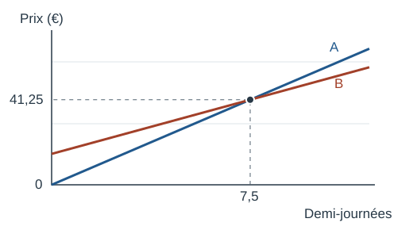

# DNB Générale — Mathématiques 2026 · Corrigé brut

*Sujet 26GENMATAG1 · Antilles et Guyane. Corrigé rédigé par IA, non officiel.*

## Partie 1 — Automatismes

### Question 1

$A(-2\,;\,2)$.

### Question 2

$M$ : à partir de $O$, on reporte deux carreaux à gauche et deux vers le bas.

### Question 3

**B.** $AC\times BD\div 2$.

### Question 4

**C.** $4/10$.

### Question 5

**D.** $n/2$.

### Question 6

**C.** $60/10=6$ min.

### Question 7

$(10+10+12+16)/4=48/4=12$.

### Question 8

$120+2x=180$, donc $x=30^\circ$.

### Question 9

$15/20=3/4$ h, soit **45 minutes**.

## Partie 2 — Exercice 1 : géométrie

### Question 1

$AM=MT-AT=7{,}7-2{,}2=5{,}5$ m.

### Question 2

$AB^2=MB^2-AM^2=7{,}3^2-5{,}5^2=23{,}04$. Donc $AB=4{,}8$ m.

### Question 3

$\sin(\widehat{ABM})=5{,}5/7{,}3$. L’angle vaut environ $48{,}89^\circ$, soit **$49^\circ$** au degré près.

### Question 4

Sur les deux droites sécantes en $A$, $T$ et $M$ sont de part et d’autre de $A$, comme $E$ et $B$. On a $AT/AM=2{,}2/5{,}5=0{,}4$ et $AE/AB=1{,}92/4{,}8=0{,}4$. La réciproque de Thalès donne $(TE)\parallel(BM)$.

### Question 5

**Proposition 3.** Le rapport est $-AM/AT=-2{,}5$.

## Partie 2 — Exercice 2 : programmes de calcul

### Question 1

$5(1-2)+3\times1=-2$.

### Question 2(a)

$5(x-2)+3x=5x-10+3x=8x-10$.

### Question 2(b)

$x=10/8=5/4=1{,}25$.

### Question 3(a)

Pour 1, le résultat prend successivement les valeurs 4, $-1$, puis $-2$.

### Question 3(b)

Pour $x$, B produit $2(4x-5)=8x-10$, comme A.

## Partie 2 — Exercice 3 : tarifs

### Question 1

$15+3{,}50\times12=57$ €.

### Question 2

$f$ correspond à B, $g$ à C et $h$ à A.

### Question 3

$(d_1)$ représente $f$, $(d_2)$ représente $g$, $(d_3)$ représente $h$.

### Question 4

Non. La droite $(d_1)$ passe par $(0\,;\,15)$, pas par l’origine.

### Question 5

Les droites se coupent à $7{,}5$ demi-journées. La droite du tarif B est ensuite sous celle de A. B devient plus avantageux à partir de **8 demi-journées**.

### Question 6(a)

La formule est `=15+3,5*B1`.

### Question 6(b)

B vaut 64 € pour 14 demi-journées, puis 67,50 € pour 15. C est plus avantageux à partir de **15 demi-journées**.
