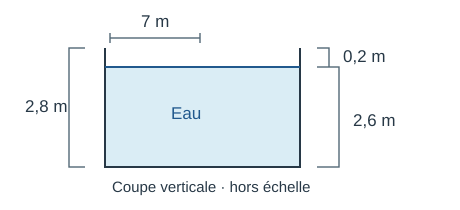

# DNB Professionnelle — Mathématiques 2026 · Corrigé brut

*Sujet 26PROMATME2 · Métropole, La Réunion et Mayotte. Corrigé rédigé par IA, non officiel.*

## Partie 1 — Automatismes

### Question 1

Les diviseurs demandés sont **1, 3, 5 et 15**.

### Question 2

$3+3+3+3=12$ cm.

### Question 3

C’est un **cône de révolution**.

### Question 4

$2/5=40/100=40\,\%$.

### Question 5

72 min = **1 h 12 min**.

### Question 6

**Situation 1**. C’est la seule droite qui passe par l’origine. Elle correspond à un coefficient négatif.

### Question 7

Dans $8;12;15;19;22$, la valeur du milieu est **15**.

### Question 8

$2x=12$, donc $x=6$.

### Question 9

Le vélo va de A7 à F7, puis à F5 et enfin à **D5**.

## Partie 2 — Exercice 1 : animaux du zoo

### Question 1

Le secteur Herbivores compte **402 animaux**.

### Question 2

$1500-(402+96+546+300)=156$ animaux.

### Question 3

$546/1500=0{,}364=36{,}4\,\%$.

### Question 4

L’affirmation est vraie : $546+300=846$, et $846>1500/2=750$.

## Partie 2 — Exercice 2 : bassin

### Question 1

$2{,}8-0{,}2=2{,}6$ m.

### Question 2

$V=\pi\times7^2\times2{,}6=127{,}4\pi$ m³, soit environ **400 m³**.

### Question 3

$400/5=80$ m³.

### Question 4

À 4 m³ par heure, $f(x)=4x$.

### Question 5

Depuis $(12\,;\,0)$, trace une verticale jusqu’à la droite en $(12\,;\,48)$, puis une horizontale jusqu’à l’axe des volumes en $(0\,;\,48)$. On lit 48 m³ versés. Le bassin contient alors $320+48=368$ m³, donc il n’a pas retrouvé ses 400 m³.

### Question 6

$432-320=112$ m³ et $112/4=28$ h. Le bassin atteint sa capacité au bout de **28 h**. L’eau déborde ensuite si l’alimentation continue.

## Partie 2 — Exercice 3 : clôture

### Question 1

$AP=LP-LA=60-40=20$ m.

### Question 2

L’arc mesure $\pi\times20/2=10\pi$, soit **31 m** à l’unité près. Si l’on compte le bord complet de la demi-surface, diamètre compris, on obtient $20+10\pi$, soit 51 m. Seul l’arc est utilisé à la question 5.

### Question 3

C’est un **trapèze**.

### Question 4

Par le théorème de Thalès, $NA/IP=LA/LP=40/60$. Donc $NA=46\times40/60=92/3$ m, soit **31 m** à l’unité près.

### Question 5

Le grillage suit $IN$, $NA$, l’arc de diamètre $AP$ et $PI$. Sa longueur vaut $23+92/3+10\pi+46$, soit 131,08 m environ. À l’unité près, **131 m**.

### Question 6

10 rouleaux donnent 120 m et 11 en donnent 132. Il faut donc **11 rouleaux**.

### Question 7

$11\times54=594$ €, ce qui laisse $700-594=106$ €. Le budget suffit.

## Partie 2 — Exercice 4 : volière

### Question 1

$12+15+5+8=40$ oiseaux.

### Question 2

$12/40=0{,}3$.

### Question 3

Il y a maintenant 10 cacatoès sur 45 oiseaux. La probabilité vaut $10/45=2/9$.
