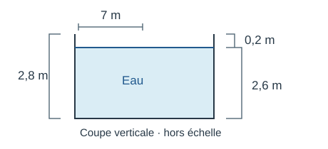

# DNB Professionnelle — Mathématiques 2026 · Corrigé guidé

*Sujet 26PROMATME2 · Métropole, La Réunion et Mayotte. Corrigé rédigé par IA, non officiel.*

## Présentation du sujet

La première partie présente des automatismes sans justification obligatoire. La seconde attend des calculs et des raisonnements justifiés.

## Partie 1 — Automatismes

### Question 1

> [!INDICATION]
> Un diviseur donne un quotient entier.

#### Solution

Les diviseurs demandés sont **1, 3, 5 et 15**.

### Question 2

> [!INDICATION]
> Additionne les quatre longueurs du carré.

#### Solution

$3+3+3+3=12$ cm.

### Question 3

> [!INDICATION]
> Il y a une base circulaire et un sommet.

#### Solution

C’est un **cône de révolution**.

### Question 4

> [!INDICATION]
> Exprime la fraction sur 100.

#### Solution

$2/5=40/100=40\,\%$.

### Question 5

> [!INDICATION]
> Retire une heure, soit 60 minutes.

#### Solution

72 min = **1 h 12 min**.

### Question 6

> [!INDICATION]
> La droite doit passer par l’origine.

#### Solution

**Situation 1**. L’inclinaison descendante est compatible avec un coefficient négatif.

### Question 7

> [!INDICATION]
> Range d’abord les valeurs dans l’ordre croissant.

#### Solution

Dans $8;12;15;19;22$, la valeur du milieu est **15**.

### Question 8

> [!INDICATION]
> Soustrais 3 aux deux membres, puis divise par 2.

#### Solution

$2x=12$, donc $x=6$.

### Question 9

> [!INDICATION]
> Mets à jour l’orientation après chaque virage.

#### Solution

Le vélo va de A7 à F7, puis à F5 et enfin à **D5**.

## Partie 2 — Exercice 1 : animaux du zoo

### Question 1

> [!INDICATION]
> Associe la trame du secteur à la légende.

#### Solution

Le secteur Herbivores compte **402 animaux**.

### Question 2

> [!INDICATION]
> Le reste est le total diminué des quatre effectifs visibles.

#### Solution

$1500-(402+96+546+300)=156$ animaux.

### Question 3

> [!INDICATION]
> Divise l’effectif des oiseaux par le total.

#### Solution

$546/1500=0{,}364=36{,}4\,\%$.

### Question 4

> [!INDICATION]
> Compare la somme des deux effectifs à la moitié du total.

#### Solution

L’affirmation est vraie : $546+300=846$, et $846>1500/2=750$.

## Partie 2 — Exercice 2 : bassin

### Question 1

> [!INDICATION]
> Retranche la hauteur laissée au-dessus de l’eau.

#### Solution

$2{,}8-0{,}2=2{,}6$ m.

### Question 2

> [!INDICATION]
> L’aire de la base vaut $\pi R^2$.

#### Solution

$V=\pi\times7^2\times2{,}6=127{,}4\pi$ m³, soit environ **400 m³**.

### Question 3

> [!INDICATION]
> Prends un cinquième de 400.

#### Solution

$400/5=80$ m³.

### Question 4

> [!INDICATION]
> En zéro heure, aucun volume n’a encore été versé.

#### Solution

À 4 m³ par heure, $f(x)=4x$.

### Question 5

> [!INDICATION]
> Lis l’ordonnée du point de la droite d’abscisse 12.

#### Solution

Les traits de lecture conduisent à 48 m³ versés. Le bassin contient alors $320+48=368$ m³, donc il n’a pas retrouvé ses 400 m³.

### Question 6

> [!INDICATION]
> Calcule le volume encore disponible puis divise par le débit.

#### Solution

$432-320=112$ m³ et $112/4=28$ h. Le bassin atteint sa capacité au bout de **28 h**. L’eau déborde ensuite si l’alimentation continue.

## Partie 2 — Exercice 3 : clôture

### Question 1

> [!INDICATION]
> $A$ appartient à $[LP]$.

#### Solution

$AP=LP-LA=60-40=20$ m.

### Question 2

> [!INDICATION]
> La clôture suit l’arc, et le diamètre ne fait pas partie de son tracé extérieur.

#### Solution

L’arc mesure $\pi\times20/2=10\pi$, soit **31 m** à l’unité près. Si l’on compte le bord complet de la demi-surface, diamètre compris, on obtient $20+10\pi$, soit 51 m. Seul l’arc est utilisé à la question 5.

### Question 3

> [!INDICATION]
> Les côtés opposés $NA$ et $IP$ sont parallèles.

#### Solution

C’est un **trapèze**.

### Question 4

> [!INDICATION]
> Compare les triangles $LNA$ et $LIP$.

#### Solution

Par le théorème de Thalès, $NA/IP=LA/LP=40/60$. Donc $NA=46\times40/60=92/3$ m, soit **31 m** à l’unité près.

### Question 5

> [!INDICATION]
> Additionne les longueurs extérieures avant d’arrondir.

#### Solution

Le grillage suit $IN$, $NA$, l’arc de diamètre $AP$ et $PI$. Sa longueur vaut $23+92/3+10\pi+46$, soit 131,08 m environ. À l’unité près, **131 m**.

### Question 6

> [!INDICATION]
> Compare ce qu’offrent dix et onze rouleaux.

#### Solution

10 rouleaux donnent 120 m et 11 en donnent 132. Il faut donc **11 rouleaux**.

### Question 7

> [!INDICATION]
> Calcule la dépense totale avant de la comparer au budget.

#### Solution

$11\times54=594$ €, ce qui laisse $700-594=106$ €. Le budget suffit.

## Partie 2 — Exercice 4 : volière

### Question 1

> [!INDICATION]
> Additionne les effectifs de chaque espèce.

#### Solution

$12+15+5+8=40$ oiseaux.

### Question 2

> [!INDICATION]
> Divise le nombre d’aras par le nombre total d’oiseaux.

#### Solution

$12/40=0{,}3$.

### Question 3

> [!INDICATION]
> Mets à jour à la fois le nombre de cacatoès et le nombre total.

#### Solution

Il y a maintenant 10 cacatoès sur 45 oiseaux. La probabilité vaut $10/45=2/9$.

## Bilan

Relis les unités, vérifie la consigne d’arrondi et conserve les valeurs exactes jusqu’au calcul final.
