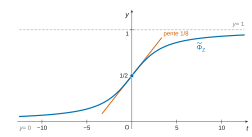

# e3a-Polytech MP — Mathématiques 2026 · Corrigé brut

*Corrigé rédigé par IA, non officiel. Signalez toute erreur.*

Épreuve de 4 heures, calculatrices interdites. Trois exercices indépendants.

## Exercice 1

On note $E=\mathbb C_{n-1}[X]$ (avec $n\ge 5$), de dimension $n$, et $\mathscr B=(P_0,\dots,P_{n-1})$ avec $P_j=X^j$.

Les lignes et colonnes des matrices sont indexées par $i,j\in[\![0,n-1]\!]$. La « $k$-ième colonne » (numérotation usuelle de $1$ à $n$) est celle de $u(P_{k-1})$.

### 1. Étude de $u$

**1.1.** Soit $P=\sum_{j=0}^{d}c_jX^j\in E$. Alors $u(P)=\sum_{j=0}^{d}c_j(X+1)^j$.

Chaque $(X+1)^j$ est de degré $j$, donc $u(P)$ est de degré au plus $d\le n-1$ : $u(P)\in E$.

Pour $\lambda,\mu\in\mathbb C$ et $P,Q\in E$, on a pour tout $x\in\mathbb C$ :
$$(\lambda P+\mu Q)(x+1)=\lambda P(x+1)+\mu Q(x+1).$$
Les polynômes $u(\lambda P+\mu Q)$ et $\lambda u(P)+\mu u(Q)$ coïncident donc sur $\mathbb C$, ensemble infini : ils sont égaux. **$u$ est un endomorphisme de $\mathbb C_{n-1}[X]$.**

**1.2.** Par la formule du binôme, pour $j\in[\![0,n-1]\!]$ :
$$\boxed{\begin{aligned}u(P_j)&=(X+1)^j\\&=\sum_{i=0}^{j}\binom ji P_i.\end{aligned}}$$

**1.3.** La colonne $j$ (indexée à partir de $0$) de $M$ contient les coordonnées de $u(P_j)$.

Le coefficient en ligne $i$ vaut donc $\binom ji$, avec $\binom ji=0$ si $i>j$ :
$$\boxed{M=\left(\binom ji\right)_{0\le i,j\le n-1}=\begin{pmatrix}1&1&1&1&\cdots&1\\0&1&2&3&\cdots&n-1\\0&0&1&3&\cdots&\binom{n-1}{2}\\0&0&0&1&\cdots&\binom{n-1}{3}\\\vdots&&&&\ddots&\vdots\\0&0&0&0&\cdots&1\end{pmatrix}}$$
La matrice est triangulaire supérieure, avec des $1$ sur la diagonale. Colonnes demandées (numérotation de $1$ à $n$) :

- 1re colonne (celle de $u(P_0)=1$) : $(1,0,0,\dots,0)^{T}$ ;
- 2e colonne (celle de $u(P_1)=1+X$) : $(1,1,0,\dots,0)^{T}$ ;
- $k$-ième colonne, $k\in[\![3,n-2]\!]$ (celle de $u(P_{k-1})=(1+X)^{k-1}$) :
$$\left(\binom{k-1}{0},\binom{k-1}{1},\dots,\binom{k-1}{k-1},0,\dots,0\right)^{T},$$
soit $\binom{k-1}{i-1}$ en ligne $i$ pour $1\le i\le k$, puis $n-k$ zéros.

Si l'on numérote les colonnes à partir de $0$, la colonne $k$ est celle de $u(P_k)$ et contient les $\binom ki$.

**1.4.** $M$ est triangulaire de diagonale $(1,\dots,1)$, donc $XI_n-M$ est triangulaire de diagonale $(X-1,\dots,X-1)$. Avec $\chi_u=\det(XI_n-M)$ :
$$\boxed{\chi_u=(X-1)^n.}$$

**1.5.** D'après 1.4, $\mathrm{Sp}(u)=\{1\}$. Si $u$ était diagonalisable, $E$ serait égal à son unique sous-espace propre $\ker(u-\mathrm{Id})$, donc on aurait $u=\mathrm{Id}$.

Or $X\in E$ (car $n-1\ge 1$) et $u(X)=X+1\ne X$. **$u$ n'est pas diagonalisable.**

**1.6.** D'après 1.4 et 1.5, $\mathrm{Sp}(u)=\{1\}$ : $0$ n'est pas valeur propre de $u$, donc $\ker u=\{0\}$.

L'endomorphisme $u$ de l'espace $E$, de dimension finie, est injectif, donc bijectif : c'est un automorphisme de $E$. (De façon équivalente, $\det M=1\ne 0$.)

Soit $v:P\mapsto P(X-1)$, endomorphisme de $E$ par le même argument qu'en 1.1. Pour tout $P\in E$ :
$$\begin{aligned}(u\circ v)(P)(X)&=P(X+1-1)=P(X),\\(v\circ u)(P)(X)&=P(X-1+1)=P(X).\end{aligned}$$
Donc $u\circ v=v\circ u=\mathrm{Id}$, et
$$\boxed{u^{-1}:P\longmapsto P(X-1).}$$

**1.7.** $M^{-1}$ est la matrice de $u^{-1}$ dans $\mathscr B$. Par la formule du binôme :
$$\begin{aligned}u^{-1}(P_j)&=(X-1)^j\\&=\sum_{i=0}^{j}(-1)^{j-i}\binom ji X^i.\end{aligned}$$
D'où
$$\boxed{M^{-1}=\left((-1)^{j-i}\binom ji\right)_{0\le i,j\le n-1}=\begin{pmatrix}1&-1&1&-1&\cdots\\0&1&-2&3&\cdots\\0&0&1&-3&\cdots\\0&0&0&1&\cdots\\\vdots&&&&\ddots\end{pmatrix}.}$$

**1.8.** Montrons par récurrence sur $k\in\mathbb N$ l'assertion $\mathcal H_k$ : « pour tout $P\in E$, $u^k(P)=P(X+k)$ ».

- $\mathcal H_0$ est vraie car $u^0=\mathrm{Id}$.
- Supposons $\mathcal H_k$ vraie et soit $P\in E$. Posons $R=u^k(P)$, de sorte que $R(X)=P(X+k)$. Alors, avec $u^{k+1}=u\circ u^k$ :
$$\begin{aligned}u^{k+1}(P)&=u(R)\\&=R(X+1)\\&=P(X+k+1).\end{aligned}$$

Donc
$$\boxed{\forall k\in\mathbb N,\ \forall P\in E,\quad u^k(P)=P(X+k).}$$
Matriciellement, $M^k=\left(k^{\,j-i}\binom ji\right)_{0\le i,j\le n-1}$, ce qu'on lit sur le développement de $(X+k)^j$ par la formule du binôme.

### 2. L'endomorphisme $\Delta=u-\mathrm{Id}$

**2.1.** Pour $P\in E$, $\Delta(P)=P(X+1)-P(X)$. Si $P$ est constant, $\Delta(P)=0$.

Si $P=\sum_{j=0}^{d}c_jX^j$ avec $d\ge 1$ et $c_d\ne 0$, on a pour $j\ge 1$
$$(X+1)^j-X^j=jX^{j-1}+(\text{termes de degré}\le j-2).$$
Donc $\Delta(P)$ est de degré exactement $d-1$, de coefficient dominant $d\,c_d$.

Avec la convention $\deg 0=-\infty$, on a donc $\deg\Delta(P)\le\deg P-1$ pour tout $P\in E$. Par récurrence, $\deg\Delta^m(P)\le\deg P-m$.

Pour $P\in E$, $\deg\Delta^n(P)\le -1<0$, donc $\Delta^n(P)=0$ :
$$\boxed{\Delta^n=0,\ \text{donc } \Delta \text{ est nilpotent.}}$$
De plus, $\Delta^{n-1}(X^{n-1})=(n-1)!\ne 0$, donc l'indice de nilpotence vaut exactement $n$.

On peut aussi conclure par le théorème de Cayley-Hamilton : $\chi_u(u)=0$, c'est-à-dire $(u-\mathrm{Id})^n=0$ d'après 1.4.

**2.2.** Si $\Delta(x)=\lambda x$ avec $x\ne 0$, alors $0=\Delta^n(x)=\lambda^n x$, donc $\lambda=0$ : $\mathrm{Sp}(\Delta)\subset\{0\}$.

Si $\Delta$ était diagonalisable, on aurait $E=\ker\Delta$, c'est-à-dire $\Delta=0$. Or $\Delta(X)=1\ne 0$. **$\Delta$ n'est pas diagonalisable.**

### 3.

Les endomorphismes $u$ et $\mathrm{Id}$ commutent, donc la formule du binôme de Newton s'applique dans l'anneau $\mathcal L(E)$ :
$$\begin{aligned}0&=\Delta^n=(u-\mathrm{Id})^n\\&=\sum_{k=0}^{n}\binom nk(-1)^{n-k}u^k\\&=u^n+\sum_{k=0}^{n-1}(-1)^{n-k}\binom nk u^k.\end{aligned}$$
On applique cette égalité à $P\in E$ et on utilise 1.8 ($u^k(P)=P(X+k)$, y compris pour $k=n$).

Les coefficients $a_k=(-1)^{n-k}\binom nk$ sont des entiers relatifs, car les coefficients binomiaux sont des entiers naturels. On obtient :
$$\boxed{\begin{aligned}{}&\forall P\in\mathbb C_{n-1}[X],\quad P(X+n)+\sum_{k=0}^{n-1}a_kP(X+k)=0,\\&\text{avec}\quad a_k=(-1)^{n-k}\binom nk\in\mathbb Z.\end{aligned}}$$
Par exemple, pour $n=5$ :
$$P(X+5)-5P(X+4)+10P(X+3)-10P(X+2)+5P(X+1)-P(X)=0.$$

## Exercice 2

$a$ est un réel fixé.

**1.** Pour $n\ge 1$, on a $0<u_n=\dfrac{1}{n^2+a^2}\le\dfrac{1}{n^2}$. La série de Riemann $\sum\frac{1}{n^2}$ converge. Par comparaison de séries à termes positifs, **$\sum u_n$ converge.**

**2.** Posons $f(t)=\dfrac{\sin(at)}{e^t-1}$. La fonction $f$ est continue sur $]0,+\infty[$, car $e^t-1>0$ pour $t>0$.

- En $0^+$ : $f(t)=\dfrac{\sin(at)}{t}\cdot\dfrac{t}{e^t-1}\longrightarrow a\cdot 1=a$. Donc $f$ se prolonge par continuité en $0$ et est intégrable sur $]0,1]$.
- En $+\infty$ : pour $t\ge 1$, $e^t-1\ge(1-e^{-1})e^t$, donc $|f(t)|\le\dfrac{e^{-t}}{1-e^{-1}}$. Ce majorant est intégrable sur $[1,+\infty[$.

Donc $f$ est intégrable (l'intégrale converge absolument) sur $]0,+\infty[$ : **$\displaystyle\int_0^{+\infty}\frac{\sin(at)}{e^t-1}\,dt$ existe.**

**3.** Pour $t>0$, on a $0<e^{-t}<1$. La série géométrique de raison $e^{-t}$, commencée à $k=1$, converge donc :
$$\begin{aligned}\sum_{k=1}^{+\infty}e^{-kt}&=\frac{e^{-t}}{1-e^{-t}}\\&=\frac{1}{e^t-1}.\end{aligned}$$
D'où $\boxed{\forall t>0,\ \dfrac{1}{e^t-1}=\displaystyle\sum_{k=1}^{+\infty}e^{-kt}.}$

**4.** Soit $k\in\mathbb N^*$. On a $|\sin(at)e^{-kt}|\le e^{-kt}$, intégrable sur $[0,+\infty[$, donc l'intégrale converge absolument.

Posons $\lambda=ia-k$, de sorte que $\operatorname{Re}\lambda=-k<0$ et $|e^{\lambda A}|=e^{-kA}\to 0$. Pour $A>0$ :
$$\begin{aligned}\int_0^{A}e^{\lambda t}\,dt&=\frac{e^{\lambda A}-1}{\lambda}\\&\xrightarrow[A\to+\infty]{}-\frac1\lambda=\frac{1}{k-ia}\\&=\frac{k+ia}{k^2+a^2}.\end{aligned}$$
Comme $\sin(at)e^{-kt}=\operatorname{Im}\big(e^{\lambda t}\big)$, on prend la partie imaginaire :
$$\boxed{\int_0^{+\infty}\sin(at)\,e^{-kt}\,dt=\frac{a}{a^2+k^2}.}$$

**5.** *Inégalité.* Pour $x\ge 0$, $|\sin x|=\left|\int_0^x\cos s\,ds\right|\le x$. Par imparité de $\sin$, on obtient $|\sin x|\le|x|$ pour tout $x\in\mathbb R$.

*Théorème d'intégration terme à terme.* Soit $(f_k)$ une suite de fonctions continues par morceaux et intégrables sur un intervalle $I$.

Si $\sum f_k$ converge simplement sur $I$ vers une fonction continue par morceaux et si la série $\sum_k\int_I|f_k|$ converge, alors $\sum_k f_k$ est intégrable sur $I$ et $\int_I\sum_k f_k=\sum_k\int_I f_k$.

On l'applique sur $I=]0,+\infty[$ à $f_k(t)=\sin(at)e^{-kt}$, pour $k\ge 1$.

- Chaque $f_k$ est continue et intégrable sur $I$ (question 4).
- $\sum f_k$ converge simplement sur $I$ vers $f$, qui est continue (questions 3 et 2).
- Avec $|\sin(at)|\le|a|t$ et une intégration par parties :
$$\int_I|f_k|\le|a|\int_0^{+\infty}t\,e^{-kt}\,dt=\frac{|a|}{k^2},$$
terme général d'une série convergente.

Le théorème donne alors
$$\boxed{\begin{aligned}\int_0^{+\infty}\frac{\sin(at)}{e^t-1}\,dt&=\sum_{k=1}^{+\infty}\frac{a}{a^2+k^2}\\&=a\sum_{k=1}^{+\infty}\frac{1}{a^2+k^2}.\end{aligned}}$$

**6.** Posons $g_k(a)=\dfrac{1}{a^2+k^2}$ pour $k\ge 1$. Chaque $g_k$ est continue sur $\mathbb R$, et $\|g_k\|_{\infty,\mathbb R}=\dfrac1{k^2}$, terme général d'une série convergente.

La série $\sum g_k$ converge donc normalement, donc uniformément, sur $\mathbb R$. Par le théorème de continuité de la somme d'une série de fonctions continues qui converge uniformément, $S=\sum_{k\ge 1}g_k$ est continue sur $\mathbb R$, en particulier en $0$ :
$$\boxed{\begin{aligned}\lim_{a\to 0}\sum_{k=1}^{+\infty}\frac{1}{a^2+k^2}&=\sum_{k=1}^{+\infty}\frac1{k^2}\\&=\zeta(2)=\frac{\pi^2}{6}.\end{aligned}}$$

### 7. Développement en série entière de $H$

**7.1.** Soient $a\in]-1,1[$ et $k\ge 1$. Posons $q=-\dfrac{a^2}{k^2}$. Alors $|q|\le a^2<1$, et la série géométrique de raison $q$ converge :
$$\begin{aligned}\frac{1}{k^2}\sum_{n=0}^{+\infty}(-1)^n\left(\frac ak\right)^{2n}&=\frac{1}{k^2}\cdot\frac{1}{1+a^2/k^2}\\&=\boxed{\frac{1}{a^2+k^2}.}\end{aligned}$$

**7.2.** Soit $a\in]-1,1[$. Posons $c_{k,n}=(-1)^n\dfrac{a^{2n}}{k^{2n+2}}$ pour $(k,n)\in\mathbb N^*\times\mathbb N$.

Pour $k$ fixé, $\sum_{n\ge 0}|c_{k,n}|=\dfrac{1}{k^2-a^2}$, qui est fini car $k^2-a^2\ge 1-a^2>0$.

Pour $k\ge 2$, $\dfrac{1}{k^2-a^2}\le\dfrac{4}{3k^2}$. Donc $\sum_k\sum_n|c_{k,n}|<+\infty$ et la famille $(c_{k,n})$ est sommable.

Par le théorème de Fubini pour les familles sommables, on peut sommer dans les deux ordres :
$$\begin{aligned}\sum_{k=1}^{+\infty}\frac{1}{a^2+k^2}&=\sum_{k\ge 1}\sum_{n\ge 0}c_{k,n}\\&=\sum_{n\ge 0}(-1)^na^{2n}\sum_{k\ge 1}\frac{1}{k^{2n+2}}\\&=\sum_{n=0}^{+\infty}(-1)^n\zeta(2n+2)a^{2n},\end{aligned}$$
où $\zeta(2n+2)$ est bien défini car $2n+2>1$. En multipliant par $a$ et avec la question 5, on obtient, pour tout $a\in]-1,1[$ :
$$\boxed{H(a)=\sum_{n=0}^{+\infty}(-1)^n\zeta(2n+2)\,a^{2n+1}.}$$

**7.3.** La série entière $\sum_n(-1)^n\zeta(2n+2)a^{2n+1}$ converge en tout point de $]-1,1[$, donc son rayon vérifie $R\ge 1$.

La somme d'une série entière est de classe $\mathcal C^\infty$ sur $]-R,R[$, et $H$ coïncide avec elle sur $]-1,1[$.

Donc **$H$ est de classe $\mathcal C^\infty$ sur $]-1,1[$.**

**7.4.** Les coefficients d'une série entière de rayon non nul s'obtiennent par $b_m=\dfrac{H^{(m)}(0)}{m!}$. Ici $b_{2n}=0$ et $b_{2n+1}=(-1)^n\zeta(2n+2)$. D'où, pour $n\in\mathbb N$ :
$$\boxed{\begin{aligned}H^{(2n)}(0)&=0,\\H^{(2n+1)}(0)&=(-1)^n(2n+1)!\,\zeta(2n+2).\end{aligned}}$$
Autrement dit, $H^{(p)}(0)=(-1)^{(p-1)/2}\,p!\,\zeta(p+1)$ pour $p$ impair. En particulier $H'(0)=\zeta(2)=\pi^2/6$, en accord avec la question 6.

**8.** Posons $\varphi(t)=\dfrac{\ln t}{t-1}$, continue et positive sur $]0,1[$.

- En $1^-$ : $\varphi(t)\to 1$, donc $\varphi$ se prolonge par continuité en $1$.
- En $0^+$ : $\sqrt t\,\varphi(t)=\dfrac{\sqrt t\ln t}{t-1}\to 0$ par croissances comparées, donc $\varphi(t)=o(t^{-1/2})$. Or $t^{-1/2}$ est intégrable sur $]0,\frac12]$ (Riemann, $\frac12<1$).

**L'intégrale $\displaystyle\int_0^1\frac{\ln t}{t-1}\,dt$ converge.**

**9.** Soit $p\in\mathbb N$. La fonction $h_p(t)=t^p\ln t$ est continue sur $]0,1]$.

De plus, $\sqrt t\,|h_p(t)|=t^{p+1/2}|\ln t|\to 0$ en $0^+$. Donc $h_p(t)=o(t^{-1/2})$ et **$I_p$ converge** (absolument).

**10.** Sur $[\varepsilon,1]$, on intègre par parties avec $\ln t$ et $\frac{t^{p+1}}{p+1}$, toutes deux de classe $\mathcal C^1$ :
$$\begin{aligned}\int_\varepsilon^1t^p\ln t\,dt&=-\frac{\varepsilon^{p+1}\ln\varepsilon}{p+1}-\frac{1-\varepsilon^{p+1}}{(p+1)^2}\\&\xrightarrow[\varepsilon\to 0^+]{}-\frac{1}{(p+1)^2}.\end{aligned}$$
$$\boxed{I_p=-\frac{1}{(p+1)^2}.}$$

**11.** On applique le théorème d'intégration terme à terme énoncé en question 5, sur $J=]0,1[$, à $g_p(t)=-t^p\ln t\ge 0$ pour $p\in\mathbb N$.

- Chaque $g_p$ est continue et intégrable sur $J$, avec $\int_J g_p=-I_p=\dfrac1{(p+1)^2}$ (questions 9 et 10).
- Pour $t\in J$, on a $|t|<1$, donc par la série géométrique $\sum_{p\ge 0}g_p(t)=\dfrac{-\ln t}{1-t}=\varphi(t)$. La série converge simplement sur $J$ vers $\varphi$, continue sur $J$.
- $\sum_p\int_J|g_p|=\sum_p\dfrac{1}{(p+1)^2}<+\infty$.

Le théorème donne :
$$\boxed{\begin{aligned}\int_0^1\frac{\ln t}{t-1}\,dt&=\sum_{p=0}^{+\infty}\frac{1}{(p+1)^2}\\&=\sum_{p=1}^{+\infty}\frac{1}{p^2}.\end{aligned}}$$

**12.** Avec la valeur rappelée par l'énoncé :
$$\boxed{\int_0^1\frac{\ln t}{t-1}\,dt=\zeta(2)=\frac{\pi^2}{6}.}$$

## Exercice 3

### Question de cours

**1.** Pour $a\in\mathbb R^*$ et $n\in\mathbb N^*$, au voisinage de $0$ :
$$\boxed{\begin{aligned}e^{at}&=\sum_{j=0}^{n}\frac{a^jt^j}{j!}+o(t^n),\\\ln(1+at)&=at-\frac{a^2t^2}{2}+o(t^2).\end{aligned}}$$

*Notation.* On pose $G(t)=\sum_{i=1}^kp_ie^{x_it}$ pour $t\in\mathbb R$. La fonction $G$ est de classe $\mathcal C^\infty$ et strictement positive, avec $G(0)=1$.

Pour $t\ne 0$, on a $\Phi_X(t)=\dfrac{\ln G(t)}{t}$.

### 2. Étude d'exemples

**2.1.** Si $X$ est certaine, il existe $c\in\mathbb R_+$ tel que $\mathbb P(X=c)=1$, donc $k=1$, $x_1=c$ et $p_1=1$.

Alors $\Phi_X(t)=\frac1t\ln(e^{ct})=c$ :
$$\boxed{\forall t\in\mathbb R^*,\ \Phi_X(t)=c.}$$

**2.2.1.** Ici $k=2$, $x_1=0$, $x_2=1$ et $p_1=p_2=\frac12$ :
$$\boxed{\forall t\in\mathbb R^*,\quad\Phi_Z(t)=\frac1t\ln\left(\frac{1+e^t}{2}\right).}$$

**2.2.2.** Posons $\psi(t)=\ln\frac{1+e^t}{2}$, de classe $\mathcal C^\infty$ sur $\mathbb R$, avec $\psi(0)=0$.

Par la question 1, $\frac{1+e^t}{2}=1+w$ avec $w=\frac t2+\frac{t^2}{4}+o(t^2)$ et $w^2=\frac{t^2}{4}+o(t^2)$. Donc
$$\begin{aligned}\psi(t)&=w-\frac{w^2}{2}+o(t^2)\\&=\frac t2+\frac{t^2}{8}+o(t^2),\\\Phi_Z(t)&=\frac12+\frac t8+o(t).\end{aligned}$$
Posons $\widetilde\Phi_Z(0)=\frac12$ et $\widetilde\Phi_Z=\Phi_Z$ sur $\mathbb R^*$.

Ce développement limité d'ordre $1$ (et non seulement la limite en $0$) montre que $\widetilde\Phi_Z$ est dérivable en $0$, avec $\widetilde\Phi_Z'(0)=\frac18$.

Sur $\mathbb R^*$, $\widetilde\Phi_Z=\psi/t$ est de classe $\mathcal C^\infty$. **$\widetilde\Phi_Z$ est donc dérivable sur $\mathbb R$.**

### 3. Étude générale ($k\ge 2$)

**3.1.** Pour chaque $i$, $e^{x_it}=1+x_it+\frac{x_i^2t^2}{2}+o(t^2)$ (question 1, ou trivial si $x_i=0$). En sommant ces $k$ développements, en nombre fini :
$$G(t)=1+m_1t+\frac{m_2}{2}t^2+o(t^2),$$
avec, par la formule de transfert,
$$\begin{aligned}m_1&=\sum_ip_ix_i=\mathbb E(X),\\m_2&=\sum_ip_ix_i^2=\mathbb E(X^2).\end{aligned}$$
Avec $w=G(t)-1$, on a $w^2=m_1^2t^2+o(t^2)$, d'où
$$\ln G(t)=m_1t+\frac{m_2-m_1^2}{2}t^2+o(t^2).$$
Comme $m_2-m_1^2=V(X)$ (König-Huygens), on obtient en divisant par $t$ :
$$\boxed{\Phi_X(t)=\mathbb E(X)+\frac{V(X)}{2}\,t+o(t)\qquad(t\to 0).}$$

**3.2.** Posons $\widetilde\Phi_X(0)=\mathbb E(X)$ et $\widetilde\Phi_X=\Phi_X$ sur $\mathbb R^*$.

Par 3.1, $\widetilde\Phi_X$ admet en $0$ un développement limité d'ordre $1$, donc elle est dérivable en $0$.

Sur $\mathbb R^*$, $\widetilde\Phi_X=\frac{\ln G}{t}$ est de classe $\mathcal C^\infty$, puisque $G>0$ est $\mathcal C^\infty$.

**$\widetilde\Phi_X$ est dérivable sur $\mathbb R$.**

**3.3.** $\widetilde\Phi_X(0)=\lim_{t\to 0}\Phi_X(t)$ est le terme constant du développement de 3.1 :
$$\boxed{\begin{aligned}\widetilde\Phi_X(0)&=\mathbb E(X)\\&=\sum_{i=1}^kp_ix_i.\end{aligned}}$$

**3.4.** Le coefficient de $t$ dans le développement limité d'ordre $1$ est le nombre dérivé en $0$ :
$$\boxed{\widetilde\Phi_X'(0)=\frac{V(X)}{2},}$$
la moitié de la variance de $X$. On vérifie sur l'exemple de la question 2.2 : $V(Z)=\frac14$ et $\widetilde\Phi_Z'(0)=\frac18$.

**3.5.** Pour $t>0$, on écrit $G(t)=p_ke^{x_kt}(1+\varepsilon(t))$ avec $\varepsilon(t)=\sum_{i<k}\frac{p_i}{p_k}e^{(x_i-x_k)t}$. On a $\varepsilon(t)\to 0$ quand $t\to+\infty$, car $x_i<x_k$. Donc
$$\Phi_X(t)=x_k+\frac{\ln p_k+\ln(1+\varepsilon(t))}{t}\xrightarrow[t\to+\infty]{}x_k.$$
De même, pour $t<0$, $G(t)=p_1e^{x_1t}(1+\eta(t))$ avec $\eta(t)=\sum_{i>1}\frac{p_i}{p_1}e^{(x_i-x_1)t}$, qui tend vers $0$ quand $t\to-\infty$. Donc $\Phi_X(t)\to x_1$.
$$\boxed{\begin{aligned}\lim_{+\infty}\widetilde\Phi_X&=x_k=\max_i x_i,\\\lim_{-\infty}\widetilde\Phi_X&=x_1=\min_i x_i.\end{aligned}}$$

**3.6.** **Non.** Si $\widetilde\Phi_X$ était impaire, elle vérifierait $\widetilde\Phi_X(0)=0$ puisqu'elle est définie en $0$, donc $\mathbb E(X)=\sum_ip_ix_i=0$.

C'est une somme de termes positifs, avec $p_i>0$ et $x_i\ge 0$, donc tous les $x_i$ seraient nuls. Cela contredit $x_1<x_2$, puisque $k\ge 2$.

Autre argument : l'imparité imposerait $\lim_{-\infty}=-\lim_{+\infty}$, c'est-à-dire $x_1=-x_k$, alors que $0\le x_1<x_k$. **$\widetilde\Phi_X$ n'est pas impaire.**

**4.** Par la formule de transfert, $\mathbb E(e^{tX})=\sum_ip_ie^{tx_i}=G(t)>0$, d'où
$$\boxed{\begin{aligned}{}&\forall t\in\mathbb R^*,\quad\Phi_X(t)=\frac1t\ln\mathbb E\left(e^{tX}\right),\\&\text{soit}\quad\mathbb E\left(e^{tX}\right)=e^{t\Phi_X(t)}.\end{aligned}}$$

**5.** La variable $X+Y$ est discrète finie, à valeurs dans $\mathbb R_+$, donc $\Phi_{X+Y}$ est définie. Soit $t\in\mathbb R^*$.

Les variables $e^{tX}$ et $e^{tY}$ sont indépendantes, comme fonctions de variables indépendantes, et finies, donc d'espérance finie. D'où
$$\mathbb E\left(e^{t(X+Y)}\right)=\mathbb E\left(e^{tX}\right)\mathbb E\left(e^{tY}\right).$$
En prenant le logarithme (les trois espérances sont $>0$) puis en divisant par $t$ :
$$\boxed{\forall t\in\mathbb R^*,\quad\Phi_{X+Y}(t)=\Phi_X(t)+\Phi_Y(t).}$$

**FIN**
