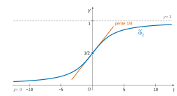

# e3a-Polytech MP — Mathématiques 2026 · Corrigé guidé

*Corrigé rédigé par IA, non officiel. Signalez toute erreur.*

## Présentation du sujet

L'épreuve (code MP8M) dure **4 heures**, sans calculatrice ni document. Elle comporte **trois exercices indépendants**, soit **38 questions** courtes et très balisées.

Le sujet reste proche du cours : la note se joue sur la **rigueur des justifications**. L'énoncé demande trois fois de citer le théorème utilisé « avec précision » et d'en vérifier les hypothèses, et une fois de justifier « soigneusement ».

| Exercice | Questions | Contenu | Notions du programme MP |
|---|---|---|---|
| 1 – Translation des polynômes | 1.1–1.8, 2.1–2.2, 3 (11 questions) | Étude de $u:P\mapsto P(X+1)$ sur $\mathbb C_{n-1}[X]$ : matrice de Pascal, spectre, inverse, puissances, puis $\Delta=u-\mathrm{Id}$ nilpotent et relation de récurrence entre les translatées. | Matrice d'un endomorphisme, polynôme caractéristique, diagonalisabilité, endomorphismes nilpotents, formule du binôme dans une algèbre |
| 2 – Deux intégrales et $\zeta(2)$ | 1–6, 7.1–7.4, 8–12 (15 questions) | Calcul de $H(a)=\int_0^{+\infty}\frac{\sin(at)}{e^t-1}dt$ comme somme de série, développement de $H$ en série entière, puis $\int_0^1\frac{\ln t}{t-1}dt=\zeta(2)$. | Intégrabilité, séries géométriques, intégration terme à terme, continuité de la somme d'une série de fonctions, familles sommables (Fubini), séries entières |
| 3 – Une transformée de variable finie | 1, 2.1, 2.2.1, 2.2.2, 3.1–3.6, 4, 5 (12 questions) | Étude de $\Phi_X(t)=\frac1t\ln\mathbb E(e^{tX})$ : prolongement en $0$ par l'espérance, dérivée en $0$ égale à la moitié de la variance, limites égales au minimum et au maximum de $X$, non-imparité, additivité pour des variables indépendantes. | Développements limités, prolongement par continuité, dérivabilité, espérance, variance, formule de transfert, indépendance |

**Ce qu'en dit le jury.** Le rapport 2026 donne une moyenne de 7,25 et un écart type de 4,11 sur 2911 copies (p. 2). Il ne publie pas de taux de réussite par question.

Il insiste sur le manque de rigueur et rappelle qu'« une affirmation sans démonstration n'a aucune valeur » (p. 2). Il annonce aussi un nombre non négligeable de points de barème pour la présentation, après avoir relevé des copies renumérotées ou raturées (p. 2) : gardez la numérotation du sujet, dans l'ordre.

**Questions discriminantes d'après le rapport 2026.**

- Ex. 1, Q1.1 et Q1.3 : des questions de cours où beaucoup de copies échouent (p. 4).
- Ex. 2, Q7.2 : « Quasiment aucune justification correcte de ce résultat. » (p. 8)
- Ex. 2, Q7.3 et Q7.4 : très peu de bonnes réponses, malgré le titre de la question 7 (p. 8).
- Ex. 3, Q2.2.1 et Q2.2.2 : peu abordées, et le prolongement obtenu est souvent seulement continu (p. 10).
- Ex. 3, Q3.4 à Q5 : « Question quasiment pas traitée, ainsi que les suivantes. » (p. 10)

**Difficulté.** Le sujet est accessible, mais long si l'on rédige tout proprement. Les points délicats sont les suivants :

- Ex. 1, Q1.3 : bien placer les indices (colonne = antécédent) et écrire les trois colonnes demandées ;
- Ex. 1, Q2.1 : prouver proprement que $\Delta$ abaisse le degré, ou citer Cayley-Hamilton ;
- Ex. 2, Q5 : trouver la majoration qui rend $\sum\int|f_k|$ convergente, ce que fait l'inégalité $|\sin x|\le|x|$ suggérée par l'énoncé ;
- Ex. 2, Q7.2 : justifier l'interversion de deux sommes infinies ;
- Ex. 3, Q3.1 : mener un développement limité de $\ln G$ à l'ordre 2 sans perdre de terme.

**Questions abordables à ne pas laisser passer** : Ex. 1, Q1.1, 1.2, 1.4, 1.5, 1.6, 1.8 et 2.2 ; Ex. 2, Q1, 3, 4, 6, 7.1, 9, 10 et 12 ; Ex. 3, Q1, 2.1, 2.2.1, 3.3, 3.4 et 4. Elles représentent plus de la moitié du sujet.

Le rapport montre que la fin de l'exercice 3, très peu traitée, était pourtant courte : c'est là que se gagnent des points faciles quand on gère bien son temps.

**Gestion du temps.** Comptez environ 60 minutes pour l'exercice 1, 100 minutes pour l'exercice 2, qui est le plus long et le plus technique, et 70 minutes pour l'exercice 3, puis gardez 10 minutes de relecture.

Les trois exercices étant indépendants, commencez par celui où vous vous sentez le plus à l'aise. Dans l'exercice 2, les questions 8 à 12 rejouent le schéma des questions 1 à 5 : si vous bloquez sur Q5, la suite reste faisable, et la réussite de Q11 vous aidera à rédiger Q5.

## Exercice 1 — L'opérateur de translation sur $\mathbb C_{n-1}[X]$

On étudie $u$ par sa matrice dans la base canonique. Elle est triangulaire, ce qui donne immédiatement le spectre et l'inversibilité. Le fait que $\Delta=u-\mathrm{Id}$ abaisse le degré donne ensuite la nilpotence. La formule du binôme transforme enfin $\Delta^n=0$ en une relation explicite entre les translatées.

Notations : $E=\mathbb C_{n-1}[X]$, de dimension $n$, et $P_j=X^j$.

Les matrices sont indexées par $i,j\in[\![0,n-1]\!]$, et la « $k$-ième colonne » (numérotation de $1$ à $n$) est celle de $u(P_{k-1})$.

### Question 1.1

> [!INDICATION]
> Il y a deux choses à vérifier : $u(P)$ reste dans $E$, et $u$ est linéaire.

> [!INDICATION]
> Pour la stabilité, regardez le degré de $(X+1)^j$. Pour la linéarité, raisonnez sur les valeurs prises en un point $x$.

#### Solution

Soit $P=\sum_{j=0}^{d}c_jX^j\in E$. Alors $u(P)=\sum_{j=0}^dc_j(X+1)^j$.

Chaque $(X+1)^j$ est de degré $j\le d\le n-1$, donc $u(P)\in E$.

Soient $\lambda,\mu\in\mathbb C$, $P,Q\in E$ et $x\in\mathbb C$. On a
$$(\lambda P+\mu Q)(x+1)=\lambda P(x+1)+\mu Q(x+1).$$
Les polynômes $u(\lambda P+\mu Q)$ et $\lambda u(P)+\mu u(Q)$ coïncident donc sur $\mathbb C$, qui est infini : ils sont égaux. **$u$ est un endomorphisme de $\mathbb C_{n-1}[X]$.**

> [!PIEGE]
> Ne montrer que la linéarité ne suffit pas : l'hypothèse « degré $\le n-1$ » ne sert qu'à prouver que $u(P)$ reste dans $E$. Il faut donc le dire.
>
> Le rapport relève aussi « $u(P+Q)=u(P)+u(Q)$ et donc, $u$ est un morphisme de groupe : c'est un endomorphisme » : l'additivité seule ne donne pas la linéarité, il faut aussi la multiplication par un scalaire.

> [!JURY]
> Le rapport 2026 juge cette question « a priori facile mais qui pose problème » (p. 4) : des justifications comme « $u$ est linéaire puisque les polynômes sont linéaires » ne valent rien. Deux vérifications explicites suffisent.

### Question 1.2

> [!INDICATION]
> Développez $(X+1)^j$.

#### Solution

Par la formule du binôme :
$$\begin{aligned}u(P_j)&=(X+1)^j\\&=\sum_{i=0}^{j}\binom ji X^i\\&=\sum_{i=0}^{j}\binom ji P_i.\end{aligned}$$

> [!METHODE]
> « Expression dans la base $\mathscr B$ » signifie une combinaison linéaire des $P_i$ : c'est elle qui donne directement la colonne de la matrice demandée à la question suivante.

> [!JURY]
> Rapport 2026 (p. 4) : « En général, on trouve bien que $u(P_j) = (X+1)^j$ mais ça se gâte souvent lorsqu'il faut développer. » Parmi les erreurs citées : un facteur $(-1)^{j-k}$ parasite, ou une somme d'indice $n$ au lieu de $j$.

### Question 1.3

> [!INDICATION]
> La colonne d'indice $j$ de $M$ contient les coordonnées de $u(P_j)$ dans $\mathscr B$.

> [!INDICATION]
> Que vaut le coefficient en ligne $i$ quand $i>j$ ? Écrivez ensuite explicitement les trois colonnes demandées en précisant où commencent les zéros.

#### Solution

D'après 1.2, le coefficient en ligne $i$ et colonne $j$ vaut $\binom ji$, nul si $i>j$ :
$$M=\left(\binom ji\right)_{0\le i,j\le n-1}=\begin{pmatrix}1&1&1&1&\cdots&1\\0&1&2&3&\cdots&n-1\\0&0&1&3&\cdots&\binom{n-1}{2}\\0&0&0&1&\cdots&\binom{n-1}{3}\\\vdots&&&&\ddots&\vdots\\0&0&0&0&\cdots&1\end{pmatrix}.$$
C'est la matrice de Pascal : triangulaire supérieure, avec des $1$ sur la diagonale et $\binom ji$ au-dessus.

Colonnes demandées (numérotation de $1$ à $n$) :

- 1re colonne : $(1,0,\dots,0)^T$, coordonnées de $u(P_0)=1$ ;
- 2e colonne : $(1,1,0,\dots,0)^T$, coordonnées de $u(P_1)=1+X$ ;
- $k$-ième colonne, $3\le k\le n-2$ : les coordonnées de $(1+X)^{k-1}$, soit
$$\left(\binom{k-1}{0},\binom{k-1}{1},\dots,\binom{k-1}{k-1},0,\dots,0\right)^T,$$
avec $k$ coefficients non nuls sur les lignes $1$ à $k$, puis $n-k$ zéros.

On peut se représenter $M$ comme un carré coupé par sa diagonale : le triangle inférieur est nul, la diagonale ne contient que des $1$, et la colonne $k$ ne porte des coefficients non nuls que jusqu'à la diagonale.

> [!PIEGE]
> L'inversion des indices est l'erreur classique : $\left(\binom ij\right)$ est la transposée, triangulaire inférieure, et ce n'est pas la matrice de $u$ dans $\mathscr B$. Pour se contrôler : la colonne de $u(1)=1$ doit être $(1,0,\dots,0)^T$.
>
> Une matrice d'endomorphisme dans une base contient des **scalaires**. Le rapport cite une « matrice » dont les coefficients sont $X+1$, $(X+1)^{n-1}$… : c'est une liste d'images, pas une matrice de coordonnées.

> [!JURY]
> Rapport 2026 (p. 4) : « Encore trop de $X^k$ dans la matrice ». Le jury juge inadmissible qu'un candidat de MP ne sache pas écrire la matrice d'un endomorphisme dans une base.

> [!METHODE]
> Le sujet ne précise pas si les colonnes sont numérotées à partir de $0$ ou de $1$. Annoncez votre convention et donnez la formule générale $\left(\binom ji\right)$ : elle rend la réponse juste quelle que soit la lecture du correcteur.

### Question 1.4

> [!INDICATION]
> Quel est le polynôme caractéristique d'une matrice triangulaire ?

#### Solution

On a $\chi_u=\chi_M=\det(XI_n-M)$. La matrice $XI_n-M$ est triangulaire, de diagonale $(X-1,\dots,X-1)$, donc
$$\chi_u=(X-1)^n.$$

> [!PIEGE]
> Le programme définit $\chi_u=\det(X\,\mathrm{Id}-u)$, qui est unitaire. Écrire $(1-X)^n$ n'est correct que pour $n$ pair.
>
> Ne confondez pas $(X-1)^n$ et $X^n-1$ : le rapport relève l'égalité fausse $(X-1)^n=\prod_{k}(X-e^{2i\pi/n})$, qui mélange les deux.

> [!JURY]
> Rapport 2026 (p. 4) : « En général, pas trop de souci sur cette question », même si certains ne savent pas calculer le déterminant d'une matrice triangulaire supérieure.

### Question 1.5

> [!INDICATION]
> Que devient un endomorphisme diagonalisable qui n'a qu'une seule valeur propre ?

> [!INDICATION]
> Trouvez un polynôme sur lequel $u$ n'agit pas comme l'identité.

#### Solution

On a $\mathrm{Sp}(u)=\{1\}$. Si $u$ était diagonalisable, $E$ serait la somme de ses sous-espaces propres, donc $E=\ker(u-\mathrm{Id})$ et $u=\mathrm{Id}$.

Or $X\in E$, puisque $n-1\ge 4$, et $u(X)=X+1\ne X$. **$u$ n'est pas diagonalisable.**

> [!METHODE]
> Un endomorphisme diagonalisable dont le spectre est $\{\lambda\}$ est égal à $\lambda\,\mathrm{Id}$. C'est le moyen le plus rapide de prouver qu'un endomorphisme triangulaire à diagonale constante, non scalaire, n'est pas diagonalisable.

> [!PIEGE]
> L'argument « $\chi_u$ n'est pas scindé » est faux : $\chi_u$ est scindé et $u$ est même déjà trigonalisé.
>
> « $\chi_u$ n'est pas scindé à racines simples et donc $u$ n'est pas diagonalisable » est aussi un raisonnement faux relevé par le rapport : être scindé à racines simples est une condition **suffisante** de diagonalisabilité, pas nécessaire ($\mathrm{Id}$ est diagonalisable avec $\chi=(X-1)^n$).

> [!JURY]
> Rapport 2026 (p. 5) : « Beaucoup de candidats ont l'air de confondre matrice triangulaire et matrice diagonale. » Trigonalisable ne veut pas dire diagonalisable.

### Question 1.6

> [!INDICATION]
> Utilisez la question précédente : $0$ est-il valeur propre de $u$ ?

> [!INDICATION]
> Pour l'inverse, quelle opération défait une translation de $+1$ ?

#### Solution

D'après 1.4, $\mathrm{Sp}(u)=\{1\}$ : $0$ n'est pas valeur propre, donc $\ker u=\{0\}$. En dimension finie, $u$ injectif est bijectif : c'est un automorphisme de $E$. On peut aussi dire que $\det M=1\ne 0$.

Soit $v:P\mapsto P(X-1)$. C'est un endomorphisme de $E$ par le raisonnement de 1.1. Pour tout $P\in E$ :
$$\begin{aligned}u(v(P))(X)&=v(P)(X+1)=P(X),\\v(u(P))(X)&=u(P)(X-1)=P(X).\end{aligned}$$
Donc $u\circ v=v\circ u=\mathrm{Id}$ et
$$u^{-1}:P\longmapsto P(X-1).$$

> [!METHODE]
> Exhiber l'inverse et vérifier $u\circ v=v\circ u=\mathrm{Id}$ prouve à la fois la bijectivité et donne $u^{-1}$. En dimension finie, une seule des deux égalités suffirait, à condition de le dire.

> [!PIEGE]
> « $M$ est une matrice triangulaire supérieure, elle est donc inversible » figure parmi les erreurs relevées par le rapport : c'est la diagonale **sans zéro** qui donne l'inversibilité, pas la forme triangulaire.

> [!JURY]
> Rapport 2026 (p. 5) : « Étonnant que le lien avec la question précédente ne soit pas toujours fait pour prouver que $u$ est un automorphisme » ; beaucoup cherchent $\mathrm{Ker}(u)$ à la main. Le jury ajoute : « Ne pas oublier de justifier que $u^{-1} : P \mapsto P(X-1)$. »

### Question 1.7

> [!INDICATION]
> Inutile de faire un pivot de Gauss : utilisez la question précédente.

> [!INDICATION]
> Développez $(X-1)^j$ et lisez les colonnes.

#### Solution

$M^{-1}$ est la matrice de $u^{-1}$ dans $\mathscr B$. Or
$$\begin{aligned}u^{-1}(P_j)&=(X-1)^j\\&=\sum_{i=0}^{j}(-1)^{j-i}\binom ji P_i,\end{aligned}$$
donc
$$M^{-1}=\left((-1)^{j-i}\binom ji\right)_{0\le i,j\le n-1}=\begin{pmatrix}1&-1&1&-1&\cdots\\0&1&-2&3&\cdots\\0&0&1&-3&\cdots\\0&0&0&1&\cdots\\\vdots&&&&\ddots\end{pmatrix}.$$

> [!PIEGE]
> Le signe est $(-1)^{j-i}$. Contrôle : la première ligne contient les valeurs en $0$ des $(X-1)^j$, donc $(1,-1,1,-1,\dots)$.

> [!JURY]
> Rapport 2026 (p. 5) : « Question bien traitée par les candidats qui ont trouvé la bonne expression de $u^{-1}$. » Les erreurs restantes portent sur le développement de $(X-1)^j$.

### Question 1.8

> [!INDICATION]
> Calculez $u^2(P)$, conjecturez, puis démontrez par récurrence en utilisant la définition $v^m=v\circ v^{m-1}$ rappelée par l'énoncé.

#### Solution

Soit $\mathcal H_k$ : « pour tout $P\in E$, $u^k(P)=P(X+k)$ ».

- $\mathcal H_0$ est vraie car $u^0=\mathrm{Id}$.
- Supposons $\mathcal H_k$ vraie et soit $P\in E$. Posons $R=u^k(P)$, de sorte que $R(X)=P(X+k)$. Alors
$$\begin{aligned}u^{k+1}(P)&=u(R)\\&=R(X+1)\\&=P(X+k+1).\end{aligned}$$

Par récurrence,
$$\forall k\in\mathbb N,\ \forall P\in E,\quad u^k(P)=P(X+k).$$
Matriciellement, $M^k=\left(k^{\,j-i}\binom ji\right)_{0\le i,j\le n-1}$, ce qu'on lit sur le développement de $(X+k)^j$.

> [!JURY]
> Rapport 2026 (p. 6) : « Dire que par une récurrence évidente on obtient le résultat : $u^k(P) = P(X+k)$ ne suffit pas. » Une récurrence de deux lignes, initialisation et hérédité, est attendue.

> [!PIEGE]
> Ne confondez pas puissance de composition et puissance du polynôme : le rapport relève $u^k(P)=P^k(X+1)$.

### Question 2.1

> [!INDICATION]
> Deux voies : le théorème de Cayley-Hamilton avec la question 1.4, ou un argument de degré.

> [!INDICATION]
> Pour la voie du degré, développez $(X+1)^j-X^j$ par le binôme : le terme $X^j$ disparaît. Itérez ensuite $n$ fois.

#### Solution

On a $\Delta(P)=P(X+1)-P(X)$. Si $P$ est constant, $\Delta(P)=0$.

Si $P=\sum_{j=0}^dc_jX^j$ avec $d\ge 1$ et $c_d\ne 0$, alors pour $j\ge 1$,
$$\begin{aligned}(X+1)^j-X^j&=\sum_{i=0}^{j-1}\binom jiX^i\\&=jX^{j-1}+(\text{degré}\le j-2).\end{aligned}$$
Donc $\Delta(P)$ est de degré exactement $d-1$, de coefficient dominant $d\,c_d\ne 0$.

Avec la convention $\deg 0=-\infty$, on a $\deg\Delta(P)\le\deg P-1$ pour tout $P$. Par récurrence, $\deg\Delta^m(P)\le\deg P-m$.

Pour $P\in E$, $\deg\Delta^n(P)\le -1$, donc $\Delta^n(P)=0$ :
$$\Delta^n=0,\ \text{donc } \Delta \text{ est nilpotent.}$$
De plus, $\Delta^{n-1}(X^{n-1})=(n-1)!\ne 0$ : l'indice de nilpotence est exactement $n$.

On peut visualiser $\Delta$ comme une chaîne $\mathbb C_{n-1}[X]\to\mathbb C_{n-2}[X]\to\cdots\to\mathbb C_0[X]\to\{0\}$ : il faut exactement $n$ applications pour atteindre $\{0\}$.

*Autre preuve, en une ligne.* Par le théorème de Cayley-Hamilton, $\chi_u(u)=0$, c'est-à-dire $(u-\mathrm{Id})^n=0$ d'après 1.4.

> [!JURY]
> Rapport 2026 (p. 6) : « Trop de résultats énoncés sans démonstration. Trop peu de candidats pensent au théorème de Cayley Hamilton. » La preuve par Cayley-Hamilton est parfaitement acceptable, puisque $\chi_u$ a été calculé en 1.4.

> [!PIEGE]
> Le rapport relève « toute matrice qui n'a que des $0$ sur la diagonale est nilpotente », ce qui est faux : il faut une matrice **strictement triangulaire**. Par exemple, $\begin{pmatrix}0&1\\1&0\end{pmatrix}$ a une diagonale nulle et n'est pas nilpotente.

### Question 2.2

> [!INDICATION]
> Quelles sont les valeurs propres possibles d'un endomorphisme nilpotent ?

> [!INDICATION]
> Raisonnez comme en 1.5, puis vérifiez que $\Delta\ne 0$.

#### Solution

Si $\Delta(x)=\lambda x$ avec $x\ne 0$, alors $0=\Delta^n(x)=\lambda^nx$, donc $\lambda=0$.

Si $\Delta$ était diagonalisable, on aurait $E=\ker\Delta$, c'est-à-dire $\Delta=0$. Or $\Delta(X)=1\ne 0$. **$\Delta$ n'est pas diagonalisable.**

On peut aussi remarquer que $u=\Delta+\mathrm{Id}$ : si $\Delta$ était diagonalisable, $u$ le serait dans la même base, ce qui contredit 1.5.

> [!PIEGE]
> Un endomorphisme nilpotent **non nul** n'est pas diagonalisable. Oublier de vérifier $\Delta\ne 0$ laisse un trou, puisque l'endomorphisme nul, lui, est diagonalisable.
>
> Le rapport relève l'argument inverse : « $\Delta^n = O_n$ et $O_n$ est diagonalisable et donc, par changement de base, $\Delta$ est diagonalisable ». La diagonalisabilité de $\Delta^n$ ne dit rien sur celle de $\Delta$.

> [!JURY]
> Rapport 2026 (p. 6) : « Beaucoup de raisonnement faux sur cette question simple. »

### Question 3

> [!INDICATION]
> La relation porte sur les $P(X+k)$, c'est-à-dire sur les $u^k(P)$ d'après 1.8. Cherchez un polynôme annulateur de $u$ unitaire de degré $n$.

> [!INDICATION]
> Développez $(u-\mathrm{Id})^n$ par la formule du binôme. Pourquoi est-elle licite dans $\mathcal L(E)$ ?

#### Solution

Les endomorphismes $u$ et $\mathrm{Id}$ commutent, donc la formule du binôme s'applique dans $\mathcal L(E)$ :
$$\begin{aligned}0&=(u-\mathrm{Id})^n\\&=\sum_{k=0}^{n}\binom nk(-1)^{n-k}u^k\\&=u^n+\sum_{k=0}^{n-1}(-1)^{n-k}\binom nku^k.\end{aligned}$$
On applique cette égalité à $P\in E$ et on utilise 1.8. Les coefficients $a_k=(-1)^{n-k}\binom nk$ sont entiers, puisque les coefficients binomiaux le sont :
$$\begin{aligned}{}&\forall P\in\mathbb C_{n-1}[X],\quad P(X+n)+\sum_{k=0}^{n-1}a_kP(X+k)=0,\\&a_k=(-1)^{n-k}\binom nk\in\mathbb Z.\end{aligned}$$
Pour $n=5$, et pour tout polynôme $P$ de degré au plus $4$ :
$$P(X+5)-5P(X+4)+10P(X+3)-10P(X+2)+5P(X+1)-P(X)=0.$$

*Unicité (non demandée).* Une autre famille $(a'_k)$ donnerait un polynôme annulateur $\sum_{k<n}(a_k-a'_k)X^k$ de degré $<n$.

Or le polynôme minimal de $u$ est $(X-1)^n$, puisque l'indice de nilpotence de $\Delta$ vaut $n$ (question 2.1). Ce polynôme annulateur est donc nul, et $a'_k=a_k$.

> [!JURY]
> Rapport 2026 (p. 6) : « Il ne faut pas oublier de justifier l'utilisation de la formule du binôme de Newton pour développer $(u-\mathrm{Id})^n$ et de vérifier que les coefficients trouvés sont bien des éléments de $\mathbb Z$. » Deux phrases suffisent : $u$ et $\mathrm{Id}$ commutent, et les coefficients binomiaux sont entiers.

> [!PIEGE]
> Le signe : $a_k=(-1)^{n-k}\binom nk$, et non $(-1)^k\binom nk$. Contrôle : $a_{n-1}=-n$ et $a_0=(-1)^n$.

> [!METHODE]
> Un polynôme annulateur appliqué à un vecteur donne une relation de récurrence linéaire. Ici, la relation $\Delta^n=0$ traduit le fait que la différence finie d'ordre $n$ d'un polynôme de degré au plus $n-1$ est nulle.

## Exercice 2 — Deux intégrales et $\zeta(2)$

On développe $\frac1{e^t-1}$ en série géométrique, puis on intègre terme à terme pour écrire $H(a)$ comme une série (Q1–Q6). On en tire son développement en série entière par interversion de deux sommes (Q7). Les questions 8 à 12 rejouent le même schéma sur $\int_0^1\frac{\ln t}{t-1}dt$.

Les outils sont l'intégrabilité par comparaison, le théorème d'intégration terme à terme, la continuité de la somme d'une série de fonctions, les familles sommables et les séries entières.

> [!JURY]
> Rapport 2026 (p. 3) : « Le simple énoncé des théorèmes d'inversion (série/intégrale, limite/série, Fubini pour les familles sommables) est assez peu maîtrisé, encore moins la vérification des hypothèses. » Ce sont exactement les questions 5, 6, 7.2 et 11.

### Question 1

> [!INDICATION]
> Comparez $u_n$ au terme général d'une série de Riemann.

#### Solution

Pour $n\ge 1$, $0<u_n=\dfrac{1}{n^2+a^2}\le\dfrac1{n^2}$. La série $\sum\frac1{n^2}$ converge (Riemann, $2>1$). Par comparaison de séries à termes positifs, **$\sum u_n$ converge.**

> [!JURY]
> Rapport 2026 (p. 7) : « Ne pas oublier que l'on manipule des séries à termes positifs. » La comparaison n'est valable que pour des termes positifs : dites-le. Le jury relève aussi des copies qui concluent à la convergence de la série du seul fait que $u_n\to 0$, ce qui est faux.

### Question 2

> [!INDICATION]
> Repérez les bornes à problème. L'intégrande n'est pas défini en $0$ : a-t-il une limite finie ?

> [!INDICATION]
> En $+\infty$, minorez le dénominateur pour dominer la **valeur absolue** de l'intégrande par une exponentielle.

#### Solution

$f(t)=\dfrac{\sin(at)}{e^t-1}$ est continue sur $]0,+\infty[$.

- En $0^+$ : $f(t)=\dfrac{\sin(at)}{t}\cdot\dfrac{t}{e^t-1}\to a$, y compris si $a=0$. Donc $f$ est prolongeable par continuité en $0$, donc intégrable sur $]0,1]$.
- En $+\infty$ : pour $t\ge 1$, $e^t-1\ge e^t-e^{t-1}=(1-e^{-1})e^t$. Donc $|f(t)|\le\dfrac{e^{-t}}{1-e^{-1}}$, intégrable sur $[1,+\infty[$.

Donc **$f$ est intégrable sur $]0,+\infty[$ et l'intégrale existe.**

> [!PIEGE]
> L'équivalent $\sin(at)\sim at$ n'a pas de sens si $a=0$ : passez par la limite du quotient $\frac{\sin(at)}{t}$, qui vaut $a$ dans tous les cas. En $+\infty$, c'est une **minoration** de $e^t-1$ qu'il faut écrire, valable à partir d'un certain rang.
>
> La continuité sur $]0,+\infty[$ ne suffit pas à elle seule, contrairement à ce qu'écrivent des copies citées par le rapport : il faut étudier les deux bornes.

> [!JURY]
> Rapport 2026 (p. 7) : « La valeur absolue est quasiment toujours oubliée. » L'intégrande change de signe : on majore $|f|$, et la conclusion est l'intégrabilité (convergence absolue).

> [!METHODE]
> On peut aussi dire $|f(t)|\le\frac1{e^t-1}\sim e^{-t}$ en $+\infty$ et conclure par équivalence de fonctions positives.

### Question 3

> [!INDICATION]
> Reconnaissez une série géométrique de raison $e^{-t}$. Attention à l'indice de départ.

#### Solution

Pour $t>0$, $0<e^{-t}<1$, donc la série géométrique converge et
$$\begin{aligned}\sum_{k=1}^{+\infty}e^{-kt}&=\frac{e^{-t}}{1-e^{-t}}\\&=\frac1{e^t-1}.\end{aligned}$$

> [!PIEGE]
> La somme commence à $k=1$ : elle vaut $\frac q{1-q}$, et non $\frac1{1-q}$. L'hypothèse $t>0$ sert à garantir $|e^{-t}|<1$, condition de convergence de la série géométrique.

> [!JURY]
> Rapport 2026 (p. 7) : « Le fait de démarrer la somme à k = 1 en a dérouté plus d'un. » Le jury relève aussi des copies qui invoquent un développement en série entière au lieu de la simple série géométrique.

### Question 4

> [!INDICATION]
> Écrivez $\sin(at)$ comme partie imaginaire d'une exponentielle complexe.

> [!INDICATION]
> Intégrez $e^{(ia-k)t}$ sur $[0,A]$ et faites tendre $A$ vers $+\infty$. Pourquoi $e^{(ia-k)A}\to 0$ ?

#### Solution

On a $|\sin(at)e^{-kt}|\le e^{-kt}$, intégrable sur $[0,+\infty[$, donc l'intégrale converge absolument.

Soit $\lambda=ia-k$, avec $\operatorname{Re}\lambda=-k<0$, de sorte que $|e^{\lambda A}|=e^{-kA}\to 0$. Alors
$$\begin{aligned}\int_0^Ae^{\lambda t}dt&=\frac{e^{\lambda A}-1}{\lambda}\\&\xrightarrow[A\to+\infty]{}-\frac1\lambda=\frac1{k-ia}\\&=\frac{k+ia}{k^2+a^2}.\end{aligned}$$
La partie imaginaire passe à l'intégrale, d'où
$$\int_0^{+\infty}\sin(at)e^{-kt}dt=\frac{a}{a^2+k^2}.$$

> [!JURY]
> Rapport 2026 (p. 7) : « En général, cette question a été bien traitée. » Selon le jury, les candidats qui réussissent le mieux passent par la partie imaginaire de $\int_0^{+\infty}e^{(ia-k)t}dt$, comme ici.

> [!METHODE]
> La double intégration par parties marche aussi, mais elle est plus longue et plus risquée. L'exponentielle complexe est le réflexe pour les intégrales de type $\int e^{\alpha t}\cos(\beta t)$ ou $\int e^{\alpha t}\sin(\beta t)$. Contrôle : le résultat est impair en $a$, comme l'intégrale.

### Question 5

> [!INDICATION]
> Injectez la question 3 sous l'intégrale : il faut intervertir $\int$ et $\sum$. Quel théorème du programme le permet, et sous quelles hypothèses ?

> [!INDICATION]
> L'hypothèse délicate est la convergence de $\sum_k\int|f_k|$. La majoration $|\sin(at)|\le 1$ donne $\int|f_k|\le\frac1k$, ce qui ne suffit pas. Utilisez plutôt $|\sin(at)|\le|a|t$.

> [!INDICATION]
> Pour l'inégalité $|\sin x|\le|x|$, écrivez $\sin x$ comme une intégrale de $\cos$, ou utilisez l'inégalité des accroissements finis.

#### Solution

*Inégalité.* Pour $x\ge 0$, $|\sin x|=\left|\int_0^x\cos s\,ds\right|\le\int_0^x1\,ds=x$. Comme $\sin$ est impaire, $|\sin x|\le|x|$ pour tout $x\in\mathbb R$.

*Théorème d'intégration terme à terme.* Soit $(f_k)$ une suite de fonctions continues par morceaux et intégrables sur un intervalle $I$.

Si $\sum f_k$ converge simplement sur $I$ vers une fonction $f$ continue par morceaux, et si $\sum_k\int_I|f_k|$ converge, alors $f$ est intégrable sur $I$ et
$$\int_If=\sum_{k}\int_If_k.$$

On l'applique sur $I=]0,+\infty[$ avec $f_k(t)=\sin(at)e^{-kt}$ :

- chaque $f_k$ est continue et intégrable sur $I$ (question 4) ;
- pour $t>0$, $\sum_kf_k(t)=\sin(at)\sum_ke^{-kt}=f(t)$ (question 3), et $f$ est continue sur $I$ ;
- par l'inégalité et une intégration par parties, $\int_I|f_k|\le\frac{|a|}{k^2}$, terme général d'une série convergente :
$$\begin{aligned}\int_I|f_k|&\le|a|\int_0^{+\infty}te^{-kt}dt\\&=|a|\left(\left[-\frac{te^{-kt}}{k}\right]_0^{+\infty}+\frac1k\int_0^{+\infty}e^{-kt}dt\right)\\&=\frac{|a|}{k^2}.\end{aligned}$$

Donc
$$\begin{aligned}\int_0^{+\infty}\frac{\sin(at)}{e^t-1}dt&=\sum_{k=1}^{+\infty}\frac{a}{a^2+k^2}\\&=a\sum_{k=1}^{+\infty}\frac{1}{a^2+k^2}.\end{aligned}$$

> [!JURY]
> L'énoncé exige de citer le théorème avec précision et de vérifier ses hypothèses. Le rapport 2026 le rappelle dès les commentaires généraux (p. 2) : « les hypothèses doivent être clairement énoncées et vérifiées avant d'appliquer le théorème ». Écrivez l'énoncé complet, puis vérifiez les hypothèses une par une.

> [!PIEGE]
> Les $f_k$ changent de signe : on ne peut pas se contenter de la positivité. Toute la difficulté de la question est la convergence de $\sum\int|f_k|$, et c'est précisément pour cela que l'énoncé fournit l'inégalité $|\sin x|\le|x|$.
>
> Deux erreurs relevées par le rapport : « $|\sin x|\le 1\le|x|$ », faux pour $|x|<1$ ; et une prétendue convergence uniforme de $\sum x^n$ sur $]-1,1[$, qui n'a pas lieu.

### Question 6

> [!INDICATION]
> C'est une interversion limite/somme. Étudiez la convergence de la série de fonctions $a\mapsto\frac1{a^2+k^2}$ sur $\mathbb R$.

> [!INDICATION]
> Majorez $\frac1{a^2+k^2}$ indépendamment de $a$.

#### Solution

Soit $g_k(a)=\frac1{a^2+k^2}$. Chaque $g_k$ est continue sur $\mathbb R$, et $0<g_k(a)\le\frac1{k^2}$ pour tout $a$, donc $\|g_k\|_\infty=\frac1{k^2}$.

La série $\sum g_k$ converge normalement, donc uniformément, sur $\mathbb R$. Par le **théorème de continuité de la somme d'une série de fonctions continues convergeant uniformément**, $S=\sum_kg_k$ est continue sur $\mathbb R$, donc en $0$ :
$$\begin{aligned}\lim_{a\to 0}\sum_{k=1}^{+\infty}\frac{1}{a^2+k^2}&=S(0)\\&=\zeta(2)=\frac{\pi^2}{6}.\end{aligned}$$

> [!PIEGE]
> « Chaque terme tend vers $\frac1{k^2}$, donc la somme tend vers $\zeta(2)$ » est une interversion non justifiée, exactement ce que la question demande de justifier.

> [!METHODE]
> Le théorème de la double limite (convergence uniforme au voisinage de $0$, chaque terme ayant une limite) est une alternative au programme. La convergence normale est l'outil le plus simple pour obtenir la convergence uniforme.

### Question 7.1

> [!INDICATION]
> Reconnaissez une série géométrique de raison $-\frac{a^2}{k^2}$. Vérifiez que son module est $<1$.

#### Solution

Soit $q=-\frac{a^2}{k^2}$. On a $|q|=\frac{a^2}{k^2}\le a^2<1$, donc
$$\begin{aligned}\frac1{k^2}\sum_{n=0}^{+\infty}(-1)^n\left(\frac ak\right)^{2n}&=\frac1{k^2}\cdot\frac1{1+\frac{a^2}{k^2}}\\&=\frac1{a^2+k^2}.\end{aligned}$$

> [!JURY]
> Rapport 2026 (p. 8) : « La justification $0 < \left(\frac{a}{k}\right)^2 < 1$ n'est pas toujours clairement exprimée » ; beaucoup se contentent de $\frac ak<1$. Écrivez la condition sur le module de la raison : $\left|-\frac{a^2}{k^2}\right|<1$ (l'inégalité large $0\le$ couvre le cas $a=0$).

> [!PIEGE]
> De $\frac ak<1$ seul, on ne peut pas déduire $\left(\frac ak\right)^2<1$ : un réel négatif comme $-2$ vérifie la première inégalité, pas la seconde. C'est $|a|<1\le k$ qui donne $\frac{a^2}{k^2}<1$.

> [!METHODE]
> La majoration $|q|\le a^2$ est uniforme en $k$ : elle resservira à la question suivante pour sommer en $k$.

### Question 7.2

> [!INDICATION]
> Reportez 7.1 dans la formule de la question 5 : il apparaît une somme double en $(k,n)$, qu'il faut intervertir.

> [!INDICATION]
> L'outil est le théorème de Fubini pour les familles sommables. Calculez $\sum_n|c_{k,n}|$ à $k$ fixé, puis montrez que la série en $k$ converge.

#### Solution

Soit $a\in]-1,1[$ et $c_{k,n}=(-1)^n\dfrac{a^{2n}}{k^{2n+2}}$ pour $k\ge 1$ et $n\ge 0$.

*Sommabilité.* À $k$ fixé,
$$\begin{aligned}\sum_{n\ge 0}|c_{k,n}|&=\frac1{k^2}\cdot\frac1{1-a^2/k^2}\\&=\frac1{k^2-a^2},\end{aligned}$$
qui est fini car $k^2-a^2\ge 1-a^2>0$.

Pour $k\ge 2$, $k^2-a^2\ge k^2-1\ge\frac34k^2$, donc $\frac1{k^2-a^2}\le\frac4{3k^2}$. Ainsi $\sum_k\sum_n|c_{k,n}|<+\infty$ : la famille est sommable.

*Interversion.* Le théorème de Fubini pour les familles sommables donne
$$\begin{aligned}\sum_{k\ge 1}\frac1{a^2+k^2}&=\sum_{k\ge 1}\sum_{n\ge 0}c_{k,n}\\&=\sum_{n\ge 0}(-1)^na^{2n}\sum_{k\ge 1}\frac1{k^{2n+2}}\\&=\sum_{n=0}^{+\infty}(-1)^n\zeta(2n+2)a^{2n},\end{aligned}$$
où $\zeta(2n+2)$ est défini puisque $2n+2>1$. En multipliant par $a$ et avec la question 5, on obtient, pour tout $a\in]-1,1[$ :
$$H(a)=\sum_{n=0}^{+\infty}(-1)^n\zeta(2n+2)a^{2n+1}.$$

> [!JURY]
> Rapport 2026 (p. 8) : « Quasiment aucune justification correcte de ce résultat. » C'est l'une des questions les plus discriminantes du sujet : la sommabilité de la famille double, établie avec les valeurs absolues, rapporte les points.

> [!PIEGE]
> Deux sommes infinies ne s'intervertissent pas « par linéarité ». Il faut établir la sommabilité de la famille double, avec les valeurs absolues.
>
> Attention aussi à la majoration $\frac1{k^2-a^2}\le\frac4{3k^2}$ : elle n'est valable que pour $k\ge 2$, et le terme $k=1$, fini, se traite à part.

> [!METHODE]
> Pour développer en série entière une somme $\sum_k g_k(a)$, on développe chaque $g_k$, puis on justifie l'interversion par sommabilité.

### Question 7.3

> [!INDICATION]
> D'après 7.2, $H$ est la somme d'une série entière sur $]-1,1[$. Que peut-on dire de son rayon de convergence ?

#### Solution

La série entière $\sum_n(-1)^n\zeta(2n+2)a^{2n+1}$ converge en tout point de $]-1,1[$, donc son rayon $R$ vérifie $R\ge 1$.

La somme d'une série entière est de classe $\mathcal C^\infty$ sur $]-R,R[$, et $H$ coïncide avec elle sur $]-1,1[\subset]-R,R[$.

Donc **$H$ est de classe $\mathcal C^\infty$ sur $]-1,1[$.**

> [!JURY]
> Rapport 2026 (p. 8) : malgré le titre « développement en série entière de la fonction $H$ », « très peu de candidats répondent correctement à cette question, ainsi qu'à la suivante, se lançant dans des calculs vains et inutiles. » Deux lignes suffisent quand on lit le titre.

> [!METHODE]
> Le théorème de régularité porte sur l'intervalle **ouvert** de convergence. On pourrait aussi dériver sous l'intégrale, mais il faudrait dominer toutes les dérivées en $a$ : la voie des séries entières, annoncée par le titre de la question 7, est bien plus courte.

### Question 7.4

> [!INDICATION]
> Reliez les coefficients d'une série entière aux dérivées de sa somme en $0$.

> [!INDICATION]
> Séparez les indices pairs et impairs, et faites attention à la correspondance $p=2n+1$.

#### Solution

Si $H(a)=\sum_mb_ma^m$ avec un rayon $R>0$, alors $b_m=\frac{H^{(m)}(0)}{m!}$. Ici $b_{2n}=0$ et $b_{2n+1}=(-1)^n\zeta(2n+2)$, donc pour $n\in\mathbb N$ :
$$\begin{aligned}H^{(2n)}(0)&=0,\\H^{(2n+1)}(0)&=(-1)^n(2n+1)!\,\zeta(2n+2).\end{aligned}$$
Autrement dit, $H^{(p)}(0)=0$ si $p$ est pair, et $H^{(p)}(0)=(-1)^{(p-1)/2}p!\,\zeta(p+1)$ si $p$ est impair.

Contrôle : $H'(0)=\zeta(2)$, ce qui est cohérent avec $H(a)=aS(a)$ et la question 6.

> [!PIEGE]
> Les dérivées d'ordre pair sont nulles parce que $H$ est impaire. L'erreur fréquente est d'écrire $(-1)^p$ au lieu de $(-1)^{(p-1)/2}$, en confondant l'indice $n$ et l'ordre $p$.

### Question 8

> [!INDICATION]
> Étudiez les deux bornes. En $1$, la singularité n'est qu'apparente.

> [!INDICATION]
> En $0$, comparez à $t^{-1/2}$ par croissances comparées.

#### Solution

$\varphi(t)=\frac{\ln t}{t-1}$ est continue sur $]0,1[$, et positive puisque numérateur et dénominateur y sont négatifs.

- En $1^-$ : avec $t=1+h$, $\varphi(t)=\frac{\ln(1+h)}{h}\to 1$. Donc $\varphi$ se prolonge par continuité en $1$.
- En $0^+$ : $\sqrt t\,\varphi(t)=\frac{\sqrt t\ln t}{t-1}\to 0$, donc $\varphi(t)=o(t^{-1/2})$. Or $t^{-1/2}$ est intégrable sur $]0,\frac12]$ : par comparaison de fonctions positives, $\varphi$ l'est aussi.

**L'intégrale converge.** La fonction $\varphi$ décroît de $+\infty$ (divergence logarithmique en $0$) jusqu'à la limite $1$ en $1^-$.

> [!METHODE]
> Pour une singularité logarithmique en $0$, comparer à $t^{-\alpha}$ avec $0<\alpha<1$ est le réflexe le plus sûr.

### Question 9

> [!INDICATION]
> Même technique qu'en Q8. Où est la seule borne à problème ?

#### Solution

$h_p(t)=t^p\ln t$ est continue sur $]0,1]$. De plus, $t^{1/2}|h_p(t)|=t^{p+1/2}|\ln t|\to 0$ en $0^+$, car $p+\frac12>0$.

Donc $|h_p(t)|=o(t^{-1/2})$ et **$I_p$ converge absolument.**

### Question 10

> [!INDICATION]
> Intégrez par parties sur $[\varepsilon,1]$, puis faites tendre $\varepsilon$ vers $0$.

> [!INDICATION]
> Dérivez $\ln t$ et primitivez $t^p$.

#### Solution

Sur $[\varepsilon,1]$, avec $\ln t$ et $\frac{t^{p+1}}{p+1}$, toutes deux de classe $\mathcal C^1$ :
$$\begin{aligned}\int_\varepsilon^1t^p\ln t\,dt&=\left[\frac{t^{p+1}}{p+1}\ln t\right]_\varepsilon^1-\frac1{p+1}\int_\varepsilon^1t^p\,dt\\&=-\frac{\varepsilon^{p+1}\ln\varepsilon}{p+1}-\frac{1-\varepsilon^{p+1}}{(p+1)^2}.\end{aligned}$$
Comme $\varepsilon^{p+1}\ln\varepsilon\to 0$, on obtient
$$I_p=-\frac1{(p+1)^2}.$$
Contrôle : $I_0=\int_0^1\ln t\,dt=-1$, et $I_p<0$ puisque $\ln t<0$ sur $]0,1[$.

> [!PIEGE]
> N'écrivez pas les crochets directement en $0$ : la forme $0\times\infty$ doit être levée par un passage à la limite.
>
> Ne confondez pas la convergence de l'intégrale $I_p$ (question 9) et celle de la suite $(I_p)_p$ : le rapport cite une copie qui conclut que « $I_p$ converge » parce que $I_p\to 0$ quand $p\to+\infty$.

### Question 11

> [!INDICATION]
> Développez $\frac1{1-t}$ en série géométrique sur $]0,1[$ et suivez le schéma de la question 5.

> [!INDICATION]
> Prenez $g_p(t)=-t^p\ln t$, qui est positive : la convergence de $\sum\int|g_p|$ découle alors directement de la question 10.

#### Solution

Sur $J=]0,1[$, posons $g_p(t)=-t^p\ln t\ge 0$. On applique le théorème d'intégration terme à terme, énoncé en Q5 :

- chaque $g_p$ est continue et intégrable sur $J$, avec $\int_Jg_p=\frac1{(p+1)^2}$ (questions 9 et 10) ;
- pour $t\in J$, $|t|<1$, donc $\sum_{p\ge 0}g_p(t)=\frac{-\ln t}{1-t}=\varphi(t)$ : la série converge simplement sur $J$ vers $\varphi$, continue sur $J$ ;
- $\sum_p\int_J|g_p|=\sum_p\frac1{(p+1)^2}<+\infty$.

Donc
$$\begin{aligned}\int_0^1\frac{\ln t}{t-1}dt&=\sum_{p=0}^{+\infty}\frac1{(p+1)^2}\\&=\sum_{p=1}^{+\infty}\frac1{p^2}.\end{aligned}$$

> [!JURY]
> Rapport 2026 (p. 8) : « Manque de justifications. » Comme en Q5, l'énoncé demande que le théorème soit cité et ses hypothèses vérifiées : reprenez la liste complète, même si elle est plus simple ici.

> [!PIEGE]
> Deux erreurs classiques : le signe ($t^p\ln t<0$ alors que $\varphi>0$, d'où le signe moins dans $g_p$) et le décalage d'indice $p\to p+1$.
>
> La série géométrique est en $t$, de raison $t\in]0,1[$, et non en $\frac1p$ comme dans une copie citée par le rapport.

### Question 12

> [!INDICATION]
> L'énoncé rappelle la valeur de $\zeta(2)$.

#### Solution

$$\int_0^1\frac{\ln t}{t-1}dt=\zeta(2)=\frac{\pi^2}{6}.$$
Numériquement, cela vaut environ $1{,}645$, et le résultat est positif, comme l'intégrande.

Les deux moitiés de l'exercice se rejoignent : $H'(0)=\zeta(2)=\int_0^1\frac{\ln t}{t-1}dt$.

## Exercice 3 — La transformée $\Phi_X$ d'une variable finie positive

Après une question de cours sur les développements limités, on étudie $\Phi_X(t)=\frac1t\ln\left(\sum_ip_ie^{x_it}\right)$. Sur deux exemples d'abord, puis en général : un développement limité en $0$ donne le prolongement (l'espérance) et la dérivée (la moitié de la variance).

Les comportements en $\pm\infty$ redonnent le minimum et le maximum de $X$. Les deux dernières questions relient $\Phi_X$ à $\mathbb E(e^{tX})$ et en tirent l'additivité pour des variables indépendantes.

Notation commune : $G(t)=\sum_{i=1}^kp_ie^{x_it}$. La fonction $G$ est de classe $\mathcal C^\infty$ et strictement positive sur $\mathbb R$, avec $G(0)=\sum_ip_i=1$.

Sur $\mathbb R^*$, on a $\Phi_X=\frac{\ln G}{t}$.

### Question 1

> [!INDICATION]
> Partez des développements usuels de $e^u$ et de $\ln(1+u)$ en $0$, puis substituez $u=at$.

#### Solution

Pour $a\ne 0$ et $n\ge 1$, $u=at\to 0$ quand $t\to 0$, et $o(u^n)=o(t^n)$ puisque $a$ est une constante. D'où
$$\begin{aligned}e^{at}&=1+at+\frac{a^2t^2}{2!}+\cdots+\frac{a^nt^n}{n!}+o(t^n)\\&=\sum_{j=0}^n\frac{a^jt^j}{j!}+o(t^n),\end{aligned}$$
$$\ln(1+at)=at-\frac{a^2t^2}{2}+o(t^2).$$

> [!PIEGE]
> Le terme d'ordre $2$ de $\ln(1+u)$ est $-\frac{u^2}{2}$ : une erreur de signe ici fausse toutes les questions 2.2.2 et 3.1.
>
> Un développement limité est une somme **finie** suivie d'un reste, et $\ln(1+at)$ n'a pas de terme constant. Le rapport relève une somme jusqu'à $+\infty$ suivie d'un $o$, et un développement de $\ln(1+at)$ qui commence par $1$.

> [!JURY]
> Le rapport 2026 juge inadmissible, en commentaire général (p. 3), que ces deux développements limités ne soient pas connus, au moins à l'ordre 2 : « Le maniement des développements limités reste une épreuve d'une haute technicité pour beaucoup de candidats. »

### Question 2.1

> [!INDICATION]
> Une variable certaine ne prend qu'une valeur avec une probabilité non nulle. Que valent $k$ et $p_1$ ?

#### Solution

Il existe $c\in\mathbb R_+$ tel que $\mathbb P(X=c)=1$, donc $k=1$, $x_1=c$ et $p_1=1$.

Pour $t\ne 0$, $\Phi_X(t)=\frac1t\ln(e^{ct})=c$ : **$\Phi_X$ est constante, égale à $c$, sur $\mathbb R^*$.**

> [!JURY]
> Rapport 2026 (p. 9) : « L'expression variable aléatoire certaine n'est manifestement pas connue de tous les candidats. » Une variable certaine prend une valeur $c$ avec probabilité $1$.

> [!METHODE]
> Gardez ce résultat comme contrôle : il est cohérent avec les questions 3.3 ($\mathbb E(X)=c$) et 3.5 ($\min=\max=c$).

### Question 2.2.1

> [!INDICATION]
> Identifiez $k$, les $x_i$ et les $p_i$, puis appliquez la définition.

#### Solution

On a $k=2$, $(x_1,x_2)=(0,1)$ et $p_1=p_2=\frac12$. Donc, pour $t\in\mathbb R^*$,
$$\Phi_Z(t)=\frac1t\ln\left(\frac{1+e^t}{2}\right).$$

> [!JURY]
> Rapport 2026 (p. 10) : « Trop peu de copies abordent cette question facile. » Une application directe de la définition, à ne pas laisser passer.

> [!PIEGE]
> $\ln\left(\frac{1+e^t}{2}\right)$ n'est pas $\ln\sqrt{1+e^t}$, confusion relevée par le rapport : le facteur $\frac12$ donne $-\ln 2$, pas une racine carrée.

### Question 2.2.2

> [!INDICATION]
> Le numérateur s'annule en $0$. Un développement limité de $\ln\frac{1+e^t}{2}$ à l'ordre $2$ donne celui de $\Phi_Z$ à l'ordre $1$.

> [!INDICATION]
> Écrivez $\frac{1+e^t}{2}=1+w$ avec $w\to 0$, puis utilisez $\ln(1+w)=w-\frac{w^2}{2}+o(w^2)$. N'oubliez pas de traiter aussi la dérivabilité sur $\mathbb R^*$.

#### Solution

Soit $\psi(t)=\ln\frac{1+e^t}{2}$, de classe $\mathcal C^\infty$ sur $\mathbb R$ car $\frac{1+e^t}2>0$, avec $\psi(0)=0$.

Par la question 1, $\frac{1+e^t}{2}=1+w$, avec $w=\frac t2+\frac{t^2}4+o(t^2)$ et $w^2=\frac{t^2}{4}+o(t^2)$. Donc
$$\begin{aligned}\psi(t)&=\frac t2+\frac{t^2}4-\frac{t^2}8+o(t^2)\\&=\frac t2+\frac{t^2}8+o(t^2),\\\Phi_Z(t)&=\frac12+\frac t8+o(t).\end{aligned}$$
On pose $\widetilde\Phi_Z(0)=\frac12$ et $\widetilde\Phi_Z=\Phi_Z$ sur $\mathbb R^*$.

Ce développement limité d'ordre $1$ en $0$ montre que $\widetilde\Phi_Z$ est continue et dérivable en $0$, avec $\widetilde\Phi_Z'(0)=\frac18$.

Sur $\mathbb R^*$, $\widetilde\Phi_Z=\psi/t$ est un quotient de fonctions $\mathcal C^\infty$ à dénominateur non nul. **$\widetilde\Phi_Z$ est dérivable sur $\mathbb R$.**

La courbe est croissante et reste strictement entre ses deux asymptotes, qu'elle n'atteint pas (question 3.5).

> [!METHODE]
> Une fonction admet un développement limité d'ordre $1$ en $a$ si et seulement si elle est dérivable en $a$. C'est la voie la plus courte pour étudier un prolongement par continuité. Le théorème de la limite de la dérivée marche aussi, mais il impose de calculer $\Phi_Z'$.

> [!JURY]
> Rapport 2026 (p. 10) : le développement obtenu par la plupart des candidats ne permet pas de conclure à la dérivabilité, et « ils se contentent d'un prolongement qui est continu ». Il faut un développement d'ordre $1$ de $\Phi_Z$, donc d'ordre $2$ de $\psi$.

> [!PIEGE]
> Le développement limité ne renseigne que sur le point $0$ : la dérivabilité sur $\mathbb R^*$ doit être justifiée à part.

### Question 3.1

> [!INDICATION]
> Développez chaque $e^{x_it}$ à l'ordre $2$, sommez (la somme est finie), puis composez avec $\ln(1+w)$.

> [!INDICATION]
> Reconnaissez $\sum_ip_ix_i$ et $\sum_ip_ix_i^2$. Le coefficient de $t^2$ dans $\ln G$ fait apparaître une quantité probabiliste connue.

#### Solution

Pour chaque $i$, $e^{x_it}=1+x_it+\frac{x_i^2t^2}{2}+o(t^2)$ (question 1 si $x_i\ne 0$, trivial sinon). Comme la somme est finie,
$$G(t)=1+m_1t+\frac{m_2}2t^2+o(t^2),$$
avec, par la formule de transfert,
$$\begin{aligned}m_1&=\sum_ip_ix_i=\mathbb E(X),\\m_2&=\sum_ip_ix_i^2=\mathbb E(X^2).\end{aligned}$$
Soit $w=G(t)-1\to 0$. On a $w^2=m_1^2t^2+o(t^2)$, donc
$$\begin{aligned}\ln G(t)&=w-\frac{w^2}{2}+o(t^2)\\&=m_1t+\frac{m_2-m_1^2}{2}t^2+o(t^2).\end{aligned}$$
Par la formule de König-Huygens, $m_2-m_1^2=V(X)$. En divisant par $t$ :
$$\Phi_X(t)=\mathbb E(X)+\frac{V(X)}2\,t+o(t).$$

> [!PIEGE]
> La division par $t$ fait perdre un ordre : il faut développer $G$ à l'ordre $2$ pour obtenir $\Phi_X$ à l'ordre $1$.
>
> Oublier le terme $-\frac{w^2}{2}$ donne $\frac{\mathbb E(X^2)}{2}$ au lieu de $\frac{V(X)}2$.

> [!JURY]
> Rapport 2026 (p. 10) : « Rappelons que $e^0$ n'est pas égal à 0. » Le terme constant de $G$ est $G(0)=\sum_ip_i=1$, d'où $\ln G(t)\to 0$. Le jury conseille aussi à certains de revoir les propriétés du logarithme ; par exemple, le logarithme d'une somme n'est pas la somme des logarithmes.

> [!METHODE]
> Contrôle : le coefficient de $t$ doit être positif, car c'est une demi-variance. Sur l'exemple $Z$, on retrouve $\frac12+\frac t8$.

### Question 3.2

> [!INDICATION]
> Choisissez la valeur en $0$ que dicte le développement limité, puis séparez le point $0$ et $\mathbb R^*$.

#### Solution

On pose $\widetilde\Phi_X(0)=\mathbb E(X)$ et $\widetilde\Phi_X=\Phi_X$ sur $\mathbb R^*$.

Par 3.1, $\widetilde\Phi_X(t)=\widetilde\Phi_X(0)+\frac{V(X)}2t+o(t)$, donc $\widetilde\Phi_X$ est dérivable en $0$.

Sur $\mathbb R^*$, $\ln G$ est de classe $\mathcal C^\infty$ (car $G>0$ est $\mathcal C^\infty$), donc $\frac{\ln G}{t}$ aussi.

**$\widetilde\Phi_X$ est dérivable sur $\mathbb R$.**

> [!JURY]
> Le rapport 2026 renvoie ici aux remarques de la question 2.2.2 (p. 10) : un prolongement seulement continu ne répond pas à la question.

### Question 3.3

> [!INDICATION]
> La valeur du prolongement est la limite en $0$, c'est-à-dire le terme constant du développement limité.

#### Solution

$\widetilde\Phi_X(0)=\lim_{t\to 0}\Phi_X(t)$, qui est le terme constant du développement de 3.1. Donc
$$\begin{aligned}\widetilde\Phi_X(0)&=\mathbb E(X)\\&=\sum_{i=1}^kp_ix_i.\end{aligned}$$
L'espérance existe puisque $X$ est finie. Vérification : $\mathbb E(Z)=\frac12$.

> [!JURY]
> Rapport 2026 (p. 10) : « Pour ceux qui connaissent l'espérance d'une variable aléatoire, ce résultat est évident. »

### Question 3.4

> [!INDICATION]
> Lisez le coefficient de $t$ dans le développement limité de 3.1.

#### Solution

Le coefficient d'ordre $1$ d'un développement limité en $0$ est le nombre dérivé en $0$ :
$$\widetilde\Phi_X'(0)=\frac{V(X)}{2}=\frac{\mathbb E(X^2)-\mathbb E(X)^2}{2}.$$
C'est la moitié de la variance de $X$. Contrôle : $V(Z)=\frac14$ et $\widetilde\Phi_Z'(0)=\frac18$.

> [!JURY]
> Rapport 2026 (p. 10) : « Question quasiment pas traitée, ainsi que les suivantes. » Elle se lit pourtant directement sur le développement de 3.1.

### Question 3.5

> [!INDICATION]
> Quand $t\to+\infty$, quel terme de la somme $G(t)$ domine les autres ? Et quand $t\to-\infty$ ?

> [!INDICATION]
> Mettez ce terme en facteur dans le logarithme : $\ln G(t)$ devient une fonction affine de $t$, plus un reste borné.

#### Solution

*En $+\infty$.* On écrit $G(t)=p_ke^{x_kt}(1+\varepsilon(t))$, avec $\varepsilon(t)=\sum_{i<k}\frac{p_i}{p_k}e^{(x_i-x_k)t}$. On a $\varepsilon(t)\to 0$, car $x_i-x_k<0$ et la somme est finie. Donc
$$\Phi_X(t)=x_k+\frac{\ln p_k+\ln(1+\varepsilon(t))}t\xrightarrow[t\to+\infty]{}x_k.$$
*En $-\infty$.* On écrit $G(t)=p_1e^{x_1t}(1+\eta(t))$, avec $\eta(t)=\sum_{i>1}\frac{p_i}{p_1}e^{(x_i-x_1)t}$, qui tend vers $0$ quand $t\to-\infty$. Donc
$$\Phi_X(t)=x_1+\frac{\ln p_1+\ln(1+\eta(t))}t\xrightarrow[t\to-\infty]{}x_1.$$
Finalement, $\lim_{+\infty}\widetilde\Phi_X=x_k=\max_ix_i$ et $\lim_{-\infty}\widetilde\Phi_X=x_1=\min_ix_i$.

> [!PIEGE]
> Le terme dominant change selon le signe de $t$ : factoriser $p_ke^{x_kt}$ des deux côtés conduit à une erreur en $-\infty$. L'hypothèse $p_i>0$ sert ici à donner un sens à $\ln p_k$ et à $\ln p_1$.

### Question 3.6

> [!INDICATION]
> Une fonction impaire définie en $0$ y prend une valeur bien précise. Que dit alors la question 3.3 ?

> [!INDICATION]
> Utilisez la positivité des $x_i$ et l'hypothèse $k\ge 2$.

#### Solution

**Non.** Supposons $\widetilde\Phi_X$ impaire. Elle est définie en $0$, donc $\widetilde\Phi_X(0)=-\widetilde\Phi_X(0)=0$, c'est-à-dire $\mathbb E(X)=\sum_ip_ix_i=0$.

Tous les termes de cette somme sont positifs, avec $p_i>0$, donc tous les $x_i$ sont nuls. C'est impossible puisque $x_1<x_2$ ($k\ge 2$). Donc **$\widetilde\Phi_X$ n'est jamais impaire.**

On peut aussi conclure par la question 3.5 : l'imparité imposerait $x_1=-x_k$, alors que $0\le x_1<x_k$.

> [!METHODE]
> La positivité de $X$ est décisive.
>
> Pour une variable à valeurs réelles dont la loi est symétrique ($X$ et $-X$ de même loi), $\Phi_X$ est impaire : par exemple, pour $X$ uniforme sur $\{-1,1\}$, $\Phi_X(t)=\frac{\ln\operatorname{ch}t}{t}$.
>
> Pour $k=1$ et $x_1=0$, $\Phi_X\equiv 0$ est aussi impaire, d'où l'hypothèse $k\ge 2$.

> [!PIEGE]
> « La courbe est croissante, donc elle n'est pas impaire » n'est pas une justification : une fonction croissante peut très bien être impaire. L'énoncé demande une preuve soignée.

### Question 4

> [!INDICATION]
> Calculez $\mathbb E(e^{tX})$ par la formule de transfert.

#### Solution

$e^{tX}$ est une variable finie, donc d'espérance finie. Par la formule de transfert, $\mathbb E(e^{tX})=\sum_ip_ie^{tx_i}=G(t)>0$. Donc, pour tout $t\in\mathbb R^*$,
$$\Phi_X(t)=\frac1t\ln\mathbb E\left(e^{tX}\right),$$
soit encore
$$\mathbb E\left(e^{tX}\right)=e^{t\Phi_X(t)}.$$

> [!METHODE]
> $t\mapsto\mathbb E(e^{tX})$ est la fonction génératrice des moments, et $t\Phi_X(t)$ est son logarithme. Retenir cette écriture rend la question 5 immédiate.

### Question 5

> [!INDICATION]
> Passez par la question 4 : il faut calculer $\mathbb E(e^{t(X+Y)})$.

> [!INDICATION]
> Que dit l'indépendance sur l'espérance d'un produit ? Pourquoi $e^{tX}$ et $e^{tY}$ sont-elles indépendantes ?

#### Solution

$X+Y$ est discrète finie, à valeurs dans $\mathbb R_+$, donc $\Phi_{X+Y}$ est bien définie et la question 4 s'y applique. Soit $t\in\mathbb R^*$.

Les variables $e^{tX}$ et $e^{tY}$ sont indépendantes, comme images de variables indépendantes par des fonctions, et elles sont finies, donc d'espérance finie. Par conséquent,
$$\begin{aligned}\mathbb E\left(e^{t(X+Y)}\right)&=\mathbb E\left(e^{tX}e^{tY}\right)\\&=\mathbb E\left(e^{tX}\right)\mathbb E\left(e^{tY}\right).\end{aligned}$$
Ces espérances sont strictement positives. En prenant le logarithme, on obtient $t\Phi_{X+Y}(t)=t\Phi_X(t)+t\Phi_Y(t)$, puis en divisant par $t\ne 0$ :
$$\forall t\in\mathbb R^*,\quad\Phi_{X+Y}(t)=\Phi_X(t)+\Phi_Y(t).$$
Contrôle : en prolongeant en $0$, on retrouve $\mathbb E(X+Y)=\mathbb E(X)+\mathbb E(Y)$. Par la question 3.4, on retrouve aussi $V(X+Y)=V(X)+V(Y)$ pour des variables indépendantes.

> [!PIEGE]
> L'indépendance sert à une seule étape : $\mathbb E(UV)=\mathbb E(U)\mathbb E(V)$. Il faut la nommer, et justifier que $e^{tX}$ et $e^{tY}$ héritent de l'indépendance de $X$ et $Y$.

## Bilan

**Méthodes à retenir**

- **Matrice d'un endomorphisme de polynômes** : la colonne $j$ contient les coordonnées (des scalaires) de l'image du $j$-ième vecteur de base. Un endomorphisme triangulaire à diagonale constante $\lambda$ qui n'est pas $\lambda\,\mathrm{Id}$ n'est pas diagonalisable.
- **Opérateur qui abaisse le degré** : il est nilpotent, et son indice se lit sur un polynôme de degré maximal. Cayley-Hamilton donne la nilpotence en une ligne quand $\chi_u$ est connu. La formule du binôme (licite car $u$ et $\mathrm{Id}$ commutent) transforme un polynôme annulateur en relation de récurrence.
- **Intégrales de type $\int\frac{g(t)}{e^t-1}$ ou $\int\frac{g(t)}{1-t}$** : développement en série géométrique, puis théorème d'intégration terme à terme, dont l'hypothèse clé est $\sum\int|f_k|<+\infty$. Trouver la bonne majoration est le cœur du travail.
- **Interversion de deux sommes** : passer par la sommabilité de la famille double (Fubini), avec les valeurs absolues.
- **Limite d'une somme de série de fonctions** : convergence normale, donc uniforme, puis continuité de la somme.
- **Prolongement par continuité et dérivabilité** : un développement limité d'ordre $1$ donne les deux d'un coup. Pour diviser par $t$, développer le numérateur à l'ordre $2$.
- **Comportement à l'infini d'un logarithme de somme d'exponentielles** : factoriser le terme dominant, qui change selon le signe de $t$.

**Ce que le rapport 2026 conduit à travailler.** Les questions les plus discriminantes ont été la justification de l'interversion en 7.2, les questions 7.3 et 7.4 (lire le titre « développement en série entière »), le prolongement **dérivable** en 2.2.2 et 3.2, et la fin de l'exercice 3, presque pas traitée. Le jury attend partout l'énoncé précis des théorèmes et la vérification de leurs hypothèses, la valeur absolue dans les études d'intégrabilité, et une copie présentée dans l'ordre du sujet.

**Prérequis à revoir** : la formule du binôme dans une algèbre, la caractérisation des endomorphismes diagonalisables à spectre réduit à un point, les énoncés exacts du théorème d'intégration terme à terme et du théorème de continuité de la somme, les familles sommables, la régularité des séries entières et la formule $a_n=f^{(n)}(0)/n!$, les développements limités usuels, la formule de transfert, König-Huygens, l'espérance d'un produit de variables indépendantes.

**Questions classiques transposables** : la matrice de Pascal et son inverse ; la nilpotence de l'opérateur de différence finie ; le calcul de $\int_0^{+\infty}\frac{\sin(at)}{e^t-1}dt$, qu'on retrouve aussi avec $\frac{t^{s-1}}{e^t-1}$ (fonction $\zeta$) ; l'égalité $\int_0^1\frac{\ln t}{t-1}dt=\zeta(2)$ et ses variantes ($\int_0^1\frac{\ln t}{1+t}dt=-\frac{\pi^2}{12}$) ; la fonction génératrice des moments et la transformée de Cramér (log-Laplace), qui donnent espérance et variance par un développement limité en $0$.
