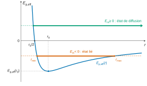
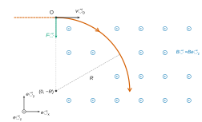
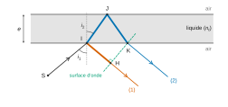
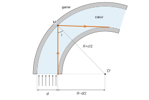
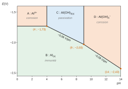

# e3a-Polytech MP — Physique-chimie 2026 · Corrigé brut

*Corrigé rédigé par IA, non officiel. Signalez toute erreur.*

Épreuve de 4 heures (code MP9PC), calculatrices interdites. Sujet « Autour de l'hélium » : cinq parties indépendantes, 43 questions.

## Partie I – L'hélium, un gaz « rare » dans notre atmosphère

### Q1.

L'atmosphère terrestre sèche est composée principalement de **diazote $\mathrm{N_2}$ (environ 78 % en quantité de matière) et de dioxygène $\mathrm{O_2}$ (environ 21 %)**. Le reste (environ 1 %) est surtout de l'argon, avec des traces de $\mathrm{CO_2}$, de néon et d'hélium.

### Q2.

Dans le référentiel géocentrique, on note $r=OP$ et $\vec e_r=\overrightarrow{OP}/r$. La loi de la gravitation universelle donne une force centrale et attractive :

$$\boxed{\vec F=-\frac{G M_T m}{r^2}\,\vec e_r}$$

On cherche $E_p(r)$ telle que $\vec F=-\overrightarrow{\mathrm{grad}}\,E_p=-\dfrac{\mathrm dE_p}{\mathrm dr}\vec e_r$. Il vient :

$$\begin{aligned}
\frac{\mathrm dE_p}{\mathrm dr}&=\frac{GM_Tm}{r^2}\\
E_p(r)&=-\frac{GM_Tm}{r}+\text{cste}
\end{aligned}$$

La condition $E_p(\infty)=0$ annule la constante :

$$\boxed{E_p(r)=-\frac{G M_T m}{r}}$$

### Q3.

$$\boxed{E_m=\frac12 m v^2-\frac{G M_T m}{r}}$$

Dans le référentiel géocentrique supposé galiléen, P n'est soumis qu'à $\vec F$, qui dérive de l'énergie potentielle $E_p$ : aucune force non conservative ne travaille. Le théorème de l'énergie mécanique donne :

$$\frac{\mathrm dE_m}{\mathrm dt}=\mathcal P_{\text{non conservatives}}=0$$

**L'énergie mécanique se conserve.**

### Q4.

Le moment de $\vec F$ en O est nul, car $\vec F$ est colinéaire à $\overrightarrow{OP}$ :

$$\overrightarrow{OP}\wedge\vec F=r\vec e_r\wedge\left(-\dfrac{GM_Tm}{r^2}\vec e_r\right)=\vec 0$$

Le théorème du moment cinétique en O (point fixe du référentiel galiléen) donne $\dfrac{\mathrm d\vec L_O}{\mathrm dt}=\vec 0$. Donc $\vec L_O=\overrightarrow{OP}\wedge m\vec v$ est un vecteur constant.

- Si $\vec L_O\neq\vec 0$ : $\overrightarrow{OP}\cdot\vec L_O=0$ à chaque instant, donc P reste dans le plan fixe passant par O et orthogonal à $\vec L_O$. Le mouvement est plan.
- Si $\vec L_O=\vec 0$ : $\vec v$ reste colinéaire à $\overrightarrow{OP}$, le mouvement est rectiligne (donc plan).

Dans ce plan, en coordonnées polaires, $\vec v=\dot r\,\vec e_r+r\dot\theta\,\vec e_\theta$. On en déduit $\vec L_O=m r^2\dot\theta\,\vec e_z$, avec $\vec e_z=\vec e_r\wedge\vec e_\theta$ fixe. Comme $\vec L_O$ est constant :

$$\boxed{r^2\dot\theta=C=\text{constante}}$$

### Q5.

En polaires, $v^2=\dot r^2+r^2\dot\theta^2$, et $r^2\dot\theta^2=C^2/r^2$. Donc :

$$E_m=\frac12 m\dot r^2+\frac{mC^2}{2r^2}-\frac{GM_Tm}{r}$$

$$\boxed{E_{p,\text{eff}}(r)=\frac{mC^2}{2r^2}-\frac{G M_T m}{r}}$$

### Q6.

Étude de $E_{p,\text{eff}}$ pour $C\neq0$ :

- quand $r\to0^+$, le terme en $1/r^2$ domine : $E_{p,\text{eff}}\to+\infty$ ;
- quand $r\to+\infty$, le terme en $-1/r$ domine : $E_{p,\text{eff}}\to0^-$ ;
- $E_{p,\text{eff}}'(r)=\dfrac{m}{r^3}\left(GM_Tr-C^2\right)$ s'annule en $r_0=\dfrac{C^2}{GM_T}$, négative avant, positive après : minimum $E_{p,\text{eff}}(r_0)=-\dfrac{m(GM_T)^2}{2C^2}<0$.

La courbe coupe l'axe en $r_0/2$ (figure 1).

Comme $\frac12m\dot r^2\ge0$, seules sont accessibles les valeurs de $r$ telles que $E_{p,\text{eff}}(r)\le E_m$ (droite horizontale d'ordonnée $E_m$) :

- si $E_{p,\text{eff}}(r_0)\le E_m<0$, la droite coupe la courbe en deux points $r_{\min}$ et $r_{\max}$ : $r$ reste borné, c'est un **état lié** ;
- si $E_m\ge0$, la droite reste au-dessus de la courbe pour tout $r$ supérieur au point de rebroussement $r_{\min}$ : $r$ peut tendre vers l'infini, c'est un **état de diffusion**.

**P peut échapper à l'attraction de la Terre si et seulement si $E_m\ge 0$.**

### Q7.

Le seuil $E_m=0$ ne dépend pas de $C$, donc pas de la direction du lancement. La vitesse minimale lancée depuis la surface ($r=R_T$) est celle qui donne $E_m=0$ :

$$\frac12 m v_\ell^2-\frac{GM_Tm}{R_T}=0$$

$$\boxed{v_\ell=\sqrt{\frac{2GM_T}{R_T}}}$$

Application numérique :

$$\begin{aligned}
v_\ell&=\sqrt{\frac{2\times7{,}0\cdot10^{-11}\times6{,}0\cdot10^{24}}{6{,}0\cdot10^{6}}}\ \mathrm{m\cdot s^{-1}}\\
&=\sqrt{1{,}4\cdot10^{8}}\ \mathrm{m\cdot s^{-1}}\\
&\approx\boxed{1{,}2\cdot10^{4}\ \mathrm{m\cdot s^{-1}}}
\end{aligned}$$

### Q8.

Modèle du gaz parfait :

- les particules sont ponctuelles : leur taille est négligeable devant la distance moyenne qui les sépare ;
- elles n'ont aucune interaction à distance ; elles ne subissent que des chocs (entre elles et sur les parois), supposés élastiques ;
- elles sont en très grand nombre, avec une répartition des vitesses homogène et isotrope (agitation thermique désordonnée).

### Q9.

La vitesse quadratique moyenne est la racine de la moyenne du carré des vitesses : $u=\sqrt{\langle v^2\rangle}$.

Pour un gaz parfait monoatomique, la température cinétique est définie par $\frac12 m_{\text{He}}\,u^2=\frac32k_BT$. Avec $m_{\text{He}}=\mathcal M_{\text{He}}/\mathcal N_A$ et $k_B=R/\mathcal N_A$, on obtient $\frac12\mathcal M_{\text{He}}u^2=\frac32RT$ :

$$\boxed{u=\sqrt{\frac{3RT}{\mathcal M_{\text{He}}}}}$$

### Q10.

$$\begin{aligned}
u&=\sqrt{\frac{3\times8{,}0\times300}{4{,}0\cdot10^{-3}}}\ \mathrm{m\cdot s^{-1}}\\
&=\sqrt{1{,}8\cdot10^{6}}\ \mathrm{m\cdot s^{-1}}\\
&\approx\boxed{1{,}3\cdot10^{3}\ \mathrm{m\cdot s^{-1}}}
\end{aligned}$$

Or $v_\ell/10\approx1{,}2\cdot10^{3}\ \mathrm{m\cdot s^{-1}}$ (Q7). On a donc $u>v_\ell/10$ : **les atomes d'hélium s'échappent de l'atmosphère**. L'hélium produit dans la croûte et libéré dans l'atmosphère est donc continuellement perdu vers l'espace, ce qui explique sa très faible concentration.

Pour comparaison, $u(\mathrm{N_2})=\sqrt{3RT/\mathcal M_{\mathrm{N_2}}}\approx5\cdot10^{2}\ \mathrm{m\cdot s^{-1}}$, inférieure à $v_\ell/10$ : le diazote est retenu.

## Partie II – Le laser hélium-néon

### Q11.

Trois applications :

- vie quotidienne : lecteurs de codes-barres, pointeurs, lecture des disques optiques ;
- médecine : chirurgie réfractive de l'œil, dermatologie, découpe et coagulation de tissus ;
- industrie et recherche : découpe et soudage de métaux, télémétrie, télécommunications par fibre optique, interférométrie de précision.

### Q12.

Dans un conducteur ohmique de conductivité $\gamma$, la loi d'Ohm locale s'écrit $\vec\jmath=\gamma\vec E$. La puissance volumique cédée par le champ aux porteurs de charge (effet Joule) vaut :

$$p=\vec\jmath\cdot\vec E=\gamma E^2$$

Un conducteur parfait correspond à $\gamma\to\infty$. Si $\vec E$ y gardait une valeur non nulle, la puissance dissipée $\gamma E^2$ deviendrait infinie, ce qui est impossible puisque l'énergie disponible est finie.

Pour que la puissance reste finie (et que la densité de courant $\vec\jmath$ reste finie), il faut $E=j/\gamma\to0$. La puissance dissipée $j^2/\gamma$ tend alors vers 0 : un conducteur parfait ne dissipe pas d'énergie. **Le champ électrique est nul dans un conducteur parfait.**

### Q13.

Dans le vide, sans charge ni courant ($\rho=0$, $\vec\jmath=\vec0$), les équations de Maxwell s'écrivent :

$$\begin{aligned}
\mathrm{div}\,\vec E&=0\\
\overrightarrow{\mathrm{rot}}\,\vec E&=-\frac{\partial\vec B}{\partial t}\\
\mathrm{div}\,\vec B&=0\\
\overrightarrow{\mathrm{rot}}\,\vec B&=\mu_0\varepsilon_0\frac{\partial\vec E}{\partial t}
\end{aligned}$$

On prend le rotationnel de Maxwell-Faraday et on intervertit les dérivations spatiales et temporelle :

$$\begin{aligned}
\overrightarrow{\mathrm{rot}}\left(\overrightarrow{\mathrm{rot}}\,\vec E\right)&=-\frac{\partial}{\partial t}\overrightarrow{\mathrm{rot}}\,\vec B\\
&=-\mu_0\varepsilon_0\frac{\partial^2\vec E}{\partial t^2}
\end{aligned}$$

Avec l'identité fournie et $\mathrm{div}\,\vec E=0$, le membre de gauche vaut $-\Delta\vec E$. En posant $c=1/\sqrt{\mu_0\varepsilon_0}$ :

$$\boxed{\Delta\vec E-\frac1{c^2}\frac{\partial^2\vec E}{\partial t^2}=\vec0}$$

Pour $E(x,t)=f(x)\sin(\omega t)$ (composante transverse), on a $\Delta E=f''(x)\sin(\omega t)$ et $\partial^2E/\partial t^2=-\omega^2f(x)\sin(\omega t)$. Cette relation étant vraie à tout instant :

$$\boxed{f''(x)+\frac{\omega^2}{c^2}f(x)=0}$$

### Q14.

Avec $k=\omega/c$, la solution générale est $f(x)=A\cos(kx)+B\sin(kx)$. Le champ est nul dans les miroirs (Q12) et continu en $x=0$ et $x=L$, donc $f(0)=f(L)=0$ :

- $f(0)=0$ impose $A=0$ ;
- $f(L)=0$ avec $B\neq0$ (sinon le champ est nul partout) impose $\sin(kL)=0$, soit $kL=n\pi$ avec $n\in\mathbb N^*$.

D'où $f(x)=B\sin\left(\dfrac{n\pi x}{L}\right)$ et $\omega_n=\dfrac{n\pi c}{L}$. Les fréquences propres valent :

$$\boxed{\nu_n=\frac{\omega_n}{2\pi}=\frac{n\,c}{2L}}$$

$$\boxed{\mathrm{ISL}=\nu_{n+1}-\nu_n=\frac{c}{2L}}$$

Le mode $n$ présente $n+1$ nœuds de champ électrique, en $x=pL/n$ ($p=0,\dots,n$).

### Q15.

Sur la photographie, le corps du laser mesure environ 6,5 à 7 fois la barre d'échelle de 2 cm. On prend la longueur de la cavité de l'ordre de celle du tube, $L\approx14$ cm (la cavité réelle est un peu plus courte que le boîtier).

$$\mathrm{ISL}=\frac{c}{2L}\approx\frac{3{,}0\cdot10^{8}}{2\times0{,}14}\ \mathrm{Hz}\approx\boxed{1\ \mathrm{GHz}}$$

**L'ordre de grandeur est cohérent avec la valeur du fabricant, 1 090 MHz**, qui correspond à $L=c/(2\,\mathrm{ISL})\approx13{,}8$ cm.

### Q16.

En configuration lame d'air, la différence de marche au centre de l'écran (incidence nulle) est $\delta=2e$, où $e$ est l'épaisseur de la lame d'air équivalente. L'ordre d'interférence au centre vaut $p=2e/\lambda$.

Un anneau brillant défile au centre chaque fois que $p$ varie d'une unité, c'est-à-dire quand $\delta$ varie de $\lambda$, donc quand $e$ varie de $\lambda/2$.

Pendant $\tau$, le miroir se déplace de $V_0\tau$, donc $\delta$ varie de $2V_0\tau$. Le défilement de $k$ anneaux donne donc :

$$2V_0\tau=k\lambda$$

soit

$$\boxed{\lambda=\frac{2V_0\tau}{k}}$$

Vérification : $\lambda=2\times0{,}667\cdot10^{-6}\times47{,}5/100\approx633{,}7$ nm, la valeur annoncée par l'énoncé.

### Q17.

$\lambda=2V_0\bar\tau/k$ est un produit de puissances de grandeurs supposées indépendantes. Les incertitudes relatives se composent en somme quadratique :

$$\boxed{u(\lambda)=\lambda\sqrt{\left(\frac{u(V_0)}{V_0}\right)^2+\left(\frac{u(\bar\tau)}{\bar\tau}\right)^2+\left(\frac{u(k)}{k}\right)^2}}$$

avec $u(\bar\tau)=s_\tau/\sqrt n$.

Avec la valeur donnée $u(\lambda)=7{,}6$ nm, l'écart normalisé vaut (l'incertitude sur la valeur de référence est négligeable) :

$$\begin{aligned}
z&=\frac{|\lambda_{\text{exp}}-\lambda_{\text{réf}}|}{u(\lambda)}\\
&=\frac{633{,}7-632{,}8}{7{,}6}\\
&\approx\boxed{0{,}12}
\end{aligned}$$

$z<2$ : **la mesure est compatible avec la valeur attendue de 632,8 nm.** L'incertitude reste en revanche grande (environ 1 %), dominée par le comptage des anneaux et par la dispersion des chronométrages.

Remarque : les données donnent $u(\bar\tau)=1{,}9/\sqrt{20}\approx0{,}42$ s. Les incertitudes relatives valent alors :

- $1{,}5\cdot10^{-3}$ pour $V_0$ ;
- $8{,}9\cdot10^{-3}$ pour $\bar\tau$ ;
- $1{,}0\cdot10^{-2}$ pour $k$.

On trouve ainsi $u(\lambda)\approx8{,}6$ nm plutôt que 7,6 nm, puis $z\approx0{,}10$ : la conclusion est la même.

### Q18.

Les deux modes ont des fréquences différentes : ils sont incohérents entre eux, et leurs intensités s'ajoutent. On les suppose de même intensité $I_0$ (cette hypothèse ne change pas la position du brouillage, seulement la valeur minimale du contraste). Pour une différence de marche $\delta$ au centre :

$$\begin{aligned}
I(\delta)&=2I_0\left[2+\cos\frac{2\pi\nu_1\delta}{c}+\cos\frac{2\pi\nu_2\delta}{c}\right]\\
&=4I_0\left[1+\cos\left(\frac{\pi\,\mathrm{ISL}\,\delta}{c}\right)\cos\left(\frac{\pi(\nu_1+\nu_2)\delta}{c}\right)\right]
\end{aligned}$$

Le second cosinus varie vite (franges), le premier est une enveloppe lente qui fixe le contraste $\mathcal C=\left|\cos\left(\pi\,\mathrm{ISL}\,\delta/c\right)\right|$.

Au contact optique ($\delta=0$), $\mathcal C=1$. Le premier brouillage ($\mathcal C=0$) a lieu pour $\pi\,\mathrm{ISL}\,\delta_b/c=\pi/2$ :

$$\boxed{\delta_b=\frac{c}{2\,\mathrm{ISL}}}$$

### Q19.

$$\delta_b=\frac{3{,}0\cdot10^{8}}{2\times1{,}1\cdot10^{9}}\ \mathrm m\approx\boxed{0{,}14\ \mathrm m}$$

C'est la longueur $L$ de la cavité. Il faudrait translater le miroir mobile de $\delta_b/2\approx7$ cm depuis le contact optique.

La course du chariot d'un Michelson de TP est de l'ordre du centimètre, soit une différence de marche accessible de quelques centimètres au plus. **On n'observe donc pas ce brouillage avec un Michelson usuel** : sur toute la plage accessible, le contraste reste proche de 1 et le laser He-Ne se comporte comme une source monochromatique. Les deux modes ne perturbent pas la mesure de Q16.

## Partie III – De l'hélium pour détecter les fuites

### Q20.

Système : l'ion, dans le référentiel terrestre galiléen, poids négligé. La seule force est la force de Lorentz magnétique $\vec F=e\,\vec v\wedge\vec B$, avec $\vec B$ colinéaire à $\vec e_z$.

Cette force est orthogonale à $\vec B$, donc $\vec F\cdot\vec e_z=0$. Le principe fondamental de la dynamique, projeté sur $\vec e_z$, donne $m\ddot z=0$.

Les conditions initiales sont $z(0)=0$ et $\dot z(0)=0$, car $\vec v_0=v_0\vec e_x$. On obtient donc $z(t)=0$ à tout instant : **la trajectoire est contenue dans le plan $(O,\vec e_x,\vec e_y)$.**

### Q21.

La puissance de la force magnétique est nulle : $\mathcal P=e(\vec v\wedge\vec B)\cdot\vec v=0$. Le théorème de l'énergie cinétique donne $\dfrac{\mathrm d}{\mathrm dt}\left(\frac12mv^2\right)=0$, donc $\|\vec v\|=v_0$ : **le mouvement est uniforme.**

Sur la figure 2, l'ion entre en O selon $+\vec e_x$ et s'incurve vers le détecteur, situé en dessous, donc vers $-\vec e_y$. La force initiale doit être selon $-\vec e_y$.

Avec $\vec B=B_z\vec e_z$, la force initiale vaut $e\,v_0\vec e_x\wedge B_z\vec e_z=-e\,v_0B_z\,\vec e_y$. Comme $e>0$, il faut $B_z>0$ :

$$\boxed{\vec B=+B\,\vec e_z}$$

Le champ est sortant du plan de la figure, comme $\vec e_z$.

### Q22.

Le principe fondamental de la dynamique s'écrit, avec $\vec e_x\wedge\vec e_z=-\vec e_y$ et $\vec e_y\wedge\vec e_z=\vec e_x$ :

$$m\frac{\mathrm d\vec v}{\mathrm dt}=e\vec v\wedge B\vec e_z=eB(v_y\vec e_x-v_x\vec e_y)$$

Avec $\omega=eB/m$ :

$$\boxed{\begin{aligned}
\frac{\mathrm dv_x}{\mathrm dt}&=\omega\,v_y\\
\frac{\mathrm dv_y}{\mathrm dt}&=-\omega\,v_x
\end{aligned}}$$

### Q23.

On dérive $\underline u=v_y+\mathrm jv_x$ et on remplace avec Q22 :

$$\begin{aligned}
\frac{\mathrm d\underline u}{\mathrm dt}&=\frac{\mathrm dv_y}{\mathrm dt}+\mathrm j\frac{\mathrm dv_x}{\mathrm dt}\\
&=-\omega v_x+\mathrm j\omega v_y\\
&=\mathrm j\omega\left(v_y+\mathrm jv_x\right)\\
&=\mathrm j\omega\,\underline u
\end{aligned}$$

d'où $\boxed{\dfrac{\mathrm d\underline u}{\mathrm dt}-\mathrm j\omega\,\underline u=0}$.

### Q24.

$\underline u(t)=\underline u(0)\,e^{\mathrm j\omega t}$ avec $\underline u(0)=v_y(0)+\mathrm jv_x(0)=\mathrm jv_0$. Donc :

$$\begin{aligned}
\underline u(t)&=\mathrm jv_0\left(\cos\omega t+\mathrm j\sin\omega t\right)\\
&=-v_0\sin\omega t+\mathrm j\,v_0\cos\omega t
\end{aligned}$$

Par identification de la partie réelle ($v_y$) et de la partie imaginaire ($v_x$) :

$$\boxed{\begin{aligned}
v_x(t)&=v_0\cos(\omega t)\\
v_y(t)&=-v_0\sin(\omega t)
\end{aligned}}$$

### Q25.

On intègre avec $x(0)=y(0)=0$ :

$$\boxed{\begin{aligned}
x(t)&=\frac{v_0}{\omega}\sin(\omega t)\\
y(t)&=\frac{v_0}{\omega}\left(\cos(\omega t)-1\right)
\end{aligned}}$$

### Q26.

$$\begin{aligned}
x^2+\left(y+\frac{v_0}{\omega}\right)^2&=\frac{v_0^2}{\omega^2}\left(\sin^2\omega t+\cos^2\omega t\right)\\
&=\frac{v_0^2}{\omega^2}
\end{aligned}$$

La trajectoire est un arc du cercle de centre $\left(0,-\dfrac{v_0}{\omega}\right)$ et de rayon $v_0/\omega$ :

$$\boxed{R=\frac{v_0}{\omega}=\frac{m\,v_0}{e\,B}}$$

### Q27.

À énergie cinétique $E_c$ fixée, $v_0=\sqrt{2E_c/m}$, donc $R=\dfrac{\sqrt{2mE_c}}{eB}\propto\sqrt m$ pour une même charge : plus l'ion est lourd, plus le rayon est grand.

Sur la figure 2, (1) est la trajectoire de plus petit rayon, (3) celle de plus grand rayon, et (2), intermédiaire, aboutit au détecteur. Le champ est réglé pour que seuls les ions hélium traversent : ce sont eux qui suivent (2).

| Trajectoire | Rayon | Ions |
|---|---|---|
| (1) | le plus petit | ions légers ($\mathrm H_2^+$, $^3\mathrm{He}^+$) |
| (2) | intermédiaire, vers le détecteur | ions hélium $^4\mathrm{He}^+$ |
| (3) | le plus grand | ions lourds ($\mathrm N_2^+$, $\mathrm O_2^+$, $\mathrm{CO_2^+}$, $\mathrm{Ar^+}$) |

### Q28.

Le quart de cercle, de longueur $\pi R/2$, est parcouru à la vitesse constante $v_0$ :

$$\tau=\frac{\pi R}{2v_0}=\frac{\pi}{2\omega}$$

La masse d'un ion hélium vaut :

$$m=\frac{\mathcal M_{\text{He}}}{\mathcal N_A}=\frac{4{,}0\cdot10^{-3}}{6{,}0\cdot10^{23}}\ \mathrm{kg}\approx6{,}7\cdot10^{-27}\ \mathrm{kg}$$

D'où :

$$\begin{aligned}
\omega&=\frac{eB}{m}=\frac{1{,}6\cdot10^{-19}\times0{,}10}{6{,}7\cdot10^{-27}}\ \mathrm{rad\cdot s^{-1}}\\
&\approx2{,}4\cdot10^{6}\ \mathrm{rad\cdot s^{-1}}\\
\tau&=\frac{\pi}{2\omega}\approx\boxed{6{,}5\cdot10^{-7}\ \mathrm s}
\end{aligned}$$

$\tau=\dfrac{\pi m}{2eB}$ ne dépend pas de $v_0$.

### Q29.

On compare la vitesse des ions à la célérité $c$ de la lumière. D'après Q26, $v_0=R\,\omega=\dfrac{eBR}{m}$.

Pour $R\approx3$ cm :

$$v_0\approx3\cdot10^{-2}\times2{,}4\cdot10^{6}\ \mathrm{m\cdot s^{-1}}\approx7\cdot10^{4}\ \mathrm{m\cdot s^{-1}}$$

Pour $R$ entre 1 et 10 cm, $v_0$ reste entre $2\cdot10^{4}$ et $2\cdot10^{5}\ \mathrm{m\cdot s^{-1}}$.

Donc $v_0/c\lesssim10^{-3}$ : **il était pertinent de négliger les effets relativistes**. L'écart relatif du facteur de Lorentz à 1 est de l'ordre de $(v_0/c)^2/2\lesssim10^{-6}$.

## Partie IV – Des bulles de savon remplies d'hélium

### Q30.

Sphère : $V_0=\frac43\pi r^3$, donc :

$$\begin{aligned}
S_s&=4\pi r^2\\
&=(4\pi)^{1/3}(3V_0)^{2/3}\\
&=(36\pi)^{1/3}V_0^{2/3}
\end{aligned}$$

Cube : $V_0=a^3$ et $S_c=6a^2=6V_0^{2/3}$. Donc :

$$\begin{aligned}
\frac{S_s}{S_c}&=\frac{(36\pi)^{1/3}}{6}\\
&=\left(\frac{36\pi}{216}\right)^{1/3}\\
&=\boxed{\left(\frac\pi6\right)^{1/3}\approx0{,}81<1}
\end{aligned}$$

À volume égal, la sphère a une surface plus petite que le cube (elle minimise la surface parmi tous les solides de volume donné). L'énergie de surface du film étant proportionnelle à son aire, la bulle libre prend une forme sphérique : c'est la forme observée sur la figure 3.

### Q31.

Bulle de rayon $r_c$ dans l'air au repos, référentiel terrestre galiléen. Forces :

- poids de l'hélium : $\rho_{\text{He}}\frac43\pi r_c^3\,g$, vers le bas ;
- poids de la coque liquide, de volume $4\pi r_c^2e$ (car $e\ll r_c$) : $\rho_\ell\,4\pi r_c^2e\,g$, vers le bas ;
- poussée d'Archimède, poids de l'air déplacé (boule de rayon $r_c+e\simeq r_c$) : $\rho_a\frac43\pi r_c^3\,g$, vers le haut.

Les bulles plus grosses que $r_c$ montent et les plus petites descendent : à $r=r_c$, la résultante est nulle.

$$\rho_{\text{He}}\frac43\pi r_c^3+\rho_\ell\,4\pi r_c^2e=\rho_a\frac43\pi r_c^3$$

$$\boxed{e=\frac{(\rho_a-\rho_{\text{He}})\,r_c}{3\rho_\ell}}$$

Application numérique :

$$\begin{aligned}
e&=\frac{(1{,}2-0{,}2)\times6\cdot10^{-3}}{3\times1{,}0\cdot10^{3}}\ \mathrm m\\
&=\boxed{2\cdot10^{-6}\ \mathrm m=2\ \mu\mathrm m}
\end{aligned}$$

On vérifie que $e\ll r_c$. Le rapport poussée sur poids vaut $\dfrac{\rho_a r}{\rho_{\text{He}}r+3\rho_\ell e}$ : il croît avec $r$, ce qui explique que seules les grosses bulles montent.

### Q32.

Notations : I est le point où le rayon incident issu de S atteint la face inférieure du film. Le rayon (1) s'y réfléchit. Le rayon (2) s'y réfracte sous l'angle $i_2$ ($\sin i_1=n_\ell\sin i_2$), se réfléchit en J sur la face supérieure, puis ressort en K sur la face inférieure, parallèlement à (1) (lois de Snell-Descartes). Les deux rayons ont le même trajet jusqu'en I.

Soit H le projeté orthogonal de K sur le rayon (1). Les rayons émergents sont parallèles. Par retour inverse de la lumière, on peut les voir comme issus d'une source à l'infini : le plan orthogonal aux rayons passant par H et K est alors une surface d'onde (théorème de Malus). Les chemins optiques de H à l'infini et de K à l'infini sont donc égaux, et la différence de marche vaut :

$$\delta=(IJK)-(IH)=n_\ell\,\frac{2e}{\cos i_2}-IK\sin i_1$$

avec $IK=2e\tan i_2$. Comme $\sin i_1=n_\ell\sin i_2$ :

$$\begin{aligned}
\delta&=\frac{2n_\ell e}{\cos i_2}-\frac{2n_\ell e\sin^2i_2}{\cos i_2}\\
&=2n_\ell e\cos i_2
\end{aligned}$$

Le rayon (1) subit un déphasage supplémentaire de $\pi$ à la réflexion air/liquide. Le rayon (2) se réfléchit sur un milieu moins réfringent (liquide/air) et ne subit pas de déphasage de réflexion. Le déphasage de (2) par rapport à (1) à l'infini vaut donc :

$$\begin{aligned}
\varphi&=\frac{2\pi}{\lambda}\,2n_\ell e\cos i_2-\pi\\
&=\frac\alpha\lambda\cos i_2-\pi
\end{aligned}$$

$$\boxed{\alpha=4\pi n_\ell e}$$

### Q33.

Les interférences sont destructives quand $\varphi=(2p+1)\pi$ avec $p\in\mathbb Z$, soit $\dfrac{\alpha\cos i_2}{\lambda}=2(p+1)\pi$. On pose $k=p+1$, qui doit être un entier strictement positif puisque $\lambda>0$ :

$$\boxed{\begin{aligned}
\lambda_k&=\frac{\alpha\cos i_2}{2\pi k}\\
&=\frac{2n_\ell e\cos i_2}{k},\quad k\in\mathbb N^*
\end{aligned}}$$

### Q34.

En incidence normale, $\lambda_k=2n_\ell e/k$, donc $\dfrac1{\lambda_k}=\dfrac{k}{2n_\ell e}$ : les nombres d'onde éteints sont régulièrement espacés de $\dfrac1{2n_\ell e}$.

Lecture des minima nuls de la figure 5 (à quelques nm près) : environ 669, 595, 535, 487, 446, 410 et 381 nm. Leurs inverses (en $\mu\mathrm m^{-1}$) valent 1,49 ; 1,68 ; 1,87 ; 2,05 ; 2,24 ; 2,44 ; 2,62.

L'écart entre deux valeurs successives est constant. Sur six intervalles, il vaut $(2{,}62-1{,}49)/6\approx0{,}188\ \mu\mathrm m^{-1}$. Les ordres correspondants vont de $k=8$ (669 nm) à $k=14$ (381 nm), car $8\times0{,}188\approx1{,}50\ \mu\mathrm m^{-1}$. Donc :

$$2n_\ell e=\frac1{0{,}188\ \mu\mathrm m^{-1}}\approx5{,}3\ \mu\mathrm m$$

$$e\approx\frac{5{,}3}{2\times1{,}33}\ \mu\mathrm m\approx\boxed{2{,}0\ \mu\mathrm m}$$

Contrôle avec un seul minimum : $e=\dfrac{8\times669\ \mathrm{nm}}{2\times1{,}33}\approx2{,}0\ \mu\mathrm m$. **Cette valeur est en très bon accord avec les 2 µm de la question Q31.**

### Q35.

Sur la figure 6, $R$ est le rayon de courbure de l'axe de la fibre (ligne médiane du cœur). Le centre de courbure est noté O'. Les bords du cœur sont des arcs de cercle de rayons $R-d/2$ (intérieur) et $R+d/2$ (extérieur).

Un rayon entre parallèlement à l'axe, en incidence normale, à la distance $\rho\in[R-d/2,\,R+d/2]$ de O'. Il se propage en ligne droite et frappe la paroi extérieure en M. Dans le triangle rectangle formé par O', le pied de la perpendiculaire issue de O' sur le rayon, et M, l'angle d'incidence $i$ (entre le rayon et la normale O'M) vérifie :

$$\sin i=\frac{\rho}{R+d/2}$$

Après réflexion sur un cercle de centre O', la distance de O' au rayon réfléchi est encore $\rho$ : toutes les réflexions suivantes se font sous le même angle, et le rayon ne coupe jamais la paroi intérieure. L'angle est le plus faible pour $\rho=R-d/2$.

Toute la lumière est guidée sans perte si la réflexion est totale pour ce rayon, soit $\sin i\ge n_2/n_1$ :

$$\frac{R-d/2}{R+d/2}\ge\frac{n_2}{n_1}$$

ce qui équivaut à $R\,(n_1-n_2)\ge\dfrac d2\,(n_1+n_2)$. D'où :

$$\boxed{R_{\min}=\frac{d}{2}\,\frac{n_1+n_2}{n_1-n_2}}$$

Application numérique :

$$\begin{aligned}
R_{\min}&=\frac{50\cdot10^{-6}}{2}\times\frac{3{,}00}{0{,}10}\ \mathrm m\\
&=\boxed{7{,}5\cdot10^{-4}\ \mathrm m=0{,}75\ \mathrm{mm}}
\end{aligned}$$

## Partie V – Gonfler un ballon volant sans hélium

### Q36.

La réaction produit du dihydrogène gazeux, qui gonfle le ballon. Sa masse molaire (2 g/mol) est bien plus faible que celle de l'air (29 g/mol).

À même température et même pression, la masse volumique d'un gaz parfait, $\rho=P\mathcal M/(RT)$, est donc environ quinze fois plus faible pour $\mathrm H_2$ que pour l'air.

Le ballon de volume $V$ subit la poussée d'Archimède $\rho_aVg$, et son poids vaut $(m_{\text{env}}+\rho_{\mathrm H_2}V)g$.

Il s'envole dès que $(\rho_a-\rho_{\mathrm H_2})V>m_{\text{env}}$, ce que permet un volume suffisant de $\mathrm H_2$ : **$\mathrm H_2$ joue le même rôle que l'hélium.**

### Q37.

Une base forte est une base qui réagit **totalement** avec l'eau : $\mathrm B+\mathrm H_2\mathrm O\to\mathrm{BH^+}+\mathrm{HO^-}$. En solution aqueuse, elle est entièrement remplacée par l'ion hydroxyde $\mathrm{HO^-}$, base la plus forte qui existe dans l'eau. L'hydroxyde de sodium, solide ionique, se dissout totalement : $\mathrm{NaOH_{(s)}}\to\mathrm{Na^+_{(aq)}}+\mathrm{HO^-_{(aq)}}$.

Pour $c=0{,}1\ \mathrm{mol\cdot L^{-1}}$, on a $[\mathrm{HO^-}]=c$ : l'autoprotolyse de l'eau est négligeable car $c\gg10^{-7}\ \mathrm{mol\cdot L^{-1}}$. Alors $[\mathrm{H_3O^+}]=K_e/c$, et :

$$\begin{aligned}
\mathrm{pH}&=\mathrm pK_e+\log c\\
&=14-1=\boxed{13}
\end{aligned}$$

### Q38.

Nombres d'oxydation de l'aluminium (O : $-\mathrm{II}$, H : $+\mathrm I$) :

| Espèce | n.o. de Aℓ |
|---|---|
| $\mathrm{A\ell_{(s)}}$ | 0 |
| $\mathrm{A\ell^{3+}_{(aq)}}$ | $+\mathrm{III}$ |
| $\mathrm{A\ell(OH)_{3(s)}}$ | $+\mathrm{III}$ (car $x-6+3=0$) |
| $\mathrm{A\ell(OH)_{4(aq)}^-}$ | $+\mathrm{III}$ (car $x-8+4=-1$) |

Le n.o. croît avec $E$ : $\mathrm{A\ell}$ (n.o. 0) occupe le domaine du bas, **B**.

Parmi les espèces au n.o. $+\mathrm{III}$, le pH croissant correspond à une complexation croissante par $\mathrm{HO^-}$ : $\mathrm{A\ell^{3+}}$ en milieu acide, puis $\mathrm{A\ell(OH)_3}$, puis $\mathrm{A\ell(OH)_4^-}$ en milieu basique.

$$\boxed{\mathrm A:\mathrm{A\ell^{3+}_{(aq)}}\quad \mathrm B:\mathrm{A\ell_{(s)}}\quad \mathrm C:\mathrm{A\ell(OH)_{3(s)}}\quad \mathrm D:\mathrm{A\ell(OH)^-_{4(aq)}}}$$

B et C sont des domaines d'existence (solides), A et D des domaines de prédominance (espèces dissoutes).

- **Immunité** : domaine B, où le métal est stable.
- **Passivation** : domaine C ($4\lesssim\mathrm{pH}\lesssim9$), où l'oxydation produit un solide ($\mathrm{A\ell(OH)_3}$, ou l'alumine) qui peut former une couche protectrice.
- **Corrosion** : domaines A ($\mathrm{pH}\lesssim4$) et D ($\mathrm{pH}\gtrsim9$), où l'aluminium passe en solution.

### Q39.

**Frontière A/C** (verticale, lue à $\mathrm{pH}=4{,}0$). À la frontière, le précipité apparaît avec $[\mathrm{A\ell^{3+}}]=c_T$ :

$$K_s=c_T\left(\frac{K_e}{[\mathrm H_3\mathrm O^+]}\right)^3$$

$$\begin{aligned}
\mathrm pK_s&=-\log c_T+3(\mathrm pK_e-\mathrm{pH})\\
&=3+3\times10=\boxed{33}
\end{aligned}$$

Ce résultat est proche de la valeur donnée, 33,5. Avec $\mathrm pK_s=33{,}5$, la frontière théorique serait à $\mathrm{pH}=3{,}8$, difficile à distinguer de 4 sur le graphe.

**Frontière A/B** (horizontale, lue à $E\approx-1{,}73$ V). Pour $\mathrm{A\ell^{3+}}+3e^-=\mathrm{A\ell_{(s)}}$, la loi de Nernst avec $[\mathrm{A\ell^{3+}}]=c_T$ donne :

$$\begin{aligned}
E&=E^\circ+\frac{0{,}06}{3}\log c_T\\
&=E^\circ-0{,}06\ \mathrm V
\end{aligned}$$

$$E^\circ\approx-1{,}73+0{,}06=\boxed{-1{,}67\ \mathrm V}$$

C'est en accord avec la valeur donnée, $-1{,}66$ V, à la précision de lecture près.

### Q40.

Demi-équation : $\mathrm{A\ell(OH)_4^-}+4\mathrm H^++3e^-=\mathrm{A\ell_{(s)}}+4\mathrm H_2\mathrm O$. Loi de Nernst :

$$\begin{aligned}
E&=E^\circ_{\mathrm{A\ell(OH)_4^-/A\ell}}+\frac{0{,}06}{3}\log\left([\mathrm{A\ell(OH)_4^-}][\mathrm H^+]^4\right)\\
&=E^\circ+0{,}02\log c_T-0{,}08\,\mathrm{pH}
\end{aligned}$$

$$\boxed{\text{pente théorique}=-0{,}08\ \mathrm{V}\ \text{par unité de pH}}$$

Sur la figure 7, la frontière B/D passe par $(\mathrm{pH}=9{,}0\ ;\ E\approx-2{,}03\ \mathrm V)$ et $(\mathrm{pH}=14\ ;\ E\approx-2{,}43\ \mathrm V)$. La pente lue vaut $\dfrac{-0{,}40}{5}=-0{,}08$ V par unité de pH. **La pente lue est égale à la pente théorique.**

La frontière B/C, de pente $-0{,}06$ V par unité de pH, correspond à $\mathrm{A\ell(OH)_3}+3\mathrm H^++3e^-=\mathrm{A\ell}+3\mathrm H_2\mathrm O$.

### Q41.

En milieu basique :

$$\text{oxydation :}\quad \mathrm{A\ell_{(s)}}+4\,\mathrm{HO^-_{(aq)}}=\mathrm{A\ell(OH)^-_{4(aq)}}+3e^-$$

$$\text{réduction :}\quad 2\,\mathrm H_2\mathrm O_{(\ell)}+2e^-=\mathrm H_{2(g)}+2\,\mathrm{HO^-_{(aq)}}$$

On combine 2 × (oxydation) + 3 × (réduction) pour échanger 6 électrons, qui disparaissent du bilan. On simplifie ensuite 6 $\mathrm{HO^-}$ :

$$\boxed{2\,\mathrm{A\ell_{(s)}}+2\,\mathrm{HO^-_{(aq)}}+6\,\mathrm H_2\mathrm O_{(\ell)}\longrightarrow2\,\mathrm{A\ell(OH)^-_{4(aq)}}+3\,\mathrm H_{2(g)}}$$

Vérification : Aℓ 2/2, O 8/8, H 14/14, charges $-2/-2$.

### Q42.

Loi de Hess :

$$\Delta_rG^\circ=2\Delta_fG^\circ(\mathrm{A\ell(OH)_4^-})+3\Delta_fG^\circ(\mathrm H_2)-2\Delta_fG^\circ(\mathrm{A\ell})-2\Delta_fG^\circ(\mathrm{HO^-})-6\Delta_fG^\circ(\mathrm H_2\mathrm O)$$

$$\begin{aligned}
\Delta_rG^\circ&=2(-1325)+0-0-2(-230)-6(-237)\\
&=-2650+460+1422\\
&=\boxed{-768\ \mathrm{kJ\cdot mol^{-1}}}
\end{aligned}$$

$$\Delta_rG^\circ=-RT\ln K^\circ$$

$$\boxed{K^\circ=\exp\left(-\frac{\Delta_rG^\circ}{RT}\right)}$$

$K^\circ=7\cdot10^{134}\gg1$ : **la réaction est thermodynamiquement totale**. On peut traiter l'aluminium comme intégralement consommé tant que la soude est en excès.

Une constante aussi grande ne dit rien de la vitesse. En pratique, la réaction n'est rapide que parce que la soude dissout la couche protectrice d'alumine (l'aluminium est corrodé en milieu basique, domaine D).

### Q43.

$\mathrm H_2$ est assimilé à un gaz parfait :

$$n_{\mathrm H_2}=\frac{PV}{RT}=\frac{1{,}013\cdot10^{5}\times5{,}0\cdot10^{-3}}{8{,}3\times298}\ \mathrm{mol}\approx0{,}205\ \mathrm{mol}$$

La réaction est totale, la soude est en excès et l'aluminium est le réactif limitant. D'après le bilan de Q41 (2 Aℓ pour 3 $\mathrm H_2$), $n_{\mathrm{A\ell}}=\frac23n_{\mathrm H_2}\approx0{,}137$ mol, d'où :

$$\begin{aligned}
m&=\frac23\,\frac{PV}{RT}\,\mathcal M_{\mathrm{A\ell}}\\
&\approx0{,}137\times27\ \mathrm g\approx\boxed{3{,}7\ \mathrm g}
\end{aligned}$$

FIN
