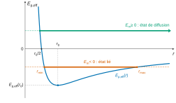
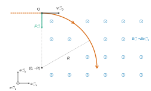
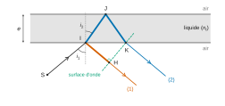
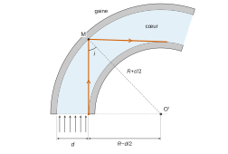
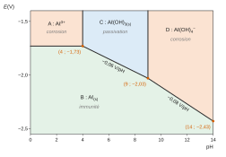

# e3a-Polytech MP — Physique-chimie 2026 · Corrigé guidé

*Corrigé rédigé par IA, non officiel. Signalez toute erreur.*

## Présentation du sujet

**Thème** : « Autour de l'hélium ». L'épreuve dure 4 heures, **sans calculatrice**. Le sujet compte 9 pages et **43 questions** réparties en cinq parties **indépendantes**. Les données sont regroupées en fin de chaque partie. L'énoncé rappelle qu'un résultat numérique sans unité, ou avec une unité fausse, n'est pas compté, et que les explications physiques pèsent autant que les calculs.

| Partie | Questions | Contenu | Notions du programme MPSI/MP |
|---|---|---|---|
| I – L'hélium, un gaz « rare » | Q1–Q10 | Pourquoi l'hélium s'échappe de l'atmosphère : vitesse de libération comparée à l'agitation thermique. | Force centrale conservative, moment cinétique, énergie potentielle effective, états liés et de diffusion, gaz parfait, vitesse quadratique moyenne |
| II – Le laser hélium-néon | Q11–Q19 | Modes propres de la cavité, mesure de $\lambda$ au Michelson, brouillage dû à deux modes. | Conducteur parfait, équations de Maxwell, onde stationnaire, Michelson en lame d'air, incertitudes de type A et B, écart normalisé, battements de contraste |
| III – Détection de fuites | Q20–Q29 | Spectromètre de masse : tri des ions par le rayon de leur trajectoire. | Force de Lorentz, puissance nulle, notation complexe, mouvement circulaire uniforme, ordre de grandeur relativiste |
| IV – Bulles de savon à l'hélium | Q30–Q35 | Forme sphérique, flottabilité et épaisseur du film, mesure interférentielle de cette épaisseur, fibre optique courbée. | Poussée d'Archimède, lame mince, théorème de Malus, spectre cannelé, réflexion totale |
| V – Ballon sans hélium | Q36–Q43 | Aluminium et soude produisent du dihydrogène. | Base forte et pH, diagramme potentiel-pH, loi de Nernst, demi-équations en milieu basique, $\Delta_rG^\circ$ et $K^\circ$, gaz parfait et stœchiométrie |

**Difficulté.** Le sujet est long mais très guidé. La plupart des questions sont des questions de cours ou des applications directes. Les passages qui demandent de la réflexion sont :

- la discussion graphique de l'énergie potentielle effective (Q6) ;
- le calcul de la différence de marche dans le film par le théorème de Malus (Q32), une démonstration classique qu'il faut savoir refaire ;
- la lecture quantitative du spectre cannelé (Q34) et du diagramme potentiel-pH (Q39–Q40) ;
- la géométrie de la fibre courbée (Q35), la question la moins standard du sujet ;
- les questions d'ordre de grandeur et de « conclusion » (Q10, Q15, Q19, Q29), où le correcteur attend une phrase physique et pas seulement un nombre.

**Ce qu'en dit le rapport 2026.** Le rapport, commun aux sujets MP et MPI (les parties II et V diffèrent un peu), ne donne pas de statistiques par question. Il note que la partie I, proche du cours, « n'a pas été très bien réussie », et que la chimie (partie V) a été « assez bien réussie ». Les questions qui ont fait la différence :

- la planéité du mouvement (Q4 et Q20) et son uniformité (Q21), « rarement » bien démontrées ;
- la justification du champ nul dans un conducteur parfait (Q12) ;
- les questions sur le Michelson (Q16 à Q19) et l'écart normalisé (Q17) ;
- l'attribution justifiée des trajectoires (Q27) ;
- le bilan des forces sur la bulle (Q31) ;
- l'optique de la partie IV (Q32 à Q35), où seuls de rares candidats se sont illustrés, et ont été récompensés ;
- les domaines d'immunité, de passivation et de corrosion (Q38) et les coefficients du bilan rédox (Q41).

**Questions abordables à ne pas laisser passer** : Q1–Q5, Q7–Q9, Q11, Q13–Q14, Q16, Q20–Q26, Q28, Q30–Q31, Q37–Q38, Q41–Q43. Elles représentent plus de la moitié du sujet.

**Calcul sans calculatrice.** Les données sont choisies pour que les calculs tombent juste ($\sqrt{1{,}4\cdot10^8}$, $\sqrt{1{,}8\cdot10^6}$, $m_{\text{He}}=6{,}7\cdot10^{-27}$ kg…). Gardez les puissances de dix à part et annoncez deux chiffres significatifs.

**Gestion du temps.** Comptez environ 40 minutes pour la partie I, 55 pour la II, 40 pour la III, 50 pour la IV et 45 pour la V, et gardez 10 minutes de relecture. Les parties sont indépendantes, mais le rapport 2026 met en garde contre les allers-retours entre parties pour grappiller les questions faciles : traitez chaque partie de façon suivie. La partie V (chimie) est souvent négligée en fin d'épreuve : elle est pourtant rapide et rentable.

## Partie I – L'hélium, un gaz « rare » dans notre atmosphère

On établit le critère d'échappement d'un point soumis à la gravitation terrestre (énergie mécanique positive), on en déduit la vitesse de libération, puis on la compare à la vitesse d'agitation thermique des atomes d'hélium. Outils : théorèmes du moment cinétique et de l'énergie mécanique, énergie potentielle effective, théorie cinétique du gaz parfait.

### Question 1

> [!INDICATION]
> Connaissance générale : deux gaz diatomiques, l'un très majoritaire.

#### Solution

L'atmosphère sèche contient environ **78 % de diazote $\mathrm{N_2}$ et 21 % de dioxygène $\mathrm{O_2}$** (en quantité de matière, donc en volume). Le pour cent restant est surtout de l'argon, avec des traces de $\mathrm{CO_2}$, de néon et d'hélium.

### Question 2

> [!INDICATION]
> Loi de la gravitation universelle, écrite avec le vecteur unitaire $\vec e_r$ dirigé de O vers P.

> [!INDICATION]
> $\vec F=-\overrightarrow{\mathrm{grad}}\,E_p$ : en symétrie sphérique, il suffit d'intégrer par rapport à $r$, puis de fixer la constante à l'infini.

#### Solution

$$\boxed{\vec F=-\frac{G M_T m}{r^2}\,\vec e_r}$$

On cherche $E_p(r)$ avec $\vec F=-\dfrac{\mathrm dE_p}{\mathrm dr}\vec e_r$. Il vient :

$$\begin{aligned}
\frac{\mathrm dE_p}{\mathrm dr}&=\frac{GM_Tm}{r^2}\\
E_p&=-\frac{GM_Tm}{r}+\text{cste}
\end{aligned}$$

Avec $E_p(\infty)=0$ :

$$\boxed{E_p(r)=-\frac{G M_T m}{r}}$$

> [!PIEGE]
> Les deux signes « moins » ont un sens physique. La force est attractive (vers O) et $E_p$ est négative, croissante vers 0. Vérifiez toujours qu'une énergie potentielle d'attraction croît avec la distance. La force est un vecteur, l'énergie un scalaire : n'écrivez pas l'une à la place de l'autre.

> [!JURY]
> Le rapport 2026 signale que, dans cette partie, « des confusions vecteur/scalaire ou des problèmes de signe sur l'énergie potentielle gravitationnelle ont ruisselé dans les questions suivantes » (p. 1). Une erreur ici fausse $E_m$, $E_{p,\text{eff}}$ et la vitesse de libération.

### Question 3

> [!INDICATION]
> Énergie cinétique plus énergie potentielle. Pour la conservation, quelle est la nature de l'unique force ?

#### Solution

$$\boxed{E_m=\frac12 m v^2-\frac{G M_T m}{r}}$$

Le référentiel géocentrique est supposé galiléen et la seule force, $\vec F$, est conservative : aucune force non conservative ne travaille. Le théorème de l'énergie mécanique donne :

$$\frac{\mathrm dE_m}{\mathrm dt}=\mathcal P_{\text{non conservatives}}=0$$

$E_m$ se conserve.

> [!JURY]
> Le rapport 2026 rappelle : « Une réponse non justifiée ne rapporte aucun point. » Il précise aussi que « justifier ne veut pas dire donner un synonyme » (p. 1). Il cite précisément l'argument « l'énergie mécanique est constante donc elle se conserve », qui ne rapporte rien. La justification attendue nomme le théorème, le référentiel galiléen et le caractère conservatif de la seule force.

### Question 4

> [!INDICATION]
> Une force centrale a un moment nul par rapport au centre O.

> [!INDICATION]
> Le vecteur $\vec L_O$ est constant. Que dire de $\overrightarrow{OP}\cdot\vec L_O$ ? Exprimez ensuite $\vec L_O$ en coordonnées polaires.

#### Solution

$\overrightarrow{OP}\wedge\vec F=\vec0$ car $\vec F$ est colinéaire à $\overrightarrow{OP}$. Le théorème du moment cinétique en O, point fixe du référentiel galiléen, donne $\vec L_O=\overrightarrow{OP}\wedge m\vec v=\overrightarrow{\text{cste}}$.

- Si $\vec L_O\ne\vec0$ : $\overrightarrow{OP}\cdot\vec L_O=0$ à chaque instant, donc P reste dans le plan passant par O et orthogonal à $\vec L_O$, qui est fixe.
- Si $\vec L_O=\vec0$ : $\vec v$ reste colinéaire à $\overrightarrow{OP}$ et le mouvement est rectiligne radial, donc plan aussi.

En polaires, $\vec v=\dot r\vec e_r+r\dot\theta\vec e_\theta$ et $\vec L_O=mr^2\dot\theta\,\vec e_z$. D'où :

$$\boxed{r^2\dot\theta=C=\text{cste}}$$

> [!METHODE]
> La direction constante de $\vec L_O$ donne la planéité, sa norme (ou sa composante sur $\vec e_z$) constante donne la loi des aires. Il faut énoncer les deux étapes séparément.

> [!JURY]
> D'après le rapport 2026, « la démonstration de la planéité du mouvement laisse souvent à désirer » (p. 1). Le même rapport demande de définir un sigle avant de l'employer : on n'écrit pas « TMC » sans avoir écrit une fois « théorème du moment cinétique ».

### Question 5

> [!INDICATION]
> Écrivez $v^2$ en polaires, puis éliminez $\dot\theta$ grâce à la constante $C$.

#### Solution

En polaires :

$$\begin{aligned}
v^2&=\dot r^2+r^2\dot\theta^2\\
&=\dot r^2+\frac{C^2}{r^2}
\end{aligned}$$

Donc :

$$E_m=\frac12m\dot r^2+\underbrace{\frac{mC^2}{2r^2}-\frac{GM_Tm}{r}}_{E_{p,\text{eff}}(r)}$$

$$\boxed{E_{p,\text{eff}}(r)=\frac{mC^2}{2r^2}-\frac{GM_Tm}{r}}$$

Le problème est ramené à un mouvement à une seule variable $r$, dans un potentiel effectif qui contient un terme « centrifuge » répulsif.

### Question 6

> [!INDICATION]
> Étudiez les limites en $0^+$ et en $+\infty$ en comparant les termes en $1/r^2$ et en $1/r$, puis cherchez l'extremum.

> [!INDICATION]
> Comme $\frac12m\dot r^2\ge0$, seules les valeurs de $r$ où la courbe est sous la droite horizontale d'ordonnée $E_m$ sont accessibles. Selon le signe de $E_m$, cette région est-elle bornée ?

#### Solution

Pour $C\ne0$ :

- $E_{p,\text{eff}}\to+\infty$ quand $r\to0^+$ (le terme en $1/r^2$ domine) ;
- $E_{p,\text{eff}}\to0^-$ quand $r\to+\infty$ (le terme en $-1/r$ domine) ;
- $E_{p,\text{eff}}'(r)=\dfrac m{r^3}(GM_Tr-C^2)$, nulle en $r_0=C^2/(GM_T)$ : c'est un minimum, de valeur $-\dfrac{m(GM_T)^2}{2C^2}<0$.

La courbe coupe l'axe en $r_0/2$ (figure 1).

Le mouvement n'est possible que là où $E_{p,\text{eff}}(r)\le E_m$ :

- pour $E_{p,\text{eff}}(r_0)\le E_m<0$, $r$ reste entre deux valeurs $r_{\min}$ et $r_{\max}$ : état lié ;
- pour $E_m\ge0$, $r$ n'est borné que par en dessous : P peut partir à l'infini, état de diffusion.

**Il y a échappement si et seulement si $E_m\ge0$.**

> [!METHODE]
> Lecture graphique en mécanique à une dimension : on trace l'horizontale $E=E_m$. Les points d'intersection avec la courbe sont les points de rebroussement, et le mouvement a lieu dans les zones où la courbe est sous la droite.

> [!PIEGE]
> Le seuil est $E_m=0$ (valeur de l'asymptote), pas la valeur du minimum. Le minimum correspond à la trajectoire circulaire.

> [!JURY]
> Le rapport 2026 note : « La courbe de l'énergie potentielle effective mérite d'être mieux comprise et exploitée. » (p. 1). Le tracé doit être justifié (limites, extremum), puis réellement utilisé : droite $E=E_m$, zones accessibles, conclusion selon le signe de $E_m$.

### Question 7

> [!INDICATION]
> Le seuil trouvé en Q6 ne dépend pas de $C$, donc pas de la direction du lancement. Écrivez $E_m=0$ à la surface.

#### Solution

$$\frac12mv_\ell^2-\frac{GM_Tm}{R_T}=0$$

$$\boxed{v_\ell=\sqrt{\frac{2GM_T}{R_T}}}$$

Application numérique :

$$\begin{aligned}
v_\ell&=\sqrt{\frac{2\times7{,}0\cdot10^{-11}\times6{,}0\cdot10^{24}}{6{,}0\cdot10^6}}\ \mathrm{m\cdot s^{-1}}\\
&=\sqrt{1{,}4}\times10^4\ \mathrm{m\cdot s^{-1}}\\
&\approx\boxed{1{,}2\cdot10^4\ \mathrm{m\cdot s^{-1}}}
\end{aligned}$$

C'est cohérent avec la valeur tabulée de 11,2 km/s.

> [!METHODE]
> Sans calculatrice, regroupez d'abord les puissances de dix ($10^{-11}\times10^{24}/10^6=10^7$), puis les mantisses ($2\times7\times6/6=14$). On obtient $14\cdot10^7=1{,}4\cdot10^8$, d'où l'aide numérique de l'énoncé.

> [!PIEGE]
> Le rapport 2026 prévient qu'« un résultat exprimé avec une puissance de 10 non entière ne rapporte aucun point » (p. 1). Écrire $\sqrt{1{,}4}\times10^{4}$ et non $\sqrt{14}\times10^{3{,}5}$ : on choisit la mantisse pour que l'exposant sous la racine soit pair.

### Question 8

> [!INDICATION]
> Trois hypothèses : la taille des particules, leurs interactions, leur nombre.

#### Solution

- Particules ponctuelles : leur volume propre est négligeable devant le volume disponible.
- Aucune interaction à distance entre particules : seulement des chocs, supposés élastiques.
- Très grand nombre de particules, en agitation désordonnée : distribution des vitesses homogène et isotrope.

> [!JURY]
> Le rapport 2026 juge les questions de thermodynamique de fin de partie « délicates » et estime que « les hypothèses du modèle du gaz parfait méritent d'être revues » (p. 1). On attend des hypothèses microscopiques (taille, interactions), pas la seule équation d'état $PV=nRT$.

### Question 9

> [!INDICATION]
> Définition : racine de la moyenne de $v^2$. Reliez-la à la température par la température cinétique d'un gaz parfait monoatomique.

#### Solution

La vitesse quadratique moyenne est $u=\sqrt{\langle v^2\rangle}$. Pour un gaz parfait monoatomique, $\frac12m_{\text{He}}u^2=\frac32k_BT$.

Avec $m_{\text{He}}=\mathcal M_{\text{He}}/\mathcal N_A$ et $k_B=R/\mathcal N_A$ :

$$\boxed{u=\sqrt{\frac{3RT}{\mathcal M_{\text{He}}}}}$$

> [!PIEGE]
> La masse molaire s'exprime en $\mathrm{kg\cdot mol^{-1}}$, pas en $\mathrm{g\cdot mol^{-1}}$. Sinon $u$ est faux d'un facteur $\sqrt{1000}\approx32$.

### Question 10

> [!INDICATION]
> Calculez $u$ avec l'aide numérique, comparez à $v_\ell/10$, puis concluez par une phrase physique sur le devenir de l'hélium.

#### Solution

$$\begin{aligned}
u&=\sqrt{\frac{3\times8{,}0\times300}{4{,}0\cdot10^{-3}}}\ \mathrm{m\cdot s^{-1}}\\
&=\sqrt{1{,}8}\times10^3\ \mathrm{m\cdot s^{-1}}\\
&\approx\boxed{1{,}3\cdot10^3\ \mathrm{m\cdot s^{-1}}}
\end{aligned}$$

On a $u>v_\ell/10\approx1{,}2\cdot10^3\ \mathrm{m\cdot s^{-1}}$ : **les atomes d'hélium s'échappent**. L'hélium dégazé par la croûte est continuellement perdu vers l'espace, ce qui explique sa très faible concentration dans l'atmosphère.

À titre de comparaison, $u(\mathrm N_2)\approx5\cdot10^2\ \mathrm{m\cdot s^{-1}}$, inférieure à $v_\ell/10$ : le diazote est retenu, car $u\propto1/\sqrt{\mathcal M}$.

> [!JURY]
> Pour le rapport 2026, cette question conclusive « imposait d'avoir réalisé les applications numériques précédentes ; il n'était pas pertinent d'y répondre sans les avoir effectuées » (p. 1). On attend la comparaison chiffrée de $u$ et de $v_\ell/10$, puis une phrase qui répond à la question posée : pourquoi y a-t-il si peu d'hélium ?

## Partie II – Le laser hélium-néon

On modélise la cavité laser par deux miroirs conducteurs parfaits. On établit l'équation d'onde, on trouve les modes propres et leur écart en fréquence (ISL). On l'estime à partir d'une photographie, puis on mesure $\lambda$ au Michelson avec une analyse d'incertitudes, et on se demande enfin si les deux modes du laser brouillent les franges. Outils : Maxwell dans le vide, ondes stationnaires, Michelson en lame d'air, incertitudes, superposition incohérente de deux raies.

### Question 11

> [!INDICATION]
> Trois domaines différents suffisent, avec une ligne chacun.

#### Solution

- Vie quotidienne : lecteurs de codes-barres, pointeurs, lecture des disques optiques.
- Médecine : chirurgie réfractive de l'œil, dermatologie, coagulation.
- Industrie et recherche : découpe et soudage, télémétrie, télécommunications par fibre, interférométrie de précision.

### Question 12

> [!INDICATION]
> Quelle puissance volumique le champ cède-t-il aux charges d'un conducteur ohmique ?

> [!INDICATION]
> Faites tendre la conductivité vers l'infini en imposant à cette puissance de rester finie.

#### Solution

Dans un conducteur ohmique, $\vec\jmath=\gamma\vec E$, et la puissance volumique dissipée par effet Joule vaut :

$$p=\vec\jmath\cdot\vec E=\gamma E^2$$

Pour un conducteur parfait, $\gamma\to\infty$. Une puissance dissipée infinie étant physiquement impossible, $\gamma E^2$ doit rester fini, ce qui impose $E\to0$.

Plus précisément, à densité de courant finie, $E=j/\gamma\to0$ et la puissance dissipée $j^2/\gamma$ tend vers 0 : le conducteur parfait ne dissipe pas d'énergie. **Le champ électrique est nul dans un conducteur parfait.**

> [!JURY]
> Le rapport 2026 indique que « la justification du champ électrique nul dans un conducteur parfait a posé des problèmes à de nombreux candidats » (p. 2). L'énoncé demande des considérations énergétiques : il faut écrire la puissance volumique $\vec\jmath\cdot\vec E$, faire tendre $\gamma$ vers l'infini et conclure, pas seulement affirmer le résultat.

### Question 13

> [!INDICATION]
> Repartez des quatre équations de Maxwell sans sources, puis prenez le rotationnel de l'une d'elles.

> [!INDICATION]
> L'identité fournie et $\mathrm{div}\,\vec E=0$ font apparaître le laplacien. Injectez ensuite la forme séparée $f(x)\sin\omega t$.

#### Solution

Sans charge ni courant, les équations de Maxwell s'écrivent :

$$\begin{aligned}
\mathrm{div}\,\vec E&=0\\
\overrightarrow{\mathrm{rot}}\,\vec E&=-\partial_t\vec B\\
\mathrm{div}\,\vec B&=0\\
\overrightarrow{\mathrm{rot}}\,\vec B&=\mu_0\varepsilon_0\partial_t\vec E
\end{aligned}$$

On prend le rotationnel de Maxwell-Faraday et on intervertit les dérivations :

$$\begin{aligned}
\overrightarrow{\mathrm{rot}}\left(\overrightarrow{\mathrm{rot}}\,\vec E\right)&=-\partial_t\left(\overrightarrow{\mathrm{rot}}\,\vec B\right)\\
&=-\mu_0\varepsilon_0\,\partial_t^2\vec E
\end{aligned}$$

Le membre de gauche vaut $\overrightarrow{\mathrm{grad}}(\mathrm{div}\,\vec E)-\Delta\vec E=-\Delta\vec E$. Avec $c=1/\sqrt{\mu_0\varepsilon_0}$ :

$$\boxed{\Delta\vec E-\frac1{c^2}\frac{\partial^2\vec E}{\partial t^2}=\vec0}$$

Avec $E=f(x)\sin\omega t$, on obtient $\left(f''+\dfrac{\omega^2}{c^2}f\right)\sin\omega t=0$ pour tout $t$, d'où :

$$\boxed{f''(x)+\frac{\omega^2}{c^2}f(x)=0}$$

### Question 14

> [!INDICATION]
> Oscillateur harmonique spatial. Les conditions aux limites viennent de Q12 et de la continuité admise.

> [!INDICATION]
> La condition en $x=0$ élimine un terme, celle en $x=L$ quantifie $\omega$. Excluez la solution nulle.

#### Solution

On a $f(x)=A\cos(kx)+B\sin(kx)$ avec $k=\omega/c$.

- $f(0)=0$, donc $A=0$.
- $f(L)=0$ avec $B\ne0$, donc $\sin(kL)=0$, soit $kL=n\pi$ avec $n\in\mathbb N^*$.

D'où $f(x)=B\sin(n\pi x/L)$ et :

$$\boxed{\nu_n=\frac{nc}{2L}}$$

$$\boxed{\mathrm{ISL}=\frac{c}{2L}}$$

Le mode $n$ a des nœuds en $x=pL/n$ ($p=0,\dots,n$). La condition $L=n\lambda_n/2$ signifie que la cavité contient un nombre entier de demi-longueurs d'onde.

> [!METHODE]
> Corde vibrante, cavité laser, tuyau sonore : deux nœuds aux extrémités donnent toujours $L=n\lambda/2$ et des modes équidistants en fréquence.

### Question 15

> [!INDICATION]
> Mesurez la longueur du tube sur la photographie à l'aide de la barre d'échelle. Seul un ordre de grandeur est demandé.

#### Solution

Le corps du laser mesure environ 6,5 à 7 fois la barre de 2 cm, soit $L\approx14$ cm (la cavité réelle est un peu plus courte que le boîtier).

$$\mathrm{ISL}=\frac c{2L}\approx\frac{3{,}0\cdot10^8}{0{,}28}\ \mathrm{Hz}\approx\boxed{1\ \mathrm{GHz}}$$

C'est cohérent avec la spécification de 1 090 MHz, qui correspond à $L\approx13{,}8$ cm.

> [!PIEGE]
> Ne pas annoncer un accord « à 2 % près » : la lecture sur photographie et l'écart entre boîtier et cavité ne donnent qu'un ordre de grandeur, et c'est ce que demande l'énoncé.

### Question 16

> [!INDICATION]
> En lame d'air, quelle est la différence de marche au centre en fonction de l'épaisseur $e$ ?

> [!INDICATION]
> Un anneau brillant défile chaque fois que l'ordre au centre varie d'une unité.

#### Solution

Au centre (incidence nulle), $\delta=2e$ et l'ordre d'interférence vaut $p=2e/\lambda$.

Un anneau défile quand $p$ varie de 1, c'est-à-dire quand $\delta$ varie de $\lambda$, donc quand le miroir avance de $\lambda/2$.

Pendant $\tau$, le miroir avance de $V_0\tau$. On a donc :

$$2V_0\tau=k\lambda$$

$$\boxed{\lambda=\frac{2V_0\tau}{k}}$$

On vérifie : $2\times0{,}667\cdot10^{-6}\times47{,}5/100=633{,}7$ nm.

> [!PIEGE]
> Le facteur 2 vient de l'aller-retour de la lumière dans le bras mobile. L'oublier double la longueur d'onde trouvée.

> [!JURY]
> Le rapport 2026 constate que, dans le sujet MP, « les questions portant sur l'interféromètre de Michelson sont rarement justifiées proprement » (p. 2). Il faut écrire $\delta=2e$ au centre, dire pourquoi un anneau défile par variation de $\lambda$ de la différence de marche, puis relier $e$ au déplacement $V_0\tau$.

### Question 17

> [!INDICATION]
> $\lambda$ est un produit de puissances de $V_0$, $\bar\tau$ et $k$ : composez les incertitudes relatives.

> [!INDICATION]
> L'écart normalisé est l'écart à la valeur de référence divisé par l'incertitude-type. Comparez-le au seuil usuel.

#### Solution

$$\boxed{u(\lambda)=\lambda\sqrt{\left(\frac{u(V_0)}{V_0}\right)^2+\left(\frac{u(\bar\tau)}{\bar\tau}\right)^2+\left(\frac{u(k)}{k}\right)^2}}$$

avec $u(\bar\tau)=s_\tau/\sqrt n$. L'écart normalisé vaut :

$$\begin{aligned}
z&=\frac{|633{,}7-632{,}8|}{7{,}6}\\
&\approx\boxed{0{,}12}<2
\end{aligned}$$

**La mesure est compatible avec la valeur attendue.**

Remarque : avec les données numériques, $u(\bar\tau)\approx0{,}42$ s. Les trois incertitudes relatives valent $1{,}5\cdot10^{-3}$, $8{,}9\cdot10^{-3}$ et $1{,}0\cdot10^{-2}$.

On obtient alors $u(\lambda)\approx8{,}6$ nm plutôt que 7,6 nm, et $z\approx0{,}10$, avec la même conclusion.

> [!METHODE]
> Pour une incertitude de type A sur une moyenne de $n$ mesures, on divise l'écart-type expérimental par $\sqrt n$. Il faut repérer le terme dominant (ici $k$ et $\bar\tau$) pour savoir quoi améliorer : compter plus d'anneaux réduit les deux.

> [!JURY]
> Selon le rapport 2026, la formule de propagation des incertitudes est « assez souvent correcte », mais « la notion d'écart normalisé semble méconnue. Cette quantité fait pourtant partie des compétences exigibles au programme, y compris aux écrits » (p. 2). Définir $z$, le calculer, le comparer à 2 et conclure par une phrase.

### Question 18

> [!INDICATION]
> Les deux modes sont incohérents entre eux : on additionne les intensités des deux systèmes d'anneaux.

> [!INDICATION]
> Transformez la somme de deux cosinus en produit : un facteur rapide (les franges) et une enveloppe lente (le contraste).

#### Solution

Les deux modes, de fréquences différentes, sont incohérents : les intensités s'ajoutent. On les prend de même intensité (cela ne change pas la position du brouillage) :

$$\begin{aligned}
I(\delta)&=2I_0\left[2+\cos\frac{2\pi\nu_1\delta}c+\cos\frac{2\pi\nu_2\delta}c\right]\\
&=4I_0\left[1+\cos\frac{\pi\,\mathrm{ISL}\,\delta}c\cos\frac{\pi(\nu_1+\nu_2)\delta}c\right]
\end{aligned}$$

Le contraste vaut $\mathcal C=\left|\cos(\pi\,\mathrm{ISL}\,\delta/c)\right|$. Il vaut 1 au contact optique et s'annule pour la première fois quand $\pi\,\mathrm{ISL}\,\delta_b/c=\pi/2$ :

$$\boxed{\delta_b=\frac c{2\,\mathrm{ISL}}}$$

> [!METHODE]
> C'est le calcul du doublet du sodium. Le premier brouillage a lieu quand les deux systèmes d'anneaux sont en opposition, c'est-à-dire quand les ordres d'interférence diffèrent de 1/2 : $\delta_b\,\Delta\nu/c=1/2$.

> [!PIEGE]
> Additionner les amplitudes des deux modes au lieu de leurs intensités n'a pas de sens : deux ondes de fréquences différentes n'interfèrent pas entre elles en moyenne. Le rapport 2026 regrette que les questions sur le Michelson soient rarement justifiées proprement (p. 2) : l'incohérence des deux modes est la justification à écrire ici.

### Question 19

> [!INDICATION]
> Faites l'application numérique, puis traduisez $\delta_b$ en déplacement du miroir et comparez à la course d'un Michelson de TP.

#### Solution

$$\delta_b=\frac{3{,}0\cdot10^8}{2\times1{,}1\cdot10^9}\ \mathrm m\approx\boxed{0{,}14\ \mathrm m}$$

Il faudrait éloigner le miroir mobile d'environ 7 cm du contact optique, alors que la course d'un Michelson usuel est de l'ordre du centimètre. **Le brouillage n'est pas observable** : sur toute la plage accessible, le contraste reste voisin de 1 et le laser se comporte comme une source monochromatique. La mesure de Q16 n'en est pas perturbée.

> [!PIEGE]
> Remarquez que $\delta_b=c/(2\,\mathrm{ISL})=L$ : la différence de marche de brouillage est égale à la longueur de la cavité. C'est un bon contrôle de cohérence avec Q14–Q15.

## Partie III – De l'hélium pour détecter les fuites

Mouvement d'un ion dans un champ magnétique uniforme : planéité, uniformité, résolution complexe, trajectoire circulaire de rayon $mv_0/(eB)$, puis exploitation pour trier les ions. Outils : force de Lorentz, théorème de l'énergie cinétique, équation différentielle linéaire du premier ordre à coefficient complexe.

### Question 20

> [!INDICATION]
> Projetez le principe fondamental de la dynamique sur la direction du champ.

#### Solution

L'ion, de poids négligé, n'est soumis qu'à la force de Lorentz $\vec F=e\vec v\wedge\vec B$, avec $\vec B$ colinéaire à $\vec e_z$ (sens encore inconnu).

$\vec F$ est orthogonale à $\vec B$, donc le principe fondamental de la dynamique projeté sur $\vec e_z$ donne $m\ddot z=0$.

Avec $z(0)=0$ et $\dot z(0)=0$, on obtient $z(t)=0$ : **la trajectoire est dans le plan $(O,\vec e_x,\vec e_y)$.**

> [!JURY]
> Le rapport 2026 observe : « Les quelques candidats qui ne connaissaient pas l'expression de la force de Lorentz ont été en difficulté. La démonstration du caractère plan, puis uniforme du mouvement a rarement été bien menée. » (p. 2). La preuve complète comporte trois éléments : la projection du principe fondamental sur $\vec e_z$, et les deux conditions initiales $z(0)=0$ et $\dot z(0)=0$.

### Question 21

> [!INDICATION]
> Calculez la puissance de la force magnétique.

> [!INDICATION]
> Pour le sens de $\vec B$ : de quel côté l'ion doit-il tourner en O ? Calculez $\vec e_x\wedge\vec e_z$.

#### Solution

$\mathcal P=e(\vec v\wedge\vec B)\cdot\vec v=0$. Le théorème de l'énergie cinétique donne alors $v=v_0$ constant : **le mouvement est uniforme.**

En O, l'ion doit s'incurver vers $-\vec e_y$ (le détecteur est en bas). Avec $\vec B=B_z\vec e_z$, la force initiale vaut :

$$e\,v_0B_z\,(\vec e_x\wedge\vec e_z)=-ev_0B_z\,\vec e_y$$

Il faut donc $B_z>0$ :

$$\boxed{\vec B=+B\,\vec e_z\ \text{(sortant du plan de la figure)}}$$

> [!PIEGE]
> $\vec e_x\wedge\vec e_z=-\vec e_y$ (permutation non circulaire). Une erreur de signe ici inverse le sens de $\vec B$ et fausse la suite.

### Question 22

> [!INDICATION]
> Développez $\vec v\wedge B\vec e_z$ en composantes.

#### Solution

$\vec v\wedge B\vec e_z=B(v_y\vec e_x-v_x\vec e_y)$. Avec $\omega=eB/m$ :

$$\boxed{\begin{aligned}
\dot v_x&=\omega v_y\\
\dot v_y&=-\omega v_x
\end{aligned}}$$

> [!JURY]
> Le rapport 2026 est explicite : les équations étant données par l'énoncé, « la démonstration se doit d'être rigoureuse » ; les candidats qui ont tenté « de flouer le correcteur en arrivant au résultat attendu avec des signes incorrects dans les calculs intermédiaires, ont été sanctionnés » (p. 2). Écrivez chaque produit vectoriel de la base.

### Question 23

> [!INDICATION]
> Dérivez $\underline u$ et remplacez avec Q22. Factorisez par $\mathrm j\omega$.

#### Solution

$$\begin{aligned}
\dot{\underline u}&=\dot v_y+\mathrm j\dot v_x\\
&=-\omega v_x+\mathrm j\omega v_y\\
&=\mathrm j\omega(v_y+\mathrm jv_x)\\
&=\mathrm j\omega\underline u
\end{aligned}$$

donc $\boxed{\dfrac{\mathrm d\underline u}{\mathrm dt}-\mathrm j\omega\underline u=0}$.

### Question 24

> [!INDICATION]
> La solution est une exponentielle complexe. Déterminez $\underline u(0)$ à partir de $\vec v_0$.

#### Solution

$\underline u(t)=\underline u(0)e^{\mathrm j\omega t}$ avec $\underline u(0)=\mathrm jv_0$. Donc :

$$\begin{aligned}
\underline u&=\mathrm jv_0(\cos\omega t+\mathrm j\sin\omega t)\\
&=-v_0\sin\omega t+\mathrm jv_0\cos\omega t
\end{aligned}$$

et

$$\boxed{\begin{aligned}
v_x&=v_0\cos\omega t\\
v_y&=-v_0\sin\omega t
\end{aligned}}$$

> [!PIEGE]
> Ici, la partie réelle est $v_y$ et la partie imaginaire est $v_x$ (ordre inhabituel). Vérifiez sur le résultat que $v_x(0)=v_0$ et $v_y(0)=0$.

### Question 25

> [!INDICATION]
> Intégrez en fixant les constantes par $x(0)=y(0)=0$.

#### Solution

$$\boxed{\begin{aligned}
x(t)&=\frac{v_0}\omega\sin\omega t\\
y(t)&=\frac{v_0}\omega(\cos\omega t-1)
\end{aligned}}$$

### Question 26

> [!INDICATION]
> Éliminez le temps en isolant $\sin\omega t$ et $\cos\omega t$.

#### Solution

$$x^2+\left(y+\dfrac{v_0}\omega\right)^2=\dfrac{v_0^2}{\omega^2}$$

La trajectoire est un cercle de centre $(0,-v_0/\omega)$ et de rayon :

$$\boxed{R=\frac{mv_0}{eB}}$$

O est un point du cercle, pas son centre.

### Question 27

> [!INDICATION]
> À charge et énergie cinétique fixées, exprimez $R$ en fonction de la seule masse.

#### Solution

$v_0=\sqrt{2E_c/m}$, donc $R=\sqrt{2mE_c}/(eB)\propto\sqrt m$ : le rayon croît avec la masse. Le champ est réglé pour que les ions hélium atteignent le détecteur : ce sont eux qui suivent la trajectoire intermédiaire (2).

| Trajectoire | Rayon | Ions |
|---|---|---|
| (1) | le plus petit | légers : $\mathrm H_2^+$, $^3\mathrm{He}^+$ |
| (2) | intermédiaire, vers le détecteur | hélium $^4\mathrm{He}^+$ |
| (3) | le plus grand | lourds : $\mathrm N_2^+$, $\mathrm O_2^+$, $\mathrm{CO_2^+}$, $\mathrm{Ar^+}$ |

> [!METHODE]
> Raisonner sur la proportionnalité ($R\propto\sqrt m$ à $E_c$ fixée, $R\propto m$ à $v_0$ fixée) évite tout calcul. C'est le principe de tous les spectromètres de masse magnétiques.

> [!JURY]
> Le rapport 2026 précise que « l'attribution des trajectoires aux différents types d'ions n'est pas triviale et ne peut être donnée sans explication » (p. 2). Le tableau seul ne suffit pas : il faut la loi $R\propto\sqrt m$ à $E_c$ et charge fixées, et la comparaison des rayons sur la figure.

### Question 28

> [!INDICATION]
> Un quart de tour à vitesse angulaire constante : la durée ne dépend que de $\omega$.

#### Solution

$$\tau=\frac{\pi R}{2v_0}=\frac{\pi m}{2eB}$$

La masse d'un ion hélium vaut :

$$m=\frac{4{,}0\cdot10^{-3}}{6{,}0\cdot10^{23}}\ \mathrm{kg}\approx6{,}7\cdot10^{-27}\ \mathrm{kg}$$

On a $\omega=eB/m\approx2{,}4\cdot10^6\ \mathrm{rad\cdot s^{-1}}$, d'où $\tau=\pi/(2\omega)\approx\boxed{6{,}5\cdot10^{-7}\ \mathrm s}$, indépendante de $v_0$.

### Question 29

> [!INDICATION]
> Déduisez $v_0$ de $R$, puis comparez-la à $c$.

#### Solution

On a $v_0=eBR/m=R\omega$.

- Pour $R\approx3$ cm, $v_0\approx7\cdot10^4\ \mathrm{m\cdot s^{-1}}$.
- Même pour $R=10$ cm, $v_0\approx2\cdot10^5\ \mathrm{m\cdot s^{-1}}$.

Donc $v_0/c\lesssim10^{-3}$ : **le traitement non relativiste était justifié**. L'écart relatif du facteur de Lorentz à 1 est de l'ordre de $(v_0/c)^2/2\lesssim10^{-6}$.

> [!PIEGE]
> Le rapport 2026 signale que « certains candidats confondent effets quantiques et effets relativistes » (p. 2). La question porte sur la relativité : le critère est la comparaison de la vitesse de l'ion à celle de la lumière, et non une longueur d'onde de de Broglie.

## Partie IV – Des bulles de savon remplies d'hélium

Trois sous-parties autonomes : géométrie et flottabilité des bulles (épaisseur du film estimée à partir du rayon critique), mesure de cette épaisseur par interférences en lame mince, et guidage de la lumière dans la fibre du spectromètre. Outils : poussée d'Archimède, différence de marche par le théorème de Malus, spectre cannelé, réflexion totale.

Le rapport 2026 juge cette partie « délicate pour de nombreux candidats ». La partie d'optique demandait selon lui « de la rigueur calculatoire, de l'initiative et un certain recul » (p. 2), et les rares candidats qui l'ont réussie ont été bien récompensés.

### Question 30

> [!INDICATION]
> Exprimez les deux surfaces en fonction du seul volume $V_0$.

> [!INDICATION]
> Pour le commentaire, reliez l'aire du film à son énergie de surface.

#### Solution

On a $r=(3V_0/4\pi)^{1/3}$, donc $S_s=4\pi r^2=(36\pi)^{1/3}V_0^{2/3}$. Pour le cube, $S_c=6a^2=6V_0^{2/3}$. Donc :

$$\begin{aligned}
\frac{S_s}{S_c}&=\left(\frac{36\pi}{216}\right)^{1/3}\\
&=\boxed{\left(\frac\pi6\right)^{1/3}\approx0{,}81<1}
\end{aligned}$$

À volume égal, la sphère a une surface plus petite que le cube (elle est la surface minimale à volume donné). L'énergie de surface du film étant proportionnelle à l'aire, la bulle libre adopte la forme sphérique.

### Question 31

> [!INDICATION]
> Trois forces : le poids de l'hélium, le poids de la coque liquide (volume d'une coquille mince) et la poussée d'Archimède.

> [!INDICATION]
> Que vaut la résultante pour la bulle de rayon critique, à la frontière entre celles qui montent et celles qui descendent ?

#### Solution

Forces sur la bulle de rayon $r_c$ :

- poids de l'hélium : $\rho_{\text{He}}\frac43\pi r_c^3g$, vers le bas ;
- poids de la coque : $\rho_\ell4\pi r_c^2e\,g$ (coquille mince), vers le bas ;
- poussée d'Archimède : $\rho_a\frac43\pi r_c^3g$, vers le haut.

À $r=r_c$, la résultante est nulle. Après division par $4\pi r_c^2g$ :

$$\rho_{\text{He}}\frac{r_c}3+\rho_\ell e=\rho_a\frac{r_c}3$$

$$\boxed{e=\frac{(\rho_a-\rho_{\text{He}})r_c}{3\rho_\ell}}$$

$$\begin{aligned}
e&=\frac{1{,}0\times6\cdot10^{-3}}{3{,}0\cdot10^3}\ \mathrm m\\
&=\boxed{2\ \mu\mathrm m}
\end{aligned}$$

Le rapport poussée sur poids, $\rho_ar/(\rho_{\text{He}}r+3\rho_\ell e)$, croît avec $r$ : seules les grosses bulles montent, conformément à l'expérience.

> [!METHODE]
> Volume d'une coquille mince : surface fois épaisseur, $4\pi r^2e$. Le poids de la coque n'est pas négligeable, car $\rho_\ell/\rho_{\text{He}}=5000$ compense largement $e/r\approx3\cdot10^{-4}$.

> [!JURY]
> Pour le rapport 2026, le bilan des forces sur la bulle « a été source d'erreurs : des confusions de signes, volumes ou masses volumiques sont fréquentes » (p. 2). Il ajoute que le volume de la coque pouvait être simplifié puisque $e\ll r$. Orientez chaque force et associez à chaque poids la bonne masse volumique ($\rho_{\text{He}}$, $\rho_\ell$) et à la poussée celle de l'air.

### Question 32

> [!INDICATION]
> Nommez les points : I (entrée et réflexion de (1)), J (réflexion de (2) sur la face supérieure), K (sortie de (2)). Les deux rayons ont un trajet commun jusqu'en I.

> [!INDICATION]
> Projetez K orthogonalement sur le rayon (1) en un point H. Par Malus et retour inverse, H et K appartiennent à une même surface d'onde des rayons émergents parallèles.

> [!INDICATION]
> Calculez $(IJK)$ et $(IH)$ en fonction de $e$, $i_1$, $i_2$, puis éliminez $i_1$ avec la loi de Snell-Descartes. N'oubliez pas les déphasages de réflexion.

#### Solution

Les rayons émergents (1) et (2) sont parallèles. Par retour inverse de la lumière, on peut les considérer comme issus d'un point à l'infini. D'après le théorème de Malus, le plan orthogonal à ces rayons passant par K, qui contient H, est une surface d'onde. Les chemins optiques de H et de K jusqu'à l'infini sont donc égaux, et :

$$\delta=(IJK)-(IH)=\frac{2n_\ell e}{\cos i_2}-IK\sin i_1$$

avec $IK=2e\tan i_2$ et $\sin i_1=n_\ell\sin i_2$. D'où :

$$\begin{aligned}
\delta&=\frac{2n_\ell e}{\cos i_2}\left(1-\sin^2i_2\right)\\
&=2n_\ell e\cos i_2
\end{aligned}$$

Le rayon (1) subit un déphasage de $\pi$ à la réflexion air/liquide. La réflexion de (2) en J (liquide vers air, indice décroissant) n'introduit pas de déphasage. Le déphasage de (2) par rapport à (1) vaut donc :

$$\begin{aligned}
\varphi&=\frac{2\pi\delta}\lambda-\pi\\
&=\frac\alpha\lambda\cos i_2-\pi
\end{aligned}$$

$$\boxed{\alpha=4\pi n_\ell e}$$

> [!PIEGE]
> Le chemin optique dans le film vaut $2n_\ell e/\cos i_2$, pas $2n_\ell e\cos i_2$. Le facteur $\cos i_2$ final n'apparaît qu'après avoir retranché le trajet $IH$ parcouru dans l'air par le rayon (1). Affirmer le résultat sans ce calcul ne répond pas à la question posée.

> [!METHODE]
> Démonstration à connaître par cœur : elle sert pour toutes les lames minces (couches antireflet, bulles, films d'huile) et, avec $n=1$, pour la lame d'air du Michelson ($\delta=2e\cos i$).

> [!JURY]
> Le rapport 2026 cite parmi les difficultés de cette partie l'« application du théorème de Malus combiné au principe de retour inverse de la lumière » (p. 2). Les deux arguments doivent apparaître explicitement : retour inverse pour voir les rayons parallèles comme issus d'un point à l'infini, Malus pour placer H et K sur une même surface d'onde.

### Question 33

> [!INDICATION]
> Interférence destructive : le déphasage est un multiple impair de $\pi$. Réindexez l'entier pour avoir une formule simple.

#### Solution

$\varphi=(2p+1)\pi$ donne $\alpha\cos i_2/\lambda=2(p+1)\pi$. Avec $k=p+1\in\mathbb N^*$ :

$$\boxed{\begin{aligned}
\lambda_k&=\frac{\alpha\cos i_2}{2\pi k}\\
&=\frac{2n_\ell e\cos i_2}k,\quad k\in\mathbb N^*
\end{aligned}}$$

### Question 34

> [!INDICATION]
> Pour $i_2=0$, ce ne sont pas les $\lambda_k$ mais leurs inverses qui sont régulièrement espacés.

> [!INDICATION]
> Relevez plusieurs minima successifs. L'écart entre leurs inverses donne $2n_\ell e$ sans connaître les ordres ; vous pouvez ensuite identifier les ordres pour contrôler.

#### Solution

En incidence normale, $1/\lambda_k=k/(2n_\ell e)$.

Les minima de la figure 5 sont lus à environ 669, 595, 535, 487, 446, 410 et 381 nm (à quelques nm près). Leurs inverses valent 1,49 ; 1,68 ; 1,87 ; 2,05 ; 2,24 ; 2,44 ; 2,62 µm⁻¹.

L'écart constant vaut environ $0{,}188\ \mu\mathrm m^{-1}$, et les ordres vont de $k=8$ (669 nm) à $k=14$ (381 nm). Donc :

$$2n_\ell e\approx\frac1{0{,}188}\ \mu\mathrm m\approx5{,}3\ \mu\mathrm m$$

$$\boxed{e\approx2{,}0\ \mu\mathrm m}$$

Contrôle avec un seul minimum : $e=8\times669/(2\times1{,}33)$ nm $\approx2{,}0$ µm. **L'accord avec Q31 (2 µm) est très bon** : l'épaisseur des bulles est bien celle du film du cadre.

> [!METHODE]
> Spectre cannelé : on exploite l'écart entre cannelures successives en nombre d'onde $1/\lambda$, ce qui évite de connaître l'ordre absolu. Utiliser des extrema éloignés ($n$ intervalles d'un coup) réduit l'erreur de lecture.

### Question 35

> [!INDICATION]
> Un rayon entre parallèlement à l'axe et se propage en ligne droite jusqu'au bord extérieur du cœur. Son angle d'incidence dépend de sa distance au centre de courbure.

> [!INDICATION]
> Dans le triangle formé par le centre de courbure, le point d'impact et le pied de la perpendiculaire au rayon, exprimez le sinus de l'angle d'incidence. Quel rayon est le plus défavorable ?

> [!INDICATION]
> Écrivez la condition de réflexion totale pour ce rayon, puis isolez $R$.

#### Solution

On prend $R$ comme le rayon de courbure de l'axe du cœur. Le centre de courbure est noté O'. Les bords du cœur ont pour rayons $R-d/2$ et $R+d/2$. Un rayon entré à la distance $\rho\in[R-d/2,R+d/2]$ de O' frappe le bord extérieur sous l'incidence $i$ telle que :

$$\sin i=\frac\rho{R+d/2}$$

La réflexion sur un cercle de centre O' conserve la distance de O' au rayon : toutes les réflexions suivantes se font sous le même angle, et le rayon ne touche jamais le bord intérieur. Le cas le plus défavorable est $\rho=R-d/2$. La condition de réflexion totale $\sin i\ge n_2/n_1$ donne :

$$\frac{R-d/2}{R+d/2}\ge\frac{n_2}{n_1}$$

$$\boxed{R_{\min}=\frac d2\,\frac{n_1+n_2}{n_1-n_2}}$$

$$\begin{aligned}
R_{\min}&=\frac{50\cdot10^{-6}}2\times\frac{3{,}00}{0{,}10}\ \mathrm m\\
&=\boxed{0{,}75\ \mathrm{mm}}
\end{aligned}$$

> [!PIEGE]
> Le rayon critique est celui qui longe le bord **intérieur** de la courbure : c'est lui qui arrive le plus près de la normale sur la paroi extérieure. Le rayon qui longe le bord extérieur arrive en incidence rasante et ne pose aucun problème.

## Partie V – Gonfler un ballon volant sans hélium

Chimie des solutions autour de la réaction de l'aluminium avec la soude : pH d'une base forte, lecture et exploitation du diagramme potentiel-pH, écriture du bilan rédox en milieu basique, caractère total de la réaction, puis masse d'aluminium nécessaire. Outils : loi de Nernst, $K_s$, loi de Hess, $\Delta_rG^\circ=-RT\ln K^\circ$, gaz parfait.

### Question 36

> [!INDICATION]
> Comparez la masse molaire du gaz produit à celle de l'air, puis écrivez la condition d'envol (poussée d'Archimède contre poids total).

#### Solution

Le dihydrogène produit gonfle le ballon. À même $P$ et $T$, $\rho=P\mathcal M/(RT)$ : $\mathrm H_2$ (2 g/mol) est environ quinze fois moins dense que l'air (29 g/mol).

Le ballon de volume $V$ s'envole si $\rho_aVg>(m_{\text{env}}+\rho_{\mathrm H_2}V)g$, c'est-à-dire si le volume de gaz produit est suffisant : $\mathrm H_2$ joue le même rôle que l'hélium.

### Question 37

> [!INDICATION]
> Base forte : sa réaction avec l'eau est totale. La concentration en $\mathrm{HO^-}$ est alors connue.

#### Solution

Une base forte réagit totalement avec l'eau ($\mathrm B+\mathrm H_2\mathrm O\to\mathrm{BH^+}+\mathrm{HO^-}$). En solution, elle est entièrement remplacée par $\mathrm{HO^-}$. La soude se dissout totalement : $\mathrm{NaOH}\to\mathrm{Na^+}+\mathrm{HO^-}$.

Pour $c=0{,}1\ \mathrm{mol\cdot L^{-1}}\gg10^{-7}\ \mathrm{mol\cdot L^{-1}}$, on a $[\mathrm{HO^-}]=c$ et :

$$\mathrm{pH}=\mathrm pK_e+\log c=\boxed{13}$$

> [!PIEGE]
> Le rapport 2026 relève que « la définition d'une base forte est parfois fantaisiste » (p. 2). Une base forte n'est ni une base « très concentrée » ni une base « de pH élevé » : c'est une base dont la réaction avec l'eau est totale.

### Question 38

> [!INDICATION]
> Calculez les n.o. par la neutralité électrique. Plus le n.o. est élevé, plus l'espèce est haute dans le diagramme.

> [!INDICATION]
> À n.o. égal, l'espèce la plus riche en $\mathrm{HO^-}$ est à droite. Immunité, passivation, corrosion : dans quel domaine se trouve le métal, un solide oxydé, un ion ?

#### Solution

N.o. de Aℓ :

- 0 dans $\mathrm{A\ell_{(s)}}$ ;
- $+\mathrm{III}$ dans $\mathrm{A\ell^{3+}}$ ;
- $+\mathrm{III}$ dans $\mathrm{A\ell(OH)_3}$ ($x-6+3=0$) ;
- $+\mathrm{III}$ dans $\mathrm{A\ell(OH)_4^-}$ ($x-8+4=-1$).

$$\boxed{\mathrm A:\mathrm{A\ell^{3+}}\quad\mathrm B:\mathrm{A\ell_{(s)}}\quad\mathrm C:\mathrm{A\ell(OH)_{3(s)}}\quad\mathrm D:\mathrm{A\ell(OH)_4^-}}$$

- **Immunité** : B (le métal est stable).
- **Passivation** : C ($4\lesssim\mathrm{pH}\lesssim9$), où se forme un solide oxydé potentiellement protecteur.
- **Corrosion** : A et D, où l'aluminium passe en solution.

> [!PIEGE]
> Immunité et passivation ne sont pas synonymes. Dans le domaine de passivation, le métal est thermodynamiquement oxydé, mais la couche solide peut ralentir ou bloquer la réaction. Seule l'immunité correspond à la stabilité du métal.

> [!JURY]
> D'après le rapport 2026, « les domaines d'immunité/corrosion/passivation sont rarement bien attribués » (p. 2). La règle est simple : métal stable, immunité ; solide oxydé, passivation ; espèce dissoute, corrosion. La corrosion concerne ici deux domaines, A et D.

### Question 39

> [!INDICATION]
> Frontière verticale A/C : apparition du précipité avec $[\mathrm{A\ell^{3+}}]=c_T$. Frontière horizontale A/B : loi de Nernst avec la même convention.

> [!INDICATION]
> Lisez soigneusement la grille : un carreau vaut 0,1 V et 1 unité de pH.

#### Solution

Frontière A/C à pH 4,0 : $K_s=c_T[\mathrm{HO^-}]^3=10^{-3}\times(10^{-10})^3$, d'où $\boxed{\mathrm pK_s\approx33}$, proche de 33,5.

Frontière A/B à $E\approx-1{,}73$ V :

$$\begin{aligned}
E&=E^\circ+0{,}02\log c_T\\
&=E^\circ-0{,}06\ \mathrm V
\end{aligned}$$

d'où $\boxed{E^\circ\approx-1{,}67\ \mathrm V}$, proche de $-1{,}66$ V.

La valeur $\mathrm pK_s=33{,}5$ placerait la frontière A/C à pH 3,8 : l'écart est en deçà de la précision de lecture.

> [!METHODE]
> La convention de tracé (ici, concentration totale $c_T$ en élément dissous) s'applique à toutes les frontières. Elle explique le terme $0{,}02\log c_T=-0{,}06$ V qui sépare $E^\circ$ du potentiel lu.

### Question 40

> [!INDICATION]
> Écrivez la demi-équation avec $\mathrm H^+$. Le nombre de $\mathrm H^+$ divisé par le nombre d'électrons, multiplié par 0,06 V, donne la pente.

#### Solution

Demi-équation : $\mathrm{A\ell(OH)_4^-}+4\mathrm H^++3e^-=\mathrm{A\ell}+4\mathrm H_2\mathrm O$. Loi de Nernst :

$$E=E^\circ+0{,}02\log c_T-\dfrac{4\times0{,}06}{3}\mathrm{pH}$$

$$\boxed{\text{pente}=-0{,}08\ \mathrm V\ \text{par unité de pH}}$$

Sur la figure, la frontière passe par $(9{,}0\ ;\ -2{,}03)$ et $(14\ ;\ -2{,}43)$, soit une pente de $-0{,}40/5=-0{,}08$ V par unité de pH : **accord parfait**.

La frontière B/C a une pente de $-0{,}06$ V par unité de pH, avec 3 $\mathrm H^+$ pour 3 électrons.

### Question 41

> [!INDICATION]
> Équilibrez d'abord avec $\mathrm H^+$ et $\mathrm H_2\mathrm O$, puis ajoutez autant de $\mathrm{HO^-}$ que de $\mathrm H^+$ de chaque côté.

#### Solution

$$\mathrm{A\ell}+4\mathrm{HO^-}=\mathrm{A\ell(OH)_4^-}+3e^-$$

$$2\mathrm H_2\mathrm O+2e^-=\mathrm H_2+2\mathrm{HO^-}$$

On combine 2 × (oxydation) + 3 × (réduction) : les 6 électrons échangés disparaissent, puis on simplifie les $\mathrm{HO^-}$ :

$$\boxed{2\mathrm{A\ell_{(s)}}+2\mathrm{HO^-_{(aq)}}+6\mathrm H_2\mathrm O_{(\ell)}\longrightarrow2\mathrm{A\ell(OH)^-_{4(aq)}}+3\mathrm H_{2(g)}}$$

Vérification : Aℓ 2/2, O 8/8, H 14/14, charges $-2/-2$.

> [!PIEGE]
> Le rapport 2026 relève des « électrons présents dans l'équation-bilan » et des « coefficients stœchiométriques incorrects » (p. 2). Les électrons ne figurent que dans les demi-équations : le bilan s'obtient en multipliant chacune pour égaliser les électrons échangés.

> [!JURY]
> L'énoncé impose le milieu basique (en gras) : un bilan écrit avec des $\mathrm H^+$ n'est pas conforme. Le rapport 2026 souligne que ces coefficients servaient ensuite pour la loi de Hess puis pour relier l'aluminium consommé au dihydrogène produit (p. 2) : vérifiez explicitement la conservation des éléments et des charges.

### Question 42

> [!INDICATION]
> Loi de Hess : produits moins réactifs, chaque $\Delta_fG^\circ$ pondéré par son coefficient stœchiométrique.

> [!INDICATION]
> Pour commenter $K^\circ$, distinguez ce que dit la thermodynamique et ce qu'elle ne dit pas (la vitesse).

#### Solution

$$\Delta_rG^\circ=2(-1325)-2(-230)-6(-237)=\boxed{-768\ \mathrm{kJ\cdot mol^{-1}}}$$

$$\boxed{K^\circ=\exp\left(-\frac{\Delta_rG^\circ}{RT}\right)}$$

$K^\circ=7\cdot10^{134}\gg1$ : la réaction est **totale**. L'aluminium est entièrement consommé si la soude est en excès.

La thermodynamique ne dit rien de la vitesse. En pratique, la réaction est rapide parce que la soude dissout la couche d'alumine qui protège l'aluminium (domaine D de corrosion).

> [!PIEGE]
> Les corps simples dans leur état standard ($\mathrm{A\ell_{(s)}}$, $\mathrm H_{2(g)}$) ont un $\Delta_fG^\circ$ nul, mais il faut les écrire dans la somme. Chaque terme est pondéré par le coefficient du bilan de Q41 : un coefficient faux en Q41 (le 6 devant l'eau, par exemple) fausse directement $\Delta_rG^\circ$.

### Question 43

> [!INDICATION]
> Quantité de $\mathrm H_2$ par la loi des gaz parfaits en unités SI, puis rapport stœchiométrique du bilan de Q41.

#### Solution

$$n_{\mathrm H_2}=\frac{PV}{RT}=\frac{1{,}013\cdot10^5\times5{,}0\cdot10^{-3}}{8{,}3\times298}\ \mathrm{mol}\approx0{,}205\ \mathrm{mol}$$

La réaction est totale et la soude en excès. D'après le bilan (2 Aℓ pour 3 $\mathrm H_2$), $n_{\mathrm{A\ell}}=\frac23n_{\mathrm H_2}\approx0{,}137$ mol et :

$$m=\frac23\,\frac{PV}{RT}\,\mathcal M_{\mathrm{A\ell}}\approx\boxed{3{,}7\ \mathrm g}$$

> [!PIEGE]
> Le volume doit être converti en $\mathrm m^3$ ($5{,}0\ \mathrm L=5{,}0\cdot10^{-3}\ \mathrm m^3$) et la pression en Pa. Avec des litres et des bars, on se trompe d'un facteur 100.

## Bilan

**Méthodes à retenir**

- Mouvement à force centrale : conservation de $\vec L_O$ (planéité et loi des aires), énergie potentielle effective, lecture graphique des états liés et de diffusion, seuil d'échappement $E_m=0$.
- Cavité à deux miroirs conducteurs : $f(0)=f(L)=0$, d'où $\nu_n=nc/(2L)$ et $\mathrm{ISL}=c/(2L)$.
- Michelson : $\delta=2e$ au centre, un anneau par $\lambda/2$ de déplacement ; brouillage d'un doublet pour $\delta_b\,\Delta\nu/c=1/2$.
- Incertitudes : composition quadratique des incertitudes relatives, $u(\bar x)=s/\sqrt n$, écart normalisé $z$ comparé à 2.
- Particule chargée dans $\vec B$ uniforme : force de puissance nulle, notation complexe $\underline u$, rayon $mv_0/(eB)$, période indépendante de la vitesse.
- Lame mince : la démonstration de $\delta=2ne\cos r$ par Malus, avec les déphasages de réflexion ; exploitation d'un spectre cannelé en $1/\lambda$.
- Diagramme potentiel-pH : n.o., convention de tracé, pente $-0{,}06\,m/n$ V par unité de pH, domaines d'immunité, de passivation et de corrosion.
- Thermochimie : loi de Hess pour $\Delta_rG^\circ$, $K^\circ=\exp(-\Delta_rG^\circ/RT)$, distinction entre thermodynamique et cinétique.

**Questions discriminantes selon le rapport 2026** : la planéité et l'uniformité des mouvements (Q4, Q20, Q21), le champ nul dans un conducteur parfait (Q12), le Michelson et l'écart normalisé (Q16 à Q19), l'attribution des trajectoires (Q27), le bilan des forces sur la bulle (Q31), l'optique de la partie IV (Q32 à Q35), les domaines du diagramme potentiel-pH (Q38) et l'équation-bilan (Q41). Le rapport rappelle aussi que le programme de première année « doit être davantage travaillé » (p. 1) : la partie I en relève presque entièrement.

**Prérequis à revoir** : la définition de la vitesse quadratique moyenne et de la température cinétique, les hypothèses du gaz parfait, les équations de Maxwell et l'établissement de l'équation de d'Alembert, la loi de Snell-Descartes et la réflexion totale, l'équilibrage rédox en milieu basique, les calculs de puissances de dix sans calculatrice.

**Questions transposables** : vitesse de libération et échappement atmosphérique (atmosphère de la Lune ou de Mars), modes d'une cavité Fabry-Perot, brouillage du doublet du sodium, spectromètre de masse et cyclotron, couleurs des films minces, fibre optique (ouverture numérique et courbure), diagramme potentiel-pH du fer ou du zinc.
