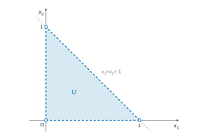

# e3a-Polytech MPI — Mathématiques 2026 · Corrigé brut

*Corrigé rédigé par IA, non officiel. Signalez toute erreur.*

Épreuve de 4 heures, calculatrices interdites, trois exercices indépendants.

## Exercice 1

### Questions préliminaires

Soit $n\ge 2$ un entier.

#### 1.

La fonction $\varphi:t\mapsto t^n$ est polynomiale, donc de classe $\mathcal C^2$ sur $]0,1[$. Pour $t\in\,]0,1[$ :
$$\varphi''(t)=n(n-1)\,t^{n-2}>0,$$
car $n(n-1)\ge 2$ et $t>0$.

Une fonction deux fois dérivable sur un intervalle, de dérivée seconde positive, y est convexe : **$\varphi$ est convexe sur $]0,1[$**.

Comme $\varphi''>0$, la dérivée $\varphi'$ est même strictement croissante sur $]0,1[$ ($\varphi$ est strictement convexe). Cela servira en 5.6.3.

#### 2.

Soit $m\ge1$ un entier, $t_1,\dots,t_m\in\,]0,1[$, et des réels $\lambda_1,\dots,\lambda_m\ge 0$ tels que $\sum_{i=1}^m\lambda_i=1$. La convexité de $\varphi$ donne l'inégalité de Jensen :
$$\boxed{\begin{aligned}
&\Big(\sum_{i=1}^m\lambda_i t_i\Big)^n\\
&\qquad\le\sum_{i=1}^m\lambda_i\,t_i^{\,n}.
\end{aligned}}$$
En particulier, avec des poids égaux $\lambda_i=\frac1m$ :
$$\begin{aligned}
&\Big(\frac1m\sum_{i=1}^m t_i\Big)^n\\
&\qquad\le\frac1m\sum_{i=1}^m t_i^{\,n}.
\end{aligned}$$

#### 3.1.

Pour $i,j\in[\![1,p]\!]$, on calcule :
$$\begin{aligned}
(J^2)_{ij}&=\sum_{k=1}^p J_{ik}J_{kj}\\
&=p.
\end{aligned}$$
Comme $p\,J_{ij}=p$, on a $J^2=pJ$, et
$$\boxed{P(X)=X^2-pX=X(X-p)\ \text{ annule } J.}$$

#### 3.2.

Toute valeur propre de $J$ est racine du polynôme annulateur $P$, donc $\mathrm{Sp}(J)\subset\{0,p\}$.

Pour $V\neq0$ et $\nu\in\mathbb R$, on a l'équivalence :
$$\begin{aligned}
&(I_p+J)V=\nu V\\
\iff\ &JV=(\nu-1)V.
\end{aligned}$$
Donc $\nu$ est valeur propre de $I_p+J$ si et seulement si $\nu-1$ est valeur propre de $J$, et
$$\boxed{\mathrm{Sp}(I_p+J)\subset\{1,\,1+p\}.}$$

(Les deux valeurs sont atteintes. D'une part $J$ est de rang 1 avec $p\ge2$, donc $0\in\mathrm{Sp}(J)$. D'autre part $J\,(1,\dots,1)^T=p\,(1,\dots,1)^T$.)

#### 3.3.

$I_p+J$ est symétrique réelle, car $J^T=J$.

D'après le théorème spectral, il existe une base orthonormée $(e_1,\dots,e_p)$ de $\mathbb R^p$ formée de vecteurs propres de $I_p+J$. Les valeurs propres associées $\mu_1,\dots,\mu_p$ appartiennent à $\{1,1+p\}$ : elles sont toutes $>0$.

Pour $V=\sum_i v_ie_i\neq0$ :
$$V^T(I_p+J)V=\sum_{i=1}^p\mu_i v_i^2>0.$$
Donc **$I_p+J\in\mathcal S_p^{++}(\mathbb R)$**.

(Vérification directe : pour $V\ne0$, $V^T(I_p+J)V=\|V\|^2+\big(\sum_i v_i\big)^2>0$.)

### Une expression de l'espérance de $X$

Les $x_j$ sont les probabilités des $r$ issues d'une même épreuve, donc $\sum_{j=1}^r x_j=1$.

#### 4.1.

$X_j$ prend les valeurs $0$ et $1$ : c'est une variable de Bernoulli.

L'événement $(X_j=1)$ est « $\alpha_j$ n'est obtenu à aucune des $n$ épreuves ». À chaque épreuve, $\alpha_j$ n'est pas obtenu avec probabilité $1-x_j$, et les épreuves sont indépendantes, donc
$$\boxed{\begin{aligned}
\mathbb P(X_j=1)&=(1-x_j)^n,\\
\mathbb P(X_j=0)&=1-(1-x_j)^n,
\end{aligned}}$$
soit $X_j\sim\mathcal B\big((1-x_j)^n\big)$.

#### 4.2.

$X$ compte les indices $j$ tels que $\alpha_j$ n'a pas été obtenu, c'est-à-dire tels que $X_j=1$ :
$$\boxed{X=\sum_{j=1}^r X_j.}$$

#### 4.3.

D'après 4.1, $\mathbb E(X_j)=\mathbb P(X_j=1)$. Par linéarité de l'espérance, qui ne demande aucune indépendance :
$$\boxed{\begin{aligned}
\mathbb E(X)&=\sum_{j=1}^r\mathbb E(X_j)\\
&=\sum_{j=1}^r(1-x_j)^n.
\end{aligned}}$$

### 5. Recherche du minimum de $\mathbb E(X)$

#### 5.1.

Pour $r=3$, $U=\{(x_1,x_2)\in\mathbb R^2:\ x_1>0,\ x_2>0,\ x_1+x_2<1\}$.

C'est l'**intérieur du triangle** de sommets $(0,0)$, $(1,0)$, $(0,1)$. Il est délimité par l'axe des abscisses, l'axe des ordonnées et la droite d'équation $x_1+x_2=1$ ; les trois côtés sont **exclus**.

#### 5.2.

*Ouvert.* Pour $1\le k\le r-1$, l'application $x\mapsto x_k$ est linéaire sur $\mathbb R^{r-1}$, donc continue. Il en va de même de $x\mapsto\sum_{j=1}^{r-1}x_j$.

Chaque ensemble $\{x_k>0\}$ est l'image réciproque de l'ouvert $]0,+\infty[$ ; l'ensemble $\{\sum_j x_j<1\}$ est l'image réciproque de l'ouvert $]-\infty,1[$. Ce sont donc des ouverts.

$U$ est l'intersection de ces $r$ ouverts ($r-1$ conditions de positivité et une condition sur la somme) : intersection finie d'ouverts, **$U$ est ouvert**.

*Borné.* Soit $x\in U$ et $k\in[\![1,r-1]\!]$. Les autres $x_j$ étant positifs :
$$0<x_k\le\sum_{j=1}^{r-1}x_j<1.$$
Donc $U\subset\,]0,1[^{r-1}$ et $\|x\|_\infty<1$ : **$U$ est borné**.

#### 5.3.

Sous la contrainte, $x_r=1-\sum_{j=1}^{r-1}x_j$. Pour $(x_1,\dots,x_{r-1})\in U$, on a bien $x_r\in\,]0,1[$, et $1-x_r=\sum_{j=1}^{r-1}x_j$.

Ainsi $U$ décrit exactement les $r-1$ premières coordonnées des $r$-uplets admissibles, et
$$\boxed{\begin{aligned}
&h(x_1,\dots,x_{r-1})\\
&\quad=\sum_{j=1}^{r-1}(1-x_j)^n+\Big(\sum_{j=1}^{r-1}x_j\Big)^n.
\end{aligned}}$$
On a bien $h(x_1,\dots,x_{r-1})=\mathbb E(X)$, et $h$ ne dépend que des $r-1$ variables libres.

#### 5.4.

$h$ est une fonction polynomiale en $(x_1,\dots,x_{r-1})$ : c'est une somme de puissances de fonctions affines.

Une fonction polynomiale est de classe $\mathcal C^\infty$ sur $\mathbb R^{r-1}$. Donc **$h$ est de classe $\mathcal C^2$ (et même $\mathcal C^\infty$) sur l'ouvert $U$**.

#### 5.5.1.

Notons $s=\sum_{k=1}^{r-1}x_k$, de sorte que $\frac{\partial s}{\partial x_j}=1$. Alors :
$$\boxed{\begin{aligned}
\frac{\partial h}{\partial x_j}(m)&=-n(1-x_j)^{n-1}+n\,s^{\,n-1}\\
&=n\Big[\Big(\sum_{k=1}^{r-1}x_k\Big)^{n-1}-(1-x_j)^{n-1}\Big].
\end{aligned}}$$

#### 5.5.2.

Sur $U$, on a $s>0$ et $1-x_j>0$. La fonction $t\mapsto t^{n-1}$ est strictement croissante sur $]0,+\infty[$ (car $n-1\ge1$), donc injective. Par suite :
$$\begin{aligned}
\nabla h(m)=0&\iff\forall j\in[\![1,r-1]\!],\ (1-x_j)^{n-1}=s^{n-1}\\
&\iff\forall j\in[\![1,r-1]\!],\ 1-x_j=s.
\end{aligned}$$

Tous les $x_j$ sont alors égaux à $c=1-s$. On en tire $s=(r-1)c$, puis $1-c=(r-1)c$, d'où $c=\frac1r$.

Réciproquement, le point $(\frac1r,\dots,\frac1r)$ est dans $U$ (coordonnées $>0$, somme $\frac{r-1}r<1$) et annule le gradient. L'unique point critique de $h$ sur $U$ est
$$\boxed{b=\Big(\frac1r,\dots,\frac1r\Big)\in\mathbb R^{r-1}.}$$

#### 5.6.1.

Pour $i,j\in[\![1,r-1]\!]$, en dérivant 5.5.1 :
$$\frac{\partial^2h}{\partial x_i\partial x_j}(m)=n(n-1)\,s^{\,n-2}+\delta_{ij}\,n(n-1)(1-x_j)^{n-2}.$$

En $b$, on a $s=\frac{r-1}r$ et $1-x_j=\frac{r-1}r$. Posons
$$A=n(n-1)\Big(\frac{r-1}r\Big)^{n-2}>0.$$
Avec $J$ la matrice de 3. de taille $p=r-1\ge2$ :
$$\boxed{H_h(b)=A\,(I_{r-1}+J).}$$
C'est la matrice de taille $r-1$ de coefficients diagonaux $2A$ et non diagonaux $A$.

#### 5.6.2.

D'après 3.3 (avec $p=r-1\ge2$), $I_{r-1}+J\in\mathcal S^{++}_{r-1}(\mathbb R)$. Comme $A>0$, $H_h(b)=A(I_{r-1}+J)$ est symétrique définie positive : pour $V\ne0$,
$$V^TH_h(b)V=A\,V^T(I_{r-1}+J)V>0.$$

Récapitulons les hypothèses de la condition suffisante du second ordre :

- $h$ est de classe $\mathcal C^2$ sur l'ouvert $U$ (5.2 et 5.4) ;
- $b$ est un point critique de $h$ (5.5.2) ;
- $H_h(b)\in\mathcal S^{++}_{r-1}(\mathbb R)$.

Donc **$h$ admet en $b$ un minimum local strict**. Comme $h=\mathbb E(X)$ et qu'en $b$ on a $x_r=1-\frac{r-1}r=\frac1r$ :
$$\boxed{\begin{aligned}
&\mathbb E(X)\ \text{admet un minimum local}\\
&\text{pour } x_1=\dots=x_r=\tfrac1r.
\end{aligned}}$$

#### 5.6.3.

Soit $(x_1,\dots,x_r)\in\,]0,1[^r$ avec $\sum_j x_j=1$. Posons $u_j=1-x_j\in\,]0,1[$.

On a $\sum_{j=1}^r u_j=r-1$. Notons $\mu$ la moyenne des $u_j$ :
$$\begin{aligned}
\mu&=\frac1r\sum_{j=1}^r u_j\\
&=\frac{r-1}r\in\,]0,1[.
\end{aligned}$$

*Inégalité.* L'inégalité de Jensen (question 2) avec les poids $\frac1r$ donne :
$$\begin{aligned}
\mu^n&=\Big(\frac1r\sum_{j=1}^r u_j\Big)^n\\
&\le\frac1r\sum_{j=1}^r u_j^n\\
&=\frac1r\,\mathbb E(X).
\end{aligned}$$
Donc $\mathbb E(X)\ge r\big(\frac{r-1}r\big)^n$. Cette borne est atteinte pour $x_1=\dots=x_r=\frac1r$, où $\mathbb E(X)=r\big(1-\frac1r\big)^n$.

*Cas d'égalité.* Pour $t\in\,]0,1[$, posons
$$g(t)=\varphi(t)-\varphi(\mu)-\varphi'(\mu)(t-\mu).$$
On a aussi $g(t)=\int_\mu^t\big(\varphi'(v)-\varphi'(\mu)\big)\,dv$.

Comme $\varphi'$ est strictement croissante sur $]0,1[$ (question 1), l'intégrande est du signe de $v-\mu$. Donc **$g(t)>0$ pour $t\ne\mu$**, et $g(\mu)=0$.

En sommant, et puisque $\sum_{j=1}^r(u_j-\mu)=0$ :
$$\begin{aligned}
\sum_{j=1}^r g(u_j)&=\sum_{j=1}^r u_j^n-r\mu^n-\varphi'(\mu)\sum_{j=1}^r(u_j-\mu)\\
&=\mathbb E(X)-r\Big(\frac{r-1}r\Big)^n.
\end{aligned}$$

Une somme de termes positifs est nulle si et seulement si chacun l'est. Donc $\mathbb E(X)=r\big(\frac{r-1}r\big)^n$ si et seulement si $u_j=\mu$ pour tout $j$, c'est-à-dire $x_j=\frac1r$ pour tout $j$.

Le minimum de $\mathbb E(X)$ sous la contrainte vaut donc $r\big(\frac{r-1}r\big)^n$, et
$$\boxed{\begin{aligned}
&\mathbb E(X)\ \text{est minimale}\\
&\text{si, et seulement si, } x_1=\dots=x_r=\tfrac1r.
\end{aligned}}$$

## Exercice 2

### Question de cours

#### 1.

La série de Riemann $\sum_{n\ge1}\frac1{n^x}$ **converge si et seulement si $x>1$**. On note alors $\zeta(x)=\sum_{n=1}^{+\infty}\frac1{n^x}$.

#### 2.

La série entière $\sum_{n\ge0}t^n$ a pour rayon de convergence $1$. Son intervalle de convergence est $]-1,1[$ : elle diverge grossièrement en $1$ et en $-1$. Sa somme est donnée par
$$\boxed{\begin{aligned}
&\forall t\in\,]-1,1[,\\
&\sum_{n=0}^{+\infty}t^n=\frac1{1-t}.
\end{aligned}}$$

### Les fonctions $E_k$

#### 3.

Soit $x\in\mathbb R\setminus\mathbb Z$. Alors $x\neq0$, et pour $n\ge1$, $x\pm n\neq0$. On a :
$$\frac1{x-n}+\frac1{x+n}=\frac{2x}{x^2-n^2}.$$

Ce terme change de signe selon $n$ ; on étudie donc sa valeur absolue :
$$\Big|\frac{2x}{x^2-n^2}\Big|\underset{n\to+\infty}{\sim}\frac{2|x|}{n^2}.$$
La série de Riemann $\sum\frac1{n^2}$ converge. Par comparaison de séries à termes positifs, la série $\sum_{n\ge1}\big(\frac1{x-n}+\frac1{x+n}\big)$ **converge absolument**, donc converge.

Avec $\frac1x$ défini, **$E_1(x)$ existe pour tout $x\in\mathbb R\setminus\mathbb Z$**.

(Les séries $\sum\frac1{x-n}$ et $\sum\frac1{x+n}$, prises séparément, divergent : seul le regroupement par paires converge.)

#### 4.1.

Soit $k\ge2$. Pour $n\ge1$, $x\pm n\ne0$, et
$$\Big|\frac1{(x\pm n)^k}\Big|=\frac1{|x\pm n|^k}\underset{n\to+\infty}{\sim}\frac1{n^k}.$$
Comme $k>1$, la série $\sum\frac1{n^k}$ converge. Par comparaison de séries à termes positifs, **les séries $\sum_{n\ge1}\frac1{(x-n)^k}$ et $\sum_{n\ge1}\frac1{(x+n)^k}$ convergent absolument**, donc convergent.

#### 4.2.

$\frac1{x^k}$ est défini car $x\neq0$, et les deux séries de 4.1 convergent : **$E_k(x)$ existe pour tout $x\in\mathbb R\setminus\mathbb Z$ et tout $k\ge2$**.

Pour tout $k\ge1$, on pose
$$u_{k,n}(x)=\frac1{(x-n)^k}+\frac1{(x+n)^k}.$$
Ainsi $E_k(x)=\frac1{x^k}+\sum_{n=1}^{+\infty}u_{k,n}(x)$. Pour $k\ge2$, c'est la somme des deux séries convergentes de 4.1.

#### 5.1.

Soit $k\ge1$ et $x\in\mathbb R\setminus\mathbb Z$ ; alors $x+1\in\mathbb R\setminus\mathbb Z$. Pour $N\ge1$, posons
$$\begin{aligned}
S_N(x)&=\frac1{x^k}+\sum_{n=1}^N u_{k,n}(x)\\
&=\sum_{m=-N}^{N}\frac1{(x+m)^k},
\end{aligned}$$
de sorte que $S_N(x)\to E_k(x)$. Par décalage d'indice dans cette somme finie :
$$\begin{aligned}
S_N(x+1)&=\sum_{m=-N}^{N}\frac1{(x+1+m)^k}\\
&=\sum_{m=-N+1}^{N+1}\frac1{(x+m)^k}\\
&=S_N(x)-\frac1{(x-N)^k}+\frac1{(x+N+1)^k}.
\end{aligned}$$
Les deux derniers termes tendent vers $0$ quand $N\to+\infty$. En passant à la limite :
$$\boxed{\forall k\ge1,\ \forall x\in\mathbb R\setminus\mathbb Z,\quad E_k(x+1)=E_k(x).}$$
**$E_k$ est 1-périodique.**

#### 5.2.

$\mathbb R\setminus\mathbb Z$ est symétrique par rapport à $0$. Pour $n\ge1$ :
$$\begin{aligned}
u_{k,n}(-x)&=\frac1{(-x-n)^k}+\frac1{(-x+n)^k}\\
&=(-1)^k\Big(\frac1{(x+n)^k}+\frac1{(x-n)^k}\Big)\\
&=(-1)^ku_{k,n}(x).
\end{aligned}$$
De plus $\frac1{(-x)^k}=\frac{(-1)^k}{x^k}$.

On somme la série convergente des $u_{k,n}$. Cela vaut aussi pour $k=1$, où l'on ne sépare jamais les deux séries :
$$\boxed{E_k(-x)=(-1)^kE_k(x).}$$
**$E_k$ est paire si $k$ est pair, impaire si $k$ est impair.**

### 6. Une relation de récurrence

#### 6.1.

Soit $k\ge1$ et $p\in\mathbb Z$. On travaille sur l'intervalle $I_p=\,]p,p+1[$, car le théorème de dérivation terme à terme porte sur un intervalle.

- Chaque $u_{k,n}$ est de classe $\mathcal C^1$ sur $I_p$, de dérivée $u_{k,n}'=-k\,u_{k+1,n}$.
- La série $\sum_n u_{k,n}$ converge simplement sur $I_p$ (questions 3 et 4).
- Soit $[\alpha,\beta]\subset I_p$ et $A=\max(|\alpha|,|\beta|)$. Pour $n\ge2A$ et $x\in[\alpha,\beta]$, on a $|x\pm n|\ge n-|x|\ge\frac n2$, donc :

$$\begin{aligned}
\sup_{[\alpha,\beta]}|u_{k,n}'|&\le 2k\Big(\frac2n\Big)^{k+1}\\
&=\frac{2^{k+2}k}{n^{k+1}}.
\end{aligned}$$

C'est le terme général d'une série convergente, puisque $k+1\ge2$. La série $\sum u_{k,n}'$ converge donc normalement, donc uniformément, sur tout segment de $I_p$.

Par le théorème de dérivation terme à terme des séries de fonctions, $x\mapsto\sum_{n\ge1}u_{k,n}(x)$ est de classe $\mathcal C^1$ sur $I_p$, de dérivée $\sum_{n\ge1}u_{k,n}'$.

Avec $\big(\frac1{x^k}\big)'=-\frac k{x^{k+1}}$, on obtient sur $I_p$, donc sur $\mathbb R\setminus\mathbb Z=\bigcup_p I_p$ :
$$\begin{aligned}
E_k'(x)&=-\frac k{x^{k+1}}-k\sum_{n=1}^{+\infty}u_{k+1,n}(x)\\
&=-k\,E_{k+1}(x).
\end{aligned}$$
$$\boxed{\forall x\in\mathbb R\setminus\mathbb Z,\quad E_k'(x)=-k\,E_{k+1}(x).}$$

#### 6.2.

*Régularité.* Pour $q\in\mathbb N$, notons $\mathcal P(q)$ : « pour tout $k\ge1$, $E_k$ est de classe $\mathcal C^q$ sur $\mathbb R\setminus\mathbb Z$ ».

- $\mathcal P(0)$ est vraie : chaque $E_k$ est dérivable (6.1), donc continue.
- Supposons $\mathcal P(q)$ et fixons $k\ge1$. D'après 6.1, $E_k$ est dérivable et $E_k'=-kE_{k+1}$.

  Par $\mathcal P(q)$, $E_{k+1}$ est de classe $\mathcal C^q$, donc $E_k'$ aussi.
- Ainsi $E_k$ est de classe $\mathcal C^{q+1}$ pour tout $k\ge1$ : $\mathcal P(q+1)$ est vraie.

Ainsi **chaque $E_k$ est de classe $\mathcal C^\infty$ sur $\mathbb R\setminus\mathbb Z$**.

*Formule.* Par récurrence sur $k\ge1$. Pour $k=1$, la formule s'écrit $E_1=\frac{(-1)^0}{0!}E_1^{(0)}$ : elle est vraie.

Supposons $E_k=\frac{(-1)^{k-1}}{(k-1)!}E_1^{(k-1)}$. Par 6.1 :
$$\begin{aligned}
E_{k+1}&=-\frac1kE_k'\\
&=-\frac1k\cdot\frac{(-1)^{k-1}}{(k-1)!}E_1^{(k)}\\
&=\frac{(-1)^k}{k!}E_1^{(k)}.
\end{aligned}$$
$$\boxed{\forall k\ge1,\quad E_k=\frac{(-1)^{k-1}}{(k-1)!}E_1^{(k-1)}.}$$

#### 7.

Soit $x\in\,]-1,1[$ et $n\ge1$. Alors $\big|\frac xn\big|\le|x|<1$.

Par la question 2, la série géométrique $\sum_k\big(\frac xn\big)^k$ converge, de somme $\frac1{1-x/n}=\frac n{n-x}$ (avec $n-x>0$).

Par suite, $\sum_{k\ge0}\frac{x^k}{n^{k+1}}=\frac1n\sum_{k\ge0}\big(\frac xn\big)^k$ converge, et
$$\boxed{\sum_{k=0}^{+\infty}\frac{x^k}{n^{k+1}}=\frac1{n-x}.}$$

#### 8.

Soit $x\in\,]-1,1[$ et $n\ge1$. La question 7, appliquée à $x$ et à $-x$, donne
$$\begin{aligned}
\frac1{n-x}-\frac1{n+x}&=\sum_{k=0}^{+\infty}\frac{x^k-(-x)^k}{n^{k+1}}\\
&=\sum_{k=0}^{+\infty}\frac{(1-(-1)^k)\,x^k}{n^{k+1}}.
\end{aligned}$$

Les termes d'indice pair sont nuls. Ceux d'indice impair $k=2s-1$ valent $\frac{2x^{2s-1}}{n^{2s}}$. Supprimer des termes nuls ne change ni la convergence ni la somme :
$$\frac1{n-x}-\frac1{n+x}=\sum_{s=1}^{+\infty}\frac2{n^{2s}}x^{2s-1}.$$

Le membre de gauche vaut $\frac{2x}{n^2-x^2}=O\big(\frac1{n^2}\big)$ : c'est le terme général d'une série convergente. En sommant sur $n\ge1$ l'égalité précédente, sans aucune interversion :
$$\boxed{\begin{aligned}
&\sum_{n=1}^{+\infty}\Big(\frac1{n-x}-\frac1{n+x}\Big)\\
&\qquad=\sum_{n=1}^{+\infty}\sum_{s=1}^{+\infty}\frac2{n^{2s}}x^{2s-1}.
\end{aligned}}$$

#### 9.

Soit $x\in\,]-1,1[$, $x\ne0$. Comme $\frac1{x-n}+\frac1{x+n}=-\big(\frac1{n-x}-\frac1{n+x}\big)$, la question 8 donne
$$\begin{aligned}
E_1(x)&=\frac1x-\sum_{n=1}^{+\infty}\sum_{s=1}^{+\infty}a_{n,s},\\
a_{n,s}&=\frac{2x^{2s-1}}{n^{2s}}.
\end{aligned}$$

**Théorème utilisé (Fubini pour les séries doubles).** Soit $(a_{n,s})_{(n,s)\in\mathbb N^*\times\mathbb N^*}$ une famille de nombres complexes. On suppose :

- pour tout $n$, la série $\sum_s|a_{n,s}|$ converge ;
- la série $\sum_n\Big(\sum_{s=1}^{+\infty}|a_{n,s}|\Big)$ converge.

Alors la famille est sommable. Pour tout $s$, la série $\sum_n a_{n,s}$ converge ; pour tout $n$, la série $\sum_s a_{n,s}$ converge ; et
$$\begin{aligned}
&\sum_{n=1}^{+\infty}\sum_{s=1}^{+\infty}a_{n,s}\\
&\qquad=\sum_{s=1}^{+\infty}\sum_{n=1}^{+\infty}a_{n,s}.
\end{aligned}$$

**Vérification des hypothèses.** Fixons $n\ge1$. La série $\sum_s|a_{n,s}|=\sum_{s\ge1}\frac{2|x|}{n^2}\Big(\frac{x^2}{n^2}\Big)^{s-1}$ est géométrique de raison $\frac{x^2}{n^2}\in[0,1[$. Elle converge, de somme
$$\begin{aligned}
\sum_{s=1}^{+\infty}|a_{n,s}|&=\frac{2|x|}{n^2}\cdot\frac1{1-x^2/n^2}\\
&=\frac{2|x|}{n^2-x^2}\\
&\le\frac{2|x|}{n^2(1-x^2)},
\end{aligned}$$
la dernière inégalité venant de $n^2-x^2\ge n^2-n^2x^2$.

La série $\sum_n\frac{2|x|}{n^2(1-x^2)}$ converge, donc $\sum_n\sum_s|a_{n,s}|$ converge. Les hypothèses sont vérifiées.

**Conclusion.** Pour $s\ge1$, comme $2s>1$ :
$$\sum_{n\ge1}a_{n,s}=2x^{2s-1}\sum_{n\ge1}\frac1{n^{2s}}=2\zeta(2s)x^{2s-1}.$$
D'où la convergence de $\sum_s\zeta(2s)x^{2s-1}$, et
$$\boxed{E_1(x)=\frac1x-2\sum_{s=1}^{+\infty}\zeta(2s)\,x^{2s-1}.}$$

#### 10.

Posons $g(x)=\sum_{s\ge1}\zeta(2s)x^{2s-1}$. D'après 9, cette série entière converge en tout point de $]-1,1[$, donc son rayon de convergence vérifie $R\ge1$. (Il vaut d'ailleurs $1$ : $\zeta(2s)\ge1$, et la série diverge grossièrement en $x=1$.)

Sa somme $g$ est donc de classe $\mathcal C^\infty$ sur $]-1,1[$ et s'y dérive terme à terme à tout ordre. Pour $q\in\mathbb N$ :
$$\begin{aligned}
g^{(q)}(x)&=\sum_{s\ge1,\ 2s-1\ge q}\zeta(2s)\frac{(2s-1)!}{(2s-1-q)!}x^{2s-1-q}\\
&=q!\sum_{s=1}^{+\infty}\binom{2s-1}{q}\zeta(2s)\,x^{2s-1-q}.
\end{aligned}$$
Les termes tels que $q>2s-1$ sont des dérivées $q$-ièmes de monômes de degré $<q$, donc nuls : ils correspondent exactement à la convention $\binom{2s-1}q=0$.

Sur chacun des intervalles ouverts $]-1,0[$ et $]0,1[$, on a $E_1(x)=\frac1x-2g(x)$ (question 9). Soit $k\ge1$. On dérive $k-1$ fois, avec $\big(\frac1x\big)^{(k-1)}=\frac{(-1)^{k-1}(k-1)!}{x^k}$ :
$$E_1^{(k-1)}(x)=\frac{(-1)^{k-1}(k-1)!}{x^k}-2(k-1)!\sum_{s=1}^{+\infty}\binom{2s-1}{k-1}\zeta(2s)\,x^{2s-k}.$$

Par 6.2, $E_k=\frac{(-1)^{k-1}}{(k-1)!}E_1^{(k-1)}$. Avec $-(-1)^{k-1}=(-1)^k$, on obtient, pour tout $k\in\mathbb N^*$ et tout $x\in\,]-1,1[\setminus\{0\}$ :
$$\boxed{E_k(x)=\frac1{x^k}+2(-1)^k\sum_{s=1}^{+\infty}\binom{2s-1}{k-1}\zeta(2s)\,x^{2s-k}.}$$

## Exercice 3

Notations : $\sigma=\sum_{j=1}^{n-1}a_j^2$ ; $(e_1,\dots,e_n)$ est la base canonique de $\mathbb K^n$ ; pour $\lambda\in\mathbb K$, $F_\lambda=\ker(M-\lambda I_n)$.

### 1. Cas $\mathbb K=\mathbb R$

#### 1.1.

Pour $i<n$, $M_{i,n}=a_i=M_{n,i}$. Les autres coefficients hors de la dernière ligne et de la dernière colonne sont nuls. Donc $M^T=M$.

Les coefficients $a_j$ sont **réels** : $M$ est une matrice **symétrique réelle**. D'après le théorème spectral, elle est **diagonalisable** (dans une base orthonormée).

#### 1.2.

Pour $j\le n-1$, la colonne $C_j$ vaut $a_j e_n$. La dernière colonne est $C_n=(a_1,\dots,a_n)^T$. Donc
$$\mathrm{Im}\,M=\mathrm{Vect}(C_1,\dots,C_n)\subset\mathrm{Vect}(e_n,C_n),$$
et $\mathrm{rg}\,M\le2$.

Par ailleurs, $C_1=a_1e_n\neq0$. La colonne $C_n$, de première coordonnée $a_1\neq0$, n'est pas colinéaire à $e_n$. La famille $(C_1,C_n)$ est donc libre, et
$$\boxed{\mathrm{rg}\,M=2.}$$

#### 1.3.

Par le théorème du rang, $\dim\ker M=n-\mathrm{rg}\,M=n-2\ge1$ (car $n\ge3$). Le noyau n'est pas réduit à $\{0\}$ : **$0$ est valeur propre**, et son sous-espace propre est de dimension $n-2$.

L'ordre de multiplicité est la multiplicité de $0$ comme racine de $\chi_M$. En général, la dimension du sous-espace propre est seulement inférieure ou égale à cette multiplicité. Ici, $M$ est diagonalisable (1.1) : il y a égalité. Donc **$0$ est valeur propre de multiplicité $n-2$**.

#### 1.4.

$M$ est diagonalisable, donc $\chi_M$ est scindé sur $\mathbb R$, de degré $n$. La somme des multiplicités des valeurs propres vaut donc $n$.

Comme $0$ a pour multiplicité exactement $n-2$, les autres valeurs propres sont non nulles, de multiplicité totale $2$. Ainsi $M$ possède **deux valeurs propres non nulles $\lambda_1,\lambda_2$** (comptées avec multiplicité), et
$$\chi_M(X)=X^{n-2}(X-\lambda_1)(X-\lambda_2).$$
(On verra en 1.6 qu'elles sont en fait distinctes.)

#### 1.5.

Le système $MX=0$ s'écrit $a_ix_n=0$ pour $1\le i\le n-1$, et $\sum_{j=1}^{n-1}a_jx_j+a_nx_n=0$.

Comme $a_1\ne0$, la première équation donne $x_n=0$. Il reste
$$\begin{aligned}
\ker M=\Big\{X\in\mathbb R^n:\ &x_n=0\\
\text{et }\ &\sum_{j=1}^{n-1}a_jx_j=0\Big\}.
\end{aligned}$$

Pour $2\le k\le n-1$, posons $v_k=a_ke_1-a_1e_k$. Ce vecteur est dans $\ker M$, car $a_1a_k-a_ka_1=0$.

Ces vecteurs sont libres : la coordonnée d'indice $k$ de $v_k$ vaut $-a_1\ne0$, et celle des autres $v_\ell$ est nulle. Ils sont au nombre de $n-2=\dim\ker M$. Donc
$$\boxed{\begin{aligned}
\ker M&=\mathrm{Vect}(v_2,\dots,v_{n-1}),\\
v_k&=(a_k,0,\dots,0,\underbrace{-a_1}_{k},0,\dots,0)^T.
\end{aligned}}$$

#### 1.6.

Soit $\lambda\ne0$ et $X\ne0$ tel que $MX=\lambda X$.

Les $n-1$ premières lignes donnent $a_ix_n=\lambda x_i$, soit $x_i=\frac{a_i}\lambda x_n$ pour $i\le n-1$.

Si $x_n=0$, tous les $x_i$ sont nuls et $X=0$ : c'est exclu. Donc $x_n\neq0$.

La dernière ligne donne
$$\sum_{j=1}^{n-1}a_j\frac{a_j}\lambda x_n+a_nx_n=\lambda x_n.$$
En divisant par $x_n$ et en multipliant par $\lambda$ :
$$\boxed{\lambda^2-\lambda a_n-\sum_{j=1}^{n-1}a_j^2=0.}$$

Appliqué à $\lambda=\lambda_1$ et à $\lambda=\lambda_2$ (valeurs propres non nulles), ce calcul montre que **$\lambda_1$ et $\lambda_2$ sont solutions de cette équation**.

Son discriminant vaut $\Delta=a_n^2+4\sigma\ge4a_1^2>0$, et le produit des racines vaut $-\sigma<0$. Les racines sont donc réelles, **distinctes et de signes opposés** :
$$\lambda_{1}=\frac{a_n-\sqrt{a_n^2+4\sigma}}2<0<\lambda_{2}=\frac{a_n+\sqrt{a_n^2+4\sigma}}2.$$

$M$ possède deux valeurs propres non nulles comptées avec multiplicité, toutes racines de cette équation à deux racines simples. Ce sont donc exactement $\lambda_1$ et $\lambda_2$, chacune simple.

#### 1.7.

Soit $\lambda\in\{\lambda_1,\lambda_2\}$. D'après 1.6, tout vecteur propre s'écrit $\frac{x_n}{\lambda}(a_1,\dots,a_{n-1},\lambda)^T$. L'espace propre est donc inclus dans $\mathrm{Vect}(w_\lambda)$, avec $w_\lambda=(a_1,\dots,a_{n-1},\lambda)^T$.

Réciproquement, pour $i<n$, $(Mw_\lambda)_i=a_i\lambda=\lambda(w_\lambda)_i$. Et, puisque $\lambda^2-a_n\lambda-\sigma=0$ :
$$\begin{aligned}
(Mw_\lambda)_n&=\sigma+a_n\lambda\\
&=\lambda^2\\
&=\lambda(w_\lambda)_n.
\end{aligned}$$
Donc
$$\boxed{\begin{aligned}
F_{\lambda_1}&=\mathrm{Vect}\big((a_1,\dots,a_{n-1},\lambda_1)^T\big),\\
F_{\lambda_2}&=\mathrm{Vect}\big((a_1,\dots,a_{n-1},\lambda_2)^T\big).
\end{aligned}}$$

#### 1.8.

Les sous-espaces propres $\ker M$, $F_{\lambda_1}$ et $F_{\lambda_2}$ sont en somme directe, car les valeurs propres $0,\lambda_1,\lambda_2$ sont distinctes. Leurs dimensions totalisent $(n-2)+1+1=n$. La concaténation de leurs bases est donc une base de $\mathbb R^n$.

Soit $P$ la matrice de colonnes $v_2,\dots,v_{n-1},w_{\lambda_1},w_{\lambda_2}$ :
$$P=\begin{pmatrix}
a_2&a_3&\cdots&a_{n-1}&a_1&a_1\\
-a_1&0&\cdots&0&a_2&a_2\\
0&-a_1&\cdots&0&a_3&a_3\\
\vdots&&\ddots&\vdots&\vdots&\vdots\\
0&0&\cdots&-a_1&a_{n-1}&a_{n-1}\\
0&0&\cdots&0&\lambda_1&\lambda_2
\end{pmatrix}.$$
$P$ est inversible, et
$$\boxed{P^{-1}MP=\mathrm{diag}\Big(\underbrace{0,\dots,0}_{n-2},\ \frac{a_n-\sqrt{a_n^2+4\sigma}}2,\ \frac{a_n+\sqrt{a_n^2+4\sigma}}2\Big).}$$

### 2. Étude du cas $\mathbb K=\mathbb C$

#### 2.1.

*Polynôme caractéristique.* Soit $X\in\mathbb C^*$. Dans $XI_n-M$, la colonne $j\le n-1$ vaut $Xe_j-a_je_n$. La dernière colonne vaut $-\sum_{j<n}a_je_j+(X-a_n)e_n$.

L'opération $C_n\leftarrow C_n+\sum_{j=1}^{n-1}\frac{a_j}XC_j$ ne change pas le déterminant. Elle remplace la dernière colonne par $\big(X-a_n-\frac\sigma X\big)e_n$.

La matrice obtenue est triangulaire inférieure, de diagonale $(X,\dots,X,X-a_n-\frac\sigma X)$. D'où, pour $X\neq0$ :
$$\begin{aligned}
\chi_M(X)&=X^{n-1}\Big(X-a_n-\frac\sigma X\Big)\\
&=X^{n-2}\big(X^2-a_nX-\sigma\big).
\end{aligned}$$
Deux polynômes égaux en une infinité de points sont égaux. Avec $Q=X^2-a_nX-\sigma$ :
$$\boxed{\chi_M=X^{n-2}Q.}$$

*Sous-espaces propres.* Les calculs de 1.2, 1.5 et 1.6 n'utilisent que $a_1\ne0$ et restent valables sur $\mathbb C$. Ainsi $\dim\ker M=n-2$. Pour toute valeur propre $\lambda\ne0$, $\dim F_\lambda=1$ (engendré par $(a_1,\dots,a_{n-1},\lambda)^T$).

$\chi_M$ est scindé sur $\mathbb C$. $M$ est diagonalisable si et seulement si, pour chaque valeur propre, la dimension du sous-espace propre est égale à la multiplicité.

- **Si $\sigma=0$** : $Q=X(X-a_n)$. Donc $0$ est racine de $\chi_M$ de multiplicité au moins $n-1$.

  Or $\dim\ker M=n-2$ : $M$ n'est pas diagonalisable.
- **Si $\sigma\ne0$ et $a_n^2+4\sigma=0$** : $Q$ a une racine double $\mu=\frac{a_n}2$. Elle est non nulle, car $Q(0)=-\sigma\ne0$.

  Ainsi $\mu$ est valeur propre de multiplicité $2$, mais $\dim F_\mu=1$ : $M$ n'est pas diagonalisable.
- **Si $\sigma\ne0$ et $a_n^2+4\sigma\ne0$** : $Q$ a deux racines distinctes $\mu_1\neq\mu_2$, non nulles car $Q(0)\neq0$.

  Alors $0$ est de multiplicité exactement $n-2$, égale à $\dim\ker M$.

  Les $\mu_i$ sont simples, et $\dim F_{\mu_i}=1$. Les dimensions totalisent $n$ : $M$ est diagonalisable.

Les trois cas étant exhaustifs, $M$ n'est pas diagonalisable si et seulement si
$$\boxed{\begin{aligned}
&\sum_{j=1}^{n-1}a_j^2=0\\
\text{ou}\quad&a_n^2+4\sum_{j=1}^{n-1}a_j^2=0.
\end{aligned}}$$

#### 2.2.

Pour $n=3$, prenons $a_1=1$, $a_2=i$, $a_3=0$. On a bien $a_1\ne0$, et $a_1^2+a_2^2=0$ :
$$\boxed{M=\begin{pmatrix}0&0&1\\0&0&i\\1&i&0\end{pmatrix}}$$
D'après 2.1, elle n'est pas diagonalisable.

Directement : $\chi_M=X^3$, donc $0$ est la seule valeur propre. Si $M$ était diagonalisable, elle serait semblable à la matrice nulle, donc nulle, ce qui n'est pas le cas. On vérifie d'ailleurs que $M^3=0$ et que $M^2\ne0$ :
$$M^2=\begin{pmatrix}1&i&0\\i&-1&0\\0&0&0\end{pmatrix}.$$

Autre exemple, relevant de la seconde condition : $a_1=1$, $a_2=0$, $a_3=2i$. Alors $\sigma=1$ et $a_3^2+4\sigma=0$ ; la valeur propre double $i$ a un espace propre de dimension 1.
