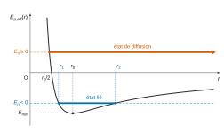
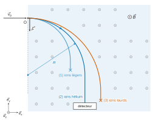
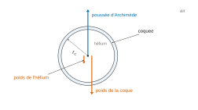
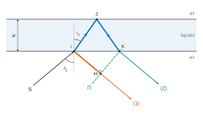
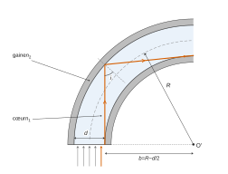

# e3a-Polytech MPI — Physique-chimie 2026 · Corrigé brut

*Corrigé rédigé par IA, non officiel. Signalez toute erreur.*

Épreuve de 4 heures, calculatrice interdite. Sujet « Autour de l'hélium », cinq parties indépendantes, 40 questions.

## Partie I – L'hélium, un gaz « rare » dans notre atmosphère

### Q1.

L'air sec contient environ **78 % de diazote $\mathrm{N_2}$** et **21 % de dioxygène $\mathrm{O_2}$**, en fraction molaire (c'est-à-dire en volume). Le reste, environ 1 %, est surtout de l'argon, avec un peu de $\mathrm{CO_2}$ et des traces d'autres gaz, dont l'hélium.

### Q2.

La Terre est à symétrie sphérique. Pour $r=OP\ge R_T$, elle agit sur $P$ comme un point de masse $M_T$ placé en $O$. On note $\vec e_r=\overrightarrow{OP}/r$ le vecteur unitaire radial :

$$\boxed{\vec F=-\frac{GM_Tm}{r^2}\,\vec e_r}$$

La force est centrale et ne dépend que de $r$. On cherche $E_\mathrm p(r)$ telle que $\vec F=-\dfrac{\mathrm dE_\mathrm p}{\mathrm dr}\vec e_r$. Il faut donc :

$$\frac{\mathrm dE_\mathrm p}{\mathrm dr}=\frac{GM_Tm}{r^2}$$

On intègre, avec la condition $E_\mathrm p(\infty)=0$ :

$$\boxed{E_\mathrm p(r)=-\frac{GM_Tm}{r}}$$

C'est un scalaire, négatif pour tout $r$.

### Q3.

$$\boxed{E_\mathrm m=\frac12mv^2-\frac{GM_Tm}{r}}$$

Dans le référentiel géocentrique galiléen, $P$ n'est soumis qu'à $\vec F$, qui est conservative : aucune force non conservative ne travaille. Le théorème de la puissance mécanique s'écrit alors :

$$\frac{\mathrm dE_\mathrm m}{\mathrm dt}=\mathcal P_{\text{non cons.}}=0$$

**$E_\mathrm m$ se conserve**.

### Q4.

On applique le théorème du moment cinétique en $O$, point fixe du référentiel galiléen, avec $\vec L_O=\overrightarrow{OP}\wedge m\vec v$ :

$$\frac{\mathrm d\vec L_O}{\mathrm dt}=\overrightarrow{OP}\wedge\vec F=\vec 0$$

En effet, $\vec F$ est colinéaire à $\overrightarrow{OP}$ (force centrale). $\vec L_O$ est donc un vecteur constant.

- Si $\vec L_O\neq\vec 0$ : $\overrightarrow{OP}$ reste orthogonal à ce vecteur fixe, donc $P$ se déplace dans le plan passant par $O$ et orthogonal à $\vec L_O$.
- Si $\vec L_O=\vec 0$ : $\vec v$ est colinéaire à $\overrightarrow{OP}$, et le mouvement est rectiligne, donc plan lui aussi.

**Le mouvement est plan.**

On prend $\vec e_z$ normal à ce plan. En polaires, $\vec v=\dot r\vec e_r+r\dot\theta\vec e_\theta$, d'où $\vec L_O=mr^2\dot\theta\,\vec e_z$. Comme ce vecteur est constant :

$$\boxed{r^2\dot\theta=C=\text{cste}}$$

### Q5.

En polaires, $v^2=\dot r^2+r^2\dot\theta^2$. Avec $\dot\theta=C/r^2$ :

$$v^2=\dot r^2+\frac{C^2}{r^2}$$

En reportant dans $E_\mathrm m$ :

$$E_\mathrm m=\frac12m\dot r^2+\frac{mC^2}{2r^2}-\frac{GM_Tm}{r}$$

C'est la forme (1), avec :

$$\boxed{E_{\mathrm p,\mathrm{eff}}(r)=\frac{mC^2}{2r^2}-\frac{GM_Tm}{r}}$$

### Q6.

On suppose $C\neq0$.

- Quand $r\to0^+$, le terme en $1/r^2$ domine : $E_{\mathrm p,\mathrm{eff}}\to+\infty$.
- Quand $r\to+\infty$, le terme en $-1/r$ domine : $E_{\mathrm p,\mathrm{eff}}\to0^-$.
- La dérivée $E_{\mathrm p,\mathrm{eff}}'(r)=\dfrac{m}{r^3}\left(GM_Tr-C^2\right)$ s'annule en $r_0=C^2/(GM_T)$. La fonction décroît sur $]0,r_0]$, puis croît sur $[r_0,+\infty[$.
- Le minimum vaut $E_{\min}=E_{\mathrm p,\mathrm{eff}}(r_0)=-\dfrac{G^2M_T^2m}{2C^2}<0$.
- La fonction s'annule en $r_0/2$.



Comme $\frac12m\dot r^2\ge0$, le mouvement n'est possible que là où $E_{\mathrm p,\mathrm{eff}}(r)\le E_\mathrm m$.

- Si $E_{\min}\le E_\mathrm m<0$, la droite horizontale d'ordonnée $E_\mathrm m$ coupe la courbe en $r_1\le r_2$ finis. On a alors $r_1\le r\le r_2$ : c'est un **état lié**.
- Si $E_\mathrm m\ge0$, la droite ne coupe la courbe qu'en un point $r_1$. Tout $r\ge r_1$ est accessible, jusqu'à l'infini : c'est un **état de diffusion**.

$$\boxed{P \text{ peut échapper à la Terre} \iff E_\mathrm m\ge0}$$

Si $C=0$ (mouvement radial), $E_{\mathrm p,\mathrm{eff}}=E_\mathrm p$, et la conclusion est la même.

### Q7.

Au départ de la surface ($r=R_T$) avec une vitesse de norme $v$, l'énergie mécanique vaut :

$$E_\mathrm m=\frac12mv^2-\frac{GM_Tm}{R_T}$$

Cette énergie se conserve et ne dépend que de la norme de $v$, pas de sa direction (pourvu que la trajectoire ne recoupe pas la Terre). La condition d'échappement $E_\mathrm m\ge0$ donne $v\ge\sqrt{2GM_T/R_T}$ :

$$\boxed{v_\ell=\sqrt{\frac{2GM_T}{R_T}}}$$

Application numérique :

$$\begin{aligned}
v_\ell^2&=\frac{2\times7{,}0\cdot10^{-11}\times6{,}0\cdot10^{24}}{6{,}0\cdot10^{6}}\\
&=1{,}4\cdot10^{8}\ \mathrm{m^2\,s^{-2}}
\end{aligned}$$

$$\boxed{v_\ell\approx1{,}2\cdot10^{4}\ \mathrm{m\,s^{-1}}}$$

### Q8.

Le modèle du gaz parfait repose sur trois hypothèses :

- les particules sont ponctuelles : leur volume propre est négligeable devant le volume offert ;
- il n'y a aucune interaction à distance entre particules, donc pas d'énergie potentielle d'interaction. Les particules n'interagissent que par des chocs (entre elles et avec les parois), supposés élastiques ;
- les particules sont très nombreuses, en agitation désordonnée, avec une répartition des vitesses homogène et isotrope (chaos moléculaire).

### Q9.

$$\begin{aligned}
u&=\sqrt{\frac{3RT}{M_{\mathrm{He}}}}\\
&=\sqrt{\frac{3\times8{,}0\times300}{4{,}0\cdot10^{-3}}}\\
&=\sqrt{1{,}8\cdot10^{6}}\ \mathrm{m\,s^{-1}}
\end{aligned}$$

$$\boxed{u\approx1{,}3\cdot10^{3}\ \mathrm{m\,s^{-1}}}$$

Or $v_\ell/10\approx1{,}2\cdot10^3\ \mathrm{m\,s^{-1}}$. Comme $u>v_\ell/10$, le critère admis est vérifié : **les atomes d'hélium s'échappent de l'attraction terrestre.**

L'hélium dégazé par la croûte quitte donc en permanence l'atmosphère, ce qui explique sa très faible concentration. À l'inverse, $\mathrm{N_2}$ et $\mathrm{O_2}$ sont 7 à 8 fois plus lourds. Leur vitesse $u$ est environ $\sqrt7\approx2{,}7$ fois plus faible : ils restent piégés.

## Partie II – Le laser hélium-néon

### Q10.

Trois applications du laser :

- **vie quotidienne** : lecteurs de codes-barres, pointeurs, lecture des disques optiques ;
- **industrie** : découpe et soudage de métaux, télémétrie et alignement sur les chantiers ;
- **médecine** : chirurgie réfractive de l'œil, photocoagulation de la rétine, dermatologie.

On peut citer aussi la recherche (refroidissement d'atomes, interférométrie des ondes gravitationnelles) et les télécommunications par fibre optique.

### Q11.

Dans un conducteur ohmique de conductivité $\gamma$, la loi d'Ohm locale s'écrit $\vec j=\gamma\vec E$. La puissance volumique cédée aux porteurs par le champ (effet Joule) vaut :

$$\begin{aligned}
p&=\vec j\cdot\vec E\\
&=\frac{j^2}{\gamma}\\
&=\gamma E^2
\end{aligned}$$

Un conducteur parfait correspond à $\gamma\to+\infty$. La densité de courant et la puissance dissipée y restent finies : un champ non nul y produirait une puissance $\gamma E^2$ infinie, physiquement impossible. On a donc $E^2=p/\gamma\to0$, et la puissance dissipée $j^2/\gamma$ tend vers 0 : un conducteur parfait ne dissipe pas d'énergie.

$$\boxed{\vec E=\vec 0\ \text{dans un conducteur parfait}}$$

### Q12.

Dans le vide sans charges ni courants ($\rho=0$, $\vec j=\vec 0$, $\mu_0\varepsilon_0c^2=1$), les équations de Maxwell s'écrivent :

$$\begin{aligned}
\operatorname{div}\vec E&=0\\
\overrightarrow{\operatorname{rot}}\,\vec E&=-\frac{\partial\vec B}{\partial t}\\
\operatorname{div}\vec B&=0\\
\overrightarrow{\operatorname{rot}}\,\vec B&=\frac1{c^2}\frac{\partial\vec E}{\partial t}
\end{aligned}$$

On prend le rotationnel de Maxwell-Faraday, puis on permute les dérivations en temps et en espace :

$$\begin{aligned}
\overrightarrow{\operatorname{rot}}(\overrightarrow{\operatorname{rot}}\,\vec E)&=-\frac{\partial}{\partial t}\overrightarrow{\operatorname{rot}}\,\vec B\\
&=-\frac1{c^2}\frac{\partial^2\vec E}{\partial t^2}
\end{aligned}$$

D'après l'identité fournie, et puisque $\operatorname{div}\vec E=0$, on a $\overrightarrow{\operatorname{rot}}(\overrightarrow{\operatorname{rot}}\,\vec E)=-\Delta\vec E$. D'où l'équation de d'Alembert :

$$\boxed{\Delta\vec E-\frac1{c^2}\frac{\partial^2\vec E}{\partial t^2}=\vec 0}$$

Le champ est transverse, porté par un axe fixe orthogonal à $\vec e_x$, de composante $E(x,t)=f(x)\sin(\omega t)$. En reportant, pour tout $t$ :

$$\left(f''(x)+\frac{\omega^2}{c^2}f(x)\right)\sin\omega t=0$$

Ce produit est nul pour tout $t$, donc :

$$\boxed{f''(x)+\frac{\omega^2}{c^2}f(x)=0}$$

### Q13.

La solution générale est $f(x)=A\cos(kx)+B\sin(kx)$, avec $k=\omega/c$. Le champ est nul dans les miroirs (Q11) et $E$ est continu en $x=0$ et en $x=L$.

- En $x=0$ : $f(0)=0$, donc $A=0$.
- En $x=L$ : $f(L)=B\sin(kL)=0$. Une solution non nulle impose $\sin(kL)=0$, soit $kL=n\pi$ avec $n\in\mathbb N^*$.

On obtient $f(x)=B\sin(n\pi x/L)$ et $\omega_n=n\pi c/L$, d'où les fréquences propres :

$$\boxed{\nu_n=\frac{nc}{2L}}$$

L'écart entre deux modes voisins vaut :

$$\boxed{\mathrm{ISL}=\nu_{n+1}-\nu_n=\frac{c}{2L}}$$

### Q14.

Le trait d'échelle de la figure 1 vaut 2 cm. Le tube, bague comprise, mesure environ 6,5 fois ce trait, soit $L\approx13\ \mathrm{cm}$ (la cavité est un peu plus courte que le boîtier). On en déduit :

$$\mathrm{ISL}=\frac{c}{2L}\approx\frac{3{,}0\cdot10^8}{2\times0{,}13}\approx1{,}2\cdot10^{9}\ \mathrm{Hz}$$

$$\boxed{\mathrm{ISL}\sim1\ \mathrm{GHz}}$$

**C'est cohérent avec les 1 090 MHz du fabricant.** Cette spécification correspond à $L=c/(2\,\mathrm{ISL})\approx14$ cm, compatible avec la photographie.

### Q15.

On applique la méthode des rectangles avec un pas $\Delta t=2/200=0{,}01$ : 201 points, donc 200 intervalles. Chaque terme de la somme est l'aire d'un rectangle, hauteur multipliée par la largeur $\Delta t$.

Les termes extrêmes sont nuls, car $\sqrt{1-t^2}=0$ en $t=\pm1$ : sommer les 201 points revient à sommer 200 rectangles.

```python
def g(x):
    S = 0                              # ligne 5
    T = np.linspace(-1,1,201)
    # tableau de 201 valeurs régulièrement réparties dans l'intervalle [-1,1]
    for k in T:
        S = S + airy(x,k)*(2/200)      # ligne 9 : aire d'un rectangle
    return S                           # ligne 10
```

### Q16.

En $x=0$, $\cos(0)=1$. Avec la primitive fournie :

$$\begin{aligned}
g(0)&=\int_{-1}^1\sqrt{1-t^2}\,\mathrm dt\\
&=\left[\frac{t\sqrt{1-t^2}+\arcsin t}{2}\right]_{-1}^{1}\\
&=\frac12\left(\frac\pi2+\frac\pi2\right)
\end{aligned}$$

$$\boxed{g(0)=\frac\pi2\approx1{,}57}$$

C'est bien le maximum lu sur la figure 3 (environ 1,57). Le programme de Q15 donne 1,5702.

### Q17.

Si $g(a)$ et $g(\text{milieu})$ ont le même signe, la racine est dans $[\text{milieu},b]$. Sinon, elle est dans $[a,\text{milieu}]$.

La boucle s'arrête quand $|b-a|\le2\varepsilon$, et le milieu renvoyé est alors à moins de $\varepsilon$ de la racine : on prend $\varepsilon=10^{-2}$.

D'après la figure 3, $g(1)>0$ et $g(2)<0$, et $g$ ne s'annule qu'une fois sur $[1,2]$ : le premier zéro positif est dans cet intervalle.

```python
def h(a,b,eps):
    while abs(b-a) > 2*eps:
        milieu = (a+b)/2
        if g(a)*g(milieu) > 0:
            a = milieu                 # ligne 5
        else:
            b = milieu                 # ligne 7
    return ((a+b)/2)

print(h(1, 2, 1e-2))                   # ligne 10
```

Le programme rend 1,2266, à $10^{-2}$ près du zéro exact (1,2197).

### Q18.

D'après (6), $\lambda=\dfrac{\phi R}{1{,}22\,d}$ : c'est un produit de puissances de grandeurs mesurées indépendamment. Les incertitudes relatives s'ajoutent donc quadratiquement :

$$\boxed{u(\lambda)=\lambda\sqrt{\left(\frac{u(\phi)}{\phi}\right)^2+\left(\frac{u(R)}{R}\right)^2+\left(\frac{u(d)}{d}\right)^2}}$$

Vérification :

$$\begin{aligned}
\frac{u(\lambda)}{\lambda}&=\sqrt{0{,}0625^2+0{,}040^2+0{,}0025^2}\\
&\approx0{,}074
\end{aligned}$$

On retrouve $u(\lambda)\approx0{,}074\times656\approx49$ nm. Le terme dû à $\phi$ domine.

L'écart normalisé compare l'écart des deux valeurs à l'incertitude-type de leur différence. La valeur attendue (632,8 nm) a une incertitude négligeable, d'où :

$$z=\frac{|\lambda_{\exp}-\lambda_{\text{réf}}|}{u(\lambda)}$$

$$\begin{aligned}
z&=\frac{656-632{,}8}{49}\\
&=\frac{23{,}2}{49}
\end{aligned}$$

$$\boxed{z\approx0{,}47}$$

Comme $z<2$, **la mesure est compatible avec la valeur attendue de 632,8 nm**. La précision reste modeste (incertitude relative de 7 %), surtout limitée par la mesure du diamètre de la tache.

## Partie III – De l'hélium pour détecter les fuites

### Q19.

Le système est l'ion, dans le référentiel terrestre galiléen ; son poids est négligé. Il n'est soumis qu'à la force de Lorentz magnétique $e\vec v\wedge\vec B$, avec $\vec B=B\vec e_z$. Le principe fondamental de la dynamique s'écrit :

$$m\frac{\mathrm d\vec v}{\mathrm dt}=e\vec v\wedge\vec B$$

Le vecteur $\vec v\wedge\vec e_z$ est orthogonal à $\vec e_z$. La projection sur $\vec e_z$ donne $m\ddot z=0$.

- Comme $\vec v_0=v_0\vec e_x$, on a $\dot z(0)=0$, donc $\dot z(t)=0$.
- Comme l'ion part de $O$, on a $z(0)=0$, donc $z(t)=0$.

**La trajectoire est dans le plan $(O,\vec e_x,\vec e_y)$.**

### Q20.

La puissance de la force magnétique est nulle :

$$\mathcal P=(e\vec v\wedge\vec B)\cdot\vec v=0$$

Le poids est négligé. Le théorème de l'énergie cinétique donne donc $\frac12mv^2=\text{cste}$, soit $\|\vec v\|=v_0$ : **le mouvement est uniforme.**

Sur la figure 4, l'ion entre selon $+\vec e_x$ et se courbe vers $-\vec e_y$, vers le détecteur. La force initiale doit donc être selon $-\vec e_y$. Avec $\vec B=B_z\vec e_z$ :

$$ev_0\vec e_x\wedge B_z\vec e_z=-ev_0B_z\vec e_y$$

Cela impose $B_z>0$ : **$\vec B$ est dirigé selon $+\vec e_z$**, sortant du plan de la figure. On note $B>0$ sa norme.

### Q21.

Avec $\vec e_x\wedge\vec e_z=-\vec e_y$ et $\vec e_y\wedge\vec e_z=\vec e_x$ :

$$\vec v\wedge\vec B=(v_x\vec e_x+v_y\vec e_y)\wedge B\vec e_z=B(v_y\vec e_x-v_x\vec e_y)$$

On projette le principe fondamental sur $\vec e_x$ et $\vec e_y$, avec $\omega=eB/m$ :

$$\boxed{\begin{aligned}
\frac{\mathrm dv_x}{\mathrm dt}&=\omega v_y\\
\frac{\mathrm dv_y}{\mathrm dt}&=-\omega v_x
\end{aligned}}$$

### Q22.

On dérive $\underline u=v_y+\mathrm jv_x$, puis on reporte les équations de Q21 :

$$\begin{aligned}
\frac{\mathrm d\underline u}{\mathrm dt}&=\frac{\mathrm dv_y}{\mathrm dt}+\mathrm j\frac{\mathrm dv_x}{\mathrm dt}\\
&=-\omega v_x+\mathrm j\omega v_y\\
&=\mathrm j\omega\,(v_y+\mathrm jv_x)\\
&=\mathrm j\omega\,\underline u
\end{aligned}$$

$$\boxed{\frac{\mathrm d\underline u}{\mathrm dt}-\mathrm j\omega\,\underline u=0}$$

### Q23.

La solution est $\underline u(t)=\underline u(0)\,e^{\mathrm j\omega t}$, avec $\underline u(0)=v_y(0)+\mathrm jv_x(0)=\mathrm jv_0$. D'où :

$$\begin{aligned}
\underline u&=\mathrm jv_0(\cos\omega t+\mathrm j\sin\omega t)\\
&=-v_0\sin\omega t+\mathrm j\,v_0\cos\omega t
\end{aligned}$$

On identifie la partie réelle à $v_y$ et la partie imaginaire à $v_x$ :

$$\boxed{\begin{aligned}
v_x(t)&=v_0\cos(\omega t)\\
v_y(t)&=-v_0\sin(\omega t)
\end{aligned}}$$

### Q24.

On intègre avec $x(0)=y(0)=0$ :

$$\boxed{\begin{aligned}
x(t)&=\frac{v_0}{\omega}\sin(\omega t)\\
y(t)&=\frac{v_0}{\omega}\big(\cos(\omega t)-1\big)
\end{aligned}}$$

### Q25.

On élimine le temps :

$$\begin{aligned}
x^2+\left(y+\frac{v_0}{\omega}\right)^2&=\frac{v_0^2}{\omega^2}(\sin^2\omega t+\cos^2\omega t)\\
&=\frac{v_0^2}{\omega^2}
\end{aligned}$$

La trajectoire est donc portée par le cercle de centre $(0,-v_0/\omega)$ et de rayon $v_0/\omega$. **Elle est circulaire**, de rayon :

$$\boxed{R=\frac{v_0}{\omega}=\frac{mv_0}{eB}}$$

### Q26.

Tous les ions ont la même charge $e$ et la même énergie cinétique $E_\mathrm c=\frac12mv_0^2$. On a donc $mv_0=\sqrt{2mE_\mathrm c}$, et :

$$R=\frac{\sqrt{2mE_\mathrm c}}{eB}\propto\sqrt m$$

Plus l'ion est lourd, plus le rayon est grand. Les masses molaires se rangent ainsi :

| Ions | Masse molaire (g/mol) |
|---|---|
| légers : $\mathrm H_2^+$, $^3\mathrm{He}^+$ | 2 et 3 |
| hélium : $^4\mathrm{He}^+$ | 4 |
| lourds : $\mathrm N_2^+$, $\mathrm O_2^+$, $\mathrm{Ar}^+$, $\mathrm{CO_2^+}$ | 28 à 44 |

Les trois trajectoires partent de $O$ tangentes à $\vec e_x$, avec un centre en $(0,-R)$. Celle de plus petit rayon tourne le plus vite vers $-\vec e_y$ : c'est la plus intérieure, (1). Celle de plus grand rayon est la plus extérieure, (3). Le détecteur est placé au bout de (2), et le champ est réglé pour que seuls les ions hélium le traversent.

- **(1)** : ions légers ($\mathrm H_2^+$, $^3\mathrm{He}^+$), rayon le plus petit ;
- **(2)** : ions hélium $^4\mathrm{He}^+$, sélectionnés vers le détecteur ;
- **(3)** : ions lourds ($\mathrm N_2^+$, $\mathrm O_2^+$, $\mathrm{CO_2^+}$, $\mathrm{Ar}^+$), rayon le plus grand.



### Q27.

Le quart de cercle est parcouru à vitesse constante :

$$\begin{aligned}
\tau&=\frac{\pi R/2}{v_0}\\
&=\frac{\pi}{2\omega}\\
&=\frac{\pi m}{2eB}
\end{aligned}$$

La masse de l'ion est $m=M_{\mathrm{He}}/\mathcal N_A=6{,}7\cdot10^{-27}$ kg. On en déduit :

$$\omega=\frac{1{,}6\cdot10^{-19}\times0{,}10}{6{,}7\cdot10^{-27}}=2{,}4\cdot10^{6}\ \mathrm{rad\,s^{-1}}$$

$$\tau=\frac{\pi}{2\times2{,}4\cdot10^{6}}\ \mathrm s$$

$$\boxed{\tau\approx6{,}5\cdot10^{-7}\ \mathrm s}$$

La durée $\tau$ ne dépend pas de $v_0$.

### Q28.

On compare la vitesse de l'ion à celle de la lumière. On a $v_0=R\omega$. Pour $R\approx3$ cm :

$$v_0\approx3\cdot10^{-2}\times2{,}4\cdot10^6\approx7\cdot10^{4}\ \mathrm{m\,s^{-1}}$$

Pour tout $R$ de 1 à 10 cm, $v_0$ reste entre $2\cdot10^4$ et $2\cdot10^5\ \mathrm{m\,s^{-1}}$.

$$\boxed{\frac{v_0}{c}\sim2\cdot10^{-4}\ll1}$$

**Le traitement non relativiste est pleinement justifié.** L'écart relatif $\gamma-1\approx\frac12(v_0/c)^2\sim10^{-8}$ est négligeable.

## Partie IV – Des bulles de savon remplies d'hélium

### Q29.

On a $V_0=\frac43\pi r^3=a^3$, donc $r=\left(\dfrac{3V_0}{4\pi}\right)^{1/3}$ et $a=V_0^{1/3}$. Les deux surfaces valent $S_\mathrm s=4\pi r^2$ et $S_\mathrm c=6a^2$, d'où :

$$\begin{aligned}
\frac{S_\mathrm s}{S_\mathrm c}&=\frac{4\pi}{6}\left(\frac{3}{4\pi}\right)^{2/3}\\
&=\left(\frac{(4\pi)^3}{6^3}\cdot\frac{9}{(4\pi)^2}\right)^{1/3}\\
&=\left(\frac{36\pi}{216}\right)^{1/3}
\end{aligned}$$

$$\boxed{\frac{S_\mathrm s}{S_\mathrm c}=\left(\frac\pi6\right)^{1/3}\approx0{,}81<1}$$

À volume égal, la sphère a moins de surface que le cube : environ 19 % de moins. Plus généralement, la sphère minimise l'aire à volume fixé. L'énergie de tension superficielle est proportionnelle à l'aire, c'est pourquoi les bulles libres sont sphériques.

### Q30.

Système : la bulle de rayon $r_\mathrm c$ (hélium et coque), dans le référentiel terrestre. On fait le bilan des forces verticales, en négligeant la traînée à l'équilibre limite. La coque est mince ($e\ll r_\mathrm c$) : son volume vaut environ $4\pi r_\mathrm c^2e$.

- poids de l'hélium : $\rho_{\mathrm{He}}\,\frac43\pi r_\mathrm c^3\,g$, vers le bas ;
- poids de la coque liquide : $\rho_\ell\,4\pi r_\mathrm c^2e\,g$, vers le bas ;
- poussée d'Archimède : $\rho_\mathrm a\,\frac43\pi r_\mathrm c^3\,g$, vers le haut.



Le rayon critique sépare les bulles qui montent de celles qui descendent : les forces s'y compensent. Après division par $4\pi r_\mathrm c^2g$ :

$$\rho_{\mathrm{He}}\frac{r_\mathrm c}{3}+\rho_\ell e=\rho_\mathrm a\frac{r_\mathrm c}{3}$$

$$\boxed{e=\frac{r_\mathrm c(\rho_\mathrm a-\rho_{\mathrm{He}})}{3\rho_\ell}}$$

Application numérique :

$$e=\frac{6\cdot10^{-3}\times(1{,}2-0{,}2)}{3\times1{,}0\cdot10^{3}}$$

$$\boxed{e\approx2\cdot10^{-6}\ \mathrm m=2\ \mu\mathrm m}$$

On vérifie que $e\ll r_\mathrm c$. Pour $r>r_\mathrm c$, la poussée nette (en $r^3$) l'emporte sur le poids de la coque (en $r^2$) : la bulle monte. C'est bien l'observation.

### Q31.

On note $I$ le point où le rayon incident frappe la face inférieure du film. Le rayon (1) s'y réfléchit. Le rayon (2) est réfracté sous l'angle $i_2$, avec $\sin i_1=n_\ell\sin i_2$. Il se réfléchit en $J$ sur la face supérieure, puis ressort en $K$ sur la face inférieure. Par les lois de Descartes, il émerge sous l'angle $i_1$, parallèle à (1).

- On a $IJ=JK=e/\cos i_2$ et $IK=2e\tan i_2$.
- Les rayons émergents sont parallèles. Pour les faire interférer à l'infini, on les fait converger en un point $M$ du plan focal d'une lentille (ou à l'infini).
- Par le retour inverse de la lumière, on peut voir ces rayons comme issus du point $M$. Le théorème de Malus dit alors que le plan $\Pi$ orthogonal aux rayons émergents est une surface d'onde. Les chemins optiques de $\Pi$ à $M$ sont donc égaux pour les deux rayons.
- On choisit $\Pi$ passant par $K$. Il coupe le rayon (1) en $H$, avec $IH=IK\cos(90°-i_1)=IK\sin i_1$.



La différence de chemin optique entre (2) et (1) vaut, avec $\sin i_1=n_\ell\sin i_2$ :

$$\begin{aligned}
\delta&=n_\ell(IJ+JK)-IH\\
&=\frac{2n_\ell e}{\cos i_2}-2e\tan i_2\sin i_1\\
&=\frac{2n_\ell e}{\cos i_2}\left(1-\sin^2i_2\right)\\
&=2n_\ell e\cos i_2
\end{aligned}$$

Le rayon (1) subit en plus un déphasage de $\pi$ à la réflexion air/liquide. Le déphasage de (2) par rapport à (1) est donc :

$$\begin{aligned}
\varphi&=\frac{2\pi\delta}{\lambda}-\pi\\
&=\frac{4\pi n_\ell e}{\lambda}\cos i_2-\pi
\end{aligned}$$

$$\boxed{\alpha=4\pi n_\ell e}$$

### Q32.

Les interférences sont destructives quand $\varphi=(2p+1)\pi$, avec $p$ entier. Cela donne $\dfrac{\alpha\cos i_2}{\lambda}=2(p+1)\pi$. On pose $k=p+1$, avec $k\ge1$ car $\lambda>0$ :

$$\boxed{\lambda_k=\frac{\alpha\cos i_2}{2\pi k},\qquad k\in\mathbb N^*}$$

Avec $\alpha=4\pi n_\ell e$, cela s'écrit aussi :

$$\lambda_k=\frac{2n_\ell e\cos i_2}{k}$$

### Q33.

En incidence normale, $\lambda_k=2n_\ell e/k$, donc $1/\lambda_k=k/(2n_\ell e)$ : les inverses des longueurs d'onde éteintes sont régulièrement espacés.

Les annulations de la figure 7 sont lues vers 665, 591, 532, 484, 443, 409, 380 et 355 nm. On vérifie que le produit $k\lambda_k$ est constant pour $k=8,9,\dots,15$ :

| $k$ | 8 | 9 | 10 | 11 | 12 | 13 | 14 | 15 |
|---|---|---|---|---|---|---|---|---|
| $\lambda_k$ (nm) | 665 | 591 | 532 | 484 | 443 | 409 | 380 | 355 |
| $k\lambda_k$ (µm) | 5,32 | 5,32 | 5,32 | 5,32 | 5,32 | 5,32 | 5,32 | 5,33 |

Ainsi $2n_\ell e\approx5{,}32\ \mu\mathrm m$, d'où :

$$e=\frac{5{,}32\ \mu\mathrm m}{2\times1{,}33}$$

$$\boxed{e\approx2{,}0\ \mu\mathrm m}$$

Avec deux minima seulement (13 et 8), on retrouve la même valeur :

$$\frac{1}{2n_\ell e}=\frac15\left(\frac1{409}-\frac1{665}\right)\ \mathrm{nm^{-1}}$$

**Elle concorde avec les $2\ \mu$m de Q30** : l'épaisseur du film sur le cadre est bien celle des bulles.

### Q34.

On note $O'$ le centre de courbure. D'après la figure 8, $R$ est la distance de $O'$ à l'axe de la fibre. Le bord intérieur du cœur est alors à $R-d/2$ de $O'$, le bord extérieur à $R+d/2$.

- La lumière arrive en incidence normale, avec des rayons parallèles à l'axe à l'entrée de la partie courbe. Un rayon se propage en ligne droite, perpendiculairement à la droite d'entrée. Il est caractérisé par sa distance $b$ à $O'$, avec $R-d/2\le b\le R+d/2$.
- Le rayon frappe l'interface extérieure cœur/gaine, cercle de rayon $R+d/2$. La normale y est radiale, donc $\sin i=\dfrac{b}{R+d/2}$.
- La réflexion conserve la distance $b$ de la droite à $O'$. Toutes les réflexions suivantes ont lieu sous le même angle $i$. Le rayon ne descend jamais sous la distance $b\ge R-d/2$ : il ne touche pas la paroi intérieure.
- Il y a réflexion totale si $\sin i\ge n_2/n_1$. Le cas le plus défavorable est le plus petit $b$, soit $b=R-d/2$ (rayon entrant au bord intérieur).



Toute la lumière est guidée si :

$$\frac{R-d/2}{R+d/2}\ge\frac{n_2}{n_1}$$

Cette condition équivaut à $R(n_1-n_2)\ge\dfrac d2(n_1+n_2)$, d'où :

$$\boxed{R_{\min}=\frac d2\cdot\frac{n_1+n_2}{n_1-n_2}}$$

Application numérique :

$$R_{\min}=25\ \mu\mathrm m\times\frac{3{,}00}{0{,}10}$$

$$\boxed{R_{\min}\approx7{,}5\cdot10^{-4}\ \mathrm m=0{,}75\ \mathrm{mm}}$$

## Partie V – Gonfler un ballon volant sans hélium

### Q35.

La réaction produit du dihydrogène gazeux qui gonfle le ballon. À $P$ et $T$ données, un gaz parfait a une masse volumique $\rho=PM/(RT)$.

Or $M(\mathrm H_2)=2\ \mathrm{g\,mol^{-1}}$, contre $29\ \mathrm{g\,mol^{-1}}$ pour l'air : le gaz contenu est environ 15 fois moins dense que l'air. Quand le volume est assez grand, la poussée d'Archimède ($\rho_\mathrm a Vg$) dépasse le poids total : gaz, enveloppe et la petite quantité de liquide et d'aluminium. **Le ballon s'envole.**

### Q36.

**Une base forte est une base dont la réaction avec l'eau est totale**, selon $\mathrm B+\mathrm H_2\mathrm O\to\mathrm{BH^+}+\mathrm{HO^-}$. Elle est entièrement convertie en $\mathrm{HO^-}$, et son acide conjugué est indifférent dans l'eau.

Pour l'hydroxyde de sodium, la dissolution $\mathrm{NaOH}\to\mathrm{Na^+}+\mathrm{HO^-}$ est totale, donc $[\mathrm{HO^-}]=c=0{,}1\ \mathrm{mol\,L^{-1}}$. Le produit ionique de l'eau donne :

$$[\mathrm{H_3O^+}]=\frac{K_\mathrm e}{c}=10^{-13}\ \mathrm{mol\,L^{-1}}$$

Les ions $\mathrm{HO^-}$ apportés par l'autoprotolyse sont en même quantité que ces $\mathrm{H_3O^+}$, donc négligeables devant $c$.

$$\mathrm{pH}=\mathrm pK_\mathrm e+\log c=14-1$$

$$\boxed{\mathrm{pH}=13}$$

### Q37.

Dans $\mathrm{A\ell(OH)_4^-}$, l'oxygène est au n.o. $-\mathrm{II}$ et l'hydrogène au n.o. $+\mathrm I$. Chaque groupe OH compte donc pour $-1$.

La somme des nombres d'oxydation est égale à la charge de l'ion : $x+4\times(-1)=-1$.

$$\boxed{\mathrm{n.o.}(\mathrm{A\ell})=+\mathrm{III}\ \text{dans}\ \mathrm{A\ell(OH)_4^-}}$$

$$\boxed{\mathrm{n.o.}(\mathrm{A\ell})=0\ \text{dans}\ \mathrm{A\ell_{(s)}}}$$

**$\mathrm{A\ell(OH)_4^-}$ est l'oxydant** du couple (n.o. le plus élevé) et **$\mathrm{A\ell}$ le réducteur**.

### Q38.

- Couple 1 : la conservation de l'aluminium donne $\beta_1=1$, celle de l'oxygène $\gamma_1=4$. La charge impose $-1-\alpha_1=-4$, donc $\alpha_1=3$. L'hydrogène est alors équilibré (4 de chaque côté).
- Couple 2 : la conservation de l'oxygène donne $\alpha_2=\gamma_2$, celle de l'hydrogène $2\alpha_2=2+\gamma_2$. On en tire $\gamma_2=\alpha_2=2$. La charge impose enfin $\beta_2=\gamma_2=2$.

$$\boxed{\begin{aligned}
\alpha_1&=3\\
\beta_1&=1\\
\gamma_1&=4
\end{aligned}}$$

$$\boxed{\begin{aligned}
\alpha_2&=2\\
\beta_2&=2\\
\gamma_2&=2
\end{aligned}}$$

Les deux demi-équations s'écrivent donc :

$$\begin{aligned}
\mathrm{A\ell(OH)_4^-}+3\,\mathrm e^-&=\mathrm{A\ell}+4\,\mathrm{HO^-}\\
2\,\mathrm{H_2O}+2\,\mathrm e^-&=\mathrm{H_2}+2\,\mathrm{HO^-}
\end{aligned}$$

On combine $2\times$(1), écrite dans le sens de l'oxydation, et $3\times$(2) : 6 électrons sont cédés et 6 captés, ils disparaissent du bilan. Après simplification des $\mathrm{HO^-}$ :

$$\boxed{2\,\mathrm{A\ell_{(s)}}+2\,\mathrm{HO^-_{(aq)}}+6\,\mathrm{H_2O_{(\ell)}}\longrightarrow2\,\mathrm{A\ell(OH)^-_{4(aq)}}+3\,\mathrm{H_{2(g)}}}$$

Contrôle : 2 $\mathrm{A\ell}$, 8 $\mathrm O$, 14 $\mathrm H$ et une charge $-2$ de chaque côté.

### Q39.

Le potentiel standard de l'oxydant $\mathrm{H_2O}$ ($E_2^\circ=-0{,}83$ V) est nettement supérieur à celui du réducteur $\mathrm{A\ell}$ ($E_1^\circ=-2{,}33$ V). Avec 6 électrons échangés :

$$\begin{aligned}
\log K^\circ&=\frac{6\,(E_2^\circ-E_1^\circ)}{0{,}06}\\
&=\frac{6\times1{,}50}{0{,}06}\\
&=150
\end{aligned}$$

$K^\circ=10^{150}\gg1$ : **on peut supposer la réaction totale.**

Cette conclusion porte sur la thermodynamique seulement. En pratique, la réaction est lente au départ, car la couche d'alumine protège le métal ; la soude dissout cette couche.

### Q40.

Le dihydrogène est assimilé à un gaz parfait :

$$\begin{aligned}
n(\mathrm H_2)&=\frac{PV}{RT}\\
&=\frac{1{,}013\cdot10^{5}\times5{,}0\cdot10^{-3}}{8{,}3\times298}\\
&\approx0{,}20\ \mathrm{mol}
\end{aligned}$$

La réaction est totale et $\mathrm{A\ell}$ est le réactif limitant. D'après les coefficients du bilan de Q38, 2 mol d'aluminium donnent 3 mol de dihydrogène :

$$n(\mathrm{A\ell})=\frac23n(\mathrm H_2)\approx0{,}137\ \mathrm{mol}$$

$$\begin{aligned}
m&=\frac23\,\frac{PV}{RT}\,M_{\mathrm{A\ell}}\\
&=0{,}137\times27\ \mathrm g
\end{aligned}$$

$$\boxed{m\approx3{,}7\ \mathrm g}$$
