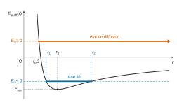
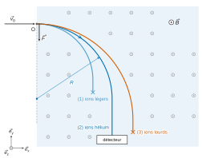
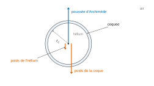
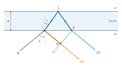
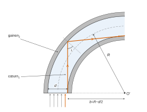

# e3a-Polytech MPI — Physique-chimie 2026 · Corrigé guidé

*Corrigé rédigé par IA, non officiel. Signalez toute erreur.*

## Présentation du sujet

**Thème** : « Autour de l'hélium ». L'épreuve dure 4 heures, **calculatrice interdite**. Le sujet compte 10 pages et **40 questions**, réparties en cinq parties **indépendantes**. Les données sont regroupées en fin de chaque partie. L'énoncé prévient qu'un résultat numérique sans unité ou avec une unité fausse n'est pas compté, et que les explications physiques comptent autant que les calculs.

| Partie | Questions | Contenu | Notions mobilisées |
|---|---|---|---|
| I – Un gaz « rare » dans l'atmosphère | Q1–Q9 | Pourquoi l'hélium quitte l'atmosphère : on compare la vitesse de libération à l'agitation thermique. | Force newtonienne, énergie potentielle, moment cinétique, énergie potentielle effective, états liés et de diffusion, gaz parfait |
| II – Le laser hélium-néon | Q10–Q18 | Modes propres de la cavité, puis mesure de $\lambda$ par la tache d'Airy : intégrale calculée en Python, dichotomie, incertitudes. | Conducteur parfait, équations de Maxwell, d'Alembert, ondes stationnaires, méthode des rectangles, dichotomie, propagation des incertitudes, écart normalisé |
| III – Détection de fuites | Q19–Q28 | Spectromètre de masse : tri des ions selon le rayon de leur trajectoire. | Force de Lorentz, puissance nulle, notation complexe, mouvement circulaire uniforme, ordre de grandeur relativiste |
| IV – Bulles de savon à l'hélium | Q29–Q34 | Forme sphérique, flottabilité et épaisseur du film, mesure interférentielle de cette épaisseur, fibre optique courbée. | Minimisation de surface, poussée d'Archimède, lame mince, théorème de Malus, spectre cannelé, réflexion totale |
| V – Ballon sans hélium | Q35–Q40 | L'aluminium attaqué par la soude produit du dihydrogène. | Base forte et pH, nombres d'oxydation, demi-équations en milieu basique, constante d'équilibre, gaz parfait et stœchiométrie |

Les parties I, III et IV sont communes avec le sujet MP. Les parties II et V comportent des variantes : la partie II de la filière MPI porte sur la diffraction et contient deux questions de Python (Q15 et Q17).

**Difficulté.** Le sujet est long mais très guidé, avec beaucoup de questions de cours et d'applications directes. Cinq points demandent davantage de réflexion :

- la discussion graphique de l'énergie potentielle effective (Q6) ;
- la lecture de la photographie du laser pour estimer $L$ (Q14) ;
- la démonstration de la différence de marche par le théorème de Malus (Q31), à savoir refaire ;
- la lecture quantitative du spectre cannelé (Q33) ;
- la géométrie de la fibre courbée (Q34), la question la moins standard du sujet.

**Ce qu'en dit le rapport 2026.** Le rapport du jury est qualitatif : il ne donne ni barème, ni taux de réussite par question. Il indique que la partie I « n'a pas été très bien réussie », la partie IV « délicate pour de nombreux candidats » et la chimie « assez bien réussie ». Ses rappels généraux valent pour tout le sujet :

- « Une réponse non justifiée ne rapporte aucun point. » ;
- les sigles (PFD, TMC) se définissent avant d'être employés ;
- « un résultat exprimé avec une puissance de 10 non entière ne rapporte aucun point ».

**Questions discriminantes selon le rapport.** La planéité du mouvement (Q4) et la courbe d'énergie potentielle effective (Q6) ; les hypothèses du gaz parfait (Q8) ; le champ nul dans un conducteur parfait (Q11) ; l'écart normalisé (Q18) ; les caractères plan et uniforme du mouvement de l'ion (Q19–Q20) ; l'attribution des trajectoires (Q26) ; le bilan des forces sur la bulle (Q30) ; l'optique de la partie IV (Q31–Q34). Sur ces dernières, « Les rares candidats qui se sont illustrés sur ces questions plus difficiles ont été récompensés à leur juste valeur. »

**Questions abordables à ne pas laisser passer** : Q1–Q5, Q7–Q13, Q15–Q16, Q19–Q25, Q27, Q29–Q30, Q35–Q38 et Q40. Elles représentent plus des deux tiers du sujet.

**Calcul sans calculatrice.** Les données sont choisies pour que les calculs tombent juste : $\sqrt{1{,}4}\approx1{,}2$ et $\sqrt{1{,}8}\approx1{,}3$ sont même fournis. Séparez toujours mantisse et puissance de dix, et donnez deux chiffres significatifs.

**Gestion du temps.** Comptez environ 45 minutes pour la partie I, 60 pour la II, 45 pour la III, 50 pour la IV et 30 pour la V, et gardez 10 minutes de relecture. Traitez chaque partie d'un bloc : le rapport 2026 met en garde contre les allers-retours entre parties pour grappiller les questions faciles, qui font perdre la cohérence d'ensemble. La partie V, rapide et rentable, ne doit pas être sacrifiée en fin d'épreuve.

## Partie I – L'hélium, un gaz « rare » dans notre atmosphère

On étudie le mouvement d'un atome dans le champ de gravitation terrestre : forces centrales, énergie potentielle effective, vitesse de libération. On compare ensuite cette vitesse à la vitesse d'agitation thermique de l'hélium. C'est du cours de première année, que le rapport 2026 demande de travailler davantage.

### Question 1

> [!INDICATION]
> Question de culture générale : deux gaz, deux pourcentages approchés.

#### Solution

L'air sec contient environ **78 % de diazote $\mathrm N_2$** et **21 % de dioxygène $\mathrm O_2$**, en fraction molaire (donc en volume). Le pourcent restant est surtout de l'argon, avec un peu de $\mathrm{CO_2}$ et des traces d'autres gaz, dont l'hélium.

> [!PIEGE]
> Ce sont des fractions molaires (ou volumiques), pas massiques. Précisez-le.

### Question 2

> [!INDICATION]
> Loi de la gravitation universelle. La Terre étant à symétrie sphérique, elle agit à l'extérieur comme un point matériel placé en $O$.

> [!INDICATION]
> Pour l'énergie potentielle, écrivez $\vec F=-\dfrac{\mathrm dE_\mathrm p}{\mathrm dr}\vec e_r$ et choisissez la constante d'intégration avec la condition à l'infini.

#### Solution

Avec $\vec e_r=\overrightarrow{OP}/r$ :

$$\boxed{\vec F=-\frac{GM_Tm}{r^2}\,\vec e_r}$$

Il faut :

$$\frac{\mathrm dE_\mathrm p}{\mathrm dr}=\frac{GM_Tm}{r^2}$$

On intègre avec $E_\mathrm p(\infty)=0$ :

$$\boxed{E_\mathrm p(r)=-\frac{GM_Tm}{r}}$$

> [!PIEGE]
> Une force attractive dérive d'une énergie potentielle **croissante** avec $r$. Avec la convention $E_\mathrm p(\infty)=0$, elle est donc négative partout. La force est un vecteur, l'énergie un scalaire : n'écrivez ni $\vec e_r$ dans $E_\mathrm p$, ni une force sans vecteur.

> [!JURY]
> Le rapport 2026 signale que, dans cette partie, « des confusions vecteur/scalaire ou des problèmes de signe sur l'énergie potentielle gravitationnelle ont ruisselé dans les questions suivantes » (p. 1). Une erreur ici fausse $E_\mathrm m$, $E_{\mathrm p,\mathrm{eff}}$ et la vitesse de libération.

### Question 3

> [!INDICATION]
> Énergie cinétique plus énergie potentielle. Pour la conservation, quelles sont les forces qui travaillent, et sont-elles conservatives ?

#### Solution

$$\boxed{E_\mathrm m=\frac12mv^2-\frac{GM_Tm}{r}}$$

Dans le référentiel géocentrique galiléen, $P$ n'est soumis qu'à $\vec F$, qui est conservative : aucune force non conservative ne travaille. Le théorème de la puissance mécanique donne :

$$\frac{\mathrm dE_\mathrm m}{\mathrm dt}=\mathcal P_{\text{non cons.}}=0$$

**$E_\mathrm m$ se conserve**.

> [!JURY]
> Le rapport 2026 rappelle que « justifier ne veut pas dire donner un synonyme » (p. 1). Il cite l'argument « l'énergie mécanique est constante donc elle se conserve », qui ne rapporte rien. Nommez le théorème, le référentiel galiléen et le caractère conservatif de la seule force.

### Question 4

> [!INDICATION]
> Pour une force centrale, une grandeur vectorielle se conserve. Laquelle ?

> [!INDICATION]
> Théorème du moment cinétique en $O$. Puis exprimez $\vec L_O$ en coordonnées polaires.

#### Solution

On applique le théorème du moment cinétique en $O$, point fixe du référentiel galiléen :

$$\frac{\mathrm d\vec L_O}{\mathrm dt}=\overrightarrow{OP}\wedge\vec F=\vec 0$$

En effet, $\vec F$ est colinéaire à $\overrightarrow{OP}$. $\vec L_O=\overrightarrow{OP}\wedge m\vec v$ est donc constant.

- Si $\vec L_O\ne\vec 0$ : $\overrightarrow{OP}$ reste orthogonal à un vecteur fixe, donc $P$ reste dans le plan passant par $O$ et orthogonal à $\vec L_O$.
- Si $\vec L_O=\vec 0$ : le mouvement est rectiligne selon $\overrightarrow{OP}$.

Dans les deux cas, **le mouvement est plan**. En polaires, $\vec v=\dot r\vec e_r+r\dot\theta\vec e_\theta$, donc $\vec L_O=mr^2\dot\theta\,\vec e_z$, et :

$$\boxed{r^2\dot\theta=C=\text{cste}}$$

> [!METHODE]
> La **direction** constante de $\vec L_O$ donne la planéité, sa **composante** constante donne la loi des aires. Ce sont deux conclusions distinctes, à rédiger séparément.

> [!JURY]
> D'après le rapport 2026, « la démonstration de la planéité du mouvement laisse souvent à désirer » (p. 1). Le même rapport demande de définir un sigle avant de l'employer : « on n'utilise pas PFD ou TMC sans le définir une première fois » (p. 1).

### Question 5

> [!INDICATION]
> Exprimez $v^2$ en polaires, puis éliminez $\dot\theta$ grâce à $C$.

#### Solution

En polaires, $v^2=\dot r^2+r^2\dot\theta^2$. Avec $\dot\theta=C/r^2$ :

$$v^2=\dot r^2+\frac{C^2}{r^2}$$

On reporte dans $E_\mathrm m$ :

$$E_\mathrm m=\frac12m\dot r^2+E_{\mathrm p,\mathrm{eff}}(r)$$

$$\boxed{E_{\mathrm p,\mathrm{eff}}(r)=\frac{mC^2}{2r^2}-\frac{GM_Tm}{r}}$$

> [!METHODE]
> Cette réduction ramène le problème à un mouvement radial à une seule variable, $r$, dans un potentiel effectif. C'est la méthode standard pour toutes les forces centrales conservatives.

### Question 6

> [!INDICATION]
> Étudiez les limites en $0^+$ et en $+\infty$ : quel terme domine dans chaque cas ? Puis le signe de la dérivée.

> [!INDICATION]
> Comme $\frac12m\dot r^2\ge0$, les valeurs de $r$ accessibles sont celles où la courbe passe sous la droite horizontale d'ordonnée $E_\mathrm m$. Discutez selon la position de cette droite par rapport à l'asymptote.

#### Solution

On suppose $C\ne0$.

- Quand $r\to0^+$, le terme en $1/r^2$ domine : $E_{\mathrm p,\mathrm{eff}}\to+\infty$.
- Quand $r\to+\infty$, le terme en $-1/r$ domine : $E_{\mathrm p,\mathrm{eff}}\to0^-$.
- La dérivée $E_{\mathrm p,\mathrm{eff}}'(r)=\dfrac{m}{r^3}(GM_Tr-C^2)$ s'annule en $r_0=C^2/(GM_T)$ : la fonction décroît sur $]0,r_0]$, puis croît.
- Le minimum vaut $-\dfrac{G^2M_T^2m}{2C^2}<0$, et la fonction s'annule en $r_0/2$.



Le mouvement n'est possible que là où $E_{\mathrm p,\mathrm{eff}}(r)\le E_\mathrm m$.

- Si $E_{\min}\le E_\mathrm m<0$, on a $r_1\le r\le r_2$ : c'est un **état lié**.
- Si $E_\mathrm m\ge0$, seul $r\ge r_1$ est imposé, et $r$ peut tendre vers l'infini : c'est un **état de diffusion**.

$$\boxed{\text{diffusion}\iff E_\mathrm m\ge0}$$

Le cas $C=0$ (mouvement radial) conduit à la même conclusion.

> [!PIEGE]
> Le minimum n'est pas à l'origine, et l'asymptote en $+\infty$ est $0^-$, pas $-\infty$. Sur votre tracé, faites apparaître les deux comportements limites, le minimum et l'asymptote.

> [!JURY]
> Le rapport 2026 note : « La courbe de l'énergie potentielle effective mérite d'être mieux comprise et exploitée. » (p. 1). Le tracé doit être justifié (limites, extremum), puis réellement utilisé : droite $E=E_\mathrm m$, zones accessibles, conclusion selon le signe de $E_\mathrm m$.

### Question 7

> [!INDICATION]
> La vitesse de libération correspond au cas limite de la question précédente. Écrivez $E_\mathrm m$ au départ de la surface.

> [!INDICATION]
> Pour l'application numérique, calculez d'abord $v_\ell^2$ et séparez la puissance de dix.

#### Solution

Au départ de $r=R_T$ avec une vitesse de norme $v$ :

$$E_\mathrm m=\frac12mv^2-\frac{GM_Tm}{R_T}$$

Cette énergie ne dépend que de la **norme** de la vitesse, pas de sa direction (pourvu que la trajectoire ne recoupe pas la Terre). La condition $E_\mathrm m\ge0$ donne :

$$\boxed{v_\ell=\sqrt{\frac{2GM_T}{R_T}}}$$

Application numérique :

$$\begin{aligned}
v_\ell^2&=\frac{2\times7{,}0\cdot10^{-11}\times6{,}0\cdot10^{24}}{6{,}0\cdot10^6}\\
&=1{,}4\cdot10^{8}\ \mathrm{m^2\,s^{-2}}
\end{aligned}$$

$$\boxed{v_\ell\approx1{,}2\cdot10^4\ \mathrm{m\,s^{-1}}}$$

> [!PIEGE]
> Inutile de supposer un tir radial « pour minimiser l'énergie » : à norme de vitesse fixée, l'énergie mécanique est la même dans toutes les directions. Autre erreur classique : oublier le facteur 2, ce qui donne la vitesse en orbite circulaire rasante, $\sqrt{GM_T/R_T}\approx8$ km/s.

> [!PIEGE]
> La racine de $1{,}4\cdot10^8$ s'écrit $\sqrt{1{,}4}\cdot10^4$. Le rapport 2026 rappelle qu'un résultat avec une puissance de 10 non entière, comme $10^{3{,}5}$, ne rapporte aucun point : regroupez la puissance de dix pour qu'elle soit paire avant d'extraire la racine.

### Question 8

> [!INDICATION]
> Trois idées : la taille des particules, leurs interactions, et la description statistique.

#### Solution

Le modèle du gaz parfait repose sur trois hypothèses :

- les particules sont ponctuelles : leur volume propre est négligeable ;
- il n'y a pas d'interaction à distance entre particules, donc pas d'énergie potentielle d'interaction. Seuls existent des chocs élastiques, entre particules et avec les parois ;
- les particules sont en très grand nombre, avec une agitation désordonnée, homogène et isotrope.

> [!JURY]
> Pour le rapport 2026, les questions de thermodynamique de fin de partie ont été délicates, et « les hypothèses du modèle du gaz parfait méritent d'être revues » (p. 1). On attend des hypothèses microscopiques (taille, interactions), pas la seule équation d'état $PV=nRT$.

### Question 9

> [!INDICATION]
> Application numérique avec l'aide fournie, puis comparaison avec $v_\ell/10$. Terminez par une phrase physique.

#### Solution

$$\begin{aligned}
u&=\sqrt{\frac{3\times8{,}0\times300}{4{,}0\cdot10^{-3}}}\\
&=\sqrt{1{,}8\cdot10^6}\ \mathrm{m\,s^{-1}}
\end{aligned}$$

$$\boxed{u\approx1{,}3\cdot10^3\ \mathrm{m\,s^{-1}}}$$

Or $v_\ell/10\approx1{,}2\cdot10^3\ \mathrm{m\,s^{-1}}$. Comme $u>v_\ell/10$, **l'hélium s'échappe de l'attraction terrestre.**

Il est produit en continu dans la croûte, mais il quitte aussi en continu la haute atmosphère, d'où sa faible concentration. $\mathrm N_2$ et $\mathrm O_2$ sont 7 à 8 fois plus lourds : leur $u$ est environ 2,7 fois plus faible, et ils restent piégés.

> [!METHODE]
> Le critère « $u>v_\ell/10$ » tient compte du fait que la distribution des vitesses s'étend bien au-delà de la moyenne. Les atomes les plus rapides suffisent à vider lentement l'atmosphère d'un gaz léger.

> [!JURY]
> Pour le rapport 2026, cette question conclusive « imposait d'avoir réalisé les applications numériques précédentes ; il n'était pas pertinent d'y répondre sans les avoir effectuées » (p. 1). On attend la comparaison chiffrée de $u$ et de $v_\ell/10$, puis une phrase qui répond à la question posée.

## Partie II – Le laser hélium-néon

La partie établit les modes propres de la cavité à partir des équations de Maxwell et confronte l'ISL à la photographie du laser. Elle exploite ensuite la tache d'Airy pour mesurer $\lambda$ : intégrale calculée en Python, recherche d'un zéro par dichotomie, incertitudes et écart normalisé. Selon le rapport 2026, hormis la question du conducteur parfait, « les autres questions d'électromagnétisme ont été plutôt bien traitées » (p. 2).

### Question 10

> [!INDICATION]
> Trois exemples concrets, dans trois domaines différents.

#### Solution

Trois applications du laser :

- **vie quotidienne** : lecteurs de codes-barres, lecture des disques optiques ;
- **industrie** : découpe et soudage de métaux, télémétrie ;
- **médecine** : chirurgie réfractive de l'œil, photocoagulation de la rétine.

On peut citer aussi les télécommunications par fibre optique et la recherche (interférométrie, refroidissement d'atomes).

### Question 11

> [!INDICATION]
> Loi d'Ohm locale et puissance volumique dissipée par effet Joule. Que se passe-t-il quand la conductivité tend vers l'infini ?

#### Solution

La loi d'Ohm locale s'écrit $\vec j=\gamma\vec E$. La puissance volumique dissipée vaut :

$$\begin{aligned}
p&=\vec j\cdot\vec E\\
&=\frac{j^2}{\gamma}\\
&=\gamma E^2
\end{aligned}$$

Pour un conducteur parfait, $\gamma\to+\infty$. Un champ non nul y produirait une puissance $\gamma E^2$ infinie, ce qui est impossible. La puissance et le courant restant finis, il faut $E^2=p/\gamma\to0$, et la puissance dissipée $j^2/\gamma$ tend vers 0 :

$$\boxed{\vec E=\vec 0\ \text{dans un conducteur parfait}}$$

> [!JURY]
> Le rapport 2026 indique que « la justification du champ électrique nul dans un conducteur parfait a posé des problèmes à de nombreux candidats » (p. 2). L'énoncé demande des considérations énergétiques : écrivez la puissance volumique $\vec j\cdot\vec E$, faites tendre $\gamma$ vers l'infini et concluez, au lieu d'affirmer le résultat.

### Question 12

> [!INDICATION]
> Écrivez les quatre équations de Maxwell dans le vide sans source, puis prenez le rotationnel de Maxwell-Faraday.

> [!INDICATION]
> Utilisez l'identité fournie et la nullité de la divergence de $\vec E$. Pour $f$, reportez la forme séparée $f(x)\sin(\omega t)$.

#### Solution

Les équations de Maxwell dans le vide sans source s'écrivent, avec $\mu_0\varepsilon_0c^2=1$ :

$$\begin{aligned}
\operatorname{div}\vec E&=0\\
\overrightarrow{\operatorname{rot}}\,\vec E&=-\frac{\partial\vec B}{\partial t}\\
\operatorname{div}\vec B&=0\\
\overrightarrow{\operatorname{rot}}\,\vec B&=\frac1{c^2}\frac{\partial\vec E}{\partial t}
\end{aligned}$$

On prend le rotationnel de Maxwell-Faraday :

$$\begin{aligned}
\overrightarrow{\operatorname{rot}}(\overrightarrow{\operatorname{rot}}\,\vec E)&=-\frac{\partial}{\partial t}\overrightarrow{\operatorname{rot}}\,\vec B\\
&=-\frac1{c^2}\frac{\partial^2\vec E}{\partial t^2}
\end{aligned}$$

Or, d'après l'identité fournie et $\operatorname{div}\vec E=0$ :

$$\begin{aligned}
\overrightarrow{\operatorname{rot}}(\overrightarrow{\operatorname{rot}}\,\vec E)&=\overrightarrow{\operatorname{grad}}(\operatorname{div}\vec E)-\Delta\vec E\\
&=-\Delta\vec E
\end{aligned}$$

D'où l'équation de d'Alembert :

$$\boxed{\Delta\vec E-\frac1{c^2}\frac{\partial^2\vec E}{\partial t^2}=\vec 0}$$

Pour un champ transverse de composante $E=f(x)\sin\omega t$, on obtient pour tout $t$ :

$$\left(f''+\frac{\omega^2}{c^2}f\right)\sin\omega t=0$$

$$\boxed{f''(x)+\frac{\omega^2}{c^2}f(x)=0}$$

> [!PIEGE]
> Sans $\operatorname{div}\vec E=0$, le terme de gradient ne disparaît pas. Citez cette hypothèse, propre à l'absence de charges.

### Question 13

> [!INDICATION]
> Oscillateur harmonique en $x$. Les conditions aux limites découlent de Q11 et de la continuité admise.

> [!INDICATION]
> La condition en $x=L$ quantifie $\omega$. Pensez à la corde vibrante fixée à ses deux extrémités.

#### Solution

La solution générale est $f=A\cos kx+B\sin kx$, avec $k=\omega/c$.

- En $x=0$ : $f(0)=0$, donc $A=0$.
- En $x=L$ : $f(L)=0$ impose $\sin kL=0$ pour une solution non nulle, soit $kL=n\pi$ avec $n\in\mathbb N^*$.

$$\boxed{\nu_n=\frac{nc}{2L}}$$

$$\boxed{\mathrm{ISL}=\frac{c}{2L}}$$

> [!PIEGE]
> Le cas $n=0$ donne le champ nul : on prend $n\ge1$.

> [!METHODE]
> Le rapport 2026 conseille de revoir les résolutions d'équations différentielles, omniprésentes en physique. Ici, écrivez la solution générale, puis appliquez les conditions aux limites une à une.

### Question 14

> [!INDICATION]
> La photographie de la figure 1 porte un trait d'échelle. Servez-vous-en pour estimer $L$.

> [!INDICATION]
> Un ordre de grandeur suffit. Commentez l'écart entre la longueur du boîtier et celle de la cavité.

#### Solution

Le tube, bague comprise, mesure environ 6,5 fois le trait de 2 cm, soit $L\approx13$ cm. La cavité est un peu plus courte que le boîtier. On en déduit :

$$\mathrm{ISL}=\frac{3{,}0\cdot10^8}{2\times0{,}13}\approx1{,}2\cdot10^9\ \mathrm{Hz}$$

$$\boxed{\mathrm{ISL}\sim1\ \mathrm{GHz}}$$

**C'est cohérent avec les 1 090 MHz annoncés.** Inversement, cette valeur correspond à $L=c/(2\,\mathrm{ISL})\approx14$ cm, compatible avec la photographie.

> [!METHODE]
> Pour une lecture de photographie, donnez la mesure faite (« environ 6,5 fois le trait d'échelle »), puis concluez sur l'ordre de grandeur sans prétendre à une précision que l'image ne permet pas.

### Question 15

> [!INDICATION]
> Méthode des rectangles : chaque terme est l'aire d'un rectangle, hauteur multipliée par largeur. Quelle est la largeur pour 201 points sur $[-1,1]$ ?

#### Solution

Le pas vaut $\Delta t=2/200$ (201 points, donc 200 intervalles). Les termes extrêmes sont nuls, car $\sqrt{1-t^2}=0$ en $\pm1$ : la somme sur les 201 points est donc bien une somme de 200 rectangles.

```python
def g(x):
    S = 0                              # ligne 5
    T = np.linspace(-1,1,201)
    for k in T:
        S = S + airy(x,k)*(2/200)      # ligne 9
    return S                           # ligne 10
```

> [!PIEGE]
> Le pas vaut $2/200$, pas $2/201$. Comptez les intervalles, pas les points.

> [!JURY]
> Le rapport 2026 relève que, dans le sujet MPI, « la largeur des rectangles est parfois oubliée dans le programme mettant en œuvre la méthode des rectangles » (p. 2). Une somme des seules hauteurs ne calcule pas une intégrale : multipliez par le pas, dans la boucle ou au retour.

### Question 16

> [!INDICATION]
> Pour quelle valeur de $x$ le cosinus disparaît-il de l'intégrande ? Comparez ensuite avec la figure 3.

#### Solution

En $x=0$, avec la primitive fournie :

$$\begin{aligned}
g(0)&=\int_{-1}^1\sqrt{1-t^2}\,\mathrm dt\\
&=\left[\frac{t\sqrt{1-t^2}+\arcsin t}{2}\right]_{-1}^1\\
&=\frac\pi2
\end{aligned}$$

$$\boxed{g(0)=\frac\pi2\approx1{,}57}$$

C'est le maximum lu sur la figure 3. Le programme de Q15 rend 1,5702.

> [!METHODE]
> Valider un programme numérique sur un cas calculable exactement est un réflexe à avoir systématiquement.

### Question 17

> [!INDICATION]
> On garde la moitié d'intervalle où $g$ change de signe. Le test porte sur le produit $g(a)\,g(\text{milieu})$.

> [!INDICATION]
> Choisissez sur la figure 3 un intervalle initial qui contient le premier zéro positif, et seulement lui. Pour $\varepsilon$, regardez la condition d'arrêt et la valeur renvoyée.

#### Solution

Si $g(a)\,g(\text{milieu})>0$, la racine est dans $[\text{milieu},b]$, donc `a = milieu`. Sinon, `b = milieu`.

La boucle s'arrête quand $|b-a|\le2\varepsilon$, et le milieu est alors à moins de $\varepsilon$ de la racine : on prend $\varepsilon=10^{-2}$. Sur la figure 3, $g(1)>0$ et $g(2)<0$, avec un seul zéro entre les deux.

```python
def h(a,b,eps):
    while abs(b-a) > 2*eps:
        milieu = (a+b)/2
        if g(a)*g(milieu) > 0:
            a = milieu                 # ligne 5
        else:
            b = milieu                 # ligne 7
    return ((a+b)/2)

print(h(1, 2, 1e-2))                   # ligne 10
```

Le programme rend $\approx1{,}23$, à $10^{-2}$ près du zéro exact (1,2197).

> [!PIEGE]
> Un intervalle initial contenant plusieurs zéros, ou aucun changement de signe, fait converger la dichotomie vers une racine quelconque, voire vers un point qui n'est pas une racine.

### Question 18

> [!INDICATION]
> Isolez $\lambda$ dans la formule (6). Pour un produit de puissances de grandeurs indépendantes, ce sont les incertitudes **relatives** qui se composent.

> [!INDICATION]
> Écart normalisé : la différence des deux valeurs, divisée par l'incertitude-type. Comparez le résultat au seuil usuel.

#### Solution

On a $\lambda=\phi R/(1{,}22\,d)$, d'où :

$$\boxed{u(\lambda)=\lambda\sqrt{\left(\frac{u(\phi)}{\phi}\right)^2+\left(\frac{u(R)}{R}\right)^2+\left(\frac{u(d)}{d}\right)^2}}$$

Vérification : la racine vaut $\sqrt{0{,}0625^2+0{,}040^2+0{,}0025^2}\approx0{,}074$, et $0{,}074\times656\approx49$ nm.

La valeur attendue a une incertitude négligeable. L'écart normalisé vaut donc :

$$z=\frac{|\lambda_{\exp}-\lambda_{\text{réf}}|}{u(\lambda)}$$

$$z=\frac{656-632{,}8}{49}$$

$$\boxed{z\approx0{,}47}$$

Comme $z<2$, **la mesure est compatible avec 632,8 nm**. C'est la mesure de $\phi$ qui limite la précision.

> [!METHODE]
> Pour conclure, énoncez toujours le seuil de compatibilité (ici $z\le2$) avant de comparer : « $z$ est petit » ne suffit pas.

> [!JURY]
> Selon le rapport 2026, la formule de propagation des incertitudes est « assez souvent correcte », mais « la notion d'écart normalisé semble méconnue. Cette quantité fait pourtant partie des compétences exigibles au programme, y compris aux écrits » (p. 2). Définissez $z$, calculez-le, comparez-le à 2 et concluez par une phrase.

## Partie III – De l'hélium pour détecter les fuites

Mouvement d'une particule chargée dans un champ magnétique uniforme. On établit la trajectoire circulaire par la notation complexe, puis on exploite la dépendance du rayon en $\sqrt m$ pour trier les ions.

### Question 19

> [!INDICATION]
> Projetez le principe fondamental de la dynamique sur $\vec e_z$, puis utilisez les conditions initiales.

#### Solution

L'ion n'est soumis qu'à la force de Lorentz magnétique (poids négligé) :

$$m\frac{\mathrm d\vec v}{\mathrm dt}=e\vec v\wedge B\vec e_z$$

Ce vecteur est orthogonal à $\vec e_z$, donc $m\ddot z=0$.

- Comme $\vec v_0=v_0\vec e_x$, on a $\dot z(0)=0$, donc $\dot z(t)=0$.
- Comme l'ion part de $O$, $z(0)=0$, donc $z(t)=0$.

**La trajectoire est dans le plan $(O,\vec e_x,\vec e_y)$.**

> [!JURY]
> Le rapport 2026 observe : « Les quelques candidats qui ne connaissaient pas l'expression de la force de Lorentz ont été en difficulté. La démonstration du caractère plan, puis uniforme du mouvement a rarement été bien menée. » (p. 2). Écrivez les deux intégrations successives avec leurs conditions initiales : « $F_z=0$ donc $z=0$ » saute une étape.

### Question 20

> [!INDICATION]
> Calculez la puissance de la force magnétique.

> [!INDICATION]
> Pour le sens de $\vec B$, la force initiale doit être orientée vers l'intérieur de la courbure. Calculez $\vec e_x\wedge\vec e_z$.

#### Solution

La puissance de la force magnétique est nulle :

$$\mathcal P=(e\vec v\wedge\vec B)\cdot\vec v=0$$

Par le théorème de l'énergie cinétique, $\|\vec v\|=v_0$ : **le mouvement est uniforme**.

Sur la figure 4, l'ion entre selon $+\vec e_x$ et tourne vers $-\vec e_y$ : la force initiale est selon $-\vec e_y$. Or :

$$ev_0\vec e_x\wedge B_z\vec e_z=-ev_0B_z\vec e_y$$

Donc $B_z>0$ : **$\vec B$ est selon $+\vec e_z$**, sortant du plan de la figure.

> [!PIEGE]
> Le trièdre est direct : $\vec e_x\wedge\vec e_y=\vec e_z$, donc $\vec e_x\wedge\vec e_z=-\vec e_y$. Une erreur de signe ici inverse toute la suite de la partie.

### Question 21

> [!INDICATION]
> Développez $\vec v\wedge\vec e_z$ en composantes.

#### Solution

Avec $\vec e_x\wedge\vec e_z=-\vec e_y$ et $\vec e_y\wedge\vec e_z=\vec e_x$ :

$$\vec v\wedge B\vec e_z=B(v_y\vec e_x-v_x\vec e_y)$$

D'où, avec $\omega=eB/m$ :

$$\boxed{\begin{aligned}
\dot v_x&=\omega v_y\\
\dot v_y&=-\omega v_x
\end{aligned}}$$

### Question 22

> [!INDICATION]
> Dérivez $\underline u$ et remplacez les dérivées par les expressions de Q21. Mettez ensuite $\mathrm j\omega$ en facteur.

#### Solution

$$\begin{aligned}
\dot{\underline u}&=\dot v_y+\mathrm j\dot v_x\\
&=-\omega v_x+\mathrm j\omega v_y\\
&=\mathrm j\omega(v_y+\mathrm jv_x)\\
&=\mathrm j\omega\underline u
\end{aligned}$$

$$\boxed{\frac{\mathrm d\underline u}{\mathrm dt}-\mathrm j\omega\underline u=0}$$

> [!METHODE]
> Deux équations couplées du type $\dot a=\omega b$, $\dot b=-\omega a$ se découplent en une seule équation complexe d'ordre 1. C'est la signature d'une rotation à vitesse angulaire $\omega$.

> [!JURY]
> Le rapport 2026 rappelle que, le résultat étant donné, « la démonstration se doit d'être rigoureuse » ; les candidats qui ont tenté « de flouer le correcteur en arrivant au résultat attendu avec des signes incorrects dans les calculs intermédiaires, ont été sanctionnés » (p. 2). Chaque ligne du calcul doit être juste, pas seulement la dernière.

### Question 23

> [!INDICATION]
> L'équation est linéaire d'ordre 1 à coefficient constant. Calculez $\underline u(0)$ à partir de $\vec v_0$.

#### Solution

On a $\underline u=\underline u(0)e^{\mathrm j\omega t}$, avec $\underline u(0)=\mathrm jv_0$. D'où :

$$\underline u=-v_0\sin\omega t+\mathrm jv_0\cos\omega t$$

En séparant parties réelle et imaginaire :

$$\boxed{\begin{aligned}
v_x&=v_0\cos\omega t\\
v_y&=-v_0\sin\omega t
\end{aligned}}$$

On vérifie que $v_x^2+v_y^2=v_0^2$, ce qui confirme Q20.

> [!PIEGE]
> La partie réelle de $\underline u$ est $v_y$, pas $v_x$. Relisez la définition de $\underline u$ avant d'identifier.

### Question 24

> [!INDICATION]
> Intégrez avec l'ion en $O$ à $t=0$. N'oubliez pas les constantes d'intégration.

#### Solution

$$\boxed{\begin{aligned}
x(t)&=\frac{v_0}{\omega}\sin\omega t\\
y(t)&=\frac{v_0}{\omega}(\cos\omega t-1)
\end{aligned}}$$

### Question 25

> [!INDICATION]
> Faites disparaître le temps en combinant $x^2$ et un carré bien choisi construit à partir de $y$.

#### Solution

$$x^2+\left(y+\frac{v_0}{\omega}\right)^2=\frac{v_0^2}{\omega^2}$$

C'est un cercle de centre $(0,-v_0/\omega)$, donc **la trajectoire est circulaire**, de rayon :

$$\boxed{R=\frac{mv_0}{eB}}$$

### Question 26

> [!INDICATION]
> À énergie cinétique fixée, exprimez $mv_0$ en fonction de $m$ et de $E_\mathrm c$.

> [!INDICATION]
> Comment $R$ varie-t-il avec la masse ? Sur la figure, quelle trajectoire a le plus grand rayon ?

#### Solution

On a $mv_0=\sqrt{2mE_\mathrm c}$, donc :

$$R=\frac{\sqrt{2mE_\mathrm c}}{eB}\propto\sqrt m$$

Les masses molaires valent 2 et 3 g/mol pour les ions légers, 4 g/mol pour l'hélium, 28 à 44 g/mol pour les ions lourds. Toutes les trajectoires partent de $O$ tangentes à $\vec e_x$. Le rayon croît de (1), la plus intérieure, à (3), la plus extérieure. Le détecteur est au bout de (2), et le champ est réglé pour que seul l'hélium y parvienne.

- **(1)** : ions légers ($\mathrm H_2^+$, $^3\mathrm{He}^+$) ;
- **(2)** : ions hélium ;
- **(3)** : ions lourds ($\mathrm N_2^+$, $\mathrm O_2^+$, $\mathrm{CO_2^+}$, $\mathrm{Ar}^+$).



> [!PIEGE]
> C'est l'énergie cinétique qui est commune, pas la vitesse. Les deux hypothèses donnent la même association (rayon croissant avec $m$), mais pas la même loi : $R\propto\sqrt m$ à énergie fixée, contre $R\propto m$ à vitesse fixée.

> [!JURY]
> Le rapport 2026 précise que « l'attribution des trajectoires aux différents types d'ions n'est pas triviale et ne peut être donnée sans explication » (p. 2). L'association seule ne suffit pas : il faut la loi $R\propto\sqrt m$ à charge et énergie fixées, et la comparaison des rayons sur la figure.

### Question 27

> [!INDICATION]
> Longueur d'un quart de cercle divisée par la vitesse. Exprimez le résultat avec $\omega$, puis calculez la masse d'un atome d'hélium.

#### Solution

$$\begin{aligned}
\tau&=\frac{\pi R}{2v_0}\\
&=\frac{\pi m}{2eB}
\end{aligned}$$

La masse d'un ion vaut $m=M_{\mathrm{He}}/\mathcal N_A=6{,}7\cdot10^{-27}$ kg, d'où $\omega=eB/m=2{,}4\cdot10^6\ \mathrm{rad\,s^{-1}}$ et :

$$\boxed{\tau\approx6{,}5\cdot10^{-7}\ \mathrm s}$$

> [!METHODE]
> La période cyclotron $2\pi m/(eB)$ ne dépend pas de la vitesse. C'est le principe du cyclotron : la fréquence d'accélération reste fixe.

### Question 28

> [!INDICATION]
> Déduisez $v_0$ de $R$ et de $\omega$, puis comparez à $c$.

#### Solution

On a $v_0=R\omega$. Pour $R\approx3$ cm, $v_0\approx7\cdot10^4\ \mathrm{m\,s^{-1}}$ :

$$\boxed{v_0/c\sim2\cdot10^{-4}\ll1}$$

**L'approximation non relativiste est justifiée** : $\gamma-1\sim10^{-8}$.

> [!PIEGE]
> Les effets relativistes se jugent sur $v/c$, les effets quantiques sur d'autres critères (longueur d'onde de de Broglie, par exemple). Ne mélangez pas les deux.

> [!JURY]
> Le rapport 2026 : « La dernière question attendait un raisonnement basé sur la comparaison de deux vitesses ; certains candidats confondent effets quantiques et effets relativistes. » (p. 2). Calculez $v_0$, comparez-la explicitement à $c$, puis concluez.

## Partie IV – Des bulles de savon remplies d'hélium

Trois sous-problèmes indépendants : un bilan de forces qui fixe l'épaisseur du film, une mesure interférentielle de cette épaisseur, puis le guidage de la lumière dans la fibre qui alimente le spectromètre. C'est la partie la plus sélective du sujet selon le rapport 2026, surtout pour l'optique (Q31–Q34).

### Question 29

> [!INDICATION]
> Exprimez les deux surfaces en fonction du même volume $V_0$.

#### Solution

On a $r=(3V_0/4\pi)^{1/3}$ et $a=V_0^{1/3}$, d'où :

$$\begin{aligned}
\frac{S_\mathrm s}{S_\mathrm c}&=\frac{4\pi}{6}\left(\frac{3}{4\pi}\right)^{2/3}\\
&=\left(\frac{(4\pi)^3\cdot9}{216\,(4\pi)^2}\right)^{1/3}\\
&=\left(\frac\pi6\right)^{1/3}
\end{aligned}$$

$$\boxed{\frac{S_\mathrm s}{S_\mathrm c}=\left(\frac\pi6\right)^{1/3}\approx0{,}81<1}$$

À volume égal, la sphère a moins de surface. Elle minimise l'aire, donc l'énergie de surface, ce qui explique que les bulles libres soient sphériques.

### Question 30

> [!INDICATION]
> Trois forces verticales. Laquelle ne dépend pas de $e$ ?

> [!INDICATION]
> Pour une coque mince, le volume vaut la surface multipliée par l'épaisseur. Au rayon critique, les forces se compensent.

#### Solution

Les forces sur la bulle de rayon critique, orientées sur la verticale ascendante, sont :

- le poids de l'hélium, $\rho_{\mathrm{He}}\frac43\pi r_\mathrm c^3g$, vers le bas ;
- le poids de la coque, $\rho_\ell 4\pi r_\mathrm c^2eg$, vers le bas ;
- la poussée d'Archimède, $\rho_\mathrm a\frac43\pi r_\mathrm c^3g$, vers le haut.



À l'équilibre limite, après division par $4\pi r_\mathrm c^2g$ :

$$\rho_{\mathrm{He}}\frac{r_\mathrm c}{3}+\rho_\ell e=\rho_\mathrm a\frac{r_\mathrm c}{3}$$

$$\boxed{e=\frac{r_\mathrm c(\rho_\mathrm a-\rho_{\mathrm{He}})}{3\rho_\ell}}$$

$$e=\frac{6\cdot10^{-3}\times1{,}0}{3{,}0\cdot10^3}\ \mathrm m$$

$$\boxed{e\approx2\ \mu\mathrm m}$$

La poussée varie en $r^3$ et le poids de la coque en $r^2$ : les grosses bulles montent, conformément à l'expérience.

> [!METHODE]
> Pour interpréter un seuil, écrivez l'équilibre au seuil, puis vérifiez le sens de variation de part et d'autre. C'est ce qui valide le modèle.

> [!JURY]
> Pour le rapport 2026, le bilan des forces sur la bulle « a été source d'erreurs : des confusions de signes, volumes ou masses volumiques sont fréquentes » (p. 2). Il ajoute que « le volume de la coque liquide pouvait être simplifié, dès lors que l'épaisseur de la bulle était supposée très inférieure à son rayon ». Orientez chaque force, associez à chaque poids sa masse volumique et à la poussée celle de l'air.

### Question 31

> [!INDICATION]
> Repérez les points d'entrée, de réflexion et de sortie du rayon (2) dans le film. Les deux rayons émergents sont parallèles.

> [!INDICATION]
> Malus : un plan orthogonal aux rayons émergents est une surface d'onde du faisceau qui converge à l'infini. Faites-le passer par le point de sortie du rayon (2).

> [!INDICATION]
> Projetez le segment entre les deux points d'émergence sur la direction des rayons, puis simplifiez avec la loi de Snell-Descartes.

#### Solution

On note $I$ le point de réflexion de (1), $J$ le point de réflexion de (2) sur la face supérieure et $K$ son point de sortie. On a $IJ=JK=e/\cos i_2$ et $IK=2e\tan i_2$.

Par le retour inverse de la lumière, on voit les deux rayons parallèles comme issus d'un même point à l'infini. Le théorème de Malus dit alors que le plan orthogonal aux rayons émergents est une surface d'onde. On le fait passer par $K$ : il coupe (1) en $H$, avec $IH=IK\sin i_1$. Au-delà de ce plan, les chemins jusqu'au point d'observation sont égaux.



Avec $\sin i_1=n_\ell\sin i_2$ :

$$\begin{aligned}
\delta&=n_\ell(IJ+JK)-IH\\
&=\frac{2n_\ell e}{\cos i_2}-2e\tan i_2\,n_\ell\sin i_2\\
&=2n_\ell e\cos i_2
\end{aligned}$$

Avec le déphasage $\pi$ subi par (1) :

$$\varphi=\frac{4\pi n_\ell e}{\lambda}\cos i_2-\pi$$

$$\boxed{\alpha=4\pi n_\ell e}$$

> [!PIEGE]
> Le terme $IH$, parcouru dans l'air par le rayon (1), est indispensable. L'oublier donne $2n_\ell e/\cos i_2$, ce qui est faux dès que $i_2\ne0$. Le plan d'onde passe par $K$ et coupe le rayon (1) : il ne faut pas projeter $I$ sur le rayon (2).

> [!JURY]
> Le rapport 2026 cite parmi les difficultés de cette partie l'« application du théorème de Malus combiné au principe de retour inverse de la lumière » (p. 2). Les deux arguments doivent apparaître explicitement : retour inverse pour voir les rayons parallèles comme issus d'un point à l'infini, Malus pour placer $H$ et $K$ sur une même surface d'onde.

### Question 32

> [!INDICATION]
> Interférence destructive : $\varphi$ est un multiple impair de $\pi$. Ne perdez pas le $-\pi$.

#### Solution

On a $\varphi=(2p+1)\pi$, d'où $\dfrac{\alpha\cos i_2}{\lambda}=2k\pi$ avec $k=p+1\ge1$ :

$$\boxed{\lambda_k=\frac{\alpha\cos i_2}{2\pi k},\qquad k\in\mathbb N^*}$$

Avec $\alpha=4\pi n_\ell e$ :

$$\lambda_k=\frac{2n_\ell e\cos i_2}{k}$$

> [!METHODE]
> Contrôle rapide : avec un saut de phase $\pi$, l'extinction correspond à une différence de marche égale à un nombre **entier** de longueurs d'onde.

### Question 33

> [!INDICATION]
> En incidence normale, que valent les inverses des longueurs d'onde éteintes ? Lisez sur la figure 7 les points où l'intensité s'annule.

> [!INDICATION]
> Repérez l'ordre $k$ de chaque minimum, puis vérifiez que $k\lambda_k$ est constant. À défaut, utilisez deux minima éloignés et comptez les ordres qui les séparent.

#### Solution

On a $1/\lambda_k=k/(2n_\ell e)$. Les annulations sont lues vers 665, 591, 532, 484, 443, 409, 380 et 355 nm. Le produit $k\lambda_k$ vaut environ 5,32 µm pour $k=8$ à 15. On en déduit :

$$e=\frac{5{,}32\ \mu\mathrm m}{2\times1{,}33}$$

$$\boxed{e\approx2{,}0\ \mu\mathrm m}$$

**Ce résultat concorde avec Q30**, ce qui valide le modèle mécanique de la bulle.

> [!PIEGE]
> Deux minima voisins donnent une différence d'inverses petite, donc sensible à l'erreur de lecture. Préférez deux minima éloignés, ou la constance de $k\lambda_k$ sur tout le spectre. Lisez soigneusement les annulations, pas les maxima.

> [!JURY]
> Le rapport 2026 range l'« exploitation d'un spectre expérimental » parmi les points qui demandaient de l'initiative (p. 2). Donnez les longueurs d'onde lues, l'ordre attribué à chacune et le contrôle de cohérence, puis la comparaison chiffrée avec Q30.

### Question 34

> [!INDICATION]
> Un rayon entre parallèlement à l'axe puis se propage en ligne droite. Caractérisez-le par sa distance au centre de courbure.

> [!INDICATION]
> En un point de l'interface extérieure, la normale est radiale. Exprimez le sinus de l'angle d'incidence avec cette distance et le rayon de l'interface. Quel rayon est le plus défavorable ?

> [!INDICATION]
> Lisez sur la figure 8 où aboutit la flèche $R$ : sur l'axe de la fibre, pas sur un bord.

#### Solution



$R$ est mesuré jusqu'à l'axe : les bords du cœur sont à $R\pm d/2$ du centre $O'$.

Un rayon entrant à la distance $b$ de $O'$ frappe l'interface extérieure avec $\sin i=b/(R+d/2)$. La réflexion conserve $b$, donc l'incidence reste la même aux réflexions suivantes.

Le cas le plus défavorable est $b=R-d/2$. La réflexion totale exige $\sin i\ge n_2/n_1$ :

$$\frac{R-d/2}{R+d/2}\ge\frac{n_2}{n_1}$$

$$\boxed{R_{\min}=\frac d2\cdot\frac{n_1+n_2}{n_1-n_2}}$$

$$R_{\min}=25\ \mu\mathrm m\times\frac{3{,}00}{0{,}10}$$

$$\boxed{R_{\min}\approx0{,}75\ \mathrm{mm}}$$

> [!PIEGE]
> Si l'on mesure $R$ jusqu'au bord intérieur, on trouve $n_2d/(n_1-n_2)=0{,}73$ mm. La valeur numérique est proche, mais l'expression littérale ne répond pas au $R$ défini par la figure.

> [!METHODE]
> Pour une réflexion sur un cercle, la distance de la droite au centre est invariante : $r\sin i=\text{cste}$. Cette relation ressert pour les fibres courbées, les gouttes et les arcs-en-ciel.

> [!JURY]
> L'« utilisation du phénomène de réflexion totale » figure parmi les difficultés de la partie relevées par le rapport 2026 (p. 2). Énoncez la condition $\sin i\ge n_2/n_1$, justifiez le choix du rayon le plus défavorable, puis donnez l'expression littérale avant la valeur.

## Partie V – Gonfler un ballon volant sans hélium

Chimie des solutions : base forte, oxydoréduction en milieu basique, caractère total de la réaction, puis bilan de matière avec un gaz parfait. Le rapport 2026 juge cette partie « sans grande difficulté » et « assez bien réussie » (p. 2) : c'est là qu'il ne faut pas perdre de points.

### Question 35

> [!INDICATION]
> Quel gaz se forme ? Comparez sa masse volumique à celle de l'air, puis concluez avec la poussée d'Archimède.

#### Solution

La réaction produit du $\mathrm H_2$ gazeux qui gonfle le ballon. Pour un gaz parfait à $P$ et $T$ données, $\rho=PM/(RT)$.

Avec $M=2\ \mathrm{g\,mol^{-1}}$ contre $29$ pour l'air, le $\mathrm H_2$ est environ 15 fois moins dense que l'air. Pour un volume suffisant, la poussée d'Archimède l'emporte sur le poids total : **le ballon s'envole**.

### Question 36

> [!INDICATION]
> Définissez la base forte par le caractère total de sa réaction avec l'eau, en écrivant cette réaction. Puis utilisez $K_\mathrm e$.

#### Solution

**Une base forte est une base dont la réaction avec l'eau est totale**, selon $\mathrm B+\mathrm H_2\mathrm O\to\mathrm{BH^+}+\mathrm{HO^-}$. Elle est entièrement convertie en $\mathrm{HO^-}$, et son acide conjugué est indifférent dans l'eau.

Pour l'hydroxyde de sodium, $[\mathrm{HO^-}]=c$. Le produit ionique de l'eau donne $[\mathrm{H_3O^+}]=K_\mathrm e/c=10^{-13}\ \mathrm{mol\,L^{-1}}$ : l'autoprotolyse est bien négligeable.

$$\mathrm{pH}=\mathrm pK_\mathrm e+\log c$$

$$\boxed{\mathrm{pH}=13}$$

> [!PIEGE]
> Une base forte n'est ni une base *concentrée*, ni une base *qui a un pH élevé*, ni une base *qui réagit beaucoup* : c'est la **totalité** de la réaction avec l'eau qui la définit, quelle que soit la concentration.

> [!JURY]
> Le rapport 2026 constate que « la définition d'une base forte est parfois fantaisiste » (p. 2). Une phrase précise et l'équation de la réaction avec l'eau suffisent.

### Question 37

> [!INDICATION]
> La somme des nombres d'oxydation est égale à la charge de l'espèce. Un corps simple a un n.o. nul.

#### Solution

Chaque groupe OH compte pour $-\mathrm{II}+\mathrm I=-1$. On a donc $x+4\times(-1)=-1$ :

$$\boxed{\mathrm{n.o.}=+\mathrm{III}\ \text{dans}\ \mathrm{A\ell(OH)_4^-}}$$

$$\boxed{\mathrm{n.o.}=0\ \text{dans}\ \mathrm{A\ell}}$$

**L'oxydant est $\mathrm{A\ell(OH)_4^-}$, le réducteur est $\mathrm{A\ell}$.**

### Question 38

> [!INDICATION]
> Pour chaque demi-équation, équilibrez l'élément principal, puis O, puis H, et vérifiez la charge.

> [!INDICATION]
> Pour le bilan, égalisez le nombre d'électrons échangés, puis simplifiez les $\mathrm{HO^-}$ présents des deux côtés.

#### Solution

$$\boxed{\begin{aligned}
\alpha_1&=3\\
\beta_1&=1\\
\gamma_1&=4
\end{aligned}}$$

$$\boxed{\begin{aligned}
\alpha_2&=2\\
\beta_2&=2\\
\gamma_2&=2
\end{aligned}}$$

On prend $2\times$(1) dans le sens de l'oxydation et $3\times$(2) : 6 électrons sont cédés et 6 captés, ils disparaissent du bilan.

$$\boxed{2\,\mathrm{A\ell_{(s)}}+2\,\mathrm{HO^-_{(aq)}}+6\,\mathrm{H_2O_{(\ell)}}\longrightarrow2\,\mathrm{A\ell(OH)^-_{4(aq)}}+3\,\mathrm{H_{2(g)}}}$$

Contrôle : 2 $\mathrm{A\ell}$, 8 O, 14 H et une charge $-2$ de chaque côté.

> [!PIEGE]
> En milieu basique, on équilibre avec $\mathrm{HO^-}$ et $\mathrm{H_2O}$, jamais avec $\mathrm{H^+}$. Une équation-bilan ne contient jamais d'électrons : s'il en reste, le nombre d'électrons échangés n'a pas été égalisé.

> [!JURY]
> Le rapport 2026 relève des erreurs « surprenantes » sur les réactions d'oxydo-réduction : « électrons présents dans l'équation-bilan, coefficients stœchiométriques incorrects » (p. 2). Vérifiez la conservation des éléments et des charges, car ces coefficients servent en Q40.

### Question 39

> [!INDICATION]
> Comparez les potentiels standard de l'oxydant et du réducteur qui réagissent. Que vaut la constante d'équilibre ?

#### Solution

On a $E_2^\circ>E_1^\circ$, avec un écart de 1,50 V. Pour 6 électrons échangés :

$$\log K^\circ=\frac{6\times1{,}50}{0{,}06}=150$$

Comme $K^\circ\gg1$, **la réaction peut être supposée totale**.

> [!METHODE]
> Un écart de potentiels standard de quelques dixièmes de volt suffit déjà pour qu'une réaction soit quasi totale. Cette conclusion est thermodynamique : elle ne dit rien de la vitesse.

### Question 40

> [!INDICATION]
> Calculez la quantité de dihydrogène avec la loi des gaz parfaits, en unités SI. Puis utilisez la stœchiométrie du bilan.

#### Solution

$$\begin{aligned}
n(\mathrm H_2)&=\frac{1{,}013\cdot10^5\times5{,}0\cdot10^{-3}}{8{,}3\times298}\\
&\approx0{,}20\ \mathrm{mol}
\end{aligned}$$

D'après le bilan de Q38, 2 mol d'aluminium donnent 3 mol de dihydrogène :

$$n(\mathrm{A\ell})=\frac23n(\mathrm H_2)\approx0{,}137\ \mathrm{mol}$$

$$\boxed{m\approx3{,}7\ \mathrm g}$$

> [!PIEGE]
> Exprimez $P$ en pascals et $V$ en $\mathrm m^3$. Un oubli de conversion fausse le résultat d'un facteur $10^3$ ou $10^5$.

> [!JURY]
> Le rapport 2026 souligne que les coefficients stœchiométriques servaient « pour lier les quantités de matière d'aluminium consommé et de dihydrogène produit dans la dernière question » (p. 2). Une erreur en Q38 se propage ici : écrivez le rapport 2/3 en citant le bilan.

## Bilan

**Méthodes à retenir.**

- Force centrale conservative : conservation de $\vec L_O$ (planéité, loi des aires), énergie potentielle effective, discussion graphique des états liés et de diffusion.
- Particule chargée dans $\vec B$ uniforme : puissance nulle, notation complexe $\underline u$, rayon $mv/(eB)$, période indépendante de la vitesse.
- Cavité entre deux conducteurs parfaits : d'Alembert, conditions aux limites, modes $nc/(2L)$, ISL.
- Lame mince : Malus pour la différence de marche $2ne\cos r$, saut de phase à la réflexion, spectre cannelé exploité par la constance de $k\lambda_k$.
- Réflexion sur une paroi circulaire : invariance de $r\sin i$.
- Incertitudes : composition quadratique des incertitudes relatives, écart normalisé et seuil $z\le2$.
- Python : méthode des rectangles (chaque terme est multiplié par la largeur, longueur divisée par le nombre d'intervalles), dichotomie et choix de l'intervalle initial.

**Questions discriminantes (rapport 2026).** Q4 et Q6 (planéité, potentiel effectif), Q8 (gaz parfait), Q11 (conducteur parfait), Q15 (largeur des rectangles), Q18 (écart normalisé), Q19–Q20 (caractères plan et uniforme), Q26 (attribution des trajectoires), Q30 (bilan des forces), Q31–Q34 (optique de la partie IV), Q36 (base forte) et Q38 (équation-bilan). Le rapport ne donne pas de taux de réussite : ce sont les questions qu'il désigne comme mal traitées ou réservées aux meilleurs.

**Prérequis à revoir.** Les équations de Maxwell et l'identité du double rotationnel ; les lois de Descartes et la réflexion totale ; les nombres d'oxydation et les demi-équations en milieu basique ; la relation entre $\log K^\circ$ et l'écart des potentiels standard. Le rapport 2026 insiste aussi sur le programme de première année, sur les calculs de puissances de 10 et sur la résolution des équations différentielles.

**Questions classiques transposables.** La vitesse de libération et la fuite des gaz légers (Q7–Q9) ; le spectromètre de masse (Q19–Q27) ; les modes d'une cavité laser (Q12–Q14) ; la lame de savon en réflexion (Q31–Q33) ; le rayon de courbure minimal d'une fibre (Q34) ; la production de dihydrogène par un métal (Q38–Q40).
