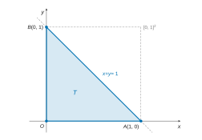
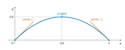
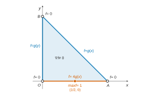

# e3a-Polytech PC — Mathématiques 2026 · Corrigé brut

*Corrigé rédigé par IA, non officiel. Signalez toute erreur.*

Épreuve PC8M, 4 heures, calculatrices interdites. Trois exercices indépendants.

## Exercice 1

### Questions préliminaires

#### Question 1

Soit $\mu$ une valeur propre de $g$. Il existe un vecteur $x$ **non nul** tel que $g(x)=\mu x$. Par linéarité de $g$ :

$$\begin{aligned}
g^2(x)&=g(\mu x)\\
&=\mu\,g(x)\\
&=\mu^2x.
\end{aligned}$$

Comme $x\neq0$, **$\mu^2$ est valeur propre de $g^2$** (avec le même vecteur propre $x$).

#### Question 2

Soit $x\neq0$ tel que $g^2(x)=\lambda x$, avec $\lambda\neq0$. Comme $g$ commute avec $g^2$ :

$$\begin{aligned}
g^2(g(x))&=g(g^2(x))\\
&=g(\lambda x)\\
&=\lambda\,g(x).
\end{aligned}$$

De plus $g(x)\neq0$. Sinon, on aurait $\lambda x=g^2(x)=g(0)=0$.

Comme $\lambda\neq0$, cela donnerait $x=0$, ce qui est exclu.

**$g(x)$ est donc un vecteur propre de $g^2$, associé à la même valeur propre $\lambda$.**

#### Question 3

Soient $\mu_1\neq\mu_2$ deux valeurs propres de $g$, et $x\in E_{\mu_1}(g)\cap E_{\mu_2}(g)$.

Alors $\mu_1x=g(x)=\mu_2x$, donc $(\mu_1-\mu_2)x=0$.

Comme $\mu_1-\mu_2\neq0$, on obtient $x=0$.

Deux sous-espaces dont l'intersection est réduite à $\{0\}$ sont en somme directe : **$E_{\mu_1}(g)+E_{\mu_2}(g)=E_{\mu_1}(g)\oplus E_{\mu_2}(g)$.**

#### Question 4

$$\boxed{\det(-A)=(-1)^n\det(A)}$$

$$\boxed{\det(A^\top)=\det(A)}$$

### Question 5 — Premières propriétés de l'endomorphisme $f$

#### Question 5.1

$M$ a une diagonale nulle, des $-1$ sur la sur-diagonale et des $1$ sur la sous-diagonale.

$M^\top$ a des $1$ sur la sur-diagonale et des $-1$ sur la sous-diagonale. Donc :

$$\boxed{M+M^\top=0_5}$$

c'est-à-dire $M^\top=-M$.

#### Question 5.2

D'après 5.1 et la question 4 avec $n=5$ :

$$\begin{aligned}
\det M&=\det(M^\top)\\
&=\det(-M)\\
&=(-1)^5\det M\\
&=-\det M.
\end{aligned}$$

Donc $\det M=0$ et $M$ n'est pas inversible.

Un automorphisme de $E$ est un endomorphisme bijectif ; sa matrice serait inversible. **$f$ n'est pas un automorphisme de $E$.**

#### Question 5.3

Soit $X=(x_1,\dots,x_5)^\top$. Le système $MX=0$ s'écrit :

$$\begin{cases}
-x_2=0\\
x_1-x_3=0\\
x_2-x_4=0\\
x_3-x_5=0\\
x_4=0
\end{cases}$$

Il équivaut à $x_2=x_4=0$ et $x_1=x_3=x_5$.

Donc $\operatorname{Ker}M=\operatorname{Vect}(w)$, avec $w=(1,0,1,0,1)^\top$ : ce noyau est de dimension $1$.

Par le théorème du rang :

$$\boxed{\operatorname{rg}M=5-1=4}$$

#### Question 5.4

La base $\mathscr B$ est **orthonormale**, et la matrice de $f^2$ dans $\mathscr B$ est $M^2$. Or :

$$\begin{aligned}
(M^2)^\top&=(M^\top)^2\\
&=(-M)^2\\
&=M^2.
\end{aligned}$$

$M^2$ est symétrique et représente $f^2$ dans une base orthonormale : **$f^2$ est un endomorphisme symétrique de $E$.**

#### Question 5.5

$M^2$ est une matrice symétrique réelle (5.4).

D'après le théorème spectral, elle est diagonalisable au moyen d'une matrice de passage orthogonale : **$M^2$ est diagonalisable dans $\mathcal M_5(\mathbb R)$.**

#### Question 5.6

Soient $x,y\in E$, de coordonnées $X,Y$ dans $\mathscr B$. Comme $(x\mid y)=X^\top Y$ :

$$\begin{aligned}
(f(x)\mid y)&=(MX)^\top Y\\
&=X^\top M^\top Y\\
&=-X^\top MY\\
&=-(x\mid f(y)).
\end{aligned}$$

$$\boxed{\forall (x,y)\in E^2,\ (f(x)\mid y)=-(x\mid f(y))}$$

### Question 6 — Étude des éléments propres de l'endomorphisme $f$

#### Question 6.1

Avec $y=x$ dans 5.6, on a $(f(x)\mid x)=-(x\mid f(x))$. Donc :

$$\forall x\in E,\ (f(x)\mid x)=0.$$

Soit $\mu$ une valeur propre de $f$ et $x\neq0$ tel que $f(x)=\mu x$. Alors :

$$0=(f(x)\mid x)=\mu\|x\|^2.$$

Comme $\|x\|^2>0$, on obtient $\mu=0$.

Réciproquement, $0$ est valeur propre de $f$, car $\operatorname{Ker}f\neq\{0\}$ (5.3).

**$0$ est la seule valeur propre de $f$.**

#### Question 6.2

Supposons $f$ diagonalisable. Sa matrice dans une base de vecteurs propres serait diagonale.

Ses coefficients diagonaux seraient les valeurs propres, tous nuls d'après 6.1 : on aurait $f=0$.

Or $f(e_1)=e_2\neq0$. **$f$ n'est pas diagonalisable.**

#### Question 6.3

Soit $\lambda\neq0$ une valeur propre de $f^2$ et $x\neq0$ tel que $f^2(x)=\lambda x$. Par 5.6 appliquée au couple $(x,f(x))$ :

$$\begin{aligned}
\|f(x)\|^2&=(f(x)\mid f(x))\\
&=-(x\mid f^2(x))\\
&=-\lambda\|x\|^2.
\end{aligned}$$

Donc $-\lambda\|x\|^2\ge0$, avec $\|x\|^2>0$, d'où $\lambda\le0$.

Comme $\lambda\neq0$ : **$\lambda<0$.**

### Question 7

Par le théorème du rang, $\dim\operatorname{Ker}f+\dim\operatorname{Im}f=\dim E=5$ (ici $1+4$, d'après 5.3).

Il suffit donc de montrer que $\operatorname{Ker}f\cap\operatorname{Im}f=\{0\}$.

Soit $z\in\operatorname{Ker}f\cap\operatorname{Im}f$. Il existe $y\in E$ tel que $z=f(y)$, et $f(z)=0$. Par 5.6 :

$$\begin{aligned}
\|z\|^2&=(f(y)\mid z)\\
&=-(y\mid f(z))\\
&=0.
\end{aligned}$$

Donc $z=0$. L'intersection est nulle et les dimensions s'ajoutent en $\dim E$ :

$$\boxed{E=\operatorname{Ker}(f)\oplus\operatorname{Im}(f)}$$

### Question 8

#### Question 8.1

Soit $\lambda\neq0$ une valeur propre de $f^2$, donc $\lambda<0$ (6.3), et $x\neq0$ avec $f^2(x)=\lambda x$.

Soient $a,b\in\mathbb R$ tels que $ax+bf(x)=0$.

- Si $b=0$, alors $ax=0$, donc $a=0$ car $x\neq0$.
- Si $b\neq0$, alors $f(x)=kx$ avec $k=-a/b\in\mathbb R$. Il vient $f^2(x)=k^2x$, donc $\lambda=k^2\ge0$, ce qui contredit $\lambda<0$.

Donc $a=b=0$ : **$(x,f(x))$ est libre.**

#### Question 8.2

On a $f(x)\in\operatorname{Im}f$. Comme $\lambda\neq0$ :

$$x=\frac1\lambda f^2(x)=f\!\left(\frac1\lambda f(x)\right).$$

Donc $x\in\operatorname{Im}f$.

$\operatorname{Im}f$ est un sous-espace vectoriel, donc $\operatorname{Vect}(x,f(x))\subset\operatorname{Im}f$.

Ce sous-espace est de dimension $2$ par 8.1 : **$(x,f(x))$ engendre un plan vectoriel de $\operatorname{Im}(f)$.**

### Question 9

Notons $E_{-1}$ et $E_{-3}$ les sous-espaces propres de $f^2$ associés à $-1$ et $-3$.

- Les valeurs propres $-1$ et $-3$ de $f^2$ sont non nulles. Par la question préliminaire 2 (avec $g=f$), $f(u)\in E_{-1}$ et $f(v)\in E_{-3}$.
  Donc $\operatorname{Vect}(u,f(u))\subset E_{-1}$ et $\operatorname{Vect}(v,f(v))\subset E_{-3}$.
- Par la question préliminaire 3 (avec $g=f^2$), $E_{-1}\cap E_{-3}=\{0\}$, car $-1\neq-3$.
- Par 8.1, les familles $(u,f(u))$ et $(v,f(v))$ sont libres.

Soient $a,b,c,d$ réels tels que $au+bf(u)+cv+df(v)=0$.

Le vecteur $au+bf(u)=-(cv+df(v))$ appartient à $E_{-1}\cap E_{-3}=\{0\}$.

Donc $au+bf(u)=0$ et $cv+df(v)=0$, puis $a=b=c=d=0$ par liberté de chaque couple.

La famille $(u,f(u),v,f(v))$ est libre. Ses $4$ vecteurs sont dans $\operatorname{Im}f$ (8.2), et $\dim\operatorname{Im}f=4$ (5.3).

**$(u,f(u),v,f(v))$ est une base de $\operatorname{Im}(f)$.**

### Question 10

Par 7 et 9, $\mathscr B'=(w,u,f(u),v,f(v))$ est une base de $E$ : on concatène une base de $\operatorname{Ker}f$ et une base de $\operatorname{Im}f$, sous-espaces supplémentaires. Images des vecteurs de $\mathscr B'$ :

$$\begin{aligned}
f(w)&=0\\
f(u)&=f(u)\\
f(f(u))&=f^2(u)=-u\\
f(v)&=f(v)\\
f(f(v))&=f^2(v)=-3v
\end{aligned}$$

La matrice de $f$ dans $\mathscr B'$ est donc

$$T=\begin{pmatrix}0&0&0&0&0\\0&0&-1&0&0\\0&1&0&0&0\\0&0&0&0&-3\\0&0&0&1&0\end{pmatrix}.$$

$M$, matrice du même endomorphisme dans $\mathscr B$, lui est semblable :

$$\boxed{\begin{aligned}\alpha&=-1\\\beta&=1\\\gamma&=-3\\\delta&=1\end{aligned}}$$

Exemple explicite : $w=(1,0,1,0,1)$, $u=(0,1,0,1,0)$ et $v=(0,-1,0,1,0)$ conviennent.

On vérifie en effet $M^2u=-u$ et $M^2v=-3v$.

## Exercice 2

### Questions préliminaires

#### Question 1

$$\boxed{e^t=1+t+\frac{t^2}{2}+\underset{t\to0}{o}(t^2)}$$

#### Question 2

$h$ est continue sur l'intervalle $\mathbb R_+^*$, et $a\in\mathbb R_+^*$.

D'après le théorème fondamental de l'analyse, $H:x\mapsto\int_a^xh(t)\,dt$ est l'unique primitive de $h$ sur $\mathbb R_+^*$ qui s'annule en $a$.

$H$ est donc dérivable sur $\mathbb R_+^*$, de dérivée $h$, qui est continue :

$$\boxed{H\in\mathcal C^1(\mathbb R_+^*),\qquad H'=h}$$

#### Question 3

Soit $x>0$ ; alors $x+1\in\mathbb R_+^*$. La relation de Chasles donne :

$$\begin{aligned}
G(x)&=\int_a^{x+1}h(t)\,dt-\int_a^xh(t)\,dt\\
&=H(x+1)-H(x).
\end{aligned}$$

$H$ est de classe $\mathcal C^1$ sur $\mathbb R_+^*$ (question 2), et $x\mapsto x+1$ envoie $\mathbb R_+^*$ dans $\mathbb R_+^*$.

Par composition et différence, $G$ est de classe $\mathcal C^1$ sur $\mathbb R_+^*$, et :

$$\boxed{G'(x)=h(x+1)-h(x)}$$

### Question 4

Soit $x>0$. Pour $t\in[0,1]$, on a $x+t\ge x>0$ : le dénominateur ne s'annule pas.

$t\mapsto\frac{f(t)}{x+t}$ est donc continue sur le segment $[0,1]$, comme quotient de fonctions continues.

Son intégrale existe : **$F$ est définie sur $\mathbb R_+^*$.**

### Question 5 — Un premier exemple

#### Question 5.1

$$\begin{aligned}
F_0(x)&=\int_0^1\frac{dt}{x+t}\\
&=\bigl[\ln(x+t)\bigr]_0^1\\
&=\ln(x+1)-\ln x.
\end{aligned}$$

$$\boxed{F_0(x)=\ln\!\left(1+\frac1x\right)}$$

#### Question 5.2

Pour $k\ge1$, par linéarité de l'intégrale :

$$\begin{aligned}
F_k(x)+xF_{k-1}(x)&=\int_0^1\frac{t^{k-1}(t+x)}{x+t}\,dt\\
&=\int_0^1t^{k-1}\,dt.
\end{aligned}$$

$$\boxed{F_k(x)+xF_{k-1}(x)=\frac1k}$$

#### Question 5.3

D'après 5.2 :

$$F_k(x)=\frac1k+(-x)F_{k-1}(x).$$

On divise par $(-x)^k\neq0$, en utilisant $\dfrac{-x}{(-x)^k}=\dfrac{1}{(-x)^{k-1}}$ :

$$\frac{F_k(x)}{(-x)^k}=\frac{1}{k(-x)^k}+\frac{F_{k-1}(x)}{(-x)^{k-1}}.$$

Comme $\frac{1}{(-x)^k}=\frac{(-1)^k}{x^k}$ :

$$\boxed{\frac{F_k(x)}{(-x)^k}-\frac{F_{k-1}(x)}{(-x)^{k-1}}=\frac{(-1)^k}{k}\left(\frac1x\right)^k}$$

#### Question 5.4

Soit $n\ge1$. On somme 5.3 pour $k=1,\dots,n$ ; la somme télescope :

$$\frac{F_n(x)}{(-x)^n}-F_0(x)=\sum_{k=1}^n\frac{(-1)^k}{k}\left(\frac1x\right)^k.$$

Avec 5.1 :

$$\frac{F_n(x)}{(-x)^n}=\ln\!\left(1+\frac1x\right)-\sum_{k=1}^n\frac{(-1)^{k-1}}{k}\left(\frac1x\right)^k.$$

On pose

$$\boxed{P_n(X)=\sum_{k=1}^n\frac{(-1)^{k-1}}{k}X^k}$$

avec $P_0=0$.

On obtient $F_n(x)=(-x)^n\bigl(\ln(1+\frac1x)-P_n(\frac1x)\bigr)$ pour tout $n\ge1$.

La formule vaut aussi pour $n=0$ d'après 5.1.

($P_n$ est la partie régulière du développement limité de $\ln(1+X)$ en $0$ à l'ordre $n$.)

### Question 6 — Un deuxième exemple

#### Question 6.1

Soit $x>0$. Le changement de variable affine $u=x+t$ ($du=dt$, bornes $x$ et $x+1$) donne :

$$\begin{aligned}
G(x)&=\int_x^{x+1}\frac{e^{u-x}}{u}\,du\\
&=e^{-x}\,\Phi(x),
\end{aligned}$$

où l'on a sorti le facteur $e^{-x}$, indépendant de $u$, et posé

$$\Phi(x)=\int_x^{x+1}\frac{e^u}{u}\,du.$$

La fonction $\varphi:u\mapsto e^u/u$ est continue sur $\mathbb R_+^*$.

Par la question préliminaire 3 (avec $h=\varphi$), $\Phi$ est de classe $\mathcal C^1$ sur $\mathbb R_+^*$, et :

$$\Phi'(x)=\frac{e^{x+1}}{x+1}-\frac{e^x}{x}.$$

Produit de deux fonctions de classe $\mathcal C^1$, **$G$ est de classe $\mathcal C^1$ sur $\mathbb R_+^*$**, et :

$$\begin{aligned}
G'(x)&=-e^{-x}\Phi(x)+e^{-x}\Phi'(x)\\
&=-G(x)+\frac{e}{x+1}-\frac1x.
\end{aligned}$$

#### Question 6.2.1

*Cas de $K$.* $t\mapsto\frac{e^t}{1+t}$ est continue sur l'intervalle $\mathbb R_+$, car $1+t\ge1$.

Par le théorème fondamental de l'analyse (celui de la question préliminaire 2, ici sur $\mathbb R_+$ avec la borne $0$), $K$ est la primitive de cette fonction nulle en $0$.

$K$ est donc de classe $\mathcal C^1$ sur $\mathbb R_+$, avec $K'(x)=\frac{e^x}{1+x}$.

*Cas de $J$.* Pour $t>0$, posons $\psi(t)=\frac{e^t-1}{t}$. L'intégrande n'est pas définie en $0$ : il faut justifier l'existence de $J(x)$.

D'après la question 1 :

$$e^t-1=t+\frac{t^2}2+\underset{t\to0}{o}(t^2).$$

Donc $\psi(t)=1+\frac t2+o(t)$, et $\psi(t)\to1$ quand $t\to0^+$.

Prolongée par $\psi(0)=1$, $\psi$ est continue sur $\mathbb R_+$.

L'intégrale $J(x)$ existe donc pour tout $x\ge0$ (c'est l'intégrale de ce prolongement).

Par le théorème fondamental, $J$ est de classe $\mathcal C^1$ sur $\mathbb R_+$, avec $J'(x)=\frac{e^x-1}{x}$ pour $x>0$ et $J'(0)=1$.

**$J$ et $K$ sont de classe $\mathcal C^1$ sur $\mathbb R_+$.**

#### Question 6.2.2

$L$ est de classe $\mathcal C^1$ sur $\mathbb R_+^*$ (6.1, 6.2.1). Pour $x>0$, avec 6.1 :

$$\begin{aligned}
\bigl(G(x)e^x\bigr)'&=\bigl(G'(x)+G(x)\bigr)e^x\\
&=\frac{e^{x+1}}{x+1}-\frac{e^x}{x}.
\end{aligned}$$

Donc :

$$\begin{aligned}
L'(x)&=\frac{e^{x+1}}{x+1}-\frac{e^x}{x}-e\cdot\frac{e^x}{1+x}+\frac{e^x-1}{x}+\frac1x\\
&=\frac{-e^x+e^x-1+1}{x}\\
&=0.
\end{aligned}$$

$L'$ est nulle sur l'intervalle $\mathbb R_+^*$ : **$L$ est constante sur $\mathbb R_+^*$.**

#### Question 6.2.3

Notons $C$ la valeur de $L$. Pour $x>0$ :

$$G(x)e^x=C+eK(x)-J(x)-\ln x.$$

$J$ et $K$ sont continues en $0$, avec $J(0)=K(0)=0$.

Donc $C+eK(x)-J(x)\to C$ quand $x\to0^+$, tandis que $-\ln x\to+\infty$.

Ainsi $G(x)e^x\to+\infty$, et comme $e^{-x}\to1$ :

$$\boxed{\lim_{x\to0^+}G(x)=+\infty}$$

De plus :

$$\frac{G(x)e^x}{-\ln x}=1+\frac{C+eK(x)-J(x)}{-\ln x}\xrightarrow[x\to0^+]{}1.$$

Donc $G(x)e^x\sim-\ln x$, et comme $e^x\to1$ :

$$\boxed{G(x)\underset{x\to0^+}{\sim}-\ln x}$$

## Exercice 3

### Question 1

$X(\Omega)\subset\{1,2,3\}$, donc $X^2(\Omega)\subset\{1,4,9\}$.

**Les valeurs possibles de $X^2$ sont $1$, $4$ et $9$.** La valeur $k^2$ est prise avec probabilité $p_k$.

### Question 2

Par la formule de transfert :

$$\begin{aligned}
\mathbb E(X^2)&=\sum_{k=1}^3k^2\,\mathbb P(X=k)\\
&=p_1+4p_2+9p_3.
\end{aligned}$$

$$\boxed{\mathbb E(X^2)=p_1+4p_2+9p_3}$$

### Question 3

Avec $p_3=1-p_1-p_2$ :

$$\begin{aligned}
\mathbb E(X^2)&=9-8p_1-5p_2\\
\mathbb E(X)&=p_1+2p_2+3p_3=3-2p_1-p_2
\end{aligned}$$

Par la formule de König-Huygens, $\mathbb V(X)=\mathbb E(X^2)-\mathbb E(X)^2$. Or :

$$(3-2p_1-p_2)^2=9+4p_1^2+p_2^2-12p_1-6p_2+4p_1p_2.$$

Donc :

$$\boxed{\mathbb V(X)=4p_1+p_2-4p_1^2-p_2^2-4p_1p_2}$$

### Question 4

#### Question 4.1

$T$ est le triangle plein (bord compris) de sommets $O(0,0)$, $A(1,0)$, $B(0,1)$ : la partie du carré $[0,1]^2$ située sous la diagonale $x+y=1$.

#### Question 4.2

$f$ est une fonction polynomiale des deux variables $(x,y)$, donc de classe $\mathcal C^\infty$ sur $\mathbb R^2$.

En particulier, **$f$ est de classe $\mathcal C^2$ sur $\mathbb R^2$.**

#### Question 4.3

$f$ est **continue** sur $\mathbb R^2$ (4.2), donc sur $T$.

$T$ est une partie non vide et bornée de $\mathbb R^2$, car incluse dans $[0,1]^2$.

Elle est fermée, comme intersection des demi-plans fermés $\{x\ge0\}$, $\{y\ge0\}$, $\{x+y\le1\}$ et du fermé $[0,1]^2$.

D'après le théorème des bornes atteintes, **$f$ est bornée sur $T$ et y atteint un maximum et un minimum.**

#### Question 4.4

Les dérivées partielles sont $\partial_xf(x,y)=4-8x-4y$ et $\partial_yf(x,y)=1-4x-2y$. Le gradient est le **vecteur** :

$$\boxed{\nabla f(x,y)=\begin{pmatrix}4-8x-4y\\1-4x-2y\end{pmatrix}}$$

#### Question 4.5

Un point critique vérifierait :

$$\begin{cases}8x+4y=4\\4x+2y=1\end{cases}$$

La seconde équation, multipliée par $2$, donne $8x+4y=2$ : elle est incompatible avec la première.

**$f$ n'a aucun point critique dans $\mathbb R^2$, donc aucun dans l'intérieur de $T$.**

#### Question 4.6

$g(x)=x-x^2$ et $g'(x)=1-2x$.

$g'$ est positive sur $[0,\frac12]$ et négative sur $[\frac12,1]$.

| $x$ | $0$ | | $\frac12$ | | $1$ |
|---|---|---|---|---|---|
| $g'(x)$ | $1$ | $+$ | $0$ | $-$ | $-1$ |
| $g(x)$ | $0$ | croissante | $\frac14$ | décroissante | $0$ |

Représentation graphique : arc de parabole concave, symétrique par rapport à la droite $x=\frac12$ (figure 2).

#### Question 4.7

L'intérieur de $T$ est un ouvert. Si $f$ atteignait un extremum sur $T$ en un point intérieur, ce serait un extremum local sur un ouvert, donc un point critique.

C'est exclu par 4.5. Les extrema, qui existent par 4.3, sont donc atteints sur le bord, réunion des trois côtés :

- $[OB]$ ($x=0$, $y\in[0,1]$) : $f(0,y)=y-y^2=g(y)$ ;
- $[OA]$ ($y=0$, $x\in[0,1]$) : $f(x,0)=4x-4x^2=4g(x)$ ;
- $[AB]$ ($y=1-x$, $x\in[0,1]$) : voir le calcul ci-dessous.

$$\begin{aligned}
f(x,1-x)&=4x+(1-x)-4x^2-(1-2x+x^2)-4x(1-x)\\
&=x-x^2\\
&=g(x).
\end{aligned}$$

Par 4.6, sur $[0,1]$, on a $0\le g\le\frac14$.

L'égalité $g=0$ n'a lieu qu'en $0$ et $1$ ; l'égalité $g=\frac14$ n'a lieu qu'en $\frac12$.

Sur le bord, $f$ prend donc ses valeurs dans $[0,1]$. Le maximum $1$ n'est atteint qu'en $(\frac12,0)$, et le minimum $0$ qu'aux trois sommets :

$$\boxed{\max_Tf=f\!\left(\tfrac12,0\right)=1}$$

$$\boxed{\min_Tf=0,\ \text{atteint en }(0,0),\ (1,0),\ (0,1)}$$

### Question 5

Les conditions $p_1,p_2,p_3\in[0,1]$ et $p_1+p_2+p_3=1$ équivalent à $(p_1,p_2)\in T$ avec $p_3=1-p_1-p_2$.

De plus $\mathbb V(X)=f(p_1,p_2)$ (question 3). D'après 4.7 :

- **la variance est maximale, égale à $1$, pour $(p_1,p_2,p_3)=(\frac12,0,\frac12)$** ;
- **la variance est minimale, égale à $0$, pour $(p_1,p_2,p_3)\in\{(1,0,0),(0,1,0),(0,0,1)\}$.**

### Question 6

Lorsque la variance est minimale, l'un des $p_k$ vaut $1$.

**$X$ est presque sûrement constante**, égale à $1$, $2$ ou $3$ : c'est une variable quasi-certaine.

C'est cohérent avec la propriété générale : $\mathbb V(X)\ge0$, et $\mathbb V(X)=0$ si et seulement si $X=\mathbb E(X)$ presque sûrement.
