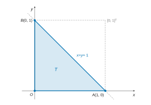
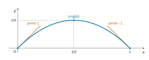
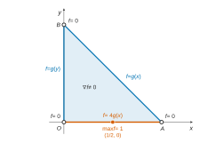

# e3a-Polytech PC — Mathématiques 2026 · Corrigé guidé

*Corrigé rédigé par IA, non officiel. Signalez toute erreur.*

## Présentation du sujet

L'épreuve (code PC8M) dure **4 heures**, sans calculatrice ni document. Elle comporte **trois exercices indépendants**, soit **42 questions** courtes et très guidées.

Chaque exercice suit le même schéma : des questions préliminaires de cours isolent les outils, puis un exemple les met en œuvre. Le sujet ne contient aucun piège technique lourd : la note se joue sur la **rigueur des justifications** (vecteur propre non nul, hypothèses des théorèmes, intervalle de travail) et sur la **propreté des calculs**.

| Exercice | Questions | Contenu | Notions du programme PC |
|---|---|---|---|
| 1 – Un endomorphisme antisymétrique de $\mathbb R^5$ | 1–4, 5.1–5.6, 6.1–6.3, 7, 8.1, 8.2, 9, 10 (18 questions) | $M^\top=-M$ : $f$ non inversible, non diagonalisable, $f^2$ symétrique ; $E=\operatorname{Ker}f\oplus\operatorname{Im}f$ ; base adaptée formée de plans stables. | Déterminant, rang, éléments propres, somme directe, espaces euclidiens, endomorphismes symétriques, théorème spectral, matrices semblables |
| 2 – Une transformation intégrale | 1–3, 4, 5.1–5.4, 6.1, 6.2.1–6.2.3 (12 questions) | $F(x)=\int_0^1\frac{f(t)}{x+t}dt$ : formule exacte pour $f(t)=t^n$, puis pour $f=\exp$, régularité, limite et équivalent en $0^+$. | Développements limités, théorème fondamental de l'analyse, changement de variable, prolongement par continuité, relations de comparaison |
| 3 – Variance extrémale | 1–3, 4.1–4.7, 5, 6 (12 questions) | La variance d'une variable à valeurs dans $\{1,2,3\}$ est une fonction de deux variables sur un triangle ; extrema atteints sur le bord. | Espérance, formule de transfert, variance, fonctions de deux variables, gradient, points critiques, théorème des bornes atteintes |

**Difficulté.** Les questions sont de niveau modeste prises une à une, mais le sujet est long à rédiger proprement, et le résultat de la session est faible.

Le rapport 2026 donne une moyenne de 6,41 sur 20 (écart type 3,13, sur 2341 copies) et juge le bilan « assez mitigé avec très peu de bonnes copies ». Les points qui demandent de l'attention :

- Ex. 1, Q2 et Q8.1 : vérifier qu'un vecteur propre est **non nul**, et exploiter le **signe** de $\lambda$ ;
- Ex. 1, Q9 : combiner trois résultats antérieurs pour obtenir une famille libre ;
- Ex. 2, Q5.3 : un calcul de signes avec les puissances de $-x$ ;
- Ex. 2, Q6.2.2 : une dérivation où tout doit se simplifier exactement ;
- Ex. 3, Q4.7 : justifier que les extrema sont sur le bord, puis étudier les **trois** côtés.

**Questions discriminantes selon le rapport 2026.** Le rapport ne donne pas de taux par question, mais ses commentaires désignent nettement les questions qui ont fait la différence :

- Ex. 1, Q7 (« peu de réussite pour cette question classique »), Q8.1, Q9 et Q10 (« rarement abordée et rarement aboutie ») ;
- Ex. 2, Q2, qualifiée de « fiasco total », puis Q6.1, Q6.2.2 et Q6.2.3 (« quasiment jamais achevée ») ;
- Ex. 3, Q4.4 (gradient), Q4.6 et Q4.7, puis Q5 et Q6, rarement menées au bout.

**Questions abordables à ne pas laisser passer** : Ex. 1, Q1, 3, 4, 5.1 à 5.6 et 6.2 ; Ex. 2, Q1 à 4, 5.1, 5.2 et 6.1 ; Ex. 3, Q1 à 3 et 4.1 à 4.6.

Le jury signale qu'une partie non négligeable du barème porte sur la présentation : numérotation du sujet respectée, questions dans l'ordre, copie lisible.

**Gestion du temps.** Comptez environ 90 minutes pour l'exercice 1, le plus long, 75 minutes pour l'exercice 2 et 60 minutes pour l'exercice 3, et gardez 15 minutes de relecture.

Les trois exercices sont indépendants : commencez par celui qui vous inspire le plus. Dans l'exercice 1, les questions 7 à 10 n'utilisent que des résultats énoncés (dont le spectre admis de $f^2$) : on peut les traiter même si l'on a calé avant.

> [!JURY]
> Le rapport 2026 rappelle que « une affirmation sans démonstration n'a aucune valeur » et conclut : « lire attentivement l'énoncé en étudiant toutes les interactions entre les questions reste d'une importance capitale pour réussir cette épreuve » (p. 2). Les questions préliminaires servent aux exemples : citez-les explicitement quand vous les utilisez.

## Exercice 1 — Un endomorphisme antisymétrique de $\mathbb R^5$

Les préliminaires établissent quatre faits généraux sur les valeurs propres de $g$ et $g^2$ et sur les déterminants. On les applique ensuite à $f$, dont la matrice vérifie $M^\top=-M$.

Cette antisymétrie, traduite en $(f(x)\mid y)=-(x\mid f(y))$, est le seul ingrédient de presque toutes les preuves. On aboutit à une décomposition de $E$ en une droite (le noyau) et deux plans stables, sur lesquels $f$ agit comme une « rotation d'un quart de tour suivie d'une dilatation ».

### Question 1

> [!INDICATION]
> Revenez à la définition : une valeur propre, c'est un vecteur non nul $x$ tel que $g(x)=\mu x$. Appliquez $g$ une seconde fois.

#### Solution

Soit $\mu$ une valeur propre de $g$. Il existe $x\neq0$ tel que $g(x)=\mu x$. Par linéarité de $g$ :

$$\begin{aligned}
g^2(x)&=g(\mu x)\\
&=\mu\,g(x)\\
&=\mu^2x.
\end{aligned}$$

Comme $x\neq0$, **$\mu^2$ est valeur propre de $g^2$**, et $x$ est un vecteur propre associé.

> [!JURY]
> Rapport 2026 (p. 4) : « Le fait que $x$ qui vérifie $g(x)=\mu x$ est non nul est rarement évoqué. » Le jury relève aussi des confusions entre valeur propre et élément du noyau, du type « $g(\mu)=0$ ». La non-nullité du vecteur propre doit figurer dans la copie.

### Question 2

> [!INDICATION]
> Calculez $g^2(g(x))$ en faisant commuter $g$ et $g^2$.

> [!INDICATION]
> Un vecteur propre doit être non nul : que se passerait-il si $g(x)=0$ ? Utilisez l'hypothèse « valeur propre non nulle ».

#### Solution

Soit $x\neq0$ avec $g^2(x)=\lambda x$ et $\lambda\neq0$. On a :

$$\begin{aligned}
g^2(g(x))&=g^3(x)\\
&=g(g^2(x))\\
&=g(\lambda x)\\
&=\lambda\,g(x).
\end{aligned}$$

Il reste à voir que $g(x)\neq0$. Si $g(x)=0$, alors $\lambda x=g^2(x)=g(0)=0$.

Comme $\lambda\neq0$, on aurait $x=0$ : contradiction. Donc $g(x)\neq0$.

**$g(x)$ est un vecteur propre de $g^2$ associé à la même valeur propre $\lambda$.**

> [!PIEGE]
> Écrire seulement $g^2(g(x))=\lambda g(x)$ ne suffit pas : c'est la non-nullité de $g(x)$ qui fait de lui un vecteur propre. C'est précisément là que sert l'hypothèse $\lambda\neq0$ : si $\lambda=0$, $g(x)$ peut être nul (prendre $g$ nilpotent).

> [!PIEGE]
> Ne supposez pas que $x$ est aussi vecteur propre de $g$ : c'est faux en général, et c'est même exclu dans la suite (question 8.1). Le rapport 2026 (p. 4) note : « Il est assez fréquent que le candidat considère que $x$ est aussi vecteur propre de $g$. »

> [!JURY]
> Rapport 2026 (p. 4) : « Le fait que $g(x)$ n'est pas le vecteur nul est rarement vérifié. »

### Question 3

> [!INDICATION]
> Pour **deux** sous-espaces, être en somme directe équivaut à avoir une intersection réduite à $\{0\}$.

#### Solution

Soient $\mu_1\neq\mu_2$ deux valeurs propres de $g$, et $x\in E_{\mu_1}(g)\cap E_{\mu_2}(g)$.

Alors $\mu_1x=g(x)=\mu_2x$, d'où $(\mu_1-\mu_2)x=0$.

Comme $\mu_1-\mu_2\neq0$, on obtient $x=0$.

L'intersection est réduite à $\{0\}$, donc **les sous-espaces propres $E_{\mu_1}(g)$ et $E_{\mu_2}(g)$ sont en somme directe.**

> [!PIEGE]
> Le critère « intersection nulle » ne vaut que pour deux sous-espaces. Pour trois sous-espaces ou plus, les intersections deux à deux nulles ne suffisent pas à garantir une somme directe.

> [!PIEGE]
> L'intersection de deux sous-espaces vectoriels contient toujours $0$ : elle vaut $\{0\}$, jamais $\varnothing$. Le jury a lu « $E_\lambda\cap E_\mu=\{\varnothing\}$ » dans des copies.

> [!JURY]
> Rapport 2026 (p. 4) : « Bien que cette question soit une question de cours, la réussite ne fut pas toujours au rendez-vous. »

### Question 4

> [!INDICATION]
> Le déterminant est linéaire par rapport à chacune des $n$ colonnes.

#### Solution

$$\boxed{\det(-A)=(-1)^n\det(A)}$$

$$\boxed{\det(A^\top)=\det(A)}$$

> [!PIEGE]
> $\det(-A)$ vaut $-\det(A)$ seulement si $n$ est impair ; pour $n$ pair, $\det(-A)=\det(A)$.
>
> Le facteur $(-1)^n$ vient de ce qu'on sort un signe $-1$ de chacune des $n$ colonnes.

> [!JURY]
> Rapport 2026 (p. 4) : « Pour la grande majorité des candidats, $\det(-A)=-\det(A)$. » Le jury cite aussi « $\det(A^\top)=(\det(A))^\top$ », qui n'a pas de sens pour un nombre réel.

### Question 5 — Premières propriétés de l'endomorphisme $f$

Six vérifications rapides, qui reposent toutes sur l'identité $M^\top=-M$.

### Question 5.1

> [!INDICATION]
> Transposer échange la sur-diagonale et la sous-diagonale.

#### Solution

$M$ est tridiagonale, de diagonale nulle, avec des $-1$ sur la sur-diagonale et des $1$ sur la sous-diagonale.

Sa transposée a des $1$ sur la sur-diagonale et des $-1$ sur la sous-diagonale. Terme à terme :

$$\boxed{M+M^\top=0_5}$$

soit $M^\top=-M$ : $M$ est antisymétrique.

> [!PIEGE]
> La matrice obtenue est la matrice **nulle**, pas l'identité : le rapport 2026 signale des copies qui « reconnaissent » $\mathrm{Id}_E$. Et la transposée s'obtient par symétrie par rapport à la diagonale principale, non à la « deuxième diagonale ».

### Question 5.2

> [!INDICATION]
> Inutile de calculer $\det M$ : combinez $M^\top=-M$ avec la question 4, en tenant compte de la parité de $5$.

#### Solution

D'après 5.1 et la question 4 avec $n=5$ :

$$\begin{aligned}
\det M&=\det(M^\top)\\
&=\det(-M)\\
&=(-1)^5\det M\\
&=-\det M.
\end{aligned}$$

Donc $2\det M=0$, puis $\det M=0$ : $M$ n'est pas inversible.

Un automorphisme est un endomorphisme bijectif, dont la matrice serait inversible : **$f$ n'est pas un automorphisme de $E$.**

> [!METHODE]
> Toute matrice antisymétrique réelle de taille impaire a un déterminant nul. L'argument « $\det A=\det A^\top=\det(-A)$ » est à retenir.

> [!JURY]
> Rapport 2026 (p. 5) : « La notion d'automorphisme reste très floue dans beaucoup de copies. » Parmi les arguments relevés : « $M^2\neq M$ », la non-symétrie de la matrice, ou une prétendue équivalence entre automorphisme et $M M^\top=I_5$. Aucun ne prouve la non-bijectivité : il faut un noyau non nul ou un déterminant nul.

### Question 5.3

> [!INDICATION]
> Déterminez le noyau en résolvant $MX=0$ ligne par ligne, puis appliquez le théorème du rang.

#### Solution

Pour $X=(x_1,\dots,x_5)^\top$, le système $MX=0$ s'écrit :

$$\begin{cases}
-x_2=0\\
x_1-x_3=0\\
x_2-x_4=0\\
x_3-x_5=0\\
x_4=0
\end{cases}$$

Les lignes $1$ et $5$ donnent $x_2=x_4=0$.

Les lignes $2$ et $4$ donnent $x_1=x_3=x_5$ ; la ligne $3$ est alors satisfaite.

Donc $\operatorname{Ker}M=\operatorname{Vect}(w)$, avec $w=(1,0,1,0,1)^\top$. Par le théorème du rang :

$$\boxed{\operatorname{rg}M=5-\dim\operatorname{Ker}M=4}$$

> [!METHODE]
> On peut aussi remarquer que les colonnes $1,2,4,5$ de $M$ sont visiblement libres (chacune a un coefficient non nul sur une ligne où les autres n'en ont pas). Mais déterminer le noyau sert à la question 10 : autant le faire tout de suite.

> [!PIEGE]
> Le rang n'est pas la taille de la matrice. Le rapport 2026 (p. 3) : « Beaucoup de candidats confondent « rang d'une matrice » et « taille de cette matrice ». » Le théorème du rang porte sur $\dim E=5$, pas sur $\dim\mathcal M_5(\mathbb R)=25$.

### Question 5.4

> [!INDICATION]
> Dans une base orthonormale, un endomorphisme est symétrique si et seulement si sa matrice l'est.

#### Solution

La base $\mathscr B$ est orthonormale, et la matrice de $f^2$ dans $\mathscr B$ est $M^2$. Or :

$$\begin{aligned}
(M^2)^\top&=(MM)^\top\\
&=M^\top M^\top\\
&=(-M)(-M)\\
&=M^2.
\end{aligned}$$

$M^2$ est symétrique, donc **$f^2$ est un endomorphisme symétrique de $E$.**

> [!PIEGE]
> L'équivalence « endomorphisme symétrique $\iff$ matrice symétrique » exige une base **orthonormale**. Il faut le mentionner.

> [!JURY]
> Rapport 2026 (p. 6) : « Il est rarement signalé le caractère orthonormal de la base dans laquelle est écrite la matrice de $f^2$, ce qui donne rarement une réponse totalement correcte. » Le jury a aussi lu que $M^2$ aurait pour coefficients les carrés de ceux de $M$.

### Question 5.5

> [!INDICATION]
> Le mot « alors » renvoie à un théorème du cours sur les matrices symétriques réelles.

#### Solution

D'après 5.4, $M^2$ est une matrice symétrique à coefficients réels.

Par le théorème spectral, elle est diagonalisable au moyen d'une matrice de passage orthogonale. En particulier, **$M^2$ est diagonalisable dans $\mathcal M_5(\mathbb R)$.**

> [!PIEGE]
> Le théorème spectral ne dit pas que le polynôme caractéristique est « scindé à racines simples » : $M^2$ a des valeurs propres doubles (ici $-1$ et $-3$). Citez le théorème tel quel.

### Question 5.6

> [!INDICATION]
> Écrivez $(f(x)\mid y)$ comme un produit matriciel $(MX)^\top Y$.

#### Solution

Soient $x,y\in E$, de coordonnées $X,Y$ dans la base orthonormale $\mathscr B$. On a $(x\mid y)=X^\top Y$, donc :

$$\begin{aligned}
(f(x)\mid y)&=(MX)^\top Y\\
&=X^\top M^\top Y\\
&=X^\top(-M)Y\\
&=-X^\top(MY)\\
&=-(x\mid f(y)).
\end{aligned}$$

$$\boxed{\forall (x,y)\in E^2,\ (f(x)\mid y)=-(x\mid f(y))}$$

> [!METHODE]
> Cette identité remplace tout calcul matriciel dans la suite : elle sert aux questions 6.1, 6.3 et 7. Le cas $y=x$ donne $(f(x)\mid x)=0$ : un endomorphisme antisymétrique envoie tout vecteur sur un vecteur qui lui est orthogonal.

> [!PIEGE]
> Contrôlez les formats : $X^\top MY$ est une matrice $1\times1$, alors que $MXY^\top$ est une matrice $5\times5$. Le rapport 2026 (p. 6) met en garde : « Attention cependant à la taille des produits matriciels effectués ».

### Question 6 — Étude des éléments propres de l'endomorphisme $f$

On montre que le spectre de $f$ est réduit à $\{0\}$, d'où la non-diagonalisabilité, puis que $f^2$ n'a que des valeurs propres négatives.

### Question 6.1

> [!INDICATION]
> Prenez $y=x$ dans la question 5.6.

> [!INDICATION]
> Appliquez ensuite le résultat à un vecteur propre. N'oubliez pas de montrer que $0$ **est** valeur propre.

#### Solution

Avec $y=x$ dans 5.6, on a $(f(x)\mid x)=-(f(x)\mid x)$, donc :

$$\forall x\in E,\ (f(x)\mid x)=0.$$

Soit $\mu$ une valeur propre de $f$ (réelle, puisque $E$ est un espace vectoriel réel) et $x\neq0$ tel que $f(x)=\mu x$. Alors :

$$0=(f(x)\mid x)=\mu\|x\|^2.$$

Comme $\|x\|^2>0$, on obtient $\mu=0$.

Réciproquement, $0$ est valeur propre de $f$, puisque $\operatorname{Ker}f=\operatorname{Vect}(w)\neq\{0\}$ (5.3, ou 5.2).

**$0$ est la seule valeur propre de $f$.**

> [!PIEGE]
> « Seule valeur propre » contient deux affirmations : toute valeur propre est nulle, **et** $0$ en est une. La seconde est souvent oubliée.

> [!PIEGE]
> Deux raisonnements faux relevés par le jury. D'abord « $\lambda(x\mid y)=-\lambda(x\mid y)$ et donc, $\lambda=0$ » : on ne peut simplifier que si $(x\mid y)\neq0$, d'où le choix $y=x$.
>
> Ensuite « $\chi_M=X^5$ » : en réalité $\chi_M=X(X^2+1)(X^2+3)$, dont $0$ est la seule racine **réelle**.

> [!JURY]
> Rapport 2026 (p. 6) : « Peu de candidats pensent à exploiter $(x\mid f(x))=0$, comme le suggérait l'énoncé. » Le rapport rappelle aussi (p. 3) que « les valeurs propres d'une matrice ne sont pas les coefficients diagonaux de cette matrice ».

### Question 6.2

> [!INDICATION]
> Que serait la matrice de $f$ dans une base de vecteurs propres ?

#### Solution

Supposons $f$ diagonalisable. Sa matrice dans une base de vecteurs propres serait diagonale, avec sur la diagonale les valeurs propres de $f$.

Celles-ci sont toutes nulles d'après 6.1 : ce serait la matrice nulle, et l'on aurait $f=0$.

Or la première colonne de $M$ donne $f(e_1)=e_2\neq0$. Contradiction : **$f$ n'est pas diagonalisable.**

> [!METHODE]
> Un endomorphisme diagonalisable qui n'a qu'une valeur propre $\mu$ est l'homothétie $\mu\,\mathrm{Id}$. C'est un argument standard pour réfuter la diagonalisabilité.

> [!PIEGE]
> « Comme $0$ est valeur propre, $f$ n'est pas diagonalisable » est faux : la matrice nulle, ou toute matrice diagonale ayant un $0$ sur la diagonale, est diagonalisable. Le jury cite cette erreur.

### Question 6.3

> [!INDICATION]
> Pour un vecteur propre $x$ de $f^2$, calculez $\|f(x)\|^2$ à l'aide de la question 5.6.

#### Solution

Soit $\lambda\neq0$ une valeur propre de $f^2$ et $x\neq0$ tel que $f^2(x)=\lambda x$. La question 5.6, appliquée au couple $(x,f(x))$, donne :

$$\begin{aligned}
\|f(x)\|^2&=(f(x)\mid f(x))\\
&=-(x\mid f(f(x)))\\
&=-(x\mid\lambda x)\\
&=-\lambda\|x\|^2.
\end{aligned}$$

Le membre de gauche est positif et $\|x\|^2>0$, donc $\lambda\le0$.

Comme $\lambda\neq0$, **les valeurs propres non nulles de $f^2$ sont strictement négatives.**

> [!METHODE]
> On retrouve un fait général : si $f$ est antisymétrique, $f^2=-f^*\circ f$ est symétrique négatif, puisque $(f^2(x)\mid x)=-\|f(x)\|^2\le0$.

> [!JURY]
> Rapport 2026 (p. 7) : « Les candidats qui réussissent cette question calculent le polynôme caractéristique de $M^2$. » Cette voie est valable : on trouve $\chi_{M^2}=X(X+1)^2(X+3)^2$, ce qui donne aussi le spectre admis ensuite. Le jury cite en revanche « $\chi_{M^2}=(X+1)^2(X+2)^2$ car les coefficients diagonaux de $M^2$ sont $-1$ et $-2$ », qui est faux.

L'énoncé admet ensuite que les valeurs propres distinctes de $f^2$ sont $0$, $-1$ et $-3$.

### Question 7

> [!INDICATION]
> Le théorème du rang règle la question des dimensions : il suffit de prouver que l'intersection est nulle.

> [!INDICATION]
> Pour $z=f(y)$ dans le noyau, calculez $\|z\|^2=(f(y)\mid z)$ avec la question 5.6.

#### Solution

Par le théorème du rang, $\dim\operatorname{Ker}f+\dim\operatorname{Im}f=\dim E=5$ (ici $1+4$).

Il suffit donc de montrer que $\operatorname{Ker}f\cap\operatorname{Im}f=\{0\}$.

Soit $z\in\operatorname{Ker}f\cap\operatorname{Im}f$ : il existe $y\in E$ tel que $z=f(y)$, et $f(z)=0$. Par 5.6 :

$$\begin{aligned}
\|z\|^2&=(f(y)\mid z)\\
&=-(y\mid f(z))\\
&=-(y\mid0)\\
&=0.
\end{aligned}$$

Donc $z=0$. L'intersection est nulle et la somme des dimensions vaut $\dim E$ :

$$\boxed{E=\operatorname{Ker}(f)\oplus\operatorname{Im}(f)}$$

> [!PIEGE]
> L'égalité des dimensions ne suffit pas : pour $f:(x,y)\mapsto(y,0)$ dans $\mathbb R^2$, on a $\operatorname{Ker}f=\operatorname{Im}f$. C'est l'antisymétrie qui garantit ici l'intersection nulle.

> [!METHODE]
> Plus généralement, on a $\operatorname{Im}f\subset(\operatorname{Ker}f)^\perp$ par 5.6. L'égalité des dimensions donne même $\operatorname{Im}f=(\operatorname{Ker}f)^\perp$ : la somme directe est orthogonale.

> [!JURY]
> Rapport 2026 (p. 7) : « Pour beaucoup d'étudiants, le fait que $\dim(\operatorname{Ker}(f))+\dim(\operatorname{Im}(f))=\dim(E)$ suffit pour conclure. On pense peu à utiliser l'orthogonalité. » Et : « Globalement, peu de réussite pour cette question classique. »

### Question 8 — Vecteurs propres de $f^2$ associés à une valeur propre non nulle

On fixe $\lambda\neq0$ valeur propre de $f^2$ et $x$ un vecteur propre associé.

### Question 8.1

> [!INDICATION]
> Supposez une relation $ax+bf(x)=0$ et distinguez les cas $b=0$ et $b\neq0$.

> [!INDICATION]
> Si $b\neq0$, $x$ serait vecteur propre de $f$ : appliquez $f$ une seconde fois et confrontez le résultat au signe de $\lambda$.

#### Solution

Soit $\lambda\neq0$ une valeur propre de $f^2$, donc $\lambda<0$ par 6.3, et $x\neq0$ avec $f^2(x)=\lambda x$.

Soient $a,b$ réels tels que $ax+bf(x)=0$.

- Si $b=0$, il reste $ax=0$, donc $a=0$ puisque $x\neq0$.
- Si $b\neq0$, alors $f(x)=kx$ avec $k=-a/b\in\mathbb R$, puis $f^2(x)=kf(x)=k^2x$.
  Comme $x\neq0$, $\lambda=k^2\ge0$, ce qui contredit $\lambda<0$.

Donc $a=b=0$ : **la famille $(x,f(x))$ est libre.**

> [!METHODE]
> Autre rédaction possible : si la famille était liée, $x$ serait vecteur propre de $f$, donc associé à la valeur propre $0$ (6.1). Alors $f^2(x)=0=\lambda x$ avec $\lambda\neq0$, d'où $x=0$, ce qui est absurde.

> [!JURY]
> Rapport 2026 (p. 7) : « Beaucoup de sottises dans cette question. La problématique d'une famille libre est souvent mal posée. » Posez la relation $ax+bf(x)=0$, puis concluez explicitement à $a=b=0$, sans « identification » entre vecteurs qui ne forment pas une base connue.

### Question 8.2

> [!INDICATION]
> $f(x)$ est évidemment dans $\operatorname{Im}f$. Pour $x$, écrivez-le comme l'image d'un vecteur en utilisant $\lambda\neq0$.

#### Solution

On a $f(x)\in\operatorname{Im}f$. Comme $\lambda\neq0$ :

$$x=\frac1\lambda f^2(x)=f\!\left(\frac1\lambda f(x)\right).$$

Donc $x\in\operatorname{Im}f$. $\operatorname{Im}f$ étant un sous-espace vectoriel, $\operatorname{Vect}(x,f(x))\subset\operatorname{Im}f$.

Ce sous-espace est de dimension $2$ puisque $(x,f(x))$ est libre (8.1) : **$(x,f(x))$ engendre un plan vectoriel de $\operatorname{Im}(f)$.**

> [!JURY]
> Rapport 2026 (p. 7) : « La plupart des candidats qui abordent cette question oublient de vérifier que c'est un plan vectoriel de $\operatorname{Im}(f)$. » Le point attendu est l'appartenance de $x$ lui-même à $\operatorname{Im}f$.

### Question 9

> [!INDICATION]
> Les préliminaires 2 et 3 vous disent dans quel sous-espace propre de $f^2$ se trouvent $f(u)$ et $f(v)$, et que ces sous-espaces se coupent en $\{0\}$.

> [!INDICATION]
> Partez d'une combinaison nulle $au+bf(u)+cv+df(v)=0$, isolez la partie qui vit dans $E_{-1}$ et celle qui vit dans $E_{-3}$, puis comptez les dimensions.

#### Solution

Notons $E_{-1}$ et $E_{-3}$ les sous-espaces propres de $f^2$ associés à $-1$ et $-3$.

- Par la question préliminaire 2 appliquée à $g=f$ (valeurs propres $-1$ et $-3$ non nulles), $f(u)\in E_{-1}$ et $f(v)\in E_{-3}$.
  Ainsi $\operatorname{Vect}(u,f(u))\subset E_{-1}$ et $\operatorname{Vect}(v,f(v))\subset E_{-3}$.
- Par la question préliminaire 3 appliquée à $g=f^2$, $E_{-1}\cap E_{-3}=\{0\}$.
- Par 8.1, $(u,f(u))$ et $(v,f(v))$ sont libres.

Soient $a,b,c,d$ réels avec $au+bf(u)+cv+df(v)=0$.

Le vecteur $au+bf(u)=-\bigl(cv+df(v)\bigr)$ appartient à $E_{-1}\cap E_{-3}=\{0\}$.

Donc $au+bf(u)=0$ et $cv+df(v)=0$, puis $a=b=0$ et $c=d=0$. La famille $(u,f(u),v,f(v))$ est libre.

Ses quatre vecteurs sont dans $\operatorname{Im}f$ (8.2), et $\dim\operatorname{Im}f=4$ (5.3).

Une famille libre de $4$ vecteurs dans un espace de dimension $4$ en est une base : **$(u,f(u),v,f(v))$ est une base de $\operatorname{Im}(f)$.**

> [!PIEGE]
> $f(u)$ n'est pas colinéaire à $u$ (sinon $u$ serait vecteur propre de $f$, ce qu'exclut 8.1). C'est bien la question préliminaire 2, et non une colinéarité, qui place $f(u)$ dans $E_{-1}$.

> [!JURY]
> Rapport 2026 (p. 8) : « Les candidats qui ont abordé cette question ont eu du mal à faire la synthèse des questions précédentes, malgré l'indication de l'énoncé. » Nommez chaque résultat utilisé (préliminaires 2 et 3, questions 8.1, 8.2 et 5.3) au moment où il sert.

### Question 10

> [!INDICATION]
> Complétez la base de $\operatorname{Im}f$ obtenue en 9 par un vecteur du noyau, en choisissant soigneusement l'ordre des vecteurs.

> [!INDICATION]
> Lisez la matrice colonne par colonne : la colonne $j$ contient les coordonnées de l'image du $j$-ième vecteur de base. Utilisez $f^2(u)=-u$ et $f^2(v)=-3v$.

#### Solution

Par 7, $E=\operatorname{Ker}f\oplus\operatorname{Im}f$. On concatène la base $(w)$ de $\operatorname{Ker}f$ (5.3) et la base $(u,f(u),v,f(v))$ de $\operatorname{Im}f$ (9). On obtient une base de $E$ :

$$\mathscr B'=(w,\ u,\ f(u),\ v,\ f(v)).$$

Images des vecteurs de $\mathscr B'$ :

$$\begin{aligned}
f(w)&=0\\
f(u)&=f(u)\\
f(f(u))&=f^2(u)=-u\\
f(v)&=f(v)\\
f(f(v))&=f^2(v)=-3v
\end{aligned}$$

La matrice de $f$ dans $\mathscr B'$ est donc :

$$T=\begin{pmatrix}0&0&0&0&0\\0&0&-1&0&0\\0&1&0&0&0\\0&0&0&0&-3\\0&0&0&1&0\end{pmatrix}.$$

$M$ et $T$ représentent le même endomorphisme dans deux bases : elles sont semblables, avec

$$\boxed{\begin{aligned}\alpha&=-1\\\beta&=1\\\gamma&=-3\\\delta&=1\end{aligned}}$$

Exemple explicite : $w=(1,0,1,0,1)$, $u=(0,1,0,1,0)$ et $v=(0,-1,0,1,0)$ vérifient $Mw=0$, $M^2u=-u$ et $M^2v=-3v$.

Pour la matrice de passage $P$ dont les colonnes sont, dans l'ordre, $w,u,Mu,v,Mv$, on vérifie $\det P=12\neq0$ et $P^{-1}MP=T$.

> [!METHODE]
> Contrôle rapide : chaque bloc diagonal $\begin{pmatrix}0&\alpha\\\beta&0\end{pmatrix}$ a pour carré $\alpha\beta\,I_2$. Celui-ci doit valoir $-I_2$ pour le premier bloc et $-3I_2$ pour le second.

> [!PIEGE]
> La réponse n'est pas unique : en remplaçant $f(u)$ par $c\,f(u)$ ($c\neq0$) dans la base, on obtient $\beta=c$ et $\alpha=-1/c$.
>
> Toute solution vérifie $\alpha\beta=-1$ et $\gamma\delta=-3$ (ou l'inverse si l'on échange les blocs). Une seule solution est demandée, mais il faut préciser la base qui la donne.

> [!JURY]
> Rapport 2026 (p. 8) : « Question rarement abordée et rarement aboutie. L'idée d'utiliser une base adaptée est rarissime. » Deux matrices sont semblables quand elles représentent le même endomorphisme : c'est la base $\mathscr B'$ qu'il faut exhiber.

Schéma de synthèse de l'exercice :

```text
                 E = R^5
      ___________/   |   \___________
     /               |               \
 Ker f          Vect(u, f(u))     Vect(v, f(v))
 dim 1          dim 2             dim 2
 f = 0          f^2 = -Id         f^2 = -3 Id
                \__________ Im f __________/
```

## Exercice 2 — Une transformation intégrale

On étudie $F(x)=\int_0^1\frac{f(t)}{x+t}\,dt$ pour $x>0$. Pour $f(t)=t^n$, une relation de récurrence télescopique donne une formule exacte faisant apparaître le développement limité de $\ln(1+X)$.

Pour $f=\exp$, on ne calcule pas $G$ : on montre qu'une combinaison de $G$ et de primitives est constante, ce qui suffit à obtenir le comportement de $G$ en $0^+$. Les préliminaires fournissent exactement les outils nécessaires.

> [!JURY]
> Rapport 2026 (p. 3) : « Le lien entre les questions des deux exemples et les questions préliminaires est rarement fait. » Les questions 6.1 et 6.2.1 se traitent en citant les préliminaires 3 et 2.

### Question 1

> [!INDICATION]
> Formule de Taylor-Young, ou développement de référence.

#### Solution

$$\boxed{e^t=1+t+\frac{t^2}{2}+\underset{t\to0}{o}(t^2)}$$

> [!PIEGE]
> Un développement limité comporte un reste : $e^t=1+t+\frac{t^2}2$ sans $o(t^2)$ est faux. On n'écrit pas non plus « $\sim$ » devant un développement limité, et le reste est $o(t^2)$, pas $o(t^n)$.

> [!JURY]
> Rapport 2026 (p. 8) : « Il est inadmissible qu'un nombre non négligeable de candidats ne sachent pas répondre correctement à cette question. »

### Question 2

> [!INDICATION]
> Quel théorème garantit qu'une fonction continue sur un intervalle possède une primitive, et sous quelle forme ?

#### Solution

$h$ est continue sur l'**intervalle** $\mathbb R_+^*$, et $a\in\mathbb R_+^*$.

D'après le théorème fondamental de l'analyse, $H:x\mapsto\int_a^xh(t)\,dt$ est l'unique primitive de $h$ sur $\mathbb R_+^*$ qui s'annule en $a$.

$H$ est donc dérivable, de dérivée $h$, qui est continue :

$$\boxed{H\in\mathcal C^1(\mathbb R_+^*),\qquad\forall x>0,\ H'(x)=h(x)}$$

> [!PIEGE]
> Les deux hypothèses comptent : $h$ continue sur un **intervalle** contenant $a$ et $x$.
>
> Ici $\mathbb R_+^*$ est un intervalle, et $a$, $x$, $x+1$ y sont.

> [!PIEGE]
> $H'(x)=h(x)$, et non $h(x)-h(a)$ : la borne $a$ est fixe.
>
> De plus « $H$ dérivable » ne suffit pas pour « $H$ de classe $\mathcal C^1$ » : c'est la continuité de $H'=h$ qui le donne.

> [!JURY]
> Rapport 2026 (p. 8) : « Nous posons souvent cette question et force est de constater qu'elle se transforme encore en un fiasco total. » Le jury ajoute qu'« on trouve encore très souvent $H'(x)=h(x)-h(a)$ » et que « La notion de primitive semble totalement inconnue de trop de candidats. »

### Question 3

> [!INDICATION]
> Exprimez $G$ à l'aide de $H$ par la relation de Chasles.

#### Solution

Soit $x>0$ ; alors $x+1>0$, et la relation de Chasles donne :

$$\begin{aligned}
G(x)&=\int_a^{x+1}h(t)\,dt-\int_a^xh(t)\,dt\\
&=H(x+1)-H(x).
\end{aligned}$$

$H$ est de classe $\mathcal C^1$ sur $\mathbb R_+^*$ (question 2).

La fonction $x\mapsto x+1$ est de classe $\mathcal C^1$ et envoie $\mathbb R_+^*$ dans $\mathbb R_+^*$.

Par composition et différence, **$G$ est de classe $\mathcal C^1$ sur $\mathbb R_+^*$**, et :

$$\boxed{G'(x)=h(x+1)-h(x)}$$

> [!METHODE]
> Pour dériver $x\mapsto\int_{u(x)}^{v(x)}h(t)\,dt$, on écrit $H(v(x))-H(u(x))$ avec une primitive $H$. La dérivée vaut $v'(x)h(v(x))-u'(x)h(u(x))$.

> [!JURY]
> Rapport 2026 (p. 9) : « Réponse souvent juste avec un raisonnement faux. » L'exemple cité, « $G$ est la primitive de $h$ sur le segment $[x,x+1]$ », n'a pas de sens : il faut passer par $H$, comme le demande le « En déduire ».

### Question 4

> [!INDICATION]
> À $x>0$ fixé, l'intégrale porte sur un segment : il suffit que l'intégrande soit continue.

#### Solution

Soit $x>0$. Pour tout $t\in[0,1]$, $x+t\ge x>0$ : le dénominateur ne s'annule pas.

$t\mapsto\frac{f(t)}{x+t}$ est donc continue sur le segment $[0,1]$, comme quotient de fonctions continues.

Son intégrale existe : **$F$ est définie sur $\mathbb R_+^*$.**

> [!PIEGE]
> En $x=0$, l'intégrande $f(t)/t$ n'est en général pas définie en $t=0$ : c'est pourquoi on se limite à $x>0$. La question 6.2.3 montre que $G$ diverge bien en $0^+$.

> [!JURY]
> Rapport 2026 (p. 9) : « On voit très rarement signaler que $t\mapsto\frac{f(t)}{x+t}$ est continue car $f$ l'est et que, pour $x>0$ et $t\in[0,1]$, $x+t>0$. » Le théorème des intégrales à paramètre est inutile ici : il s'agit d'une intégrale sur un segment, $x$ étant fixé.

### Question 5 — Un premier exemple

On calcule $F_n=T(t\mapsto t^n)$ par récurrence.

### Question 5.1

> [!INDICATION]
> Une primitive de $t\mapsto\frac1{x+t}$ est immédiate.

#### Solution

$$\begin{aligned}
F_0(x)&=\int_0^1\frac{dt}{x+t}\\
&=\bigl[\ln(x+t)\bigr]_0^1\\
&=\ln(x+1)-\ln x.
\end{aligned}$$

$$\boxed{F_0(x)=\ln\!\left(1+\frac1x\right)}$$

### Question 5.2

> [!INDICATION]
> Réunissez les deux intégrales en une seule et factorisez le numérateur.

#### Solution

Par linéarité de l'intégrale, pour $k\ge1$ :

$$\begin{aligned}
F_k(x)+xF_{k-1}(x)&=\int_0^1\frac{t^k+xt^{k-1}}{x+t}\,dt\\
&=\int_0^1\frac{t^{k-1}(t+x)}{x+t}\,dt\\
&=\int_0^1t^{k-1}\,dt.
\end{aligned}$$

$$\boxed{F_k(x)+xF_{k-1}(x)=\frac1k}$$

### Question 5.3

> [!INDICATION]
> Divisez la relation de 5.2 par $(-x)^k$.

> [!INDICATION]
> Écrivez $x=-(-x)$ pour faire apparaître $(-x)^{k-1}$ au dénominateur.

#### Solution

D'après 5.2 :

$$F_k(x)=\frac1k+(-x)F_{k-1}(x).$$

On divise par $(-x)^k\neq0$, en utilisant $\frac{-x}{(-x)^k}=\frac{1}{(-x)^{k-1}}$ :

$$\frac{F_k(x)}{(-x)^k}=\frac{1}{k(-x)^k}+\frac{F_{k-1}(x)}{(-x)^{k-1}}.$$

Enfin :

$$\frac{1}{(-x)^k}=\frac{1}{(-1)^kx^k}=\frac{(-1)^k}{x^k}.$$

Donc :

$$\boxed{\frac{F_k(x)}{(-x)^k}-\frac{F_{k-1}(x)}{(-x)^{k-1}}=\frac{(-1)^k}{k}\left(\frac1x\right)^k}$$

> [!PIEGE]
> Ne confondez pas $(-x)^k$ et $-x^k$, qui diffèrent quand $k$ est pair. Vérification sur $k=1$ : $F_1(x)=1-xF_0(x)$, donc $\frac{F_1(x)}{-x}-F_0(x)=-\frac1x$, ce que donne bien la formule.

> [!JURY]
> Rapport 2026 (p. 10) : « La réponse étant donnée, la plupart des candidats arrivent au résultat, même au prix d'esbroufes, durement sanctionnées. » Chaque étape du calcul de signes doit apparaître.

### Question 5.4

> [!INDICATION]
> La relation de 5.3 est de la forme $u_k-u_{k-1}=a_k$ : sommez-la.

> [!INDICATION]
> Isolez $F_n(x)/(-x)^n$ et regroupez les signes pour faire apparaître un polynôme en $\frac1x$ que vous reconnaîtrez.

#### Solution

Soit $n\ge1$. En sommant 5.3 pour $k=1,\dots,n$, la somme télescope :

$$\frac{F_n(x)}{(-x)^n}-\frac{F_0(x)}{(-x)^0}=\sum_{k=1}^n\frac{(-1)^k}{k}\left(\frac1x\right)^k.$$

Avec 5.1 :

$$\frac{F_n(x)}{(-x)^n}=\ln\!\left(1+\frac1x\right)-\sum_{k=1}^n\frac{(-1)^{k-1}}{k}\left(\frac1x\right)^k.$$

On pose :

$$\boxed{P_n(X)=\sum_{k=1}^n\frac{(-1)^{k-1}}{k}X^k}$$

soit $P_n(X)=X-\frac{X^2}2+\cdots+\frac{(-1)^{n-1}}{n}X^n$.

On a alors $F_n(x)=(-x)^n\bigl(\ln(1+\frac1x)-P_n(\frac1x)\bigr)$ pour $n\ge1$.

Pour $n=0$, la formule vaut avec $P_0=0$ d'après 5.1. Elle est donc vraie pour tout $n\in\mathbb N$.

> [!METHODE]
> $P_n$ est la partie régulière du développement limité de $\ln(1+X)$ à l'ordre $n$ en $0$.
>
> On en tire, pour $x$ grand, $\ln(1+\frac1x)-P_n(\frac1x)=O(x^{-n-1})$. C'est cohérent avec $F_n(x)\sim\frac{1}{(n+1)x}$ quand $x\to+\infty$.

> [!JURY]
> Rapport 2026 (p. 10) : « Beaucoup d'étudiants ont du mal à exploiter le résultat de la question précédente bien que son résultat ait été présenté sous forme télescopique. » La sommation suffit ; une récurrence mal posée (« Supposons que pour tout $k$, la propriété soit vérifiée ») est relevée comme erreur.

### Question 6 — Un deuxième exemple

Pour $g=\exp$, on établit la régularité de $G=T(g)$, puis une identité « $L$ constante » qui donne le comportement de $G$ en $0^+$ sans calculer $G$.

### Question 6.1

> [!INDICATION]
> Après le changement de variable, la variable $x$ apparaît dans les bornes et dans un facteur $e^{-x}$ que l'on sort de l'intégrale.

> [!INDICATION]
> L'intégrale restante est de la forme étudiée à la question préliminaire 3.

#### Solution

Soit $x>0$. On fait le changement de variable affine $u=x+t$, avec $du=dt$.

Les bornes $t=0$ et $t=1$ deviennent $u=x$ et $u=x+1$. Il vient :

$$\begin{aligned}
G(x)&=\int_x^{x+1}\frac{e^{u-x}}{u}\,du\\
&=e^{-x}\,\Phi(x),
\end{aligned}$$

où l'on a écrit $e^{u-x}=e^ue^{-x}$, sorti $e^{-x}$ de l'intégrale, et posé :

$$\Phi(x)=\int_x^{x+1}\frac{e^u}{u}\,du.$$

La fonction $\varphi:u\mapsto e^u/u$ est continue sur $\mathbb R_+^*$.

D'après la question préliminaire 3 (avec $h=\varphi$), $\Phi$ est de classe $\mathcal C^1$ sur $\mathbb R_+^*$ et :

$$\Phi'(x)=\frac{e^{x+1}}{x+1}-\frac{e^x}{x}.$$

$G$ est le produit de $x\mapsto e^{-x}$ et de $\Phi$, toutes deux de classe $\mathcal C^1$ sur $\mathbb R_+^*$.

Donc **$G$ est de classe $\mathcal C^1$ sur $\mathbb R_+^*$**, et :

$$\begin{aligned}
G'(x)&=-e^{-x}\Phi(x)+e^{-x}\Phi'(x)\\
&=-G(x)+\frac{e}{x+1}-\frac1x.
\end{aligned}$$

> [!METHODE]
> Quand le paramètre apparaît à l'intérieur de l'intégrande sous une forme « translation », un changement de variable le transfère dans les bornes. On évite ainsi le théorème de dérivation sous l'intégrale.

> [!PIEGE]
> On ne peut pas appliquer la question préliminaire 3 directement à $\int_x^{x+1}\frac{e^{u-x}}{u}\,du$ : l'intégrande dépend encore de $x$. Il faut d'abord sortir $e^{-x}$. Et pour un changement de variable à $x$ fixé, $du=dt$ (pas « $dt=du-dx$ »).

> [!JURY]
> Rapport 2026 (p. 10) : « L'indication donnée n'a pas été comprise, sans doute car beaucoup n'ont pas écrit $e^{u-x}=e^ue^{-x}$ et sorti le $e^{-x}$ de l'intégrale. »

### Question 6.2.1

> [!INDICATION]
> Pour $K$, rien de particulier : l'intégrande est continue sur $\mathbb R_+$.

> [!INDICATION]
> Pour $J$, l'intégrande n'est pas définie en $0$ : utilisez le développement limité de la question 1 pour la prolonger par continuité.

#### Solution

*Cas de $K$.* $t\mapsto\frac{e^t}{1+t}$ est continue sur l'intervalle $\mathbb R_+$, car $1+t\ge1$.

Par le théorème fondamental de l'analyse (celui de la question préliminaire 2, ici sur $\mathbb R_+$ avec la borne $0$), $K$ est sa primitive nulle en $0$.

$K$ est donc de classe $\mathcal C^1$ sur $\mathbb R_+$, avec $K'(x)=\frac{e^x}{1+x}$.

*Cas de $J$.* Posons $\psi(t)=\frac{e^t-1}{t}$ pour $t>0$. D'après la question 1 :

$$e^t-1=t+\frac{t^2}2+\underset{t\to0}{o}(t^2).$$

Donc $\psi(t)=1+\frac t2+o(t)$, et $\psi(t)\to1$ quand $t\to0^+$.

En posant $\psi(0)=1$, on obtient une fonction continue sur $\mathbb R_+$. L'intégrale $J(x)=\int_0^x\psi(t)\,dt$ existe donc pour tout $x\ge0$.

Par le théorème fondamental, $J$ est de classe $\mathcal C^1$ sur $\mathbb R_+$, avec :

$$J'(x)=\frac{e^x-1}{x}\quad(x>0)$$

et $J'(0)=1$.

**$J$ et $K$ sont de classe $\mathcal C^1$ sur $\mathbb R_+$.**

> [!PIEGE]
> Le « lorsque cela existe » de l'énoncé attend que l'on justifie l'existence de $J(x)$ : c'est le prolongement par continuité en $0$ qui le fait. Sans lui, on ne peut pas appliquer le théorème fondamental sur $\mathbb R_+$.

> [!JURY]
> Rapport 2026 (p. 10) : pour $K$, « la référence à une question préliminaire est rarement évoquée », et pour $J$, « beaucoup n'ont pas vu qu'il fallait justifier l'existence de $J(x)$ à la borne 0 ».

### Question 6.2.2

> [!INDICATION]
> Dérivez $L$ terme à terme et utilisez l'expression de $G'$ obtenue en 6.1.

> [!INDICATION]
> Regroupez d'abord $G'(x)e^x+G(x)e^x$ : les termes en $G$ disparaissent.

#### Solution

Les fonctions $G$, $\exp$, $K$, $J$ et $\ln$ sont de classe $\mathcal C^1$ sur l'intervalle des réels strictement positifs (6.1, 6.2.1).

Donc $L$ l'est aussi et, pour $x>0$ :

$$L'(x)=\bigl(G'(x)+G(x)\bigr)e^x-e\,K'(x)+J'(x)+\frac1x.$$

D'après 6.1 :

$$\bigl(G'(x)+G(x)\bigr)e^x=\frac{e^{x+1}}{x+1}-\frac{e^x}{x}.$$

D'autre part $e\,K'(x)=\frac{e^{x+1}}{1+x}$. Ainsi :

$$\begin{aligned}
L'(x)&=\frac{e^{x+1}}{x+1}-\frac{e^x}{x}-\frac{e^{x+1}}{x+1}+\frac{e^x-1}{x}+\frac1x\\
&=\frac{-e^x+e^x-1+1}{x}\\
&=0.
\end{aligned}$$

$L'$ est nulle sur l'**intervalle** $\mathbb R_+^*$ : **$L$ est constante sur $\mathbb R_+^*$.**

> [!METHODE]
> Pour montrer qu'une fonction est constante, on dérive et l'on conclut sur un intervalle. Si le calcul ne donne pas exactement $0$, une erreur s'est glissée : c'est un auto-contrôle gratuit.

> [!PIEGE]
> « $L(x+1)-L(x)=0$ et donc, $L$ est constante » est faux : cela prouve seulement que $L$ est $1$-périodique. Ce raisonnement figure parmi les erreurs citées par le jury.

> [!JURY]
> Rapport 2026 (p. 11) : « Cette question a été rarement traitée. Certains tentent, sans grand succès de calculer $L(x)$ au lieu de dériver. »

### Question 6.2.3

> [!INDICATION]
> Isolez $G(x)e^x$ dans l'égalité $L(x)=C$.

> [!INDICATION]
> Quand $x\to0^+$, que deviennent $J(x)$ et $K(x)$ (question 6.2.1), et $\ln x$ ?

#### Solution

Notons $C$ la valeur constante de $L$. Pour $x>0$ :

$$G(x)e^x=C+e\,K(x)-J(x)-\ln x.$$

$J$ et $K$ sont continues en $0$ (6.2.1), avec $J(0)=K(0)=0$.

Donc $C+eK(x)-J(x)\to C$ quand $x\to0^+$, tandis que $-\ln x\to+\infty$.

Ainsi $G(x)e^x\to+\infty$ et, comme $e^{-x}\to1$ :

$$\boxed{\lim_{x\to0^+}G(x)=+\infty}$$

Pour l'équivalent :

$$\frac{G(x)e^x}{-\ln x}=1+\frac{C+eK(x)-J(x)}{-\ln x}\xrightarrow[x\to0^+]{}1,$$

car le numérateur de la fraction tend vers $C$ et le dénominateur vers $+\infty$.

Donc $G(x)e^x\sim-\ln x$, et comme $e^x\to1$ :

$$\boxed{G(x)\underset{x\to0^+}{\sim}-\ln x}$$

Autrement dit, $G(x)\sim\ln\frac1x$ quand $x\to0^+$.

> [!PIEGE]
> On n'a pas besoin de connaître $C$. Il faut en revanche justifier l'équivalent (par un quotient qui tend vers $1$, ou en disant qu'une quantité bornée est négligeable devant $-\ln x\to+\infty$), et non le déduire de la seule limite.

> [!METHODE]
> En faisant tendre $x$ vers $0^+$ dans $L$, on obtient $C=\lim_{x\to0^+}\bigl(G(x)+\ln x\bigr)$.
>
> En prenant $x=1$, on trouve aussi $C=J(1)\approx1{,}318$, car $G(1)=K(1)$.
>
> Ainsi $G(x)=-\ln x+C+o(1)$, un développement plus précis que l'équivalent demandé.

> [!JURY]
> Rapport 2026 (p. 11) : « Question très rarement abordée et quasiment jamais achevée. » Elle ne demande pourtant que de lire l'égalité $L(x)=C$ en $0^+$.

## Exercice 3 — Variance extrémale d'une variable à trois valeurs

La variance de $X$ s'écrit comme une fonction polynomiale $f(p_1,p_2)$ sur le triangle $T$ des lois possibles.

$f$ n'a aucun point critique : ses extrema sont sur le bord, où elle se ramène à la fonction $g(x)=x(1-x)$. On conclut en revenant aux probabilités.

### Question 1

> [!INDICATION]
> Élevez au carré chaque valeur possible de $X$. Attention : « à valeurs dans » ne signifie pas que chaque valeur est prise.

#### Solution

$X(\Omega)\subset\{1,2,3\}$, donc $X^2(\Omega)\subset\{1^2,2^2,3^2\}=\{1,4,9\}$.

**Les valeurs possibles de $X^2$ sont $1$, $4$ et $9$.**

La valeur $k^2$ est prise avec la probabilité $p_k$, puisque $X^2=k^2\iff X=k$ pour $X$ à valeurs positives.

> [!PIEGE]
> $X^2$ est le carré de $X$, pas le produit de deux tirages : $X^2(\Omega)$ n'est ni $\{1,2,3,4,6,9\}$ ni $\{1,2,3\}^2$. Ces deux réponses figurent dans la liste d'erreurs du rapport 2026 (p. 11).

### Question 2

> [!INDICATION]
> Formule de transfert.

#### Solution

Par la formule de transfert :

$$\begin{aligned}
\mathbb E(X^2)&=\sum_{k=1}^3k^2\,\mathbb P(X=k)\\
&=p_1+4p_2+9p_3.
\end{aligned}$$

$$\boxed{\mathbb E(X^2)=p_1+4p_2+9p_3}$$

> [!JURY]
> Rapport 2026 (p. 11) : « Souvent bien exprimé, mais le transfert de la loi $X$ n'est pas toujours évoqué. » Nommez la formule de transfert.

### Question 3

> [!INDICATION]
> Éliminez $p_3$ grâce à $p_1+p_2+p_3=1$, puis utilisez la formule de König-Huygens.

#### Solution

Comme $p_3=1-p_1-p_2$ :

$$\begin{aligned}
\mathbb E(X^2)&=p_1+4p_2+9(1-p_1-p_2)\\
&=9-8p_1-5p_2
\end{aligned}$$

$$\begin{aligned}
\mathbb E(X)&=p_1+2p_2+3(1-p_1-p_2)\\
&=3-2p_1-p_2
\end{aligned}$$

Par la formule de König-Huygens, $\mathbb V(X)=\mathbb E(X^2)-\mathbb E(X)^2$. Avec

$$(3-2p_1-p_2)^2=9+4p_1^2+p_2^2-12p_1-6p_2+4p_1p_2,$$

on obtient :

$$\boxed{\mathbb V(X)=4p_1+p_2-4p_1^2-p_2^2-4p_1p_2}$$

> [!METHODE]
> Contrôles rapides : pour $p_1=1$ ($X=1$ presque sûrement), on trouve $4-4=0$ ; pour $p_2=1$, $1-1=0$.
>
> Pour $p_1=p_2=0$, on trouve $0$. Une variable constante a bien une variance nulle.

> [!JURY]
> Rapport 2026 (p. 11) : « La réponse étant donnée dans la question suivante, on se débrouille pour y arriver à tout prix. » Le développement du carré doit figurer en entier.

On reconnaît $\mathbb V(X)=f(p_1,p_2)$, où $f$ est la fonction de la question 4.

### Question 4 — Extrema de $f$ sur le triangle $T$

On étudie $f(x,y)=4x+y-4x^2-y^2-4xy$ sur $T=\{(x,y)\in[0,1]^2,\ x+y\le1\}$.

### Question 4.1

> [!INDICATION]
> Tracez les trois droites $x=0$, $y=0$ et $x+y=1$.

#### Solution

$T$ est le triangle plein, bord compris, de sommets $O(0,0)$, $A(1,0)$ et $B(0,1)$.

C'est la moitié du carré $[0,1]^2$ située sous la diagonale $x+y=1$ ; les contraintes $x\le1$ et $y\le1$ sont alors automatiques.



> [!PIEGE]
> Le domaine est un triangle, ni un carré, ni un disque, ni un demi-plan : le rapport 2026 (p. 12) décrit sur ce tracé un « bestiaire assez original ».

### Question 4.2

> [!INDICATION]
> De quelle nature est l'expression de $f$ ?

#### Solution

$f$ est une fonction polynomiale des deux variables $x$ et $y$. Les fonctions polynomiales sont de classe $\mathcal C^\infty$ sur $\mathbb R^2$.

En particulier, **$f$ est de classe $\mathcal C^2$ sur $\mathbb R^2$.**

> [!PIEGE]
> La régularité des applications partielles $x\mapsto f(x,y)$ et $y\mapsto f(x,y)$ ne suffit pas à conclure pour $f$, et le théorème de Schwarz ne prouve aucune régularité. L'argument attendu est « fonction polynomiale ».

> [!JURY]
> Rapport 2026 (p. 12) : « Beaucoup de copies calculent les dérivées partielles d'ordre 2, et comme elles sont de classes $\mathcal C^2$, $f$ aussi. »

### Question 4.3

> [!INDICATION]
> Théorème des bornes atteintes : vérifiez chacune de ses hypothèses.

#### Solution

$f$ est **continue** sur $\mathbb R^2$ (4.2), donc sur $T$.

$T$ est non vide et borné, car inclus dans $[0,1]^2$.

$T$ est fermé, comme intersection des demi-plans fermés $\{x\ge0\}$, $\{y\ge0\}$, $\{x+y\le1\}$ et du fermé $[0,1]^2$.

D'après le théorème des bornes atteintes, une fonction continue sur une partie fermée bornée non vide de $\mathbb R^2$ est bornée et atteint ses bornes : **$f$ admet sur $T$ un maximum et un minimum.**

> [!PIEGE]
> Les points critiques et la hessienne ne disent rien de l'existence d'extrema sur un fermé : seule la continuité sur un fermé borné la garantit.

> [!JURY]
> Rapport 2026 (p. 12) : « Quelques candidats pensent bien au théorème « des bornes atteintes », mais en oubliant d'évoquer la continuité de la fonction $f$. »

### Question 4.4

> [!INDICATION]
> Calculez les deux dérivées partielles ; attention au terme croisé.

#### Solution

On a $\partial_xf(x,y)=4-8x-4y$ et $\partial_yf(x,y)=1-2y-4x$. Le gradient est le **vecteur** de ces deux dérivées partielles :

$$\boxed{\nabla f(m)=\begin{pmatrix}4-8x-4y\\1-4x-2y\end{pmatrix}}$$

> [!JURY]
> Rapport 2026 (p. 12) : « Stupeur de constater que pour énormément de candidats, le vecteur gradient (pourtant outil banal en Physique) est un nombre, obtenu en additionnant les dérivées partielles. » Écrire $\nabla f(m)=\frac{\partial f}{\partial x}+\frac{\partial f}{\partial y}$ est faux.

### Question 4.5

> [!INDICATION]
> Écrivez le système $\nabla f=0$ et comparez les deux équations.

#### Solution

Un point critique vérifierait :

$$\begin{cases}8x+4y=4\\4x+2y=1\end{cases}$$

En multipliant la seconde équation par $2$, on obtient $8x+4y=2$, incompatible avec $8x+4y=4$.

Le système n'a aucune solution : **$f$ n'a aucun point critique dans $\mathbb R^2$, a fortiori dans l'intérieur de $T$.**

> [!METHODE]
> Les deux lignes de la matrice hessienne $\begin{pmatrix}-8&-4\\-4&-2\end{pmatrix}$ sont proportionnelles. Le système linéaire $\nabla f=0$ est alors soit sans solution, soit à une infinité de solutions. Ici il est incompatible.

> [!PIEGE]
> L'énoncé affirme qu'il n'y a pas de point critique : en « trouver » un signale une erreur de calcul en 4.4. Le rapport 2026 (p. 3) relève des copies qui en trouvent et y calculent la hessienne.

### Question 4.6

> [!INDICATION]
> Étudiez le signe de $g'$ sur $[0,1]$ ; pour le graphe, repérez le sommet et les tangentes aux extrémités.

#### Solution

$g(x)=x-x^2$ est dérivable sur $\mathbb R$, avec $g'(x)=1-2x$.

$g'$ est positive sur $[0,\frac12]$ et négative sur $[\frac12,1]$. $g$ est donc strictement croissante sur $[0,\frac12]$ et strictement décroissante sur $[\frac12,1]$.

Valeurs remarquables : $g(0)=g(1)=0$ et $g(\frac12)=\frac14$.

| $x$ | $0$ | | $\frac12$ | | $1$ |
|---|---|---|---|---|---|
| $g'(x)$ | $1$ | $+$ | $0$ | $-$ | $-1$ |
| $g(x)$ | $0$ | croissante | $\frac14$ | décroissante | $0$ |

Représentation graphique : arc de parabole tourné vers le bas, symétrique par rapport à la droite $x=\frac12$ (figure 2).



En particulier, $0\le g(x)\le\frac14$ pour $x\in[0,1]$.

L'égalité de gauche n'a lieu qu'en $0$ et $1$, celle de droite qu'en $\frac12$.

> [!JURY]
> Rapport 2026 (p. 12) : « Le tracé et l'étude de cette fonction simple pose souvent problème. On voit souvent un triangle au lieu d'une parabole. » Le graphe est un arc de parabole, à tangentes de pentes $1$ et $-1$ aux extrémités.

### Question 4.7

> [!INDICATION]
> Commencez par expliquer pourquoi les extrema ne peuvent pas être atteints à l'intérieur de $T$.

> [!INDICATION]
> Paramétrez chacun des trois côtés du triangle par une seule variable dans $[0,1]$ : vous devez retrouver la fonction $g$ de la question précédente, éventuellement multipliée par une constante.

#### Solution

*Localisation des extrema.* L'intérieur $\mathring T=\{x>0,\ y>0,\ x+y<1\}$ est un ouvert.

Si un extremum de $f$ sur $T$ était atteint en un point de $\mathring T$, ce serait un extremum local de $f$ sur cet ouvert, donc un point critique (condition nécessaire du premier ordre). C'est exclu par 4.5.

Les extrema de $f$ sur $T$, qui existent d'après 4.3, sont donc atteints sur le bord de $T$, réunion des trois côtés.

*Étude sur les côtés.*

- Côté $[OB]$ : $x=0$, $y\in[0,1]$, et $f(0,y)=y-y^2=g(y)$.
- Côté $[OA]$ : $y=0$, $x\in[0,1]$, et $f(x,0)=4x-4x^2=4g(x)$.
- Côté $[AB]$ : $y=1-x$, $x\in[0,1]$, et le calcul suivant.

$$\begin{aligned}
f(x,1-x)&=4x+(1-x)-4x^2-(1-2x+x^2)-4x(1-x)\\
&=x-x^2\\
&=g(x).
\end{aligned}$$

D'après 4.6, $f$ prend ses valeurs dans $[0,\frac14]$ sur $[OB]$ et $[AB]$, et dans $[0,1]$ sur $[OA]$.

La valeur $1$ n'est atteinte qu'au milieu $(\frac12,0)$ de $[OA]$. La valeur $0$ n'est atteinte qu'aux extrémités des côtés, c'est-à-dire aux trois sommets. Donc :

$$\boxed{\max_Tf=f\!\left(\tfrac12,0\right)=1}$$

$$\boxed{\min_Tf=0,\ \text{atteint exactement en }(0,0),\ (1,0),\ (0,1)}$$



> [!PIEGE]
> Il faut étudier les **trois** côtés, y compris l'hypoténuse $x+y=1$, et comparer les valeurs obtenues. Oublier un côté peut faire manquer un extremum.

> [!METHODE]
> Schéma général pour les extrema d'une fonction continue sur un compact : existence par les bornes atteintes, recherche des points critiques intérieurs, étude de la restriction au bord, puis comparaison de toutes les valeurs candidates.

> [!JURY]
> Rapport 2026 (p. 12) : « La question (facile) est assez peu abordée et pas toujours avec les précisions attendues. » Les précisions attendues sont la justification « pas d'extremum intérieur » et les points où chaque extremum est atteint.

### Question 5

> [!INDICATION]
> Traduisez les contraintes sur $(p_1,p_2,p_3)$ en une condition sur $(p_1,p_2)$, et revenez à la question 3.

#### Solution

Les conditions « $p_1,p_2,p_3\in[0,1]$ et $p_1+p_2+p_3=1$ » équivalent à « $(p_1,p_2)\in T$ et $p_3=1-p_1-p_2$ ».

En effet, si $(p_1,p_2)\in T$, alors $p_3=1-p_1-p_2\in[0,1]$, et réciproquement.

Toute loi sur $\{1,2,3\}$ correspond donc à un point de $T$, et $\mathbb V(X)=f(p_1,p_2)$ (question 3). D'après 4.7 :

- **$\mathbb V(X)$ est maximale, égale à $1$, si et seulement si $(p_1,p_2,p_3)=(\frac12,0,\frac12)$** ;
  $X$ vaut alors $1$ ou $3$ avec probabilité $\frac12$ chacune ;
- **$\mathbb V(X)$ est minimale, égale à $0$, si et seulement si $(p_1,p_2,p_3)\in\{(1,0,0),(0,1,0),(0,0,1)\}$.**

> [!METHODE]
> Le résultat est intuitif : la variance mesure la dispersion, maximale quand la masse est répartie à parts égales sur les deux valeurs extrêmes. On retrouve d'ailleurs $\mathbb V(X)=\bigl(\frac{3-1}{2}\bigr)^2=1$.

> [!JURY]
> Rapport 2026 (p. 12) : « Quelques tentatives mais une résolution claire et nette du problème est rarissime. » Rédigez la conclusion en termes de lois $(p_1,p_2,p_3)$, pas seulement de points de $T$.

### Question 6

> [!INDICATION]
> Regardez la loi de $X$ dans chacun des trois cas obtenus.

#### Solution

Dans chacun des trois cas, l'un des $p_k$ vaut $1$ et les deux autres sont nuls.

**$X$ est presque sûrement constante** (égale à $1$, $2$ ou $3$) : c'est une variable quasi-certaine.

C'est conforme à la propriété générale : $\mathbb V(X)=0$ si et seulement si $X=\mathbb E(X)$ presque sûrement.

> [!PIEGE]
> Dire « $X$ est constante » est un abus : $X$ peut prendre d'autres valeurs sur un ensemble de probabilité nulle. La formulation correcte est « presque sûrement constante ».

> [!JURY]
> Rapport 2026 (p. 12) : « Rappelons que d'une façon générale, la variance d'une variable aléatoire est positive et s'annule pour une variable quasi-certaine. » Le jury a lu « la variance est minimale et vaut $-4$ » : une variance négative doit alerter.

## Bilan

**Ce qui a fait la différence en 2026.** D'après le rapport, les points se sont joués sur des notions de base : définition d'un vecteur propre, rang, automorphisme, dérivée de $x\mapsto\int_a^xh$, vecteur gradient, étude de $x\mapsto x(1-x)$.

Les questions de synthèse (Ex. 1, Q7, Q9, Q10 ; Ex. 2, Q6.2.2, Q6.2.3 ; Ex. 3, Q5, Q6) ont été rarement menées au bout. Elles ne demandaient pourtant que d'enchaîner des résultats déjà établis.

**Méthodes à retenir.**

- *Antisymétrie* ($M^\top=-M$) : déterminant nul en taille impaire ; $(f(x)\mid x)=0$, d'où un spectre réel réduit à $\{0\}$ ; $f^2$ symétrique à valeurs propres négatives ; $\operatorname{Ker}f$ et $\operatorname{Im}f$ supplémentaires orthogonaux.
  La réduction obtenue (droite noyau et plans stables sur lesquels $f^2=\lambda\,\mathrm{Id}$, $\lambda<0$) est le modèle de la réduction des matrices antisymétriques réelles.
- *Familles libres* : pour montrer que $(x,f(x))$ est libre, on suppose une relation et l'on distingue selon le coefficient de $f(x)$. Pour recoller deux familles libres, on utilise une somme directe.
- *Intégrales dépendant d'un paramètre dans les bornes* : se ramener à une primitive $H$ et dériver $H(v(x))-H(u(x))$. Un changement de variable $u=x+t$ fait passer le paramètre de l'intégrande dans les bornes.
- *Relation de récurrence télescopique* : diviser par le bon facteur ($(-x)^k$) pour obtenir $u_k-u_{k-1}=a_k$, puis sommer.
- *Fonction constante* : dériver sur un intervalle ; une combinaison bien choisie évite tout calcul explicite.
- *Extrema sur un compact* : bornes atteintes, points critiques intérieurs, étude du bord, comparaison.

**Prérequis à revoir.** Définition d'un vecteur propre (non nul) ; théorème du rang ; caractérisation d'un endomorphisme symétrique par sa matrice en base orthonormale ; théorème spectral ; théorème fondamental de l'analyse ; prolongement par continuité ; équivalents et négligeabilité ; formule de transfert et formule de König-Huygens ; théorème des bornes atteintes et condition nécessaire d'extremum local sur un ouvert.

**Questions transposables.** Ces gestes reviennent régulièrement aux concours PC :

- « une matrice antisymétrique de taille impaire n'est pas inversible » ;
- « un endomorphisme diagonalisable à une seule valeur propre est une homothétie » ;
- « $\operatorname{Ker}f\oplus\operatorname{Im}f$ via une intersection nulle » ;
- « $F_k+xF_{k-1}=\frac1k$ » (même technique pour $\int_0^1\frac{t^n}{1+t}dt$ et le développement de $\ln2$) ;
- « extrema d'une fonction polynomiale de degré $2$ sur un triangle ».
