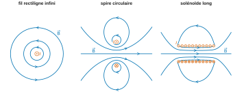
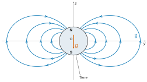
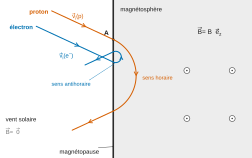
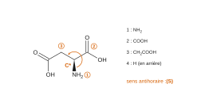
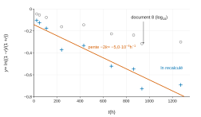

# e3a-Polytech PC — Physique-chimie 2026 · Corrigé brut

*Corrigé rédigé par IA, non officiel. Signalez toute erreur.*

Épreuve de 4 heures (code PC9PC), calculatrices interdites. Physique « Physique en Scandinavie » (parties I à III) et chimie en deux problèmes, 43 questions numérotées en continu. Résultats numériques de physique donnés avec un chiffre significatif, comme l'autorise l'énoncé.

## Physique — Physique en Scandinavie

## Partie I – Magnétisme terrestre et aurores polaires

### Q1.

$$\begin{aligned}
&\operatorname{div}\vec E=\frac{\rho}{\varepsilon_0} &&\text{(Maxwell-Gauss)}\\
&\operatorname{div}\vec B=0 &&\text{(Maxwell-flux, ou Maxwell-Thomson)}\\
&\overrightarrow{\operatorname{rot}}\,\vec E=-\frac{\partial\vec B}{\partial t} &&\text{(Maxwell-Faraday)}\\
&\overrightarrow{\operatorname{rot}}\,\vec B=\mu_0\vec\jmath+\mu_0\varepsilon_0\frac{\partial\vec E}{\partial t} &&\text{(Maxwell-Ampère)}
\end{aligned}$$

### Q2.

Une **ligne de champ** de $\vec B$ est une courbe tangente en chacun de ses points $M$ au vecteur $\vec B(M)$, et orientée dans le sens de $\vec B$. Pour un déplacement élémentaire $\mathrm d\vec\ell$ le long de la ligne :

$$\mathrm d\vec\ell\wedge\vec B(M)=\vec 0.$$

Comme $\operatorname{div}\vec B=0$, les lignes de $\vec B$ sont fermées (ou s'étendent à l'infini).

Allure (le sens des lignes se déduit de celui de $I$ par la règle de la main droite) :

- **fil infini horizontal** : cercles centrés sur le fil, dans les plans perpendiculaires au fil, d'autant plus espacés qu'on s'éloigne du fil ($B\propto1/r$) ;
- **spire circulaire** : lignes qui traversent le disque de la spire et se referment à l'extérieur autour du conducteur ; au centre, $\vec B$ est porté par l'axe. C'est la topologie d'un dipôle ;
- **solénoïde long** : lignes parallèles et régulièrement espacées à l'intérieur (champ quasi uniforme), évasées aux extrémités et très espacées à l'extérieur (champ quasi nul pour un solénoïde infini).

### Q3.

Coordonnées cylindriques d'axe $(Oz)$ confondu avec le fil, $I$ dans le sens de $\vec e_z$.

*Invariances* : la distribution est invariante par translation selon $(Oz)$ et par rotation autour de $(Oz)$, donc $\vec B$ ne dépend que de $r$.

*Symétries* : le plan $(M,\vec e_r,\vec e_z)$ contient le fil, c'est un plan de symétrie de la distribution de courants. $\vec B$ étant un pseudovecteur, $\vec B(M)$ est perpendiculaire à ce plan : $\vec B(M)=B(r)\,\vec e_\theta$.

*Théorème d'Ampère* sur le cercle $\mathcal C$ d'axe $(Oz)$, de rayon $r$, orienté par $\vec e_\theta$ (orientation cohérente avec $\vec e_z$, sens de $I$) :

$$\oint_{\mathcal C}\vec B\cdot\mathrm d\vec\ell=2\pi r\,B(r)=\mu_0 I.$$

$$\boxed{\vec B(M)=\frac{\mu_0 I}{2\pi r}\,\vec e_\theta\qquad (r>0)}$$

### Q4.

En sphériques, $\vec e_z=\cos\theta\,\vec e_r-\sin\theta\,\vec e_\theta$, donc $\vec M=-M\vec e_z=-M\cos\theta\,\vec e_r+M\sin\theta\,\vec e_\theta$ et $\vec M\cdot\vec e_r=-M\cos\theta$. En $r=R_T$ :

$$\vec B(P)=\frac{\mu_0}{4\pi R_T^3}\Big[-3M\cos\theta\,\vec e_r+M\cos\theta\,\vec e_r-M\sin\theta\,\vec e_\theta\Big]$$

$$\boxed{\begin{aligned}
B_r&=-\frac{\mu_0M\cos\theta}{2\pi R_T^3}\\
B_\theta&=-\frac{\mu_0M\sin\theta}{4\pi R_T^3}\\
B_\varphi&=0
\end{aligned}}$$

Au pôle Nord géographique ($\theta=0$) : $\vec B=-\dfrac{\mu_0M}{2\pi R_T^3}\vec e_r$, champ vertical dirigé vers le centre de la Terre, de norme $B_0=\dfrac{\mu_0M}{2\pi R_T^3}$. D'où

$$\begin{aligned}
M&=\frac{2\pi R_T^3B_0}{\mu_0}\\
&=\frac{R_T^3B_0}{2\cdot10^{-7}}\\
&=\frac{(6{,}4\cdot10^6)^3\times6{,}0\cdot10^{-5}}{2\cdot10^{-7}}.
\end{aligned}$$

Avec $6{,}4^3\approx262$ : $M\approx262\cdot10^{18}\times3{,}0\cdot10^{2}\approx\mathbf{7{,}9\cdot10^{22}\ A\cdot m^2}$, valeur du tableau 1.

### Q5.

$[M]=\mathrm{A\cdot m^2}$, $[j]=\mathrm{A\cdot m^{-2}}$, $[R_N]=\mathrm m$. L'égalité $\mathrm{A\cdot m^2}=\mathrm A^\alpha\,\mathrm m^{-2\alpha+\beta}$ impose $\alpha=1$ et $-2+\beta=2$ :

$$\boxed{\begin{aligned}
\alpha&=1\\
\beta&=4
\end{aligned}}$$

On a donc $M=j\,R_N^4$, d'où

$$\begin{aligned}
j&=\frac{M}{R_N^4}=\frac{7{,}9\cdot10^{22}}{(5{,}0\cdot10^5)^4}\\
&=\frac{7{,}9\cdot10^{22}}{6{,}25\cdot10^{22}}\\
&\approx\mathbf{1\ A\cdot m^{-2}}.
\end{aligned}$$

Fil de laboratoire : $j_{\text{fil}}=\dfrac{i}{s}=\dfrac{10\cdot10^{-3}}{1\cdot10^{-6}}=\mathbf{1\cdot10^4\ A\cdot m^{-2}}$.

**La densité de courant dans le noyau est environ $10^4$ fois plus faible que dans un simple fil parcouru par 10 mA.** Le moment géomagnétique énorme vient de l'extension du noyau : le courant total qui traverse une section méridienne vaut $I\sim jR_N^2\sim10^{11}$ à $10^{12}$ A, et $M$ croît comme $R_N^4$.

### Q6.

Dans le plan $(yOz)$, les lignes du dipôle forment deux familles de boucles fermées, symétriques par rapport à l'axe $(Oz)$ et au plan équatorial ; chaque ligne part d'un point de l'hémisphère sud et revient dans l'hémisphère nord, d'autant plus loin de la Terre que ses pieds sont proches de l'équateur. Les lignes sont radiales au voisinage des pôles et parallèles à $(Oz)$ dans le plan équatorial.

**Orientation** : $B_r<0$ pour $\theta<\pi/2$ et $B_r>0$ pour $\theta>\pi/2$, donc à l'extérieur de la Terre **les lignes sortent de l'hémisphère sud et entrent dans l'hémisphère nord** ; dans le plan équatorial, $\vec B=-\frac{\mu_0M}{4\pi r^3}\vec e_\theta=+\frac{\mu_0M}{4\pi r^3}\vec e_z$ est dirigé vers le nord. (À l'intérieur du noyau, elles se referment du nord vers le sud, dans le sens de $\vec M$.)

Différences essentielles avec la figure 2 :

1. **Pas de symétrie de révolution ni de symétrie jour/nuit** dans la figure 2 : côté Soleil, les lignes sont comprimées par le vent solaire ; côté nuit, elles sont étirées en une longue queue magnétosphérique quasi parallèle à l'axe Soleil-Terre, de part et d'autre d'une couche de courant.
2. **Existence d'une frontière et de lignes ouvertes** : la magnétosphère est bornée par la magnétopause ; près des cornets polaires et dans la queue, des lignes ne se referment pas près de la Terre et se connectent au champ du vent solaire. Le dipôle pur a des lignes toutes fermées qui s'étendent indéfiniment.

### Q7.

A est dans le plan équatorial, donc $\boxed{\theta=\pi/2}$. Avec $\cos\theta=0$, $\sin\theta=1$ et $r=d$ :

$$\boxed{\begin{aligned}
B_r&=0\\
B_\theta&=-\frac{\mu_0M}{4\pi d^3}\\
B_\varphi&=0
\end{aligned}}$$

À l'équateur, $\vec e_\theta=-\vec e_z$, donc le champ est dirigé vers le nord :

$$\vec B(A)=\frac{\mu_0M}{4\pi d^3}\,\vec e_z.$$

Numériquement, $B(A)=\dfrac{B_0}{2}\left(\dfrac{R_T}{d}\right)^3=\dfrac{6{,}0\cdot10^{-5}}{2\times216}\approx1{,}4\cdot10^{-7}$ T, conforme à l'énoncé.

**Commentaire** : le champ dipolaire décroît en $1/r^3$. À $6R_T$ il est environ 430 fois plus faible qu'au pôle (facteur $6^3=216$, et un facteur 2 entre pôle et équateur à même distance). Il reste toutefois très supérieur au champ quasi nul du vent solaire (quelques nT) : la région autour de A est encore dominée par le champ terrestre, ce qui est cohérent avec la présence de la magnétopause à cette distance.

### Q8.

Le poids est négligeable devant la force de Lorentz magnétique. Le PFD dans le référentiel terrestre s'écrit, avec $\vec B=B\vec e_z$ uniforme :

$$m\frac{\mathrm d\vec v}{\mathrm dt}=q\,\vec v\wedge\vec B.$$

La force est orthogonale à $\vec v$ : sa puissance est nulle, donc la norme $v$ de la vitesse est constante. Elle est aussi orthogonale à $\vec e_z$ : $v_z$ est constante, ici nulle, et le mouvement reste dans le plan $(xOy)$.

*Rayon.* Pour un mouvement circulaire de rayon $R$, on utilise la base locale cylindrique centrée sur le centre de la trajectoire :

$$\begin{aligned}
\vec v&=R\dot\theta\,\vec e_\theta\\
\vec a&=-R\dot\theta^2\,\vec e_r\\
q\vec v\wedge\vec B&=qR\dot\theta B\,(\vec e_\theta\wedge\vec e_z)=qR\dot\theta B\,\vec e_r
\end{aligned}$$

La projection du PFD sur $\vec e_r$ donne $-mR\dot\theta^2=qR\dot\theta B$, soit

$$\dot\theta=-\frac{qB}{m}$$

$$\boxed{R=\frac{v}{\lvert\dot\theta\rvert}=\frac{mv}{\lvert q\rvert B}}$$

*Sens de parcours.* Pour le proton ($q=+e$), $\dot\theta<0$ : rotation dans le **sens horaire** vu depuis $+\vec e_z$ (c'est-à-dire vu par le lecteur de la figure 5, où $\vec B$ sort de la feuille). Pour l'électron ($q=-e$), $\dot\theta>0$ : **sens antihoraire**.

*Allure.*

En franchissant la magnétopause, la force initiale $q\vec v_i\wedge\vec B$ courbe le proton vers le bas puis le ramène vers la gauche : il ressort sous A, après un arc un peu plus court qu'un demi-cercle. L'électron, courbé vers le haut, décrit un arc un peu plus long qu'un demi-cercle, mais de rayon bien plus petit, et ressort au-dessus de son point d'entrée. Aucune des deux ne pénètre au-delà d'une profondeur de $2R$ dans la magnétosphère : c'est le rôle de **bouclier**.

*Applications numériques* ($B=1{,}4\cdot10^{-7}$ T, $v=7{,}0\cdot10^5$ m·s⁻¹, $m_p=2000\,m_e$) :

$$\begin{aligned}
R_p&=\frac{2000\times9{,}1\cdot10^{-31}\times7{,}0\cdot10^5}{1{,}6\cdot10^{-19}\times1{,}4\cdot10^{-7}}\approx\mathbf{6\cdot10^4\ m}\ (60\text{ km})\\
R_e&=\frac{R_p}{2000}\approx\mathbf{3\cdot10^1\ m}
\end{aligned}$$

**Commentaire** : les deux rayons sont minuscules devant l'échelle de variation du champ ($d\approx4\cdot10^7$ m), ce qui justifie a posteriori l'hypothèse d'un champ localement uniforme. Ils montrent que les particules du vent solaire sont réfléchies dans une couche très mince de la magnétopause. Protons et électrons y tournent en sens opposés : leurs déplacements le long de la magnétopause sont de sens contraires, ce qui crée une séparation de charges et un courant de surface.

## Partie II – Ångström, Rydberg… et Bohr

### Q9.

L'électron n'est soumis qu'à la force de Coulomb $\vec F=-\dfrac{e^2}{4\pi\varepsilon_0r^2}\vec e_r$, **centrale** (colinéaire à $\overrightarrow{OM}$). Le théorème du moment cinétique en $O$, fixe dans le référentiel galiléen, donne

$$\frac{\mathrm d\vec L_O}{\mathrm dt}=\overrightarrow{OM}\wedge\vec F=\vec 0,$$

donc $\vec L_O=m_e\overrightarrow{OM}\wedge\vec v$ est constant.

Si la position et la vitesse initiales sont dans le plan $(xOy)$, $\vec L_O$ est colinéaire à $\vec e_z$ à tout instant.

Or $\overrightarrow{OM}\cdot\vec L_O=0$ (produit mixte avec un vecteur répété). On en déduit $\overrightarrow{OM}\cdot\vec e_z=0$ : **la trajectoire reste dans le plan $(xOy)$** (si $\vec L_O\neq\vec 0$, ce qui est le cas pour une orbite).

Sur une orbite circulaire de rayon $r_n$ :

$$\begin{aligned}
\vec v&=r_n\dot\theta\,\vec e_\theta\\
L_O&=m_er_n^2\dot\theta
\end{aligned}$$

La conservation de $L_O$ avec $r_n$ constant impose $\dot\theta$ constant, donc $v=r_n\lvert\dot\theta\rvert$ constant : **le mouvement circulaire est uniforme**. Le caractère plan seul ne l'aurait pas établi. Uniforme ne veut pas dire accélération nulle : l'accélération $\vec a=-r_n\dot\theta^2\,\vec e_r$ est centripète.

### Q10.

Mouvement circulaire uniforme : $\vec a=-\dfrac{v_n^2}{r_n}\vec e_r$. Le PFD projeté sur $\vec e_r$ donne $m_e\dfrac{v_n^2}{r_n}=\dfrac{e^2}{4\pi\varepsilon_0r_n^2}$ :

$$\boxed{v_n=\sqrt{\frac{e^2}{4\pi\varepsilon_0m_er_n}}}$$

### Q11.

$$\begin{aligned}
E_c&=\frac12m_ev_n^2=\frac{e^2}{8\pi\varepsilon_0r_n}\\
E_p&=-\frac{e^2}{4\pi\varepsilon_0r_n}\quad(E_p\to0\text{ à l'infini})
\end{aligned}$$

$$\boxed{E_n=E_c+E_p=-\frac{e^2}{8\pi\varepsilon_0r_n}}$$

On a $E_n=-E_c=E_p/2$.

### Q12.

On part de $L_O=m_er_nv_n=n\hbar$, qu'on élève au carré en utilisant Q10 :

$$\begin{aligned}
m_e^2r_n^2\,\frac{e^2}{4\pi\varepsilon_0m_er_n}&=n^2\hbar^2\\
m_er_n\,\frac{e^2}{4\pi\varepsilon_0}&=n^2\hbar^2
\end{aligned}$$

$$\boxed{r_n=a_0n^2}$$

avec

$$\boxed{a_0=\frac{4\pi\varepsilon_0\hbar^2}{m_ee^2}=\frac{\varepsilon_0h^2}{\pi m_ee^2}}$$

En reportant dans $E_n$ :

$$E_n=-\frac{e^2}{8\pi\varepsilon_0a_0}\,\frac1{n^2}=-\frac{E_0}{n^2}$$

$$\boxed{\begin{aligned}
E_0&=\frac{e^2}{8\pi\varepsilon_0a_0}\\
&=\frac{m_ee^4}{32\pi^2\varepsilon_0^2\hbar^2}\\
&=\frac{m_ee^4}{8\varepsilon_0^2h^2}
\end{aligned}}$$

(numériquement $a_0\approx53$ pm et $E_0\approx13{,}6$ eV).

Conséquences physiques :

- **l'énergie de l'atome est quantifiée** : seuls les niveaux $-E_0/n^2$ sont permis ; l'atome n'échange de l'énergie avec le rayonnement que par quanta $E_p-E_n$, d'où un **spectre de raies** discret ;
- **il existe un état fondamental stable** ($n=1$, rayon minimal $a_0$, énergie $-E_0$) : l'électron ne peut pas s'effondrer sur le noyau ; $E_0$ est l'**énergie d'ionisation** de l'atome dans son état fondamental (les niveaux tendent vers 0 quand $n\to\infty$, tous les états liés ont $E_n<0$).

### Q13.

Lors de la transition de $E_p$ vers $E_n$ ($p>n$), l'atome émet un photon dont l'énergie est fixée par la conservation de l'énergie :

$$\begin{aligned}
h\nu=\frac{hc}{\lambda_{p\to n}}&=E_p-E_n\\
&=E_0\left(\frac1{n^2}-\frac1{p^2}\right)>0
\end{aligned}$$

D'où

$$\frac1{\lambda_{p\to n}}=\frac{E_0}{hc}\left(\frac1{n^2}-\frac1{p^2}\right)$$

$$\boxed{R_\infty=\frac{E_0}{hc}}\quad(\approx1{,}1\cdot10^7\ \mathrm{m^{-1}}).$$

### Q14.

Série de Balmer ($n=2$) :

$$\frac1{\lambda_{p\to2}}=R_\infty\left(\frac14-\frac1{p^2}\right)$$

est une fonction **croissante** de $p$, donc $\lambda_{p\to2}$ décroît avec $p$ : 656,3 nm ($p=3$), 486,2 nm ($p=4$), puis des valeurs toutes inférieures à 486,2 nm (434 nm, 410 nm…, jusqu'à la limite $4/R_\infty\approx365$ nm).

La raie d'Ångström à 557,7 nm est strictement comprise entre $\lambda_{4\to2}$ et $\lambda_{3\to2}$. Il faudrait $3<p<4$ (le calcul donne $p\approx3{,}4$), ce qui est impossible. Les autres séries tombent hors du visible (Lyman dans l'UV, Paschen et au-delà dans l'IR). **La raie verte des aurores n'est pas due à l'hydrogène atomique** (elle est en fait émise par l'oxygène atomique).

Deux défauts du modèle de Bohr :

- il utilise la notion de **trajectoire** (position et vitesse simultanément déterminées), incompatible avec l'inégalité de Heisenberg ; la quantification $L_O=n\hbar$ est un postulat ad hoc ;
- un électron accéléré sur une orbite circulaire devrait, d'après l'électromagnétisme classique, **rayonner** et tomber sur le noyau : le modèle postule sans justification la stabilité des orbites. De plus, il ne s'étend pas aux atomes polyélectroniques et n'explique ni la structure fine ni les intensités des raies.

$\psi(x,t)$ est la **fonction d'onde**, une amplitude de probabilité. Selon l'interprétation probabiliste de Born, $\lvert\psi(x,t)\rvert^2\mathrm dx$ est la probabilité de trouver la particule entre $x$ et $x+\mathrm dx$ à l'instant $t$. La normalisation s'écrit

$$\int_{-\infty}^{+\infty}\lvert\psi\rvert^2\,\mathrm dx=1.$$

$\lvert\psi\rvert^2$ est donc une densité linéique de probabilité, en $\mathrm m^{-1}$, et $\psi$ n'est pas sans dimension :

$$\boxed{[\psi]=\mathrm m^{-1/2}}$$

## Partie III – Ondes de gravité dans un fjord norvégien

### Q15.

Le nombre de Reynolds est le rapport des ordres de grandeur du terme convectif et du terme visqueux de l'équation (1) :

$$\begin{aligned}
\lVert\rho(\vec v\cdot\overrightarrow{\operatorname{grad}})\vec v\rVert&\sim\rho\frac{U^2}{L}\\
\lVert\eta\Delta\vec v\rVert&\sim\eta\frac{U}{L^2}
\end{aligned}$$

$$\boxed{R_e=\frac{\rho U^2/L}{\eta U/L^2}=\frac{\rho UL}{\eta}}$$

$R_e$ est sans dimension. Il compare le transport de quantité de mouvement par convection à son transport par diffusion visqueuse. Pour $R_e\ll1$, la viscosité domine (écoulement laminaire, « rampant »). Pour $R_e\gg1$, l'inertie domine : l'écoulement devient turbulent au-delà d'un seuil qui dépend de la géométrie (de l'ordre de $2\cdot10^3$ pour une conduite cylindrique).

### Q16.

Écoulement parfait : on néglige la viscosité ($\eta\Delta\vec v$ négligeable, ou $\eta=0$). L'équation devient l'**équation d'Euler** :

$$\boxed{\rho\left(\frac{\partial\vec v}{\partial t}+(\vec v\cdot\overrightarrow{\operatorname{grad}})\vec v\right)=\rho\vec g-\overrightarrow{\operatorname{grad}}\,P}$$

### Q17.

À l'équilibre, $\vec v=\vec 0$ : le membre de gauche est nul et il reste la loi de la statique des fluides. Avec $\vec g=-g\vec e_z$ (axe $(Oz)$ vertical ascendant) :

$$\begin{aligned}
\overrightarrow{\operatorname{grad}}\,P_e&=\rho\vec g\\
\frac{\mathrm dP_e}{\mathrm dz}&=-\rho g
\end{aligned}$$

Avec $P_e(0)=P_0$ (continuité de la pression à la surface libre plane) :

$$\boxed{P_e(z)=P_0-\rho gz}$$

L'eau occupe $z<0$ : la pression y croît avec la profondeur, $P_e(z)=P_0+\rho g\lvert z\rvert>P_0$.

### Q18.

En négligeant le terme convectif : $\rho\dfrac{\partial\vec v}{\partial t}=\rho\vec g-\overrightarrow{\operatorname{grad}}\,P_e-\overrightarrow{\operatorname{grad}}\,p$. Comme $\overrightarrow{\operatorname{grad}}\,P_e=\rho\vec g$ (Q17) :

$$\boxed{\rho\frac{\partial\vec v}{\partial t}=-\overrightarrow{\operatorname{grad}}\,p}\qquad(2)$$

*Formes sinusoïdales.* Les équations (2) et $\operatorname{div}\vec v=0$ sont **linéaires**, à coefficients indépendants de $x$ et de $t$ (milieu invariant par translation selon $x$ et dans le temps). Toute perturbation est une superposition (Fourier) d'ondes harmoniques $e^{j(\omega t-kx)}$ qui évoluent indépendamment : il suffit d'étudier l'une d'elles, avec une dépendance en $z$ quelconque.

En notation complexe, $\partial/\partial t\to j\omega$ et $\partial/\partial x\to-jk$. L'équation (2) projetée donne

$$\begin{aligned}
j\omega\rho\,\underline V_x&=jk\,f&&\text{(sur }\vec e_x)\\
j\omega\rho\,\underline V_z&=-\frac{\mathrm df}{\mathrm dz}&&\text{(sur }\vec e_z)
\end{aligned}$$

*Incompressibilité* : $\boxed{\operatorname{div}\vec v=0}$, soit

$$\begin{aligned}
\frac{\partial v_x}{\partial x}+\frac{\partial v_z}{\partial z}&=0\\
-jk\,\underline V_x+\frac{\mathrm d\underline V_z}{\mathrm dz}&=0
\end{aligned}$$

On reporte les deux projections :

$$\begin{aligned}
\underline V_x&=\frac{k}{\omega\rho}f\\
\frac{\mathrm d\underline V_z}{\mathrm dz}&=-\frac{1}{j\omega\rho}f''=\frac{j}{\omega\rho}f''
\end{aligned}$$

L'incompressibilité devient

$$-\frac{jk^2}{\omega\rho}f+\frac{j}{\omega\rho}f''=0$$

$$\boxed{\frac{\mathrm d^2f}{\mathrm dz^2}-k^2f=0}$$

### Q19.

Solution générale, avec $k>0$ :

$$f(z)=A\,e^{kz}+A'\,e^{-kz}.$$

L'eau occupe $-H<z<0$ avec $H\gg\lambda$ : on peut faire $z\to-\infty$, où $e^{-kz}$ diverge. La perturbation devant rester finie, $A'=0$ et $f(z)=A\,e^{kz}$.

On choisit l'origine des phases pour que $h(x,t)=a\cos(\omega t-kx)$, avec $a$ réel ; la condition à la surface ci-dessous montre que $A$ est alors réel. La partie réelle donne

$$\boxed{p(x,z,t)=A\,e^{kz}\cos(\omega t-kx)}$$

*Ordre de grandeur* : $ka=2\pi a/\lambda\ll1$ car $a\ll\lambda$, donc $\boxed{e^{ka}\approx1}$ ; de même $e^{kh}\approx1$ puisque $\lvert h\rvert\le a$.

*Continuité de la pression* à la surface libre $z=h(x,t)$, au contact de l'air à $P_0$ :

$$\begin{aligned}
P_e(h)+p(x,h,t)&=P_0\\
P_0-\rho g\,h+A\,e^{kh}\cos(\omega t-kx)&=P_0
\end{aligned}$$

Avec $e^{kh}\approx1$ et $h=a\cos(\omega t-kx)$, il vient pour tous $x$ et $t$ :

$$A\cos(\omega t-kx)=\rho g a\cos(\omega t-kx),$$

d'où

$$\boxed{A=a\rho g}$$

*Vitesse verticale* : d'après la projection de (2) sur $\vec e_z$, $\underline V_z=-\dfrac{1}{j\omega\rho}\dfrac{\mathrm df}{\mathrm dz}$, donc

$$\underline v\cdot\vec e_z=-\frac{1}{j\omega\rho}\,\psi(z)\,e^{j(\omega t-kx)}$$

avec

$$\boxed{\psi(z)=\frac{\mathrm df}{\mathrm dz}=a\rho gk\,e^{kz}}$$

Toutes les perturbations décroissent en $e^{kz}$ : elles sont confinées sur une profondeur de l'ordre de $\lambda/2\pi$ sous la surface.

### Q20.

La relation $\underline v\cdot\vec e_z=\dfrac{\partial h}{\partial t}$ à l'interface (évaluée en $z\approx0$ à l'ordre linéaire) est la **condition cinématique** : la surface libre est une surface matérielle que le fluide ne traverse pas ; la vitesse verticale des particules de surface est la vitesse de déplacement vertical de la surface.

En $z=0$, avec $\psi(0)=a\rho gk$ (Q19) et $\partial h/\partial t=j\omega a\,e^{j(\omega t-kx)}$ :

$$\begin{aligned}
-\frac{a\rho gk}{j\omega\rho}\,e^{j(\omega t-kx)}&=j\omega a\,e^{j(\omega t-kx)}\\
-agk&=j^2\omega^2a\qquad\text{(après multiplication par }j\omega)\\
-agk&=-\omega^2a
\end{aligned}$$

donc $\omega^2=gk$ et

$$\boxed{\omega=(gk)^{1/2}}$$

L'exposant vaut donc

$$\boxed{\beta=\frac12}$$

Homogénéité : $[g][k]=\mathrm{m\cdot s^{-2}\cdot m^{-1}}=\mathrm s^{-2}$, donc $[(gk)^{1/2}]=\mathrm s^{-1}=[\omega]$. Une relation $\omega(k)$ est une **relation de dispersion** ; elle n'est pas linéaire, le milieu est **dispersif**.

### Q21.

La **vitesse de phase** $v_\varphi=\omega/k$ est la vitesse de propagation des surfaces d'égale phase d'une onde harmonique. La **vitesse de groupe** $v_g=\mathrm d\omega/\mathrm dk$, évaluée au centre du spectre, est la vitesse de l'enveloppe d'un paquet d'ondes (et, en général, celle de l'énergie).

$$\begin{aligned}
v_\varphi&=\frac{\omega}{k}=\sqrt{\frac gk}\\
v_g&=\frac{\mathrm d}{\mathrm dk}\sqrt{gk}=\frac12\sqrt{\frac gk}
\end{aligned}$$

$$\boxed{v_g=\frac{v_\varphi}{2}}$$

Les grandes longueurs d'onde se propagent le plus vite, et l'enveloppe d'un train de vagues avance deux fois moins vite que les crêtes qui le composent.

## Chimie

## Problème 1 – Composition et propriétés des vins rouges

### Partie I – Synthèse du resvératrol

### Q22.

Le cycle consomme l'éthanoate de 4-iodophényle et le 3,5-diacétoxystyrène (éthanoate de 3-acétoxy-5-éthénylphényle), et libère le stilbène triacétylé (acétate de resvératrol, de configuration E) et $\mathrm{Et_3NH^+ + I^-}$. Le Pd(0) est régénéré : c'est un catalyseur. Bilan :

$$\mathrm{AcO{-}C_6H_4{-}I}\ +\ \mathrm{CH_2{=}CH{-}C_6H_3(OAc)_2}\ +\ \mathrm{Et_3N}\ \xrightarrow{\ \mathrm{Pd(0)}\ }\ \mathrm{AcO{-}C_6H_4{-}CH{=}CH{-}C_6H_3(OAc)_2}\ +\ \mathrm{Et_3NH^+}\ +\ \mathrm{I^-}$$

(4-acétoxyphényle et 3,5-diacétoxyphényle de part et d'autre de la double liaison C=C, en E).

### Q23.

Dans Pd(0), le nombre d'oxydation du palladium est 0. Après l'étape 1, Pd est lié à un groupe aryle et à un iode, tous deux plus électronégatifs que Pd et comptés comme ligands anioniques ($\mathrm{Ar^-}$, $\mathrm{I^-}$) : n.o.(Pd) $=+\mathrm{II}$.

$$\boxed{\Delta\,\text{n.o.(Pd)}=+2\quad(0\to+\mathrm{II})}$$

### Q24.

À l'étape 4, le complexe alkylpalladium perd l'alcène produit et garde un hydrogène : $\mathbf A$ est le complexe **hydrido(iodo)palladium(II)** $\mathrm{H{-}Pd{-}I}$ (n.o. +II, ligands éventuels non représentés). À l'étape 5, la base Et₃N lui arrache HI.

### Q25.

- Étape 1 : **addition oxydante** de la liaison C–I sur Pd(0).
- Étape 2 : **coordination** (complexation π) de l'alcène sur le palladium, par association de ligand.
- Étape 3 : **insertion migratoire** (insertion 1,2, syn) de l'alcène dans la liaison Pd–aryle.
- Étape 4 : **β-élimination** d'hydrure (syn), qui libère l'alcène couplé et forme $\mathbf A$.
- Étape 5 : **élimination réductrice** de HI (Pd(II) → Pd(0)), assistée par Et₃N qui capte HI sous forme de $\mathrm{Et_3NH^+\,I^-}$.

### Q26.

Les trois phénols sont protégés sous forme d'esters (acétates d'aryle). **Déprotection** : saponification par la soude aqueuse ou hydroalcoolique en excès (au moins 6 équivalents : 3 pour les esters, 3 pour les phénols déprotonés), à chaud si nécessaire, puis acidification par $\mathrm{H_3O^+}$ (alternative douce : $\mathrm{K_2CO_3}$ dans le méthanol, transestérification). Réaction : **saponification** (hydrolyse basique d'ester).

Mécanisme (addition nucléophile puis élimination), pour chaque groupe $\mathrm{Ar{-}O{-}CO{-}CH_3}$ :

1. addition nucléophile : un doublet de $\mathrm{HO^-}$ attaque le carbone du carbonyle, le doublet π de C=O bascule sur l'oxygène ; on obtient l'intermédiaire tétraédrique $\mathrm{Ar{-}O{-}C(O^-)(OH){-}CH_3}$ ;
2. élimination : le doublet de $\mathrm{O^-}$ reforme C=O et expulse le phénolate $\mathrm{ArO^-}$, bon groupe partant (base conjuguée d'un phénol, stabilisée par délocalisation sur le cycle) ; il se forme $\mathrm{CH_3COOH}$ ;
3. réaction acide-base quasi totale : $\mathrm{CH_3COOH}+\mathrm{HO^-}$ (ou $\mathrm{ArO^-}$) donne $\mathrm{CH_3COO^-}$, ce qui rend la saponification totale. En milieu basique, les phénols restent sous forme de phénolates ;
4. traitement acide final : $\mathrm{ArO^-+H_3O^+\to ArOH+H_2O}$ (trois fois). On obtient le resvératrol.

### Partie II – Dosage des polyphénols par la méthode de Folin-Ciocalteu

### Q27.

Dilution au dixième : $C_S=C_{\text{vin}}/10$ et conservation de la matière, $C_{\text{vin}}V_0=C_S\times10{,}0$ mL, d'où

$$\boxed{V_0=\frac{10{,}0\ \text{mL}}{10}=1{,}0\ \text{mL}}$$

prélevé à la pipette jaugée de 1,00 mL et introduit dans une fiole jaugée de 10,0 mL complétée au trait de jauge avec de l'eau distillée. Contrôle : le volume prélevé est bien inférieur au volume de la fiole, et le rapport $10{,}0/1{,}0$ redonne le facteur de dilution 10.

### Q28.

- La réduction du réactif de Folin-Ciocalteu par les polyphénols forme des oxydes **bleus** de tungstène et de molybdène. Une espèce bleue absorbe dans le domaine complémentaire, orange-rouge, et jusque dans le proche infrarouge : son absorption est forte vers 700–800 nm (maximum des « bleus de molybdène » vers 760 nm).
- Le document 3 montre qu'un vin rouge absorbe fortement dans l'UV (vers 280 nm) et un peu vers 520 nm (anthocyanes), mais que son absorbance est quasi nulle au-delà de 650–700 nm.

À 760 nm, l'absorbance mesurée est donc due **uniquement** aux oxydes bleus, dont la quantité est proportionnelle à celle des polyphénols. La couleur propre du vin n'interfère pas, et la sensibilité est bonne.

### Q29.

Étalons et échantillon subissent exactement le même traitement (1,0 mL de solution dans une fiole de 10,0 mL, mêmes réactifs). Les concentrations du document 4 sont celles des solutions de la gamme : la droite donne directement la concentration de (S) en équivalent acide gallique.

Coefficient directeur de la droite tracée, lu sur deux points éloignés, $(0\,;\,0{,}01)$ et $(0{,}30\,;\,1{,}01)$ :

$$a=\frac{1{,}01-0{,}01}{0{,}30-0}\approx3{,}3\ \mathrm{L\cdot g^{-1}}.$$

La régression sur les dix points donne la même droite, $A=3{,}33\,C+0{,}013$ avec $C$ en g·L⁻¹. Pour $A=0{,}52$ :

$$C_S=\frac{0{,}52-0{,}013}{3{,}33}\approx0{,}152\ \mathrm{g\cdot L^{-1}}$$

(la lecture graphique donne $C_S\approx0{,}15$ g·L⁻¹). Le vin a été dilué 10 fois (Q27) :

$$\boxed{C_{\text{vin}}=10\,C_S\approx1{,}5\ \mathrm{g\cdot L^{-1}}\ \text{en équivalent acide gallique, soit environ }1{,}5\cdot10^3\ \mathrm{mg\cdot L^{-1}}}$$

Cette valeur est du même ordre que celles du document 5 (1 473 à 2 578 mg·L⁻¹). L'autre lecture possible (concentrations de l'axe prises dans les fioles finales) donnerait 15 g·L⁻¹, une valeur absurde.

### Q30.

$C_{\text{vin}}\approx1{,}5\ \mathrm{g\cdot L^{-1}}<2\ \mathrm{g\cdot L^{-1}}$, et l'écart (0,5 g·L⁻¹) dépasse nettement l'incertitude de lecture (quelques centièmes de g·L⁻¹ sur $C_S$, soit environ 0,1 g·L⁻¹ sur le vin). **Selon le critère du document 5, le vin analysé n'est pas astringent.** Sa teneur est proche de celle des vins de Merlot et de Feteasca Neagra du document 5.

## Problème 2 – Synthèse et racémisation de l'acide aspartique

### Partie I – Synthèse de l'acide aspartique

### Q31.

1. **Réaction acide-base** : $\mathrm{ClCH_2COOH+HCO_3^-\to ClCH_2COO^-+H_2CO_3}$ ($\mathrm{CO_2+H_2O}$), de constante $K=10^{6{,}4-5}\approx25$. L'acide est converti en carboxylate et ne peut plus protoner l'ion cyanure en HCN (toxique et non nucléophile).
2. **Substitution nucléophile $S_N2$** : le doublet du carbone de $\mathrm{CN^-}$ attaque le carbone porteur du chlore (primaire, peu encombré), à l'opposé de la liaison C–Cl ; dans un état de transition unique, la liaison C–C se forme tandis que la liaison C–Cl se rompt et que $\mathrm{Cl^-}$ part.

$$\boxed{\mathbf B=\mathrm{N{\equiv}C{-}CH_2{-}COO^-\,Na^+}\ \text{(cyanoéthanoate de sodium ; l'acide cyanoéthanoïque correspondant est aussi admis)}}$$

L'étape 2 (hydrolyse acide du nitrile, puis protonation) conduit à l'acide malonique $\mathrm{HOOC{-}CH_2{-}COOH}$ (C).

### Q32.

L'énol du document 7, $\mathrm{HOOC{-}CH{=}C(OH)_2}$, se forme par catalyse acide :

1. protonation de l'oxygène du carbonyle d'une fonction COOH par $\mathrm{H_3O^+}$ : on obtient un cation, dont la charge est délocalisée sur le carbone et les deux oxygènes ;
2. déprotonation du carbone α par l'eau : le doublet de la liaison C–H forme la double liaison C=C, le doublet π de C=O⁺H revient sur l'oxygène, et $\mathrm{H_3O^+}$ est régénéré.

$$\mathrm{HOOC{-}CH_2{-}C(=O)OH}\ \rightleftharpoons\ \mathrm{HOOC{-}CH{=}C(OH)_2}$$

Cet équilibre est la **tautomérie céto-énolique** (ici entre la forme « carbonyle » de l'acide et sa forme énol) ; il est très déplacé vers la forme carbonylée.

### Q33.

Sous contrôle frontalier, l'interaction dominante est celle entre la **HO du nucléophile** (l'énol, riche en électrons) et la **BV de l'électrophile** $\mathrm{Br_2}$ (orbitale σ* de Br–Br). Cette interaction est d'autant plus stabilisante que le recouvrement est grand, donc que le coefficient de la HO sur l'atome attaqué est grand en valeur absolue. Le terme stabilisant varie comme le carré du coefficient.

Coefficients de la HO de l'énol en valeur absolue : atome 1 (O) 0,08 ; 2 (C) 0,13 ; 3 (O) 0,51 ; **4 (C) 0,67** ; 5 (C) 0,38 ; 6 et 7 (O) 0,24. Le coefficient maximal est porté par l'**atome 4**, le carbone de la double liaison C=C qui deviendra le carbone α ($0{,}67^2\approx0{,}45$ contre $0{,}51^2\approx0{,}26$ pour O3).

$\mathrm{Br_2}$ est donc attaqué par l'atome 4. Le doublet π de C4=C5 forme la liaison C4–Br et $\mathrm{Br^-}$ part ; le cation obtenu, stabilisé par les deux oxygènes de C5, perd un proton sur O et redonne la fonction acide. On obtient D, $\mathrm{HOOC{-}CHBr{-}COOH}$ : **la bromation a lieu sur le carbone α**, situé entre les deux fonctions acide.

### Q34.

- **Étape 5** (E → F) : (1) $\mathrm{H_3O^+}$ protone les deux carboxylates (et l'amine) ; (2) l'éthanol, en milieu acide, réalise une **estérification de Fischer** des deux fonctions acide. Rôle : **protéger les acides carboxyliques sous forme d'esters éthyliques**. Sinon, à l'étape 7, $\mathrm{EtO^-}$ déprotonerait d'abord les COOH ($\mathrm{p}K_a\approx5$) au lieu du CH. Sous forme de diester, l'hydrogène du carbone central devient assez acide ($\mathrm{p}K_a\approx13$) pour être arraché par l'éthanolate et former le carbanion à alkyler.
- **Étape 6** (F → G) : **N-acétylation** de l'amine par le chlorure d'éthanoyle (chlorure d'acétyle) en présence de $\mathrm{NaHCO_3}$. Rôle : **protéger l'amine sous forme d'amide** (acétamide), beaucoup moins nucléophile et basique. Sinon, l'amine libre serait alkylée par le bromure d'allyle à l'étape 7 (N-alkylation concurrente de la C-alkylation) et oxydée par l'ozone à l'étape 8.
- **Étape 9** (I → J) : **déprotection** par hydrolyse basique, suivie d'acidification : saponification des deux esters éthyliques (le COOH formé à l'étape 8 est neutralisé) et, d'après la structure de J, hydrolyse de l'acétamide qui libère $\mathrm{NH_2}$. On obtient l'acide aminé gem-dicarboxylique J, que l'étape 10 décarboxyle à chaud en milieu acide (diacide malonique), pour donner l'acide aspartique.

### Q35.

E est l'aminomalonate $\mathrm{^-OOC{-}CH(NH_2){-}COO^-}$.

1. **Acidification** (réactions acide-base) : les deux $\mathrm{COO^-}$ sont protonés en COOH et $\mathrm{NH_2}$ en $\mathrm{NH_3^+}$ ; la forme ammonium n'est plus nucléophile et ne réagit pas sur les fonctions acide.
2. **Estérification de Fischer**, pour chaque fonction COOH (mécanisme identique pour la seconde) :
   - (a) protonation de l'oxygène du carbonyle par $\mathrm{H^+}$ : le carbone fonctionnel devient plus électrophile (cation délocalisé sur C et les deux O) ;
   - (b) addition nucléophile d'un doublet non liant de l'oxygène de l'éthanol sur ce carbone : on obtient un intermédiaire tétraédrique $\mathrm{R{-}C(OH)_2{-}O^+(H)Et}$ ;
   - (c) prototropie : le proton passe de l'oxygène éthylique sur l'un des OH, qui devient $\mathrm{{-}OH_2^+}$ ;
   - (d) élimination d'eau : un doublet d'un OH reforme la double liaison, $\mathrm{H_2O}$ part et on obtient l'ester protoné $\mathrm{R{-}C(=O^+H){-}OEt}$ ;
   - (e) déprotonation : on obtient l'ester $\mathrm{R{-}CO{-}OEt}$ et $\mathrm{H^+}$ est régénéré.

Chaque étape est renversable ; l'estérification est un équilibre athermique de constante voisine de 4, qu'on déplace par excès d'éthanol (solvant) ou élimination de l'eau. Après neutralisation de l'ammonium (réalisée par $\mathrm{NaHCO_3}$ au début de l'étape 6), on obtient

$$\boxed{\mathbf F=\mathrm{EtO{-}CO{-}CH(NH_2){-}CO{-}OEt}\ \text{(aminomalonate de diéthyle)}}$$

### Q36.

- **Chlorure d'acétyle $\mathrm{CH_3COCl}$** : c'est l'agent d'acylation le plus réactif parmi les dérivés d'acide. $\mathrm{Cl^-}$ est un excellent groupe partant et le carbone du carbonyle est très électrophile. La réaction avec l'amine (addition nucléophile, puis élimination de $\mathrm{Cl^-}$) est rapide, totale et douce. L'amine, bien plus nucléophile que les esters ou le C–H, est acylée sélectivement. L'acide éthanoïque ne conviendrait pas : avec l'amine, il donnerait seulement une réaction acide-base, qui forme un carboxylate d'ammonium.
- **$\mathrm{NaHCO_3}$**, base faible ($\mathrm{p}K_a(\mathrm{H_2CO_3/HCO_3^-})=6{,}4$) :
  - elle **capte HCl** libéré par l'acylation, ce qui évite aussi un dégagement de chlorure d'hydrogène gazeux (on obtient NaCl, $\mathrm{CO_2}$ et $\mathrm{H_2O}$). Sinon, HCl protonerait l'amine restante en ammonium non nucléophile, et la conversion plafonnerait à 50 % ;
  - elle libère l'amine de F si celle-ci est encore sous forme d'ammonium après l'étape 5 (milieu acide) ;
  - elle est **trop faible** pour saponifier les esters éthyliques ou pour déprotoner le C–H central ($\mathrm{p}K_a\approx13\gg6{,}4$), ce qui évite toute C-acylation ou condensation parasite. Une base forte (NaOH, EtONa) hydrolyserait les esters et le chlorure d'acyle, ou formerait l'énolate.

### Partie II – Cinétique de racémisation de l'acide aspartique

### Q37.

Carbone asymétrique : $\mathrm C^*$ porteur de $\mathrm{NH_2}$, $\mathrm{COOH}$, $\mathrm{CH_2COOH}$ et H.

Priorités CIP : $\mathrm{NH_2}$ (N, $Z=7$) > $\mathrm{COOH}$ (C substitué par (O, O, O)) > $\mathrm{CH_2COOH}$ (C substitué par (C, H, H)) > H.

Sur la figure 3, $\mathrm C^*$ est en bas de la chaîne en zigzag : $\mathrm{CH_2}$ en haut à gauche, COOH en haut à droite, dans le plan ; $\mathrm{NH_2}$ en coin plein vers le bas (vers l'observateur) ; H implicite en arrière. H étant à l'arrière, on lit le sens 1 → 2 → 3 : $\mathrm{NH_2}$ (bas), puis COOH (haut droite), puis $\mathrm{CH_2COOH}$ (haut gauche). On tourne dans le **sens antihoraire** :

$$\boxed{\text{acide L-aspartique}=\text{acide }(S)\text{-aspartique, soit acide }(2S)\text{-2-aminobutanedioïque}}$$

### Q38.

Réactions opposées d'ordre 1 : $v_1=k_1[\mathrm L]$ (L → D) et $v_{-1}=k_{-1}[\mathrm D]$ (D → L).

$$\boxed{\frac{\mathrm d[\mathrm L]}{\mathrm dt}=-k_1[\mathrm L]+k_{-1}[\mathrm D]}$$

### Q39.

Un **mélange racémique** est un mélange équimolaire de deux énantiomères ; il est optiquement inactif. En fin de racémisation, le mélange est racémique :

$$\boxed{[\mathrm D]_\infty=[\mathrm L]_\infty}$$

### Q40.

À l'état final (équilibre), $\dfrac{\mathrm d[\mathrm L]}{\mathrm dt}=0$, donc $k_1[\mathrm L]_\infty=k_{-1}[\mathrm D]_\infty$. Avec $[\mathrm D]_\infty=[\mathrm L]_\infty\neq0$ :

$$\boxed{k_1=k_{-1}=k}$$

Ce résultat est cohérent avec la thermodynamique : deux énantiomères ont la même enthalpie libre standard, donc $K^\circ=k_1/k_{-1}=1$.

### Q41.

La racémisation L ⇌ D ne crée ni ne détruit d'acide aspartique : par conservation de la matière, à volume constant, la concentration totale est constante. En l'écrivant à l'instant $t$ et à la fin, avec Q39 :

$$\begin{aligned}
[\mathrm L]+[\mathrm D]&=[\mathrm L]_\infty+[\mathrm D]_\infty=2[\mathrm L]_\infty\\
[\mathrm D]&=2[\mathrm L]_\infty-[\mathrm L]
\end{aligned}$$

En reportant dans Q38 avec $k_1=k_{-1}=k$ :

$$\frac{\mathrm d[\mathrm L]}{\mathrm dt}=-k[\mathrm L]+k\big(2[\mathrm L]_\infty-[\mathrm L]\big)$$

$$\boxed{\frac{\mathrm d[\mathrm L]}{\mathrm dt}+2k[\mathrm L]=2k[\mathrm L]_\infty}$$

### Q42.

Si l'ordre partiel est 1, $y=\ln\dfrac{1-r}{1+r}$ est une **fonction affine du temps**, $y=y_0-2kt$ avec $y_0=\ln\dfrac{1-r_0}{1+r_0}$.

Valeurs de $y$ calculées à partir des données du document 8 :

| $t$ (h) | 24 | 48 | 108 | 240 | 432 | 672 | 864 | 936 | 1 272 |
|---|---|---|---|---|---|---|---|---|---|
| $r$ | 0,052 | 0,063 | 0,088 | 0,184 | 0,165 | 0,255 | 0,267 | 0,348 | 0,333 |
| $y=\ln\frac{1-r}{1+r}$ | −0,10 | −0,13 | −0,18 | −0,37 | −0,33 | −0,52 | −0,55 | −0,73 | −0,69 |

*Validation du modèle affine.* Les points se répartissent de part et d'autre d'une droite décroissante, sans courbure systématique (coefficient de corrélation de $-0{,}95$). La dispersion est notable (deux inversions de $r$, à 240/432 h et à 936/1 272 h), mais elle est typique de mesures sur échantillons biologiques. Le modèle affine est donc acceptable.

*Conclusion.* La loi intégrée de l'ordre 1 est vérifiée : **les données sont compatibles avec un ordre partiel 1 par rapport à l'acide L-aspartique.** La régression affine donne, avec $t$ en h :

$$y=-5{,}0\cdot10^{-4}\,t-0{,}14$$

La pente vaut $-2k$, d'où

$$\boxed{k_{65}=\frac{5{,}0\cdot10^{-4}}{2}\approx2{,}5\cdot10^{-4}\ \mathrm{h^{-1}}\approx7\cdot10^{-8}\ \mathrm{s^{-1}}}$$

L'ordonnée à l'origine $y_0\approx-0{,}14$ correspond à $r_0\approx0{,}07$ : l'échantillon contenait déjà un peu d'acide D à $t=0$.

**Erreur d'énoncé signalée.** Le graphe du document 8 est titré $\ln\frac{1-r}{1+r}$, mais ses points sont en **logarithme décimal**. Pour $r=0{,}333$, on a $\frac{1-r}{1+r}=\frac12$, et :

$$\begin{aligned}
\ln\tfrac12&\approx-0{,}69\quad\text{(valeur attendue)}\\
\log_{10}\tfrac12&\approx-0{,}30\quad\text{(ordonnée du point sur le graphe)}
\end{aligned}$$

La pente affichée, $-2{,}18\cdot10^{-4}$ h⁻¹, vaut donc $-2k/\ln10$. On retrouve bien

$$k=\frac{2{,}3\times2{,}18\cdot10^{-4}}{2}\approx2{,}5\cdot10^{-4}\ \mathrm{h^{-1}}.$$

Prendre naïvement $2k=2{,}18\cdot10^{-4}$ h⁻¹ donnerait une valeur $\ln 10$ fois trop faible ($1{,}1\cdot10^{-4}$ h⁻¹).

### Q43.

On interprète « racémisé à 99 % » comme $r=[\mathrm D]/[\mathrm L]=0{,}99$ ($r_\infty=1$). D'après la loi intégrée :

$$\begin{aligned}
t_{99}&=\frac{1}{2k}\left[\ln\frac{1-r_0}{1+r_0}-\ln\frac{1-0{,}99}{1+0{,}99}\right]\\
&=\frac{y_0-\ln(0{,}01/1{,}99)}{2k}.
\end{aligned}$$

Annexe 1 : $\ln\dfrac{0{,}01}{1{,}99}\approx\ln(5{,}0\cdot10^{-3})\approx-5{,}3$ (lecture sur $]0\,;0{,}1]$ ; on peut aussi écrire $\ln0{,}01-\ln1{,}99\approx-4{,}6-0{,}7$). Avec $y_0\approx-0{,}14$ et $2k\approx5{,}0\cdot10^{-4}$ h⁻¹ :

$$\boxed{t_{99}\approx\frac{-0{,}14+5{,}3}{5{,}0\cdot10^{-4}}\approx1\cdot10^4\ \text{h}\approx4\cdot10^2\ \text{jours, soit un peu plus d'un an à }65\ ^\circ\mathrm C}$$

Variantes :

- avec $r_0=0$, on trouverait $1{,}1\cdot10^4$ h ;
- si l'on entend « 99 % » comme un excès énantiomérique résiduel de 1 %, soit $\frac{1-r}{1+r}=0{,}01$, on trouverait $0{,}9\cdot10^4$ h, même ordre de grandeur ;
- en prenant le graphe du document 8 tel quel, on trouverait $2{,}4\cdot10^4$ h, valeur erronée d'un facteur $\ln10$ sur la constante de vitesse.

À la température d'un sol, bien plus basse, $k$ est beaucoup plus petit (loi d'Arrhenius) et la racémisation prend des milliers d'années : c'est ce qui permet de l'utiliser pour dater des restes fossiles.
