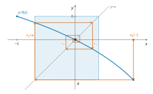
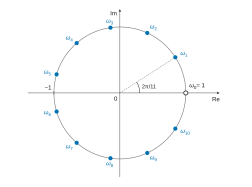

# e3a-Polytech PSI — Mathématiques 2026 · Corrigé brut

*Corrigé rédigé par IA, non officiel. Signalez toute erreur.*

Épreuve de 4 heures, calculatrices interdites. Quatre exercices indépendants.

## Exercice 1

Soit $n\ge 2$. On note $U={}^t(1,\dots,1)\in\mathcal M_{n,1}(\mathbb R)$. Pour $m=(x_1,\dots,x_n)$, on note $X={}^t(x_1,\dots,x_n)$ la colonne associée.

### Questions préliminaires

**1.** Soit $f$ de classe $\mathcal C^2$ sur $\mathbb R^n$ et $a\in\mathbb R^n$. Quand $h=(h_1,\dots,h_n)\to0$ :

$$\boxed{\begin{aligned}f(a+h)={}&f(a)+\sum_{i=1}^n\frac{\partial f}{\partial x_i}(a)\,h_i\\&+\frac12\sum_{i=1}^n\sum_{j=1}^n\frac{\partial^2 f}{\partial x_i\partial x_j}(a)\,h_ih_j+o\bigl(\lVert h\rVert^2\bigr)\end{aligned}}$$

Sous forme matricielle, avec $H$ la colonne de $h$ :

$$f(a+h)=f(a)+\langle\nabla f(a),h\rangle+\frac12\,{}^tH\,H_f(a)\,H+o\bigl(\lVert h\rVert^2\bigr).$$

**2.1.** On a $J=U\,{}^tU$. Toutes les colonnes de $J$ sont égales à $U\neq0$, donc $\operatorname{Im}J=\operatorname{Vect}(U)$ et

$$\boxed{\operatorname{rg}J=1.}$$

**2.2.** Par le théorème du rang, $\dim\ker J=n-1$, et $n-1\ge1$. Donc $J$ n'est pas injective : $0$ est valeur propre de $J$, et $\dim E_0(J)=n-1$.

La matrice $J$ est symétrique réelle, donc diagonalisable (théorème spectral). Pour une matrice diagonalisable, l'ordre de multiplicité de chaque valeur propre est égal à la dimension du sous-espace propre associé. **La valeur propre $0$ est d'ordre de multiplicité $n-1$.**

**2.3.** On a ${}^t(I_n+J)=I_n+{}^tJ=I_n+J$ : la matrice $I_n+J$ est symétrique réelle.

D'après 2.2, $J$ est diagonalisable et $0$ est valeur propre d'ordre $n-1$. Il reste une valeur propre $\mu$, simple. La trace est la somme des valeurs propres comptées avec multiplicité :

$$(n-1)\times0+\mu=\operatorname{tr}J=n.$$

Donc $\operatorname{Sp}J=\{0,n\}$. Soit $P$ inversible et $D$ diagonale telles que $J=PDP^{-1}$. Alors $I_n+J=P(I_n+D)P^{-1}$, donc

$$\operatorname{Sp}(I_n+J)=\{1,\ n+1\}\subset\mathbb R_+^*.$$

Une matrice symétrique réelle dont toutes les valeurs propres sont strictement positives est définie positive. **Donc $I_n+J$ est symétrique réelle définie positive.**

On peut aussi le vérifier directement. Pour $X\in\mathcal M_{n,1}(\mathbb R)$, comme ${}^tXJX=({}^tUX)^2$ :

$$\begin{aligned}{}^tX(I_n+J)X&=\sum_{k=1}^nx_k^2+\Bigl(\sum_{k=1}^nx_k\Bigr)^2\\&\ge\lVert X\rVert^2,\end{aligned}$$

et $\lVert X\rVert^2>0$ si $X\neq0$.

### Étude de $f$

**3.** Les applications coordonnées $m\mapsto x_k$ sont linéaires, donc de classe $\mathcal C^\infty$ sur $\mathbb R^n$.

La fonction $f$ s'obtient à partir d'elles par sommes et produits : c'est une fonction polynomiale des coordonnées. **$f$ est donc de classe $\mathcal C^\infty$, a fortiori $\mathcal C^2$, sur $\mathbb R^n$.**

On note $s=\sum_{k=1}^nx_k$. Ainsi $f(m)=\sum_kx_k^2+s^2-s$, et $\frac{\partial s}{\partial x_i}=1$ pour tout $i$.

**4.1.**

$$\boxed{\begin{aligned}\frac{\partial f}{\partial x_1}(m)&=2x_1+2s-1\\&=2x_1+2\sum_{k=1}^nx_k-1\end{aligned}}$$

**4.2.** Par symétrie des rôles, $\frac{\partial f}{\partial x_2}(m)=2x_2+2s-1$. En dérivant :

$$\boxed{\begin{aligned}\frac{\partial^2 f}{\partial x_2\partial x_1}(m)&=\frac{\partial}{\partial x_2}(2x_1+2s-1)=2\\\frac{\partial^2 f}{\partial x_1\partial x_2}(m)&=\frac{\partial}{\partial x_1}(2x_2+2s-1)=2\end{aligned}}$$

L'égalité était attendue par le théorème de Schwarz, $f$ étant $\mathcal C^2$.

**4.3.**

$$\boxed{\begin{aligned}\frac{\partial^2 f}{\partial x_1^2}(m)&=\frac{\partial}{\partial x_1}(2x_1+2s-1)\\&=4\end{aligned}}$$

**5.** Le même calcul donne $\frac{\partial f}{\partial x_i}(m)=2x_i+2s-1$ pour tout $i$. Comme $JX=sU$, le vecteur gradient est

$$\boxed{\begin{aligned}\nabla f(m)&=\bigl(2x_1+2s-1,\ \dots,\ 2x_n+2s-1\bigr)\\&=2X+(2s-1)U\\&=2(I_n+J)X-U\end{aligned}}$$

(en identifiant un vecteur de $\mathbb R^n$ et sa colonne).

**6.** Notons $\sigma=\sum_ka_k$. Le point $a$ est critique si et seulement si $2a_i+2\sigma-1=0$ pour tout $i$.

Alors $a_i=\frac{1-2\sigma}{2}$ ne dépend pas de $i$ : tous les $a_i$ valent un même réel $c$, et $\sigma=nc$.

L'équation devient $2c+2nc=1$, soit $c=\frac1{2(n+1)}$. Réciproquement, ce point annule le gradient, car $2c+2nc-1=0$. **Le seul point critique est**

$$\boxed{a=\Bigl(\frac1{2(n+1)},\dots,\frac1{2(n+1)}\Bigr).}$$

Variante : $\nabla f(m)=0$ équivaut à $(I_n+J)X=\frac12U$. C'est un système de Cramer, car $I_n+J$ est inversible d'après 2.3.

**7.1.** Pour tous $i,j$, $\frac{\partial^2 f}{\partial x_j\partial x_i}(m)=\frac{\partial}{\partial x_j}(2x_i+2s-1)=2\delta_{ij}+2$. Donc, pour tout $m$, la matrice hessienne est la matrice $n\times n$

$$\boxed{H_f(m)=\begin{pmatrix}4&2&\cdots&2\\2&4&\ddots&\vdots\\\vdots&\ddots&\ddots&2\\2&\cdots&2&4\end{pmatrix}=2(I_n+J).}$$

**7.2.** D'après 2.3, $\operatorname{Sp}J=\{0,n\}$, de multiplicités $n-1$ et $1$ ; on le confirme par $JU=U({}^tUU)=nU$. Si $JY=\mu Y$, alors $2(I_n+J)Y=2(1+\mu)Y$. Donc

$$\boxed{\operatorname{Sp}H_f(m)=\{2,\ 2(n+1)\}}$$

avec $2$ de multiplicité $n-1$ et $2(n+1)$ de multiplicité $1$.

**8.** La fonction $f$ est de classe $\mathcal C^2$ (question 3) et $a$ est un point critique (question 6). La hessienne $H_f(a)$ est symétrique réelle à valeurs propres strictement positives (question 7.2), donc définie positive. D'après la condition suffisante d'ordre 2 du programme, **$f$ admet en $a$ un minimum local strict.**

Ce minimum est même global. En effet $f(m)={}^tX(I_n+J)X-{}^tUX$. Notons $A$ la colonne de $a$ ; on a $2(I_n+J)A-U=\nabla f(a)=0$. Pour toute colonne $H$, par symétrie de $I_n+J$ :

$$\begin{aligned}f(a+h)&=f(a)+{}^tH\bigl(2(I_n+J)A-U\bigr)+{}^tH(I_n+J)H\\&=f(a)+{}^tH(I_n+J)H\\&\ge f(a),\end{aligned}$$

avec égalité si et seulement si $h=0$, d'après 2.3.

Valeur : avec $a_i=\frac1{2(n+1)}$ et $\sigma=\frac n{2(n+1)}$,

$$\begin{aligned}f(a)&=\frac n{4(n+1)^2}+\frac{n^2}{4(n+1)^2}-\frac n{2(n+1)}\\&=\frac n{4(n+1)}-\frac{2n}{4(n+1)}\\&=-\frac n{4(n+1)}.\end{aligned}$$

$$\boxed{f(a)=-\frac n{4(n+1)}}$$

**$f$ admet en $a$ un minimum (local, et même global strict), de valeur $-\frac n{4(n+1)}$.**

## Exercice 2

### 1. Étude de la suite $(v_n)_{n\in\mathbb N}$

**1.1.** Pour $x\in[-1,1]$, on a $1-\frac x2\in[\frac12,\frac32]$, donc $1-\frac x2>0$. Ainsi $f$ est définie et dérivable sur $[-1,1]$, et

$$f'(x)=\frac{-1/2}{1-x/2}=-\frac1{2-x}<0.$$

| $x$ | $-1$ | | $1$ |
|---|---|---|---|
| $f'(x)$ | | $-$ | |
| $f(x)$ | $\ln\frac32$ | $\searrow$ | $-\ln2$ |

$f$ est continue et strictement décroissante, donc $f([-1,1])=[f(1),f(-1)]$ :

$$\boxed{\begin{aligned}a&=-\ln2\\b&=\ln\frac32\end{aligned}}$$

**1.2.** On a $e>2$, car $e^x>1+x$ pour $x\neq0$. La fonction $\ln$ est strictement croissante et $1<\frac32<2<e$, donc

$$0<\ln\frac32<\ln2<\ln e=1.$$

Par suite $-1<-\ln2=a<0$ et $0<b<1$. **Ainsi $[a,b]\subset\,]-1,1[$.**

**1.3.** Comme $[a,b]\subset[-1,1]$, on a $f([a,b])\subset f([-1,1])=[a,b]$ : le segment $[a,b]$ est stable par $f$. Récurrence sur $n\ge1$ :
- $v_0\in[-1,1]$, donc $1-\frac{v_0}2>0$ : $v_1=f(v_0)$ est défini, et $v_1\in f([-1,1])=[a,b]$ ;
- si $v_n$ est défini et $v_n\in[a,b]$, alors $v_n\in[-1,1]$, donc $v_{n+1}=f(v_n)$ est défini et $v_{n+1}\in f([a,b])\subset[a,b]$.

**Pour tout $n\in\mathbb N^*$, $v_n$ est bien défini et $v_n\in[a,b]$.**

**1.4.** Sur $[a,b]$, $|f'(x)|=\frac1{2-x}$. Pour $x\le b$, on a $2-x\ge2-b>0$, donc $\frac1{2-x}\le\frac1{2-b}$. Ainsi

$$\boxed{\forall x\in[a,b],\quad |f'(x)|\le k}$$

où

$$\boxed{k=\frac1{2-\ln\frac32}.}$$

Comme $0<b<1$, on a $1<2-b<2$, donc $k\in\,]\frac12,1[\subset\,]0,1[$.

**1.5.** On a $f(0)=0$ et $0\in[a,b]$.

Soit $n\ge2$ : $v_{n-1}\in[a,b]$ (question 1.3), donc le segment d'extrémités $0$ et $v_{n-1}$ est inclus dans $[a,b]$.

La fonction $f$ y est dérivable avec $|f'|\le k$. L'inégalité des accroissements finis donne $|f(v_{n-1})-f(0)|\le k|v_{n-1}-0|$, soit

$$\boxed{\forall n\ge2,\quad |v_n|\le k\,|v_{n-1}|.}$$

**1.6.** Par récurrence, $|v_n|\le k^{n-1}|v_1|$ pour tout $n\ge1$. Comme $0<k<1$, $k^{n-1}\to0$, donc par encadrement

$$\boxed{(v_n) \text{ converge et } \lim_{n\to+\infty}v_n=0.}$$

### 2. Étude d'une série de fonctions

**2.** Pour $x\in[-1,1]$ fixé, $(u_n(x))_n$ est la suite $(v_n)$ de la partie 1 avec $v_0=x$. Elle est donc bien définie. Les questions 1.3 à 1.6 donnent, pour tout $x\in[-1,1]$ et tout $n\ge1$ :

$$\begin{aligned}|u_n(x)|&\le k^{n-1}|u_1(x)|\\&\le k^{n-1}\max(|a|,|b|)\\&=k^{n-1}\ln2.\end{aligned}$$

En effet $u_1(x)=f(x)\in[a,b]$, et $|a|=\ln2>\ln\frac32=|b|$. La constante $k$ ne dépend pas de $x$, donc

$$\lVert u_n\rVert_{\infty,[-1,1]}\le k^{n-1}\ln 2.$$

C'est le terme général d'une série géométrique convergente, car $0<k<1$. La série $\sum_{n\ge1}u_n$ converge normalement sur $[-1,1]$, donc

$$\boxed{\sum_{n\ge1}u_n \text{ converge uniformément sur } [-1,1].}$$

## Exercice 3

Soit $n\ge3$, $E_n=\mathbb R_n[X]$, $P_k=X^k$.

**1.** La dérivation et la multiplication par un polynôme fixé sont linéaires, donc $\Phi$ est linéaire.

Soit $P\in E_n$, c'est-à-dire $\deg P\le n$ (le polynôme nul compris).

Alors $\deg\bigl((X^2-1)P\bigr)\le n+2$, et sa dérivée seconde $\Phi(P)$ est de degré au plus $n$ : $\Phi(P)\in E_n$. **$\Phi$ est un endomorphisme de $E_n$.**

**2.** On a $P_k'=kX^{k-1}$ et $P_k''=k(k-1)X^{k-2}$ (nuls si $k<1$, resp. $k<2$). Donc

$$\begin{aligned}\Phi(P_k)&=k(k-1)X^k-k(k-1)X^{k-2}+4kX^k+2X^k\\&=(k^2+3k+2)X^k-k(k-1)X^{k-2},\end{aligned}$$

$$\boxed{\Phi(P_k)=(k+1)(k+2)P_k-k(k-1)P_{k-2}}$$

le second terme étant nul pour $k\in\{0,1\}$. Ainsi $\Phi(P_0)=2P_0$, $\Phi(P_1)=6P_1$ et $\Phi(P_2)=12P_2-2P_0$.

**3.** Numérotons lignes et colonnes de $1$ à $n+1$ : la colonne $j$ porte les coordonnées de $\Phi(P_{j-1})$ dans $\mathcal B$. Les trois premières colonnes sont

$$C_1=\begin{pmatrix}2\\0\\0\\0\\\vdots\\0\end{pmatrix},\quad C_2=\begin{pmatrix}0\\6\\0\\0\\\vdots\\0\end{pmatrix},\quad C_3=\begin{pmatrix}-2\\0\\12\\0\\\vdots\\0\end{pmatrix}.$$

Pour $j\in[\![3,n+1]\!]$, la question 2 donne

$$\Phi(P_{j-1})=j(j+1)P_{j-1}-(j-1)(j-2)P_{j-3}.$$

La $j$-ième colonne a donc pour seuls coefficients non nuls

$$\boxed{\begin{aligned}M_{j-2,\,j}&=-(j-1)(j-2)\\M_{j,\,j}&=j(j+1)\end{aligned}}$$

Ainsi $M$ est triangulaire supérieure, de diagonale $(2,6,12,\dots,(n+1)(n+2))$. Sa seule autre diagonale non nulle est la deuxième sur-diagonale.

**4.** $M$ est triangulaire supérieure, donc $\chi_\Phi=\prod_{k=0}^n\bigl(X-(k+1)(k+2)\bigr)$.

Les valeurs propres de $\Phi$ sont les coefficients diagonaux $\lambda_k=(k+1)(k+2)$, $k\in[\![0,n]\!]$. La suite $k\mapsto(k+1)(k+2)$ est strictement croissante sur $\mathbb N$ : ces $n+1$ valeurs sont deux à deux distinctes, et

$$\boxed{\begin{aligned}&\lambda_k=(k+1)(k+2),\quad k\in[\![0,n]\!]\\&\lambda_0=2<\lambda_1=6<\cdots<\lambda_n\end{aligned}}$$

**5.** Tous les $\lambda_k$ sont $\ge2$, donc $0\notin\operatorname{Sp}\Phi$ et $\ker\Phi=\{0\}$.

En dimension finie, un endomorphisme injectif est bijectif. **Oui, $\Phi$ est un automorphisme de $E_n$.** De manière équivalente, $\det M=\prod_k\lambda_k\neq0$.

**6.** $\Phi$ admet $n+1=\dim E_n$ valeurs propres distinctes, donc **$\Phi$ est diagonalisable**.

La somme des dimensions des $n+1$ sous-espaces propres vaut $n+1$ et chacune est $\ge1$. **Chaque sous-espace propre $E_{\lambda_k}(\Phi)$ est de dimension 1.**

**7.1.** Soit $P\neq0$ de degré $d$ et de coefficient dominant $c$.

Les termes de degré $d$ de $\Phi(P)$ proviennent de $X^2P''$, $4XP'$ et $2P$. Leur coefficient vaut

$$c\bigl(d(d-1)+4d+2\bigr)=c(d+1)(d+2).$$

Soit $T$ vecteur propre pour $\lambda_k$, de degré $d$ et de coefficient dominant $c\neq0$. On identifie les coefficients de $X^d$ dans $\Phi(T)=\lambda_kT$ :

$$\begin{aligned}c(d+1)(d+2)&=\lambda_kc,\\(d+1)(d+2)&=(k+1)(k+2).\end{aligned}$$

Par stricte croissance de $x\mapsto(x+1)(x+2)$ sur $\mathbb N$, $d=k$ :

$$\boxed{\deg T=k.}$$

**7.2.** Pour $R\in E_n$, notons $\widetilde R(X)=R(-X)$. Alors $\widetilde R'(X)=-R'(-X)$ et $\widetilde R''(X)=R''(-X)$, d'où

$$\begin{aligned}\Phi(\widetilde R)(X)&=(X^2-1)R''(-X)-4XR'(-X)+2R(-X)\\&=\Phi(R)(-X).\end{aligned}$$

Avec $R=T$, on obtient

$$\begin{aligned}\Phi(Q)(X)&=\Phi(T)(-X)\\&=\lambda_kT(-X)\\&=\lambda_kQ(X).\end{aligned}$$

De plus $Q\neq0$ car $T\neq0$. **$Q$ est un vecteur propre de $\Phi$ associé à $\lambda_k$.**

**8.** *Existence.* Soit $k\in[\![0,n]\!]$ et $T$ un vecteur directeur de la droite $E_{\lambda_k}(\Phi)$. Par 7.1, $\deg T=k$ ; notons $c\neq0$ son coefficient dominant.

On pose $Q_k=\frac1cT$ : c'est un vecteur propre unitaire de degré $k$.

Par 7.2, $Q_k(-X)\in E_{\lambda_k}(\Phi)=\operatorname{Vect}(Q_k)$, donc $Q_k(-X)=\mu Q_k(X)$. Les coefficients de $X^k$ donnent $\mu=(-1)^k$. Ainsi $Q_k(-X)=(-1)^kQ_k(X)$.

La famille $(Q_0,\dots,Q_n)$ est échelonnée en degrés, donc libre. Elle compte $n+1=\dim E_n$ vecteurs : c'est une base de $E_n$ formée de vecteurs propres.

*Unicité.* Soit $(R_0,\dots,R_n)$ une base ayant les mêmes propriétés. $R_k$ est un vecteur propre, associé à un certain $\lambda_m$.

Par 7.1, $m=\deg R_k=k$, donc $R_k\in E_{\lambda_k}(\Phi)=\operatorname{Vect}(Q_k)$, soit $R_k=\alpha Q_k$. Les deux étant unitaires de degré $k$, $\alpha=1$.

**Il existe une unique base $\mathcal U=(Q_0,\dots,Q_n)$ ayant les propriétés demandées.**

**9.** On a $Q_k(-X)=(-1)^kQ_k(X)$ : **$Q_k$ est pair si $k$ est pair, impair si $k$ est impair.** Il ne comporte que des monômes de même parité que $k$.

**10.** $(Q_0,\dots,Q_k)$ est une sous-famille de la base $\mathcal U$, donc libre. Pour $i\le k$, $\deg Q_i=i\le k$, donc ses éléments sont dans $\mathbb R_k[X]$.

C'est une famille libre de $k+1$ vecteurs dans un espace de dimension $k+1$. **$(Q_0,\dots,Q_k)$ est une base de $\mathbb R_k[X]$.**

**11.** $\Phi(1)=2$ et $\Phi(X)=6X$ donnent $Q_0=1$ et $Q_1=X$.

Par 9, $Q_2=X^2+c$. Alors $\Phi(Q_2)=12X^2-2+2c$ doit valoir $12X^2+12c$, d'où $c=-\frac15$.

De même, $Q_3=X^3+cX$. Alors $\Phi(Q_3)=20X^3-6X+6cX$ doit valoir $20X^3+20cX$, d'où $c=-\frac37$.

$$\boxed{\begin{aligned}Q_0&=1\\Q_1&=X\\Q_2&=X^2-\frac15\\Q_3&=X^3-\frac37X\end{aligned}}$$

**12.** Pour $P,Q\in E_n$, la fonction $t\mapsto(1-t^2)P(t)Q(t)$ est continue sur le segment $[-1,1]$, donc l'intégrale existe.
- Symétrie : immédiate.
- Bilinéarité : linéarité à gauche par linéarité de l'intégrale, puis symétrie.
- Positivité : $(P|P)=\int_{-1}^1(1-t^2)P(t)^2\,dt\ge0$, car l'intégrande est positive sur $[-1,1]$.
- Caractère défini : supposons $(P|P)=0$. La fonction $t\mapsto(1-t^2)P(t)^2$ est **continue**, **positive** et d'intégrale nulle sur $[-1,1]$.
- Elle est donc nulle sur $[-1,1]$. Pour $t\in\,]-1,1[$, $1-t^2>0$, donc $P(t)=0$.
- Ainsi $P$ a une infinité de racines : $P=0$.

**$(\cdot|\cdot)$ est un produit scalaire sur $E_n$.**

**13.1.** Soient $P,Q\in E_n$. Posons $g=(X^2-1)P$, de sorte que $\Phi(P)=g''$, et $h=\bigl((1-t^2)Q\bigr)'$. Ces fonctions sont polynomiales, donc $\mathcal C^\infty$, et l'on peut intégrer par parties :

$$\begin{aligned}(\Phi(P)|Q)&=\int_{-1}^1g''(t)(1-t^2)Q(t)\,dt\\&=\Bigl[g'(t)(1-t^2)Q(t)\Bigr]_{-1}^1-\int_{-1}^1g'(t)h(t)\,dt\\&=-\int_{-1}^1g'(t)h(t)\,dt,\end{aligned}$$

car $1-t^2$ s'annule en $\pm1$. Puis, comme $g(\pm1)=0$ :

$$\begin{aligned}-\int_{-1}^1g'h&=-\Bigl[g(t)h(t)\Bigr]_{-1}^1+\int_{-1}^1g(t)h'(t)\,dt\\&=\int_{-1}^1(t^2-1)P(t)\bigl((1-t^2)Q\bigr)''(t)\,dt.\end{aligned}$$

Enfin, en changeant deux fois de signe :

$$\begin{aligned}(t^2-1)\bigl((1-t^2)Q\bigr)''&=(1-t^2)\bigl((t^2-1)Q\bigr)''\\&=(1-t^2)\Phi(Q)(t).\end{aligned}$$

Donc

$$\boxed{(\Phi(P)|Q)=\int_{-1}^1(1-t^2)P(t)\Phi(Q)(t)\,dt=(P|\Phi(Q)).}$$

**$\Phi$ est un endomorphisme symétrique de $(E_n,(\cdot|\cdot))$.**

**13.2.** Soient $i\neq j$. D'une part $(\Phi(Q_i)|Q_j)=\lambda_i(Q_i|Q_j)$. D'autre part, par 13.1, $(\Phi(Q_i)|Q_j)=(Q_i|\Phi(Q_j))=\lambda_j(Q_i|Q_j)$.

Donc $(\lambda_i-\lambda_j)(Q_i|Q_j)=0$. Les valeurs propres étant distinctes (question 4), $(Q_i|Q_j)=0$. **La base $\mathcal U$ est orthogonale.**

**14.** Soit $j\in[\![1,n]\!]$ et $S\in\mathbb R_{j-1}[X]$. Par 10 (avec $k=j-1$), $S=\sum_{i=0}^{j-1}\alpha_iQ_i$. Par linéarité, et par 13.2 puisque $i\neq j$ :

$$\begin{aligned}(S|Q_j)&=\sum_{i=0}^{j-1}\alpha_i(Q_i|Q_j)\\&=0.\end{aligned}$$

$$\boxed{\forall S\in\mathbb R_{j-1}[X],\quad (S|Q_j)=0.}$$

## Exercice 4

### Questions préliminaires

**1.** Soit $P\in\mathbb R[X]$ de degré impair $d$, de coefficient dominant $c$. Quitte à remplacer $P$ par $-P$, qui a les mêmes racines, $c>0$.

Alors $P(x)\sim cx^{d}$ en $\pm\infty$.

Comme $d$ est impair, $P(x)\to+\infty$ en $+\infty$ et $P(x)\to-\infty$ en $-\infty$.

Il existe donc $A>0$ tel que $P(-A)<0<P(A)$. La fonction $P$ est continue : le théorème des valeurs intermédiaires fournit $x_0\in\,]-A,A[$ tel que $P(x_0)=0$. **Tout polynôme réel de degré impair a au moins une racine réelle.**

**2.** Soit $z=re^{i\theta}$ avec $r>0$ ($0$ n'est pas racine). Alors

$$\begin{aligned}z^{11}=1&\iff r^{11}=1\ \text{ et }\ 11\theta\equiv0\ [2\pi]\\&\iff r=1\ \text{ et }\ \theta\equiv\frac{2k\pi}{11}\ [2\pi],\ k\in\mathbb Z.\end{aligned}$$

Les nombres $\omega_k=e^{2ik\pi/11}$, $k\in[\![0,10]\!]$, ont des arguments distincts dans $[0,2\pi[$, donc sont distincts. Ce sont onze racines d'un polynôme de degré 11, donc toutes :

$$\boxed{X^{11}-1=\prod_{k=0}^{10}(X-\omega_k)}$$

où

$$\boxed{\omega_k=e^{2ik\pi/11},\quad k\in[\![0,10]\!].}$$

**3.** On a

$$X^{11}-1=(X-1)\sum_{k=0}^{10}X^k.$$

Pour $k\in[\![1,10]\!]$, $\omega_k^{11}=1$ et $\omega_k\neq1$, donc $\omega_k$ est racine de $\sum_{k=0}^{10}X^k$. 

Ce sont dix racines distinctes d'un polynôme de degré 10, donc toutes ; et $1$ n'en est pas racine, la somme valant $11$ en $1$.

**Les racines de $\sum_{k=0}^{10}X^k$ sont les $\omega_k=e^{2ik\pi/11}$, $k\in[\![1,10]\!]$** (dix racines simples).

Aucune n'est réelle. En effet, $\omega_k\in\mathbb R$ équivaut à $\sin\frac{2k\pi}{11}=0$, c'est-à-dire à $11\mid 2k$.

Pour $1\le k\le10$, l'entier $2k$ est pair et compris entre 2 et 20. Le seul multiple de 11 de cet intervalle est 11, qui est impair.

Donc $11\nmid 2k$.

### Le problème des dés

**4.** Chaque face a une probabilité non nulle, donc $U(\Omega)=V(\Omega)=[\![1,6]\!]$, et $S(\Omega)\subset[\![2,12]\!]$. Réciproquement, soit $s\in[\![2,12]\!]$ et $i=\max(1,s-6)$. Alors $i\in[\![1,6]\!]$ et $s-i\in[\![1,6]\!]$. Par indépendance :

$$\begin{aligned}\mathbb P(S=s)&\ge\mathbb P(U=i,\ V=s-i)\\&=\mathbb P(U=i)\,\mathbb P(V=s-i)\\&>0.\end{aligned}$$

$$\boxed{\begin{aligned}U(\Omega)&=V(\Omega)=[\![1,6]\!]\\S(\Omega)&=[\![2,12]\!]\end{aligned}}$$

**5.** $S$ est à valeurs dans un ensemble fini. Donc $G_S(t)=\mathbb E(t^S)=\sum_{s=2}^{12}\mathbb P(S=s)t^s$ est définie sur $\mathbb R$ : c'est une fonction polynomiale. Si $S$ suit la loi uniforme sur $S(\Omega)=[\![2,12]\!]$, qui compte 11 valeurs, alors $\mathbb P(S=s)=\frac1{11}$ et

$$\boxed{\begin{aligned}G_S(t)&=\frac1{11}\sum_{s=2}^{12}t^s\\&=\frac{t^2}{11}\sum_{k=0}^{10}t^k\end{aligned}}$$

**6.** D'après 5 et la question 3 :

$$\boxed{\text{racines de }G_S:\ 0\ \text{(double) et } e^{2ik\pi/11},\ k\in[\![1,10]\!]\ \text{(simples)}.}$$

La seule racine réelle de $G_S$ est $0$.

**7.** Notons $p_k=\mathbb P(U=k)>0$ et $q_k=\mathbb P(V=k)>0$, pour $k\in[\![1,6]\!]$. Alors $G_U(t)=\sum_{k=1}^6p_kt^k=t\,Q(t)$ et $G_V(t)=t\,R(t)$, avec

$$\boxed{\begin{aligned}Q&=\sum_{k=1}^6p_kX^{k-1}=p_1+p_2X+\cdots+p_6X^5\\R&=\sum_{k=1}^6q_kX^{k-1}=q_1+q_2X+\cdots+q_6X^5\end{aligned}}$$

**8.** Le coefficient de $X^5$ dans $Q$ est $p_6>0$ : $Q$ est de degré 5, impair.

D'après la question préliminaire 1, $Q$ a une racine réelle. De même pour $R$, car $q_6>0$. **$Q$ et $R$ possèdent chacun au moins une racine réelle.**

**9.** $U$ et $V$ sont **indépendantes** et à valeurs dans $\mathbb N$, donc $G_{U+V}=G_UG_V$ là où les deux sont définies, ici sur $\mathbb R$. Avec 7 :

$$\boxed{\forall t\in\mathbb R,\quad G_S(t)=t^2\,Q(t)\,R(t).}$$

**10.** Supposons $S$ uniforme. Soit $r$ une racine réelle de $Q$ (question 8).

Par 9, $G_S(r)=r^2Q(r)R(r)=0$ : $r$ est une racine réelle de $G_S$, donc $r=0$ par 6.

Alors $Q(0)=0$, alors que $Q(0)=p_1=\mathbb P(U=1)>0$ : contradiction. **La supposition encadrée est fausse : $S$ ne suit pas une loi uniforme.**

**11.** Les questions 4 à 10 valent pour toutes les lois de $U$ et $V$ dont chaque face a une probabilité non nulle. **Non : il est impossible de truquer deux dés à six faces (chaque face ayant une probabilité non nulle) de sorte que la somme des résultats suive une loi uniforme.**

FIN
