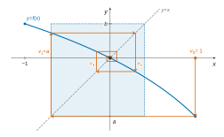
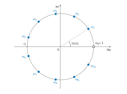

# e3a-Polytech PSI — Mathématiques 2026 · Corrigé guidé

*Corrigé rédigé par IA, non officiel. Signalez toute erreur.*

## Présentation du sujet

**Format.** 4 heures, calculatrices interdites, quatre exercices indépendants, 47 questions. Aucune donnée numérique : les seules « applications numériques » sont des comparaisons comme $\ln2<1$, à justifier à la main.

**Les quatre exercices.**

| Exercice | Thème | Questions | Notions du programme PSI mobilisées |
|---|---|---|---|
| 1 | Extremum d'une fonction de $n$ variables | 13 | Taylor-Young à l'ordre 2, gradient, hessienne, matrice $J$ de rang 1, théorème spectral, matrices symétriques définies positives, condition suffisante d'ordre 2 |
| 2 | Suite récurrente $v_{n+1}=\ln(1-\frac12v_n)$ et série de fonctions | 7 | Variations, intervalle stable, inégalité des accroissements finis, convergence géométrique, convergence normale |
| 3 | L'endomorphisme $\Phi(P)=((X^2-1)P)''$ et des polynômes orthogonaux | 16 | Matrice d'un endomorphisme, matrices triangulaires, diagonalisabilité, degré, parité, produit scalaire intégral, intégration par parties, endomorphismes symétriques |
| 4 | Peut-on truquer deux dés pour que la somme soit uniforme ? | 11 | Racines de l'unité, TVI, fonctions génératrices, indépendance |

**Difficulté.** Le sujet est très proche du cours. Les difficultés sont la rigueur des justifications et l'enchaînement des questions. Dans l'exercice 3, une erreur sur $\Phi(P_k)$ fausse tout ce qui suit.

**Ce qu'en dit le jury (rapport 2026).** Moyenne 5,95, écart type 2,78, sur 2801 copies. Le jury rappelle que les questions préliminaires servent à la suite et que « une affirmation sans démonstration n'a aucune valeur ». Il signale des lacunes importantes en algèbre linéaire : rang de $J$, matrice d'un endomorphisme, confusion entre multiplicité et dimension du sous-espace propre. Beaucoup de candidats calculent aussi avec $n=2$ alors que $n$ est quelconque. Il annonce enfin des points de barème pour la présentation.

**Questions discriminantes.** D'après le rapport 2026, sont rarement traitées ou rarement réussies : Ex. 1 Q2.3 et Q8, Ex. 2 Q1.2, Q1.4 et Q2, Ex. 3 Q5, Q7.1, Q8, Q10, Q12 et Q13.2, Ex. 4 Q1 et Q3. Ce sont des questions de cours ou des applications directes : une copie qui les rédige proprement se détache.

**Questions à ne pas laisser passer.** Tout l'exercice 1, les questions 1.1 à 1.6 de l'exercice 2, les questions 1 à 6 et 11 de l'exercice 3, les préliminaires et les questions 4 à 9 de l'exercice 4.

**Gestion du temps.** Une répartition raisonnable : 45 min pour l'exercice 1, 40 min pour le 2, 1 h 30 pour le 3 (le plus long), 45 min pour le 4. Le reste sert à relire. Les exercices étant indépendants, on peut commencer par celui où l'on se sent le plus à l'aise, en gardant la numérotation du sujet.

## Exercice 1 — Extremum d'une fonction quadratique

L'exercice étudie $f(m)=\sum x_k^2+\bigl(\sum x_k\bigr)^2-\sum x_k$. Les préliminaires établissent les propriétés de $J$ et de $I_n+J$. La suite calcule gradient et hessienne, et la hessienne se révèle égale à $2(I_n+J)$.

Notations : $U={}^t(1,\dots,1)$, $X={}^t(x_1,\dots,x_n)$ et $s=\sum_kx_k$.

### Question 1

> [!INDICATION]
> Question de cours : on attend une formule, sans démonstration. Pensez au terme d'ordre 1 (gradient), au terme d'ordre 2 (hessienne) et à la nature du reste.

#### Solution

Si $f$ est de classe $\mathcal C^2$ sur $\mathbb R^n$ et $a\in\mathbb R^n$, alors, quand $h\to0$ :

$$\begin{aligned}f(a+h)={}&f(a)+\sum_{i=1}^n\frac{\partial f}{\partial x_i}(a)\,h_i\\&+\frac12\sum_{i=1}^n\sum_{j=1}^n\frac{\partial^2 f}{\partial x_i\partial x_j}(a)\,h_ih_j+o\bigl(\lVert h\rVert^2\bigr).\end{aligned}$$

En notant $H$ la colonne de $h$ :

$$f(a+h)=f(a)+\langle\nabla f(a),h\rangle+\frac12\,{}^tH\,H_f(a)\,H+o\bigl(\lVert h\rVert^2\bigr).$$

> [!PIEGE]
> La plupart des copies écrivent la formule de Taylor d'une fonction d'**une** variable, ou ne gardent que les dérivées $\frac{\partial^2 f}{\partial x_i^2}$ en oubliant les termes croisés. Le facteur $\frac12$ et le reste $o(\lVert h\rVert^2)$ font partie de la réponse.

> [!JURY]
> Rapport 2026 (p. 4) : la formule pour une fonction de $\mathbb R^n$ dans $\mathbb R$, « bien que ce soit une question de cours, est très rarement citée ».

### Question 2.1

> [!INDICATION]
> Regardez les colonnes de $J$.

> [!INDICATION]
> On peut écrire $J$ comme le produit d'une colonne par une ligne.

#### Solution

Toutes les colonnes de $J$ sont égales à $U\neq0$. Donc $\operatorname{Im}J=\operatorname{Vect}(U)$, et $\operatorname{rg}J=1$.

On note au passage que $J=U\,{}^tU$, qui servira plus loin.

> [!PIEGE]
> Le rapport 2026 relève des rangs $n$ ou $0$. Une matrice non nulle a un rang au moins $1$ ; ici l'image est une droite.
>
> Ne pas confondre non plus $U\,{}^tU$ (matrice $n\times n$, c'est $J$) et ${}^tU\,U$ (scalaire égal à $n$).

### Question 2.2

> [!INDICATION]
> Le noyau de $J$ est non trivial : pourquoi ? Sa dimension se lit avec le théorème du rang.

> [!INDICATION]
> La dimension du sous-espace propre ne donne la multiplicité que si l'on sait que $J$ est diagonalisable. Quel théorème le garantit ici ?

#### Solution

Par le théorème du rang, $\dim\ker J=n-\operatorname{rg}J=n-1$, et $n-1\ge1$. Donc $J$ n'est pas injective et $0\in\operatorname{Sp}J$. Le sous-espace propre $E_0(J)=\ker J$ est de dimension $n-1$.

$J$ est symétrique réelle, donc diagonalisable (théorème spectral). Pour une matrice diagonalisable, l'ordre de multiplicité de chaque valeur propre est égal à la dimension du sous-espace propre. **L'ordre de multiplicité de $0$ est $n-1$.**

> [!METHODE]
> Multiplicité et dimension du sous-espace propre coïncident pour une matrice diagonalisable. En général, on a seulement $1\le\dim E_\lambda\le m_\lambda$ : il faut donc citer l'argument de diagonalisabilité.

> [!PIEGE]
> Le rapport 2026 (p. 4) constate que la plupart des candidats confondent ordre de multiplicité et dimension du sous-espace propre. Il note aussi qu'après avoir trouvé le rang 1, beaucoup redémontrent que $0$ est valeur propre par le polynôme caractéristique : le rang suffit. Enfin, $J0=0$ ne prouve rien, un vecteur propre étant non nul.

### Question 2.3

> [!INDICATION]
> « Démontrer alors » : servez-vous de 2.2. Il manque une valeur propre de $J$ ; la trace la donne.

> [!INDICATION]
> Si $J=PDP^{-1}$, que vaut $I_n+J$ dans la même base ? Quel critère relie spectre et caractère défini positif pour une matrice symétrique réelle ?

#### Solution

$I_n$ et $J$ sont symétriques, donc $I_n+J$ aussi.

D'après 2.2, $J$ est diagonalisable et $0$ est valeur propre d'ordre $n-1$. Il reste une valeur propre $\mu$, simple. La trace est la somme des valeurs propres comptées avec multiplicité :

$$(n-1)\times0+\mu=\operatorname{tr}J=n.$$

Donc $\operatorname{Sp}J=\{0,n\}$. Si $J=PDP^{-1}$ avec $D$ diagonale, alors $I_n+J=P(I_n+D)P^{-1}$, d'où

$$\operatorname{Sp}(I_n+J)=\{1,\ n+1\}\subset\mathbb R_+^*.$$

Une matrice symétrique réelle à valeurs propres strictement positives est définie positive. **$I_n+J$ est symétrique réelle définie positive.**

Vérification directe : pour $X\in\mathcal M_{n,1}(\mathbb R)$, on a ${}^tXJX=({}^tUX)^2$, donc

$$\begin{aligned}{}^tX(I_n+J)X&=\sum_{k=1}^nx_k^2+\Bigl(\sum_{k=1}^nx_k\Bigr)^2\\&\ge\lVert X\rVert^2,\end{aligned}$$

et $\lVert X\rVert^2>0$ pour $X\neq0$.

> [!PIEGE]
> Des coefficients tous positifs ne suffisent pas : $\begin{pmatrix}1&2\\2&1\end{pmatrix}$ est symétrique à coefficients positifs, mais a pour valeur propre $-1$. Diagonalisable ne veut pas dire défini positif non plus.

> [!JURY]
> Rapport 2026 (p. 5) : « Question très mal traitée : rappelons qu'une matrice symétrique réelle dont tous les coefficients sont positifs n'est pas forcément définie positive. » Le jury regrette aussi que peu de candidats passent des valeurs propres de $J$ à celles de $I_n+J$, et rappelle que $n\ge2$ ne signifie pas $n=2$.

### Question 3

> [!INDICATION]
> $f$ est construite à partir des fonctions coordonnées par sommes et produits.

#### Solution

Les applications coordonnées $m\mapsto x_k$ sont linéaires, donc de classe $\mathcal C^\infty$.

$f$ est une fonction polynomiale de ces coordonnées (sommes et produits). **$f$ est de classe $\mathcal C^\infty$, donc $\mathcal C^2$, sur $\mathbb R^n$.**

> [!JURY]
> Le rapport 2026 (p. 5) juge que très peu de copies donnent une justification correcte. Une phrase suffit, mais elle doit nommer les fonctions de base (les coordonnées) et les opérations qui conservent le caractère $\mathcal C^2$.

### Question 4.1

> [!INDICATION]
> Notez $s=\sum x_k$ et n'oubliez pas que $s$ dépend de $x_1$.

#### Solution

On a $f=\sum_kx_k^2+s^2-s$ et $\frac{\partial s}{\partial x_1}=1$, donc

$$\begin{aligned}\frac{\partial f}{\partial x_1}(m)&=2x_1+2s-1\\&=2x_1+2\sum_{k=1}^nx_k-1.\end{aligned}$$

> [!PIEGE]
> Le terme $s^2$ se dérive en $2s\,\frac{\partial s}{\partial x_1}=2s$ : il ne disparaît pas.

### Question 4.2

> [!INDICATION]
> Dérivez le résultat de 4.1 par rapport à $x_2$, et l'expression analogue de $\frac{\partial f}{\partial x_2}$ par rapport à $x_1$.

#### Solution

Le même calcul donne $\frac{\partial f}{\partial x_2}(m)=2x_2+2s-1$. Donc

$$\begin{aligned}\frac{\partial^2 f}{\partial x_2\partial x_1}(m)&=\frac{\partial}{\partial x_2}(2x_1+2s-1)=2,\\\frac{\partial^2 f}{\partial x_1\partial x_2}(m)&=\frac{\partial}{\partial x_1}(2x_2+2s-1)=2.\end{aligned}$$

Les deux dérivées croisées sont égales, comme l'annonce le théorème de Schwarz ($f$ est $\mathcal C^2$).

### Question 4.3

> [!INDICATION]
> Même calcul, en dérivant par rapport à $x_1$ : deux termes de $\frac{\partial f}{\partial x_1}$ dépendent de $x_1$.

#### Solution

$$\begin{aligned}\frac{\partial^2 f}{\partial x_1^2}(m)&=\frac{\partial}{\partial x_1}(2x_1+2s-1)\\&=2+2=4.\end{aligned}$$

> [!JURY]
> Le rapport 2026 (p. 6) indique que les questions 4.1 à 4.3 sont la plupart du temps bien traitées : ce sont des points à ne pas perdre.

### Question 5

> [!INDICATION]
> Généralisez 4.1 à un indice $i$ quelconque. Le gradient est un **vecteur** de $\mathbb R^n$ : écrivez ses $n$ coordonnées, puis exprimez-le avec $U$ et $I_n+J$.

#### Solution

Pour tout $i$, $\frac{\partial f}{\partial x_i}(m)=2x_i+2s-1$. Comme $JX=sU$ :

$$\begin{aligned}\nabla f(m)&=\bigl(2x_1+2s-1,\ \dots,\ 2x_n+2s-1\bigr)\\&=2X+(2s-1)U\\&=2(I_n+J)X-U.\end{aligned}$$

> [!PIEGE]
> Le gradient n'est pas la somme $\sum_i\frac{\partial f}{\partial x_i}(m)$, qui est un réel : c'est le vecteur des dérivées partielles. Le rapport 2026 (p. 6) s'étonne de cette erreur très répandue, et note qu'elle fausse ensuite le calcul du point critique (question 6).

### Question 6

> [!INDICATION]
> Écrivez les $n$ équations $\frac{\partial f}{\partial x_i}(a)=0$ : que remarquez-vous sur $a_i$ en fonction de $i$ ?

> [!INDICATION]
> Une fois tous les $a_i$ égaux à un même $c$, il reste une équation à une inconnue. Ou bien : le système s'écrit $(I_n+J)A=\frac12U$, et la question 2.3 dit quelque chose de $I_n+J$.

#### Solution

Notons $\sigma=\sum a_k$. Le point $a$ est critique si et seulement si $2a_i+2\sigma-1=0$ pour tout $i$.

Alors $a_i=\frac{1-2\sigma}2$ ne dépend pas de $i$ : tous les $a_i$ sont égaux à un réel $c$, et $\sigma=nc$.

L'équation devient $2c+2nc=1$, d'où $c=\frac1{2(n+1)}$.

Réciproquement, ce point annule bien le gradient. **Le seul point critique est**

$$a=\Bigl(\frac1{2(n+1)},\dots,\frac1{2(n+1)}\Bigr).$$

> [!METHODE]
> Variante matricielle : $\nabla f(m)=0$ équivaut à $(I_n+J)X=\frac12U$. La matrice $I_n+J$ est définie positive, donc inversible : il y a une unique solution. Comme $JU=nU$, on vérifie que $A=\frac1{2(n+1)}U$ convient.

> [!PIEGE]
> Deviner $a_i=\frac1{2(n+1)}$ et vérifier ne montre que l'existence. Pour l'unicité, il faut montrer que toute solution a ses coordonnées égales, ou invoquer l'inversibilité de $I_n+J$.

### Question 7.1

> [!INDICATION]
> Calculez $\frac{\partial^2 f}{\partial x_j\partial x_i}$ en distinguant $i=j$ et $i\neq j$, et comparez avec 4.2 et 4.3.

#### Solution

Pour tous $i,j$ :

$$\frac{\partial^2 f}{\partial x_j\partial x_i}(m)=\frac{\partial}{\partial x_j}(2x_i+2s-1)=2\delta_{ij}+2.$$

Les coefficients diagonaux valent $4$, les autres $2$. La hessienne est la matrice $n\times n$

$$H_f(m)=\begin{pmatrix}4&2&\cdots&2\\2&4&\ddots&\vdots\\\vdots&\ddots&\ddots&2\\2&\cdots&2&4\end{pmatrix}=2(I_n+J),$$

indépendante de $m$, ce qui est normal pour une fonction polynomiale de degré 2.

> [!JURY]
> Rapport 2026 (p. 6) : « La matrice $H_f(m)$ n'est pas une matrice $2\times2$. » La hessienne d'une fonction de $n$ variables est carrée d'ordre $n$.

### Question 7.2

> [!INDICATION]
> Ne recalculez pas de polynôme caractéristique : $H_f(m)$ s'exprime avec $I_n+J$, dont le spectre est connu.

> [!INDICATION]
> Si $JY=\mu Y$, que vaut $2(I_n+J)Y$ ?

#### Solution

D'après 2.3, $\operatorname{Sp}J=\{0,n\}$, avec multiplicités $n-1$ et $1$. On le confirme par $JU=U({}^tUU)=nU$.

Si $JY=\mu Y$, alors $2(I_n+J)Y=2(1+\mu)Y$. Donc

$$\operatorname{Sp}H_f(m)=\{2,\ 2(n+1)\},$$

avec $2$ de multiplicité $n-1$ et $2(n+1)$ de multiplicité $1$. Les valeurs propres sont strictement positives, et ce pour tout $m$.

> [!METHODE]
> Pour une matrice $\alpha I_n+\beta J$, les vecteurs propres de $J$ restent vecteurs propres, et les valeurs propres se transforment par $\mu\mapsto\alpha+\beta\mu$. On obtient ainsi en une ligne le spectre de toute matrice « constante sur la diagonale, constante hors diagonale ».

> [!PIEGE]
> Le rapport 2026 (p. 6) relève d'énormes calculs de polynôme caractéristique qui aboutissent rarement. Il note aussi des copies qui trouvent le bon spectre sans faire le lien avec les questions précédentes : c'est ce lien qui est attendu.

### Question 8

> [!INDICATION]
> Vous disposez d'un point critique et du spectre de la hessienne en ce point. Quel théorème du cours relie ces deux informations à la nature d'un extremum local ?

> [!INDICATION]
> Pour la valeur, remplacez dans $f$ en utilisant $\sigma=\frac n{2(n+1)}$.

#### Solution

$f$ est de classe $\mathcal C^2$ et $a$ est un point critique (question 6).

$H_f(a)$ est symétrique réelle à valeurs propres strictement positives (question 7.2), donc $H_f(a)\in\mathcal S_n^{++}(\mathbb R)$. Par la condition suffisante du second ordre, **$f$ admet en $a$ un minimum local strict.**

Ce minimum est même global. On a $f(m)={}^tX(I_n+J)X-{}^tUX$. Soit $A$ la colonne de $a$ et $H$ une colonne quelconque. En développant, avec la symétrie de $I_n+J$ :

$$\begin{aligned}f(a+h)&=f(a)+{}^tH\bigl(2(I_n+J)A-U\bigr)+{}^tH(I_n+J)H\\&=f(a)+{}^tH(I_n+J)H,\end{aligned}$$

car $2(I_n+J)A-U=\nabla f(a)=0$. Par 2.3, ${}^tH(I_n+J)H>0$ pour $h\neq0$ : $f(m)>f(a)$ pour tout $m\neq a$.

Valeur, avec $a_i=\frac1{2(n+1)}$ et $\sigma=\frac n{2(n+1)}$ :

$$\begin{aligned}f(a)&=\frac n{4(n+1)^2}+\frac{n^2}{4(n+1)^2}-\frac n{2(n+1)}\\&=\frac n{4(n+1)}-\frac{2n}{4(n+1)}\\&=-\frac n{4(n+1)}.\end{aligned}$$

**$f$ admet en $a$ un minimum (local, et même global strict), égal à $-\frac n{4(n+1)}$.**

Contrôle pour $n=1$ (hors sujet mais instructif) : $f(x)=2x^2-x$ a pour minimum $-\frac18$, et la formule donne bien $-\frac18$.

> [!PIEGE]
> On ne peut pas dire que « la formule de Taylor-Young est exacte » pour un polynôme de degré 2 : Taylor-Young ne fournit qu'un $o(\lVert h\rVert^2)$. L'égalité exacte s'obtient en développant directement $f(a+h)$, comme ci-dessus.

> [!JURY]
> Le rapport 2026 (p. 6) indique que cette question est rarement traitée. Pour conclure, il faut citer les trois hypothèses du critère : fonction de classe $\mathcal C^2$, point critique, hessienne définie positive en ce point.

## Exercice 2 — Une suite récurrente et une série de fonctions

La partie 1 montre que $f:x\mapsto\ln(1-\frac x2)$ envoie $[-1,1]$ dans un segment $[a,b]$ sur lequel elle est contractante, de point fixe $0$ ; la suite converge géométriquement vers $0$. La partie 2 exploite l'uniformité de ces estimations en la valeur initiale.

### Question 1.1

> [!INDICATION]
> Vérifiez d'abord que l'argument du logarithme est strictement positif, puis étudiez le signe de $f'$.

#### Solution

Pour $x\in[-1,1]$, $1-\frac x2\in[\frac12,\frac32]$, donc $1-\frac x2>0$. Ainsi $f$ est définie et dérivable sur $[-1,1]$, et

$$f'(x)=\frac{-1/2}{1-x/2}=-\frac1{2-x}<0.$$

| $x$ | $-1$ | | $1$ |
|---|---|---|---|
| $f'(x)$ | | $-$ | |
| $f(x)$ | $\ln\frac32$ | $\searrow$ | $-\ln2$ |

$f$ est continue et strictement décroissante sur $[-1,1]$, donc $f([-1,1])=[f(1),f(-1)]$ : $a=-\ln2$ et $b=\ln\frac32$.

> [!PIEGE]
> $f$ est décroissante : c'est $f(1)$ qui donne la borne inférieure $a$, et $f(-1)$ la borne supérieure $b$.
>
> Le rapport 2026 (p. 7) relève l'intervalle à l'envers $[\ln\frac32,-\ln2]$, ainsi que des dérivées fausses comme $\frac{x}{x-2}$ ou $-\frac1x$.

> [!JURY]
> Le rapport 2026 (p. 7) juge l'étude « souvent mal rédigée et incomplète ». Un tableau complet comprend le domaine de définition justifié, la dérivée, son signe et les valeurs aux bornes.

### Question 1.2

> [!INDICATION]
> Il faut comparer $\ln2$ et $\ln\frac32$ à $1$ sans calculatrice, c'est-à-dire comparer $2$ et $\frac32$ à $e$.

#### Solution

On a $e>2$, car $e^x>1+x$ pour $x\neq0$. La fonction $\ln$ est strictement croissante et $1<\frac32<2<e$, donc

$$0<\ln\frac32<\ln2<\ln e=1.$$

Ainsi $-1<a<0$ et $0<b<1$ : **$[a,b]\subset\,]-1,1[$.**

> [!METHODE]
> Autre argument sans valeur numérique : $\ln x<x-1$ pour $x>0$, $x\neq1$. Il donne $\ln2<1$ et $\ln\frac32<\frac12$.

> [!JURY]
> Rapport 2026 (p. 7) : « Catastrophique : comparer 2 et $\frac32$ à e est parfois impossible. » Une ligne de justification suffit, mais elle est exigée.

### Question 1.3

> [!INDICATION]
> Une récurrence. Il faut un intervalle stable par $f$ et contenu dans le domaine de définition.

> [!INDICATION]
> $[a,b]\subset[-1,1]$, donc $f([a,b])\subset f([-1,1])$.

#### Solution

Par 1.2, $[a,b]\subset[-1,1]$, donc $f([a,b])\subset f([-1,1])=[a,b]$ : le segment $[a,b]$ est stable par $f$.

Récurrence sur $n\ge1$.

*Initialisation* : $v_0\in[-1,1]$, donc $1-\frac{v_0}2>0$. Ainsi $v_1=f(v_0)$ est défini et $v_1\in[a,b]$.

*Hérédité* : si $v_n$ est défini et $v_n\in[a,b]$, alors $v_n\in[-1,1]$. Donc $v_{n+1}=f(v_n)$ est défini et appartient à $f([a,b])\subset[a,b]$.

**Pour tout $n\ge1$, $v_n$ est défini et $v_n\in[a,b]$.**

> [!PIEGE]
> La question demande aussi que $v_n$ soit « bien défini » : il faut dire explicitement que $v_n\in[-1,1]$ garantit $1-\frac{v_n}2>0$.

> [!JURY]
> Le rapport 2026 (p. 7) constate que la notion d'intervalle stable est souvent oubliée, et rappelle que l'argument « par une récurrence évidente » ne prouve rien : initialisation et hérédité doivent être écrites.

### Question 1.4

> [!INDICATION]
> Étudiez la monotonie de $|f'|$ sur $[a,b]$. Majorer un quotient de numérateur positif, c'est minorer son dénominateur.

#### Solution

Sur $[a,b]$, $|f'(x)|=\frac1{2-x}$. Pour $x\le b$, on a $2-x\ge2-b>0$, donc $\frac1{2-x}\le\frac1{2-b}$. On pose

$$k=\frac1{2-\ln\frac32}.$$

Comme $0<b<1$, on a $1<2-b<2$, donc $\frac12<k<1$. **Pour tout $x\in[a,b]$, $|f'(x)|\le k$, avec $k\in\,]0,1[$.**

> [!JURY]
> Rapport 2026 (p. 7) : « Question très mal traitée : la majoration d'un quotient reste souvent une épreuve insurmontable. »

### Question 1.5

> [!INDICATION]
> Cherchez un point fixe évident de $f$ qui soit dans $[a,b]$.

> [!INDICATION]
> Inégalité des accroissements finis entre ce point fixe et $v_{n-1}$.

#### Solution

On a $f(0)=\ln1=0$ et $0\in[a,b]$.

Pour $n\ge2$, $v_{n-1}\in[a,b]$ (question 1.3). Le segment d'extrémités $0$ et $v_{n-1}$ est donc contenu dans $[a,b]$, sur lequel $|f'|\le k$. Par l'inégalité des accroissements finis :

$$\begin{aligned}|v_n|&=|f(v_{n-1})-f(0)|\\&\le k\,|v_{n-1}-0|\\&=k\,|v_{n-1}|.\end{aligned}$$

> [!PIEGE]
> La condition $n\ge2$ vient de ce que $v_0$ est seulement dans $[-1,1]$, où l'on ne dispose pas de la majoration $|f'|\le k$ (on a $|f'(1)|=1$).

> [!JURY]
> Rapport 2026 (p. 7) : « L'inégalité des accroissements finis n'apparaît que très rarement. » C'est pourtant l'outil attendu : il faut le nommer et vérifier ses hypothèses (segment inclus dans $[a,b]$, majoration de $|f'|$).

### Question 1.6

> [!INDICATION]
> Itérez l'inégalité de 1.5.

#### Solution

Par récurrence, $|v_n|\le k^{n-1}|v_1|$ pour $n\ge1$. Comme $0<k<1$, $k^{n-1}\to0$. Par encadrement, **$(v_n)$ converge vers $0$.**

> [!METHODE]
> Schéma général : intervalle stable, majoration de $|f'|$ par $k<1$ sur cet intervalle, point fixe $\ell$, puis $|v_n-\ell|\le k^n|v_0-\ell|$. On obtient la limite et une vitesse de convergence géométrique.

> [!PIEGE]
> L'inégalité $|v_n|\le k|v_{n-1}|$ montre que $(|v_n|)$ décroît, pas que $(v_n)$ décroît : ici la suite alterne de signe (figure). De même, $f$ décroissante ne rend pas la suite décroissante. Le rapport 2026 (p. 3 et 7) relève ces deux confusions, ainsi que le recours étrange au critère de d'Alembert, qui concerne les séries.

### Question 2

> [!INDICATION]
> Pour $x$ fixé, $(u_n(x))$ est une suite de la partie 1. Quelle valeur de $v_0$ ?

> [!INDICATION]
> Cherchez une majoration de $|u_n(x)|$ qui ne dépende pas de $x$ et qui soit le terme général d'une série convergente.

#### Solution

Pour $x\in[-1,1]$ fixé, $(u_n(x))_n$ est la suite $(v_n)$ avec $v_0=x$. D'après 1.3 à 1.6, pour tout $n\ge1$ :

$$\begin{aligned}|u_n(x)|&\le k^{n-1}|u_1(x)|\\&\le k^{n-1}\ln2.\end{aligned}$$

En effet $u_1(x)=f(x)\in[a,b]$, donc $|u_1(x)|\le\max(\ln2,\ln\frac32)=\ln2$.

La constante $k$ ne dépend pas de $x$, donc $\sup_{[-1,1]}|u_n|\le k^{n-1}\ln2$. C'est le terme général d'une série géométrique convergente. **La série $\sum_{n\ge1}u_n$ converge normalement, donc uniformément, sur $[-1,1]$.**

> [!METHODE]
> Pour une série de fonctions, chercher d'abord la convergence normale : une majoration $|u_n(x)|\le\alpha_n$ indépendante de $x$, avec $\sum\alpha_n$ convergente.

> [!PIEGE]
> Montrer que $\sum u_n(x)$ converge pour chaque $x$ ne donne que la convergence simple. Le point décisif est que $k$ et la borne $\ln2$ ne dépendent pas de $x$.

> [!JURY]
> Rapport 2026 (p. 8) : « Question très rarement abordée. » Elle ne demande pourtant que de relire la partie 1 avec $v_0=x$ : la traiter rapporte des points que peu de copies obtiennent.

## Exercice 3 — Un endomorphisme de $\mathbb R_n[X]$ et des polynômes orthogonaux

On étudie $\Phi(P)=((X^2-1)P)''$ sur $E_n=\mathbb R_n[X]$, avec $n\ge3$.

Questions 1 à 6 : matrice, spectre et diagonalisabilité. Questions 7 à 11 : base $(Q_k)$ de vecteurs propres unitaires, parité, calcul explicite. Questions 12 à 14 : $\Phi$ est symétrique pour le produit scalaire de poids $1-t^2$, donc les $Q_k$ sont orthogonaux. Tout repose sur la formule de la question 2.

### Question 1

> [!INDICATION]
> Deux points : linéarité, et le fait que $\Phi(P)$ reste de degré au plus $n$.

> [!INDICATION]
> Utilisez la première écriture $\Phi(P)=((X^2-1)P)''$ pour le degré.

#### Solution

Dérivation et multiplication par un polynôme fixé sont linéaires, donc $\Phi$ est linéaire.

Soit $P\in E_n$, c'est-à-dire $\deg P\le n$, le polynôme nul compris. Alors $\deg((X^2-1)P)\le n+2$, et sa dérivée seconde est de degré au plus $n$. **$\Phi$ est un endomorphisme de $E_n$.**

> [!METHODE]
> Quand un énoncé donne deux écritures d'un même opérateur, choisir celle qui rend la propriété évidente : ici la forme « dérivée seconde » pour le degré, la forme développée pour les calculs.

> [!PIEGE]
> Rapport 2026 (p. 8) : « Beaucoup de candidats ne savent pas qui est $\mathbb R_n[X]$ et prétendent que tous ses éléments sont de degré $n$ : inadmissible. » $\mathbb R_n[X]$ est l'ensemble des polynômes de degré **au plus** $n$. Une majoration grossière du type $\deg\Phi(P)\le3n$ ne prouve rien non plus.

### Question 2

> [!INDICATION]
> Calcul direct avec la forme développée. Traitez à part ou avec une convention les cas $k=0$ et $k=1$.

#### Solution

On a $P_k'=kX^{k-1}$ et $P_k''=k(k-1)X^{k-2}$, nuls pour $k<1$, resp. $k<2$. Donc

$$\begin{aligned}\Phi(P_k)&=k(k-1)X^k-k(k-1)X^{k-2}+4kX^k+2X^k\\&=(k+1)(k+2)P_k-k(k-1)P_{k-2},\end{aligned}$$

le terme en $P_{k-2}$ étant nul pour $k\in\{0,1\}$. En particulier :

$$\begin{aligned}\Phi(P_0)&=2P_0,&\Phi(P_1)&=6P_1,\\\Phi(P_2)&=12P_2-2P_0,&\Phi(P_3)&=20P_3-6P_1.\end{aligned}$$

> [!PIEGE]
> Vérifiez sur un cas simple : $\Phi(X^2)=((X^2-1)X^2)''=(X^4-X^2)''=12X^2-2$. Une erreur ici se propage à tout l'exercice. Le rapport 2026 (p. 8) relève notamment $\Phi(P_k)=2P_k$ pour tout $k$, et un résultat rarement écrit comme combinaison des $P_k$.

### Question 3

> [!INDICATION]
> La colonne d'indice $j$ contient les coordonnées de l'image du $j$-ième vecteur de base. Attention : le $j$-ième vecteur de $(P_0,\dots,P_n)$ est $P_{j-1}$.

#### Solution

Numérotons lignes et colonnes de $1$ à $n+1$, comme le suggère l'énoncé ($j\in[\![3,n+1]\!]$) : la colonne $j$ porte les coordonnées de $\Phi(P_{j-1})$. Les trois premières colonnes sont

$$C_1=\begin{pmatrix}2\\0\\0\\0\\\vdots\\0\end{pmatrix},\quad C_2=\begin{pmatrix}0\\6\\0\\0\\\vdots\\0\end{pmatrix},\quad C_3=\begin{pmatrix}-2\\0\\12\\0\\\vdots\\0\end{pmatrix}.$$

Pour $j\in[\![3,n+1]\!]$, la question 2 donne

$$\Phi(P_{j-1})=j(j+1)P_{j-1}-(j-1)(j-2)P_{j-3}.$$

La colonne $j$ n'a donc que deux coefficients non nuls :

$$\begin{aligned}M_{j-2,\,j}&=-(j-1)(j-2)&&\text{(ligne } j-2\text{)},\\M_{j,\,j}&=j(j+1)&&\text{(ligne } j\text{)}.\end{aligned}$$

Par exemple, pour $n=4$ :

$$M=\begin{pmatrix}2&0&-2&0&0\\0&6&0&-6&0\\0&0&12&0&-12\\0&0&0&20&0\\0&0&0&0&30\end{pmatrix}.$$

> [!PIEGE]
> Décalage d'indice : en numérotant à partir de $0$, on écrirait $m_{k,k}=(k+1)(k+2)$ et $m_{k-2,k}=-k(k-1)$. Les deux conventions sont justes si on annonce celle qu'on prend. Une matrice ne contient que des scalaires : pas de $X$ dans ses coefficients.

> [!JURY]
> Rapport 2026 (p. 8) : « Sans parler du décalage : la colonne $j$ correspond à $\Phi(P_{j-1})$, rarement vu. » Le jury regrette aussi que la consigne (trois premières colonnes et colonne $j$ générique) ne soit pas toujours respectée, et que des $X$ apparaissent dans la matrice.

### Question 4

> [!INDICATION]
> Quelle est la forme de $M$ ? Où lit-on les valeurs propres d'une telle matrice ?

> [!INDICATION]
> « Deux à deux distinctes » se démontre : étudiez la monotonie de $k\mapsto(k+1)(k+2)$.

#### Solution

$M$ est triangulaire supérieure : chaque colonne $j$ n'a de coefficients non nuls qu'aux lignes $j-2$ et $j$. Son polynôme caractéristique est le produit des $X-M_{j,j}$. Les valeurs propres de $\Phi$ sont donc les coefficients diagonaux

$$\lambda_k=(k+1)(k+2),\qquad k\in[\![0,n]\!].$$

La fonction $x\mapsto(x+1)(x+2)$ est strictement croissante sur $\mathbb R_+$, donc $\lambda_0=2<\lambda_1=6<\dots<\lambda_n$. **$\Phi$ a $n+1$ valeurs propres deux à deux distinctes.**

> [!PIEGE]
> Lire les valeurs propres sur la diagonale n'est légitime que parce que $M$ est **triangulaire** ; le rapport 2026 (p. 2) rappelle que ce n'est pas vrai en général. Et triangulaire n'implique pas diagonalisable : la diagonalisabilité viendra des valeurs propres distinctes (question 6), pas du théorème spectral, $M$ n'étant pas symétrique.

> [!JURY]
> Rapport 2026 (p. 9) : « Les $n+1$ valeurs propres apparaissent mais le fait qu'elles soient deux à deux distinctes est rarement correctement traité. »

### Question 5

> [!INDICATION]
> Un endomorphisme est-il inversible quand $0$ n'est pas valeur propre ? En quelle dimension ?

#### Solution

Tous les $\lambda_k$ sont $\ge2$ : $0\notin\operatorname{Sp}\Phi$, donc $\ker\Phi=\{0\}$.

En dimension finie, un endomorphisme injectif est bijectif. **$\Phi$ est un automorphisme de $E_n$.** Autre façon : $\det M=\prod_{k=0}^n(k+1)(k+2)\neq0$.

> [!PIEGE]
> Le lien est : $0$ valeur propre si et seulement si $\Phi$ non injectif. Le rapport 2026 (p. 9) cite des copies qui concluent à l'inverse, « $\Phi$ n'est pas bijectif car 0 n'est pas valeur propre de $\Phi$ », ou qui confondent endomorphisme et automorphisme.

> [!JURY]
> Rapport 2026 (p. 9) : « Affirmer, comme s'il s'agissait d'une évidence, que l'équation $(X^2-1)P''+4XP'+2P=0$ n'admet comme solution que le polynôme nul n'est pas très convaincant. » La question 4 donne la réponse en une ligne : rares sont les candidats qui l'utilisent, selon le jury.

### Question 6

> [!INDICATION]
> Comparez le nombre de valeurs propres distinctes à la dimension de $E_n$.

#### Solution

$\Phi$ a $n+1=\dim E_n$ valeurs propres distinctes, donc **$\Phi$ est diagonalisable.**

La somme des dimensions des sous-espaces propres vaut $n+1$, et chacune est au moins $1$. **Chaque sous-espace propre est une droite.**

> [!METHODE]
> « $\dim E$ valeurs propres distinctes » est une condition suffisante de diagonalisabilité, qui donne en plus des sous-espaces propres de dimension 1. C'est ce dernier point qui sert dans la suite (question 8).

> [!PIEGE]
> Le rapport 2026 (p. 9 et 10) relève « triangulaire supérieure, donc diagonalisable », et des matrices triangulaires devenues symétriques pour invoquer le théorème spectral. Les questions 4 et 5 suffisent ici.

### Question 7.1

> [!INDICATION]
> Calculez le coefficient du terme de plus haut degré de $\Phi(P)$ pour un polynôme $P$ de degré $d$.

> [!INDICATION]
> Identifiez les coefficients dominants dans $\Phi(T)=\lambda_kT$, puis utilisez l'injectivité de $d\mapsto(d+1)(d+2)$.

#### Solution

Soit $P\neq0$, de degré $d$, de coefficient dominant $c$.

Les termes de degré $d$ de $\Phi(P)$ viennent de $X^2P''$, $4XP'$ et $2P$. Leur coefficient vaut

$$c\bigl(d(d-1)+4d+2\bigr)=c(d+1)(d+2).$$

Soit $T$ vecteur propre pour $\lambda_k$, de degré $d$ et de coefficient dominant $c\neq0$. On identifie les coefficients de $X^d$ dans $\Phi(T)=\lambda_kT$ :

$$c(d+1)(d+2)=c(k+1)(k+2).$$

Comme $c\neq0$, $(d+1)(d+2)=(k+1)(k+2)$, et $d=k$ par stricte croissance. **$\deg T=k$.**

> [!JURY]
> Rapport 2026 (p. 10) : « Très rarement traitée correctement ». Affirmer que le degré est « forcément » égal à $k$ ne suffit pas : il faut l'identification des coefficients dominants.

### Question 7.2

> [!INDICATION]
> Il s'agit de calculer $\Phi(Q)$ et de trouver $\lambda_kQ$. Montrez que $\Phi$ commute avec l'application $R\mapsto R(-X)$.

> [!INDICATION]
> Dérivez $X\mapsto R(-X)$ une puis deux fois : quels signes apparaissent ?

#### Solution

Pour $R\in E_n$, notons $\widetilde R(X)=R(-X)$. Alors $\widetilde R'(X)=-R'(-X)$ et $\widetilde R''(X)=R''(-X)$, d'où

$$\begin{aligned}\Phi(\widetilde R)(X)&=(X^2-1)R''(-X)-4XR'(-X)+2R(-X)\\&=\Phi(R)(-X).\end{aligned}$$

En prenant $R=T$ :

$$\begin{aligned}\Phi(Q)(X)&=\Phi(T)(-X)\\&=\lambda_kT(-X)\\&=\lambda_kQ(X).\end{aligned}$$

De plus $Q\neq0$. **$Q$ est un vecteur propre de $\Phi$ associé à $\lambda_k$.**

> [!METHODE]
> L'identité tient parce que les coefficients $X^2-1$ et $2$ sont pairs et $4X$ impair, chaque dérivation changeant un signe. C'est une symétrie de l'opérateur, qui se transmet aux vecteurs propres.

> [!JURY]
> Rapport 2026 (p. 10) : « Très peu de candidats pensent à montrer que $\Phi(Q)=\lambda_kQ$ en ayant posé $Q(X)=T(-X)$. » Le calcul direct de $\Phi(Q)$, avec les dérivées de $T(-X)$, est la démarche attendue.

### Question 8

> [!INDICATION]
> Existence : partez d'un vecteur directeur de la droite $E_{\lambda_k}(\Phi)$ et normalisez-le.

> [!INDICATION]
> Pour la relation de parité : $Q_k(-X)$ appartient à la même droite (7.2). Comparez les coefficients dominants.

> [!INDICATION]
> Unicité : un vecteur propre de degré $k$ est-il forcément associé à $\lambda_k$ ? Utilisez 7.1.

#### Solution

*Existence.* Soit $k\in[\![0,n]\!]$ et $T$ un vecteur directeur de $E_{\lambda_k}(\Phi)$, droite d'après 6. Par 7.1, $\deg T=k$ ; soit $c\neq0$ son coefficient dominant.

Le polynôme $Q_k=\frac1cT$ est un vecteur propre unitaire de degré $k$.

Par 7.2, $Q_k(-X)\in E_{\lambda_k}(\Phi)=\operatorname{Vect}(Q_k)$, donc $Q_k(-X)=\mu Q_k(X)$.

Le coefficient de $X^k$ vaut $(-1)^k$ à gauche et $\mu$ à droite. Donc $\mu=(-1)^k$ et $Q_k(-X)=(-1)^kQ_k(X)$.

La famille $(Q_0,\dots,Q_n)$ est échelonnée en degrés, donc libre. Elle compte $n+1=\dim E_n$ éléments : c'est une base de $E_n$ formée de vecteurs propres de $\Phi$.

*Unicité.* Soit $(R_0,\dots,R_n)$ une autre base vérifiant les conditions. $R_k$ est un vecteur propre, associé à une valeur propre $\lambda_m$. Par 7.1, $m=\deg R_k=k$.

Donc $R_k\in E_{\lambda_k}(\Phi)=\operatorname{Vect}(Q_k)$, soit $R_k=\alpha Q_k$, et $\alpha=1$ puisque les deux sont unitaires. **La base $\mathcal U$ existe et est unique.**

> [!PIEGE]
> L'unicité ne se réduit pas à « deux vecteurs unitaires d'une même droite sont égaux » : il faut d'abord savoir que $R_k$ est dans la droite $E_{\lambda_k}$, ce que donne 7.1.

> [!METHODE]
> La condition $Q_k(-X)=(-1)^kQ_k(X)$ n'est pas une contrainte supplémentaire : elle découle de la symétrie de $\Phi$ et de la dimension 1 des sous-espaces propres.

> [!JURY]
> Rapport 2026 (p. 10) : « Question en général sabotée. » Les trois points (existence, relation de parité, unicité) doivent apparaître séparément, chacun appuyé sur la question qui le justifie (6, 7.1, 7.2).

### Question 9

> [!INDICATION]
> Traduisez la relation de la question 8 selon la parité de $k$.

#### Solution

Si $k$ est pair, $Q_k(-X)=Q_k(X)$ : **$Q_k$ est pair**. Si $k$ est impair, $Q_k(-X)=-Q_k(X)$ : **$Q_k$ est impair**.

Dans les deux cas, $Q_k$ ne contient que des monômes de même parité que $k$.

> [!PIEGE]
> La réponse dépend de $k$ : « $Q_k$ est à la fois paire et impaire », relevé par le rapport 2026 (p. 10), voudrait dire $Q_k=0$. Le jury note par ailleurs que la question est réussie.

### Question 10

> [!INDICATION]
> Liberté, dimension, et inclusion dans $\mathbb R_k[X]$.

#### Solution

$(Q_0,\dots,Q_k)$ est une sous-famille de la base $\mathcal U$, donc libre.

Pour $i\le k$, $\deg Q_i=i\le k$, donc ses éléments sont dans $\mathbb R_k[X]$, qui est de dimension $k+1$.

Une famille libre de $k+1$ vecteurs dans un espace de dimension $k+1$ en est une base. **C'est une base de $\mathbb R_k[X]$.**

> [!JURY]
> Rapport 2026 (p. 10) : « Très peu de copies rédigent bien cette question du niveau de première année. » Les trois ingrédients (liberté, appartenance à $\mathbb R_k[X]$, cardinal égal à la dimension) doivent être écrits.

### Question 11

> [!INDICATION]
> La parité (question 9) réduit $Q_2$ et $Q_3$ à un seul coefficient inconnu chacun.

> [!INDICATION]
> Écrivez $\Phi(Q_k)=\lambda_kQ_k$ en utilisant la formule de la question 2 et la linéarité.

#### Solution

$\Phi(1)=2$ et $\Phi(X)=6X$, donc $Q_0=1$ et $Q_1=X$.

$Q_2$ est pair et unitaire : $Q_2=X^2+c$. Alors $\Phi(Q_2)=12X^2-2+2c$, à identifier avec $12Q_2=12X^2+12c$. Donc $-2+2c=12c$, et $c=-\frac15$.

$Q_3$ est impair et unitaire : $Q_3=X^3+cX$. Alors $\Phi(Q_3)=20X^3-6X+6cX$, à identifier avec $20X^3+20cX$. Donc $-6+6c=20c$, et $c=-\frac37$.

$$\begin{aligned}Q_0&=1,&Q_1&=X,\\Q_2&=X^2-\frac15,&Q_3&=X^3-\frac37X.\end{aligned}$$

> [!METHODE]
> Contrôle avec la question 14 : $(1|Q_2)=\int_{-1}^1(1-t^2)(t^2-\frac15)\,dt=\frac4{15}-\frac15\cdot\frac43=0$.
>
> De même, $(X|Q_3)=\int_{-1}^1(1-t^2)(t^4-\frac37t^2)\,dt=\frac4{35}-\frac37\cdot\frac4{15}=0$.

> [!PIEGE]
> On demande les polynômes eux-mêmes. Le rapport 2026 (p. 10) indique que la réponse la plus fréquente se contente de recopier les relations $Q_k(-X)=\pm Q_k(X)$ : cela ne calcule rien.

### Question 12

> [!INDICATION]
> Quatre propriétés : symétrie, bilinéarité, positivité, caractère défini.

> [!INDICATION]
> Pour le caractère défini : une fonction continue, positive, d'intégrale nulle sur un segment est nulle ; puis un polynôme qui a une infinité de racines est nul.

#### Solution

Pour $P,Q\in E_n$, $t\mapsto(1-t^2)P(t)Q(t)$ est continue sur $[-1,1]$, donc l'intégrale existe.
- *Symétrie* : évidente.
- *Bilinéarité* : linéarité à gauche par linéarité de l'intégrale, puis symétrie.
- *Positivité* : $(P|P)=\int_{-1}^1(1-t^2)P(t)^2\,dt\ge0$, l'intégrande étant positive sur $[-1,1]$.
- *Caractère défini* : si $(P|P)=0$, la fonction **continue** et **positive** $t\mapsto(1-t^2)P(t)^2$ a une intégrale nulle sur $[-1,1]$.
- Elle est donc nulle sur $[-1,1]$. Sur $]-1,1[$, $1-t^2>0$, donc $P(t)=0$.
- Ainsi $P$ a une infinité de racines, donc $P=0$.

**$(\cdot|\cdot)$ est un produit scalaire sur $E_n$.**

> [!PIEGE]
> Le poids s'annule en $\pm1$ : il faut conclure sur l'ouvert $]-1,1[$, où $1-t^2>0$, et ne pas oublier l'argument « infinité de racines ».

> [!JURY]
> Rapport 2026 (p. 10) : « Le cours fait clairement défaut sur cette question. » Le jury note (p. 3) que les arguments du caractère défini « sont souvent escamotés » : invoquer un « théorème de l'intégrale nulle » sans vérifier continuité et positivité, puis sans passer de $]-1,1[$ à $P=0$, ne suffit pas.

### Question 13.1

> [!INDICATION]
> Partez de $(\Phi(P)|Q)=\int_{-1}^1 g''(t)\,(1-t^2)Q(t)\,dt$ avec $g=(X^2-1)P$. Intégrez deux fois par parties.

> [!INDICATION]
> À chaque étape, un crochet contient un facteur qui s'annule en $\pm1$ : soit $1-t^2$, soit $g$.

#### Solution

Soient $P,Q\in E_n$, $g=(X^2-1)P$ (donc $\Phi(P)=g''$) et $h=\bigl((1-t^2)Q\bigr)'$. Toutes ces fonctions sont polynomiales, donc de classe $\mathcal C^\infty$. Première intégration par parties :

$$\begin{aligned}(\Phi(P)|Q)&=\int_{-1}^1g''(t)(1-t^2)Q(t)\,dt\\&=\Bigl[g'(t)(1-t^2)Q(t)\Bigr]_{-1}^1-\int_{-1}^1g'(t)h(t)\,dt\\&=-\int_{-1}^1g'(t)h(t)\,dt.\end{aligned}$$

Seconde intégration par parties, avec $g(\pm1)=0$ :

$$\begin{aligned}-\int_{-1}^1g'h&=-\Bigl[g(t)h(t)\Bigr]_{-1}^1+\int_{-1}^1g(t)h'(t)\,dt\\&=\int_{-1}^1(t^2-1)P(t)\bigl((1-t^2)Q\bigr)''(t)\,dt.\end{aligned}$$

Or, en changeant deux fois de signe :

$$\begin{aligned}(t^2-1)\bigl((1-t^2)Q\bigr)''&=(1-t^2)\bigl((t^2-1)Q\bigr)''\\&=(1-t^2)\Phi(Q)(t).\end{aligned}$$

Donc

$$(\Phi(P)|Q)=\int_{-1}^1(1-t^2)P(t)\,\Phi(Q)(t)\,dt=(P|\Phi(Q)).$$

**$\Phi$ est un endomorphisme symétrique de $(E_n,(\cdot|\cdot))$.**

> [!METHODE]
> En écrivant $(\Phi(P)|Q)=-\int_{-1}^1\bigl((t^2-1)P\bigr)''\,(t^2-1)Q\,dt$, le calcul devient symétrique. Deux intégrations par parties font passer les deux dérivées d'un facteur à l'autre, et les termes de bord s'annulent parce que les deux facteurs contiennent $t^2-1$.

> [!JURY]
> Rapport 2026 (p. 10) : « Le calcul est moins aisé en prenant $\Phi(P)=(X^2-1)P''+4XP'+2P$ au lieu de $\Phi(P)=((X^2-1)P)''$, malgré l'indication de l'énoncé ! »

### Question 13.2

> [!INDICATION]
> Calculez $(\Phi(Q_i)|Q_j)$ de deux manières : directement, puis en faisant passer $\Phi$ de l'autre côté.

#### Solution

Soient $i\neq j$. D'une part $(\Phi(Q_i)|Q_j)=\lambda_i(Q_i|Q_j)$. D'autre part, par 13.1, $(\Phi(Q_i)|Q_j)=(Q_i|\Phi(Q_j))=\lambda_j(Q_i|Q_j)$.

Donc $(\lambda_i-\lambda_j)(Q_i|Q_j)=0$, et $\lambda_i\neq\lambda_j$ (question 4) donne $(Q_i|Q_j)=0$. **La base $\mathcal U$ est orthogonale.**

> [!METHODE]
> C'est la démonstration du cours : deux vecteurs propres d'un endomorphisme symétrique associés à des valeurs propres distinctes sont orthogonaux. On peut aussi citer ce résultat directement, en vérifiant ses hypothèses.

> [!JURY]
> Rapport 2026 (p. 10) : « Peu réussi, surtout pour les candidats qui reviennent à la définition intégrale du produit scalaire. » L'indication de l'énoncé mène à un calcul de deux lignes, sans intégrale.

### Question 14

> [!INDICATION]
> Décomposez $S$ dans une base de $\mathbb R_{j-1}[X]$ fournie par une question précédente.

#### Solution

Soit $j\in[\![1,n]\!]$ et $S\in\mathbb R_{j-1}[X]$. Par la question 10 (avec $k=j-1$), $S=\sum_{i=0}^{j-1}\alpha_iQ_i$. Par linéarité, et par 13.2 puisque tous les $i$ sont différents de $j$ :

$$\begin{aligned}(S|Q_j)&=\sum_{i=0}^{j-1}\alpha_i(Q_i|Q_j)\\&=0.\end{aligned}$$

**$Q_j$ est orthogonal à $\mathbb R_{j-1}[X]$.**

> [!METHODE]
> Les $Q_k$ sont donc les polynômes unitaires obtenus en orthogonalisant $(1,X,X^2,\dots)$ pour le poids $1-t^2$ (procédé de Gram-Schmidt). Le même schéma, avec un opérateur différentiel symétrique, produit les polynômes de Legendre (poids $1$) ou de Tchebychev : c'est un classique des sujets d'écrit.

## Exercice 4 — Deux dés truqués et une somme uniforme

Les préliminaires fournissent deux outils : un polynôme réel de degré impair a une racine réelle, et $1+X+\dots+X^{10}$ n'a aucune racine réelle.

La suite traduit l'uniformité de $S=U+V$ en une factorisation de polynômes, que ces deux outils rendent impossible :

$$\frac{t^2}{11}\sum_{k=0}^{10}t^k=t^2Q(t)R(t).$$

### Question 1

> [!INDICATION]
> Limites en $\pm\infty$ d'un polynôme de degré impair, puis un théorème d'existence pour les fonctions continues.

#### Solution

Soit $P\in\mathbb R[X]$ de degré impair $d$, de coefficient dominant $c$. Quitte à remplacer $P$ par $-P$, qui a les mêmes racines, $c>0$.

Alors $P(x)\sim cx^d$ en $\pm\infty$. L'exposant étant impair, $P\to+\infty$ en $+\infty$ et $P\to-\infty$ en $-\infty$.

Il existe donc $A>0$ tel que $P(-A)<0<P(A)$.

$P$ est continue : par le théorème des valeurs intermédiaires, **$P$ s'annule sur $]-A,A[$.**

> [!METHODE]
> Autre preuve, algébrique : les racines non réelles d'un polynôme **à coefficients réels** vont par paires conjuguées, de même multiplicité. Leur nombre total est pair ; le degré étant impair, il reste au moins une racine réelle.

> [!PIEGE]
> Le rapport 2026 (p. 11) relève des confusions : un polynôme de degré impair n'est pas forcément un polynôme impair, et un raisonnement sur le degré 1 ne prouve rien pour les autres degrés. Dans l'argument par conjugaison, il faut dire que les coefficients sont réels.

> [!JURY]
> Rapport 2026 (p. 11) : « Question assez mal traitée et rarement abordée. »

### Question 2

> [!INDICATION]
> Écrivez $z$ sous forme exponentielle et identifiez module et argument.

> [!INDICATION]
> Pour être sûr d'avoir toutes les racines, comptez-les et comparez au degré.

#### Solution

Soit $z=re^{i\theta}$ avec $r>0$ ($0$ n'est pas racine). Alors

$$\begin{aligned}z^{11}=1&\iff r^{11}=1\ \text{ et }\ 11\theta\equiv0\ [2\pi]\\&\iff r=1\ \text{ et }\ \theta\equiv\frac{2k\pi}{11}\ [2\pi],\ k\in\mathbb Z.\end{aligned}$$

Les onze complexes $\omega_k=e^{2ik\pi/11}$, $k\in[\![0,10]\!]$, ont des arguments distincts dans $[0,2\pi[$, donc sont distincts. Un polynôme de degré 11 a au plus 11 racines.

**Les racines de $X^{11}-1$ sont les $\omega_k=e^{2ik\pi/11}$, $k\in[\![0,10]\!]$**, toutes simples.

> [!JURY]
> Le rapport 2026 (p. 11) juge inadmissibles les réponses fausses relevées sur cette question (par exemple « $X^{11}=1\iff X^2=-1$ »). Les racines $n$-ièmes de l'unité sont un résultat de cours de première année.

### Question 3

> [!INDICATION]
> Factorisez $X^{11}-1$ par $X-1$.

> [!INDICATION]
> Un complexe $e^{i\theta}$ est réel si et seulement si $\sin\theta=0$.

#### Solution

On a la factorisation

$$X^{11}-1=(X-1)\sum_{k=0}^{10}X^k.$$

Pour $k\in[\![1,10]\!]$, $\omega_k\neq1$ et $\omega_k^{11}=1$, donc $\omega_k$ est racine de $\sum_{k=0}^{10}X^k$.

On obtient dix racines distinctes d'un polynôme de degré 10 : ce sont toutes. ($1$ n'est pas racine : la somme vaut $11$ en $1$.) **Les racines de $1+X+\dots+X^{10}$ sont les $e^{2ik\pi/11}$, $k\in[\![1,10]\!]$.**

Aucune n'est réelle. En effet, $\omega_k\in\mathbb R$ équivaut à $\sin\frac{2k\pi}{11}=0$, soit $\frac{2k}{11}\in\mathbb Z$, soit $11\mid2k$.

Pour $1\le k\le10$, l'entier $2k$ est pair et compris entre 2 et 20. Le seul multiple de 11 de cet intervalle est 11, qui est impair.

Donc $11\nmid 2k$, ce qui exclut $\omega_k\in\mathbb R$.

> [!METHODE]
> Plus généralement, les racines de $1+X+\dots+X^{m-1}$ sont les racines $m$-ièmes de l'unité autres que $1$. La seule qui puisse être réelle est $-1$, et seulement si $m$ est pair. Ici $m=11$ est impair.

> [!JURY]
> Le rapport 2026 (p. 11) indique que la question est très rarement traitée, la factorisation de $X^{11}-1$ par $X-1$ étant inconnue de la plupart des candidats. Il relève aussi l'erreur « $X^{11}-1=X^{11}(1+X+\dots+X^{10})$ ».

### Question 4

> [!INDICATION]
> Pour $S$, il faut deux choses : les valeurs possibles, et le fait que chacune est prise avec une probabilité non nulle.

#### Solution

Chaque face a une probabilité non nulle, donc $U(\Omega)=V(\Omega)=[\![1,6]\!]$, et $S(\Omega)\subset[\![2,12]\!]$.

Réciproquement, soit $s\in[\![2,12]\!]$ et $i=\max(1,s-6)$. Alors $i\in[\![1,6]\!]$ et $s-i\in[\![1,6]\!]$. Par indépendance :

$$\begin{aligned}\mathbb P(S=s)&\ge\mathbb P(U=i,\ V=s-i)\\&=\mathbb P(U=i)\,\mathbb P(V=s-i)\\&>0.\end{aligned}$$

**$U(\Omega)=V(\Omega)=[\![1,6]\!]$ et $S(\Omega)=[\![2,12]\!]$.**

> [!PIEGE]
> Sans l'hypothèse « chaque face a une probabilité non nulle », $S$ pourrait ne prendre qu'une partie des valeurs de $[\![2,12]\!]$, et l'expression « loi uniforme » changerait de sens.

> [!JURY]
> Rapport 2026 (p. 12) : « Dire que $U=[\![1,6]\!]$ ou $\Omega(U)=[\![1,6]\!]$ n'a aucun sens. » L'ensemble des valeurs prises se note $U(\Omega)$. Le jury relève aussi $S(\Omega)=[\![1,12]\!]$ : la plus petite somme est $2$.

### Question 5

> [!INDICATION]
> Que vaut $G_S(t)=\mathbb E(t^S)$ pour une variable à valeurs dans un ensemble fini ? Que vaut chaque probabilité sous l'hypothèse encadrée ?

#### Solution

$S$ prend un nombre fini de valeurs. Donc $G_S(t)=\mathbb E(t^S)=\sum_{s=2}^{12}\mathbb P(S=s)\,t^s$ est définie pour tout réel $t$, et polynomiale.

Si $S$ suit la loi uniforme sur $[\![2,12]\!]$, qui compte onze valeurs, alors $\mathbb P(S=s)=\frac1{11}$, d'où

$$\begin{aligned}G_S(t)&=\frac1{11}\sum_{s=2}^{12}t^s\\&=\frac{t^2}{11}\sum_{k=0}^{10}t^k.\end{aligned}$$

> [!PIEGE]
> $[\![2,12]\!]$ compte $12-2+1=11$ éléments. Le rapport 2026 (p. 12) note que « La loi uniforme sur $[\![2,12]\!]$ pose problème à nombre de candidats », qui écrivent $\frac1{10}$ ou $\frac1{12}$. Il relève aussi des séries infinies là où la somme est finie.

### Question 6

> [!INDICATION]
> Factorisation de la question 5 et question préliminaire 3.

#### Solution

D'après 5 et 3, **les racines de $G_S$ sont $0$ (racine double) et les $e^{2ik\pi/11}$, $k\in[\![1,10]\!]$ (racines simples)**. Cela fait douze racines comptées avec multiplicité, pour un polynôme de degré 12.

La seule racine réelle est $0$.

### Question 7

> [!INDICATION]
> Écrivez $G_U(t)=\sum_k\mathbb P(U=k)\,t^k$ et remarquez que la somme commence à $k=1$.

#### Solution

Notons $p_k=\mathbb P(U=k)$ et $q_k=\mathbb P(V=k)$ pour $k\in[\![1,6]\!]$, tous strictement positifs. Alors $G_U(t)=\sum_{k=1}^6p_kt^k=t\,Q(t)$ et $G_V(t)=t\,R(t)$, avec

$$\begin{aligned}Q&=p_1+p_2X+p_3X^2+p_4X^3+p_5X^4+p_6X^5,\\R&=q_1+q_2X+q_3X^2+q_4X^3+q_5X^4+q_6X^5.\end{aligned}$$

### Question 8

> [!INDICATION]
> Quel est le degré exact de $Q$ ? Une question préliminaire s'applique alors.

#### Solution

Le coefficient de $X^5$ dans $Q$ est $p_6>0$ : $Q$ est de degré exactement 5, impair.

Par la question préliminaire 1, $Q$ a une racine réelle. De même pour $R$, dont le coefficient de $X^5$ est $q_6>0$. **$Q$ et $R$ ont chacun au moins une racine réelle.**

> [!PIEGE]
> L'hypothèse $p_6>0$ est indispensable : sans elle, $Q$ pourrait être de degré pair et sans racine réelle.

### Question 9

> [!INDICATION]
> Résultat du cours sur la fonction génératrice d'une somme de variables indépendantes.

#### Solution

$U$ et $V$ sont indépendantes et à valeurs dans $\mathbb N$, donc $G_{U+V}=G_UG_V$ sur l'intervalle où les deux sont définies, ici $\mathbb R$. Avec la question 7 :

$$\begin{aligned}\forall t\in\mathbb R,\quad G_S(t)&=t\,Q(t)\cdot t\,R(t)\\&=t^2\,Q(t)\,R(t).\end{aligned}$$

> [!JURY]
> Rapport 2026 (p. 12) : « L'indépendance est souvent oubliée. » C'est pourtant l'hypothèse du théorème $G_{U+V}=G_UG_V$ : il faut la citer.

### Question 10

> [!INDICATION]
> Évaluez $G_S$ en une racine réelle de $Q$.

> [!INDICATION]
> Comparez avec la liste des racines réelles de $G_S$ obtenue à la question 6, puis calculez $Q(0)$.

#### Solution

Supposons que $S$ suive une loi uniforme. Soit $r$ une racine réelle de $Q$ (question 8).

Par 9, $G_S(r)=r^2Q(r)R(r)=0$ : $r$ est une racine réelle de $G_S$, donc $r=0$ par la question 6. Ainsi $Q(0)=0$.

Or $Q(0)=p_1=\mathbb P(U=1)>0$ : contradiction. **La supposition encadrée est fausse.**

> [!METHODE]
> Variante : en comparant les racines dans $G_S=t^2QR$, les dix racines de $Q$ et $R$ (comptées avec multiplicité) seraient exactement les dix racines non réelles $e^{2ik\pi/11}$. Or $Q$ en a au moins une réelle. Les deux rédactions sont équivalentes ; celle ci-dessus évite de parler de multiplicités.

> [!JURY]
> Le rapport 2026 (p. 12) déplore « Beaucoup de baratin dans ces deux dernières questions », par exemple des racines « imaginaires » qui rendraient les probabilités imaginaires. La contradiction tient en trois lignes : une racine réelle $r$ de $Q$, puis $r=0$, puis $Q(0)=p_1>0$.

### Question 11

> [!INDICATION]
> Le raisonnement des questions 4 à 10 a-t-il utilisé une loi particulière pour les dés ?

#### Solution

Les questions 4 à 10 valent pour **toutes** les lois de $U$ et de $V$ dans lesquelles chaque face a une probabilité non nulle.

**Non : il est impossible de truquer deux dés à six faces, chaque face gardant une probabilité non nulle, de sorte que la somme des résultats suive une loi uniforme.**

> [!PIEGE]
> L'hypothèse de l'énoncé compte. Si l'on autorisait des faces de probabilité nulle, ce serait possible pour un support plus petit : avec $U=1$ presque sûrement et $V$ uniforme sur $[\![1,6]\!]$, $S$ est uniforme sur $[\![2,7]\!]$.
>
> En revanche, aucune loi ne rend $S$ uniforme sur $[\![2,12]\!]$ tout entier. En effet, $\mathbb P(S=2)>0$ et $\mathbb P(S=12)>0$ imposent $p_1,q_1,p_6,q_6>0$, et ce sont les seules hypothèses utilisées en 8 et 10. Une somme constante, citée par le rapport 2026 (p. 13) parmi les réponses étranges, n'est pas une loi uniforme sur les valeurs d'un lancer de deux dés.

## Bilan

**Méthodes à retenir.**
- *Matrice $J$* : $J=U\,{}^tU$, de rang 1, de spectre $\{0,n\}$. Toute matrice $\alpha I_n+\beta J$ a pour spectre $\{\alpha,\alpha+n\beta\}$. Ce calcul revient très souvent.
- *Extremum* : point critique, puis hessienne définie positive (ou négative) en ce point, en citant le critère du second ordre. Pour un résultat global, développer exactement quand la fonction est quadratique.
- *Suites récurrentes* : intervalle stable, majoration $|f'|\le k<1$, point fixe, inégalité des accroissements finis. Les mêmes majorations, uniformes en la valeur initiale, donnent la convergence normale d'une série de fonctions.
- *Réduction* : un endomorphisme qui conserve le degré a une matrice triangulaire dans la base canonique ; ses valeurs propres sont sur la diagonale. $\dim E$ valeurs propres distinctes donnent la diagonalisabilité avec des droites propres.
- *Polynômes orthogonaux* : un opérateur différentiel symétrique pour un produit scalaire intégral a des vecteurs propres orthogonaux. La symétrie s'obtient par deux intégrations par parties à termes de bord nuls. C'est le schéma des polynômes de Legendre et de leurs cousins.
- *Fonctions génératrices* : $G_{U+V}=G_UG_V$ pour des variables indépendantes transforme une question de lois en une factorisation de polynômes.

**Ce que le jury 2026 a sanctionné.** Les questions préliminaires traitées comme si elles étaient isolées ; les calculs faits avec $n=2$ ; la confusion entre multiplicité et dimension d'un sous-espace propre ; la matrice d'un endomorphisme mal écrite ; les récurrences « évidentes » ; les affirmations sans démonstration. Les questions les plus discriminantes, rarement réussies, sont listées dans la présentation : Ex. 1 Q8, Ex. 2 Q2, Ex. 3 Q7.1, Q8, Q12 et Q13.2, Ex. 4 Q1 et Q3 en tête.

**Prérequis à revoir.** Théorème spectral et matrices définies positives ; formule de Taylor-Young et critère du second ordre ; inégalité des accroissements finis ; convergence normale ; matrice d'un endomorphisme et lecture des colonnes ; produit scalaire défini par une intégrale ; racines $n$-ièmes de l'unité ; fonctions génératrices.

**Questions classiques transposables.** Le spectre de $I_n+J$ ; l'orthogonalité des vecteurs propres d'un endomorphisme symétrique (Ex. 3 Q13.2) ; la commutation d'un opérateur avec $P\mapsto P(-X)$ pour obtenir la parité (Ex. 3 Q7.2). Le problème des dés se décline avec des dés à $m$ faces : l'argument tient dès que $m-1$ est impair, c'est-à-dire $m$ pair.
