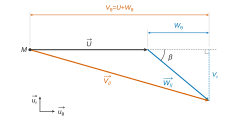
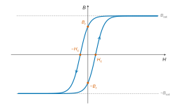
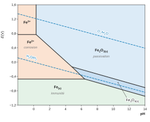
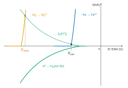

# e3a-Polytech PSI — Physique-chimie 2026 · Corrigé

*Corrigé rédigé par IA, non officiel. Signalez toute erreur.*

Épreuve de 4 heures, calculatrices interdites. Données : documents 1 et 2 (pages 12–13). Applications numériques avec deux chiffres significatifs au plus.

## Question préliminaire

### Q1

L'énergie produite en 2022 vaut $E=49{,}6\ \mathrm{TW\cdot h}$, soit $4{,}96\cdot10^{13}\ \mathrm{W\cdot h}$. Elle est produite sur $\Delta t=1\ \text{an}=365\times24\ \mathrm h$, pour $N=4{,}0\cdot10^7$ clients. La puissance moyenne par client est

$$\begin{aligned}
p&=\frac{E}{N\,\Delta t}\\
&=\frac{4{,}96\cdot10^{13}}{4{,}0\cdot10^{7}}\times\frac{1}{365}\times\frac1{24}\ \mathrm W\\
&\approx1{,}24\cdot10^{6}\times3\cdot10^{-3}\times\frac{1}{24}\ \mathrm W\\
&\approx1{,}5\cdot10^{2}\ \mathrm W.
\end{aligned}$$

$$\boxed{p\sim10^{2}\ \mathrm W\ \text{par client}}$$

La valeur exacte est $1{,}4\cdot10^2$ W. Comme l'hydroélectricité ne fournit que 11 % de la production métropolitaine, la production totale par client est d'environ neuf fois plus, de l'ordre du kilowatt, industrie et tertiaire compris : l'ordre de grandeur est plausible.

## Partie I - Convertir l'énergie hydraulique en énergie électrique

### I.1 - Une retenue d'eau

### Q2

On note $\vec u_{12}$ le vecteur unitaire dirigé de la particule 1 vers la particule 2, distantes de $r$. Les forces exercées par la particule 1 sur la particule 2 s'écrivent, en électrostatique puis en gravitation,

$$\begin{aligned}
\vec F_{q_1\to q_2}&=\frac{q_1q_2}{4\pi\varepsilon_0r^2}\,\vec u_{12},\\
\vec F_{m_1\to m_2}&=-\frac{\mathcal G\,m_1m_2}{r^2}\,\vec u_{12}.
\end{aligned}$$

L'analogie associe $q\leftrightarrow m$ et $\dfrac1{4\pi\varepsilon_0}\leftrightarrow-\mathcal G$, soit $\dfrac{1}{\varepsilon_0}\leftrightarrow-4\pi\mathcal G$. Elle transforme le théorème de Gauss électrostatique,

$$\oint_\Sigma\vec E\cdot\mathrm d\vec S=\frac{Q_{\text{int}}}{\varepsilon_0},$$

en **théorème de Gauss gravitationnel** : pour toute surface fermée $\Sigma$,

$$\oint_\Sigma\vec G\cdot\mathrm d\vec S=-4\pi\mathcal G\,M_{\text{int}}.$$

La distribution de masse est à symétrie sphérique de centre $O$. Tout plan contenant la droite $(OM)$ est un plan de symétrie de la distribution. Le champ $\vec G(M)$ appartient à tous ces plans : il est **radial**, $\vec G(M)=G\,\vec u_r$.

L'invariance par toute rotation autour de $O$ fait que $G$ ne dépend que de $r$.

Soit $M$ extérieur à la Terre, à la distance $r>R_T$ du centre. On choisit comme surface de Gauss la sphère de centre $O$ et de rayon $r$. Le flux sortant vaut $4\pi r^2G(r)$ et la masse intérieure est $M_T$ :

$$G(r)\,4\pi r^2=-4\pi\mathcal GM_T,$$

d'où

$$\boxed{\vec G(M)=-\frac{\mathcal G M_T}{r^2}\,\vec u_r}\qquad(r>R_T).$$

### Q3

Au sol ($r=R_T$), avec les données du document 2 :

$$\begin{aligned}
g_T&=\frac{\mathcal GM_T}{R_T^2}\\
&=\frac{6{,}7\cdot10^{-11}\times6{,}0\cdot10^{24}}{(6{,}4\cdot10^6)^2}\ \mathrm{m\cdot s^{-2}}\\
&\approx9{,}8\ \mathrm{m\cdot s^{-2}},
\end{aligned}$$

en accord avec la valeur du document 2.

À l'altitude $h\ll R_T$, un développement limité à l'ordre 1 en $h/R_T$ donne

$$\begin{aligned}
g(h)&=\frac{\mathcal GM_T}{(R_T+h)^2}\\
&=\frac{g_T}{(1+h/R_T)^2}\\
&\simeq g_T\left(1-\frac{2h}{R_T}\right).
\end{aligned}$$

$$\boxed{g(h)\simeq g_T\left(1-\frac{2h}{R_T}\right)}$$

La variation relative vaut

$$\frac{g_T-g(h)}{g_T}\simeq\frac{2h}{R_T}.$$

Elle reste inférieure à $10^{-3}$ si $h<h_{\max}$, avec

$$\begin{aligned}
h_{\max}&=\frac{10^{-3}R_T}{2}\\
&=\frac{6{,}4\cdot10^{6}\times10^{-3}}{2}\ \mathrm m.
\end{aligned}$$

$$\boxed{h_{\max}\approx3{,}2\ \mathrm{km}}$$

### Q4

Un barrage ou une retenue a une extension verticale de quelques dizaines de mètres, très inférieure à $h_{\max}\approx3$ km. La variation relative de $g$ y est de l'ordre de $2\times30/(6{,}4\cdot10^6)\sim10^{-5}$.

Sa direction varie aussi de façon négligeable, d'un angle de l'ordre de $L/R_T\sim10^{-4}$ rad sur la longueur du barrage. **Le champ de pesanteur est uniforme à l'échelle de l'ouvrage.**

### Q5

L'eau est au repos dans le référentiel terrestre, supposé galiléen. C'est un fluide incompressible, placé dans le champ uniforme $\vec g=g\,\vec u_z$. La relation fondamentale de la statique des fluides s'écrit

$$\overrightarrow{\mathrm{grad}}\,P=\mu_e\vec g.$$

Projetée sur l'axe $(Oz)$, orienté vers le bas :

$$\frac{\mathrm dP}{\mathrm dz}=\mu_eg.$$

La continuité de la pression à l'interface donne $P(0)=P_0$, d'où

$$\boxed{P(z)=P_0+\mu_e\,g\,z}.$$

### Q6

La face amont est verticale : c'est un rectangle de hauteur $H$ et de longueur $L$. L'eau est du côté $x<0$, et la normale dirigée de l'eau vers le barrage est $\vec u_x$. Sur une bande horizontale de hauteur $\mathrm dz$, la pression est uniforme. La force exercée par l'eau est donc

$$\begin{aligned}
\vec F_{\text{eau}}&=\int_0^H P(z)\,L\,\mathrm dz\;\vec u_x\\
&=\left(P_0H+\frac12\mu_egH^2\right)L\,\vec u_x.
\end{aligned}$$

$$\boxed{\vec F_{\text{eau}}=HL\left(P_0+\frac{\mu_egH}{2}\right)\vec u_x}$$

L'air exerce la pression uniforme $P_0$ sur la face aval inclinée et sur le couronnement. La composante horizontale de cette action vaut $-P_0HL\,\vec u_x$ : c'est la projection de la face aval sur un plan vertical. La résultante horizontale des forces pressantes (eau et air), qui détermine la stabilité de l'ouvrage, est donc

$$\vec F_{\text{net}}=\frac12\mu_egH^2L\,\vec u_x.$$

Application numérique, avec l'aide au calcul $HL=15\times605\approx9{,}1\cdot10^{3}\ \mathrm{m^2}$ :

$$\begin{aligned}
\|\vec F_{\text{net}}\|&=\frac12\times1{,}0\cdot10^3\times9{,}8\times15\times9{,}1\cdot10^3\ \mathrm N\\
&\approx\boxed{6{,}7\cdot10^{8}\ \mathrm N},\\
\|\vec F_{\text{eau}}\|&=9{,}1\cdot10^3\times(1{,}0\cdot10^5+7{,}4\cdot10^4)\ \mathrm N\\
&\approx\boxed{1{,}6\cdot10^{9}\ \mathrm N}.
\end{aligned}$$

L'ordre de grandeur est $10^9$ N, soit le poids d'environ $10^5$ tonnes.

### I.2 - Remplissage d'un bassin et contrôle du niveau

### Q7

L'approximation acoustique consiste à traiter l'onde comme une **petite perturbation** de l'état de repos : $|\tilde p|\ll P_0$, $|\tilde\varrho|\ll\varrho_0$, et la vitesse $|\tilde v|$ très petite devant la célérité de l'onde. Les champs perturbés et leurs dérivées sont des infiniment petits du premier ordre.

On **linéarise** les équations en négligeant les termes d'ordre 2 (produits de grandeurs perturbées). On néglige aussi la pesanteur et la viscosité.

### Q8

Conservation de la masse à une dimension :

$$\frac{\partial\varrho}{\partial t}+\frac{\partial(\varrho v)}{\partial z}=0.$$

Avec $\varrho=\varrho_0+\tilde\varrho$ et $v=\tilde v$ :

$$\varrho v=\varrho_0\tilde v+\tilde\varrho\tilde v.$$

Le terme $\tilde\varrho\tilde v$ est d'ordre 2. Comme $\varrho_0$ est uniforme et constant, $\partial\varrho/\partial t=\partial\tilde\varrho/\partial t$. Il reste, à l'ordre 1,

$$\boxed{\frac{\partial\tilde\varrho}{\partial t}+\varrho_0\frac{\partial\tilde v}{\partial z}=0}.$$

### Q9

Les termes de l'équation (1) sont les suivants :

- $\varrho\,\dfrac{\partial\tilde v}{\partial t}$ : terme d'accélération locale (variation du champ des vitesses en un point fixe), par unité de volume ;
- $\varrho\,\tilde v\dfrac{\partial\tilde v}{\partial z}$ : terme d'accélération convective, non linéaire ;
- $-\dfrac{\partial P}{\partial z}$ : résultante volumique des forces de pression.

Simplification à l'ordre 1 :

- $\varrho\,\partial_t\tilde v=\varrho_0\,\partial_t\tilde v+\tilde\varrho\,\partial_t\tilde v$, et le second terme est d'ordre 2 ;
- le terme convectif $\varrho\,\tilde v\,\partial_z\tilde v$ est d'ordre 2 au moins ;
- $P_0$ est uniforme, donc $\partial_zP=\partial_z\tilde p$.

Il reste

$$\boxed{\varrho_0\frac{\partial\tilde v}{\partial t}=-\frac{\partial\tilde p}{\partial z}}.$$

### Q10

L'évolution est isentropique. Au voisinage de l'état de repos, un développement à l'ordre 1 de $\varrho$ en fonction de $P$, à entropie fixée, donne

$$\begin{aligned}
\varrho-\varrho_0&\simeq\left(\frac{\partial\varrho}{\partial P}\right)_S(P-P_0)\\
&=\varrho_0\chi_s\,(P-P_0),
\end{aligned}$$

où $\chi_s$ est évalué dans l'état de repos $(\varrho_0,P_0,T_0)$. D'où

$$\boxed{\tilde\varrho=\varrho_0\,\chi_s\,\tilde p}.$$

### Q11

On dérive (Q8) par rapport à $t$ :

$$\frac{\partial^2\tilde\varrho}{\partial t^2}=-\varrho_0\frac{\partial^2\tilde v}{\partial t\,\partial z}.$$

On dérive (Q9) par rapport à $z$ :

$$\varrho_0\frac{\partial^2\tilde v}{\partial z\,\partial t}=-\frac{\partial^2\tilde p}{\partial z^2}.$$

Les champs sont supposés de classe $C^2$, donc les dérivées croisées de $\tilde v$ sont égales. En éliminant $\tilde v$ :

$$\frac{\partial^2\tilde\varrho}{\partial t^2}=\frac{\partial^2\tilde p}{\partial z^2}.$$

Avec (Q10), où $\varrho_0\chi_s$ est une constante :

$$\frac{\partial^2\tilde\varrho}{\partial t^2}=\varrho_0\chi_s\frac{\partial^2\tilde p}{\partial t^2}.$$

D'où

$$\frac{\partial^2\tilde p}{\partial z^2}=\varrho_0\chi_s\,\frac{\partial^2\tilde p}{\partial t^2},$$

qui est l'équation (2) avec $1/c_s^2=\varrho_0\chi_s$.

### Q12

C'est l'**équation de d'Alembert** (équation des ondes) à une dimension, avec

$$\boxed{c_s=\frac{1}{\sqrt{\varrho_0\chi_s}}}.$$

Dimension :

$$\begin{aligned}
[\varrho_0\chi_s]&=\mathrm{kg\cdot m^{-3}}\cdot\mathrm{Pa^{-1}}\\
&=\mathrm{kg\cdot m^{-3}}\cdot\mathrm{kg^{-1}\cdot m\cdot s^{2}}\\
&=\mathrm{s^2\cdot m^{-2}}.
\end{aligned}$$

$c_s$ est donc homogène à une **vitesse**. C'est la **célérité des ondes sonores** dans l'air au repos.

### Q13

Pour le gaz parfait de masse molaire $\mathcal M_{\text{air}}$, l'équation d'état s'écrit $P_0V=\dfrac{m}{\mathcal M_{\text{air}}}RT_0$, donc

$$\boxed{\varrho_0=\frac{P_0\,\mathcal M_{\text{air}}}{RT_0}}.$$

Pour une quantité fixée de gaz parfait (à $\gamma$ constant) en évolution isentropique, la loi de Laplace $PV^\gamma=\text{cste}$ s'écrit, avec $V\propto1/\varrho$ :

$$\boxed{\frac{P}{\varrho^{\gamma}}=\text{cste}}.$$

### Q14

En différentiant logarithmiquement la loi de Laplace :

$$\frac{\mathrm dP}{P}=\gamma\frac{\mathrm d\varrho}{\varrho}.$$

Donc, dans l'état de repos,

$$\begin{aligned}
\chi_s&=\frac1\varrho\left(\frac{\partial\varrho}{\partial P}\right)_S\\
&=\frac1{\gamma P_0}.
\end{aligned}$$

Alors, avec l'expression de $\varrho_0$ de Q13 :

$$\begin{aligned}
c_s&=\sqrt{\frac{\gamma P_0}{\varrho_0}}\\
&=\sqrt{\gamma P_0\,\frac{RT_0}{P_0\mathcal M_{\text{air}}}}.
\end{aligned}$$

$$\boxed{c_s=\sqrt{\frac{\gamma RT_0}{\mathcal M_{\text{air}}}}}$$

L'air sec contient, en fractions molaires, environ 78 % de diazote, 21 % de dioxygène et 1 % d'argon. On l'assimile ici à un mélange de diazote, de fraction molaire $x_{\mathrm{N_2}}\approx0{,}8$, et de dioxygène, de fraction molaire $x_{\mathrm{O_2}}\approx0{,}2$. Les masses molaires du document 2 sont atomiques, et ces deux gaz sont diatomiques. La masse molaire moyenne est la moyenne pondérée par les fractions **molaires** :

$$\boxed{\mathcal M_{\text{air}}=x_{\mathrm{N_2}}\cdot2\mathcal M_N+x_{\mathrm{O_2}}\cdot2\mathcal M_O}.$$

### Q15

Masse molaire de l'air :

$$\begin{aligned}
\mathcal M_{\text{air}}&=0{,}8\times28\cdot10^{-3}+0{,}2\times32\cdot10^{-3}\ \mathrm{kg\cdot mol^{-1}}\\
&\approx2{,}9\cdot10^{-2}\ \mathrm{kg\cdot mol^{-1}}.
\end{aligned}$$

Masse volumique, avec l'aide $1/8{,}3\approx0{,}12$ :

$$\begin{aligned}
\varrho_0&=\frac{1{,}0\cdot10^5\times2{,}9\cdot10^{-2}}{8{,}3\times3{,}0\cdot10^2}\ \mathrm{kg\cdot m^{-3}}\\
&=\frac{2{,}9\cdot10^{3}}{3{,}0\cdot10^{2}}\times0{,}12\ \mathrm{kg\cdot m^{-3}}\\
&\approx\boxed{1{,}2\ \mathrm{kg\cdot m^{-3}}}.
\end{aligned}$$

Célérité, avec l'aide $1{,}4\times8{,}3\approx10$ :

$$\begin{aligned}
c_s&\approx\sqrt{\frac{10\times3{,}0\cdot10^2}{2{,}9\cdot10^{-2}}}\ \mathrm{m\cdot s^{-1}}\\
&\approx\sqrt{1{,}0\cdot10^{5}}\ \mathrm{m\cdot s^{-1}}\\
&=\sqrt{10}\times10^{2}\ \mathrm{m\cdot s^{-1}}\\
&\approx\boxed{3{,}2\cdot10^{2}\ \mathrm{m\cdot s^{-1}}}.
\end{aligned}$$

Remarque : l'aide de l'énoncé est grossière, puisque $1{,}4\times8{,}3=11{,}6$. Le calcul exact donne $c_s\approx3{,}5\cdot10^2\ \mathrm{m\cdot s^{-1}}$, la valeur usuelle de la vitesse du son dans l'air vers 300 K.

### Q16

Sur la figure 3, la salve émise est centrée en $t_e\approx0$ et l'écho en $t_r\approx0{,}044$ s. L'air est faiblement dispersif : le paquet d'ondes se propage sans se déformer, à une vitesse de groupe égale à $c_s$.

On peut donc repérer le retard sur les maxima des enveloppes : $\Delta t\approx0{,}044$ s. L'onde fait l'aller-retour entre le capteur et la surface de l'eau, soit la distance $2d$ :

$$\begin{aligned}
d&=\frac{c_s\,\Delta t}{2}\\
&=\frac{3{,}4\cdot10^2\times4{,}4\cdot10^{-2}}{2}\ \mathrm m\\
&\approx7{,}5\ \mathrm m.
\end{aligned}$$

$$\begin{aligned}
h(t_{\text{mes}})&=H_{\text{capteur}}-d\\
&=8{,}5-7{,}5\ \mathrm m.
\end{aligned}$$

$$\boxed{h(t_{\text{mes}})\approx1{,}0\ \mathrm m}$$

### I.3 - Couple hydraulique et puissance utile

### Q17

Le bassin a une section $S$ et contient une hauteur d'eau $h_0$ au-dessus de son sol. Ce sol est à la hauteur $H$ au-dessus de l'entrée $E$ de la turbine (figure 12), et la conduite amont est vide.

On découpe l'eau en tranches horizontales. La tranche d'épaisseur $\mathrm dz$, à la cote $z\in[0,h_0]$ au-dessus du sol du bassin, a une masse $\mu_eS\,\mathrm dz$. Elle descend de $H+z$ jusqu'à $E$. L'énergie potentielle de pesanteur libérable est

$$\begin{aligned}
E_{\max}&=\int_0^{h_0}\mu_eSg\,(H+z)\,\mathrm dz\\
&=\mu_e\,g\,S\,h_0\left(H+\frac{h_0}{2}\right).
\end{aligned}$$

$$\boxed{E_{\max}=\mu_e\,g\,S\,h_0\left(H+\frac{h_0}{2}\right)}$$

C'est la variation d'énergie potentielle de la masse $\mu_eSh_0$, dont le centre de masse descend de $H+h_0/2$. C'est un **maximum** parce que ce calcul suppose la conversion intégrale de l'énergie potentielle en énergie électrique. En réalité, une partie est perdue :

- dissipation visqueuse et pertes de charge dans les conduites ;
- énergie cinétique résiduelle de l'eau en sortie de turbine ;
- pertes mécaniques de la turbine et pertes de l'alternateur.

### Q18

Le fluide entre et sort sur toute la périphérie, sans composante axiale. À l'entrée, il traverse la surface latérale du cylindre de rayon $R_e$ et de hauteur $e_e$, dont la normale est radiale. Seule $V_{r,e}$ contribue au flux, car $V_\theta$ est tangente à cette surface. Le fluide est incompressible et l'écoulement stationnaire, donc le débit se conserve :

$$\boxed{\begin{aligned}
D_v&=2\pi R_e\,e_e\,V_{r,e}\\
&=2\pi R_s\,e_s\,V_{r,s}
\end{aligned}}$$

où $V_r>0$ désigne la norme de la composante radiale (écoulement centripète).

### Q19

Le référentiel lié à la roue tourne à la vitesse angulaire $\omega$ autour d'un axe fixe dans le référentiel terrestre, supposé galiléen. Il n'est pas en translation rectiligne uniforme par rapport à ce référentiel : un point fixe de la roue a une accélération centripète $-\omega^2r\,\vec u_r\neq\vec 0$. **Le référentiel de la roue n'est donc pas galiléen** : comme l'indique l'énoncé, on ne peut y appliquer les théorèmes de la mécanique qu'en ajoutant le moment des forces d'inertie, dont l'expression est admise.

### Q20

**Volume de contrôle** $\mathcal V$ : le volume fixe dans le référentiel de la roue, limité par les flasques de la roue, le cylindre d'entrée (rayon $R_e$, hauteur $e_e$) et le cylindre de sortie (rayon $R_s$, hauteur $e_s$). Il contient le fluide compris entre les aubes.

**Système fermé** $\Sigma$. À l'instant $t$, il est formé du fluide contenu dans $\mathcal V$ et de la masse qui va entrer pendant $\mathrm dt$ :

$$\delta m=\mu_eD_v\,\mathrm dt.$$

À l'instant $t+\mathrm dt$, il est formé du fluide contenu dans $\mathcal V$ et de la masse $\delta m$ sortie entre-temps. C'est à ce système fermé que s'applique le théorème du moment cinétique.

On travaille dans le **référentiel de la roue**, avec les vitesses relatives $\vec W$. L'écoulement y est stationnaire, donc le moment cinétique du contenu de $\mathcal V$ ne varie pas.

Considérons une masse $\delta m$ située à la distance $R$ de l'axe $Oz$. Son moment cinétique par rapport à cet axe vaut $\delta m\,R\,W_\theta$, car seule la composante orthoradiale a un bras de levier. Par conséquent

$$\frac{\mathrm dL_z(\Sigma)}{\mathrm dt}=\mu_eD_v\big(R_sW_{\theta,s}-R_eW_{\theta,e}\big).$$

Moments par rapport à l'axe des actions sur $\Sigma$ :

- le poids est parallèle à l'axe : moment nul ;
- les forces de pression sur les surfaces d'entrée et de sortie sont radiales : moment nul ;
- les actions de la roue (aubes et flasques) sur le fluide ont un moment $\mathcal M_{\text{roue}\to\text{fluide}}$ ;
- les forces d'inertie, dues au caractère non galiléen du référentiel (Q19), ont pour moment total $\Gamma_{\text{inertie}}=-\mu_eD_v\omega(R_s^2-R_e^2)$, expression admise par l'énoncé.

Le théorème du moment cinétique s'écrit

$$\mu_eD_v\big(R_sW_{\theta,s}-R_eW_{\theta,e}\big)=\mathcal M_{\text{roue}\to\text{fluide}}-\mu_eD_v\,\omega\,(R_s^2-R_e^2).$$

La composition des vitesses donne $W_\theta=V_\theta-\omega R$. Le premier membre vaut donc

$$\mu_eD_v\big(R_sW_{\theta,s}-R_eW_{\theta,e}\big)=\mu_eD_v\big(R_sV_{\theta,s}-R_eV_{\theta,e}\big)-\mu_eD_v\omega(R_s^2-R_e^2).$$

Le terme en $\omega$ se simplifie exactement :

$$\mathcal M_{\text{roue}\to\text{fluide}}=\mu_eD_v\big(R_sV_{\theta,s}-R_eV_{\theta,e}\big).$$

Par le principe des actions réciproques, le couple exercé par le fluide sur la roue est

$$\begin{aligned}
\Gamma_i&=-\mathcal M_{\text{roue}\to\text{fluide}}\\
&=\mu_eD_v\big(R_eV_{\theta,e}-R_sV_{\theta,s}\big).
\end{aligned}$$

On remplace $D_v$ par $2\pi R_ee_eV_{r,e}$ dans le terme d'entrée et par $2\pi R_se_sV_{r,s}$ dans le terme de sortie :

$$\boxed{\Gamma_i=2\pi\mu_e\left(R_e^2V_{r,e}V_{\theta,e}\,e_e-R_s^2V_{r,s}V_{\theta,s}\,e_s\right)}.$$

### Q21

Le point coïncident $M$ de la roue décrit un cercle de rayon $r$ à la vitesse angulaire $\omega$ :

$$\boxed{\vec U(M)=r\,\omega\,\vec u_\theta}$$

soit $U=r\omega$. $\vec U$ est orthoradial. On projette la relation $\vec V=\vec U+\vec W$ :

- sur $\vec u_\theta$ : $V_\theta=U+W_\theta$ ;
- sur $\vec u_r$ : les composantes radiales de $\vec V$ et de $\vec W$ sont égales, de norme commune $V_r$.

Dans le plan normal à l'axe, $\vec W_{/\!/}$ fait l'angle $\beta$ avec $\vec U$, c'est-à-dire avec $\vec u_\theta$. Ses composantes s'écrivent donc

$$\begin{aligned}
W_\theta&=W_{/\!/}\cos\beta,\\
V_r&=W_{/\!/}\sin\beta.
\end{aligned}$$

En divisant membre à membre :

$$W_\theta=\frac{V_r}{\tan\beta},$$

d'où

$$\boxed{V_\theta=U+\frac{V_r}{\tan\beta}}.$$

### Q22

D'après Q21 et Q18 :

$$\begin{aligned}
V_{\theta,e}&=\omega R_e+\frac{V_{r,e}}{\tan\beta_e},\\
V_{\theta,s}&=\omega R_s+\frac{V_{r,s}}{\tan\beta_s},\\
R_eV_{r,e}&=\frac{D_v}{2\pi e_e},\\
R_sV_{r,s}&=\frac{D_v}{2\pi e_s}.
\end{aligned}$$

Donc

$$R_eV_{\theta,e}-R_sV_{\theta,s}=\omega(R_e^2-R_s^2)+\frac{D_v}{2\pi}\left(\frac{1}{e_e\tan\beta_e}-\frac{1}{e_s\tan\beta_s}\right).$$

Avec $\Gamma_i=\mu_eD_v(R_eV_{\theta,e}-R_sV_{\theta,s})$ :

$$\boxed{\Gamma_i=\mu_eD_v\,\omega\,(R_e^2-R_s^2)+\frac{\mu_eD_v^2}{2\pi}\left(\frac{1}{e_e\tan\beta_e}-\frac{1}{e_s\tan\beta_s}\right)}$$

La puissance indiquée est la puissance reçue par la roue de la part du fluide :

$$\boxed{\begin{aligned}
\mathcal P_i&=\Gamma_i\,\omega\\
&=\mu_eD_v\,\omega^2(R_e^2-R_s^2)+\frac{\mu_eD_v^2\,\omega}{2\pi}\left(\frac{1}{e_e\tan\beta_e}-\frac{1}{e_s\tan\beta_s}\right)
\end{aligned}}$$

Le couple disponible en sortie d'arbre $\Gamma$ est inférieur à $\Gamma_i$ car une partie du couple transmis par le fluide sert à vaincre les **frottements** : frottements solides dans les paliers, butées et joints, frottements visqueux du fluide sur les faces extérieures de la roue (frottement de disque) et fuites entre roue et carter. Ces effets sont exclus du modèle d'écoulement parfait.

## Partie II - Transport de l'énergie électrique

### II.1 - Transformateur de tension

### Q23

**Non.** En régime continu, $B$ et donc le flux $\Phi$ sont constants. La force électromotrice induite $N_2\,\mathrm d\Phi/\mathrm dt$ est nulle : aucune tension n'apparaît au secondaire et aucune puissance n'est transmise. De plus, les enroulements étant de résistance nulle, le primaire alimenté en continu serait un court-circuit. Le transformateur exige un régime variable (alternatif).

### Q24

Équation de Maxwell-Thomson :

$$\boxed{\operatorname{div}\vec B=0}.$$

Par le théorème d'Ostrogradski, le flux de $\vec B$ à travers toute surface fermée est nul. On l'applique à la surface fermée formée de deux sections droites du tore et de la paroi latérale du tore entre elles. Le milieu est de très grande perméabilité et il n'y a pas de fuites : les lignes de champ restent dans le tore, et le flux à travers la paroi latérale est nul.

**Le flux magnétique $\Phi=\iint\vec B\cdot\mathrm d\vec S$ est le même à travers toute section droite du circuit magnétique.** Comme $a\gg\sqrt S$, $B$ est quasi uniforme sur une section et $\Phi=B(t)\,S$.

### Q25

Équation de Maxwell-Faraday :

$$\boxed{\overrightarrow{\mathrm{rot}}\,\vec E=-\frac{\partial\vec B}{\partial t}}.$$

Par le théorème de Stokes, la circulation de $\vec E$ le long d'une spire vaut $-\mathrm d\Phi/\mathrm dt$. Les fils sont parfaits, donc le champ électrique est nul dans le conducteur. La tension aux bornes d'un enroulement de $N$ spires traversées par le même flux vaut alors $N\,\mathrm d\Phi/\mathrm dt$, orientée selon la convention des bornes homologues de la figure 7 :

$$\begin{aligned}
u_1&=N_1\frac{\mathrm d\Phi}{\mathrm dt},\\
u_2&=N_2\frac{\mathrm d\Phi}{\mathrm dt}.
\end{aligned}$$

$$\boxed{u_2(t)=\frac{N_2}{N_1}\,u_1(t)}$$

C'est la **loi de transformation des tensions**, de rapport $m=N_2/N_1$.

### Q26

Théorème d'Ampère dans un milieu magnétique en ARQS : la circulation de l'excitation $\vec H$ sur un contour fermé est égale à l'intensité des courants libres enlacés,

$$\oint_{\mathcal C}\vec H\cdot\mathrm d\vec\ell=I_{\text{enlacé}}.$$

On prend pour contour la ligne moyenne du tore (rayon $a$), orientée dans le sens du flux. Sur la figure 7, $i_1$ et $i_2$ entrent tous deux par les bornes marquées d'un point, donc leurs ampères-tours s'ajoutent :

$$H\cdot2\pi a=N_1i_1+N_2i_2.$$

Le milieu est linéaire : $H=\dfrac{B}{\mu_0\mu_r}$. Le champ $B$ reste fini, car il est fixé par $u_1$ via la loi de Faraday. Quand $\mu_r\to\infty$, $H\to0$, d'où $N_1i_1+N_2i_2=0$ et

$$\boxed{i_2(t)=-\frac{N_1}{N_2}\,i_1(t)},$$

qui est la **loi de transformation des intensités**. Le signe $-$ traduit le fait que $i_2$ est orienté en convention récepteur au secondaire.

### Q27

La puissance reçue par le primaire est $p_1=u_1i_1$. La puissance fournie à la charge par le secondaire, en convention générateur pour le courant $-i_2$, vaut

$$\begin{aligned}
-u_2i_2&=\frac{N_2}{N_1}u_1\cdot\frac{N_1}{N_2}i_1\\
&=u_1i_1.
\end{aligned}$$

À chaque instant, toute la puissance reçue est transmise :

$$\boxed{\eta=1}.$$

Les pertes d'un transformateur réel sont :

- les **pertes cuivre** : effet Joule dans les enroulements de résistance non nulle ;
- les **pertes fer** dans le circuit magnétique : pertes par **hystérésis**, proportionnelles à l'aire du cycle et à la fréquence, et pertes par **courants de Foucault** (le circuit magnétique est feuilleté pour les réduire) ;
- les **fuites magnétiques**, qui dégradent le couplage et augmentent les chutes de tension.

Les rendements réels vont de **95 % à plus de 99 %** pour les gros transformateurs de réseau.

### II.2 - Tracé d'un cycle d'hystérésis

### Q28

Un ferromagnétique **doux** présente :

- un cycle **étroit**, donc de faibles pertes par hystérésis ;
- une excitation coercitive $H_c$ **faible** ;
- une perméabilité relative très élevée ($10^3$ à $10^5$) et une aimantation à saturation élevée.

Il s'aimante et se désaimante facilement, et convient aux circuits magnétiques en régime alternatif (transformateurs, machines).

Le cycle sature vers $B_{\text{sat}}\sim1{,}5$ T ; le champ rémanent $B_r$ est de l'ordre du tesla.

Ordre de grandeur :

$$\boxed{H_c\sim10\ \text{à}\ 10^2\ \mathrm{A\cdot m^{-1}}}$$

pour le fer doux et les tôles Fe-Si. Il est de $10^5$ à $10^6\ \mathrm{A\cdot m^{-1}}$ pour un matériau dur.

### Q29

L'ALI est idéal ($i_+=i_-=0$) et la rétroaction est négative (par $R\parallel C$), donc le régime est linéaire et $v_+=v_-$. Aucun courant ne traverse la résistance $\sim R/2$, d'où $v_+=0$ et $v_-=0$ : l'entrée inverseuse est une masse virtuelle.

Sur la figure 8, $i(t)$ circule dans la résistance d'entrée $R$ **de l'ALI vers l'étage 1**. La loi d'Ohm donne donc

$$\begin{aligned}
i&=\frac{v_--u_e}{R}\\
&=-\frac{u_e}{R},
\end{aligned}$$

et

$$\begin{aligned}
\underline{Z_e}&=-\frac{u_e}{i}\\
&=R.
\end{aligned}$$

$$\boxed{\underline{Z_e}=R\approx4{,}7\cdot10^{5}\ \Omega}$$

Vu de l'étage 1, le montage à ALI se comporte comme une résistance $R$ reliée à la masse : c'est son impédance d'entrée, au sens d'un quadripôle.

Le secondaire débite dans la résistance série $R$ de l'étage 1, suivie de $R/10$ en parallèle avec $\underline{Z_e}=R$. La résistance de charge vaut donc $R+\frac{R}{11}\approx5\cdot10^{5}\ \Omega$, très grande. Il est raisonnable de supposer **$i_2(t)\approx0$** : le secondaire fonctionne quasiment à vide, et $N_2|i_2|\ll N_1|i_1|$.

On cherche à tracer le cycle du matériau réel : on ne fait donc pas tendre $\mu_r$ vers l'infini. Le théorème d'Ampère sur la ligne moyenne du tore, avec $H$ uniforme sur cette ligne ($a\gg\sqrt S$, symétrie du tore), donne

$$\begin{aligned}
H\cdot2\pi a&=N_1i_1+N_2i_2\\
&\approx N_1i_1.
\end{aligned}$$

La résistance $r$ est parcourue par $i_1$ (flèche de $u_r$ en convention récepteur). On la choisit de **faible valeur** : sa tension est une image du courant primaire, et sa chute de tension reste petite devant $u_1$, ce qui ne perturbe presque pas le montage. Alors

$$\begin{aligned}
u_r(t)&=r\,i_1(t)\\
&=\frac{2\pi a\,r}{N_1}\,H(t).
\end{aligned}$$

$$\boxed{K=\frac{2\pi a\,r}{N_1}}$$

Hypothèses de travail : ARQS, absence de fuites (flux canalisé), $H$ uniforme sur la ligne moyenne, $i_2\approx0$, résistance $r$ assez faible pour ne pas modifier le courant primaire.

### Q30

L'impédance de rétroaction est l'association parallèle de $R$ et de $C$ :

$$\underline Z_f=\frac{R}{1+jRC\omega}.$$

Avec la masse virtuelle, la loi des nœuds en $v_-$ s'écrit

$$\frac{u_e}{R}+\frac{u_s}{\underline Z_f}=0.$$

D'où

$$\begin{aligned}
\underline H(j\omega)&=-\frac{\underline Z_f}{R}\\
&=\frac{-1}{1+jRC\omega}.
\end{aligned}$$

$$\boxed{\begin{aligned}
H_0&=-1\\
\omega_0&=\frac{1}{RC}
\end{aligned}}$$

### Q31

Numériquement :

$$\begin{aligned}
\omega_0&=\frac1{RC}\\
&=\frac{1}{4{,}7\cdot10^5\times4{,}7\cdot10^{-8}}\ \mathrm{rad\cdot s^{-1}}\\
&\approx45\ \mathrm{rad\cdot s^{-1}},
\end{aligned}$$

soit $f_0\approx7$ Hz. À $f=50$ Hz, $\omega/\omega_0\approx7$, donc

$$\begin{aligned}
\underline H&\simeq-\frac{\omega_0}{j\omega}\\
&=-\frac{1}{jRC\omega}.
\end{aligned}$$

Le montage est un **(pseudo-)intégrateur inverseur** :

$$u_s(t)\simeq-\frac{1}{RC}\int u_e\,\mathrm dt\qquad\text{(sans composante continue)}.$$

La résistance $R$ en parallèle sur $C$ supprime la dérive due aux composantes continues, que l'intégrateur pur amplifierait jusqu'à saturation.

**Intérêt de l'intégration.** D'après la loi de Faraday, la tension du secondaire est proportionnelle à $\mathrm dB/\mathrm dt$, et non à $B$. Il faut donc l'intégrer pour obtenir une tension image de $B(t)$, à tracer en fonction de $u_r$, image de $H(t)$. C'est pourquoi on travaille à une fréquence nettement supérieure à $f_0$.

**Tension $u_e$.** On note $A$ le nœud commun de l'étage 1. Le courant $i_2=\dfrac{u_e-u_2}{R}$ va de $A$ vers le secondaire (orientation de la figure 8).

Le montage à ALI fournit le courant $i$ au nœud. La résistance $R/10$ évacue vers la masse le courant $10u_e/R$. La loi des nœuds en $A$ s'écrit

$$\begin{aligned}
i&=i_2+\frac{u_e}{R/10},\\
-\frac{u_e}{R}&=\frac{u_e-u_2}{R}+\frac{10\,u_e}{R},\\
u_e&=\frac{u_2}{12}.
\end{aligned}$$

L'étage 1 est un atténuateur. Avec $\Phi=SB$, la loi de Faraday au secondaire donne $u_2=N_2S\,\dfrac{\mathrm dB}{\mathrm dt}$, donc

$$\begin{aligned}
u_s(t)&=-\frac{1}{RC}\int\frac{N_2S}{12}\frac{\mathrm dB}{\mathrm dt}\,\mathrm dt\\
&=K'\,B(t),
\end{aligned}$$

$$\boxed{K'=-\frac{N_2\,S}{12\,RC}}$$

Si l'on néglige le courant absorbé par le montage à ALI, on trouve $u_e\simeq u_2/11$ et $K'\simeq-N_2S/(11RC)$. En mode XY, l'oscilloscope affiche $u_s$ en fonction de $u_r$, c'est-à-dire le champ magnétique en fonction de l'excitation, au facteur d'échelle près : le cycle d'hystérésis.

Intérêt de l'étage 1 :

- il **atténue** $u_2$ d'un facteur de l'ordre de 10, ce qui évite la saturation de l'ALI (de l'ordre de 15 V) lorsque $u_2$ vaut quelques dizaines de volts ;
- il présente au secondaire une **très grande impédance**, ce qui garantit $i_2\approx0$, l'hypothèse qui rend $u_r$ proportionnelle à $H$.

La résistance $\sim R/2$ sur l'entrée $+$ égale à peu près la résistance vue par l'entrée $-$, soit $R\parallel(R+R/11)\approx R/2$. Avec l'ALI idéal, elle n'est parcourue par aucun courant et ne modifie aucun des résultats précédents ; son rôle tient à des défauts de l'ALI réel que le modèle idéal ne décrit pas.

### II.3 - Couplage de la centrale hydraulique au réseau EDF

### Q32

Dans un câble coaxial, les ondes électrocinétiques se propagent à la célérité

$$v=\frac{c}{\sqrt{\varepsilon_r}}\approx\boxed{2\cdot10^{8}\ \mathrm{m\cdot s^{-1}}}$$

pour un diélectrique d'indice voisin de 1,5. L'ARQS est valable si la longueur $L$ du circuit est très petite devant la longueur d'onde. De façon équivalente, le temps de propagation $L/v$ doit être très petit devant la période $T=1/f$. À $f=50$ Hz :

$$\begin{aligned}
\lambda&=\frac{v}{f}\\
&=\frac{2\cdot10^8}{50}\ \mathrm m\\
&=4\cdot10^{6}\ \mathrm m\\
&=4\cdot10^{3}\ \mathrm{km}.
\end{aligned}$$

Pour la ligne aérienne bifilaire, le diélectrique est l'air : la célérité est proche de $c=3\cdot10^8\ \mathrm{m\cdot s^{-1}}$ et $\lambda\approx6\cdot10^3$ km, du même ordre de grandeur.

Une ligne régionale de 400 kV a une longueur $L\sim10^2$ km, donc $L/\lambda\sim2\cdot10^{-2}\ll1$. **L'ARQS est valable** : à un instant donné, l'intensité est la même tout le long de la ligne. Elle cesserait de l'être pour des lignes de plusieurs centaines à milliers de kilomètres.

### Q33

En France, la tension efficace d'une prise standard est

$$\boxed{U_{e,\text{eff}}=230\ \mathrm V}$$

à 50 Hz (amplitude $230\sqrt2\approx3{,}3\cdot10^2$ V). La puissance moyenne vaut

$$\begin{aligned}
\mathscr P&=\langle u_{\text{EDF}}\,i_{\text{EDF}}\rangle\\
&=2U_{e,\text{eff}}I_{e,\text{eff}}\big\langle\cos(2\pi ft)\cos(2\pi ft+\varphi)\big\rangle\\
&=U_{e,\text{eff}}I_{e,\text{eff}}\big\langle\cos(4\pi ft+\varphi)+\cos\varphi\big\rangle.
\end{aligned}$$

$$\boxed{\mathscr P=U_{e,\text{eff}}\,I_{e,\text{eff}}\cos\varphi}$$

À puissance active $\mathscr P$ et tension fixées, $I_{e,\text{eff}}=\dfrac{\mathscr P}{U_{e,\text{eff}}\cos\varphi}$. Un facteur de puissance faible impose un courant plus intense, donc des pertes Joule $R_{\text{ligne}}I_{e,\text{eff}}^2\propto1/\cos^2\varphi$ plus grandes et un surdimensionnement des lignes et des transformateurs. **EDF impose donc $\cos\varphi\approx1$.**

Pour la même raison, à puissance transportée fixée, les pertes en ligne valent

$$p_J=R_{\text{ligne}}\frac{\mathscr P^2}{U^2\cos^2\varphi}\propto\frac{1}{U^2}.$$

**Le transport sous très haute tension (400 kV) divise les pertes Joule**, d'un facteur $(400/20)^2=400$ par rapport à 20 kV, et permet des conducteurs de section raisonnable.

## Partie III - L'acier des conduites forcées

### III.1 - Corrosion des conduites forcées et protection

### Q34

Le domaine de stabilité de l'eau est la bande comprise entre deux droites :

- couple $\mathrm{O_2/H_2O}$ : $E=1{,}23-0{,}06\,\mathrm{pH}$ ;
- couple $\mathrm{H_2O/H_2}$ : $E=-0{,}06\,\mathrm{pH}$.

Le domaine de $\mathrm{Fe_{(s)}}$ est situé **entièrement sous** la droite $\mathrm{H_2O/H_2}$, à tout pH. Par exemple, à $\mathrm{pH}=0$, la frontière $\mathrm{Fe^{2+}/Fe}$ est vers −0,45 V, alors que la droite de l'eau passe par 0 V.

Les deux domaines sont disjoints : **le fer n'est pas thermodynamiquement stable au contact de l'eau.** Il est oxydé par l'eau, avec dégagement de dihydrogène, et plus encore par le dioxygène dissous.

- Immunité : $\mathrm{Fe_{(s)}}$.
- Corrosion : espèces dissoutes $\mathrm{Fe^{2+}}$ et $\mathrm{Fe^{3+}}$ ; s'y ajoutent les petits domaines de $\mathrm{FeOH^+}$ (vers pH 7–8) et de $\mathrm{FeO_2^{2-}}$ (milieu très basique).
- Passivation : $\mathrm{Fe_2O_{3(s)}}$, $\mathrm{Fe_3O_{4(s)}}$ et $\mathrm{Fe(OH)_{2(s)}}$, si la couche est couvrante et adhérente.

### Q35

On superpose sur la figure 11 la branche anodique $\mathrm{Mg\to Mg^{2+}}$, qui démarre à un potentiel très négatif, la branche anodique $\mathrm{Fe\to Fe^{2+}}$ et la branche cathodique $\mathrm{H^+\to H_2}$ sur fer.

- **Fer seul** : son potentiel de corrosion $E_{\text{corr}}$ est tel que $i_a(\mathrm{Fe})=|i_c(\mathrm{H^+})|$. Il se situe sur la partie montante de la courbe du fer, et le fer se corrode avec un courant $i_{\text{corr}}>0$.
- **Fer relié électriquement à un bloc de magnésium** : les deux métaux sont au même potentiel $E_{\text{mixte}}$, défini par $i_a(\mathrm{Mg})+i_a(\mathrm{Fe})=|i_c(\mathrm{H^+})|$, la réduction des ions $\mathrm{H^+}$ ayant lieu sur la surface du fer. La courbe anodique du magnésium coupe la courbe symétrique de la branche cathodique à un potentiel **inférieur au potentiel d'oxydation du fer**. Construction : on trace l'opposé de la branche cathodique et on lit son intersection avec la courbe anodique du magnésium.
- En $E_{\text{mixte}}$, le courant anodique du fer est nul. Le fer est dans son domaine d'immunité, et seul le magnésium s'oxyde.

**Oui**, la protection est envisageable : c'est la **protection cathodique par anode sacrificielle**. Le magnésium, plus réducteur, se consomme à la place du fer, et il faut donc renouveler les blocs.

### Q36

**Hypothèses et grandeurs introduites.**

- La conduite est un cylindre de diamètre $D$ et de longueur $\ell$. Seule sa surface latérale extérieure $S_c=\pi D\ell$ est en contact avec le sol ; les extrémités sont négligées.
- La densité de courant de protection $j$ est uniforme sur $S_c$ et constante pendant $\Delta t$.
- Chaque bloc de masse $m_{\text{el}}$ fournit la charge $Q_{\text{bloc}}=m_{\text{el}}Q_m$ et est consommé jusqu'au bout. $Q_m$ est la capacité pratique : environ la moitié de la capacité théorique $2\mathcal F/M_{\mathrm{Mg}}\approx2{,}2\cdot10^3$ A·h/kg, du fait de l'autocorrosion.
- $\varrho_{\text{sol}}$ caractérise le milieu pour lequel $j$ est donnée ; il n'intervient pas dans le bilan de charge.

**Calcul.**

$$\begin{aligned}
S_c&=\pi D\ell\\
&=\pi\times0{,}30\times100\ \mathrm{m^2}\\
&\approx94\ \mathrm{m^2},\\
I&=jS_c\\
&=11\cdot10^{-3}\times94\ \mathrm A\\
&\approx\boxed{1{,}0\ \mathrm A}.
\end{aligned}$$

La durée vaut $\Delta t=5\times365\times24\ \mathrm h\approx4{,}4\cdot10^4$ h. La charge à fournir est $Q=I\Delta t\approx4{,}5\cdot10^4\ \mathrm{A\cdot h}$, avec $I\approx1{,}04$ A.

Un bloc fournit $Q_{\text{bloc}}=5{,}0\times1{,}1\cdot10^3=5{,}5\cdot10^3\ \mathrm{A\cdot h}$. Le nombre de blocs est donc

$$\begin{aligned}
n&\geq\frac{Q}{Q_{\text{bloc}}}\\
&=\frac{j\pi D\ell\,\Delta t}{m_{\text{el}}Q_m}\\
&\approx\frac{4{,}5\cdot10^4}{5{,}5\cdot10^3}\\
&\approx8{,}3.
\end{aligned}$$

On arrondit à l'entier supérieur :

$$\boxed{n=9\ \text{blocs}}$$

répartis le long de la conduite, soit environ un bloc tous les 11 m, pour une distribution uniforme du courant.

### III.2 - Réduction des oxydes de fer par le monoxyde de carbone gazeux

### Q37

La réaction étudiée est

$$3\,\mathrm{Fe_2O_{3(s)}}+\mathrm{CO_{(g)}}\rightleftharpoons2\,\mathrm{Fe_3O_{4(s)}}+\mathrm{CO_{2(g)}}.$$

Elle s'obtient comme $[5]-[4]$, ce qui élimine $\mathrm{O_2}$. Par linéarité :

$$\begin{aligned}
\Delta_rG^\circ(T)&=\Delta_rG_5^\circ-\Delta_rG_4^\circ\\
&=(-282{,}1+250{,}0)+(86{,}70-140{,}50)\cdot10^{-3}T.
\end{aligned}$$

$$\boxed{\Delta_rG^\circ(T)=-32{,}1-53{,}8\cdot10^{-3}\,T\ \ (\mathrm{kJ\cdot mol^{-1}})}$$

Cette fonction est décroissante : elle vaut −59 kJ/mol à 500 K et −113 kJ/mol à 1500 K. Elle est **négative sur tout le domaine**, donc $K^\circ=\exp(-\Delta_rG^\circ/RT)\gg1$, d'environ $e^{14}$ à 500 K à $e^{9}$ à 1500 K. La réduction de $\mathrm{Fe_2O_3}$ en $\mathrm{Fe_3O_4}$ par CO est thermodynamiquement favorisée, et quasi totale.

### Q38

Nombres d'oxydation :

- fer : +8/3 en moyenne dans $\mathrm{Fe_3O_4}$, 0 dans le métal : le fer est **réduit** ;
- carbone : +II dans CO, +IV dans $\mathrm{CO_2}$ : CO est le **réducteur**, il est oxydé.

C'est bien la réduction de $\mathrm{Fe_3O_4}$ par CO. Bilan électronique : pour $\tfrac34$ d'atome de fer passant de +8/3 à 0, le nombre d'électrons captés est $\tfrac34\times\tfrac83=2$. Ce sont exactement les 2 électrons cédés par CO.

Paramètres intensifs. Le système compte trois phases : deux solides purs, $\mathrm{Fe_3O_{4(s)}}$ et $\mathrm{Fe_{(s)}}$, chacun seul dans sa phase, et une phase gazeuse contenant CO et $\mathrm{CO_2}$. Un solide seul dans sa phase a une activité égale à 1 et n'apporte aucune variable de composition : on ne le décrit pas par une concentration. Les paramètres intensifs sont donc

- la température $T$ et la pression $P$ ;
- les fractions molaires $x_{\mathrm{CO}}$ et $x_{\mathrm{CO_2}}$ de la phase gazeuse,

soit **4 paramètres**. Ils sont liés par **2 relations** :

- $x_{\mathrm{CO}}+x_{\mathrm{CO_2}}=1$ ;
- la loi d'action des masses à l'équilibre, $K_a^\circ(T)=x_{\mathrm{CO_2}}/x_{\mathrm{CO}}$.

Le nombre maximal de degrés de liberté est

$$\boxed{v=4-2=2}$$

par exemple $T$ et $P$.

### Q39

La combinaison $[a]=[5]-[2]$ élimine $\mathrm{O_2}$ :

$$\Big(\mathrm{CO}+\tfrac12\mathrm{O_2}\to\mathrm{CO_2}\Big)-\Big(\tfrac34\mathrm{Fe}+\tfrac12\mathrm{O_2}\to\tfrac14\mathrm{Fe_3O_4}\Big)=\Big(\tfrac14\mathrm{Fe_3O_4}+\mathrm{CO}\to\tfrac34\mathrm{Fe}+\mathrm{CO_2}\Big).$$

$$\begin{aligned}
\Delta_rG_a^\circ(T)&=\Delta_rG_5^\circ-\Delta_rG_2^\circ\\
&=-9{,}6+8{,}60\cdot10^{-3}\,T\ \ (\mathrm{kJ\cdot mol^{-1}}).
\end{aligned}$$

Avec $\Delta_rG_a^\circ=-RT\ln K_a^\circ$ et $R=8{,}314\ \mathrm{J\cdot K^{-1}\cdot mol^{-1}}$ :

$$\begin{aligned}
\ln K_a^\circ(T)&=-\frac{\Delta_rG_a^\circ}{RT}\\
&=\frac{9{,}6\cdot10^{3}}{R\,T}-\frac{8{,}60}{R}\\
&=\frac{1\,155}{T}-1{,}03,
\end{aligned}$$

ce qu'il fallait vérifier. Avec $R=8{,}3$, on trouve $1\,157/T-1{,}04$, identique aux arrondis près.

### Q40

**Pression.** À l'équilibre, $K_a^\circ=\dfrac{P_{\mathrm{CO_2}}}{P_{\mathrm{CO}}}$, et le quotient réactionnel vaut $Q=\dfrac{x_{\mathrm{CO_2}}}{x_{\mathrm{CO}}}$. Il ne dépend pas de $P$, car la somme des nombres stœchiométriques gazeux est $\Delta\nu_g=1-1=0$. Une augmentation de pression à $T$ et composition fixées laisse $Q=K_a^\circ$ : **l'équilibre n'est pas déplacé**, et la pression n'est pas un facteur d'équilibre.

**Température.** Les enthalpie et entropie standard de réaction étant supposées indépendantes de $T$ (expressions affines fournies), on identifie dans $\Delta_rG_a^\circ=\Delta_rH_a^\circ-T\Delta_rS_a^\circ$ :

$$\begin{aligned}
\Delta_rH_a^\circ&=-9{,}6\ \mathrm{kJ\cdot mol^{-1}},\\
\Delta_rS_a^\circ&=-8{,}6\ \mathrm{J\cdot K^{-1}\cdot mol^{-1}}.
\end{aligned}$$

La réaction est **exothermique**. La loi de van 't Hoff donne

$$\begin{aligned}
\frac{\mathrm d\ln K_a^\circ}{\mathrm dT}&=\frac{\Delta_rH_a^\circ}{RT^2}\\
&=-\frac{1\,155}{T^2}<0.
\end{aligned}$$

Quand la température passe à $T'>T$, la constante $K_a^\circ$ diminue. Le quotient $Q$, lui, garde l'ancienne valeur de la constante. On a donc $Q>K_a^\circ(T')$, et

$$\Delta_rG_a=RT'\ln\frac{Q}{K_a^\circ(T')}>0.$$

**L'équilibre est déplacé dans le sens indirect** (formation de $\mathrm{Fe_3O_4}$ et de CO), défavorable à la réduction.

Ce sens indirect consomme le fer. Si tout le fer présent est réoxydé avant que $Q$ n'ait atteint $K_a^\circ(T')$, l'équilibre ne se rétablit pas : il y a **rupture d'équilibre**, et le seul solide restant est $\mathrm{Fe_3O_4}$.

### Q41

Les solides sont purs (activité 1) et les gaz parfaits. À l'équilibre :

$$\begin{aligned}
K_a^\circ(T)&=\frac{P^{\text{eq}}_{\mathrm{CO_2}}/P^\circ}{P^{\text{eq}}_{\mathrm{CO}}/P^\circ}\\
&=r_{\text{eq}}.
\end{aligned}$$

$$\boxed{r_{\text{eq}}(T)=\exp\left(\frac{1\,155}{T}-1{,}03\right)}$$

Numériquement, $r_{\text{eq}}\approx3{,}6$ à 500 K, $1{,}1$ à 1000 K et $0{,}77$ à 1500 K. Le rapport diminue avec $T$, conformément à Q40.

Si, à l'instant $t$, on a $r>r_{\text{eq}}$, le quotient réactionnel $Q=r$ est supérieur à $K_a^\circ$, et

$$\Delta_rG_a=RT\ln\frac{r}{r_{\text{eq}}}>0.$$

**Le système évolue dans le sens indirect** : $\mathrm{CO_2}$ réoxyde le fer en $\mathrm{Fe_3O_4}$ en formant du CO. Le rapport $r$ diminue alors jusqu'à $r_{\text{eq}}$.

Si le fer est entièrement consommé avant, il y a **rupture d'équilibre** : le système final ne contient plus que $\mathrm{Fe_3O_4}$, CO et $\mathrm{CO_2}$. Le rapport $r$ reste alors supérieur à $r_{\text{eq}}$. Pour réduire $\mathrm{Fe_3O_4}$ en fer, il faut donc maintenir un gaz riche en CO, avec $r<r_{\text{eq}}$.

*Remarque sur l'énoncé* : l'équation [c] de la fin de sujet est à lire $\mathrm{FeO_{(s)}+CO_{(g)}\rightleftharpoons Fe_{(s)}+CO_{2(g)}}$. Le coefficient 3 devant Fe est une coquille, mais aucune question n'en dépend.

FIN
