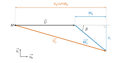
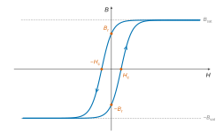
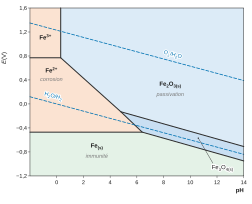
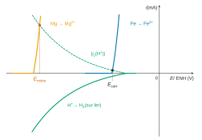

# e3a-Polytech PSI — Physique-chimie 2026 · Corrigé guidé

*Corrigé rédigé par IA, non officiel. Signalez toute erreur.*

## Présentation du sujet

**Thème** : « L'énergie hydraulique, première énergie renouvelable en région PACA ». On suit l'énergie de la retenue d'eau jusqu'au réseau, puis on s'intéresse à l'acier des conduites forcées. L'épreuve dure 4 heures, **sans calculatrice**. Elle compte **41 questions** : une question préliminaire et trois parties indépendantes. Les données sont dans les documents 1 et 2 (pages 12–13) et les aides au calcul sont placées dans les questions. Les résultats numériques se donnent avec **deux chiffres significatifs au plus**, et un résultat sans unité n'est pas compté.

| Partie | Questions | Contenu | Notions du programme PCSI/PSI |
|---|---|---|---|
| Préliminaire | Q1 | Puissance hydroélectrique moyenne par client. | Conversion d'énergie, ordres de grandeur |
| I.1 – Retenue d'eau | Q2–Q6 | Champ de pesanteur, pression hydrostatique, poussée sur un barrage. | Analogie électrostatique-gravitation, théorème de Gauss, DL, statique des fluides, forces pressantes |
| I.2 – Bassin et capteur | Q7–Q16 | Équation de d'Alembert acoustique, célérité du son, mesure de niveau par écho ultrasonore. | Approximation acoustique, linéarisation, compressibilité isentropique, loi de Laplace, paquet d'ondes |
| I.3 – Turbine Francis | Q17–Q22 | Énergie maximale d'un bassin, débit, couple d'Euler des turbomachines, puissance indiquée. | Énergie potentielle, débit volumique, référentiel non galiléen, bilan de moment cinétique en système ouvert, composition des vitesses |
| II.1 – Transformateur | Q23–Q27 | Lois du transformateur idéal, rendement et pertes. | Maxwell-flux, Maxwell-Faraday, théorème d'Ampère dans un milieu, ARQS, puissance |
| II.2 – Cycle d'hystérésis | Q28–Q31 | Montage de TP : $u_r\propto H$, $u_s\propto B$. | Ferromagnétisme doux, ALI en régime linéaire, fonction de transfert, intégrateur |
| II.3 – Réseau | Q32–Q33 | ARQS sur une ligne, facteur de puissance, très haute tension. | Propagation, ARQS, puissance active |
| III.1 – Corrosion | Q34–Q36 | Diagramme E-pH du fer, anode sacrificielle, dimensionnement. | Diagrammes E-pH, courbes intensité-potentiel, potentiel mixte, charge et Faraday |
| III.2 – Haut fourneau | Q37–Q41 | Réduction des oxydes de fer par CO. | Combinaison de réactions, $\Delta_rG^\circ$, variance, $K^\circ(T)$, déplacement d'équilibre, critère d'évolution |

**Difficulté.** Le rapport 2026 indique que le sujet a été volontairement conçu pour être très proche du cours, avec une sous-partie plus technique pour départager les meilleurs. Les passages délicats sont :

- la turbine Francis (I.3, Q17–Q22), la sous-partie que le jury désigne comme **discriminante** : peu de candidats l'ont abordée, et le bilan de moment cinétique dans le référentiel tournant (Q20) exige d'employer les vitesses **relatives** ;
- l'établissement de l'équation de d'Alembert (Q8–Q11), où le jury a sévèrement sanctionné les linéarisations approximatives ;
- le montage de tracé du cycle d'hystérésis (Q28–Q31), qui a posé des difficultés : impédance d'entrée, rôle de l'intégrateur, lecture des flèches des figures 7 et 8 ;
- la description du système hétérogène et les déplacements d'équilibre (Q37–Q41), mal maîtrisés selon le jury par une majorité de candidats ;
- la résolution de problème Q36 (étoilée), simple mais où les hypothèses sont notées.

**Questions abordables à ne pas laisser passer** : Q1–Q5, Q7–Q16, Q18–Q19, Q23–Q27 (questions de cours sur le transformateur), Q28, Q30, Q32–Q35, Q37, Q39, Q41.

**Calcul sans calculatrice.** Les aides sont faites pour être utilisées. L'une est grossière ($1{,}4\times8{,}3\approx10$ alors que le produit vaut 11,6) : suivez-la, puis signalez l'écart en une phrase. Le rapport 2026 rappelle aussi que chaque valeur numérique doit être commentée.

**Gestion du temps.** Comptez environ 1 h 35 pour la partie I (la plus longue, avec 22 questions), 1 h pour la partie II, 1 h pour la partie III et 10 minutes de relecture. Les parties étant indépendantes, la chimie (partie III), rapide et rentable, peut être traitée en premier.

## Question préliminaire

Une question d'ordre de grandeur pour se mettre en route.

### Question 1

> [!INDICATION]
> Une puissance moyenne est une énergie divisée par une durée. Ici, il faut en plus diviser par le nombre de clients.

> [!INDICATION]
> Gardez l'énergie en W·h et la durée en heures : la conversion en joules et en secondes est inutile. L'aide sert à diviser par 365.

#### Solution

L'énergie produite en 2022 vaut $E=49{,}6\ \mathrm{TW\cdot h}$, soit $4{,}96\cdot10^{13}\ \mathrm{W\cdot h}$. Elle est produite sur $\Delta t=1\ \text{an}=365\times24\ \mathrm h$, pour $N=4{,}0\cdot10^7$ clients :

$$\begin{aligned}
p&=\frac{E}{N\,\Delta t}\\
&=\frac{4{,}96\cdot10^{13}}{4{,}0\cdot10^{7}}\times\frac{1}{365}\times\frac1{24}\ \mathrm W\\
&\approx1{,}24\cdot10^{6}\times3\cdot10^{-3}\times\frac{1}{24}\ \mathrm W\\
&\approx1{,}5\cdot10^{2}\ \mathrm W.
\end{aligned}$$

$$\boxed{p\sim10^{2}\ \mathrm W\ \text{par client}}$$

La valeur exacte est $1{,}4\cdot10^2$ W. Comme l'hydroélectricité ne fournit que 11 % de la production métropolitaine, la production totale par client est d'environ neuf fois plus, de l'ordre du kilowatt, industrie et tertiaire compris : l'ordre de grandeur est plausible.

> [!PIEGE]
> 1 TW = $10^{12}$ W, pas $10^9$ W. Une puissance de dix perdue ici donne 0,1 W ou 100 kW par client : ce résultat absurde doit vous alerter.

> [!JURY]
> Le rapport 2026 rappelle « qu'une application numérique sans unité est sans valeur » et que « toute application numérique appelle un commentaire ». Ici, le commentaire naturel est la comparaison avec la consommation électrique par client.

## Partie I - Convertir l'énergie hydraulique en énergie électrique

La partie I suit l'eau : de la pesanteur qui la met en mouvement (I.1) à la mesure du niveau d'un bassin par ultrasons (I.2), puis à la turbine Francis qui convertit son énergie en travail mécanique (I.3). Les outils sont l'électrostatique par analogie, la statique des fluides, l'acoustique linéaire et la mécanique en référentiel tournant.

### Question 2

> [!INDICATION]
> Écrivez les deux lois de force avec le même vecteur unitaire. Comparez-les terme à terme : quelle grandeur joue le rôle de la charge ? Quelle constante joue le rôle de $1/(4\pi\varepsilon_0)$, et avec quel signe ?

> [!INDICATION]
> Pour le champ créé par la Terre, faites l'analyse des symétries et des invariances, puis choisissez une surface de Gauss adaptée.

#### Solution

On note $\vec u_{12}$ le vecteur unitaire dirigé de la particule 1 vers la particule 2, distantes de $r$. Les forces exercées par la particule 1 sur la particule 2 s'écrivent, en électrostatique puis en gravitation,

$$\begin{aligned}
\vec F_{q_1\to q_2}&=\frac{q_1q_2}{4\pi\varepsilon_0r^2}\,\vec u_{12},\\
\vec F_{m_1\to m_2}&=-\frac{\mathcal G\,m_1m_2}{r^2}\,\vec u_{12}.
\end{aligned}$$

L'analogie associe $q\leftrightarrow m$ et $\dfrac1{4\pi\varepsilon_0}\leftrightarrow-\mathcal G$, soit $\dfrac{1}{\varepsilon_0}\leftrightarrow-4\pi\mathcal G$. Elle transforme le théorème de Gauss électrostatique,

$$\oint_\Sigma\vec E\cdot\mathrm d\vec S=\frac{Q_{\text{int}}}{\varepsilon_0},$$

en **théorème de Gauss gravitationnel** : pour toute surface fermée $\Sigma$,

$$\oint_\Sigma\vec G\cdot\mathrm d\vec S=-4\pi\mathcal G\,M_{\text{int}}.$$

La distribution de masse est à symétrie sphérique de centre $O$. Tout plan contenant la droite $(OM)$ est un plan de symétrie de la distribution. Le champ $\vec G(M)$ appartient à tous ces plans : il est **radial**, $\vec G(M)=G\,\vec u_r$.

L'invariance par toute rotation autour de $O$ fait que $G$ ne dépend que de $r$.

Soit $M$ extérieur à la Terre, à la distance $r>R_T$ du centre. On choisit comme surface de Gauss la sphère de centre $O$ et de rayon $r$. Le flux sortant vaut $4\pi r^2G(r)$ et la masse intérieure est $M_T$ :

$$G(r)\,4\pi r^2=-4\pi\mathcal GM_T,$$

d'où

$$\boxed{\vec G(M)=-\frac{\mathcal G M_T}{r^2}\,\vec u_r}\qquad(r>R_T).$$

> [!PIEGE]
> Le signe : deux charges de même signe se repoussent, alors que deux masses s'attirent toujours. Sans le signe moins dans l'analogie, on obtiendrait un champ gravitationnel répulsif.

> [!JURY]
> Rapport 2026 : l'analogie est connue, et « L'application du théorème a été correctement réalisée par les meilleurs étudiants après avoir justifié le caractère radial de $\vec G$ ». La justification par les plans de symétrie fait partie de la réponse attendue.

### Question 3

> [!INDICATION]
> Évaluez le champ de Q2 en $r=R_T$, puis en $r=R_T+h$.

> [!INDICATION]
> Factorisez par $R_T$ et utilisez $(1+\varepsilon)^{\alpha}\simeq1+\alpha\varepsilon$.

#### Solution

Au sol ($r=R_T$), avec les données du document 2 :

$$\begin{aligned}
g_T&=\frac{\mathcal GM_T}{R_T^2}\\
&=\frac{6{,}7\cdot10^{-11}\times6{,}0\cdot10^{24}}{(6{,}4\cdot10^6)^2}\ \mathrm{m\cdot s^{-2}}\\
&\approx9{,}8\ \mathrm{m\cdot s^{-2}},
\end{aligned}$$

en accord avec la valeur du document 2.

Pour $h\ll R_T$, un développement limité à l'ordre 1 en $h/R_T$ donne

$$\begin{aligned}
g(h)&=\frac{\mathcal GM_T}{(R_T+h)^2}\\
&=\frac{g_T}{(1+h/R_T)^2}\\
&\simeq g_T\left(1-\frac{2h}{R_T}\right).
\end{aligned}$$

$$\boxed{g(h)\simeq g_T\left(1-\frac{2h}{R_T}\right)}$$

La variation relative vaut $2h/R_T$. Elle est inférieure à $10^{-3}$ si $h<h_{\max}$, avec

$$\begin{aligned}
h_{\max}&=\frac{10^{-3}R_T}{2}\\
&=\frac{6{,}4\cdot10^{6}\times10^{-3}}{2}\ \mathrm m.
\end{aligned}$$

$$\boxed{h_{\max}\approx3{,}2\ \mathrm{km}}$$

> [!PIEGE]
> Le facteur 2 vient de l'exposant $-2$. L'oublier double $h_{\max}$.

### Question 4

> [!INDICATION]
> Comparez la hauteur d'un barrage au résultat de Q3 et concluez par une phrase.

#### Solution

L'extension verticale d'un barrage est de quelques dizaines de mètres, très inférieure à $h_{\max}\approx3$ km. La variation relative de $g$ y est de l'ordre de $2\times30/(6{,}4\cdot10^6)\sim10^{-5}$.

La direction de $\vec g$ varie aussi de façon négligeable, d'un angle de l'ordre de $L/R_T\sim10^{-4}$ rad sur la longueur du barrage. **Le champ de pesanteur est uniforme à l'échelle de l'ouvrage**, ce qui justifie l'hypothèse de la suite.

### Question 5

> [!INDICATION]
> Relation fondamentale de la statique des fluides. Attention à l'orientation de $(Oz)$, ici vers le bas.

#### Solution

L'eau est un fluide incompressible au repos dans le champ uniforme $\vec g=g\,\vec u_z$. La relation fondamentale de la statique des fluides s'écrit

$$\overrightarrow{\mathrm{grad}}\,P=\mu_e\vec g.$$

Projetée sur l'axe $(Oz)$, orienté vers le bas :

$$\frac{\mathrm dP}{\mathrm dz}=\mu_eg.$$

La continuité de la pression à l'interface donne $P(0)=P_0$, d'où

$$\boxed{P(z)=P_0+\mu_e\,g\,z}.$$

Avec $(Oz)$ descendant, la pression augmente avec la profondeur : le signe est le bon.

### Question 6

> [!INDICATION]
> Découpez la face amont, verticale, en bandes horizontales de hauteur $\mathrm dz$ et de longueur $L$, sur lesquelles la pression est uniforme.

> [!INDICATION]
> La question porte sur la force « exercée par l'eau ». Demandez-vous aussi ce que fait l'atmosphère sur l'autre face, et quelle force compte pour la stabilité du barrage.

#### Solution

La face amont est un rectangle vertical de hauteur $H$ et de longueur $L$. Sa normale $\vec u_x$ est dirigée de l'eau vers le barrage. La force exercée par l'eau est

$$\begin{aligned}
\vec F_{\text{eau}}&=\int_0^H\big(P_0+\mu_egz\big)\,L\,\mathrm dz\;\vec u_x\\
&=\left(P_0H+\frac12\mu_egH^2\right)L\,\vec u_x.
\end{aligned}$$

$$\boxed{\vec F_{\text{eau}}=HL\left(P_0+\frac{\mu_egH}{2}\right)\vec u_x}$$

L'atmosphère, à pression uniforme $P_0$, agit sur la face aval inclinée. La composante horizontale de cette action vaut $-P_0HL\,\vec u_x$ : c'est la projection de la face sur un plan vertical. La résultante horizontale nette des forces pressantes est donc

$$\vec F_{\text{net}}=\frac12\mu_egH^2L\,\vec u_x.$$

Avec l'aide au calcul, $HL\approx9{,}1\cdot10^3\ \mathrm{m^2}$ :

$$\begin{aligned}
\|\vec F_{\text{net}}\|&\approx\frac12\times1{,}0\cdot10^3\times9{,}8\times15\times9{,}1\cdot10^3\ \mathrm N\\
&\approx\boxed{6{,}7\cdot10^{8}\ \mathrm N},\\
\|\vec F_{\text{eau}}\|&\approx9{,}1\cdot10^3\times(1{,}0\cdot10^5+7{,}4\cdot10^4)\ \mathrm N\\
&\approx\boxed{1{,}6\cdot10^{9}\ \mathrm N}.
\end{aligned}$$

L'ordre de grandeur est $10^9$ N, soit le poids de $10^5$ tonnes.

> [!METHODE]
> Pour une résultante de forces pressantes, $P_0$ uniforme ne contribue pas sur une surface fermée. Dès qu'un solide baigne dans l'atmosphère sur ses autres faces, seule la surpression $P-P_0$ compte. Dites explicitement quelle force vous calculez.

> [!JURY]
> Le rapport 2026 souligne « les nombreuses confusions entre grandeurs scalaires et grandeurs vectorielles » et ajoute : « Ces confusions sont à l'origine d'erreurs graves. » Écrivez la force comme un vecteur, puis donnez sa norme : ne mélangez pas les deux dans une même égalité.

### Question 7

> [!INDICATION]
> Qu'est-ce qui est « petit » dans l'approximation acoustique, et devant quoi ? Quelle conséquence mathématique en tire-t-on pour les équations ?

#### Solution

L'onde est une **petite perturbation** de l'état de repos : $|\tilde p|\ll P_0$, $|\tilde\varrho|\ll\varrho_0$, et $|\tilde v|$ est très petite devant la célérité de l'onde. Les champs perturbés et leurs dérivées sont des infiniment petits du premier ordre.

On **linéarise** les équations en négligeant tous les produits de grandeurs perturbées. On néglige aussi la pesanteur et la viscosité.

### Question 8

> [!INDICATION]
> Écrivez $\partial_t\varrho+\partial_z(\varrho v)=0$ et développez $\varrho v$ : repérez le terme d'ordre 2.

#### Solution

Conservation de la masse à une dimension :

$$\frac{\partial\varrho}{\partial t}+\frac{\partial(\varrho v)}{\partial z}=0.$$

Avec $\varrho=\varrho_0+\tilde\varrho$ et $v=\tilde v$ :

$$\varrho v=\varrho_0\tilde v+\tilde\varrho\,\tilde v.$$

Le terme $\tilde\varrho\tilde v$ est d'ordre 2. Comme $\varrho_0$ est constant et uniforme, $\partial\varrho/\partial t=\partial\tilde\varrho/\partial t$. Il reste, à l'ordre 1,

$$\boxed{\frac{\partial\tilde\varrho}{\partial t}+\varrho_0\frac{\partial\tilde v}{\partial z}=0}.$$

### Question 9

> [!INDICATION]
> Nommez chaque terme : deux contributions à l'accélération particulaire, et les forces de pression. Lequel est non linéaire ?

> [!INDICATION]
> Pour linéariser, remplacez chaque champ par « repos + perturbation » et développez tous les produits, y compris $\varrho\,\partial_t\tilde v$.

#### Solution

Les termes de l'équation (1) sont les suivants :

- $\varrho\,\partial_t\tilde v$ : accélération locale, par unité de volume ;
- $\varrho\,\tilde v\,\partial_z\tilde v$ : accélération convective, non linéaire ;
- $-\partial_zP$ : résultante volumique des forces de pression.

Simplification à l'ordre 1 :

- $\varrho\,\partial_t\tilde v=\varrho_0\,\partial_t\tilde v+\tilde\varrho\,\partial_t\tilde v$, et le second terme est d'ordre 2 ;
- le terme convectif est d'ordre 2 au moins ;
- $P_0$ est uniforme, donc $\partial_zP=\partial_z\tilde p$.

Il reste

$$\boxed{\varrho_0\frac{\partial\tilde v}{\partial t}=-\frac{\partial\tilde p}{\partial z}}.$$

### Question 10

> [!INDICATION]
> Écrivez la variation de $\varrho$ au premier ordre en fonction de la variation de $P$, l'évolution étant isentropique. Le coefficient est évalué au repos.

#### Solution

À entropie fixée, un développement à l'ordre 1 au voisinage du repos donne

$$\begin{aligned}
\varrho-\varrho_0&\simeq\left(\frac{\partial\varrho}{\partial P}\right)_{S}(P-P_0)\\
&=\varrho_0\chi_s\,(P-P_0),
\end{aligned}$$

où $\chi_s$ est évalué dans l'état $(\varrho_0,P_0,T_0)$. D'où

$$\boxed{\tilde\varrho=\varrho_0\,\chi_s\,\tilde p}.$$

### Question 11

> [!INDICATION]
> Éliminez $\tilde v$ : dérivez une équation par rapport à $t$, l'autre par rapport à $z$.

> [!INDICATION]
> Il reste $\tilde\varrho$ : utilisez Q10 pour l'exprimer en fonction de $\tilde p$.

#### Solution

On dérive (Q8) par rapport à $t$ :

$$\frac{\partial^2\tilde\varrho}{\partial t^2}=-\varrho_0\frac{\partial^2\tilde v}{\partial t\,\partial z}.$$

On dérive (Q9) par rapport à $z$ :

$$\varrho_0\frac{\partial^2\tilde v}{\partial z\,\partial t}=-\frac{\partial^2\tilde p}{\partial z^2}.$$

Les champs sont de classe $C^2$, donc les dérivées croisées sont égales. En éliminant $\tilde v$ :

$$\frac{\partial^2\tilde\varrho}{\partial t^2}=\frac{\partial^2\tilde p}{\partial z^2}.$$

Avec $\tilde\varrho=\varrho_0\chi_s\tilde p$, où $\varrho_0\chi_s$ est constant :

$$\frac{\partial^2\tilde p}{\partial z^2}=\varrho_0\chi_s\frac{\partial^2\tilde p}{\partial t^2},$$

c'est-à-dire l'équation (2) avec $1/c_s^2=\varrho_0\chi_s$.

> [!PIEGE]
> Le résultat est donné : la tentation est d'y arriver « à tout prix ». Chaque terme négligé doit être nommé et reconnu d'ordre 2, et chaque équation de couplage (Q8, Q9, Q10) doit être linéarisée avant d'être combinée. Une étape escamotée se voit.

> [!JURY]
> Rapport 2026 : « Le jury a sévèrement sanctionné toute malhonnêteté intellectuelle dans l'établissement de l'équation de d'Alembert satisfaite par la surpression acoustique. » Il précise que « la linéarisation des différentes équations de couplage n'est pas toujours rigoureuse ».

### Question 12

> [!INDICATION]
> Identifiez le coefficient, puis faites l'analyse dimensionnelle (un Pa est un N/m²).

#### Solution

C'est l'**équation de d'Alembert** à une dimension.

$$\boxed{c_s=\frac{1}{\sqrt{\varrho_0\chi_s}}}$$

Dimension :

$$\begin{aligned}
[\varrho_0\chi_s]&=\mathrm{kg\cdot m^{-3}}\cdot\mathrm{Pa^{-1}}\\
&=\mathrm{kg\cdot m^{-3}\cdot kg^{-1}\cdot m\cdot s^{2}}\\
&=\mathrm{s^2\cdot m^{-2}}.
\end{aligned}$$

$c_s$ est une **vitesse** : la célérité des ondes sonores dans le milieu au repos.

### Question 13

> [!INDICATION]
> Équation d'état des gaz parfaits écrite avec la masse volumique, puis loi de Laplace écrite avec $\varrho$ au lieu de $V$.

#### Solution

L'équation d'état $P_0V=\dfrac{m}{\mathcal M_{\text{air}}}RT_0$ donne

$$\boxed{\varrho_0=\frac{P_0\,\mathcal M_{\text{air}}}{RT_0}}.$$

Pour une quantité fixée de gaz parfait en évolution isentropique, à $\gamma$ constant, la loi de Laplace $PV^\gamma=\text{cste}$ s'écrit avec $V\propto1/\varrho$ :

$$\boxed{\frac{P}{\varrho^{\gamma}}=\text{cste}}.$$

### Question 14

> [!INDICATION]
> Différentiez logarithmiquement la loi de Laplace pour obtenir $\chi_s$.

> [!INDICATION]
> Pour la masse molaire moyenne, pondérez par les fractions molaires. Les données sont des masses molaires atomiques : $\mathrm{N_2}$ et $\mathrm{O_2}$ sont diatomiques.

#### Solution

En différentiant logarithmiquement la loi de Laplace :

$$\frac{\mathrm dP}{P}=\gamma\frac{\mathrm d\varrho}{\varrho}.$$

Donc, dans l'état de repos,

$$\begin{aligned}
\chi_s&=\frac1\varrho\left(\frac{\partial\varrho}{\partial P}\right)_S\\
&=\frac1{\gamma P_0}.
\end{aligned}$$

Avec l'expression de $\varrho_0$ de Q13 :

$$\begin{aligned}
c_s&=\sqrt{\frac{\gamma P_0}{\varrho_0}}\\
&=\sqrt{\gamma P_0\,\frac{RT_0}{P_0\mathcal M_{\text{air}}}}.
\end{aligned}$$

$$\boxed{c_s=\sqrt{\frac{\gamma RT_0}{\mathcal M_{\text{air}}}}}$$

L'air sec contient, en fractions molaires, environ 78 % de diazote, 21 % de dioxygène et 1 % d'argon. On l'assimile à un mélange de diazote, de fraction molaire $x_{\mathrm{N_2}}\approx0{,}8$, et de dioxygène, de fraction molaire $x_{\mathrm{O_2}}\approx0{,}2$ :

$$\boxed{\mathcal M_{\text{air}}=x_{\mathrm{N_2}}\cdot2\mathcal M_N+x_{\mathrm{O_2}}\cdot2\mathcal M_O}.$$

> [!PIEGE]
> Deux erreurs classiques : pondérer par des fractions massiques, et utiliser 14 et 16 g/mol au lieu de 28 et 32 g/mol. On doit trouver environ 29 g/mol.

> [!JURY]
> Rapport 2026 : « L'obtention de l'expression de la célérité des ondes acoustiques en fonction de la température a posé un certain nombre de difficultés. Un certain nombre d'étudiants ne connaissent pas la composition de l'air. »

### Question 15

> [!INDICATION]
> Calculez d'abord $\mathcal M_{\text{air}}$, puis utilisez les trois aides dans l'ordre où elles apparaissent.

#### Solution

Masse molaire de l'air :

$$\begin{aligned}
\mathcal M_{\text{air}}&\approx0{,}8\times28+0{,}2\times32\ \mathrm{g\cdot mol^{-1}}\\
&\approx29\ \mathrm{g\cdot mol^{-1}}.
\end{aligned}$$

Masse volumique, avec l'aide $1/8{,}3\approx0{,}12$ :

$$\begin{aligned}
\varrho_0&=\frac{1{,}0\cdot10^5\times2{,}9\cdot10^{-2}}{8{,}3\times3{,}0\cdot10^2}\ \mathrm{kg\cdot m^{-3}}\\
&\approx\frac{2{,}9\cdot10^3\times0{,}12}{3{,}0\cdot10^2}\ \mathrm{kg\cdot m^{-3}}\\
&\approx\boxed{1{,}2\ \mathrm{kg\cdot m^{-3}}}.
\end{aligned}$$

Célérité, avec l'aide $1{,}4\times8{,}3\approx10$ :

$$\begin{aligned}
c_s&\approx\sqrt{\frac{10\times3{,}0\cdot10^2}{2{,}9\cdot10^{-2}}}\ \mathrm{m\cdot s^{-1}}\\
&\approx\sqrt{10^{5}}\ \mathrm{m\cdot s^{-1}}\\
&=\sqrt{10}\times10^2\ \mathrm{m\cdot s^{-1}}\\
&\approx\boxed{3{,}2\cdot10^{2}\ \mathrm{m\cdot s^{-1}}}.
\end{aligned}$$

L'aide $1{,}4\times8{,}3\approx10$ est grossière, puisque le produit vaut 11,6. Le calcul exact donne $3{,}5\cdot10^2\ \mathrm{m\cdot s^{-1}}$, la valeur usuelle vers 300 K.

> [!PIEGE]
> $\sqrt{10^5}$ vaut $316$, pas $350$. Gardez $10^5=10\times10^4$ pour extraire la racine.

### Question 16

> [!INDICATION]
> Que parcourt l'onde entre l'émission et la réception ? Lisez le décalage entre les centres des deux salves.

> [!INDICATION]
> « Faiblement dispersif » sert à justifier que le paquet se propage sans déformation, à la célérité $c_s$.

#### Solution

La salve émise est centrée en $t\approx0$ et l'écho en $t\approx0{,}044$ s. Dans un milieu peu dispersif, la vitesse de groupe est égale à $c_s$ et l'enveloppe n'est pas déformée. On peut donc repérer le retard sur les maxima des enveloppes.

L'onde parcourt l'aller-retour $2d$ entre le capteur et la surface :

$$\begin{aligned}
d&=\frac{c_s\Delta t}{2}\\
&=\frac{3{,}4\cdot10^2\times4{,}4\cdot10^{-2}}{2}\ \mathrm m\\
&\approx7{,}5\ \mathrm m.
\end{aligned}$$

$$\begin{aligned}
h(t_{\text{mes}})&=H_{\text{capteur}}-d\\
&=8{,}5-7{,}5\ \mathrm m.
\end{aligned}$$

$$\boxed{h(t_{\text{mes}})\approx1{,}0\ \mathrm m}$$

> [!PIEGE]
> Sans le facteur 2 de l'aller-retour, on trouve $d=15$ m et une hauteur d'eau négative.

### Question 17

> [!INDICATION]
> Toutes les tranches d'eau du bassin ne tombent pas de la même hauteur : découpez en tranches horizontales.

> [!INDICATION]
> Le résultat est la variation d'énergie potentielle d'une masse dont le centre de masse descend d'une hauteur que vous identifierez. Pour « maximale », listez ce que le calcul suppose parfait.

#### Solution

Une tranche d'épaisseur $\mathrm dz$, à la cote $z\in[0,h_0]$ au-dessus du sol du bassin, descend de $H+z$ jusqu'à l'entrée $E$ :

$$\begin{aligned}
E_{\max}&=\int_0^{h_0}\mu_eSg(H+z)\,\mathrm dz\\
&=\mu_e\,g\,S\,h_0\left(H+\frac{h_0}{2}\right).
\end{aligned}$$

$$\boxed{E_{\max}=\mu_e\,g\,S\,h_0\left(H+\frac{h_0}{2}\right)}$$

On retrouve $mg\,\Delta z_G$, avec $m=\mu_eSh_0$ et $\Delta z_G=H+h_0/2$. C'est un **maximum** parce qu'on suppose toute l'énergie potentielle convertie en énergie électrique. En réalité :

- l'eau est freinée par les frottements visqueux dans les conduites (pertes de charge) ;
- elle sort de la turbine avec une énergie cinétique résiduelle ;
- la turbine et l'alternateur ont des pertes mécaniques et électriques.

### Question 18

> [!INDICATION]
> À travers quelle surface le fluide entre-t-il dans la roue ? Quelle composante de la vitesse est normale à cette surface ?

#### Solution

À l'entrée, le fluide traverse la surface latérale du cylindre de rayon $R_e$ et de hauteur $e_e$, dont la normale est radiale. Seule la composante radiale contribue au flux. Le débit se conserve, puisque le fluide est incompressible et l'écoulement stationnaire :

$$\boxed{\begin{aligned}
D_v&=2\pi R_e\,e_e\,V_{r,e}\\
&=2\pi R_s\,e_s\,V_{r,s}
\end{aligned}}$$

où $V_r>0$ désigne la norme de la composante radiale (l'écoulement est centripète, de $R_e$ vers $R_s<R_e$).

### Question 19

> [!INDICATION]
> Un référentiel galiléen est en translation rectiligne uniforme par rapport à un autre référentiel galiléen. Est-ce le cas ici ?

#### Solution

La roue tourne à $\omega$ autour d'un axe fixe dans le référentiel terrestre, supposé galiléen. Son référentiel n'est pas en translation rectiligne uniforme par rapport à celui-ci : un point fixe de la roue a une accélération $-\omega^2r\,\vec u_r\neq\vec 0$. **Le référentiel de la roue n'est pas galiléen** : comme l'indique l'énoncé, on n'y applique les théorèmes de la mécanique qu'en ajoutant le moment des forces d'inertie, dont l'expression est admise.

### Question 20

> [!INDICATION]
> Méthode du système fermé : volume de contrôle fixe dans le référentiel de la roue, plus la masse $\mu_eD_v\,\mathrm dt$ qui entre pendant $\mathrm dt$. En régime stationnaire, seuls comptent les flux de moment cinétique à l'entrée et à la sortie.

> [!INDICATION]
> Dans le référentiel de la roue, les vitesses à utiliser sont les vitesses **relatives** $\vec W$. Faites le bilan des moments : poids, pression sur les sections d'entrée et de sortie, forces d'inertie (moment donné par l'énoncé) et action de la roue. Lesquels sont nuls par rapport à l'axe ?

> [!INDICATION]
> Passez des vitesses relatives aux vitesses absolues par $W_\theta=V_\theta-\omega R$, et regardez ce que devient le terme $\Gamma_{\text{inertie}}$.

#### Solution

**Volume de contrôle** $\mathcal V$, fixe dans le référentiel de la roue : il est limité par les flasques, le cylindre d'entrée $(R_e,e_e)$ et le cylindre de sortie $(R_s,e_s)$.

**Système fermé** $\Sigma$. À l'instant $t$, c'est le contenu de $\mathcal V$ plus la masse qui va entrer pendant $\mathrm dt$ :

$$\delta m=\mu_eD_v\,\mathrm dt.$$

À l'instant $t+\mathrm dt$, c'est le contenu de $\mathcal V$ plus la masse $\delta m$ sortie entre-temps. C'est à ce système fermé que s'applique le théorème du moment cinétique.

Dans le référentiel de la roue, l'écoulement est stationnaire : le contenu de $\mathcal V$ garde le même moment cinétique. Par rapport à l'axe, une masse $\delta m$ située à la distance $R$ a pour moment cinétique $\delta m\,RW_\theta$. D'où

$$\frac{\mathrm dL_z(\Sigma)}{\mathrm dt}=\mu_eD_v\big(R_sW_{\theta,s}-R_eW_{\theta,e}\big).$$

Moments par rapport à l'axe $Oz$ :

- le poids est parallèle à l'axe : moment nul ;
- les forces de pression sur les sections d'entrée et de sortie sont radiales : moment nul ;
- les actions des aubes et des flasques sur le fluide ont un moment $\mathcal M_{\text{roue}\to\text{fluide}}$ ;
- les forces d'inertie, dues au caractère non galiléen du référentiel (Q19), ont pour moment total $\Gamma_{\text{inertie}}=-\mu_eD_v\omega(R_s^2-R_e^2)$, expression admise par l'énoncé.

Le théorème du moment cinétique dans le référentiel de la roue s'écrit

$$\mu_eD_v\big(R_sW_{\theta,s}-R_eW_{\theta,e}\big)=\mathcal M_{\text{roue}\to\text{fluide}}-\mu_eD_v\,\omega\,(R_s^2-R_e^2).$$

Avec $W_\theta=V_\theta-\omega R$, le premier membre vaut

$$\mu_eD_v\big(R_sV_{\theta,s}-R_eV_{\theta,e}\big)-\mu_eD_v\omega(R_s^2-R_e^2).$$

Le terme en $\omega$ se simplifie :

$$\mathcal M_{\text{roue}\to\text{fluide}}=\mu_eD_v\big(R_sV_{\theta,s}-R_eV_{\theta,e}\big).$$

Par les actions réciproques, $\Gamma_i=-\mathcal M_{\text{roue}\to\text{fluide}}$. On remplace $D_v$ par $2\pi R_ee_eV_{r,e}$ dans le terme d'entrée et par $2\pi R_se_sV_{r,s}$ dans le terme de sortie :

$$\boxed{\Gamma_i=2\pi\mu_e\left(R_e^2V_{r,e}V_{\theta,e}\,e_e-R_s^2V_{r,s}V_{\theta,s}\,e_s\right)}.$$

> [!METHODE]
> Un bilan en référentiel tournant se fait avec les vitesses relatives **et** les forces d'inertie. On peut aussi faire le bilan avec les vitesses absolues dans le référentiel galiléen, sans force d'inertie : les deux voies donnent le même résultat. Mélanger les deux, c'est-à-dire des vitesses absolues avec $\Gamma_{\text{inertie}}$, est faux.

> [!PIEGE]
> Le signe de $\Gamma_i$. Le couple exercé **par le fluide sur la roue** est l'opposé du moment exercé par la roue sur le fluide. Le fluide perd du moment cinétique en traversant la roue, et c'est ce moment cinétique qui entraîne l'arbre.

> [!JURY]
> Rapport 2026, sur la sous-partie I.3 : « La construction du sur-système fermé en lien avec le système ouvert n'est pas systématique. Raisonner dans le référentiel lié à la roue Francis permettait de considérer l'écoulement stationnaire. » Définir explicitement le volume de contrôle et le système fermé associé, comme le demande l'énoncé (« en définissant rigoureusement »), rapporte des points.

### Question 21

> [!INDICATION]
> $\vec U$ est la vitesse du point coïncident de la roue, en mouvement circulaire. Dans quelle direction est-il ?

> [!INDICATION]
> Projetez $\vec V=\vec U+\vec W$ sur $\vec u_\theta$ et sur $\vec u_r$, puis exprimez les composantes de $\vec W$ avec l'angle $\beta$.

#### Solution

$$\boxed{\vec U(M)=r\,\omega\,\vec u_\theta}$$

$\vec U$ est orthoradial. On projette $\vec V=\vec U+\vec W$ :

- sur $\vec u_\theta$ : $V_\theta=U+W_\theta$ ;
- sur $\vec u_r$ : les composantes radiales de $\vec V$ et $\vec W$ ont la même norme $V_r$.

Dans le plan normal à l'axe, $\vec W_{/\!/}$ fait l'angle $\beta$ avec $\vec U$ :

$$\begin{aligned}
W_\theta&=W_{/\!/}\cos\beta,\\
V_r&=W_{/\!/}\sin\beta.
\end{aligned}$$

D'où $W_\theta=V_r/\tan\beta$ et

$$\boxed{V_\theta=U+\frac{V_r}{\tan\beta}}.$$

> [!PIEGE]
> Cette relation suppose que $V_r$ désigne la norme de la composante radiale, et que $\beta$ est mesuré à partir de $\vec U$ lui-même et non de son opposé. Précisez votre convention en une phrase.

### Question 22

> [!INDICATION]
> Reportez Q21 en entrée et en sortie dans $\Gamma_i=\mu_eD_v(R_eV_{\theta,e}-R_sV_{\theta,s})$, puis éliminez $R V_r$ grâce à Q18.

> [!INDICATION]
> Pour la dernière question, demandez-vous ce que le modèle d'écoulement parfait a laissé de côté entre la roue et l'arbre.

#### Solution

D'après Q18 :

$$\begin{aligned}
R_eV_{r,e}&=\frac{D_v}{2\pi e_e},\\
R_sV_{r,s}&=\frac{D_v}{2\pi e_s}.
\end{aligned}$$

En reportant $V_\theta=\omega R+V_r/\tan\beta$ en entrée et en sortie :

$$\boxed{\Gamma_i=\mu_eD_v\,\omega\,(R_e^2-R_s^2)+\frac{\mu_eD_v^2}{2\pi}\left(\frac{1}{e_e\tan\beta_e}-\frac{1}{e_s\tan\beta_s}\right)}$$

$$\boxed{\begin{aligned}
\mathcal P_i&=\Gamma_i\,\omega\\
&=\mu_eD_v\,\omega^2(R_e^2-R_s^2)+\frac{\mu_eD_v^2\,\omega}{2\pi}\left(\frac{1}{e_e\tan\beta_e}-\frac{1}{e_s\tan\beta_s}\right)
\end{aligned}}$$

Le couple disponible $\Gamma$ est inférieur à $\Gamma_i$ parce qu'une partie du couple transmis par le fluide compense les **frottements** : frottements solides dans les paliers, la butée et les joints, frottement visqueux de l'eau sur les faces extérieures de la roue, et fuites entre roue et carter. Le modèle d'écoulement parfait ne les prend pas en compte.

## Partie II - Transport de l'énergie électrique

On établit les lois du transformateur idéal à partir des équations de Maxwell (II.1). On analyse ensuite le montage de TP qui trace le cycle d'hystérésis d'un noyau réel (II.2), puis on justifie l'ARQS et le transport sous très haute tension (II.3). Selon le rapport 2026, les questions de cours sur le transformateur (Q23–Q27) ont été bien traitées par les candidats qui connaissaient leur cours ; le montage de TP (Q28–Q31) a davantage départagé. Une grande partie des points s'y joue sur la lecture des conventions de signe des figures 7 et 8.

### Question 23

> [!INDICATION]
> Qu'est-ce qui induit une tension au secondaire ? Que vaut-il si tout est constant ?

#### Solution

**Non.** En régime continu, le flux $\Phi$ est constant et la force électromotrice $N_2\,\mathrm d\Phi/\mathrm dt$ est nulle : aucune puissance n'est transmise au secondaire. De plus, le primaire, de résistance nulle, serait un court-circuit pour la source. Le fonctionnement repose sur la variation temporelle du flux.

### Question 24

> [!INDICATION]
> Flux de $\vec B$ à travers une surface fermée. Laquelle choisir, sachant qu'il n'y a pas de fuites ?

#### Solution

$$\boxed{\operatorname{div}\vec B=0}$$

Le flux de $\vec B$ à travers toute surface fermée est nul. On prend la surface formée de deux sections droites et de la paroi latérale du tore entre elles. Sans fuites, les lignes de champ restent dans le tore, donc le flux latéral est nul.

**Le flux $\Phi$ est le même à travers toute section droite**, et $\Phi=B(t)S$ puisque $a\gg\sqrt S$.

> [!PIEGE]
> La divergence est un scalaire : on écrit $\operatorname{div}\vec B$, pas $\overrightarrow{\mathrm{div}}\,\vec B$. C'est une confusion scalaire-vecteur du type de celles que le rapport 2026 juge à l'origine d'erreurs graves.

### Question 25

> [!INDICATION]
> Intégrez Maxwell-Faraday le long d'une spire (théorème de Stokes), puis multipliez par le nombre de spires traversées par le même flux.

#### Solution

$$\boxed{\overrightarrow{\mathrm{rot}}\,\vec E=-\frac{\partial\vec B}{\partial t}}$$

La circulation de $\vec E$ sur une spire vaut $-\mathrm d\Phi/\mathrm dt$. Les fils sont parfaits, donc le champ électrique est nul dans le cuivre. Les tensions sont orientées selon les bornes homologues de la figure 7 :

$$\begin{aligned}
u_1&=N_1\frac{\mathrm d\Phi}{\mathrm dt},\\
u_2&=N_2\frac{\mathrm d\Phi}{\mathrm dt}.
\end{aligned}$$

$$\boxed{u_2(t)=\frac{N_2}{N_1}\,u_1(t)}$$

C'est la **loi de transformation des tensions**.

### Question 26

> [!INDICATION]
> Théorème d'Ampère pour l'excitation $\vec H$ sur la ligne moyenne du tore. Regardez sur la figure 7 par quelle borne chaque courant entre.

> [!INDICATION]
> Que devient $H=B/(\mu_0\mu_r)$ quand $\mu_r$ est très grand, sachant que $B$ est fixé par la tension $u_1$ ?

#### Solution

En ARQS, dans un milieu magnétique :

$$\oint_{\mathcal C}\vec H\cdot\mathrm d\vec\ell=I_{\text{enlacé}}.$$

Sur la ligne moyenne de rayon $a$, $i_1$ et $i_2$ entrent tous deux par les bornes pointées, donc leurs ampères-tours s'ajoutent :

$$H\cdot2\pi a=N_1i_1+N_2i_2.$$

Le champ $B$ reste fini, imposé par $u_1$. Donc $H=B/(\mu_0\mu_r)$ tend vers 0 quand $\mu_r\to\infty$ :

$$\boxed{i_2(t)=-\frac{N_1}{N_2}\,i_1(t)},$$

qui est la **loi de transformation des intensités**.

> [!PIEGE]
> Le signe dépend des conventions : avec les deux courants entrant par les bornes homologues, il y a un signe moins. Une perméabilité grande ne rend pas $H$ grand, elle le rend petit.

### Question 27

> [!INDICATION]
> Comparez la puissance reçue par le primaire et la puissance cédée à la charge par le secondaire, en tenant compte des conventions.

#### Solution

La puissance cédée à la charge vaut

$$\begin{aligned}
-u_2i_2&=\frac{N_2}{N_1}u_1\cdot\frac{N_1}{N_2}i_1\\
&=u_1i_1.
\end{aligned}$$

Elle est égale à chaque instant à la puissance reçue par le primaire :

$$\boxed{\eta=1}.$$

Les pertes réelles sont :

- les **pertes cuivre** (effet Joule dans les enroulements) ;
- les **pertes fer** : hystérésis, proportionnelle à l'aire du cycle et à la fréquence, et courants de Foucault, que l'on réduit en feuilletant le circuit ;
- les **fuites magnétiques**.

Les rendements réels vont de **95 % à plus de 99 %** pour les gros transformateurs.

### Question 28

> [!INDICATION]
> « Doux » s'oppose à « dur » (aimants). Pensez à l'aire du cycle et à ce qu'elle représente.

> [!INDICATION]
> Pour le tracé, placez l'axe $H$ en abscisse et $B$ en ordonnée. $B_r$ et $H_c$ sont les intersections du cycle avec les axes.

#### Solution

Un ferromagnétique **doux** présente :

- un cycle **étroit**, donc de faibles pertes par hystérésis ;
- une excitation coercitive **faible** ;
- une perméabilité très élevée ($10^3$ à $10^5$) et une forte aimantation à saturation.

Il convient aux circuits magnétiques en régime alternatif.

Le cycle plafonne vers $B_{\text{sat}}\sim1{,}5$ T ; le champ rémanent $B_r$ est de l'ordre du tesla.

$$\boxed{H_c\sim10\ \text{à}\ 10^2\ \mathrm{A\cdot m^{-1}}}$$

C'est la valeur pour le fer doux et les tôles Fe-Si. Elle est de $10^5$ à $10^6\ \mathrm{A\cdot m^{-1}}$ pour un aimant.

> [!JURY]
> La conclusion du rapport 2026 le rappelle : « Les schémas doivent être soignés et légendés. » Sur le cycle, nommez les axes, placez $B_r$, $H_c$ et la saturation, et indiquez le sens de parcours.

### Question 29

> [!INDICATION]
> Commencez par le potentiel de l'entrée $+$ : quel courant traverse la résistance $\sim R/2$ ? Déduisez-en $v_-$.

> [!INDICATION]
> Relevez avec soin le sens de la flèche de $i(t)$ sur la figure 8 : la définition $\underline{Z_e}=-u_e/i$ en tient compte.

> [!INDICATION]
> Pour $K$, appliquez à nouveau le théorème d'Ampère, mais sans faire tendre $\mu_r$ vers l'infini : on veut justement mesurer $H$ dans le matériau réel.

#### Solution

L'ALI est idéal et la rétroaction négative (par $R\parallel C$), donc le régime est linéaire. Aucun courant ne traverse $\sim R/2$, d'où $v_+=0=v_-$ : l'entrée inverseuse est une masse virtuelle.

Sur la figure 8, $i$ circule de l'ALI vers l'étage 1, donc

$$\begin{aligned}
i&=\frac{v_--u_e}{R}\\
&=-\frac{u_e}{R},
\end{aligned}$$

et

$$\begin{aligned}
\underline{Z_e}&=-\frac{u_e}{i}\\
&=R.
\end{aligned}$$

$$\boxed{\underline{Z_e}=R\approx4{,}7\cdot10^{5}\ \Omega}$$

Vu de l'étage 1, le montage à ALI se comporte comme une résistance $R$ reliée à la masse : c'est son impédance d'entrée, au sens d'un quadripôle.

Le secondaire est chargé par $R$ en série, puis par $R/10$ en parallèle avec $Z_e=R$. La charge totale vaut $R+\frac{R}{11}\approx5\cdot10^5\ \Omega$. Il est raisonnable de supposer **$i_2\approx0$** : le secondaire fonctionne quasiment à vide.

Le théorème d'Ampère sur la ligne moyenne, avec $H$ uniforme sur celle-ci ($a\gg\sqrt S$), donne

$$\begin{aligned}
H\cdot2\pi a&=N_1i_1+N_2i_2\\
&\approx N_1i_1.
\end{aligned}$$

La résistance $r$, de **faible valeur**, est parcourue par $i_1$. Sa tension est une image du courant primaire, et sa chute de tension reste petite devant $u_1$ : elle ne perturbe presque pas le montage. Alors

$$\begin{aligned}
u_r(t)&=r\,i_1(t)\\
&=\frac{2\pi a\,r}{N_1}\,H(t).
\end{aligned}$$

$$\boxed{K=\frac{2\pi a\,r}{N_1}}$$

Hypothèses : ARQS, pas de fuites, $H$ uniforme sur la ligne moyenne, $i_2\approx0$, résistance $r$ assez faible pour ne pas modifier le courant primaire.

> [!PIEGE]
> Une impédance d'entrée négative pour un montage de résistances autour d'une masse virtuelle doit alerter : c'est le signe d'une flèche de courant mal lue.

> [!JURY]
> Rapport 2026 : « la notion d'impédance d'entrée d'un quadripôle est mal maîtrisée pour un nombre d'étudiants conséquent ». Le jury rappelle aussi que « l'insertion d'une résistance de faible valeur dans une branche permet d'obtenir une tension image de l'intensité du courant électrique parcourant cette branche sans trop perturber le montage global ». C'est exactement le rôle de $r$.

### Question 30

> [!INDICATION]
> C'est un montage inverseur dont l'impédance de rétroaction est l'association parallèle de $R$ et de $C$.

#### Solution

L'impédance de rétroaction vaut

$$\underline Z_f=\frac{R}{1+jRC\omega}.$$

La loi des nœuds en $v_-=0$ donne

$$\frac{u_e}{R}+\frac{u_s}{\underline Z_f}=0.$$

D'où

$$\begin{aligned}
\underline H&=-\frac{\underline Z_f}{R}\\
&=\frac{-1}{1+jRC\omega}.
\end{aligned}$$

$$\boxed{\begin{aligned}
H_0&=-1\\
\omega_0&=\frac1{RC}
\end{aligned}}$$

### Question 31

> [!INDICATION]
> Calculez $f_0=\omega_0/2\pi$ et comparez-la à 50 Hz. Quel est l'équivalent de $\underline H$ quand $\omega\gg\omega_0$ ?

> [!INDICATION]
> Ne supposez pas $u_e=u_2$ sans vérifier : écrivez la loi des nœuds au point commun de l'étage 1, en tenant compte du courant $i$ absorbé par le montage à ALI.

> [!INDICATION]
> Reliez enfin $u_2$ à $\mathrm dB/\mathrm dt$ par la loi de Faraday et intégrez.

#### Solution

Numériquement :

$$\begin{aligned}
\omega_0&=\frac{1}{RC}\\
&=\frac{1}{4{,}7\cdot10^5\times4{,}7\cdot10^{-8}}\ \mathrm{rad\cdot s^{-1}}\\
&\approx45\ \mathrm{rad\cdot s^{-1}},
\end{aligned}$$

soit $f_0\approx7$ Hz. À 50 Hz, $\omega\approx7\,\omega_0$ et

$$\begin{aligned}
\underline H&\simeq-\frac{\omega_0}{j\omega}\\
&=-\frac{1}{jRC\omega}.
\end{aligned}$$

Le montage est un **pseudo-intégrateur inverseur** :

$$u_s\simeq-\frac1{RC}\int u_e\,\mathrm dt.$$

La résistance $R$ en parallèle sur $C$ empêche la dérive de l'intégrateur sous l'effet des composantes continues.

**Intérêt de l'intégration.** D'après la loi de Faraday, la tension du secondaire est proportionnelle à $\mathrm dB/\mathrm dt$, et non à $B$. Il faut donc l'intégrer pour obtenir une tension image de $B(t)$, à tracer en fonction de $u_r$, image de $H(t)$. C'est pourquoi on travaille à une fréquence nettement supérieure à $f_0$.

**Tension $u_e$.** Au nœud $A$ de l'étage 1, le courant $i_2=(u_e-u_2)/R$ va vers le secondaire. Le montage à ALI fournit le courant $i=-u_e/R$, et la résistance $R/10$ évacue le courant $10u_e/R$ vers la masse. La loi des nœuds s'écrit

$$\begin{aligned}
-\frac{u_e}{R}&=\frac{u_e-u_2}{R}+\frac{10\,u_e}{R},\\
u_e&=\frac{u_2}{12}.
\end{aligned}$$

Avec $u_2=N_2S\,\mathrm dB/\mathrm dt$ :

$$\begin{aligned}
u_s(t)&=-\frac{1}{RC}\int\frac{N_2S}{12}\frac{\mathrm dB}{\mathrm dt}\,\mathrm dt\\
&=K'B(t).
\end{aligned}$$

$$\boxed{K'=-\frac{N_2S}{12\,RC}}$$

On trouve $-N_2S/(11RC)$ si l'on néglige le courant absorbé par le montage à ALI. En mode XY, l'oscilloscope affiche $u_s(u_r)$, image du champ magnétique en fonction de l'excitation : c'est le cycle d'hystérésis.

**Intérêt de l'étage 1** :

- il **atténue** $u_2$ d'un facteur de l'ordre de 10, ce qui évite la saturation de l'ALI ;
- il charge le secondaire par une **très grande impédance**, ce qui assure $i_2\approx0$, condition de $u_r\propto H$.

La résistance $\sim R/2$ égale la résistance vue par l'entrée $-$, soit $R\parallel(R+R/11)\approx R/2$. Avec l'ALI idéal, elle n'est parcourue par aucun courant et ne change aucun résultat ; son rôle tient à des défauts de l'ALI réel, hors du modèle idéal.

> [!PIEGE]
> « Le courant est faible, donc la chute de tension est négligeable » est faux ici : le courant est faible **parce que** les résistances sont grandes, et la chute $Ri_2$ est du même ordre que $u_2$.

> [!JURY]
> Rapport 2026 : « L'intérêt de l'utilisation du montage à ALi dans son domaine intégrateur n'a pas été compris. » La réponse attendue tient en une phrase : la tension induite est proportionnelle à $\mathrm dB/\mathrm dt$, l'intégration rend une tension proportionnelle à $B$.

### Question 32

> [!INDICATION]
> Dans un câble coaxial, la célérité est celle de la lumière dans le diélectrique. Le critère de l'ARQS compare la longueur du circuit à la longueur d'onde.

#### Solution

Dans un câble coaxial, la célérité vaut

$$v=\frac{c}{\sqrt{\varepsilon_r}}\approx\boxed{2\cdot10^{8}\ \mathrm{m\cdot s^{-1}}}$$

pour un diélectrique d'indice voisin de 1,5. À 50 Hz :

$$\begin{aligned}
\lambda&=\frac{v}{f}\\
&=\frac{2\cdot10^8}{50}\ \mathrm m\\
&=4\cdot10^{6}\ \mathrm m\\
&=4\cdot10^3\ \mathrm{km}.
\end{aligned}$$

Pour la ligne aérienne bifilaire, le diélectrique est l'air : la célérité est proche de $c=3\cdot10^8\ \mathrm{m\cdot s^{-1}}$ et $\lambda\approx6\cdot10^3$ km, du même ordre.

Pour une ligne régionale, $L\sim10^2$ km, d'où $L/\lambda\sim2\cdot10^{-2}\ll1$. **L'ARQS est valable** : le courant est le même tout le long de la ligne à un instant donné. Elle cesserait de l'être pour des lignes de plusieurs milliers de kilomètres.

> [!PIEGE]
> L'ARQS se justifie par une comparaison chiffrée, $L\ll\lambda$ (ou durée de propagation très petite devant la période), et non par la seule affirmation « la fréquence est basse ».

> [!JURY]
> Rapport 2026 : « La justification de l'ARQS a été souvent mal réalisée » ; de plus, « l'ordre de grandeur de la célérité des ondes électrocinétiques parcourant une ligne bifilaire tout comme celui de la valeur efficace de la tension aux bornes d'une prise électrique standard ne sont pas connus par certains étudiants ».

### Question 33

> [!INDICATION]
> Calculez la moyenne de $u\,i$ en transformant le produit de cosinus en somme.

> [!INDICATION]
> À puissance active fixée, comment l'intensité en ligne dépend-elle de $\cos\varphi$ et de $U$ ? Et les pertes Joule ?

#### Solution

$$\boxed{U_{e,\text{eff}}=230\ \mathrm V}$$

en France, à 50 Hz. La puissance moyenne vaut

$$\begin{aligned}
\mathscr P&=\langle u\,i\rangle\\
&=2U_{e,\text{eff}}I_{e,\text{eff}}\langle\cos(2\pi ft)\cos(2\pi ft+\varphi)\rangle\\
&=U_{e,\text{eff}}I_{e,\text{eff}}\langle\cos(4\pi ft+\varphi)+\cos\varphi\rangle.
\end{aligned}$$

$$\boxed{\mathscr P=U_{e,\text{eff}}I_{e,\text{eff}}\cos\varphi}$$

À $\mathscr P$ fixée, l'intensité vaut $I_{e,\text{eff}}=\mathscr P/(U\cos\varphi)$, et les pertes en ligne valent

$$p_J=R_{\text{ligne}}\frac{\mathscr P^2}{U^2\cos^2\varphi}.$$

- **$\cos\varphi\approx1$** évite de faire circuler un courant inutile, qui augmenterait les pertes et obligerait à surdimensionner lignes et transformateurs.
- **La très haute tension** divise les pertes par $U^2$, soit un facteur 400 entre 20 kV et 400 kV.

> [!PIEGE]
> 230 V est la valeur **efficace** ; l'amplitude vaut $230\sqrt2\approx3{,}3\cdot10^2$ V. Le rapport 2026 note que cet ordre de grandeur n'est pas connu de tous.

> [!METHODE]
> Toutes les justifications de cette question tiennent dans une seule formule, celle des pertes Joule $p_J$. Écrivez-la, puis lisez-y les deux dépendances.

## Partie III - L'acier des conduites forcées

La partie III est de la chimie. La sous-partie III.1 traite de la corrosion du fer et de sa protection par une anode sacrificielle (diagramme E-pH, courbes intensité-potentiel, bilan de charge). La sous-partie III.2 applique la thermodynamique chimique à la réduction des oxydes de fer dans le haut fourneau : combinaison de réactions, variance, déplacement d'équilibre. D'après le rapport 2026, III.1 n'a pas posé de difficulté à qui avait compris la protection par anode sacrificielle, tandis que III.2 a mis en échec une majorité de candidats.

### Question 34

> [!INDICATION]
> Superposez mentalement le domaine de stabilité de l'eau, entre les deux droites pointillées, et le domaine du fer métallique. Ont-ils une partie commune ?

> [!INDICATION]
> Pour le schéma « réduit au nécessaire », classez chaque domaine selon la nature de l'espèce : métal, espèce dissoute ou solide oxydé.

#### Solution

Le domaine de stabilité de l'eau est la bande comprise entre deux droites :

- couple $\mathrm{O_2/H_2O}$ : $E=1{,}23-0{,}06\,\mathrm{pH}$ ;
- couple $\mathrm{H_2O/H_2}$ : $E=-0{,}06\,\mathrm{pH}$.

Le domaine de $\mathrm{Fe_{(s)}}$ est **entièrement sous** la droite $\mathrm{H_2O/H_2}$, à tout pH. Par exemple, à $\mathrm{pH}=0$, la frontière $\mathrm{Fe^{2+}/Fe}$ est vers −0,45 V.

Les domaines sont disjoints, donc **le fer n'est pas thermodynamiquement stable dans l'eau**. Il est oxydé par l'eau, avec dégagement de dihydrogène, et plus encore par le dioxygène dissous.

- Immunité : $\mathrm{Fe_{(s)}}$.
- Corrosion : $\mathrm{Fe^{2+}}$ et $\mathrm{Fe^{3+}}$ ; s'y ajoutent les petits domaines de $\mathrm{FeOH^+}$ et de $\mathrm{FeO_2^{2-}}$.
- Passivation : $\mathrm{Fe_2O_{3(s)}}$, $\mathrm{Fe_3O_{4(s)}}$ et $\mathrm{Fe(OH)_{2(s)}}$, si la couche est couvrante.

> [!METHODE]
> Pour savoir si une espèce est stable dans l'eau, on regarde si son domaine et celui de l'eau ont une partie commune. S'ils sont disjoints, l'espèce réagit avec l'eau. La passivation, elle, est une protection cinétique : elle ne change pas la conclusion thermodynamique.

> [!PIEGE]
> Le diagramme est tracé pour $C_{\text{tr}}=1$ mol/L. Avec la convention usuelle de corrosion ($10^{-6}$ mol/L), le domaine d'immunité serait encore plus bas.

### Question 35

> [!INDICATION]
> Relié au magnésium, le fer est au même potentiel que lui. Quelle condition sur les courants fixe ce potentiel commun ?

> [!INDICATION]
> Tracez l'opposé de la branche cathodique de $\mathrm{H^+}$ et cherchez son intersection avec la somme des branches anodiques. Où ce point se trouve-t-il par rapport au seuil d'oxydation du fer ?

#### Solution

- **Fer seul** : $E_{\text{corr}}$ est défini par $i_a(\mathrm{Fe})=|i_c(\mathrm{H^+})|$. Il est sur la partie montante de la courbe du fer, qui se corrode.
- **Fer relié au magnésium** : le potentiel commun $E_{\text{mixte}}$ vérifie $i_a(\mathrm{Mg})+i_a(\mathrm{Fe})=|i_c(\mathrm{H^+})|$, et la réduction de $\mathrm{H^+}$ a lieu sur le fer. La branche anodique du magnésium démarre très à gauche. Son intersection avec l'opposé de la branche cathodique est donc à un potentiel **inférieur au seuil d'oxydation du fer**.
- En $E_{\text{mixte}}$, $i_a(\mathrm{Fe})=0$ : le fer est dans son domaine d'immunité et seul le magnésium s'oxyde.

**Oui** : c'est la **protection cathodique par anode sacrificielle**. Les blocs de magnésium se consomment et doivent être renouvelés.

> [!METHODE]
> Pour un système de plusieurs électrodes en court-circuit, on écrit qu'à potentiel commun, la somme des courants anodiques est égale à la somme des valeurs absolues des courants cathodiques. Graphiquement, on lit l'intersection de la courbe anodique totale avec l'opposé de la courbe cathodique.

> [!JURY]
> Rapport 2026, sur Q34 à Q36 : « Ces questions n'ont posé aucune difficulté aux étudiants ayant compris le principe de la protection d'une pièce métallique par anode sacrificielle. » Ce sont des points à prendre.

### Question 36 (étoilée)

> [!INDICATION]
> Le courant de protection est proportionnel à la surface à protéger. Quelle surface de la conduite est au contact du sol ?

> [!INDICATION]
> Passez du courant à la charge totale sur 5 ans, puis comparez à la charge que fournit un bloc. Gardez les A·h : $Q_m$ est donnée dans cette unité.

> [!INDICATION]
> Un nombre de blocs est un entier. Dites aussi à quoi sert, ou ne sert pas, la résistivité du sol.

#### Solution

**Hypothèses** :

- seule la surface latérale $S_c=\pi D\ell$ est protégée ;
- $j$ est uniforme et constante pendant $\Delta t$ ;
- chaque bloc est consommé entièrement et fournit $m_{\text{el}}Q_m$ ;
- $\varrho_{\text{sol}}$ caractérise le milieu pour lequel $j$ est donnée et n'intervient pas dans le bilan de charge.

$$\begin{aligned}
S_c&=\pi\times0{,}30\times100\ \mathrm{m^2}\\
&\approx94\ \mathrm{m^2},\\
I&=jS_c\\
&\approx11\cdot10^{-3}\times94\ \mathrm A\\
&\approx\boxed{1{,}0\ \mathrm A}.
\end{aligned}$$

La durée vaut $\Delta t\approx5\times8{,}8\cdot10^3\ \mathrm h\approx4{,}4\cdot10^4$ h. La charge à fournir est $Q=I\Delta t\approx4{,}5\cdot10^4\ \mathrm{A\cdot h}$, avec $I\approx1{,}04$ A. Un bloc fournit $5{,}0\times1{,}1\cdot10^3=5{,}5\cdot10^3\ \mathrm{A\cdot h}$. Le nombre de blocs est donc

$$\begin{aligned}
n&\geq\frac{j\pi D\ell\,\Delta t}{m_{\text{el}}Q_m}\\
&\approx8{,}3.
\end{aligned}$$

$$\boxed{n=9\ \text{blocs}}$$

répartis le long de la conduite, soit environ un tous les 11 m.

Contrôle : la capacité théorique du magnésium est $2\mathcal F/M_{\mathrm{Mg}}\approx2\times96\cdot10^3/(24\cdot10^{-3}\times3600)\approx2{,}2\cdot10^3$ A·h/kg. La valeur $Q_m$ donnée en vaut environ la moitié, ce qui traduit l'autocorrosion de l'anode : la donnée est cohérente.

> [!PIEGE]
> On arrondit à l'entier **supérieur** : 8 blocs ne protègent pas la conduite pendant 5 ans.

> [!METHODE]
> Une résolution de problème se rédige en trois temps. On liste les hypothèses, on écrit la formule littérale finale, puis on fait l'application numérique et un contrôle de vraisemblance. Pour aller plus loin : dans un sol aussi résistant ($1{,}5\cdot10^3\ \Omega\cdot$m), la résistance de terre d'une anode, de l'ordre de $\varrho_{\text{sol}}/(2\pi a)$, limite le courant qu'elle peut débiter. C'est là qu'interviendrait $\varrho_{\text{sol}}$ dans un dimensionnement réel.

### Question 37

> [!INDICATION]
> Écrivez l'équation de la réduction de $\mathrm{Fe_2O_3}$ en $\mathrm{Fe_3O_4}$ par CO, puis trouvez la combinaison des réactions [1] à [5] qui élimine $\mathrm{O_2}$.

> [!INDICATION]
> Étudiez le signe de $\Delta_rG^\circ(T)$ sur tout l'intervalle : une fonction affine se contrôle à ses extrémités.

#### Solution

La réaction

$$3\,\mathrm{Fe_2O_{3(s)}}+\mathrm{CO_{(g)}}\rightleftharpoons2\,\mathrm{Fe_3O_{4(s)}}+\mathrm{CO_{2(g)}}$$

s'obtient comme $[5]-[4]$ :

$$\begin{aligned}
\Delta_rG^\circ(T)&=\Delta_rG_5^\circ-\Delta_rG_4^\circ\\
&=(-282{,}1+250{,}0)+(86{,}70-140{,}50)\cdot10^{-3}T.
\end{aligned}$$

$$\boxed{\Delta_rG^\circ(T)=-32{,}1-53{,}8\cdot10^{-3}\,T\ \ (\mathrm{kJ\cdot mol^{-1}})}$$

Cette fonction est décroissante : elle vaut −59 kJ/mol à 500 K et −113 kJ/mol à 1500 K. Elle est négative sur tout le domaine, et $K^\circ$ va d'environ $e^{14}$ à $e^{9}$. **La réduction est thermodynamiquement favorisée**, et quasi totale.

### Question 38

> [!INDICATION]
> Calculez le nombre d'oxydation du fer dans $\mathrm{Fe_3O_4}$ (il n'est pas entier) et celui du carbone dans CO et dans $\mathrm{CO_2}$.

> [!INDICATION]
> Pour la variance, listez les paramètres intensifs. Chaque solide pur forme sa propre phase et n'apporte aucune variable de composition. Comptez ensuite les relations qui les lient.

#### Solution

Nombres d'oxydation :

- fer : +8/3 en moyenne dans $\mathrm{Fe_3O_4}$, 0 dans le métal : il est **réduit** ;
- carbone : +II dans CO, +IV dans $\mathrm{CO_2}$ : CO est le **réducteur**.

Bilan : pour $\tfrac34$ d'atome de fer, le nombre d'électrons captés est $\tfrac34\times\tfrac83=2$. Ce sont exactement ceux que cède CO.

Le système compte trois phases : $\mathrm{Fe_3O_{4(s)}}$ pur, $\mathrm{Fe_{(s)}}$ pur et la phase gazeuse. Un solide seul dans sa phase a une activité égale à 1 et n'apporte aucune variable de composition. Les paramètres intensifs sont

- la température $T$ et la pression $P$ ;
- les fractions molaires $x_{\mathrm{CO}}$ et $x_{\mathrm{CO_2}}$,

soit 4 paramètres. Ils sont liés par 2 relations :

- $x_{\mathrm{CO}}+x_{\mathrm{CO_2}}=1$ ;
- la loi d'action des masses à l'équilibre.

$$\boxed{v=4-2=2}$$

par exemple $T$ et $P$.

> [!PIEGE]
> Les deux solides ne forment pas « une » phase solide : ce sont deux phases distinctes, chacune d'activité 1. On ne parle jamais de la « concentration » d'un solide seul dans sa phase.

> [!JURY]
> Rapport 2026, sur Q37 à Q41 : la description des systèmes hétérogènes « n'est pas maîtrisée pour une majorité d'étudiants » ; en particulier, « le choix des paramètres intensifs de description des phases du système est problématique », le jury citant la concentration d'un solide seul dans sa phase.

### Question 39

> [!INDICATION]
> Cherchez la combinaison de [2] et [5] qui fait disparaître $\mathrm{O_2}$ et redonne exactement les coefficients de [a].

#### Solution

La combinaison $[a]=[5]-[2]$ donne

$$\Delta_rG_a^\circ=-9{,}6+8{,}60\cdot10^{-3}\,T\ \ (\mathrm{kJ\cdot mol^{-1}}),$$

et

$$\begin{aligned}
\ln K_a^\circ&=-\frac{\Delta_rG_a^\circ}{RT}\\
&=\frac{9{,}6\cdot10^3}{8{,}314\,T}-\frac{8{,}60}{8{,}314}\\
&=\frac{1\,155}{T}-1{,}03.
\end{aligned}$$

Avec $R=8{,}3$, on trouve $1\,157/T-1{,}04$, identique aux arrondis près.

> [!PIEGE]
> Les $\Delta_rG^\circ$ sont en kJ/mol et $R$ en J/(K·mol). Il manque facilement un facteur $10^3$.

### Question 40

> [!INDICATION]
> Pour la pression : de quoi dépend le quotient réactionnel ? Comptez les gaz de chaque côté.

> [!INDICATION]
> Pour la température : identifiez $\Delta_rH_a^\circ$ dans l'expression affine de $\Delta_rG_a^\circ$, puis utilisez la loi de van 't Hoff. Concluez en comparant $Q$ à la nouvelle valeur de $K$.

#### Solution

**Pression.** Le quotient $Q=x_{\mathrm{CO_2}}/x_{\mathrm{CO}}$ ne dépend pas de $P$, car $\Delta\nu_g=0$. Après une augmentation de pression, on a toujours $Q=K_a^\circ$ : **pas de déplacement**.

**Température.** Les grandeurs standard de réaction étant supposées indépendantes de $T$ (expression affine fournie), on lit :

$$\begin{aligned}
\Delta_rH_a^\circ&=-9{,}6\ \mathrm{kJ\cdot mol^{-1}},\\
\Delta_rS_a^\circ&=-8{,}6\ \mathrm{J\cdot K^{-1}\cdot mol^{-1}}.
\end{aligned}$$

La réaction est exothermique. La loi de van 't Hoff donne

$$\frac{\mathrm d\ln K_a^\circ}{\mathrm dT}=\frac{\Delta_rH_a^\circ}{RT^2}<0.$$

Si $T$ augmente, $K_a^\circ$ diminue alors que $Q$ ne change pas. Donc $Q>K_a^\circ$ et $\Delta_rG_a>0$ : **déplacement dans le sens indirect**, défavorable à la réduction.

Ce sens indirect consomme le fer. Si tout le fer est réoxydé avant que $Q$ n'atteigne la nouvelle constante, l'équilibre ne se rétablit pas : il y a **rupture d'équilibre**.

> [!METHODE]
> « Détailler le raisonnement », c'est comparer $Q$ et $K^\circ$ juste après la perturbation, puis conclure par le signe de $\Delta_rG=RT\ln(Q/K^\circ)$.

> [!PIEGE]
> Réciter « d'après Le Chatelier, l'équilibre se déplace dans le sens qui s'oppose à la perturbation » ne vaut pas justification.

> [!JURY]
> Rapport 2026 : « Le jury rappelle qu'évoquer uniquement les lois de Le Châtelier pour l'étude des déplacements d'équilibre ne constitue pas une justification en soi. »

### Question 41

> [!INDICATION]
> Écrivez la loi d'action des masses : que valent les activités des solides purs ?

> [!INDICATION]
> Pour la seconde question, comparez le quotient réactionnel à $K_a^\circ$ et concluez par le signe de l'enthalpie libre de réaction. Pensez au cas où une phase solide disparaît.

#### Solution

Les solides sont purs (activité 1) et les gaz parfaits. À l'équilibre :

$$\begin{aligned}
K_a^\circ&=\frac{P^{\text{eq}}_{\mathrm{CO_2}}}{P^{\text{eq}}_{\mathrm{CO}}}\\
&=r_{\text{eq}}.
\end{aligned}$$

$$\boxed{r_{\text{eq}}(T)=\exp\left(\frac{1\,155}{T}-1{,}03\right)}$$

Numériquement, $r_{\text{eq}}\approx3{,}6$ à 500 K, $1{,}1$ à 1000 K et $0{,}77$ à 1500 K.

Si $r>r_{\text{eq}}$, alors $Q>K_a^\circ$ et

$$\Delta_rG_a=RT\ln\frac{r}{r_{\text{eq}}}>0.$$

**Le système évolue dans le sens indirect** : $\mathrm{CO_2}$ réoxyde le fer en $\mathrm{Fe_3O_4}$ en formant du CO. Le rapport $r$ diminue jusqu'à $r_{\text{eq}}$.

Si le fer disparaît avant, il y a rupture d'équilibre, et $r$ reste supérieur à $r_{\text{eq}}$. Pour produire du fer, il faut donc un gaz riche en CO, avec $r<r_{\text{eq}}$.

*Remarque sur l'énoncé* : l'équation [c] de la fin du sujet doit se lire $\mathrm{FeO+CO\rightleftharpoons Fe+CO_2}$. Aucune question n'en dépend.

> [!PIEGE]
> Avec des solides purs, l'« équilibre » n'existe que si les deux solides sont présents. Si l'un est épuisé, le système n'atteint pas l'égalité $Q=K$ : c'est une rupture d'équilibre.

> [!JURY]
> Rapport 2026 : « La possibilité de rupture d'équilibre est très souvent non identifiée. » Une phrase sur le cas où le fer est épuisé suffit à la traiter.

## Bilan

**Questions discriminantes.** Le rapport 2026 désigne la sous-partie I.3 (turbine Francis, Q17–Q22) comme la partie technique qui a valorisé les meilleurs candidats. Le montage du cycle d'hystérésis (Q28–Q31) et la thermodynamique des systèmes hétérogènes (Q37–Q41) ont aussi départagé : impédance d'entrée, rôle de l'intégrateur, paramètres intensifs, rupture d'équilibre.

**Méthodes à retenir.**

- L'analogie électrostatique-gravitation, avec $1/\varepsilon_0\leftrightarrow-4\pi\mathcal G$, puis Gauss avec symétries et invariances.
- Les forces pressantes : l'intégration par bandes isobares et le rôle de $P_0$ quand l'atmosphère agit sur les autres faces.
- L'acoustique linéaire : linéariser chaque équation de couplage en nommant les termes d'ordre 2, puis éliminer pour obtenir d'Alembert, et $c_s=\sqrt{\gamma RT/\mathcal M}$.
- Le bilan de moment cinétique en système ouvert, par un système fermé explicitement construit. Dans le référentiel tournant, il faut à la fois les vitesses relatives et les forces d'inertie : c'est l'équation d'Euler des turbomachines.
- Le transformateur idéal : conservation du flux, loi des tensions par Faraday, loi des intensités par Ampère avec $\mu_r\to\infty$. Les signes se lisent sur les bornes homologues.
- Le montage de TP du cycle d'hystérésis : $u_r\propto H$ par une résistance de faible valeur et Ampère à secondaire ouvert, $u_s\propto B$ par intégration de la force électromotrice du secondaire, après avoir pris en compte le pont diviseur.
- Les pertes Joule en ligne, $R\mathscr P^2/(U^2\cos^2\varphi)$, qui justifient à elles seules le facteur de puissance et la très haute tension.
- La corrosion : domaines disjoints dans le diagramme E-pH, potentiel mixte sur les courbes intensité-potentiel, dimensionnement d'une anode par bilan de charge.
- La thermochimie : combinaison linéaire de réactions, $\Delta_rH^\circ$ et $\Delta_rS^\circ$ indépendants de $T$, variance par dénombrement, comparaison de $Q$ et $K$ plutôt que Le Chatelier, rupture d'équilibre.

**Prérequis à revoir** :

- les conventions de signe (récepteur et générateur, bornes homologues, flèches de courant sur un schéma) ;
- l'ALI idéal en régime linéaire et la notion d'impédance d'entrée ;
- le théorème d'Ampère dans les milieux ;
- la loi de van 't Hoff ;
- les ordres de grandeur usuels (composition de l'air, célérité sur une ligne, 230 V efficaces) ;
- les unités (kJ et J, W·h et J, A·h et C).

**Rédaction.** La conclusion du rapport 2026 insiste sur la rigueur des calculs et des graphes, et prévient : « Les fautes d'homogénéité sont souvent rédhibitoires et peuvent être facilement détectées. » Un contrôle d'unité en fin de calcul évite la plupart de ces pertes.

**Questions classiques transposables** :

- la poussée sur un barrage ;
- le capteur de distance à écho ;
- l'équation d'onde acoustique ;
- le couple d'Euler d'une turbine ou d'une pompe centrifuge ;
- les lois du transformateur ;
- le montage de tracé du cycle d'hystérésis ;
- la protection cathodique ;
- les équilibres d'oxydes métalliques (haut fourneau).
