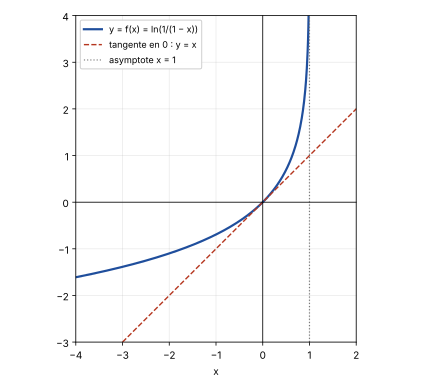

# ECRICOME ECG — Mathématiques appliquées 2026 · Corrigé brut

*Corrigé rédigé par IA, non officiel. Signalez toute erreur.*

## Exercice 1 — Choix d'une compagnie d'assurances

### 1

$X$ prend ses valeurs dans $[\![1,n]\!]$ avec équiprobabilité : **$X$ suit la loi uniforme sur $[\![1,n]\!]$**, et
$$\begin{aligned}
\mathbb E(X)&=\frac{n+1}2\\
\mathbb V(X)&=\frac{n^2-1}{12}.
\end{aligned}$$

### 2

Soit $(j,k)\in[\![1,n]\!]^2$. Comme $\mathbb P(X=j)=\frac1n\neq0$, la formule des probabilités composées donne
$$\mathbb P([X=j]\cap[Y=k])=\mathbb P(X=j)\,\mathbb P_{[X=j]}(Y=k).$$
Sachant $[X=j]$, la seconde année le particulier choisit avec équiprobabilité une compagnie parmi les $j$ compagnies $1,\dots,j$ (au moins aussi bien classées que la $j$-ième).

Donc $\mathbb P_{[X=j]}(Y=k)=\frac1j$ si $k\le j$ et $0$ si $k\ge j+1$.

D'où
$$\mathbb P([X=j]\cap[Y=k])=\begin{cases}\dfrac1{nj}&\text{si }k\le j,\\[4pt]0&\text{si }k\ge j+1.\end{cases}$$

### 3

Les événements $[X=j]\cap[Y=k]$, $(j,k)\in[\![1,n]\!]^2$, forment un système complet d'événements, donc
$$\begin{aligned}
1&=\sum_{k=1}^n\sum_{j=1}^n\mathbb P([X=j]\cap[Y=k])\\
&=\sum_{k=1}^n\sum_{j=k}^n\frac1{nj}.
\end{aligned}$$
En multipliant par $n$ :
$$\boxed{\sum_{k=1}^n\sum_{j=k}^n\frac1j=n}.$$

### 4

Soit $k\in[\![1,n]\!]$. Par la formule des probabilités totales avec le système complet $([X=j])_{1\le j\le n}$ et la question 2 :
$$\boxed{\mathbb P(Y=k)=\sum_{j=1}^n\mathbb P([X=j]\cap[Y=k])=\sum_{j=k}^n\frac1{nj}}.$$

### 5.(a)

Le domaine de sommation est $\{(j,k)\mid1\le k\le j\le n\}$ ; en sommant d'abord sur $k$ :
$$\begin{aligned}
\sum_{k=1}^n\sum_{j=k}^n\frac kj&=\sum_{j=1}^n\frac1j\sum_{k=1}^jk\\
&=\sum_{j=1}^n\frac1j\cdot\frac{j(j+1)}2\\
&=\frac12\sum_{j=1}^n(j+1).
\end{aligned}$$

### 5.(b)

$Y$ prend un nombre fini de valeurs ($Y(\Omega)\subset[\![1,n]\!]$) : **$Y$ admet une espérance**. D'après 4 et 5.(a) :
$$\begin{aligned}
\mathbb E(Y)&=\sum_{k=1}^nk\,\mathbb P(Y=k)=\frac1n\sum_{k=1}^n\sum_{j=k}^n\frac kj\\
&=\frac1{2n}\sum_{j=1}^n(j+1)=\frac1{2n}\left(\frac{n(n+1)}2+n\right)\\
&=\frac{n+1}4+\frac12=\boxed{\frac{n+3}4}.
\end{aligned}$$

### 6.(a)

$XY$ prend un nombre fini de valeurs, donc admet une espérance. Par le théorème de transfert et la question 2 :
$$\begin{aligned}
\mathbb E(XY)&=\sum_{j=1}^n\sum_{k=1}^njk\,\mathbb P([X=j]\cap[Y=k])\\
&=\sum_{j=1}^n\sum_{k=1}^j\frac{jk}{nj}=\frac1n\sum_{j=1}^n\sum_{k=1}^jk\\
&=\frac1{2n}\sum_{j=1}^nj(j+1).
\end{aligned}$$

### 6.(b)

$$\begin{aligned}
\sum_{j=1}^nj(j+1)&=\frac{n(n+1)(2n+1)}6+\frac{n(n+1)}2\\
&=\frac{n(n+1)(2n+4)}6=\frac{n(n+1)(n+2)}3.
\end{aligned}$$
Donc
$$\boxed{\mathbb E(XY)=\frac{(n+1)(n+2)}6}.$$

### 6.(c)

$$\begin{aligned}
\operatorname{Cov}(X,Y)&=\mathbb E(XY)-\mathbb E(X)\mathbb E(Y)\\
&=\frac{(n+1)(n+2)}6-\frac{(n+1)(n+3)}8\\
&=(n+1)\cdot\frac{4(n+2)-3(n+3)}{24}\\
&=\boxed{\frac{(n+1)(n-1)}{24}}.
\end{aligned}$$

### 7

Si $X$ et $Y$ étaient indépendantes, leur covariance serait nulle.

Or $n\ge2$, donc $\operatorname{Cov}(X,Y)=\frac{n^2-1}{24}>0$.

**$X$ et $Y$ ne sont pas indépendantes.** (Autre preuve : $\mathbb P([X=1]\cap[Y=2])=0$ alors que $\mathbb P(X=1)\mathbb P(Y=2)>0$.)

### 8.(a)

```python
import numpy.random as rd

def simulXY(n):
    X = rd.randint(1, n+1)     # uniforme sur [[1, n]]
    Y = rd.randint(1, X+1)     # uniforme sur [[1, X]]
    return X, Y
```

### 8.(b)

`M = np.cov(Tab)` contient $v_x$, $v_y$ et $s_{x,y}$. La fonction renvoie
$$R=\frac{s_{x,y}}{\sqrt{v_x\,v_y}},$$
**le coefficient de corrélation linéaire empirique de la série $(x,y)$** (le facteur de normalisation de `np.cov` se simplifie dans le quotient). Pour $1000$ simulations avec $n=100$, on obtient environ $0{,}64$.

### 8.(c)

La droite d'ajustement affine de $y$ en $x$ par les moindres carrés a pour équation $y-\bar y=\frac{s_{x,y}}{v_x}(x-\bar x)$ : **elle passe par le point moyen $(\bar x,\bar y)$ et sa pente a le signe de la covariance empirique $s_{x,y}$**, ici positive (la covariance théorique vaut $\frac{n^2-1}{24}>0$ et le nuage est clairement croissant).
- Tracé 1 : ligne brisée, ce n'est pas une droite.
- Tracé 3 : droite passant par l'origine mais pas par la croix rouge (elle passe au-dessus du point moyen).
- Tracé 4 : droite passant par le point moyen mais de pente négative.
- **Tracé 2** : droite de pente positive passant par le point moyen. **C'est la droite des moindres carrés.**

### 9.(a)

$$\begin{aligned}
A_n&=[X=Y]\\
&=\bigcup_{k=1}^n\big([X=k]\cap[Y=k]\big).
\end{aligned}$$

### 9.(b)

Les événements $[X=k]\cap[Y=k]$ sont deux à deux incompatibles, donc par 9.(a) et la question 2 (cas $k\le j$ avec $j=k$) :
$$\begin{aligned}
\mathbb P(A_n)&=\sum_{k=1}^n\mathbb P([X=k]\cap[Y=k])\\
&=\sum_{k=1}^n\frac1{nk}\\
&=\frac1n\sum_{j=1}^n\frac1j.
\end{aligned}$$

### 9.(c)

Soit $j\in\mathbb N^*$. On a $\ln(j+1)-\ln(j)=\int_j^{j+1}\frac{dt}t$. Pour $t\in[j,j+1]$, $\frac1{j+1}\le\frac1t\le\frac1j$. Par croissance de l'intégrale sur $[j,j+1]$ (de longueur $1$) :
$$\frac1{j+1}\le\ln(j+1)-\ln(j)\le\frac1j.$$

### 9.(d)

*Minoration.* En sommant $\frac1j\ge\ln(j+1)-\ln(j)$ pour $j=1,\dots,n$ (somme télescopique) : $\sum_{j=1}^n\frac1j\ge\ln(n+1)-\ln1=\ln(n+1)$.

*Majoration.* En sommant $\frac1{j+1}\le\ln(j+1)-\ln(j)$ pour $j=1,\dots,n-1$ : $\sum_{j=2}^n\frac1j\le\ln(n)$, donc $\sum_{j=1}^n\frac1j\le1+\ln(n)$ (vrai aussi pour $n=1$).

En divisant par $n$ et avec 9.(b) :
$$\frac{\ln(n+1)}n\le\mathbb P(A_n)\le\frac1n+\frac{\ln(n)}n.$$

### 9.(e)

Pour $n\ge2$, $\ln n>0$ ; en divisant par $\frac{\ln n}n$ :
$$\frac{\ln(n+1)}{\ln n}\le\frac{\mathbb P(A_n)}{\ln(n)/n}\le\frac1{\ln n}+1.$$
À droite, $\frac1{\ln n}\to0$. À gauche, $\frac{\ln(n+1)}{\ln n}=1+\frac{\ln(1+\frac1n)}{\ln n}\to1$. Par encadrement, le quotient tend vers $1$ : $\boxed{\mathbb P(A_n)\underset{n\to+\infty}{\sim}\frac{\ln n}n}$.

### 10.(a)

```sql
SELECT COUNT(*)
FROM adherent
WHERE id_2025 = id_2026;
```

### 10.(b)

La requête réalise la jointure des tables `adherent` et `compagnie` en associant à chaque assuré la compagnie dont l'identifiant est son `id_2026`. **Elle affiche, pour chaque assuré, son numéro et le nom de la compagnie à laquelle il a souscrit en 2026.**

### 10.(c)

```sql
SELECT compagnie, AVG(note) AS note
FROM avis
GROUP BY compagnie;
```

### 10.(d)

```sql
SELECT compagnie
FROM moyenne
ORDER BY note DESC;
```
(`SELECT *` convient aussi si l'on veut afficher les notes moyennes.)

## Exercice 2 — Partie I : étude de f

### 1

$f(x)$ est défini si et seulement si $1-x\neq0$ et $\frac1{1-x}>0$, c'est-à-dire $1-x>0$. **$I=]-\infty,1[$.**

### 2

Pour $x\in I$, $f(x)=-\ln(1-x)$.
- Quand $x\to-\infty$, $1-x\to+\infty$, donc $\ln(1-x)\to+\infty$ et $\boxed{\lim_{x\to-\infty}f(x)=-\infty}$.
- Quand $x\to1^-$, $1-x\to0^+$, donc $\ln(1-x)\to-\infty$ et $\boxed{\lim_{x\to1^-}f(x)=+\infty}$ (asymptote verticale $x=1$).

### 3

$f$ est dérivable sur $I$ et $f'(x)=-\frac{-1}{1-x}=\frac1{1-x}>0$. $f$ est strictement croissante.

| $x$ | $-\infty$ | | $0$ | | $1$ |
|---|---|---|---|---|---|
| $f'(x)$ | | $+$ | $1$ | $+$ | |
| $f$ | $-\infty$ | $\nearrow$ | $0$ | $\nearrow$ | $+\infty$ |

### 4.(a)

$\ln(1+u)\underset{u\to0}{=}u-\frac{u^2}2+o(u^2)$. Avec $u=-x$ :
$$\boxed{f(x)=-\ln(1-x)\underset{x\to0}{=}x+\frac{x^2}2+o(x^2)}.$$

### 4.(b)

D'après 4.(a), la tangente en $0$ a pour équation $\boxed{y=x}$. De plus $f(x)-x=\frac{x^2}2+o(x^2)\underset{x\to0}{\sim}\frac{x^2}2$, qui est positif pour $x\neq0$ voisin de $0$ : **au voisinage de $0$, la courbe est au-dessus de sa tangente.**

### 5

Éléments du tracé : $f$ croissante, $f(0)=0$, tangente $y=x$ en $0$ avec la courbe au-dessus ($f$ est même convexe, $f''(x)=\frac1{(1-x)^2}>0$), asymptote verticale $x=1$, $f(x)\to-\infty$ lentement en $-\infty$ (comme $-\ln|x|$).



## Exercice 2 — Partie II : la série des xᵏ/k

### 6.(a)

C'est la série de Riemann $\sum\frac1{k^\alpha}$ avec $\alpha=1\le1$ : **elle diverge.**

### 6.(b)

Pour $n\ge1$, $S_{n+1}(1)-S_n(1)=\frac1{n+1}>0$. **La suite $(S_n(1))$ est strictement croissante.**

### 6.(c)

$(S_n(1))$ est croissante. Si elle était majorée, elle convergerait (théorème de la limite monotone), donc la série $\sum\frac1k$ convergerait, ce qui contredit 6.(a). Elle n'est donc pas majorée et, étant croissante, $\boxed{\lim_{n\to+\infty}S_n(1)=+\infty}$.

### 7

Soit $x\in]-1,1[$.

Pour $k\ge1$, $0\le\left|\frac{x^k}k\right|\le|x|^k$.

La série géométrique $\sum|x|^k$ converge car $0\le|x|<1$.

Par comparaison de séries à termes positifs, $\sum\left|\frac{x^k}k\right|$ converge : **$\sum\frac{x^k}k$ converge absolument.**

### 8.(a)

Notons $u_n=S_{2n}(-1)$ et $w_n=S_{2n+1}(-1)$ pour $n\ge1$. Le terme d'indice $k$ est $\frac{(-1)^k}k$.
$$\begin{aligned}
u_{n+1}-u_n&=-\frac1{2n+1}+\frac1{2n+2}<0,\\
w_{n+1}-w_n&=\frac1{2n+2}-\frac1{2n+3}>0,\\
w_n-u_n&=-\frac1{2n+1}\xrightarrow[n\to+\infty]{}0.
\end{aligned}$$
$(u_n)$ est décroissante, $(w_n)$ croissante, et $w_n-u_n\to0$ : **les deux suites sont adjacentes.**

### 8.(b)

Deux suites adjacentes convergent vers une même limite $\ell$. Ainsi $(S_{2n}(-1))$ et $(S_{2n+1}(-1))$ convergent toutes deux vers $\ell$. Les termes d'indice pair et ceux d'indice impair tendent vers la même limite : **$(S_n(-1))$ converge (vers $\ell$).**

### 8.(c)

$(u_n)$ décroît vers $\ell=-\ln2$ et $(w_n)$ croît vers $\ell$, donc pour tout $n\ge1$, $w_n\le-\ln2\le u_n$.

Ainsi $0\le u_n+\ln2\le u_n-w_n$, c'est-à-dire
$$\big|\ln2+S_{2n}(-1)\big|\le S_{2n}(-1)-S_{2n+1}(-1).$$

### 8.(d)

Notons d'abord $u_m-w_m=\frac1{2m+1}$ et $w_m\le-\ln2\le u_m$ pour $m\ge1$.
- $n=2m$ pair ($m\ge1$) : par 8.(c), $|\ln2+S_n(-1)|\le\frac1{2m+1}\le\frac1{2m}=\frac1n$.
- $n=2m+1$ impair avec $m\ge1$ : $0\le-\ln2-w_m\le u_m-w_m=\frac1{2m+1}=\frac1n$, donc $|\ln2+S_n(-1)|\le\frac1n$.
- $n=1$ : $|\ln2-1|=1-\ln2\le1$.

**Pour tout $n\in\mathbb N^*$, $|\ln2+S_n(-1)|\le\frac1n$.**

### 9.(a)

Soit $x>1$. Par croissances comparées, $\frac{x^k}k\to+\infty$ quand $k\to+\infty$. Le terme général ne tend pas vers $0$ : **la série $\sum\frac{x^k}k$ diverge grossièrement.**

### 9.(b)

Les termes sont positifs, donc $(S_n(x))$ est croissante ; de plus $S_n(x)\ge S_n(1)$ puisque $\frac{x^k}k\ge\frac1k$. Par 6.(c) et comparaison, $\boxed{\lim_{n\to+\infty}S_n(x)=+\infty}$.

## Exercice 2 — Partie III : reste intégral et calcul de S

### 10.(a)

Pour $a\in]-1,1[$, $1-t>0$ entre $0$ et $a$.
$$\begin{aligned}
\int_0^a\frac{dt}{1-t}&=\big[-\ln(1-t)\big]_0^a\\
&=-\ln(1-a)\\
&=f(a)
\end{aligned}$$
$$\begin{aligned}
\int_0^a\frac{dt}{(1-t)^2}&=\left[\frac1{1-t}\right]_0^a\\
&=\frac1{1-a}-1\\
&=\frac{a}{1-a}.
\end{aligned}$$

### 10.(b)

$$\begin{aligned}
R_1(a)&=\int_0^a\frac{(a-1)+(1-t)}{(1-t)^2}\,dt\\
&=(a-1)\int_0^a\frac{dt}{(1-t)^2}+\int_0^a\frac{dt}{1-t}\\
&=(a-1)\cdot\frac a{1-a}+f(a)\\
&=-a+f(a).
\end{aligned}$$
Donc $\boxed{f(a)=a+R_1(a)}$.

### 11

Soit $n\ge1$.

Posons $u(t)=(a-t)^{n+1}$ et $v(t)=\frac1{(n+1)(1-t)^{n+1}}$, de classe $\mathcal C^1$ entre $0$ et $a$ (car $1-t>0$), avec $u'(t)=-(n+1)(a-t)^n$ et $v'(t)=\frac1{(1-t)^{n+2}}$.

Par intégration par parties :
$$\begin{aligned}
R_{n+1}(a)&=\left[\frac{(a-t)^{n+1}}{(n+1)(1-t)^{n+1}}\right]_0^a+\int_0^a\frac{(a-t)^n}{(1-t)^{n+1}}\,dt\\
&=0-\frac{a^{n+1}}{n+1}+R_n(a).
\end{aligned}$$
Donc $\boxed{R_n(a)=\dfrac{a^{n+1}}{n+1}+R_{n+1}(a)}$.

### 12

Montrons par récurrence $\mathcal P(n)$ : $f(a)=S_n(a)+R_n(a)$.

*Initialisation.* $S_1(a)=a$, et 10.(b) donne $f(a)=a+R_1(a)$.

*Hérédité.* Si $\mathcal P(n)$ est vraie pour un $n\ge1$, alors par 11 :
$$\begin{aligned}
f(a)&=S_n(a)+\frac{a^{n+1}}{n+1}+R_{n+1}(a)\\
&=S_{n+1}(a)+R_{n+1}(a).
\end{aligned}$$
*Conclusion.* Pour tout $n\in\mathbb N^*$, $f(a)=S_n(a)+R_n(a)$.

### 13.(a)

Soit $t\in[0,a]$ (avec $0\le a<1$). Alors $a-t\ge0$ et $1-t\ge1-a>0$, donc $\frac{a-t}{1-t}\ge0$. Ensuite
$$\begin{aligned}
a-\frac{a-t}{1-t}&=\frac{a(1-t)-(a-t)}{1-t}\\
&=\frac{t(1-a)}{1-t}\ge0,
\end{aligned}$$
car $t\ge0$, $1-a>0$ et $1-t>0$. Donc $0\le\frac{a-t}{1-t}\le a$.

### 13.(b)

Pour $t\in[0,a]$ :
$$\begin{aligned}
0&\le\frac{(a-t)^n}{(1-t)^{n+1}}\\
&=\left(\frac{a-t}{1-t}\right)^n\frac1{1-t}\\
&\le\frac{a^n}{1-a}
\end{aligned}$$
d'après 13.(a) et $\frac1{1-t}\le\frac1{1-a}$. Par croissance de l'intégrale sur $[0,a]$ ($a\ge0$) :
$$\begin{aligned}
0&\le R_n(a)\\
&\le a\cdot\frac{a^n}{1-a}\\
&=\frac{a^{n+1}}{1-a}.
\end{aligned}$$

### 13.(c)

Comme $0\le a<1$, $a^{n+1}\to0$, donc $R_n(a)\to0$ par encadrement. Par 12, $S_n(a)=f(a)-R_n(a)\to f(a)$, c'est-à-dire $\boxed{S(a)=f(a)}$.

### 14.(a)

Avec $a=\frac12\in[0,1[$ : $f\left(\frac12\right)=\ln2$ et $S_n\left(\frac12\right)=\sum_{k=1}^n\frac1{k2^k}$. D'après 12 et 13.(b) :
$$\begin{aligned}
0&\le\ln2-\sum_{k=1}^n\frac1{k2^k}\\
&=R_n\left(\tfrac12\right)\\
&\le\frac{(1/2)^{n+1}}{1/2}\\
&=\frac1{2^n}.
\end{aligned}$$
Donc $\left|\ln2-\sum_{k=1}^n\frac1{k2^k}\right|\le\frac1{2^n}$.

### 14.(b)

```python
def Val(eps):
    n = 1
    S = 1/2                  # S_1(1/2)
    while 1/2**n > eps:
        n = n + 1
        S = S + 1/(n*2**n)
    return S
```
À la sortie, $\frac1{2^n}\le\varepsilon$ et `S` vaut $S_n\left(\frac12\right)$, donc $|\ln2-S|\le\varepsilon$ par 14.(a). Essai : `Val(1e-6)` donne $0{,}69314714$, à $4\times10^{-8}$ de $\ln2$.

### 14.(c)

- $-S_n(-1)=\sum_{k=1}^n\frac{(-1)^{k+1}}k$ vaut $1$, $0{,}5$, $0{,}833$, $0{,}583$… : elle **oscille** autour de $\ln2$, en s'en approchant lentement (erreur au plus $\frac1n$, question 8.(d)). Ce sont **les croix bleues**.
- $S_n\left(\frac12\right)$ vaut $0{,}5$, $0{,}625$, $0{,}667$, $0{,}682$… : elle **croît** et se stabilise très vite près de $\ln2\approx0{,}693$ (erreur au plus $\frac1{2^n}$). Ce sont **les points orange**.

## Exercice 3 — Partie I : un problème de Cauchy

### 1

$s'(t)=x'(t)+y'(t)=(x(t)+y(t))+(-x(t)-y(t))=\boxed{0}$.

### 2

$s'=0$ sur l'intervalle $\mathbb R$, donc $s$ est constante : $s(t)=s(0)=x(0)+y(0)=2$. Pour tout $t$, $\boxed{x(t)+y(t)=2}$.

### 3

D'après 2, $x'(t)=x(t)+y(t)=2$ pour tout $t$, donc $x(t)=2t+x(0)=1+2t$, puis $y(t)=2-x(t)=1-2t$.

Réciproquement, ce couple vérifie $x'=2=x+y$, $y'=-2=-(x+y)$, $x(0)=y(0)=1$.

**L'unique solution est $x(t)=1+2t$, $y(t)=1-2t$.**

## Exercice 3 — Partie II : réduction de A et système (S)

### 4

$P$ est triangulaire inférieure à coefficients diagonaux non nuls ($1$ et $1$), donc inversible. On vérifie que
$$P\begin{pmatrix}1&0\\1&1\end{pmatrix}=\begin{pmatrix}1&0\\-1&1\end{pmatrix}\begin{pmatrix}1&0\\1&1\end{pmatrix}=I_2,$$
donc $\boxed{P^{-1}=\begin{pmatrix}1&0\\1&1\end{pmatrix}}$.

### 5

$$A^2=\begin{pmatrix}1&1\\-1&-1\end{pmatrix}^2=\begin{pmatrix}0&0\\0&0\end{pmatrix}.$$
$X^2$ est un polynôme annulateur de $A$, donc $\operatorname{Sp}(A)\subset\{0\}$.

De plus $A\begin{pmatrix}1\\-1\end{pmatrix}=\begin{pmatrix}0\\0\end{pmatrix}$ avec $\begin{pmatrix}1\\-1\end{pmatrix}\neq0$ : $0$ est valeur propre.

**$\operatorname{Sp}(A)=\{0\}$.**

### 6

Si $A$ était diagonalisable, il existerait $Q$ inversible et $\Delta$ diagonale telles que $A=Q\Delta Q^{-1}$, les coefficients diagonaux de $\Delta$ étant les valeurs propres de $A$, donc nuls.

Alors $\Delta=0$ et $A=0$, ce qui est faux.

**$A$ n'est pas diagonalisable.**

### 7

$$AP=\begin{pmatrix}1&1\\-1&-1\end{pmatrix}\begin{pmatrix}1&0\\-1&1\end{pmatrix}=\begin{pmatrix}0&1\\0&-1\end{pmatrix},$$
$$P^{-1}AP=\begin{pmatrix}1&0\\1&1\end{pmatrix}\begin{pmatrix}0&1\\0&-1\end{pmatrix}=\begin{pmatrix}0&1\\0&0\end{pmatrix}=J.$$

### 8

Les états d'équilibre sont les solutions constantes, c'est-à-dire les $X$ tels que $AX=0$ : $x+y=0$. **Ce sont les couples $(x,y)=(c,-c)$, $c\in\mathbb R$** (fonctions constantes).

### 9

Comme $P$ est constante, $X(t)=PY(t)$ donne $X'(t)=PY'(t)$. Alors
$$\begin{aligned}
(x,y)\text{ solution de }(S)&\iff\forall t,\ X'(t)=AX(t)\\
&\iff\forall t,\ PY'(t)=APY(t)\\
&\iff\forall t,\ Y'(t)=P^{-1}APY(t)=JY(t),
\end{aligned}$$
la dernière équivalence en multipliant à gauche par $P^{-1}$ ou par $P$.

### 10

$Y'=JY$ s'écrit $u'(t)=v(t)$ et $v'(t)=0$.

Donc $v$ est constante, $v(t)=c_2$, puis $u'(t)=c_2$ et $u(t)=c_2t+c_1$.

Réciproquement, ces fonctions conviennent.

**Les solutions sont $Y(t)=\begin{pmatrix}c_1+c_2t\\c_2\end{pmatrix}$, $(c_1,c_2)\in\mathbb R^2$.**

### 11

D'après 9, les solutions de $(S)$ sont les $X=PY$ avec $Y$ solution de 10 :
$$\begin{pmatrix}x(t)\\y(t)\end{pmatrix}=\begin{pmatrix}1&0\\-1&1\end{pmatrix}\begin{pmatrix}c_1+c_2t\\c_2\end{pmatrix}=\begin{pmatrix}c_1+c_2t\\c_2-c_1-c_2t\end{pmatrix},\qquad(c_1,c_2)\in\mathbb R^2.$$
(Avec $x(0)=y(0)=1$ : $c_1=1$, $c_2=2$, on retrouve la partie I.)

## Exercice 3 — Partie III : systèmes nilpotents

### 12

```python
import numpy as np

def Nil(M):
    n = len(M)
    Z = np.zeros([n, n])
    P = M                       # P contient M**k
    for k in range(1, n+1):
        if (P == Z).all():
            return k
        P = np.dot(P, M)
    return 0
```
Si $M$ est nilpotente d'indice $p$, $M^k\neq0$ pour $k<p$ et $M^p=0$ avec $p\le n$ : la fonction renvoie $p$.

Sinon, aucune puissance $M^k$ avec $k\le n$ n'est nulle (sinon $M$ serait nilpotente) et la fonction renvoie $0$.

Essais : `Nil` vaut $3$ pour $\begin{pmatrix}0&1&2\\0&0&3\\0&0&0\end{pmatrix}$, $2$ pour $J$, $0$ pour $\begin{pmatrix}1&0\\0&0\end{pmatrix}$.

### 13

$N^p=0$, donc $X^p$ est un polynôme annulateur de $N$ et $\operatorname{Sp}(N)\subset\{0\}$.

Si $N$ était inversible, $N^p$ le serait aussi (produit de matrices inversibles), alors que $N^p=0_n$.

Donc $N$ n'est pas inversible, et $0$ est valeur propre.

**$\operatorname{Sp}(N)=\{0\}$.**

### 14

Supposons $N$ diagonalisable : $N=QDQ^{-1}$ avec $D$ diagonale portant les valeurs propres de $N$, toutes nulles (question 13).

Alors $D=0_n$ et $N=0_n$, ce qui contredit l'hypothèse $N\neq0_n$.

**$N$ n'est pas diagonalisable.**

### 15

$X(t)=\sum_{k=0}^{p-1}\frac{t^k}{k!}N^kX_0$ : chaque coordonnée est une combinaison linéaire (à coefficients constants) des fonctions $t\mapsto\frac{t^k}{k!}$, donc dérivable. Le terme $k=0$ est constant, de dérivée nulle, et pour $k\ge1$, la dérivée de $\frac{t^k}{k!}$ est $\frac{t^{k-1}}{(k-1)!}$. Par linéarité de la dérivation :
$$X'(t)=\sum_{k=1}^{p-1}\frac{t^{k-1}}{(k-1)!}N^kX_0.$$

### 16

$$\begin{aligned}
NX(t)&=\sum_{k=0}^{p-1}\frac{t^k}{k!}N^{k+1}X_0=\sum_{j=1}^{p}\frac{t^{j-1}}{(j-1)!}N^jX_0\\
&=\sum_{j=1}^{p-1}\frac{t^{j-1}}{(j-1)!}N^jX_0+\frac{t^{p-1}}{(p-1)!}N^pX_0\\
&=X'(t)+0,
\end{aligned}$$
d'après 15 et $N^p=0_n$. De plus $X(0)=B(0)X_0=N^0X_0=X_0$ (seul le terme $k=0$ subsiste). Donc $X$ est solution du problème de Cauchy $X'=NX$, $X(0)=X_0$. Par le théorème d'existence et d'unicité de la solution d'un problème de Cauchy pour un système différentiel linéaire à coefficients constants (admis au programme), **c'est l'unique solution.**

### 17

```python
def B(N, t):
    if Nil(N) == 0:
        return("N n'est pas nilpotente")
    else:
        T = np.eye(len(N))
        S = T
        for k in range(1, Nil(N)):
            T = t/k * np.dot(T, N)
            S = S + T
        return S
```
Invariant : après le tour $k$, $T=\frac{t^k}{k!}N^k$ et $S=\sum_{i=0}^{k}\frac{t^i}{i!}N^i$ ; la boucle s'arrête à $k=p-1$, donc `S` vaut $B(t)$. (Comme $T$ est un polynôme en $N$, l'ordre des facteurs dans `np.dot` est indifférent.) Essai : pour la matrice $3\times3$ de la question 12 et $t=0{,}7$, le résultat coïncide avec $e^{0{,}7N}$ calculée par `scipy`.
