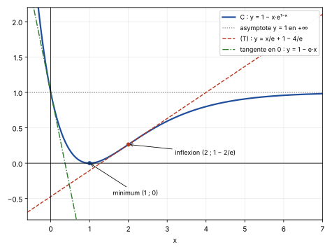

# ECRICOME ECT — Mathématiques technologiques 2026 · Corrigé brut

*Corrigé rédigé par IA, non officiel. Signalez toute erreur.*

## Exercice 1 — Partie 1 : deux suites couplées

### 1

Montrons par récurrence la propriété $\mathcal P(n)$ : $a_n+b_n=1$.

*Initialisation.* $a_0+b_0=1+0=1$ : $\mathcal P(0)$ est vraie.

*Hérédité.* Soit $n\in\mathbb N$ tel que $\mathcal P(n)$ soit vraie.
$$\begin{aligned}
a_{n+1}+b_{n+1}&=\left(\tfrac7{10}+\tfrac3{10}\right)a_n+\left(\tfrac1{10}+\tfrac9{10}\right)b_n\\
&=a_n+b_n\\
&=1.
\end{aligned}$$
$\mathcal P(n+1)$ est vraie.

*Conclusion.* Par récurrence, $\boxed{\forall n\in\mathbb N,\ a_n+b_n=1}$.

### 2.(a)

Soit $n\in\mathbb N$. D'après la question 1, $b_n=1-a_n$, donc
$$\begin{aligned}
a_{n+1}&=\tfrac7{10}a_n+\tfrac1{10}(1-a_n)\\
&=\tfrac6{10}a_n+\tfrac1{10}\\
&=\tfrac35a_n+\tfrac1{10}.
\end{aligned}$$

### 2.(b)

$$\begin{aligned}
\ell=\tfrac35\ell+\tfrac1{10}&\iff\tfrac25\ell=\tfrac1{10}\\
&\iff\ell=\tfrac14.
\end{aligned}$$
$\boxed{\ell=\tfrac14}$.

### 2.(c)

Soit $n\in\mathbb N$. Comme $\frac1{10}=\ell-\frac35\ell$ :
$$\begin{aligned}
v_{n+1}&=a_{n+1}-\ell\\
&=\tfrac35a_n+\tfrac1{10}-\ell\\
&=\tfrac35a_n-\tfrac35\ell\\
&=\tfrac35v_n.
\end{aligned}$$
**$(v_n)$ est géométrique de raison $\frac35$**, de premier terme $v_0=a_0-\ell=\frac34$.

### 2.(d)

D'après 2.(c), $v_n=\frac34\left(\frac35\right)^n$, donc
$$\boxed{a_n=v_n+\ell=\frac14+\frac34\left(\frac35\right)^n}.$$

### 3.(a)

D'après la question 1,
$$\begin{aligned}
b_n&=1-a_n\\
&=1-\tfrac14-\tfrac34\left(\tfrac35\right)^n\\
&=\tfrac34-\tfrac34\left(\tfrac35\right)^n.
\end{aligned}$$
$$\boxed{b_n=\tfrac34\left(1-\left(\tfrac35\right)^n\right)}$$

### 3.(b)

Comme $-1<\frac35<1$, $\left(\frac35\right)^n\to0$, donc $\boxed{\lim_{n\to+\infty}b_n=\tfrac34}$.

### 4

D'après la question 1, $b_{n+1}=\frac3{10}(1-b_n)+\frac9{10}b_n=\frac3{10}+\frac35b_n$.
```python
def rang(s):
    b = 0
    n = 0
    while b < s:
        n = n + 1
        b = 3/10 + 3/5*b
    return n
```
La variable `b` contient $b_n$ à chaque passage dans la boucle (invariant, vrai au départ puisque $b_0=0$).

La boucle s'arrête au premier $n$ tel que $b_n\ge s$ ; elle termine car $b_n\to\frac34>s$.

On peut aussi écrire `b = 3/4 - 3/4*(3/5)**n` d'après 3.(a).

Essai : `rang(0.5)` renvoie `3`, car $b_2=0{,}48$ et $b_3=0{,}588$.

## Exercice 1 — Partie 2 : diagonalisation et suites affines

### 5.(a)

$$QP=\begin{pmatrix}3&3&-1\\-9&3&3\\0&0&4\end{pmatrix}\begin{pmatrix}1&-1&1\\3&1&0\\0&0&3\end{pmatrix}=\begin{pmatrix}12&0&0\\0&12&0\\0&0&12\end{pmatrix}=12I.$$

### 5.(b)

D'après 5.(a), $\left(\frac1{12}Q\right)P=I$. Une matrice carrée qui admet un inverse à gauche est inversible, d'inverse celui-ci : **$P$ est inversible et $P^{-1}=\tfrac1{12}Q$.**

### 6.(a)

Notons $X_1=\begin{pmatrix}1\\3\\0\end{pmatrix}$, $X_2=\begin{pmatrix}-1\\1\\0\end{pmatrix}$ et $X_3=\begin{pmatrix}1\\0\\3\end{pmatrix}$.
$$MX_1=\begin{pmatrix}7+3\\3+27\\0\end{pmatrix}=\begin{pmatrix}10\\30\\0\end{pmatrix}=10X_1.$$
$$MX_2=\begin{pmatrix}-7+1\\-3+9\\0\end{pmatrix}=\begin{pmatrix}-6\\6\\0\end{pmatrix}=6X_2.$$
$$MX_3=\begin{pmatrix}7+3\\3-3\\30\end{pmatrix}=\begin{pmatrix}10\\0\\30\end{pmatrix}=10X_3.$$
Ces vecteurs sont non nuls. **$X_1$ et $X_3$ sont des vecteurs propres de $M$ associés à la valeur propre $10$, $X_2$ à la valeur propre $6$.**

### 6.(b)

Les colonnes de $MP$ sont $MX_1=10X_1$, $MX_2=6X_2$, $MX_3=10X_3$ ; ce sont aussi les colonnes de $PD$, puisque $D=\operatorname{diag}(10,6,10)$.

Donc $MP=PD$ et, en multipliant à droite par $P^{-1}$ (question 5.(b)), $\boxed{M=PDP^{-1}}$.

### 7.(a)

D'après 5.(b) et 6.(b), $M=\frac1{12}PDQ$. Montrons par récurrence $\mathcal P(n)$ : $M^n=\frac1{12}PD^nQ$.

*Initialisation.* $\frac1{12}PD^0Q=\frac1{12}PQ=PP^{-1}=I=M^0$.

*Hérédité.* Soit $n\in\mathbb N$ tel que $\mathcal P(n)$ soit vraie.
$$\begin{aligned}
M^{n+1}&=M^nM\\
&=\tfrac1{12}PD^nQ\times\tfrac1{12}PDQ\\
&=\tfrac1{144}PD^n(QP)DQ\\
&=\tfrac1{144}PD^n(12I)DQ\\
&=\tfrac1{12}PD^{n+1}Q.
\end{aligned}$$
*Conclusion.* $\boxed{\forall n\in\mathbb N,\ M^n=\tfrac1{12}PD^nQ}$.

### 7.(b)

$$Q\begin{pmatrix}1\\0\\1\end{pmatrix}=\begin{pmatrix}3-1\\-9+3\\0+4\end{pmatrix}=\begin{pmatrix}2\\-6\\4\end{pmatrix}.$$

### 7.(c)

$D$ étant diagonale, $D^n=\operatorname{diag}(10^n,6^n,10^n)$. Avec 7.(a) et 7.(b) :
$$D^n\begin{pmatrix}2\\-6\\4\end{pmatrix}=\begin{pmatrix}2\cdot10^n\\-6\cdot6^n\\4\cdot10^n\end{pmatrix},$$
puis
$$\begin{aligned}
M^n\begin{pmatrix}1\\0\\1\end{pmatrix}&=\frac1{12}P\begin{pmatrix}2\cdot10^n\\-6\cdot6^n\\4\cdot10^n\end{pmatrix}\\
&=\frac1{12}\begin{pmatrix}6\cdot10^n+6\cdot6^n\\6\cdot10^n-6\cdot6^n\\12\cdot10^n\end{pmatrix}\\
&=\frac12\begin{pmatrix}10^n+6^n\\10^n-6^n\\2\cdot10^n\end{pmatrix}.
\end{aligned}$$
Comme $10^n=2^n5^n$ et $6^n=2^n3^n$, on obtient
$$\boxed{M^n\begin{pmatrix}1\\0\\1\end{pmatrix}=2^{n-1}\begin{pmatrix}5^n+3^n\\5^n-3^n\\2\cdot5^n\end{pmatrix}}.$$

### 8.(a)

Soit $n\in\mathbb N$.
$$\frac1{10}M\begin{pmatrix}x_n\\y_n\\1\end{pmatrix}=\frac1{10}\begin{pmatrix}7x_n+y_n+1\\3x_n+9y_n-1\\10\end{pmatrix}=\begin{pmatrix}x_{n+1}\\y_{n+1}\\1\end{pmatrix}.$$

### 8.(b)

Notons $Y_n=\begin{pmatrix}x_n\\y_n\\1\end{pmatrix}$. Montrons par récurrence $Y_n=\frac1{10^n}M^nY_0$.

*Initialisation.* $\frac1{10^0}M^0Y_0=Y_0$.

*Hérédité.* Si $Y_n=\frac1{10^n}M^nY_0$ pour un $n\in\mathbb N$, alors d'après 8.(a)
$$\begin{aligned}
Y_{n+1}&=\tfrac1{10}MY_n\\
&=\tfrac1{10}M\cdot\tfrac1{10^n}M^nY_0\\
&=\tfrac1{10^{n+1}}M^{n+1}Y_0.
\end{aligned}$$
*Conclusion.* $\boxed{\forall n\in\mathbb N,\ Y_n=\tfrac1{10^n}M^nY_0}$.

### 8.(c)

$Y_0=\begin{pmatrix}1\\0\\1\end{pmatrix}$. D'après 8.(b) et 7.(c), la première coordonnée donne
$$\begin{aligned}
x_n&=\frac{2^{n-1}\left(5^n+3^n\right)}{10^n}\\
&=\frac12\cdot\frac{5^n+3^n}{5^n}\\
&=\frac12+\frac12\left(\frac35\right)^n.
\end{aligned}$$

## Exercice 2 — Partie 1 : étude de g

### 1.(a)

Quand $x\to-\infty$ : $1-x\to+\infty$ donc $e^{1-x}\to+\infty$, et $x\to-\infty$. Par produit, $xe^{1-x}\to-\infty$, donc $\boxed{\lim_{x\to-\infty}g(x)=+\infty}$.

### 1.(b)

Pour tout $x$, $xe^{1-x}=e\cdot\frac{x}{e^x}$.

Par croissances comparées, $\frac{x}{e^x}\to0$ en $+\infty$.

Donc $\boxed{\lim_{x\to+\infty}g(x)=1}$ : **la droite d'équation $y=1$ est asymptote (horizontale) à $\mathcal C$ en $+\infty$.**

### 2.(a)

$$\begin{aligned}
g'(x)&=-\left(e^{1-x}+x\cdot(-e^{1-x})\right)\\
&=(x-1)e^{1-x}.
\end{aligned}$$

### 2.(b)

$g'(x)$ a le signe de $x-1$. $g(1)=1-1=0$.

| $x$ | $-\infty$ | | $1$ | | $+\infty$ |
|---|---|---|---|---|---|
| $g'(x)$ | | $-$ | $0$ | $+$ | |
| $g$ | $+\infty$ | $\searrow$ | $0$ | $\nearrow$ | $1$ |

En particulier $g\ge0$ sur $\mathbb R$, avec égalité seulement en $1$.

### 3.(a)

$$\begin{aligned}
g''(x)&=e^{1-x}+(x-1)(-e^{1-x})\\
&=(2-x)e^{1-x}.
\end{aligned}$$

### 3.(b)

$g''(x)$ a le signe de $2-x$ : $g''>0$ sur $]-\infty,2[$ et $g''<0$ sur $]2,+\infty[$.

**$g$ est convexe sur $]-\infty,2]$ et concave sur $[2,+\infty[$.** La dérivée seconde s'annule en $2$ en changeant de signe : **$\mathcal C$ admet un point d'inflexion d'abscisse $2$**, le point $\left(2,1-\frac2e\right)$.

### 4.(a)

$g(2)=1-2e^{-1}$ et $g'(2)=e^{-1}$. Donc $(T):\ y=\frac1e(x-2)+1-\frac2e$, soit
$$\boxed{(T):\ y=\frac{x}{e}+1-\frac4e}.$$

### 4.(b)

Sur $]-\infty,2]$, $g$ est convexe : $\mathcal C$ est au-dessus de ses tangentes, donc de $(T)$.

Sur $[2,+\infty[$, $g$ est concave : $\mathcal C$ est en dessous de $(T)$.

**$\mathcal C$ est au-dessus de $(T)$ pour $x\le2$, en dessous pour $x\ge2$ ; elle traverse $(T)$ au point d'inflexion.**

### 5

Éléments du tracé : $g(0)=1$, tangente en $0$ d'équation $y=1-ex$ (car $g'(0)=-e$) ; minimum $(1,0)$ ; point d'inflexion $(2;1-\frac2e)\simeq(2;0{,}26)$ avec $(T)$ de pente $\frac1e\simeq0{,}37$ ; asymptote $y=1$ en $+\infty$, approchée par en dessous ($g<1$ pour $x>0$) ; branche qui monte vers $+\infty$ en $-\infty$ (pas d'asymptote de ce côté).



## Exercice 2 — Partie 2 : une densité sans variance

### 6.(a)

$t\mapsto\frac1{t^3}=t^{-3}$ a pour primitive $\boxed{t\mapsto-\dfrac1{2t^2}}$ sur $[e,+\infty[$.

### 6.(b)

Soit $x>e$.

On pose $u(t)=\ln t-1$, $v(t)=-\frac1{2t^2}$, de classe $\mathcal C^1$ sur $[e,x]$, avec $u'(t)=\frac1t$ et $v'(t)=\frac1{t^3}$.
$$\begin{aligned}
\int_e^x\frac{\ln t-1}{t^3}\,dt&=\left[-\frac{\ln t-1}{2t^2}\right]_e^x+\int_e^x\frac1{2t^3}\,dt\\
&=-\frac{\ln x-1}{2x^2}+0+\left[-\frac1{4t^2}\right]_e^x\\
&=-\frac{\ln x-1}{2x^2}-\frac1{4x^2}+\frac1{4e^2}\\
&=\frac1{2x^2}\left(\frac12-\ln x\right)+\frac1{4e^2}.
\end{aligned}$$

### 6.(c)

- **Positivité.** $f=0$ sur $]-\infty,e[$ ; pour $t\ge e$, $\ln t\ge1$ (croissance de $\ln$), donc $f(t)\ge0$.
- **Continuité.** $f$ est continue sur $]-\infty,e[$ (nulle) et sur $[e,+\infty[$ (quotient de fonctions continues, $t^3\neq0$) : elle est continue sauf peut-être en $e$ (elle l'est en fait aussi en $e$, car $f(e)=0$).
- **Intégrale.** $\int_{-\infty}^ef=0$. D'après 6.(b), pour $x>e$ :
$$\int_e^xf(t)\,dt=4e^2\left(\frac{1}{4x^2}-\frac{\ln x}{2x^2}\right)+1.$$
Par croissances comparées $\frac{\ln x}{x^2}\to0$, et $\frac1{x^2}\to0$ : l'intégrale converge et vaut $1$.

**$f$ est une densité de probabilité.**

### 7.(a)

Si $x<e$, $F(x)=\int_{-\infty}^x0\,dt=0$. Si $x\ge e$, d'après 6.(b) (la formule vaut aussi pour $x=e$, les deux membres étant nuls) :
$$\begin{aligned}
F(x)&=4e^2\left(\frac1{2x^2}\left(\frac12-\ln x\right)+\frac1{4e^2}\right)\\
&=1+\frac{e^2(1-2\ln x)}{x^2}.
\end{aligned}$$
$$\boxed{F(x)=\begin{cases}0&\text{si }x<e\\[2pt]1-\dfrac{e^2(2\ln x-1)}{x^2}&\text{si }x\ge e\end{cases}}$$

### 7.(b)

$$\begin{aligned}
\mathbb P(X\le e^2)&=F(e^2)\\
&=1-\frac{e^2\times3}{e^4}\\
&=\boxed{1-\frac3{e^2}}.
\end{aligned}$$
$$\begin{aligned}
\mathbb P(e^2<X\le e^3)&=F(e^3)-F(e^2)\\
&=\left(1-\frac5{e^4}\right)-\left(1-\frac3{e^2}\right)\\
&=\boxed{\frac3{e^2}-\frac5{e^4}}.
\end{aligned}$$
$X$ est à densité, donc $\mathbb P(X\ge e^2)=1-F(e^2)=\frac3{e^2}\neq0$ et $\mathbb P(e^2\le X<e^3)=\mathbb P(e^2<X\le e^3)$. Ainsi
$$\begin{aligned}
\mathbb P_{[X\ge e^2]}(X<e^3)&=\frac{\mathbb P(e^2\le X<e^3)}{\mathbb P(X\ge e^2)}\\
&=\frac{\frac3{e^2}-\frac5{e^4}}{\frac3{e^2}}\\
&=\boxed{1-\frac5{3e^2}}.
\end{aligned}$$

### 8.(a)

Pour $x\ge e$ :
$$\begin{aligned}
G'(x)&=-\frac{\frac1x\cdot x-\ln x\cdot1}{x^2}\\
&=\frac{\ln x-1}{x^2}.
\end{aligned}$$

### 8.(b)

Pour $t<e$, $tf(t)=0$ ; pour $t\ge e$, $tf(t)=4e^2\frac{\ln t-1}{t^2}=4e^2G'(t)\ge0$. Pour $x\ge e$ :
$$\begin{aligned}
\int_e^xtf(t)\,dt&=4e^2\big(G(x)-G(e)\big)\\
&=4e^2\left(\frac1e-\frac{\ln x}{x}\right).
\end{aligned}$$
Par croissances comparées, $\frac{\ln x}{x}\to0$ : l'intégrale $\int_{-\infty}^{+\infty}tf(t)\,dt$ converge, absolument puisque l'intégrande est positif. **$X$ admet une espérance**, et
$$\mathbb E(X)=\frac{4e^2}{e}=\boxed{4e}.$$

### 9.(a)

Soit $t\ge e^2$. Alors $\ln t\ge2$, donc $\ln t-1\ge1$, et
$$t^2f(t)=\frac{4e^2(\ln t-1)}{t}\ge\frac{4e^2}{t}.$$

### 9.(b)

$X$ admet une variance si et seulement si $\int_{-\infty}^{+\infty}t^2f(t)\,dt$ converge.

Sur $[e^2,+\infty[$, $t^2f(t)\ge\frac{4e^2}t\ge0$ (question 9.(a)), et $\int_{e^2}^{+\infty}\frac{dt}t$ diverge (intégrale de Riemann, $\int_{e^2}^x\frac{dt}t=\ln x-2\to+\infty$).

Par comparaison de fonctions positives, $\int_{e^2}^{+\infty}t^2f(t)\,dt$ diverge, donc $\int_{-\infty}^{+\infty}t^2f(t)\,dt$ aussi.

**$X$ n'admet pas de variance.**

### 10.(a)

Soit $x\in\mathbb R$. D'après l'égalité rappelée et l'indépendance des $X_i$ :
$$\begin{aligned}
F_n(x)&=\mathbb P\left(\bigcap_{i=1}^n[X_i\le x]\right)\\
&=\prod_{i=1}^n\mathbb P(X_i\le x)\\
&=\big(F(x)\big)^n,
\end{aligned}$$
car chaque $X_i$ a la même loi que $X$.

### 10.(b)

Soit $x\ge1$.

Comme $\sqrt e>0$, $\left[\frac1{\sqrt e}Z_n\le e^{x/2}\right]=\left[Z_n\le e^{\frac{x+1}2}\right]$.

Posons $c=e^{\frac{x+1}2}$ ; comme $x\ge1$, $c\ge e$ et $\ln c=\frac{x+1}2$, donc $2\ln c-1=x$ et $c^2=e^{x+1}$.

D'après 7.(a) :
$$\begin{aligned}
F(c)&=1-\frac{e^2x}{e^{x+1}}\\
&=1-xe^{1-x}.
\end{aligned}$$
Avec 10.(a) :
$$\begin{aligned}
\mathbb P\left(\frac1{\sqrt e}Z_n\le e^{x/2}\right)&=F_n(c)\\
&=\left(1-xe^{1-x}\right)^n.
\end{aligned}$$

### 10.(c)

Pour $x=1$, l'événement est $[Z_n\le e]$.

Or $X$ prend presque sûrement ses valeurs dans $[e,+\infty[$ et $\mathbb P(X\le e)=F(e)=0$.

Donc $\mathbb P(Z_n\le e)=F(e)^n=0$.

**Oui, c'est prévisible** : le maximum de variables qui dépassent $e$ presque sûrement ne peut être inférieur ou égal à $e$ qu'avec une probabilité nulle.

C'est cohérent avec la formule : $1-1\cdot e^0=0$.

## Exercice 2 — Partie 3 : la suite (αₙ)

### 11.(a)

$h_n(1)=g(1)^n=0^n=\boxed{0}$ (car $n\ge1$). D'après 1.(b), $g(x)\to1$ en $+\infty$, donc $\boxed{\lim_{x\to+\infty}h_n(x)=1^n=1}$.

### 11.(b)

D'après 2.(b), $g$ est croissante sur $[1,+\infty[$ et $g\ge0$ sur cet intervalle.

La fonction $y\mapsto y^n$ est croissante sur $[0,+\infty[$.

Par composition, $h_n=g^n$ est croissante sur $[1,+\infty[$. (Variante : $h_n'(x)=n\,g'(x)\,g(x)^{n-1}\ge0$ pour $x\ge1$.)

### 11.(c)

Soit $n\in\mathbb N^*$.

$h_n$ est continue (car dérivable) et strictement croissante sur l'intervalle $[1,+\infty[$.

Par le théorème de la bijection, elle réalise une bijection de $[1,+\infty[$ sur $\left[h_n(1),\lim_{+\infty}h_n\right[=[0,1[$.

Comme $\frac12\in[0,1[$, **il existe un unique $\alpha_n\in[1,+\infty[$ tel que $h_n(\alpha_n)=\frac12$.**

### 12

$\alpha_n$ est l'abscisse de l'intersection de la courbe de $h_n$ avec la droite $y=\frac12$.

Sur le graphique, ces intersections se déplacent vers la droite quand $n$ augmente ($h_2$, $h_5$, $h_{12}$, $h_{21}$, $h_{50}$).

**On conjecture que $(\alpha_n)$ est croissante.**

### 13.(a)

$$\begin{aligned}
h_{n+1}(\alpha_n)&=g(\alpha_n)^{n}\,g(\alpha_n)\\
&=h_n(\alpha_n)\,g(\alpha_n)\\
&=\frac{1-\alpha_ne^{1-\alpha_n}}2.
\end{aligned}$$

### 13.(b)

Comme $\alpha_n\ge1>0$, $\alpha_ne^{1-\alpha_n}>0$, donc $g(\alpha_n)<1$ et, d'après 13.(a),
$$h_{n+1}(\alpha_n)<\frac12=h_{n+1}(\alpha_{n+1}).$$
$h_{n+1}$ est strictement croissante sur $[1,+\infty[$, donc $\alpha_n<\alpha_{n+1}$ ; en particulier $\boxed{\alpha_n\le\alpha_{n+1}}$.

### 14

$(\alpha_n)$ est croissante (13.(b)). Supposons-la majorée : par le théorème de la limite monotone, elle converge vers un réel $L\ge1$. Or $h_n(\alpha_n)=\frac12$ et $g(\alpha_n)\ge0$ donnent
$$g(\alpha_n)=\left(\tfrac12\right)^{1/n}=e^{-\frac{\ln2}n}\xrightarrow[n\to+\infty]{}1.$$
Par continuité de $g$, $g(\alpha_n)\to g(L)$, donc $g(L)=1$, c'est-à-dire $Le^{1-L}=0$, impossible car $L\ge1$.

Donc $(\alpha_n)$ n'est pas majorée et, étant croissante, $\boxed{\lim_{n\to+\infty}\alpha_n=+\infty}$.

## Exercice 3 — Partie 1 : tirages avec remise

### 1.(a)

Chaque tirage donne un foulard à roses avec probabilité $\frac3{10}$ ; les $n$ tirages avec remise sont indépendants et $R$ compte les succès.

**$R$ suit la loi binomiale $\mathcal B\left(n,\frac3{10}\right)$** : $R(\Omega)=[\![0,n]\!]$ et, pour $k\in[\![0,n]\!]$,
$$\mathbb P(R=k)=\binom nk\left(\frac3{10}\right)^k\left(\frac7{10}\right)^{n-k}.$$

### 1.(b)

$$\begin{aligned}
\mathbb E(R)&=n\cdot\frac3{10}\\
&=\boxed{\frac{3n}{10}}\\
\mathbb V(R)&=n\cdot\frac3{10}\cdot\frac7{10}\\
&=\boxed{\frac{21n}{100}}.
\end{aligned}$$

### 2.(a)

À chaque tirage, on obtient exactement un foulard d'une des trois sortes, donc $R+C+M=n$ et $S=n-M$.
$$\begin{aligned}
\mathbb P(S=0)&=\mathbb P(M=n)\\
&=\left(\frac15\right)^n.
\end{aligned}$$
$$\begin{aligned}
\mathbb P(S=1)&=\mathbb P(M=n-1)\\
&=\binom n{n-1}\left(\frac15\right)^{n-1}\frac45\\
&=\frac{4n}{5^n}.
\end{aligned}$$

### 2.(b)

À chaque tirage, l'événement « le foulard a des roses ou des carreaux » a pour probabilité $\frac3{10}+\frac5{10}=\frac45$ (événements incompatibles). Les tirages sont indépendants et $S$ compte le nombre de tirages où cet événement se réalise. **$S$ suit la loi binomiale $\mathcal B\left(n,\frac45\right)$.**

### 2.(c)

$$\begin{aligned}
\mathbb E(S)&=\frac{4n}5\\
\mathbb V(S)&=n\cdot\frac45\cdot\frac15\\
&=\frac{4n}{25}.
\end{aligned}$$

### 3.(a)

$C\hookrightarrow\mathcal B\left(n,\frac12\right)$ donc $\mathbb V(C)=\frac n4$. De $\mathbb V(S)=\mathbb V(R)+\mathbb V(C)+2\operatorname{Cov}(R,C)$ :
$$\begin{aligned}
\operatorname{Cov}(R,C)&=\frac12\left(\frac{4n}{25}-\frac{21n}{100}-\frac{n}{4}\right)\\
&=\frac12\cdot\frac{16n-21n-25n}{100}\\
&=\boxed{-\frac{3n}{20}}.
\end{aligned}$$

### 3.(b)

Si $R$ et $C$ étaient indépendantes, leur covariance serait nulle. Or $\operatorname{Cov}(R,C)=-\frac{3n}{20}\neq0$ : **$R$ et $C$ ne sont pas indépendantes.**

### 3.(c)

$$\begin{aligned}
\rho(R,C)&=\frac{\operatorname{Cov}(R,C)}{\sqrt{\mathbb V(R)\,\mathbb V(C)}}\\
&=\frac{-\frac{3n}{20}}{\sqrt{\frac{21n}{100}\cdot\frac n4}}\\
&=\frac{-\frac{3n}{20}}{\frac{n\sqrt{21}}{20}}\\
&=-\frac3{\sqrt{21}}.
\end{aligned}$$
Comme $\frac{3}{\sqrt{21}}=\sqrt{\frac9{21}}=\sqrt{\frac37}$, on a bien $\boxed{\rho(R,C)=-\sqrt{\tfrac37}}$.

### 4.(a)

À chacun des $n$ passages, `p` suit la loi uniforme sur $[0,1[$ ; on incrémente `R` avec probabilité $\frac3{10}$, `C` avec probabilité $\frac8{10}-\frac3{10}=\frac5{10}$, `M` avec probabilité $\frac2{10}$.

**`Foulards(n)` simule $n$ tirages avec remise et renvoie la liste `[R, C, M]` des nombres de foulards à roses, à carreaux et à instruments obtenus** : une réalisation du triplet $(R,C,M)$.

### 4.(b)

On fixe $n$ et on répète un grand nombre $N$ de fois la simulation ; les moyennes empiriques approchent les espérances.
```python
n = 10
N = 10000
sRC = 0 ; sR = 0 ; sC = 0
for i in range(N):
    R, C, M = Foulards(n)
    sRC = sRC + R*C
    sR = sR + R
    sC = sC + C
print(sRC/N - (sR/N)*(sC/N))
```
Essai avec $N=20\,000$ : valeur affichée $\approx-1{,}49$, proche de $\operatorname{Cov}(R,C)=-\frac{3\times10}{20}=-1{,}5$.

## Exercice 3 — Partie 2 : attendre une rose et une non-rose

### 5.(a)

Les tirages sont des épreuves de Bernoulli indépendantes de même paramètre $p=\mathbb P(\text{sans roses})=\frac7{10}$, et $T$ est le rang du premier succès. **$T$ suit la loi géométrique $\mathcal G\left(\frac7{10}\right)$** : $T(\Omega)=\mathbb N^*$ et $\mathbb P(T=k)=\left(\frac3{10}\right)^{k-1}\frac7{10}$.

### 5.(b)

$$\begin{aligned}
\mathbb E(T)&=\frac1p\\
&=\boxed{\frac{10}7}\\
\mathbb V(T)&=\frac{1-p}{p^2}\\
&=\frac{3/10}{49/100}\\
&=\boxed{\frac{30}{49}}.
\end{aligned}$$

### 6.(a)

Il faut au moins deux tirages pour voir les deux types, et tout entier $k\ge2$ est possible (par exemple $k-1$ roses puis une non-rose). $\boxed{N(\Omega)=[\![2,+\infty[\![}$.

### 6.(b)

$$[N=2]=\left(R_1\cap\overline{R_2}\right)\cup\left(\overline{R_1}\cap R_2\right).$$

### 6.(c)

Les deux événements sont incompatibles et les tirages indépendants :
$$\begin{aligned}
\mathbb P(N=2)&=\mathbb P(R_1)\mathbb P(\overline{R_2})+\mathbb P(\overline{R_1})\mathbb P(R_2)\\
&=\frac3{10}\cdot\frac7{10}+\frac7{10}\cdot\frac3{10}\\
&=\boxed{\frac{21}{50}}.
\end{aligned}$$

### 6.(d)

$N=3$ si et seulement si les deux premiers tirages sont du même type et le troisième de l'autre :
$$[N=3]=\left(R_1\cap R_2\cap\overline{R_3}\right)\cup\left(\overline{R_1}\cap\overline{R_2}\cap R_3\right).$$
Par incompatibilité puis indépendance :
$$\begin{aligned}
\mathbb P(N=3)&=\left(\frac3{10}\right)^2\frac7{10}+\left(\frac7{10}\right)^2\frac3{10}\\
&=\frac{63+147}{1000}\\
&=\frac{21}{100}.
\end{aligned}$$

### 6.(e)

Les séries $\sum\left(\frac3{10}\right)^{k-1}$ et $\sum\left(\frac7{10}\right)^{k-1}$ sont géométriques de raisons appartenant à $]-1,1[$, donc convergentes. Avec $\sum_{k\ge2}q^{k-1}=\sum_{j\ge1}q^j=\frac{q}{1-q}$ :
$$\begin{aligned}
\sum_{k=2}^{+\infty}\mathbb P(N=k)&=\frac7{10}\cdot\frac{3/10}{7/10}+\frac3{10}\cdot\frac{7/10}{3/10}\\
&=\frac3{10}+\frac7{10}\\
&=1.
\end{aligned}$$

### 7.(a)

Montrons par récurrence $\mathcal P(n)$ : $(1-q)^2S_n=1-(n+1)q^n+nq^{n+1}$.

*Initialisation.* $S_1=1$ et $(1-q)^2=1-2q+q^2$ : $\mathcal P(1)$ est vraie.

*Hérédité.* Soit $n\ge1$ tel que $\mathcal P(n)$ soit vraie.
$$\begin{aligned}
(1-q)^2S_{n+1}&=(1-q)^2S_n+(n+1)q^n(1-2q+q^2)\\
&=1-(n+1)q^n+nq^{n+1}+(n+1)q^n-2(n+1)q^{n+1}+(n+1)q^{n+2}\\
&=1-(n+2)q^{n+1}+(n+1)q^{n+2}.
\end{aligned}$$
*Conclusion.* Pour tout $n\in\mathbb N^*$, $(1-q)^2S_n=1-(n+1)q^n+nq^{n+1}$.

### 7.(b)

Comme $q\in]-1,1[$ : $q^n\to0$ et $nq^n\to0$ (résultat admis). Donc $(n+1)q^n=nq^n+q^n\to0$ et $nq^{n+1}=q\cdot nq^n\to0$. Par 7.(a), et puisque $1-q\neq0$ :
$$S_n=\frac{1-(n+1)q^n+nq^{n+1}}{(1-q)^2}\xrightarrow[n\to+\infty]{}\frac1{(1-q)^2}.$$
**La série $\sum_{k\ge1}kq^{k-1}$ converge et $\displaystyle\sum_{k=1}^{+\infty}kq^{k-1}=\frac1{(1-q)^2}$.**

### 8

La série $\sum_{k\ge2}k\,\mathbb P(N=k)$ est à termes positifs ; il suffit qu'elle converge.

Pour $k\ge2$, $k\,\mathbb P(N=k)=\frac7{10}k\left(\frac3{10}\right)^{k-1}+\frac3{10}k\left(\frac7{10}\right)^{k-1}$.

D'après 7.(b), avec $q=\frac3{10}$ puis $q=\frac7{10}$, les deux séries convergent et (en retirant le terme $k=1$, égal à $1$) :
$$\begin{aligned}
\sum_{k=2}^{+\infty}k\left(\frac3{10}\right)^{k-1}&=\frac1{(7/10)^2}-1\\
&=\frac{51}{49}\\
\sum_{k=2}^{+\infty}k\left(\frac7{10}\right)^{k-1}&=\frac1{(3/10)^2}-1\\
&=\frac{91}{9}.
\end{aligned}$$
Donc $N$ admet une espérance et
$$\begin{aligned}
\mathbb E(N)&=\frac7{10}\cdot\frac{51}{49}+\frac3{10}\cdot\frac{91}9\\
&=\frac{51}{70}+\frac{91}{30}\\
&=\frac{153+637}{210}\\
&=\frac{79}{21}.
\end{aligned}$$

### 9.(a)

$[T=1]$ signifie que le premier foulard est sans roses ; avec $[N=2]$, le deuxième a alors des roses. Donc $[T=1]\cap[N=2]=\overline{R_1}\cap R_2$ et, par indépendance des tirages,
$$\begin{aligned}
\mathbb P\big([T=1]\cap[N=2]\big)&=\frac7{10}\cdot\frac3{10}\\
&=\boxed{\frac{21}{100}}.
\end{aligned}$$

### 9.(b)

$\mathbb P(T=1)\,\mathbb P(N=2)=\frac7{10}\cdot\frac{21}{50}=\frac{147}{500}\neq\frac{21}{100}=\frac{105}{500}$. **$T$ et $N$ ne sont pas indépendantes.**

## Exercice 3 — Partie 3 : base de données des foulards

### 10

```sql
SELECT ref, tissu, motif, quantite
FROM foulards;
```

### 11

**L'attribut `ref`** : chaque référence désigne un unique type de foulard, donc deux lignes distinctes n'ont jamais la même référence.

### 12

```sql
UPDATE foulards
SET prix = 72
WHERE ref = '26ECR';
```

### 13

La requête **affiche toutes les colonnes de la table `foulards` pour les foulards dont la quantité est au moins $20$ et dont le délai de livraison est strictement inférieur à $35$.** (L'énoncé écrit `> =` et `delai livraison` ; il faut lire l'opérateur `>=` et l'attribut `delai_livraison`, un nom d'attribut ne pouvant contenir d'espace.)
