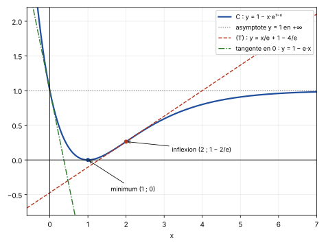

# ECRICOME ECT — Mathématiques technologiques 2026 · Corrigé guidé

*Corrigé rédigé par IA, non officiel. Signalez toute erreur.*

## Présentation du sujet

**Format.** Épreuve de 4 heures, sans document ni calculatrice. Trois exercices indépendants, 72 questions élémentaires en comptant les sous-questions. Données : $e\simeq2{,}72$ et $e^{-1}\simeq0{,}37$ (exercice 2, question 5).

**Découpage.**

| Exercice | Thème | Notions du programme ECT |
|---|---|---|
| 1, partie 1 | Deux suites couplées de somme constante | récurrence, suite arithmético-géométrique, limite, boucle `while` en Python |
| 1, partie 2 | Diagonalisation d'une matrice $3\times3$ et suites affines couplées | produit matriciel, inverse, vecteurs propres, $M=PDP^{-1}$, $M^n$, écriture matricielle d'une récurrence |
| 2, partie 1 | Étude de $g(x)=1-xe^{1-x}$ | limites, asymptote, variations, convexité, point d'inflexion, tangente, tracé |
| 2, partie 2 | Une densité sur $[e,+\infty[$ et le maximum de $n$ variables | intégration par parties, densité, fonction de répartition, espérance, absence de variance, loi du maximum |
| 2, partie 3 | Suite $(\alpha_n)$ définie par $g(\alpha_n)^n=\frac12$ | théorème de la bijection, monotonie, limite |
| 3, partie 1 | Tirages avec remise de foulards de trois sortes | loi binomiale, covariance, coefficient de corrélation, simulation Python |
| 3, partie 2 | Attente d'une rose et d'une non-rose | loi géométrique, séries géométriques, espérance, indépendance |
| 3, partie 3 | Table SQL `foulards` | `SELECT`, clé primaire, `UPDATE`, `WHERE … AND …` |

**Difficulté.** Le sujet est classique et progressif. La partie 1 de chaque exercice est très accessible ; les questions qui demandent de l'initiative sont 1.4 (Python), 2.9, 2.10, 2.13–2.14, 3.4.(b), 3.7 et 3.8. La moyenne est de 11,2 sur 20, avec un écart-type de 5,58 (rapport 2026). Le rapport note que la longueur des deux premiers exercices laissait le temps de traiter le troisième, et que l'informatique (Python et SQL) s'articulait avec les mathématiques.

**Gestion du temps.** Environ 1 h 10 pour l'exercice 1, 1 h 30 pour l'exercice 2, 1 h 20 pour l'exercice 3. Les questions de SQL (3.10 à 3.13) prennent dix minutes et rapportent des points sûrs : ne pas les laisser de côté.

## Exercice 1 — Partie 1 : deux suites couplées

La somme $a_n+b_n$ est constante, ce qui ramène l'étude à une suite arithmético-géométrique.

### Question 1

> [!INDICATION]
> Calculez $a_{n+1}+b_{n+1}$ en fonction de $a_n$ et $b_n$.

#### Solution

Montrons par récurrence la propriété $\mathcal P(n)$ : $a_n+b_n=1$.

*Initialisation.* $a_0+b_0=1+0=1$ : $\mathcal P(0)$ est vraie.

*Hérédité.* Soit $n\in\mathbb N$ tel que $\mathcal P(n)$ soit vraie.
$$\begin{aligned}
a_{n+1}+b_{n+1}&=\left(\tfrac7{10}+\tfrac3{10}\right)a_n+\left(\tfrac1{10}+\tfrac9{10}\right)b_n\\
&=a_n+b_n\\
&=1.
\end{aligned}$$
$\mathcal P(n+1)$ est vraie.

*Conclusion.* Par récurrence, $\boxed{\forall n\in\mathbb N,\ a_n+b_n=1}$.

> [!JURY]
> Le rapport 2026 demande de soigner ce premier raisonnement par récurrence : « La conclusion ne comporte pas toujours le « ∀n ∈ N » », et « L’hérédité est parfois commencée en écrivant que la proposition est vraie : « ∀n fixé » ». L'hérédité suppose $\mathcal P(n)$ pour un $n$ fixé.

### Question 2.(a)

> [!INDICATION]
> Utilisez la question 1 pour éliminer $b_n$.

#### Solution

Soit $n\in\mathbb N$. D'après la question 1, $b_n=1-a_n$, donc
$$\begin{aligned}
a_{n+1}&=\tfrac7{10}a_n+\tfrac1{10}(1-a_n)\\
&=\tfrac6{10}a_n+\tfrac1{10}\\
&=\tfrac35a_n+\tfrac1{10}.
\end{aligned}$$

> [!PIEGE]
> Une récurrence est inutile ici : il n'y a qu'à substituer. Le rapport 2026 constate que beaucoup tentent sans succès une récurrence.

### Question 2.(b)

> [!INDICATION]
> Équation du premier degré : regroupez les termes en $\ell$.

#### Solution

$$\begin{aligned}
\ell=\tfrac35\ell+\tfrac1{10}&\iff\tfrac25\ell=\tfrac1{10}\\
&\iff\ell=\tfrac14.
\end{aligned}$$
$\boxed{\ell=\tfrac14}$.

### Question 2.(c)

> [!INDICATION]
> Calculez $v_{n+1}$ en remplaçant $a_{n+1}$ par 2.(a) et $\frac1{10}$ grâce à 2.(b).

#### Solution

Soit $n\in\mathbb N$. Comme $\frac1{10}=\ell-\frac35\ell$ :
$$\begin{aligned}
v_{n+1}&=a_{n+1}-\ell\\
&=\tfrac35a_n+\tfrac1{10}-\ell\\
&=\tfrac35a_n-\tfrac35\ell\\
&=\tfrac35v_n.
\end{aligned}$$
**$(v_n)$ est géométrique de raison $\frac35$**, de premier terme $v_0=a_0-\ell=\frac34$.

> [!JURY]
> Le rapport 2026 : « Des candidats « devinent » plus qu’ils ne calculent la raison » $\frac35$, et certaines résolutions s'apparentent à de l'arnaque, détectée et sanctionnée : le calcul de $v_{n+1}$ doit apparaître en entier.

### Question 2.(d)

> [!INDICATION]
> Exprimez $v_n$ à l'aide de son premier terme et de sa raison, puis revenez à $a_n$.

#### Solution

D'après 2.(c), $v_n=\frac34\left(\frac35\right)^n$, donc
$$\boxed{a_n=v_n+\ell=\frac14+\frac34\left(\frac35\right)^n}.$$

### Question 3.(a)

> [!INDICATION]
> Question 1, avec des parenthèses autour de $a_n$.

#### Solution

D'après la question 1,
$$\begin{aligned}
b_n&=1-a_n\\
&=1-\tfrac14-\tfrac34\left(\tfrac35\right)^n\\
&=\tfrac34-\tfrac34\left(\tfrac35\right)^n.
\end{aligned}$$
$$\boxed{b_n=\tfrac34\left(1-\left(\tfrac35\right)^n\right)}$$

### Question 3.(b)

> [!INDICATION]
> Limite d'une suite géométrique.

#### Solution

Comme $-1<\frac35<1$, $\left(\frac35\right)^n\to0$, donc $\boxed{\lim_{n\to+\infty}b_n=\tfrac34}$.

### Question 4

> [!INDICATION]
> Tant que $b_n<s$, on passe au rang suivant. Pour mettre à jour `b`, il faut une relation entre $b_{n+1}$ et $b_n$ seuls, ou la formule de 3.(a).

> [!INDICATION]
> Comme pour 2.(a) : $b_{n+1}=\frac3{10}a_n+\frac9{10}b_n$ avec $a_n=1-b_n$.

#### Solution

D'après la question 1, $b_{n+1}=\frac3{10}(1-b_n)+\frac9{10}b_n=\frac3{10}+\frac35b_n$.
```python
def rang(s):
    b = 0
    n = 0
    while b < s:
        n = n + 1
        b = 3/10 + 3/5*b
    return n
```
La variable `b` contient $b_n$ à chaque passage dans la boucle (invariant, vrai au départ puisque $b_0=0$).

La boucle s'arrête au premier $n$ tel que $b_n\ge s$ ; elle termine car $b_n\to\frac34>s$.

On peut aussi écrire `b = 3/4 - 3/4*(3/5)**n` d'après 3.(a).

Essai : `rang(0.5)` renvoie `3`, car $b_2=0{,}48$ et $b_3=0{,}588$.

> [!JURY]
> Le rapport 2026 : question rarement abordée, avec des propositions fausses comme `b=b+1`, `b>=s` ou `s<3/4` en condition de boucle.

## Exercice 1 — Partie 2 : diagonalisation et suites affines

On diagonalise $M$, on calcule $M^n$ appliquée à un vecteur, puis on s'en sert pour une récurrence affine écrite en dimension 3.

### Question 5.(a)

> [!INDICATION]
> Calcul ligne par colonne.

#### Solution

$$QP=\begin{pmatrix}3&3&-1\\-9&3&3\\0&0&4\end{pmatrix}\begin{pmatrix}1&-1&1\\3&1&0\\0&0&3\end{pmatrix}=\begin{pmatrix}12&0&0\\0&12&0\\0&0&12\end{pmatrix}=12I.$$

### Question 5.(b)

> [!INDICATION]
> Exhibez une matrice dont le produit avec $P$ vaut $I$.

#### Solution

D'après 5.(a), $\left(\frac1{12}Q\right)P=I$. Une matrice carrée qui admet un inverse à gauche est inversible, d'inverse celui-ci : **$P$ est inversible et $P^{-1}=\tfrac1{12}Q$.**

> [!JURY]
> Le rapport 2026 : trop de candidats donnent la bonne matrice $P^{-1}$ sans expliquer pourquoi $P$ est inversible ; et le pivot de Gauss fait perdre du temps quand 5.(a) donne la réponse.

### Question 6.(a)

> [!INDICATION]
> Calculez le produit de $M$ par chacun des trois vecteurs.

#### Solution

Notons $X_1=\begin{pmatrix}1\\3\\0\end{pmatrix}$, $X_2=\begin{pmatrix}-1\\1\\0\end{pmatrix}$ et $X_3=\begin{pmatrix}1\\0\\3\end{pmatrix}$.
$$MX_1=\begin{pmatrix}7+3\\3+27\\0\end{pmatrix}=\begin{pmatrix}10\\30\\0\end{pmatrix}=10X_1.$$
$$MX_2=\begin{pmatrix}-7+1\\-3+9\\0\end{pmatrix}=\begin{pmatrix}-6\\6\\0\end{pmatrix}=6X_2.$$
$$MX_3=\begin{pmatrix}7+3\\3-3\\30\end{pmatrix}=\begin{pmatrix}10\\0\\30\end{pmatrix}=10X_3.$$
Ces vecteurs sont non nuls. **$X_1$ et $X_3$ sont des vecteurs propres de $M$ associés à la valeur propre $10$, $X_2$ à la valeur propre $6$.**

> [!JURY]
> Le rapport 2026 : « de nombreux candidats oublient de préciser que les vecteurs sont non nuls ».

### Question 6.(b)

> [!INDICATION]
> Les colonnes de $P$ sont $X_1$, $X_2$, $X_3$ : comparez $MP$ et $PD$.

#### Solution

Les colonnes de $MP$ sont $MX_1=10X_1$, $MX_2=6X_2$, $MX_3=10X_3$ ; ce sont aussi les colonnes de $PD$, puisque $D=\operatorname{diag}(10,6,10)$.

Donc $MP=PD$ et, en multipliant à droite par $P^{-1}$ (question 5.(b)), $\boxed{M=PDP^{-1}}$.

### Question 7.(a)

> [!INDICATION]
> Récurrence ; dans l'hérédité, le produit $P^{-1}P$ se simplifie.

#### Solution

D'après 5.(b) et 6.(b), $M=\frac1{12}PDQ$. Montrons par récurrence $\mathcal P(n)$ : $M^n=\frac1{12}PD^nQ$.

*Initialisation.* $\frac1{12}PD^0Q=\frac1{12}PQ=PP^{-1}=I=M^0$.

*Hérédité.* Soit $n\in\mathbb N$ tel que $\mathcal P(n)$ soit vraie.
$$\begin{aligned}
M^{n+1}&=M^nM\\
&=\tfrac1{12}PD^nQ\times\tfrac1{12}PDQ\\
&=\tfrac1{144}PD^n(QP)DQ\\
&=\tfrac1{144}PD^n(12I)DQ\\
&=\tfrac1{12}PD^{n+1}Q.
\end{aligned}$$
*Conclusion.* $\boxed{\forall n\in\mathbb N,\ M^n=\tfrac1{12}PD^nQ}$.

> [!JURY]
> Le rapport 2026 : initialiser par « $I=I$ » ne suffit pas, il faut justifier $\frac1{12}PQ=I$ ; une égalité du type $M^0=1$ montre une confusion sur la nature des objets.

### Question 7.(b)

> [!INDICATION]
> Produit d'une matrice par une colonne.

#### Solution

$$Q\begin{pmatrix}1\\0\\1\end{pmatrix}=\begin{pmatrix}3-1\\-9+3\\0+4\end{pmatrix}=\begin{pmatrix}2\\-6\\4\end{pmatrix}.$$

### Question 7.(c)

> [!INDICATION]
> $D$ est diagonale : $D^n=\operatorname{diag}(10^n,6^n,10^n)$.

> [!INDICATION]
> Calculez de droite à gauche : $D^n$ appliquée à la colonne de 7.(b), puis $P$.

#### Solution

$D$ étant diagonale, $D^n=\operatorname{diag}(10^n,6^n,10^n)$. Avec 7.(a) et 7.(b) :
$$D^n\begin{pmatrix}2\\-6\\4\end{pmatrix}=\begin{pmatrix}2\cdot10^n\\-6\cdot6^n\\4\cdot10^n\end{pmatrix},$$
puis
$$\begin{aligned}
M^n\begin{pmatrix}1\\0\\1\end{pmatrix}&=\frac1{12}P\begin{pmatrix}2\cdot10^n\\-6\cdot6^n\\4\cdot10^n\end{pmatrix}\\
&=\frac1{12}\begin{pmatrix}6\cdot10^n+6\cdot6^n\\6\cdot10^n-6\cdot6^n\\12\cdot10^n\end{pmatrix}\\
&=\frac12\begin{pmatrix}10^n+6^n\\10^n-6^n\\2\cdot10^n\end{pmatrix}.
\end{aligned}$$
Comme $10^n=2^n5^n$ et $6^n=2^n3^n$, on obtient
$$\boxed{M^n\begin{pmatrix}1\\0\\1\end{pmatrix}=2^{n-1}\begin{pmatrix}5^n+3^n\\5^n-3^n\\2\cdot5^n\end{pmatrix}}.$$

> [!JURY]
> Le rapport 2026 relève que le caractère diagonal de $D$ est trop rarement rappelé, que $3\times10^n$ devient parfois $30^n$, et que $M^n$ n'est pas la matrice des puissances des coefficients.

### Question 8.(a)

> [!INDICATION]
> Développez le produit et comparez avec les relations de récurrence. Aucune récurrence n'est nécessaire.

#### Solution

Soit $n\in\mathbb N$.
$$\frac1{10}M\begin{pmatrix}x_n\\y_n\\1\end{pmatrix}=\frac1{10}\begin{pmatrix}7x_n+y_n+1\\3x_n+9y_n-1\\10\end{pmatrix}=\begin{pmatrix}x_{n+1}\\y_{n+1}\\1\end{pmatrix}.$$

### Question 8.(b)

> [!INDICATION]
> Récurrence immédiate à partir de 8.(a) ; seul le scalaire $\frac1{10}$ se déplace librement.

#### Solution

Notons $Y_n=\begin{pmatrix}x_n\\y_n\\1\end{pmatrix}$. Montrons par récurrence $Y_n=\frac1{10^n}M^nY_0$.

*Initialisation.* $\frac1{10^0}M^0Y_0=Y_0$.

*Hérédité.* Si $Y_n=\frac1{10^n}M^nY_0$ pour un $n\in\mathbb N$, alors d'après 8.(a)
$$\begin{aligned}
Y_{n+1}&=\tfrac1{10}MY_n\\
&=\tfrac1{10}M\cdot\tfrac1{10^n}M^nY_0\\
&=\tfrac1{10^{n+1}}M^{n+1}Y_0.
\end{aligned}$$
*Conclusion.* $\boxed{\forall n\in\mathbb N,\ Y_n=\tfrac1{10^n}M^nY_0}$.

### Question 8.(c)

> [!INDICATION]
> $Y_0=\begin{pmatrix}1\\0\\1\end{pmatrix}$ : utilisez 7.(c).

#### Solution

$Y_0=\begin{pmatrix}1\\0\\1\end{pmatrix}$. D'après 8.(b) et 7.(c), la première coordonnée donne
$$\begin{aligned}
x_n&=\frac{2^{n-1}\left(5^n+3^n\right)}{10^n}\\
&=\frac12\cdot\frac{5^n+3^n}{5^n}\\
&=\frac12+\frac12\left(\frac35\right)^n.
\end{aligned}$$

> [!JURY]
> Le rapport 2026 note « souvent une arnaque sur la simplification finale » : écrire $10^n=2^n5^n$ explicitement.

## Exercice 2 — Partie 1 : étude de g

Étude complète de $g(x)=1-xe^{1-x}$ ; attention, $xe^{1-x}$ est un produit, à ne pas confondre avec $(1-x)e^{1-x}$.

### Question 1.(a)

> [!INDICATION]
> Limites de $x$ et de $e^{1-x}$ en $-\infty$, puis produit.

#### Solution

Quand $x\to-\infty$ : $1-x\to+\infty$ donc $e^{1-x}\to+\infty$, et $x\to-\infty$. Par produit, $xe^{1-x}\to-\infty$, donc $\boxed{\lim_{x\to-\infty}g(x)=+\infty}$.

> [!PIEGE]
> Il n'y a pas de forme indéterminée en $-\infty$ : invoquer les croissances comparées est faux ici.

### Question 1.(b)

> [!INDICATION]
> Écrivez $xe^{1-x}=e\cdot\dfrac{x}{e^x}$.

#### Solution

Pour tout $x$, $xe^{1-x}=e\cdot\frac{x}{e^x}$.

Par croissances comparées, $\frac{x}{e^x}\to0$ en $+\infty$.

Donc $\boxed{\lim_{x\to+\infty}g(x)=1}$ : **la droite d'équation $y=1$ est asymptote (horizontale) à $\mathcal C$ en $+\infty$.**

### Question 2.(a)

> [!INDICATION]
> Dérivée d'un produit ; la dérivée de $x\mapsto e^{1-x}$ est $x\mapsto-e^{1-x}$.

#### Solution

$$\begin{aligned}
g'(x)&=-\left(e^{1-x}+x\cdot(-e^{1-x})\right)\\
&=(x-1)e^{1-x}.
\end{aligned}$$

### Question 2.(b)

> [!INDICATION]
> $e^{1-x}>0$ : le signe de $g'(x)$ est celui de $x-1$.

#### Solution

$g'(x)$ a le signe de $x-1$. $g(1)=1-1=0$.

| $x$ | $-\infty$ | | $1$ | | $+\infty$ |
|---|---|---|---|---|---|
| $g'(x)$ | | $-$ | $0$ | $+$ | |
| $g$ | $+\infty$ | $\searrow$ | $0$ | $\nearrow$ | $1$ |

En particulier $g\ge0$ sur $\mathbb R$, avec égalité seulement en $1$.

### Question 3.(a)

> [!INDICATION]
> Dérivez $g'(x)=(x-1)e^{1-x}$ comme un produit.

#### Solution

$$\begin{aligned}
g''(x)&=e^{1-x}+(x-1)(-e^{1-x})\\
&=(2-x)e^{1-x}.
\end{aligned}$$

### Question 3.(b)

> [!INDICATION]
> Signe de $2-x$.

#### Solution

$g''(x)$ a le signe de $2-x$ : $g''>0$ sur $]-\infty,2[$ et $g''<0$ sur $]2,+\infty[$.

**$g$ est convexe sur $]-\infty,2]$ et concave sur $[2,+\infty[$.** La dérivée seconde s'annule en $2$ en changeant de signe : **$\mathcal C$ admet un point d'inflexion d'abscisse $2$**, le point $\left(2,1-\frac2e\right)$.

### Question 4.(a)

> [!INDICATION]
> $y=g'(2)(x-2)+g(2)$.

#### Solution

$g(2)=1-2e^{-1}$ et $g'(2)=e^{-1}$. Donc $(T):\ y=\frac1e(x-2)+1-\frac2e$, soit
$$\boxed{(T):\ y=\frac{x}{e}+1-\frac4e}.$$

### Question 4.(b)

> [!INDICATION]
> Convexité et position par rapport aux tangentes, de part et d'autre de l'abscisse $2$.

#### Solution

Sur $]-\infty,2]$, $g$ est convexe : $\mathcal C$ est au-dessus de ses tangentes, donc de $(T)$.

Sur $[2,+\infty[$, $g$ est concave : $\mathcal C$ est en dessous de $(T)$.

**$\mathcal C$ est au-dessus de $(T)$ pour $x\le2$, en dessous pour $x\ge2$ ; elle traverse $(T)$ au point d'inflexion.**

> [!JURY]
> Le rapport 2026 : « De très rares candidats pensent à utiliser la convexité. »

### Question 5

> [!INDICATION]
> Placez d'abord : minimum $(1,0)$, point d'inflexion $\left(2;1-\frac2e\right)\simeq(2;0{,}26)$, $g(0)=1$, asymptote $y=1$.

> [!INDICATION]
> Calculez $g'(0)$ avec 2.(a), puis $y=g'(0)x+g(0)$.

#### Solution

Éléments du tracé : $g(0)=1$, tangente en $0$ d'équation $y=1-ex$ (car $g'(0)=-e$) ; minimum $(1,0)$ ; point d'inflexion $(2;1-\frac2e)\simeq(2;0{,}26)$ avec $(T)$ de pente $\frac1e\simeq0{,}37$ ; asymptote $y=1$ en $+\infty$, approchée par en dessous ($g<1$ pour $x>0$) ; branche qui monte vers $+\infty$ en $-\infty$ (pas d'asymptote de ce côté).



> [!JURY]
> Le rapport 2026 : « Rappelons que les questions de ce type demandant l’allure de fonctions sont à traiter et permettent à des candidats de récupérer facilement des points. »

## Exercice 2 — Partie 2 : une densité sans variance

On construit une densité sur $[e,+\infty[$ ; la variable admet une espérance mais pas de variance. Puis on étudie le maximum $Z_n$ de $n$ copies indépendantes, dont la loi fait réapparaître $g$.

### Question 6.(a)

> [!INDICATION]
> Écrivez $\frac1{t^3}=t^{-3}$.

#### Solution

$t\mapsto\frac1{t^3}=t^{-3}$ a pour primitive $\boxed{t\mapsto-\dfrac1{2t^2}}$ sur $[e,+\infty[$.

### Question 6.(b)

> [!INDICATION]
> Dérivez $\ln t-1$ et primitivez $\frac1{t^3}$ avec 6.(a).

#### Solution

Soit $x>e$.

On pose $u(t)=\ln t-1$, $v(t)=-\frac1{2t^2}$, de classe $\mathcal C^1$ sur $[e,x]$, avec $u'(t)=\frac1t$ et $v'(t)=\frac1{t^3}$.
$$\begin{aligned}
\int_e^x\frac{\ln t-1}{t^3}\,dt&=\left[-\frac{\ln t-1}{2t^2}\right]_e^x+\int_e^x\frac1{2t^3}\,dt\\
&=-\frac{\ln x-1}{2x^2}+0+\left[-\frac1{4t^2}\right]_e^x\\
&=-\frac{\ln x-1}{2x^2}-\frac1{4x^2}+\frac1{4e^2}\\
&=\frac1{2x^2}\left(\frac12-\ln x\right)+\frac1{4e^2}.
\end{aligned}$$

### Question 6.(c)

> [!INDICATION]
> Positivité : signe de $\ln t-1$ sur $[e,+\infty[$. Continuité : sur chaque intervalle.

> [!INDICATION]
> Pour l'intégrale, faites tendre $x$ vers $+\infty$ dans 6.(b) : croissances comparées.

#### Solution

- **Positivité.** $f=0$ sur $]-\infty,e[$ ; pour $t\ge e$, $\ln t\ge1$ (croissance de $\ln$), donc $f(t)\ge0$.
- **Continuité.** $f$ est continue sur $]-\infty,e[$ (nulle) et sur $[e,+\infty[$ (quotient de fonctions continues, $t^3\neq0$) : elle est continue sauf peut-être en $e$ (elle l'est en fait aussi en $e$, car $f(e)=0$).
- **Intégrale.** $\int_{-\infty}^ef=0$. D'après 6.(b), pour $x>e$ :
$$\int_e^xf(t)\,dt=4e^2\left(\frac{1}{4x^2}-\frac{\ln x}{2x^2}\right)+1.$$
Par croissances comparées $\frac{\ln x}{x^2}\to0$, et $\frac1{x^2}\to0$ : l'intégrale converge et vaut $1$.

**$f$ est une densité de probabilité.**

> [!JURY]
> Le rapport 2026 : « Très peu de candidats s’aperçoivent que le théorème des croissances comparées doit être invoqué. » Il demande aussi de justifier explicitement la positivité de $\ln t-1$.

### Question 7.(a)

> [!INDICATION]
> Pour $x\ge e$, $F(x)=\int_e^xf(t)\,dt$ : réutilisez 6.(b) sans refaire l'intégration par parties.

#### Solution

Si $x<e$, $F(x)=\int_{-\infty}^x0\,dt=0$. Si $x\ge e$, d'après 6.(b) (la formule vaut aussi pour $x=e$, les deux membres étant nuls) :
$$\begin{aligned}
F(x)&=4e^2\left(\frac1{2x^2}\left(\frac12-\ln x\right)+\frac1{4e^2}\right)\\
&=1+\frac{e^2(1-2\ln x)}{x^2}.
\end{aligned}$$
$$\boxed{F(x)=\begin{cases}0&\text{si }x<e\\[2pt]1-\dfrac{e^2(2\ln x-1)}{x^2}&\text{si }x\ge e\end{cases}}$$

### Question 7.(b)

> [!INDICATION]
> $\mathbb P(a<X\le b)=F(b)-F(a)$, et une probabilité conditionnelle est un quotient.

#### Solution

$$\begin{aligned}
\mathbb P(X\le e^2)&=F(e^2)\\
&=1-\frac{e^2\times3}{e^4}\\
&=\boxed{1-\frac3{e^2}}.
\end{aligned}$$
$$\begin{aligned}
\mathbb P(e^2<X\le e^3)&=F(e^3)-F(e^2)\\
&=\left(1-\frac5{e^4}\right)-\left(1-\frac3{e^2}\right)\\
&=\boxed{\frac3{e^2}-\frac5{e^4}}.
\end{aligned}$$
$X$ est à densité, donc $\mathbb P(X\ge e^2)=1-F(e^2)=\frac3{e^2}\neq0$ et $\mathbb P(e^2\le X<e^3)=\mathbb P(e^2<X\le e^3)$. Ainsi
$$\begin{aligned}
\mathbb P_{[X\ge e^2]}(X<e^3)&=\frac{\mathbb P(e^2\le X<e^3)}{\mathbb P(X\ge e^2)}\\
&=\frac{\frac3{e^2}-\frac5{e^4}}{\frac3{e^2}}\\
&=\boxed{1-\frac5{3e^2}}.
\end{aligned}$$

### Question 8.(a)

> [!INDICATION]
> Dérivée d'un quotient $\frac uv$ : $\frac{u'v-uv'}{v^2}$.

#### Solution

Pour $x\ge e$ :
$$\begin{aligned}
G'(x)&=-\frac{\frac1x\cdot x-\ln x\cdot1}{x^2}\\
&=\frac{\ln x-1}{x^2}.
\end{aligned}$$

> [!JURY]
> Le rapport 2026 : « La dérivée d’un quotient est trop souvent le quotient des dérivées. »

### Question 8.(b)

> [!INDICATION]
> Remarquez que $tf(t)=4e^2G'(t)$ pour $t\ge e$.

#### Solution

Pour $t<e$, $tf(t)=0$ ; pour $t\ge e$, $tf(t)=4e^2\frac{\ln t-1}{t^2}=4e^2G'(t)\ge0$. Pour $x\ge e$ :
$$\begin{aligned}
\int_e^xtf(t)\,dt&=4e^2\big(G(x)-G(e)\big)\\
&=4e^2\left(\frac1e-\frac{\ln x}{x}\right).
\end{aligned}$$
Par croissances comparées, $\frac{\ln x}{x}\to0$ : l'intégrale $\int_{-\infty}^{+\infty}tf(t)\,dt$ converge, absolument puisque l'intégrande est positif. **$X$ admet une espérance**, et
$$\mathbb E(X)=\frac{4e^2}{e}=\boxed{4e}.$$

### Question 9.(a)

> [!INDICATION]
> Pour $t\ge e^2$, minorez $\ln t-1$.

#### Solution

Soit $t\ge e^2$. Alors $\ln t\ge2$, donc $\ln t-1\ge1$, et
$$t^2f(t)=\frac{4e^2(\ln t-1)}{t}\ge\frac{4e^2}{t}.$$

### Question 9.(b)

> [!INDICATION]
> $X$ admet une variance si et seulement si elle admet un moment d'ordre $2$.

> [!INDICATION]
> Comparez $\int_{e^2}^{+\infty}t^2f(t)\,dt$ à une intégrale de référence divergente.

#### Solution

$X$ admet une variance si et seulement si $\int_{-\infty}^{+\infty}t^2f(t)\,dt$ converge.

Sur $[e^2,+\infty[$, $t^2f(t)\ge\frac{4e^2}t\ge0$ (question 9.(a)), et $\int_{e^2}^{+\infty}\frac{dt}t$ diverge (intégrale de Riemann, $\int_{e^2}^x\frac{dt}t=\ln x-2\to+\infty$).

Par comparaison de fonctions positives, $\int_{e^2}^{+\infty}t^2f(t)\,dt$ diverge, donc $\int_{-\infty}^{+\infty}t^2f(t)\,dt$ aussi.

**$X$ n'admet pas de variance.**

> [!JURY]
> Le rapport 2026 rappelle que l'inégalité de 9.(a) n'est valable que pour $t\ge e^2$ : la comparaison se fait sur $[e^2,+\infty[$, pas sur $[e,+\infty[$.

### Question 10.(a)

> [!INDICATION]
> Utilisez l'égalité d'événements rappelée, puis l'indépendance des $X_i$.

#### Solution

Soit $x\in\mathbb R$. D'après l'égalité rappelée et l'indépendance des $X_i$ :
$$\begin{aligned}
F_n(x)&=\mathbb P\left(\bigcap_{i=1}^n[X_i\le x]\right)\\
&=\prod_{i=1}^n\mathbb P(X_i\le x)\\
&=\big(F(x)\big)^n,
\end{aligned}$$
car chaque $X_i$ a la même loi que $X$.

> [!JURY]
> Le rapport 2026 : « L’indépendance est rarement évoquée, ou bien pas au bon moment. »

### Question 10.(b)

> [!INDICATION]
> Écrivez l'événement $\left[\frac1{\sqrt e}Z_n\le e^{x/2}\right]$ sous la forme $[Z_n\le c]$.

> [!INDICATION]
> Pour $x\ge1$, $c\ge e$ : appliquez la formule de 7.(a).

#### Solution

Soit $x\ge1$.

Comme $\sqrt e>0$, $\left[\frac1{\sqrt e}Z_n\le e^{x/2}\right]=\left[Z_n\le e^{\frac{x+1}2}\right]$.

Posons $c=e^{\frac{x+1}2}$ ; comme $x\ge1$, $c\ge e$ et $\ln c=\frac{x+1}2$, donc $2\ln c-1=x$ et $c^2=e^{x+1}$.

D'après 7.(a) :
$$\begin{aligned}
F(c)&=1-\frac{e^2x}{e^{x+1}}\\
&=1-xe^{1-x}.
\end{aligned}$$
Avec 10.(a) :
$$\begin{aligned}
\mathbb P\left(\frac1{\sqrt e}Z_n\le e^{x/2}\right)&=F_n(c)\\
&=\left(1-xe^{1-x}\right)^n.
\end{aligned}$$

### Question 10.(c)

> [!INDICATION]
> Que vaut $F(e)$ ? Quelles valeurs peut prendre $X$ ?

#### Solution

Pour $x=1$, l'événement est $[Z_n\le e]$.

Or $X$ prend presque sûrement ses valeurs dans $[e,+\infty[$ et $\mathbb P(X\le e)=F(e)=0$.

Donc $\mathbb P(Z_n\le e)=F(e)^n=0$.

**Oui, c'est prévisible** : le maximum de variables qui dépassent $e$ presque sûrement ne peut être inférieur ou égal à $e$ qu'avec une probabilité nulle.

C'est cohérent avec la formule : $1-1\cdot e^0=0$.

## Exercice 2 — Partie 3 : la suite (αₙ)

D'après 10.(b), $h_n(x)=\mathbb P\left(\frac1{\sqrt e}Z_n\le e^{x/2}\right)$ ; $\alpha_n$ est l'abscisse où cette probabilité vaut $\frac12$. On montre que $(\alpha_n)$ croît vers $+\infty$.

### Question 11.(a)

> [!INDICATION]
> Utilisez $g(1)$ et la limite de $g$ en $+\infty$ (partie 1).

#### Solution

$h_n(1)=g(1)^n=0^n=\boxed{0}$ (car $n\ge1$). D'après 1.(b), $g(x)\to1$ en $+\infty$, donc $\boxed{\lim_{x\to+\infty}h_n(x)=1^n=1}$.

### Question 11.(b)

> [!INDICATION]
> $g$ est croissante et positive sur $[1,+\infty[$ ; comment se comporte $y\mapsto y^n$ sur $[0,+\infty[$ ?

#### Solution

D'après 2.(b), $g$ est croissante sur $[1,+\infty[$ et $g\ge0$ sur cet intervalle.

La fonction $y\mapsto y^n$ est croissante sur $[0,+\infty[$.

Par composition, $h_n=g^n$ est croissante sur $[1,+\infty[$. (Variante : $h_n'(x)=n\,g'(x)\,g(x)^{n-1}\ge0$ pour $x\ge1$.)

> [!JURY]
> Le rapport 2026 rappelle qu'il faut préciser $g\ge0$ sur $[1,+\infty[$, car $y\mapsto y^n$ n'est pas croissante sur $\mathbb R$ en général, et met en garde contre la confusion entre la fonction $h_n$ et la suite $(h_n)$.

### Question 11.(c)

> [!INDICATION]
> Théorème de la bijection : continuité, stricte monotonie, image de l'intervalle $[1,+\infty[$.

#### Solution

Soit $n\in\mathbb N^*$.

$h_n$ est continue (car dérivable) et strictement croissante sur l'intervalle $[1,+\infty[$.

Par le théorème de la bijection, elle réalise une bijection de $[1,+\infty[$ sur $\left[h_n(1),\lim_{+\infty}h_n\right[=[0,1[$.

Comme $\frac12\in[0,1[$, **il existe un unique $\alpha_n\in[1,+\infty[$ tel que $h_n(\alpha_n)=\frac12$.**

> [!PIEGE]
> L'image est $[0,1[$ et non $[0,1]$ : la valeur $1$ n'est jamais atteinte.

### Question 12

> [!INDICATION]
> $\alpha_n$ est l'abscisse du point d'intersection de la courbe de $h_n$ avec la droite $y=\frac12$.

#### Solution

$\alpha_n$ est l'abscisse de l'intersection de la courbe de $h_n$ avec la droite $y=\frac12$.

Sur le graphique, ces intersections se déplacent vers la droite quand $n$ augmente ($h_2$, $h_5$, $h_{12}$, $h_{21}$, $h_{50}$).

**On conjecture que $(\alpha_n)$ est croissante.**

### Question 13.(a)

> [!INDICATION]
> Écrivez $g^{n+1}=g^n\times g$.

#### Solution

$$\begin{aligned}
h_{n+1}(\alpha_n)&=g(\alpha_n)^{n}\,g(\alpha_n)\\
&=h_n(\alpha_n)\,g(\alpha_n)\\
&=\frac{1-\alpha_ne^{1-\alpha_n}}2.
\end{aligned}$$

### Question 13.(b)

> [!INDICATION]
> Comparez $g(\alpha_n)$ à $1$, puis $h_{n+1}(\alpha_n)$ à $h_{n+1}(\alpha_{n+1})$.

#### Solution

Comme $\alpha_n\ge1>0$, $\alpha_ne^{1-\alpha_n}>0$, donc $g(\alpha_n)<1$ et, d'après 13.(a),
$$h_{n+1}(\alpha_n)<\frac12=h_{n+1}(\alpha_{n+1}).$$
$h_{n+1}$ est strictement croissante sur $[1,+\infty[$, donc $\alpha_n<\alpha_{n+1}$ ; en particulier $\boxed{\alpha_n\le\alpha_{n+1}}$.

### Question 14

> [!INDICATION]
> La suite est croissante : soit elle converge, soit elle tend vers $+\infty$. Raisonnez par l'absurde.

> [!INDICATION]
> Si $\alpha_n\to L$, que vaut la limite de $g(\alpha_n)=2^{-1/n}$ ?

#### Solution

$(\alpha_n)$ est croissante (13.(b)). Supposons-la majorée : par le théorème de la limite monotone, elle converge vers un réel $L\ge1$. Or $h_n(\alpha_n)=\frac12$ et $g(\alpha_n)\ge0$ donnent
$$g(\alpha_n)=\left(\tfrac12\right)^{1/n}=e^{-\frac{\ln2}n}\xrightarrow[n\to+\infty]{}1.$$
Par continuité de $g$, $g(\alpha_n)\to g(L)$, donc $g(L)=1$, c'est-à-dire $Le^{1-L}=0$, impossible car $L\ge1$.

Donc $(\alpha_n)$ n'est pas majorée et, étant croissante, $\boxed{\lim_{n\to+\infty}\alpha_n=+\infty}$.

## Exercice 3 — Partie 1 : tirages avec remise

Trois couleurs de foulards, $n$ tirages indépendants : les nombres de chaque sorte suivent des lois binomiales, mais ne sont pas indépendants entre eux.

### Question 1.(a)

> [!INDICATION]
> Chaque tirage est une épreuve de Bernoulli (rose ou non), et les tirages sont indépendants.

#### Solution

Chaque tirage donne un foulard à roses avec probabilité $\frac3{10}$ ; les $n$ tirages avec remise sont indépendants et $R$ compte les succès.

**$R$ suit la loi binomiale $\mathcal B\left(n,\frac3{10}\right)$** : $R(\Omega)=[\![0,n]\!]$ et, pour $k\in[\![0,n]\!]$,
$$\mathbb P(R=k)=\binom nk\left(\frac3{10}\right)^k\left(\frac7{10}\right)^{n-k}.$$

> [!JURY]
> Le rapport 2026 : le support est souvent faux, absent ou mal noté ; c'est l'ensemble des entiers de $0$ à $n$, noté $[\![0,n]\!]$.

### Question 1.(b)

> [!INDICATION]
> Formules de la loi binomiale $np$ et $np(1-p)$.

#### Solution

$$\begin{aligned}
\mathbb E(R)&=n\cdot\frac3{10}\\
&=\boxed{\frac{3n}{10}}\\
\mathbb V(R)&=n\cdot\frac3{10}\cdot\frac7{10}\\
&=\boxed{\frac{21n}{100}}.
\end{aligned}$$

### Question 2.(a)

> [!INDICATION]
> $[S=0]$ signifie que tous les foulards tirés sont à instruments : faites le lien avec $M$.

#### Solution

À chaque tirage, on obtient exactement un foulard d'une des trois sortes, donc $R+C+M=n$ et $S=n-M$.
$$\begin{aligned}
\mathbb P(S=0)&=\mathbb P(M=n)\\
&=\left(\frac15\right)^n.
\end{aligned}$$
$$\begin{aligned}
\mathbb P(S=1)&=\mathbb P(M=n-1)\\
&=\binom n{n-1}\left(\frac15\right)^{n-1}\frac45\\
&=\frac{4n}{5^n}.
\end{aligned}$$

> [!JURY]
> Le rapport 2026 : « Peu de candidats ont vu le lien avec la variable M. »

### Question 2.(b)

> [!INDICATION]
> À chaque tirage, regardez l'événement « le foulard tiré a des roses ou des carreaux ».

#### Solution

À chaque tirage, l'événement « le foulard a des roses ou des carreaux » a pour probabilité $\frac3{10}+\frac5{10}=\frac45$ (événements incompatibles). Les tirages sont indépendants et $S$ compte le nombre de tirages où cet événement se réalise. **$S$ suit la loi binomiale $\mathcal B\left(n,\frac45\right)$.**

> [!JURY]
> Le rapport 2026 : « Le résultat étant donné dans l’énoncé, une justification précise et claire est attendue. » Il relève « Beaucoup de réponses du type « R et C suivent une loi binomiale donc S aussi » », argument faux en général.

### Question 2.(c)

> [!INDICATION]
> Mêmes formules qu'en 1.(b).

#### Solution

$$\begin{aligned}
\mathbb E(S)&=\frac{4n}5\\
\mathbb V(S)&=n\cdot\frac45\cdot\frac15\\
&=\frac{4n}{25}.
\end{aligned}$$

### Question 3.(a)

> [!INDICATION]
> Formule de la variance d'une somme : $\mathbb V(R+C)=\mathbb V(R)+\mathbb V(C)+2\operatorname{Cov}(R,C)$.

#### Solution

$C\hookrightarrow\mathcal B\left(n,\frac12\right)$ donc $\mathbb V(C)=\frac n4$. De $\mathbb V(S)=\mathbb V(R)+\mathbb V(C)+2\operatorname{Cov}(R,C)$ :
$$\begin{aligned}
\operatorname{Cov}(R,C)&=\frac12\left(\frac{4n}{25}-\frac{21n}{100}-\frac{n}{4}\right)\\
&=\frac12\cdot\frac{16n-21n-25n}{100}\\
&=\boxed{-\frac{3n}{20}}.
\end{aligned}$$

> [!JURY]
> Le rapport 2026 : très peu de candidats ont pensé à cette formule ; la plupart sont partis de $\mathbb E(RC)-\mathbb E(R)\mathbb E(C)$ sans pouvoir calculer $\mathbb E(RC)$.

### Question 3.(b)

> [!INDICATION]
> Que vaut la covariance de deux variables indépendantes ?

#### Solution

Si $R$ et $C$ étaient indépendantes, leur covariance serait nulle. Or $\operatorname{Cov}(R,C)=-\frac{3n}{20}\neq0$ : **$R$ et $C$ ne sont pas indépendantes.**

### Question 3.(c)

> [!INDICATION]
> Définition $\rho=\frac{\operatorname{Cov}}{\sigma\sigma'}$ ; simplifiez $\sqrt{\frac{21n^2}{400}}$.

#### Solution

$$\begin{aligned}
\rho(R,C)&=\frac{\operatorname{Cov}(R,C)}{\sqrt{\mathbb V(R)\,\mathbb V(C)}}\\
&=\frac{-\frac{3n}{20}}{\sqrt{\frac{21n}{100}\cdot\frac n4}}\\
&=\frac{-\frac{3n}{20}}{\frac{n\sqrt{21}}{20}}\\
&=-\frac3{\sqrt{21}}.
\end{aligned}$$
Comme $\frac{3}{\sqrt{21}}=\sqrt{\frac9{21}}=\sqrt{\frac37}$, on a bien $\boxed{\rho(R,C)=-\sqrt{\tfrac37}}$.

### Question 4.(a)

> [!INDICATION]
> Que représente chaque test sur `p` ? Avec quelle probabilité est-il vrai ?

#### Solution

À chacun des $n$ passages, `p` suit la loi uniforme sur $[0,1[$ ; on incrémente `R` avec probabilité $\frac3{10}$, `C` avec probabilité $\frac8{10}-\frac3{10}=\frac5{10}$, `M` avec probabilité $\frac2{10}$.

**`Foulards(n)` simule $n$ tirages avec remise et renvoie la liste `[R, C, M]` des nombres de foulards à roses, à carreaux et à instruments obtenus** : une réalisation du triplet $(R,C,M)$.

> [!JURY]
> Le rapport 2026 signale des réponses du type « le programme donne les probabilités de… » : la fonction renvoie des effectifs simulés, pas des probabilités.

### Question 4.(b)

> [!INDICATION]
> Approchez une espérance par la moyenne d'un grand nombre de simulations indépendantes.

#### Solution

On fixe $n$ et on répète un grand nombre $N$ de fois la simulation ; les moyennes empiriques approchent les espérances.
```python
n = 10
N = 10000
sRC = 0 ; sR = 0 ; sC = 0
for i in range(N):
    R, C, M = Foulards(n)
    sRC = sRC + R*C
    sR = sR + R
    sC = sC + C
print(sRC/N - (sR/N)*(sC/N))
```
Essai avec $N=20\,000$ : valeur affichée $\approx-1{,}49$, proche de $\operatorname{Cov}(R,C)=-\frac{3\times10}{20}=-1{,}5$.

## Exercice 3 — Partie 2 : attendre une rose et une non-rose

L'expérience s'arrête dès qu'on a vu les deux types (rose et non-rose) : on étudie la loi de la durée $N$, son espérance via une série géométrique dérivée établie à la main, et sa dépendance avec $T$.

### Question 5.(a)

> [!INDICATION]
> Succès = « foulard sans roses » ; $T$ est le rang du premier succès.

#### Solution

Les tirages sont des épreuves de Bernoulli indépendantes de même paramètre $p=\mathbb P(\text{sans roses})=\frac7{10}$, et $T$ est le rang du premier succès. **$T$ suit la loi géométrique $\mathcal G\left(\frac7{10}\right)$** : $T(\Omega)=\mathbb N^*$ et $\mathbb P(T=k)=\left(\frac3{10}\right)^{k-1}\frac7{10}$.

### Question 5.(b)

> [!INDICATION]
> Formules de la loi géométrique.

#### Solution

$$\begin{aligned}
\mathbb E(T)&=\frac1p\\
&=\boxed{\frac{10}7}\\
\mathbb V(T)&=\frac{1-p}{p^2}\\
&=\frac{3/10}{49/100}\\
&=\boxed{\frac{30}{49}}.
\end{aligned}$$

### Question 6.(a)

> [!INDICATION]
> Combien de tirages au minimum ? Y a-t-il un maximum ?

#### Solution

Il faut au moins deux tirages pour voir les deux types, et tout entier $k\ge2$ est possible (par exemple $k-1$ roses puis une non-rose). $\boxed{N(\Omega)=[\![2,+\infty[\![}$.

### Question 6.(b)

> [!INDICATION]
> Les deux premiers tirages doivent être de types différents.

#### Solution

$$[N=2]=\left(R_1\cap\overline{R_2}\right)\cup\left(\overline{R_1}\cap R_2\right).$$

### Question 6.(c)

> [!INDICATION]
> Union d'événements incompatibles, puis indépendance des tirages.

#### Solution

Les deux événements sont incompatibles et les tirages indépendants :
$$\begin{aligned}
\mathbb P(N=2)&=\mathbb P(R_1)\mathbb P(\overline{R_2})+\mathbb P(\overline{R_1})\mathbb P(R_2)\\
&=\frac3{10}\cdot\frac7{10}+\frac7{10}\cdot\frac3{10}\\
&=\boxed{\frac{21}{50}}.
\end{aligned}$$

> [!JURY]
> Le rapport 2026 : quand l'événement est bien écrit, « l’incompatibilité et l’indépendance sont rarement ou maladroitement évoquées ».

### Question 6.(d)

> [!INDICATION]
> Les deux premiers tirages sont du même type, le troisième de l'autre.

#### Solution

$N=3$ si et seulement si les deux premiers tirages sont du même type et le troisième de l'autre :
$$[N=3]=\left(R_1\cap R_2\cap\overline{R_3}\right)\cup\left(\overline{R_1}\cap\overline{R_2}\cap R_3\right).$$
Par incompatibilité puis indépendance :
$$\begin{aligned}
\mathbb P(N=3)&=\left(\frac3{10}\right)^2\frac7{10}+\left(\frac7{10}\right)^2\frac3{10}\\
&=\frac{63+147}{1000}\\
&=\frac{21}{100}.
\end{aligned}$$

### Question 6.(e)

> [!INDICATION]
> Deux séries géométriques de raisons $\frac3{10}$ et $\frac7{10}$, toutes deux dans $]-1,1[$.

#### Solution

Les séries $\sum\left(\frac3{10}\right)^{k-1}$ et $\sum\left(\frac7{10}\right)^{k-1}$ sont géométriques de raisons appartenant à $]-1,1[$, donc convergentes. Avec $\sum_{k\ge2}q^{k-1}=\sum_{j\ge1}q^j=\frac{q}{1-q}$ :
$$\begin{aligned}
\sum_{k=2}^{+\infty}\mathbb P(N=k)&=\frac7{10}\cdot\frac{3/10}{7/10}+\frac3{10}\cdot\frac{7/10}{3/10}\\
&=\frac3{10}+\frac7{10}\\
&=1.
\end{aligned}$$

> [!JURY]
> Le rapport 2026 : « Très peu de candidats précisent reconnaître des séries géométriques » de raison de valeur absolue strictement inférieure à $1$.

### Question 7.(a)

> [!INDICATION]
> Récurrence sur $n$ : $S_{n+1}=S_n+(n+1)q^n$.

#### Solution

Montrons par récurrence $\mathcal P(n)$ : $(1-q)^2S_n=1-(n+1)q^n+nq^{n+1}$.

*Initialisation.* $S_1=1$ et $(1-q)^2=1-2q+q^2$ : $\mathcal P(1)$ est vraie.

*Hérédité.* Soit $n\ge1$ tel que $\mathcal P(n)$ soit vraie.
$$\begin{aligned}
(1-q)^2S_{n+1}&=(1-q)^2S_n+(n+1)q^n(1-2q+q^2)\\
&=1-(n+1)q^n+nq^{n+1}+(n+1)q^n-2(n+1)q^{n+1}+(n+1)q^{n+2}\\
&=1-(n+2)q^{n+1}+(n+1)q^{n+2}.
\end{aligned}$$
*Conclusion.* Pour tout $n\in\mathbb N^*$, $(1-q)^2S_n=1-(n+1)q^n+nq^{n+1}$.

### Question 7.(b)

> [!INDICATION]
> Écrivez $(n+1)q^n=nq^n+q^n$ et $nq^{n+1}=q\cdot nq^n$.

#### Solution

Comme $q\in]-1,1[$ : $q^n\to0$ et $nq^n\to0$ (résultat admis). Donc $(n+1)q^n=nq^n+q^n\to0$ et $nq^{n+1}=q\cdot nq^n\to0$. Par 7.(a), et puisque $1-q\neq0$ :
$$S_n=\frac{1-(n+1)q^n+nq^{n+1}}{(1-q)^2}\xrightarrow[n\to+\infty]{}\frac1{(1-q)^2}.$$
**La série $\sum_{k\ge1}kq^{k-1}$ converge et $\displaystyle\sum_{k=1}^{+\infty}kq^{k-1}=\frac1{(1-q)^2}$.**

> [!JURY]
> Le rapport 2026 : « La série géométrique dérivée n’est pas au programme. Il est attendu de prouver le résultat en se servant de la question précédente. »

### Question 8

> [!INDICATION]
> $N$ admet une espérance si la série $\sum k\,\mathbb P(N=k)$ converge (absolument). Découpez-la en deux séries de la forme de la question 7.

#### Solution

La série $\sum_{k\ge2}k\,\mathbb P(N=k)$ est à termes positifs ; il suffit qu'elle converge.

Pour $k\ge2$, $k\,\mathbb P(N=k)=\frac7{10}k\left(\frac3{10}\right)^{k-1}+\frac3{10}k\left(\frac7{10}\right)^{k-1}$.

D'après 7.(b), avec $q=\frac3{10}$ puis $q=\frac7{10}$, les deux séries convergent et (en retirant le terme $k=1$, égal à $1$) :
$$\begin{aligned}
\sum_{k=2}^{+\infty}k\left(\frac3{10}\right)^{k-1}&=\frac1{(7/10)^2}-1\\
&=\frac{51}{49}\\
\sum_{k=2}^{+\infty}k\left(\frac7{10}\right)^{k-1}&=\frac1{(3/10)^2}-1\\
&=\frac{91}{9}.
\end{aligned}$$
Donc $N$ admet une espérance et
$$\begin{aligned}
\mathbb E(N)&=\frac7{10}\cdot\frac{51}{49}+\frac3{10}\cdot\frac{91}9\\
&=\frac{51}{70}+\frac{91}{30}\\
&=\frac{153+637}{210}\\
&=\frac{79}{21}.
\end{aligned}$$

### Question 9.(a)

> [!INDICATION]
> Traduisez $[T=1]\cap[N=2]$ en termes de $R_1$ et $R_2$.

#### Solution

$[T=1]$ signifie que le premier foulard est sans roses ; avec $[N=2]$, le deuxième a alors des roses. Donc $[T=1]\cap[N=2]=\overline{R_1}\cap R_2$ et, par indépendance des tirages,
$$\begin{aligned}
\mathbb P\big([T=1]\cap[N=2]\big)&=\frac7{10}\cdot\frac3{10}\\
&=\boxed{\frac{21}{100}}.
\end{aligned}$$

### Question 9.(b)

> [!INDICATION]
> Comparez avec le produit $\mathbb P(T=1)\,\mathbb P(N=2)$.

#### Solution

$\mathbb P(T=1)\,\mathbb P(N=2)=\frac7{10}\cdot\frac{21}{50}=\frac{147}{500}\neq\frac{21}{100}=\frac{105}{500}$. **$T$ et $N$ ne sont pas indépendantes.**

## Exercice 3 — Partie 3 : base de données des foulards

Quatre questions de SQL de première année : projection, clé primaire, mise à jour, sélection avec deux conditions.

### Question 10

> [!INDICATION]
> Le tableau affiche certaines colonnes de toutes les lignes : projection sans condition.

#### Solution

```sql
SELECT ref, tissu, motif, quantite
FROM foulards;
```

### Question 11

> [!INDICATION]
> Une clé primaire identifie chaque ligne de façon unique.

#### Solution

**L'attribut `ref`** : chaque référence désigne un unique type de foulard, donc deux lignes distinctes n'ont jamais la même référence.

### Question 12

> [!INDICATION]
> Instruction `UPDATE … SET … WHERE …` ; `ref` est de type texte.

#### Solution

```sql
UPDATE foulards
SET prix = 72
WHERE ref = '26ECR';
```

> [!PIEGE]
> Sans `WHERE`, tous les prix seraient modifiés ; `ref` étant de type `TEXT`, la valeur s'écrit entre apostrophes.

### Question 13

> [!INDICATION]
> Lisez `SELECT *` (quelles colonnes ?) puis la condition `WHERE` (quelles lignes ?).

#### Solution

La requête **affiche toutes les colonnes de la table `foulards` pour les foulards dont la quantité est au moins $20$ et dont le délai de livraison est strictement inférieur à $35$.** (L'énoncé écrit `> =` et `delai livraison` ; il faut lire l'opérateur `>=` et l'attribut `delai_livraison`, un nom d'attribut ne pouvant contenir d'espace.)

> [!JURY]
> Le rapport 2026 : beaucoup traduisent `SELECT` par « sélectionner », « tandis que c’est le verbe « afficher » qui était attendu ».

## Bilan

**Méthodes à retenir.**
- Suite arithmético-géométrique : point fixe $\ell$, suite $v_n=a_n-\ell$ géométrique, retour à $a_n$.
- Diagonalisation donnée : $QP=\lambda I$ donne $P^{-1}$ ; vecteurs propres par calcul de $MX$ (non nuls) ; $M^n=\frac1\lambda PD^nQ$ par récurrence ; $D^n$ diagonale.
- Récurrence affine en dimension 2 : on ajoute une troisième coordonnée égale à $1$ pour l'écrire $Y_{n+1}=AY_n$.
- Étude de fonction : dérivée d'un produit, limites sans forme indéterminée ou par croissances comparées, convexité et position par rapport à une tangente.
- Densité : positivité, continuité par morceaux, intégrale $1$ par limite et croissances comparées ; espérance via une primitive donnée ; absence de variance par comparaison à $\int\frac{dt}t$.
- Maximum de variables indépendantes : $F_{\max}=F^n$.
- Suite définie par $h_n(\alpha_n)=c$ : bijection, comparaison de $h_{n+1}(\alpha_n)$ et $h_{n+1}(\alpha_{n+1})$, raisonnement par l'absurde pour la limite.
- Covariance par $\mathbb V(R+C)$ ; série $\sum kq^{k-1}$ établie à partir de sommes finies (hors programme sinon).

**À revoir si besoin.** SQL (`SELECT … FROM … WHERE`, `UPDATE`, clé primaire) ; boucle `while` ; loi géométrique et ses moments ; notation $[\![a,b]\!]$.

**Questions transposables.** Suites couplées de somme constante ; loi du maximum ; densité à queue lourde sans variance ; tirages jusqu'à obtenir deux types (loi de $N$).
