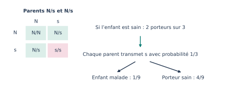
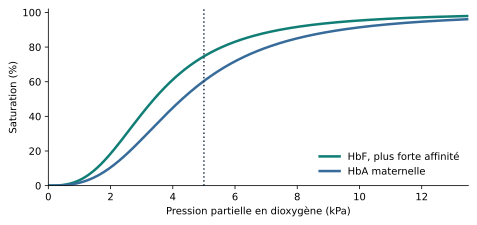
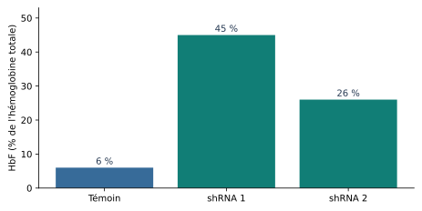
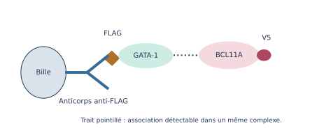
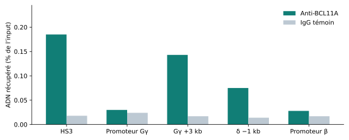
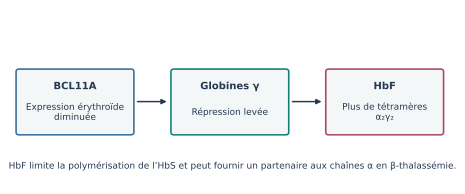

# ENS de Lyon, second concours — Biologie-biochimie 2026 · Corrigé brut

*Corrigé rédigé par IA, non officiel.*

**Rédaction** · Modèle : OpenAI Codex (famille GPT-6) · Effort de raisonnement : non renseigné · Mode de vitesse : non renseigné.

## Partie 1 · Transmission familiale

### 1.1 · Phénotype, génotype et allèle

Le phénotype est l’ensemble des caractères observables, à une échelle précisée (clinique, cellulaire ou moléculaire) et dans un environnement donné. Le génotype décrit les allèles que porte un individu au ou aux loci étudiés. Un allèle est une version de la séquence d’ADN d’un même locus. Un hétérozygote peut donc avoir un phénotype clinique proche de celui d’un homozygote normal tout en produisant deux formes moléculaires d’hémoglobine.

### 1.2 · Identifier le mode de transmission

Des parents cliniquement sains ont plusieurs enfants atteints, garçons ou filles. Une fille malade a un père sain, ce qui écarte, dans le modèle usuel, la transmission récessive liée à l’X. La transmission autosomique récessive explique les deux branches avec un seul locus, une pénétrance complète du phénotype considéré et sans mutation nouvelle. Un porteur d’un seul allèle s n’est généralement pas classé malade dans cet arbre.

### 1.3 · Lire les génotypes sur l’arbre

IV-6 est malade, donc s/s. Ses deux parents III-5 et III-8 sont sains mais lui ont chacun transmis s : ils sont obligatoirement N/s. Pour le phénotype clinique représenté, N est dominant et s récessif. L’existence de deux protéines détectables chez un hétérozygote concerne un autre niveau de phénotype.

### 1.4 · Conditionner par l’absence de maladie

Pour N/s croisé avec N/s, les probabilités à chaque conception sont 1/4 N/N, 1/2 N/s et 1/4 s/s. Le risque qu’un enfant soit malade était donc de 1/4. IV-8 est sain. Parmi les trois quarts d’enfants sains, une moitié du total est N/s ; la probabilité conditionnelle qu’il soit porteur vaut (1/2)/(3/4) = 2/3.

### 1.5 · Évaluer les probabilités pour la génération suivante

IV-9 est saine et a une fratrie comportant des enfants malades. Le même raisonnement donne une probabilité de 2/3 qu’elle soit hétérozygote. Les familles étant distinctes dans cet arbre, les transmissions aux deux futurs parents sont indépendantes dans le modèle. Chacun transmet s avec probabilité (2/3) × (1/2) = 1/3. Pour leur enfant, P(s/s) = 1/9 et P(N/s) = 2 × (1/3) × (2/3) = 4/9. Ce dernier nombre est la probabilité d’un porteur sain parmi toutes les naissances. Parmi les seuls enfants sains, la proportion de porteurs serait (4/9)/(8/9) = 1/2.

## Partie 2 · De la mutation aux symptômes

### 2.1 · Fixer, transporter et libérer le dioxygène

L’hémoglobine adulte HbA est une protéine soluble des hématies, constituée de deux chaînes α et de deux chaînes β. Chaque chaîne porte un hème dont le fer ferreux fixe réversiblement une molécule de dioxygène ; le tétramère peut donc en transporter quatre. Dans les poumons, une pression partielle élevée favorise la fixation. Dans les tissus qui consomment le dioxygène, une pression plus faible en favorise la libération ; le gaz dissous diffuse jusqu’aux cellules. La forme sigmoïde de la saturation résulte de la **coopérativité positive**. La fixation d’un premier ligand déplace l’équilibre entre conformations de faible et de forte affinité, rendant les autres sites plus aptes à fixer le ligand. Le plateau favorise le chargement pulmonaire, la région de forte pente la délivrance tissulaire. Les protons, le CO₂ et le 2,3-BPG modulent l’affinité dans les érythrocytes. Des enzymes allostériques présentent aussi une coopérativité ; l’aspartate transcarbamylase bactérienne en fournit un exemple pour l’aspartate.

### 2.2 · Passer du codon à la propriété de la protéine

Sur le brin codant, GAG devient GTG, soit GAG → GUG dans l’ARNm. Le glutamate, chargé négativement au pH physiologique, est remplacé par une valine hydrophobe. C’est une substitution ponctuelle faux-sens qui ne décale pas le cadre de lecture. Il s’agit du 7e résidu traduit avec la méthionine initiatrice, classiquement numéroté β6 dans la chaîne mature. Une surface hydrophobe nouvelle peut favoriser des contacts entre molécules d’HbS désoxygénées et la formation de fibres.

### 2.3 · Reconnaître les trois observations microscopiques

**A** est une microscopie optique sur frottis sanguin coloré. La lumière visible transmise forme l’image de cellules entières et la coloration différencie les structures. **B et C** relèvent de la microscopie électronique à balayage ; le signal produit par le balayage électronique donne un relief de surface apparent, en particulier le creux du disque biconcave normal et la déformation de l’hématie malade. **D** est une observation en microscopie électronique à transmission ; les électrons transmis à travers une préparation mince révèlent l’organisation interne et les fibres indiquées. Les microscopies électroniques offrent une résolution supérieure à celle de la microscopie optique conventionnelle. La taille d’une hématie s’exprime en micromètres, µm, là où la légende imprime µM.

### 2.4 · Relier la forme à la clinique

Des cellules allongées, incurvées en forme de faucille, remplacent une partie des disques biconcaves flexibles. Les fibres d’HbS rigidifient la cellule et les cycles de déformation fragilisent sa membrane. Sa destruction prématurée contribue à l’anémie hémolytique. Des cellules moins déformables franchissent difficilement la microcirculation, ce qui participe aux occlusions, à l’ischémie et aux douleurs. Ce sont deux conséquences distinctes d’une même anomalie cellulaire.

### 2.5 · Comparer deux courbes de saturation

À pression donnée dans la zone intermédiaire, les hématies des patients ont généralement une saturation plus faible que les témoins. La plage de l’HbS est décalée vers les hautes pressions et certaines valeurs se recouvrent. Il faut donc, dans cet essai, davantage de dioxygène pour obtenir une même saturation. Vers 35–40 mmHg, une fraction importante est désoxygénée, ce qui favorise la polymérisation de l’HbS et la falciformation dans les territoires veineux ou mal perfusés. Moindre capacité globale de transport en cas d’anémie et occlusion peuvent aggraver l’hypoxie tissulaire. Un déplacement de courbe à droite, pris isolément, n’implique pas que l’hémoglobine libère moins facilement son oxygène.

### 2.6 · Proposer des pistes à partir des données

Trois pistes découlent du modèle : diminuer la fraction d’HbS susceptible de polymériser, empêcher l’association des molécules désoxygénées, ou augmenter une hémoglobine fonctionnelle qui ne forme pas ces fibres. Une transfusion apporte des hématies contenant de l’HbA. Le rétablissement d’une synthèse de globine fonctionnelle ou la réactivation de l’hémoglobine fœtale peuvent agir durablement sur la composition des hématies. Une modulation de l’affinité devrait préserver la libération d’oxygène aux tissus. Ce sont des hypothèses de mécanisme que l’analyse documentaire suivante permet de départager.

## Partie 3 · Hémoglobine fœtale

### 3.1 · Décrire la succession des globines

Au début du développement, des chaînes embryonnaires ζ et ε sont transitoirement présentes. Les chaînes α deviennent précocement abondantes et persistent. Pendant la vie fœtale, les chaînes γ dominent la famille des chaînes de type β ; l’hémoglobine dominante est HbF, de formule α₂γ₂. Autour de la naissance, puis au cours des premiers mois, la synthèse de γ diminue et celle de β augmente. HbA, α₂β₂, prédomine ensuite, avec une faible contribution de δ dans HbA₂. La chute d’HbF éclaire l’apparition différée des symptômes chez l’enfant porteur de deux allèles s.

### 3.2 · Expliquer le transfert placentaire

La courbe fœtale est à gauche de la courbe maternelle : vers 5 kPa, la saturation fœtale est plus élevée et sa pression de demi-saturation est plus basse. Aux environs de 13 kPa, les deux sont proches du plateau. Le dioxygène diffusant sous l’effet d’un gradient de pression partielle entre circulations séparées, l’HbF fixe efficacement l’oxygène disponible du côté fœtal au placenta pendant que l’HbA maternelle en cède. L’HbF contribue à maintenir le gradient en fixant le gaz entré dans le sang fœtal. Les sangs ne se mélangent normalement pas et l’HbF doit à son tour pouvoir délivrer l’oxygène aux tissus du fœtus.

### 3.3 · Comparer les groupes sans confondre moyenne et diagnostic

Pour les porteurs, patients et témoins respectivement, le tableau rapporte HbA = 11,2 ± 3,8 ; 7,9 ± 2,6 ; 14,0 ± 1,7 UA. HbF vaut 8,2 ± 2,8 ; 8,4 ± 2,9 ; 1,1 ± 0,5 UA. L’HbF moyenne est donc élevée et très proche chez les porteurs et patients étudiés, nettement moindre chez les témoins. Le paramètre noté HbA est en moyenne le plus bas chez les patients. On restitue les libellés et unités du document ; ces moyennes seules ne définissent ni le génotype individuel ni la proportion réelle d’HbA dans tous les génotypes drépanocytaires.

### 3.4 · Lire l’association entre crises et HbF

Dans la figure 7B, le niveau d’HbF descend globalement d’environ 10 UA pour les crises les moins fréquentes à environ 3 UA pour les plus fréquentes. L’association est compatible avec un rôle protecteur de l’HbF, qui réduit la fraction d’hémoglobine susceptible de former les fibres. La série de patients est observationnelle, sans contrôle ici de l’âge, du traitement ou d’autres variables. Les porteurs, qui produisent aussi de l’HbA, sont le plus souvent asymptomatiques ; la figure B ne permet pas de calculer pour eux un risque par taux d’HbF. Un marqueur protecteur au sein d’un groupe n’explique pas seul les différences entre tous les groupes.

## Partie 4 · Régulation de la globine γ

### 4.1 · Tester l’action de BCL11A par interférence ARN

On cherche si la diminution de la protéine BCL11A (BCL11 dans le texte) change la synthèse d’HbF dans des précurseurs érythroïdes humains. Un court ARN interférent guide un complexe vers un ARN messager complémentaire et en favorise la dégradation ou la répression. La protéine cible diminue. Deux ARN différents dirigés contre la même cible et un témoin sans cible permettent de confronter effet recherché et effets non spécifiques.

### 4.2 · Comparer les deux méthodes de séparation

Sur acétate de cellulose, les hémoglobines natives migrent avec une mobilité qui dépend de leur charge nette et également de leur taille et de leur forme ; une coloration générale permet de visualiser leurs bandes. Un western blot sépare généralement des protéines dénaturées par taille, les transfère sur une membrane et détecte un antigène précis par anticorps. L’actine contrôle la quantité relative de protéines déposées dans le panneau A. Dans B, la bande majoritaire HbA fournit un repère pour apprécier la répartition d’HbF dans l’hémoglobine totale. Comme il s’agit de proportions, HbA ne constitue pas un étalon indépendant rigoureusement invariant.

### 4.3 · Interpréter l’inhibition de BCL11A

L’actine est détectée à des niveaux comparables. La bande BCL11A est abondante chez le témoin et fortement diminuée après shRNA 1, plus modérément après shRNA 2. Après différenciation, la proportion d’HbF passe de 6 % chez le témoin à 45 % ou 26 %, respectivement. Plus la diminution de BCL11A est forte dans cette comparaison, plus l’HbF augmente. BCL11A limite donc l’expression d’HbF dans ce modèle. Il s’agit d’un effet fonctionnel qui ne démontre pas encore une fixation directe à l’ADN.

### 4.4 · Expliquer les bandes multiples

Les bandes de mobilité différente reconnues par le même anticorps peuvent correspondre à des isoformes longues et courtes de BCL11A. Les exons du gène peuvent être combinés par épissage alternatif. Des modifications post-traductionnelles ou une dégradation partielle peuvent aussi modifier la migration ; seule l’identification de peptides ou de transcrits propres aux isoformes permettrait de confirmer l’origine de chaque bande.

### 4.5 · Comparer les stades du développement

À charge comparable d’après GAPDH, les cellules adultes A qui n’expriment guère d’HbF montrent surtout une forme longue de BCL11A. Les préparations fœtales F1 et F2 et la lignée embryonnaire L où HbF s’exprime présentent davantage de formes courtes ; le profil de la lignée est particulier. L’association développementale est compatible avec une fonction répressive plus forte de la forme longue et avec le remplacement progressif de γ par β. Une corrélation entre isoformes et stade ne suffit pas à attribuer une activité intrinsèque précise à chaque bande.

## Partie 5 · Mécanisme moléculaire de BCL11A

### 5.1 · Représenter une co-immunoprécipitation

Dans l’extrait, une bille porte l’anticorps anti-FLAG. Cet anticorps reconnaît l’étiquette FLAG portée par GATA-1. Si BCL11A-V5 appartient au complexe de GATA-1, elle est retenue avec celui-ci lors de la séparation. Le western anti-FLAG identifie la protéine capturée et l’anti-V5 recherche le partenaire associé. Le panneau Input renseigne sur le contenu initial de l’extrait.

### 5.2 · Expliquer le contrôle Vector

Dans la condition Vector, BCL11A-V5 est produite, d’où sa bande anti-V5 dans l’extrait de départ. GATA-1-FLAG est absent, donc les billes anti-FLAG ne capturent pas d’appât et BCL11A-V5 reste dans le surnageant. L’absence de bande V5 après immunoprécipitation indique un faible niveau d’adhésion non spécifique détectable dans ce contrôle.

### 5.3 · Portée du résultat

En coexpression, l’anti-FLAG récupère GATA-1-FLAG et BCL11A-V5 apparaît dans la fraction précipitée. Dans la condition sans appât, elle n’y apparaît pas. Les deux protéines appartiennent donc au même complexe dans les extraits étudiés. Une protéine intermédiaire ou de l’acide nucléique peut relier les deux partenaires ; une liaison binaire directe reste à tester.

### 5.4 · Associer NuRD à l’état de la chromatine

La chromatine est l’ensemble constitué par l’ADN nucléaire et les protéines associées, notamment les histones organisées en nucléosomes. Le complexe NuRD associe remodelage des nucléosomes et désacétylation des histones. Son recrutement peut diminuer l’accessibilité de sites régulateurs et réduire la transcription, selon le locus. L’association de BCL11A à ce complexe rend plausible un mécanisme de répression de l’expression de la globine γ.

### 5.5 · Préciser ce que mesure la ChIP

La ChIP teste la présence de BCL11A dans des complexes associés à différentes régions du locus β-globine. On compare la proportion d’ADN initial retrouvée avec l’anti-BCL11A à celle précipitée avec une IgG non spécifique. Une fixation au voisinage des promoteurs γ était une hypothèse simple ; une région de contrôle éloignée ou un élément régulateur intergénique pouvait également être enrichi. Une ChIP détecte une association locale, y compris par l’intermédiaire d’autres protéines.

### 5.6 · Lire les sites enrichis

Trois régions grisées présentent une différence signalée : HS3 dans la région de contrôle à distance (environ 0,18 % du matériel initial avec anti-BCL11A), une région à +3 kb de Gγ (environ 0,14 %) et une à −1 kb de δ (environ 0,07–0,08 %). Les IgG y donnent un signal beaucoup plus faible. Dans les promoteurs Gγ et β sondés sans décalage, l’écart est faible et n’est pas signalé significatif. La répression de γ peut faire intervenir des éléments distants, un complexe associé à BCL11A et l’organisation tridimensionnelle de la chromatine. Le graphe ne mesure pas lui-même un contact entre deux segments d’ADN.

### 5.7 · Comparer les deux délétions

Les deux délétions font perdre β et δ dans le modèle du sujet. La délétion 1 s’étend plus loin vers γ et enlève aussi l’élément intergénique associé à BCL11A, autour de Gγ +3 kb, que la délétion 2 conserve. Si cet élément contribue à réprimer γ, la délétion 1 devrait lever davantage cette répression. L’HbF compenserait alors en partie le déficit en HbA. On prédit donc des symptômes **plus sévères pour le type 2**. Il s’agit d’une prédiction fondée sur les régions supprimées, qui se vérifie par la comparaison de l’HbF et des phénotypes des deux groupes.

### 5.8 · Distinguer occupation, répression et interaction

Comparer, à stade de différenciation identique, l’expression des transcrits γ, l’HbF, l’acétylation des histones et l’occupation des sites dans des cellules ayant un niveau normal ou diminué de BCL11A. Une restauration de BCL11A devrait rétablir au moins partiellement la répression si cet effet lui est spécifique. Comparer les régions régulatrices intactes à celles manquant dans les deux délétions teste leur contribution ; une région sans enrichissement et l’IgG contrôlent le signal de fond. Une mesure de contact entre régions testerait séparément le modèle de boucle chromatinienne. Ces résultats distinguent la présence d’un complexe d’un effet sur la transcription.

## Partie 6 · Principe thérapeutique

### 6.1 · Relier l’inhibition du répresseur à une thérapie

Le raisonnement conduit à réduire l’expression de BCL11A dans la lignée érythroïde afin de lever la répression des gènes γ. Les hématies produisent alors davantage d’HbF, ce qui limite les conséquences de l’HbS. Le principe du Casgevy consiste à modifier ex vivo des cellules souches hématopoïétiques autologues au niveau d’un élément régulateur érythroïde de BCL11A, puis à les réadministrer. Leurs descendants érythroïdes expriment plus d’HbF. Cette approche préserve les fonctions de BCL11A dans d’autres lignées ; elle agit sur le programme d’expression sans corriger la mutation βS elle-même.

### 6.2 · Identifier les thalassémies susceptibles d’en bénéficier

En β-thalassémie, des chaînes α sont disponibles mais leur partenaire β manque. Une chaîne γ peut s’y associer et former HbF, α₂γ₂ ; sa réactivation peut donc compenser une partie du déficit en HbA. Certaines β-thalassémies transfusion-dépendantes relèvent effectivement de l’indication européenne dans les conditions fixées par l’EMA. En α-thalassémie, l’augmentation de γ ne fournit pas les chaînes α manquantes et n’apporte pas la même compensation.
