# ENS de Lyon — Second concours · Chimie 2026 · Corrigé brut

*Corrigé rédigé par IA, non officiel.*

**Rédaction** · Modèle : OpenAI Codex (famille GPT-6) · Effort de raisonnement : non renseigné · Mode de vitesse : non renseigné.

Les pressions standards valent 1 bar. Les renvois aux tableaux et aux numéros de composés reprennent ceux du sujet. La molécule appelée « arcutidine » dans son titre correspond à l’arcutinidine de la publication originale.

## I.1 — Combustion et pouvoir calorifique

### Question 1

La combustion complète s’écrit $\mathrm{H_2(g)+\tfrac12 O_2(g)\longrightarrow H_2O(g)}$ dans la flamme. Après refroidissement, l’eau peut être recueillie liquide.

### Question 2

Le combustible ne contient pas de carbone et sa combustion n’émet directement que de l’eau. Le qualificatif « décarbonée » porte ici sur l’usage. Le bilan de la filière dépend de la production de $\mathrm H_2$, notamment de la source d’électricité ou du recours au méthane pour le reformage.

### Question 3

Prenons des gaz parfaits purs en proportions stœchiométriques à $T_0=298\,\mathrm K$, une combustion complète, adiabatique et isobare. Négligeons la dissociation de l’eau et prenons son $C_{p,m}$ gazeux constant. Pour une mole d’eau, le bilan d’enthalpie est $0=\Delta_rH^\circ_{298}+C_{p,m}(\mathrm{H_2O_g})(T_f-T_0)$. L’annexe fournit $-241{,}8\,\mathrm{kJ\,mol^{-1}}$ et $33{,}6\,\mathrm{J\,K^{-1}\,mol^{-1}}$. La température de flamme de ce modèle est $T_f=298+241800/33{,}6\simeq7{,}5\times10^3\,\mathrm K$.

### Question 4

Le calcul place le gaz très au-dessus du domaine de l’incandescence visible. Il explique que le bloc puisse être porté au blanc. En revanche, $T_f$ dépasse largement $T_{\rm fus}(\mathrm{CaO})=2845\,\mathrm K$. Cette température de gaz simplifiée ne peut être identifiée à la température stationnaire d’un bloc restant solide. Le bloc cède de l’énergie par rayonnement et conduction.

### Question 5

À haute température, les capacités calorifiques augmentent et la dissociation endothermique de la vapeur en espèces telles que H, O et OH limite l’échauffement. La flamme réelle échange aussi de la chaleur avec le bloc et l’environnement, et peut entraîner de l’air. Pour une température adiabatique plus réaliste, il faudrait résoudre ensemble le bilan d’enthalpie avec $C_p(T)$ et les équilibres de dissociation.

### Question 6

Avec les données fournies, $-\Delta_rH^\circ\simeq241{,}8+40{,}7=282{,}5\,\mathrm{kJ\,mol^{-1}}$ pour l’eau liquide. Cela emploie la chaleur latente de l’annexe comme approximation à la température de référence. Pour $M(\mathrm H_2)\simeq2{,}0\,\mathrm{g\,mol^{-1}}$, le **PCS massique vaut $141\,\mathrm{MJ\,kg^{-1}}$**. La densité donnée, $0{,}09\times10^{-3}$ par rapport à l’eau, correspond à $\rho\simeq0{,}090\,\mathrm{kg\,m^{-3}}$, soit **$12{,}7\,\mathrm{MJ\,m^{-3}}$** ou $12{,}7\,\mathrm{kJ\,L^{-1}}$.

La table 1 porte « kJ/kg » pour les nombres 45,9, 46,7 et 42,5. Les pouvoirs calorifiques usuels de ces combustibles imposent de lire **MJ/kg**. Avec cette correction, le diesel et l’essence donnent environ 38 et 35 MJ/L, le gaz naturel environ 34 MJ/m³ aux densités indiquées. L’hydrogène est très énergétique par unité de masse, mais son volume à faible pression est élevé pour une énergie donnée.

## I.2 — Pile à combustible PEMFC

### Question 7

À l’anode, $\mathrm{H_2\longrightarrow 2H^+ +2e^-}$. À la cathode, $\mathrm{\tfrac12 O_2+2H^++2e^-\longrightarrow H_2O(l)}$. La membrane hydratée assure le transport des protons entre les deux compartiments.

### Question 8

Le bilan de la pile est $\mathrm{H_2(g)+\tfrac12 O_2(g)\longrightarrow H_2O(l)}$. Il retrouve la stœchiométrie de combustion. La séparation des deux demi-réactions fait passer les électrons dans le circuit extérieur et permet de fournir du travail électrique.

### Question 9

L’**anode**, alimentée en hydrogène, constitue le pôle négatif de la pile en décharge. Les électrons la quittent et rejoignent à travers la charge la **cathode** positive alimentée en oxygène. Le courant conventionnel circule dans la charge de la cathode vers l’anode. Les protons traversent la membrane de l’anode à la cathode et y participent à la formation d’eau.

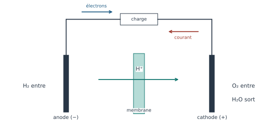

### Question 10

La fem à courant nul vaut $E=E^\circ-(RT/2F)\ln Q$, où $Q=a_{\rm eau}/[(p_{\mathrm H_2}/p^\circ)(p_{\mathrm O_2}/p^\circ)^{1/2}]$. Pour de l’eau liquide pure et des gaz aux pressions standards, **$E=1{,}23-0=1{,}23\,\mathrm V$ à 298 K**. La fem dépend de la température, des pressions partielles et de l’activité de l’eau. Un même pH aux deux électrodes déplace leurs potentiels de la même quantité, qui se retranche dans la fem. Une différence de pH réclamerait de traiter séparément les activités protoniques et la membrane.

### Question 11

Pour deux électrons par mole, $\Delta_rG^\circ=-2FE^\circ$. Ainsi $(dE^\circ/dT)_P=\Delta_rS^\circ/(2F)$. Près de 298 K, assimilons $\Delta_rS^\circ$ à une constante. Avec les données du sujet, $\Delta_rG^\circ_{298}=-237{,}4\,\mathrm{kJ\,mol^{-1}}$ et $\Delta_rH^\circ_{298}\simeq-282{,}5\,\mathrm{kJ\,mol^{-1}}$, soit $\Delta_rS^\circ_{298}\simeq-151\,\mathrm{J\,K^{-1}\,mol^{-1}}$.

$$E^\circ(T)\simeq1{,}23-7{,}8\times10^{-4}(T-298)\quad\text{en volts, avec }T\text{ en kelvins}.$$

La fem diminue avec la température dans cette approximation locale, pour de l’eau restant liquide.

### Question 12

Une mole d’hydrogène fournit au maximum $W_{\rm el,max}=-\Delta_rG^\circ=2FE^\circ$. Pour la même référence eau liquide que le PCS, le rendement réversible vaut $\eta_{\max}=(-\Delta_rG^\circ)/(-\Delta_rH^\circ)\simeq237{,}4/282{,}5=0{,}84$. Cette limite avoisine 84 % à 298 K avec les valeurs de l’annexe. La conversion électrochimique directe permet donc une fraction électrique élevée. Le rendement en charge est plus faible à cause des surtensions et des pertes ohmiques.

### Question 13

À 298 K, gaz purs à 1 bar, le couple $\mathrm{H^+/H_2}$ est à $-0{,}059\,\mathrm V$ par rapport à l’ESH, et $\mathrm{O_2/H_2O}$ à $1{,}23-0{,}059=1{,}171\,\mathrm V$. Dans la convention $j>0$ pour une oxydation, la branche anodique atteint $+1\,\mathrm{A\,cm^{-2}}$ au potentiel $-0{,}059+0{,}027=-0{,}032\,\mathrm V$. La branche cathodique atteint $-1\,\mathrm{A\,cm^{-2}}$ au potentiel $1{,}171-0{,}483=0{,}688\,\mathrm V$. La tension entre électrodes à cette densité est donc $0{,}720\,\mathrm V$ avant chute ohmique. Les deux valeurs de surtension fixent des points, sans déterminer toute la forme des courbes.

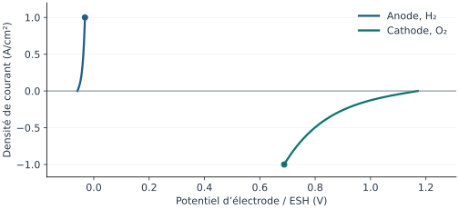

### Question 14

Le courant par cellule est $I=0{,}700\times258=180{,}6\,\mathrm A$. En une heure, la charge est $I\Delta t=6{,}50\times10^5\,\mathrm C$. Deux électrons sont transférés par molécule de $\mathrm H_2$, d’où $n_{\rm cellule}=I\Delta t/(2F)=3{,}37\,\mathrm{mol}$. Pour les 170 cellules, **$n_{\rm total}\simeq573\,\mathrm{mol}$**, soit environ **$1{,}15\,\mathrm{kg}$** en une heure, si le rendement faradique et l’utilisation du combustible sont unitaires. La tension de 650 mV renseigne sur l’énergie fournie, le bilan de matière dépend de la charge.

## II — Reformage du méthane

### Question 15

Le reformage primaire est $\mathrm{CH_4(g)+H_2O(g)\rightleftharpoons CO(g)+3H_2(g)}$. La conversion du gaz à l’eau est $\mathrm{CO(g)+H_2O(g)\rightleftharpoons CO_2(g)+H_2(g)}$. Leur somme donne quatre moles de dihydrogène par mole de méthane lorsque les deux conversions sont complètes.

### Question 16

À $T=1033{,}15\,\mathrm K$, le tableau 4 fournit les enthalpies de formation à $T_0=298{,}15\,\mathrm K$ et les capacités calorifiques, mais aucune entropie standard ni constante d’équilibre de référence. **Les données du sujet ne suffisent pas à chiffrer les deux $\Delta_rG^\circ$**. Pour des $C_p$ constants, le calcul complété est

$$\Delta_rG^\circ(T)=\Delta_rH^\circ(T_0)+\Delta C_p(T-T_0)-T\,[\Delta_rS^\circ(T_0)+\Delta C_p\ln(T/T_0)].$$

Dans l’ordre de Q15, $\Delta_rH^\circ(T_0)$ vaut $+206{,}2$ et $-41{,}2\,\mathrm{kJ\,mol^{-1}}$, $\Delta C_p$ vaut $+46{,}38$ et $+3{,}21\,\mathrm{J\,mol^{-1}\,K^{-1}}$. Les entropies molaires standards tabulées à 298 K de $\mathrm{CH_4,H_2O(g),CO,H_2,CO_2}$ sont respectivement $186{,}25$, $188{,}84$, $197{,}66$, $130{,}68$ et $213{,}79\,\mathrm{J\,mol^{-1}\,K^{-1}}$. Elles donnent $\Delta_rS^\circ(T_0)=+214{,}6$ et $-42{,}0\,\mathrm{J\,mol^{-1}\,K^{-1}}$. En conservant les $C_p$ constants de l’annexe, **$\Delta_rG^\circ(T)\simeq-41{,}0$ et $+0{,}5\,\mathrm{kJ\,mol^{-1}}$**. À titre de contrôle, l’intégration des capacités calorifiques dépendant de $T$ par les coefficients de Shomate donne environ $-35{,}6$ et $-2{,}0\,\mathrm{kJ\,mol^{-1}}$. La seconde conversion est donc proche de l’équilibre standard à cette température et le signe du petit écart est sensible à l’approximation. [Thermochimie des espèces gazeuses, NIST Chemistry WebBook](https://webbook.nist.gov/chemistry/)

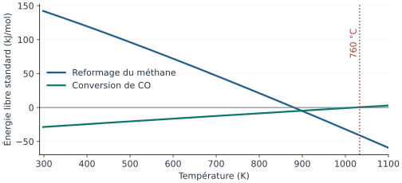

### Question 17

Le reformage primaire est endothermique et accroît de deux le nombre de moles gazeuses. Une température élevée, une pression relativement basse et un excès de vapeur favorisent la conversion du méthane à l’équilibre. La conversion de CO est exothermique et conserve le nombre total de moles gazeuses. Une température plus basse après le reformage et un excès d’eau favorisent cette seconde étape, avec peu d’effet direct de la pression pour des gaz parfaits. Une séparation du dihydrogène déplace aussi les équilibres vers la production. Un catalyseur règle la vitesse d’approche de l’équilibre.

### Question 18

Les trois bilans possibles sont $\mathrm{CH_4\rightleftharpoons C_{(graphite)}+2H_2}$ (craquage), $\mathrm{2CO\rightleftharpoons C_{(graphite)}+CO_2}$ (dismutation de Boudouard) et $\mathrm{CO+H_2\rightleftharpoons C_{(graphite)}+H_2O}$. Le dépôt de carbone recouvre les sites catalytiques, obstrue les pores et augmente les pertes de charge. Il réduit la durée de fonctionnement et détourne du carbone de la conversion gazeuse attendue.

## III.1 — Stockage de l’hydrogène dans TiFe

### Question 19

L’abscisse est la fraction molaire de fer. **A est le liquide homogène**. Dans **B coexistent un liquide et le composé intermétallique solide TiFe**, à $x(\mathrm{Fe})=0{,}50$ pour le solide. Le point **C**, à environ $1320\,^\circ\mathrm C$, est associé à l’invariant **péritectique** entre le liquide, la phase solide riche en $\mathrm{TiFe_2}$ et TiFe. Le dessin place C au bord de l’horizontale, à la même abscisse que le composé TiFe. Le point **D**, vers $x=0{,}85$ et $1290\,^\circ\mathrm C$, est **eutectique**. Le refroidissement de ce liquide donne deux phases solides, une phase de type $\mathrm{TiFe_2}$ et une solution solide riche en fer. **E** pointe la branche du **liquidus**, frontière au-dessous de laquelle apparaît du solide au refroidissement.

### Question 20

Les trois courbes donnent la température en fonction du temps à pression imposée. Un changement de pente marque le début de la cristallisation primaire, un palier traduit une transformation invariante avec libération de chaleur latente.

| Fraction molaire de Fe | Lecture de la courbe de refroidissement |
|---|---|
| $0{,}85$ | Le liquide se refroidit jusqu’à l’eutectique D, vers $1290\,^\circ\mathrm C$. Palier de solidification eutectique, puis refroidissement des deux solides. |
| $0{,}60$ | Cassure au liquidus, autour de $1400\,^\circ\mathrm C$. Des cristaux de la phase de type $\mathrm{TiFe_2}$ se forment. Le liquide résiduel atteint l’isotherme péritectique vers $1320\,^\circ\mathrm C$. Un palier accompagne la formation de TiFe, puis les deux phases solides refroidissent. |
| $0{,}50$ | La verticale tracée sur le diagramme rencontre C vers $1320\,^\circ\mathrm C$, à l’aplomb du composé TiFe. À la résolution du dessin, on trace le refroidissement du liquide, un arrêt à $1320\,^\circ\mathrm C$, puis le refroidissement de TiFe solide. |

Les durées des paliers dépendent des chaleurs latentes, de la masse et du régime d’extraction thermique. Le diagramme permet d’en fixer les températures, pas les durées.

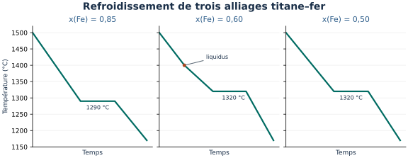

### Question 21

La maille contient Ti aux huit sommets ($8\times1/8=1$) et Fe au centre du cube ($1$). Elle contient donc **deux atomes, soit un motif TiFe**. Chaque Fe est entouré des huit Ti des sommets. Un Ti a aussi pour voisins les huit Fe des cubes partageant ce sommet. La coordinence est **8 pour Fe et 8 pour Ti**. Le réseau de Bravais est cubique simple avec une base de deux espèces, de type CsCl ou B2.

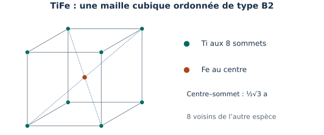

### Question 22

Le contact Ti–Fe impose $\sqrt3\,a/2=r_{\rm Ti}+r_{\rm Fe}$. On obtient
$$a=\frac{2(r_{\rm Ti}+r_{\rm Fe})}{\sqrt3}
=\frac{2(147+126)}{\sqrt3}\ \mathrm{pm}\simeq315\ \mathrm{pm}.$$
Les deux Ti voisins sur une arête sont distants de $a>2r_{\rm Ti}=294\ \mathrm{pm}$, en accord avec cette hypothèse de contact.

### Question 23

La compacité vaut
$$C=\frac{4\pi(r_{\rm Ti}^3+r_{\rm Fe}^3)}{3a^3}\simeq0{,}692.$$
La valeur de référence $\pi/(3\sqrt2)\simeq0{,}7405$ correspond à un empilement compact de sphères identiques, cubique à faces centrées ou hexagonal compact, avec douze plus proches voisins. Dans TiFe, chaque atome possède huit voisins de l’autre espèce et le modèle laisse environ 31 % du volume entre les sphères. Le nombre 0,74 concerne les sphères identiques et n’est pas une borne universelle pour deux rayons différents.

### Question 24

La masse de la maille est $(M_{\rm Ti}+M_{\rm Fe})/N_A$ et le volume vaut $a^3$. Avec les masses molaires usuelles de $47{,}9$ et $55{,}8\ \mathrm{g\,mol^{-1}}$,
$$\rho=\frac{0{,}1037}{(6{,}022\times10^{23})(3{,}152\times10^{-10})^3}
\simeq5{,}50\times10^3\ \mathrm{kg\,m^{-3}}.$$
C’est **$5{,}5\ \mathrm{g\,cm^{-3}}$** dans le modèle de sphères tangentes retenu.

### Question 25

Les **centres des six faces** sont partagés par deux mailles, soit $6/2=3$ sites. Chacun possède deux voisins Fe axiaux et quatre Ti équatoriaux. Les **milieux des douze arêtes** sont partagés par quatre mailles, soit $12/4=3$ sites. Chacun possède deux voisins Ti axiaux et quatre Fe équatoriaux. La maille compte donc **six sites octaédriques**, en deux familles chimiquement distinctes de trois. Les octaèdres sont déformés, les deux distances axiales étant plus courtes que les quatre distances équatoriales.

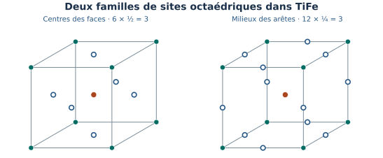

### Question 26

Au centre d’une face, les deux Fe sont à $a/2$ et les quatre Ti à $a/\sqrt2$. Le rayon maximal sans déformation est donc
$$r_{\rm face}=\min(a/2-r_{\rm Fe},a/\sqrt2-r_{\rm Ti})\simeq\min(31{,}6,75{,}9)\ \mathrm{pm}=31{,}6\ \mathrm{pm}.$$
Au milieu d’une arête, les rôles de Ti et Fe sont échangés, ce qui donne
$$r_{\rm arête}=\min(a/2-r_{\rm Ti},a/\sqrt2-r_{\rm Fe})\simeq\min(10{,}6,96{,}9)\ \mathrm{pm}=10{,}6\ \mathrm{pm}.$$
Le site de face est le plus large de ces deux sites idéalisés. Le rayon de $53\ \mathrm{pm}$ fourni pour l’hydrogène atomique est supérieur aux deux rayons calculés. Dans le matériau hydrogéné, H forme un **hydrure interstitiel**. Son insertion implique une relaxation ou une distorsion du réseau et un environnement chimique différent de celui d’un atome libre. Les rayons du modèle rigide ne suffisent donc pas à prédire l’occupation réelle des cavités.

### Question 27

Écrivons $\mathrm{TiFeH}_n$. Une maille métallique contient un motif TiFe. Si les 2 % de H sont rapportés à la masse de l’alliage chargé, on a
$$0{,}020=\frac{nM_{\rm H}}{M_{\rm TiFe}+nM_{\rm H}},
\qquad n=\frac{0{,}020}{0{,}980}\frac{103{,}7}{1{,}008}\simeq2{,}1.$$
Il y a donc **environ deux atomes d’hydrogène par maille métallique initiale**. Si la capacité est exprimée par rapport à l’alliage sec, $n=0{,}020 M_{\rm TiFe}/M_{\rm H}\simeq2{,}06$, soit la même conclusion à la précision du pourcentage.

## III.2 — Stockage dans un hydrure

### Question 28

Pour $Z=13$, l’aluminium neutre a la configuration **$1s^2\,2s^2\,2p^6\,3s^2\,3p^1=[\mathrm{Ne}]\,3s^2\,3p^1$** et possède trois électrons de valence.

### Question 29

Dans $\mathrm{Li^+[AlH_4]^-}$, H est hydrure, au degré $-\mathrm I$. Pour Al, $x+4(-1)=-1$ donne **$x=+\mathrm{III}$**. L’ion formel $\mathrm{Al^{3+}}$ possède la configuration $1s^2\,2s^2\,2p^6=[\mathrm{Ne}]$ et donc une couche externe **$2s^2\,2p^6$ saturée**, configuration de gaz noble. Le nombre d’oxydation traduit un partage formel des électrons dans l’anion tétraédrique.

### Question 30

La fraction massique théorique d’hydrogène est
$$w_{\rm H}=\frac{4M_{\rm H}}{M_{\rm Li}+M_{\rm Al}+4M_{\rm H}}
\simeq\frac{4{,}032}{6{,}94+26{,}98+4{,}032}=0{,}106.$$
**Environ 10,6 %** de la masse de $\mathrm{LiAlH_4}$ est de l’hydrogène, soit environ $10{,}6/2=5{,}3$ fois la teneur de TiFe chargé. Cette capacité est une teneur massique totale. Dans TiFe, le stockage étudié est l’absorption dans le solide.

## IV — Hydrogénation catalytique

### Question 31

Dans le mécanisme de Horiuti–Polanyi, $\mathrm{H_2}$ s’adsorbe et se dissocie sur deux sites métalliques, $\mathrm{H_2+2*\rightleftharpoons2H*}$. L’alcène s’adsorbe par sa liaison $\pi$ sur des sites voisins. Un premier H se transfère vers l’un des carbones, donnant un alkyle lié au métal. Un second H s’ajoute sur l’autre carbone. L’alcane formé se désorbe et libère les sites. Le bilan est l’addition de $\mathrm{H_2}$ sur $\mathrm{C=C}$. Une adsorption conservée pendant les deux transferts favorise une addition syn.

### Question 32

Posons $L=\mathrm{PPh_3}$, $S$ le solvant coordinant et $R=\mathrm{C_2H_5}$. Dans le comptage ionique, $L$, $S$ et l’alcène sont neutres et donnent chacun deux électrons. $\mathrm{Cl^-}$, $\mathrm{H^-}$ et l’alkyle $\mathrm{R^-}$ sont chacun anioniques et donnent aussi deux électrons. Rh appartient au groupe 9, donc Rh(I) est $d^8$ et Rh(III) est $d^6$.

| Complexe dessiné, dans l’ordre du cycle | Étape menant à cet état | Rh | Électrons |
|---|---|---:|---:|
| $\mathrm{RhCl}L_3$ | Précatalyseur | I | $8+4\times2=16$ |
| $\mathrm{RhCl}L_2S$ | Départ de $L$, coordination de $S$ | I | $8+4\times2=16$ |
| $\mathrm{RhH_2Cl}L_2S$ | Addition oxydante de $\mathrm{H_2}$ | III | $6+6\times2=18$ |
| $\mathrm{RhH_2Cl}L_2(\eta^2\text{-}\mathrm{C_2H_4})$ | L’alcène remplace $S$ | III | $6+6\times2=18$ |
| $\mathrm{RhH}(R)\mathrm{Cl}L_2S$ | Insertion migratoire de l’alcène dans Rh–H, puis coordination de $S$ | III | $6+6\times2=18$ |
| $\mathrm{RhCl}L_2S$ | Élimination réductrice de l’éthane par couplage de H et R | I | 16 |

Une phosphine dissociée sans remplacement immédiat laisserait $\mathrm{RhCl}L_2$ à 14 électrons. De même, l’alkyle juste après insertion, avant coordination de $S$, est à 16 électrons. Ces états expliquent les substitutions, tandis que le tableau compte les espèces effectivement dessinées.

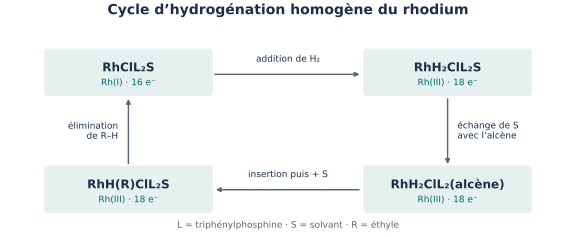

## V.1 — Stéréochimie et résolution enzymatique

### Question 33

Au carbone porteur de OH de la figure 3, OH est prioritaire, puis vient la branche vinylique du cycle (liste $\mathrm{C,C,H}$), puis la branche saturée ($\mathrm{C,H,H}$), enfin H. OH en coin plein place H vers l’arrière. L’ordre 1, 2, 3 est antihoraire, d’où la configuration **$S$**. Pour la liaison C2=C3, la branche vers C1 est prioritaire sur H du côté C2, et Br est prioritaire sur le carbone du cycle du côté C3. Ces deux groupes prioritaires sont opposés, ce qui donne **$E$** au sens CIP. La géométrie du petit cycle est contrainte. Le composé dessiné est le $(1S)$-3-bromocyclohex-2-én-1-ol.

### Question 34

Le site actif de la lipase ne reconnaît pas de façon égale les deux énantiomères de l’alcool. L’acétate de vinyle lui permet de transférer l’acétyle préférentiellement à l’un d’eux. On sépare ensuite l’ester formé et l’alcool restant, de polarités différentes. Cet alcool est enrichi en l’énantiomère 1. Il s’agit d’un dédoublement cinétique. Le rendement théorique maximal en un énantiomère d’alcool non transformé est 50 % du racémique. Le rendement de 42 % et l’excès de 99,7 % décrivent deux propriétés différentes.

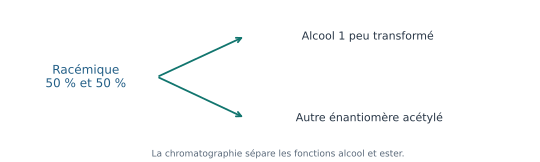

### Question 35

Après transfert de l’acétyle, le groupe partant issu de l’acétate de vinyle fournit l’alcool vinylique $\mathrm{CH_2=CH{-}OH}$. Sa tautomérie énol–aldéhyde conduit à **l’éthanal** $\mathrm{CH_3CHO}$, qui conserve les deux carbones et correspond bien à $\mathrm{MeCHO}$ sur la figure 5. Le mot « méthanal » de la question est une coquille. Le méthanal $\mathrm{HCHO}$ demanderait une rupture C–C absente de ce mécanisme.

### Question 36

Un polarimètre envoie une lumière monochromatique polarisée à travers l’échantillon. Après mise à zéro avec le solvant, on mesure l’angle de rotation du plan de polarisation, ici à la raie D du sodium et à $25\,^\circ\mathrm C$. La loi de Biot donne $\alpha=[\alpha]^{{25}}_D\ell c$, avec $\ell$ en dm et $c$ en $\mathrm{g\,mL^{-1}}$. Le racémique donne **$\alpha=0$** par compensation. La notation de chimie organique $c=1{,}0$ signifie $1{,}0\,\mathrm{g}/100\,\mathrm{mL}=0{,}010\,\mathrm{g\,mL^{-1}}$. Dans une cuve de 1 dm, la valeur spécifique mesurée pour l’échantillon final donne **$\alpha=-39{,}1\times1\times0{,}010=-0{,}391^\circ$**. Si $-39{,}1$ désignait la valeur de l’énantiomère parfaitement pur, on la multiplierait aussi par $0{,}997$, soit $-0{,}390^\circ$ pour le mélange.

## V.2 — Cinétique enzymatique

### Question 37

Au départ, le produit est absent, donc $v_{-2}=k_{-2}[E][P]\simeq0$. Sur une durée courte et avec le substrat en excès sur l’enzyme, sa fixation et sa consommation représentent une petite fraction de $[S]_0$. Ainsi $[S]\simeq[S]_0$. La vitesse dite initiale se mesure après le bref transitoire de formation de ES, avant que la baisse du substrat ou le retour à partir des produits ne comptent.

### Question 38

Pour l’approximation des états quasi stationnaires, un intermédiaire est produit et consommé assez vite pour que sa concentration varie lentement après un court transitoire. On pose alors $d[ES]/dt\simeq0$ sur le temps d’observation. Une condition usuelle suffisante est $[E]_0\ll K_M+[S]_0$. L’enzyme conserve alors pratiquement la même répartition libre/complexée au cours de la mesure initiale. L’AEQS n’impose pas à l’étape de liaison d’être thermodynamiquement à l’équilibre.

### Question 39

L’équation est $d[ES]/dt=k_1[E][S]-(k_{-1}+k_2)[ES]+k_{-2}[E][P]$. Dans les conditions initiales et sous AEQS, $[ES]\simeq k_1[E][S]/(k_{-1}+k_2)=[E][S]/K_M$, où $K_M=(k_{-1}+k_2)/k_1$ a la dimension d’une concentration.

### Question 40

L’enzyme initialement libre se répartit entre $E$ et $ES$. Son bilan est $[E]_0=[E]+[ES]$. Or Q39 donne $[E]=K_M[ES]/[S]_0$ sur la fenêtre de vitesse initiale. Donc $[E]_0=[ES](1+K_M/[S]_0)$, comme demandé.

### Question 41

Avec le retour négligeable, $v_i=k_2[ES]$. En insérant le bilan d’enzyme de Q40,

$$v_i=\frac{k_2[E]_0[S]_0}{K_M+[S]_0}=\frac{v_{\max}}{1+K_M/[S]_0},\qquad v_{\max}=k_2[E]_0.$$

À saturation, la majeure partie des molécules d’enzyme se trouve sous forme ES.

### Question 42

L’asymptote aux concentrations élevées fournit $v_{\max}$. À mi-hauteur, $v_i=v_{\max}/2$ impose $[S]_0=K_M$. Sur le diagramme normalisé de la figure 6, on trace donc une horizontale à 50 % et on projette l’intersection sur l’axe des concentrations. Un tracé exclusivement normalisé permet de lire $K_M$, mais il faut aussi des vitesses absolues pour donner $v_{\max}$ dans des unités de vitesse.

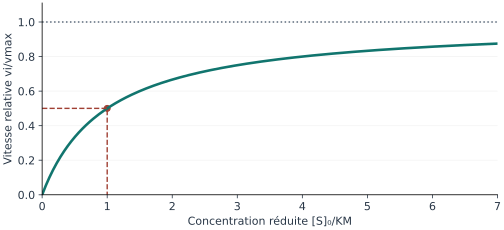

### Question 43

La figure 6 donne les lectures approchées suivantes, en $\mathrm{mmol\,L^{-1}}$.

| Ester | Sans NaCl, points blancs | Avec 0,1 M NaCl, points noirs |
|---|---:|---:|
| Propionate de vinyle (A) | 35 à 40 | 25 à 30 |
| Butyrate de vinyle (B) | 14 à 16 | 11 à 13 |

Le passage du propionate au butyrate diminue le $K_M$ apparent. Le sel le diminue aussi dans les deux cas. La demi-saturation est atteinte à plus faible concentration en substrat. Chaque courbe étant ramenée à son maximum, ces seules mesures ne permettent pas de comparer entre elles les vitesses maximales absolues.

### Question 44

On peut disperser une quantité connue d’ester dans le tampon par agitation reproductible, à température, pH, concentration en enzyme et éventuellement émulsifiant fixés. Mesurer sur un court intervalle la formation d’acide carboxylique, par exemple par titrage à pH maintenu constant, et soustraire un blanc sans enzyme. Refaire pour plusieurs charges d’ester, en contrôlant la taille des gouttes ou la surface interfaciale et en vérifiant que le transfert de matière ne limite pas la vitesse. La quantité totale au-delà de la solubilité n’est plus la concentration dissoute. On obtient alors une activité apparente en milieu dispersé et l’on précise les conditions interfaciales pour la comparer entre échantillons.

## V.3 — Cycloaddition et intermédiaires de synthèse

### Question 45

Le OH de 1 est protégé en **éther de tert-butyldiphénylsilyle (TBDPS)**. L’oxygène de l’alcool attaque le silicium électrophile de TBDPSCl, le chlorure part et l’imidazole déprotone l’oxygène. On peut aussi décrire une activation préalable par attaque de l’imidazole sur Si, suivie du déplacement de l’imidazole par l’alcool. La base capte finalement l’équivalent de HCl. La liaison nouvelle est O–Si et la liaison C–O du centre stéréogène est conservée. La protection évite que le proton de l’alcool ne consomme ultérieurement un réactif basique.

### Question 46

Le composé 3 porte un **diène conjugué** (une double liaison cyclique et une double liaison terminale) et un **cétal cyclique** à cinq chaînons autour du carbone étoilé. Pour installer ce cétal en une opération, faire réagir la cétone correspondante avec l’éthane-1,2-diol en catalyse acide en retirant l’eau formée. Après protonation du carbonyle, un premier OH du diol attaque son carbone, donnant un hémicétal après transfert de proton. Le départ d’eau du OH hérité du carbonyle forme un oxocarbénium. Le second oxygène du diol le capte intramoléculairement. La déprotonation ferme le cycle 1,3-dioxolane et régénère l’acide.

### Question 47

On conserve les numéros du tableau 2. Le proton 1b est trans à 1a dans la projection de l’énoncé.

| Déplacement (ppm) | Intégration et multiplicité | Position | Justification |
|---|---|---|---|
| 6,40 | 1 H, dd, 10,0 et 16,8 Hz | H1a | CH intérieur du groupe vinyle, couplé aux deux H terminaux. |
| 5,77 | 1 H, m | H2 | Proton de la double liaison du cyclohexène, couplé à la chaîne aliphatique voisine. |
| 5,03 | 1 H, d, 16,8 Hz | H1b | Couplage trans à H1a. |
| 4,92 | 1 H, d, 10,0 Hz | H1c | Couplage cis à H1a. |
| 4,01 | 4 H, m | H5a et H5b | Deux méthylènes O–CH₂ du cétal. |
| 2,36 | 4 H, m | H3 et H6 | Deux méthylènes allyliques voisins de C=C. |
| 1,77 | 2 H, t, 6,8 Hz | H4 | Méthylène plus éloigné de l’alcène, couplé aux deux H de C3, sans H sur C5. |

### Question 48

La méthode de Hückel approxime les orbitales $\pi$ par des combinaisons linéaires d’orbitales $p$ des atomes conjugués. Dans sa forme simple, l’intégrale diagonale de Coulomb est $\alpha=\langle p_i|\hat H|p_i\rangle$ pour un carbone de référence. L’intégrale de résonance $\beta=\langle p_i|\hat H|p_j\rangle<0$ relie deux sites voisins conjugués, les couplages entre sites éloignés et les recouvrements hors diagonale étant négligés. Des paramètres adaptés décrivent les hétéroatomes et les substituants. Les fragments du tableau conservent le diène et l’énal qui échangent leur densité électronique lors de la cycloaddition et simplifient les chaînes saturées. Ils servent à comparer les orbitales frontières et leur amplitude locale.

### Question 49

Puisque $\beta<0$, l’écart HO(diène)–BV(diénophile) est $-0{,}92\beta=0{,}92|\beta|$. L’interaction inverse demande $1{,}42|\beta|$. Le mode à demande électronique normale domine. Dans la HO du diène, $|c_1|=0{,}58$ et $|c_4|=0{,}55$. Dans la BV du diénophile, $|c_4|=0{,}64$ (carbone β) et $|c_3|=0{,}18$ (carbone α du formyle). On privilégie les nouvelles liaisons **C1(diène)–C4(diénophile)** et **C4(diène)–C3(diénophile)**. Les signes respectifs sont compatibles pour les deux recouvrements simultanés. La liaison double restante est **C2(diène)=C3(diène)**. Les groupes formyle, cétal et OTBDPS restent présents. Le tracé de ces six atomes donné en figure définit la connectivité du cycloadduit à partir de 3 et 4. Une approche endo du carbonyle et la face la moins encombrée du diénophile chiral sont attendues sous contrôle cinétique. Les seuls coefficients de Hückel ne quantifient pas l’excès diastéréomérique.

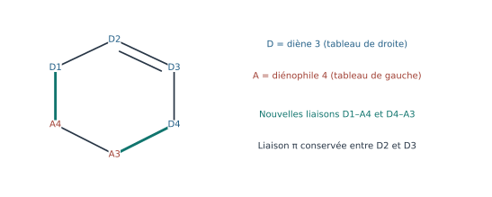

### Question 50

Dans la structure de Lewis de $\mathrm{BF_3}$, le bore réalise trois liaisons simples B–F. Chaque fluor porte trois doublets non liants. Le bore trigonal plan ne possède que six électrons dans sa couche de valence et une orbitale vacante. **C’est un acide de Lewis** qui peut accepter le doublet d’un ligand, notamment celui de l’éther ou de l’oxygène d’un aldéhyde.

### Question 51

Dans $\mathrm{BF_3\cdot OEt_2}$, l’éther est un ligand donneur. La coordination du bore à l’oxygène carbonylé de 4 polarise davantage le système $\mathrm{O=C{-}C_\alpha=C_\beta}$ et abaisse sa BV. L’écart avec la HO du diène se resserre, ce qui facilite la formation des deux liaisons du cycloadduit. La délocalisation de la charge positive partielle jusqu’en β explique la polarisation régiochimique. L’interaction secondaire avec le carbonyle peut favoriser la géométrie endo. Le tableau 3 ne contient pas de calcul sur l’adduit à BF₃, de sorte qu’un changement chiffré des coefficients ne peut en être déduit.

### Question 52

Le vinyllithium dessiné est $\mathrm{CH_2=CHLi}$. Il s’additionne sur le carbone du groupe CHO de 5 et transforme ce formyle en $\mathrm{-CH(O^-Li^+)-CH=CH_2}$. L’oxygène attaque le carbone $\mathrm{CH_2Cl}$ de $\mathrm{ClCH_2OCH_3}$, avec départ de chlorure. **6** s’obtient donc en remplaçant exclusivement le CHO de 5 par **$\mathrm{-CH(OCH_2OCH_3)-CH=CH_2}$**, avec conservation du cétal, du cyclohexène et de l’éther de TBDPS. La formule correspondante est $\mathrm{C_{37}H_{50}O_5Si}$. Deux faces sont théoriquement possibles au formyle et le squelette rigide peut les différencier. La disposition relative retenue par la suite est celle du carbone portant OMOM sur la planche de 7.

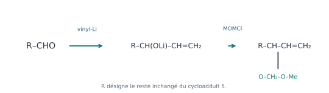

### Question 53

L’alcool secondaire de 7 forme d’abord un chlorosulfite avec $\mathrm{SOCl_2}$. Une substitution peut remplacer son OH par Cl, donnant bien $\mathrm{C_{19}H_{27}ClO_3}$ à partir de $\mathrm{C_{19}H_{28}O_4}$. La perte ultérieure de HCl sous l’effet de la base forme l’alcène. **8** conserve la cétone et l’éther OMOM. La nouvelle double liaison relie **le carbone qui portait OH au carbone immédiatement en dessous qui porte le H explicitement dessiné à gauche** sur 7. Cette élimination donne l’alcène endocyclique trisubstitué, plus substitué que celui obtenu en arrachant un H de l’autre voisin méthylénique. La formule de 8 est $\mathrm{C_{19}H_{26}O_3}$. Cette attribution concorde avec l’oléfine trisubstituée identifiée dans la publication de départ. [Étude originale, JACS](https://doi.org/10.1021/jacs.9b05818)

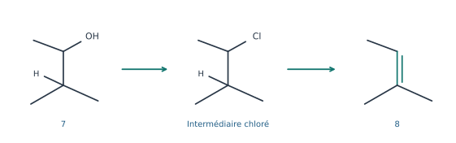

### Question 54

Le squelette représenté porte **huit centres stéréogènes tétraédriques** : le carbone α de la lactone marqué d’une étoile, le carbone portant OTMS, le carbone portant le H en coin plein au sommet, celui engagé dans la liaison C–O de la lactone, celui portant le méthyle en coin plein, et trois autres jonctions polycycliques dont les chemins du squelette sont différents. Le décompte combinatoire des configurations locales donne $2^8=256$ configurations formelles, sans symétrie interne qui identifierait des formes méso. Les cycles pontés peuvent interdire certaines configurations par contrainte géométrique. **256 est la borne de comptage d’un exercice de stéréochimie**, avant examen de leur réalisabilité.

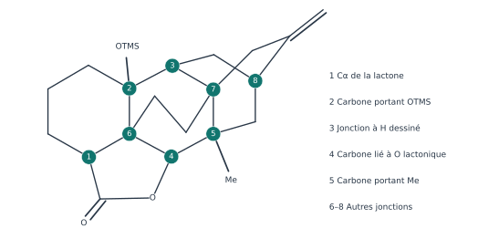

### Question 55

MeOTf est le trifluorométhanesulfonate de méthyle, $\mathrm{CH_3O{-}SO_2CF_3}$. Une voie formelle est le transfert de triflyle de l’anhydride triflique $\mathrm{Tf_2O}$ au méthanol en présence d’une base peu nucléophile. Le doublet de O du méthanol attaque le soufre électrophile d’un groupe triflyle, la liaison avec l’oxygène de l’anhydride se rompt avec départ de triflate, puis une base déprotone l’oxygène du produit. Le bilan met en jeu $\mathrm{MeOH+Tf_2O\to MeOTf+TfOH}$, l’acide étant capté par la base. La charge de l’anion triflate est délocalisée et le groupe $\mathrm{CF_3}$ est très attracteur.

### Question 56

Le H marqué est en α du carbonyle de la lactone. Son arrachement donne un énolate dont la charge se délocalise entre le carbone α et l’oxygène carbonylé. Une base forte et peu nucléophile telle que le LDA ou un hexaméthyldisilazoture alcalin convient comme proposition de principe. Le carbone α de l’énolate attaque par $\mathrm{S_N2}$ le méthyle de MeOTf, le doublet C–O du réactif repart sur $\mathrm{OTf^-}$. Le méthyle nouveau est du côté indiqué en coin plein en 10, opposé à la liaison hachurée vers le carbonyle de la lactone. Le substrat polycyclique rend les deux faces de l’énolate différentes. La planche imprime TBAF sous la flèche tout en dessinant OTMS dans 9 et 10. La modification structurale explicitement figurée est la C-méthylation.

### Question 57

$\mathrm{LiAlH_4}$ réduit la lactone de 11 et rompt sa liaison entre carbone acyle et oxygène du cycle. Le carbone carbonylé devient un **$\mathrm{CH_2OH}$** attaché au carbone α méthylé, tandis que le carbone du squelette qui portait l’oxygène de la lactone récupère un **OH secondaire**. L’alcool allylique déjà présent en haut à droite de 11 est **secondaire** : son carbone est lié au carbone sp² portant le méthylène exocyclique et à un second carbone du squelette, en plus de OH et H. Le réactif de Collins ($\mathrm{CrO_3}$–pyridine) oxyde donc les **trois alcools**. **12 porte un aldéhyde $\mathrm{-CHO}$ au carbone de l’ancien carbonyle de la lactone, une cétone cyclique au carbone qui portait l’oxygène de la lactone, et une seconde cétone en haut à droite, conjuguée au méthylène exocyclique.** Les liaisons C–C de la cage et l’éther OTMS figuré sur 11 sont conservés en supposant la stabilité de cette protection. La disparition du centre carbinolique allylique à l’oxydation rend le carbonyle trigonal.

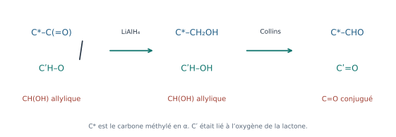
