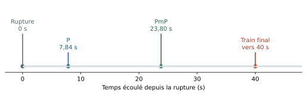
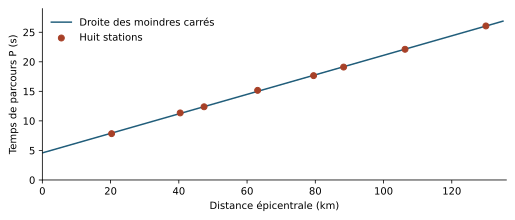
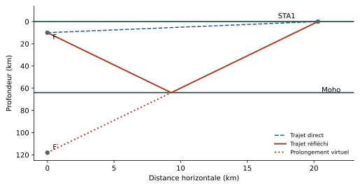
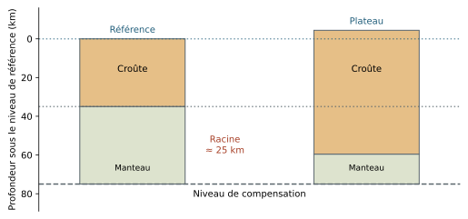
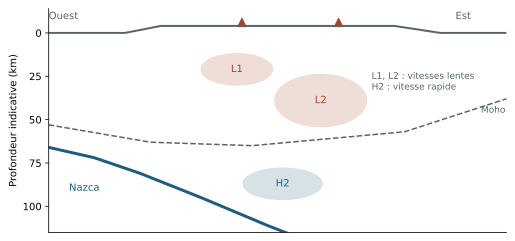
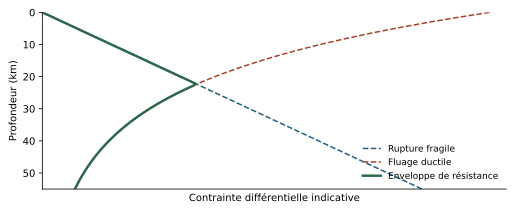
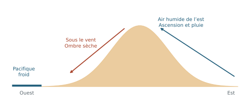

# ENS de Lyon — Second concours · Géosciences 2026 · Corrigé guidé

*Corrigé rédigé par IA, non officiel. Signalez toute erreur.*

**Rédaction** · modèle exact non renseigné (famille GPT-6) · effort non renseigné · vitesse non renseignée

**Révision (tour 1)** · GPT-6.2 Astra Ultra · vitesse non renseignée

**Révision (tour 2)** · GPT-6.2 Astra Ultra · vitesse non renseignée

Structure et dynamique du plateau Andin. Épreuve écrite de trois heures. [Sujet et annexes](https://banques-ecoles.fr/cms/wp-content/uploads/2026/08/26_2cc_sujet_geologie.pdf) · [Rapport du jury](https://banques-ecoles.fr/cms/wp-content/uploads/2026/07/26_2cc_rap_eST.pdf)

## Présentation du sujet

Le sujet de trois heures est intitulé « Composition de géologie » sur sa couverture et figure dans les annales de géosciences. Les 15 questions utilisent les données de l’Altiplano pour relier temps de parcours, épaisseur crustale, relief, comportement mécanique, volcanisme et climat. Les mesures précises sont distinguées des lectures graphiques et des hypothèses pétrologiques. [Sujet officiel](https://banques-ecoles.fr/cms/wp-content/uploads/2026/08/26_2cc_sujet_geologie.pdf) · [Rapport du jury](https://banques-ecoles.fr/cms/wp-content/uploads/2026/07/26_2cc_rap_eST.pdf)

## Arrivées sismiques et vitesse crustale

La première station permet de pointer les phases. Le réseau permet d’estimer une pente sur une distance beaucoup plus grande.

### Question 1

> [!JURY]
> Le jury relève le retard de la première onde P à STA1 par rapport à une croûte typique et la possibilité de matériaux lents en subsurface.

> [!INDICATION]
> Relever l'heure origine ainsi que les deux heures imprimées, puis les exprimer avec la même origine.

> [!INDICATION]
> Utiliser la distance au foyer avant de comparer le premier temps de parcours à celui d'une croûte compacte.

#### Solution

La rupture est repérée à 01 h 12 min 07,74 s. Le bruit initial est faible. Le premier pointé, P, est à 01 h 12 min 15,58 s, soit $7{,}84$ s après la rupture. Il inaugure un train de faible amplitude dont l'enveloppe augmente puis décroît. PmP est pointée à 01 h 12 min 31,54 s, soit $23{,}80$ s après la rupture et $15{,}96$ s après P. Elle se lit dans un train plus ample qui se prolonge en coda. Le dernier paquet, le plus ample par endroits, débute vers 01 h 12 min 48 s, soit environ 40 s après la rupture. Pour lire ce dernier instant, on prolonge l’échelle définie par les deux pointés P et PmP. Du pointé PmP au début du dernier paquet, la distance horizontale vaut approximativement celle qui sépare P de PmP, soit encore 16 à 17 s. Sans étalonnage vertical, les amplitudes ne peuvent être comparées qu'en valeur relative.

Pour un foyer à 10 km et une distance épicentrale de 20,3 km, le trajet rectiligne vaut $\sqrt{20{,}3^2+10^2}=22{,}6$ km. Dans un matériau à 6 km/s il prendrait environ 3,8 s. La première arrivée est tardive et correspond à une vitesse apparente moyenne de $22{,}6/7{,}84\simeq2{,}9$ km/s. Des formations sédimentaires meubles ou des dépôts volcaniques poreux tels que des tufs et ignimbrites peuvent ralentir la traversée près de la station. Ce temps isolé ne permet pas de fixer à la fois la vitesse et l'épaisseur de la couche lente.

L’annexe A cartographie dans la région à la fois des unités volcaniques cénozoïques et des couvertures sédimentaires, ce qui donne un contexte indépendant à ces hypothèses. La carte est régionale. Un sondage ou plusieurs trajets locaux seraient nécessaires pour identifier les matériaux exactement sous STA1.

### Question 2

> [!INDICATION]
> Que se passe-t-il lorsqu'une onde P rencontre une limite entre deux milieux d'impédances différentes ?

> [!INDICATION]
> La position tardive et la forte amplitude du dernier paquet peuvent-elles s'expliquer par un mode guidé près de la surface ?

#### Solution

Le Moho sépare les roches crustales de celles du manteau supérieur et s'accompagne d'un changement de densité et de vitesse des ondes. Le contraste d'impédance $Z_P=\rho V_P$ réfléchit une partie de l'énergie incidente. Pour la phase PmP, une onde P descend dans la croûte, se réfléchit au Moho et remonte comme onde P. Cette distance supplémentaire explique le retard sur la phase directe. Le dernier train, tardif et ample, peut comprendre des ondes de surface se propageant plus lentement et concentrant leur énergie près de la surface, éventuellement mêlées à de la coda. Une trace unique ne permet pas de séparer toutes les phases.

### Question 3

> [!INDICATION]
> Placer les distances épicentrales en abscisse et les temps écoulés depuis la rupture en ordonnée.

> [!INDICATION]
> L'inverse de la pente a-t-il bien l'unité d'une vitesse ? Faut-il imposer un passage par l'origine ?

#### Solution

Pour STA1, on insère le temps de parcours $7{,}84$ s dans la colonne numérique du tableau. En représentant les huit temps $t$ depuis la rupture en fonction de la distance épicentrale $\Delta$, la régression affine donne
$$t\ (\mathrm{s})\simeq4{,}59+0{,}1652\,\Delta\ (\mathrm{km}),\qquad V_P\simeq\frac{1}{0{,}1652}=6{,}05\ \mathrm{km/s}.$$
Une pente tracée à la règle donne environ $6{,}1\ \mathrm{km/s}$. L'ordonnée à l'origine est le temps extrapolé du modèle ajusté. Elle englobe les effets de la géométrie du foyer, de la structure des premiers kilomètres et de l'ajustement affine. Ce n'est pas une nouvelle heure de rupture. Forcer la droite par l'origine biaiserait la pente. On peut vérifier la pente à la main avec les stations extrêmes : $(26{,}07-7{,}84)/(130-20{,}3)\simeq0{,}166\ \mathrm{s\,km^{-1}}$. Cette pente mesure la variation du temps avec la distance. Le quotient de la longueur d’un seul trajet par son temps à STA1 reste sensible à tout retard local.

Pour reporter les points sur la grille de la page 8, on peut graduer l’abscisse de 0 à 140 km par pas de 20 km et l’ordonnée de 0 à 30 s par pas de 5 s. Le plus grand écart vertical à la droite ajustée vaut environ 0,16 s à STA4. Cet écart décrit la dispersion autour de la droite, tandis que le retard d’environ 4 s à STA1 concerne le modèle géométrique homogène.

### Question 4

> [!INDICATION]
> Comparer la valeur obtenue avec chaque intervalle de l'annexe B.

> [!INDICATION]
> Jusqu'à quelles profondeurs les rayons directs de la figure 3 apportent-ils une information dans le modèle ?

#### Solution

Les trajets directs entre le foyer à 10 km de profondeur et le réseau contraignent en premier lieu la croûte supérieure qu'ils traversent. $V_P\simeq6{,}1\ \mathrm{km/s}$ tombe dans les intervalles du granite compact (6,0 à 6,2) et des andésites massives (6,0 à 6,5). Une croûte supérieure consolidée, avec des roches magmatiques plutoniques ou volcaniques d'arc, est donc compatible avec la mesure. Les tufs ou les sédiments isolés de l'annexe B ont des vitesses trop faibles pour rendre compte à eux seuls de cette pente, mais peuvent exister localement au-dessus du substrat. Une vitesse ne distingue pas granite et andésite et ces rais directs restent au-dessus de la base crustale. Si « dix derniers kilomètres » désigne la tranche juste au-dessus du Moho, sa composition reste indéterminée par cette mesure. Les enclaves de la question 13 fournissent un indice indépendant sur sa nature mafique.

## Géométrie des rais et profondeur du Moho

Le retard de la phase réfléchie sur la phase directe est la mesure recherchée. La géométrie simplifiée le relie à la profondeur de la discontinuité.

### Question 5

> [!INDICATION]
> Le foyer est décalé de la station à la fois horizontalement et verticalement.

> [!INDICATION]
> Quelle longueur faut-il diviser par la vitesse ?

#### Solution

Sous les hypothèses d'une croûte homogène et d'un rai direct rectiligne, les deux côtés perpendiculaires du triangle sont la profondeur focale $h$ et la distance épicentrale $\Delta$. La longueur vaut $L_P=\sqrt{h^2+\Delta^2}$, donc $t_P=\sqrt{h^2+\Delta^2}/V_P$. Avec les longueurs en kilomètres et la vitesse en kilomètres par seconde, le résultat est en secondes.

### Question 6

> [!INDICATION]
> Construire le symétrique du foyer par rapport au Moho horizontal.

> [!INDICATION]
> Le parcours réfléchi entier a la longueur d'un segment dont on connaît les projections.

#### Solution

Appelons $H$ la profondeur du Moho sous la surface locale. La source image $F'$ est symétrique du foyer par rapport au réflecteur horizontal. Elle est donc à $H+(H-h)=2H-h$ sous la surface. Le segment joignant cette image à la station donne la longueur du trajet brisé, par égalité des angles d'incidence et de réflexion. Ainsi
$$t_{PmP}=\frac{\sqrt{(2H-h)^2+\Delta^2}}{V_P},\qquad
\delta t=t_{PmP}-t_P=\frac{\sqrt{(2H-h)^2+\Delta^2}-\sqrt{h^2+\Delta^2}}{V_P}.$$
Le signe est positif pour $H>h$.

### Question 7

> [!INDICATION]
> Isoler le radical contenant la profondeur du Moho avant de mettre au carré.

> [!INDICATION]
> Pourquoi le signe de la seconde racine n'est-il pas arbitraire ?

#### Solution

Posons $A=V_P\delta t+\sqrt{h^2+\Delta^2}$, une longueur. La question 6 donne $A^2=(2H-h)^2+\Delta^2$. Comme le foyer est au-dessus du Moho, $2H-h>0$. On choisit la racine positive et l'on obtient
$$H=\frac{h+\sqrt{\left(V_P\delta t+\sqrt{h^2+\Delta^2}\right)^2-\Delta^2}}{2}.$$

### Question 8

> [!JURY]
> Le rapport donne une profondeur de l’ordre d’une soixantaine de kilomètres et demande de discuter les simplifications géométriques ainsi que le pointé des arrivées.

> [!INDICATION]
> Former la différence des deux arrivées pointées sur le même sismogramme.

> [!INDICATION]
> Faire varier un temps ou une vitesse pour préciser le sens des incertitudes.

#### Solution

Avec $h=10$ km, $\Delta=20{,}3$ km, $V_P=6{,}05$ km/s et $\delta t=15{,}96$ s, on a $A\simeq119{,}2$ km et $H\simeq63{,}7$ km, soit environ **64 km sous la surface du plateau**. C'est une croûte continentale épaissie, proche du double d'une valeur de référence de 30 à 35 km. Cette valeur donne la profondeur du Moho, discontinuité crustomantellique, et donc l'épaisseur de la croûte locale. La durée de traversée de la discontinuité elle-même n'est pas mesurée.

Les pointés des deux phases et l'estimation de $V_P$ interviennent directement. Avec la même géométrie, modifier un pointé de 0,5 s ferait varier l'estimation d'environ 1,5 km. La vitesse varie avec la lithologie et la température, la surface et le réflecteur présentent du relief, les rais peuvent être réfractés et ne suivent pas intégralement le même trajet près de la station. Avec $H\simeq64$ km, le modèle donne $t_P\simeq3{,}7$ s et $t_{PmP}\simeq19{,}7$ s. Les deux phases sont observées environ 4 s plus tard. Un retard commun s’élimine dans leur différence, mais des retards différents sur les deux trajets se reportent sur $H$.

## Compensation du relief et racine crustale

Un calcul par colonnes demande un niveau de référence commun et des masses volumiques explicites.

### Question 9

> [!INDICATION]
> Comparer deux colonnes de même section jusqu'à un même niveau situé dans le manteau.

> [!INDICATION]
> Comment une épaisseur supplémentaire de matériau crustal peut-elle compenser la masse du relief ?

#### Solution

Dans le modèle local d'Airy, la croûte est de masse volumique uniforme $\rho_c$ et flotte sur un manteau plus dense de masse volumique $\rho_m$. Le relief est compensé par des variations d'épaisseur crustale. À une profondeur commune située sous les racines, deux colonnes de même section exercent la même pression lithostatique. Le calcul néglige la rigidité en flexion, les contraintes déviatoriques et un soutien dynamique du manteau. On prendra par exemple $\rho_c=2\,800$ et $\rho_m=3\,300\ \mathrm{kg/m^3}$, valeurs moyennes représentatives d'une colonne continentale et du manteau supérieur respectivement.

### Question 10

> [!JURY]
> Le jury attendait une évaluation chiffrée de la racine et du relief ainsi qu’une comparaison avec la topographie.

> [!INDICATION]
> Définir séparément le relief au-dessus du niveau de référence et la racine au-dessous du Moho de référence.

> [!INDICATION]
> La profondeur du Moho mesurée depuis le sommet du plateau comprend-elle aussi l'altitude ?

#### Solution

Prenons une colonne continentale de référence d'altitude zéro et d'épaisseur crustale $H_0=35$ km. Pour le plateau, notons $z$ l'altitude et $r$ la profondeur supplémentaire du Moho sous le niveau du Moho de référence. La masse du relief $\rho_c z$ par unité de surface est compensée par le déficit de masse $(\rho_m-\rho_c)r$ de la racine. Géométriquement, $H=H_0+z+r$. Ainsi
$$z=(H-H_0)\frac{\rho_m-\rho_c}{\rho_m},\qquad r=(H-H_0)\frac{\rho_c}{\rho_m}.$$
Pour $H\simeq64$ km et les masses volumiques de la question 9, il vient $z\simeq4{,}4$ km et $r\simeq24{,}6$ km. Les figures 1 et 4 montrent un plateau voisin de 4 km avec des édifices plus élevés. La racine explique donc l'ordre de grandeur du relief par compensation isostatique. L'épaisseur de référence, la densité à la base de la croûte et les variations locales contrôlent les écarts. La convergence andine a pu construire et entretenir l'épaississement. Cet accord ne requiert pas de force verticale tectonique supplémentaire pour soutenir tout le plateau, et ne démontre pas un équilibre exact en chaque point.

Un contrôle direct emploie l’altitude lue de 4 km. Pour les densités retenues, elle demanderait une racine $r=2{,}8\times4/(3{,}3-2{,}8)=22{,}4$ km et une épaisseur totale de $35+4+22{,}4=61{,}4$ km. L’écart d’environ 2 à 3 km avec l’estimation sismique donne l’échelle de l’accord avec ce modèle simple.

## Du plateau à la croûte profonde

Les anomalies de vitesse, l’activité sismique et les données pétrologiques contraignent des hypothèses sur la température et la densité.

### Question 11

> [!INDICATION]
> Lire les couleurs avec la barre signée, puis comparer leurs profondeurs avec les séismes et les édifices.

> [!INDICATION]
> Les séismes de la croûte du plateau appartiennent-ils à la même structure que la bande profonde inclinée ?

#### Solution

Sur le profil ouest–est, le plateau porte plusieurs centres volcaniques, dont Antofalla et Galán. Dans la croûte située sous ceux-ci, L1 et surtout L2 sont des anomalies de vitesse P négatives (en rouge). L2 s'étend jusqu'à plusieurs dizaines de kilomètres de profondeur. H2, vers 80 à 100 km et sous ces zones lentes, est plus rapide que le modèle de référence (en bleu). La sismicité crustale du plateau est principalement superficielle et se raréfie vers 25 km. Les points verts beaucoup plus profonds forment aussi, à l'ouest puis vers l'est en profondeur, une bande plongeante liée à la plaque de Nazca en subduction. Une limite de sismicité crustale ne doit donc pas être étendue à toute la coupe. Les anomalies lentes sont compatibles avec des matériaux chauds, localement partiellement fondus, au-dessous de l'arc. La proximité spatiale ne suffit pas à prouver à elle seule une connexion directe entre chaque anomalie et chaque volcan.

### Question 12

> [!JURY]
> Le rapport invite à relier la profondeur de disparition de la sismicité et la faiblesse de la croûte inférieure à l’enveloppe rhéologique.

> [!INDICATION]
> Comparer la vitesse S, l'arrêt de la sismicité crustale et les courbes fragile et ductile de l'annexe D.

> [!INDICATION]
> Évaluer l'ordre de grandeur de la pression avant d'utiliser la grille de faciès.

#### Solution

À 30 km, la pression lithostatique d'une croûte de $2\,800\ \mathrm{kg/m^3}$ est de l'ordre de $\rho g z\simeq0{,}8$ GPa. La faible $V_S$ donnée, environ $2{,}8\ \mathrm{km/s}$, indique une rigidité au cisaillement réduite. Avec les anomalies négatives de $V_P$, le contexte volcanique et l'extinction de la sismicité crustale profonde, elle est compatible avec une croûte moyenne à inférieure chaude, affaiblie et localement partiellement fondue. À pression comparable, la présence d'eau abaisse la température nécessaire à l'amorce de la fusion selon l'annexe C. Une vitesse sismique ne fournit à elle seule ni température exacte ni fraction de liquide.

Dans la partie froide superficielle, la résistance au frottement augmente avec le confinement et la déformation fragile produit des séismes. Avec la profondeur et la température, le fluage ductile devient possible à plus faible contrainte que la rupture fragile. L'enveloppe rhéologique de l'annexe D est l'enveloppe de la résistance la plus faible de ces deux régimes. Dans la croûte chaude de l'Altiplano, leur croisement peut être moins profond que pour une lithosphère froide. La croûte située sous ce niveau peut donc accommoder de la déformation sans forte sismicité. La croûte inférieure mafique peut, en outre, atteindre des faciès métamorphiques de haute pression sous la croûte épaissie.

L’annexe D trace une enveloppe de référence avec un Moho vers 30 km et une résistance qui change au passage de la croûte au manteau. Sur l’Altiplano, les données placent ce passage vers 64 km. On transpose le mécanisme de concurrence entre rupture et fluage, en recalant la géométrie sur le profil local.

### Question 13

> [!INDICATION]
> Suivre une roche mafique lorsque la pression augmente dans une croûte épaissie.

> [!INDICATION]
> Après le départ d'une racine devenue trop dense, quelle matière et quelle chaleur peuvent remonter ?

#### Solution

L'épaississement tectonique enfouit une base crustale relativement mafique. À 60–65 km, la pression est de l'ordre de 1,6 à 1,9 GPa. Selon la température et la composition, un protolithe basaltique ou gabbroïque peut évoluer de granulites mafiques vers des assemblages d'éclogite à grenat et clinopyroxène sodique, avec disparition du plagioclase. La roche densifiée peut dépasser la densité du manteau environnant. Une racine instable peut alors se détacher et s'enfoncer. Un fragment dense et relativement rapide constitue une interprétation possible de H2. La tomographie mesure des vitesses, et non directement la densité ou la minéralogie.

La matière mantellique remonte pour remplacer la racine qui s'enfonce. Cette remontée transfère de la chaleur par advection, peut engendrer de la fusion par décompression et alimenter la base crustale en magmas chauds. Les apports de chaleur favorisent aussi la fusion partielle de la croûte et le stockage magmatique. Les fluides relâchés par la plaque subduite peuvent de leur côté enrichir le coin mantellique et abaisser son solidus. Ensemble, ces processus rendent plausible un volcanisme discontinu associé à des compositions variées. La délamination est une hypothèse proposée pour cette coupe.

### Question 14

> [!INDICATION]
> Comparer l'abscisse et l'ordonnée du TAS, puis lire séparément l'encart potassium–sodium.

> [!INDICATION]
> Séparer les hypothèses sur la source, l'évolution dans les réservoirs et la mécanique de l'éruption.

#### Solution

La figure 5 situe les échantillons vers 45 à 64 % en masse de silice. Des produits relativement peu siliceux et alcalins côtoient des trachyandésites, des andésites et des dacites. L'encart sépare notamment des séries très enrichies en potassium. La cristallisation fractionnée de phases mafiques peut enrichir le liquide résiduel en silice et en alcalins. Des injections basiques mantelliques peuvent aussi chauffer la croûte épaisse, assimiler des roches encaissantes et se mélanger à des liquides crustaux plus felsiques. Une même évolution chimique observée sur le TAS peut résulter de plusieurs de ces processus.

Pour les laves ultra-potassiques, une hypothèse est une fusion de faible degré d'un manteau lithosphérique préalablement métasomatisé et enrichi en potassium par des fluides ou liquides de subduction. Des phases potassiques, notamment la phlogopite, peuvent stocker puis restituer le potassium lors de la fusion. La remontée chaude consécutive à une délamination pourrait déclencher cette fusion. Un diagramme des alcalins seuls ne démontre pas l'origine du potassium. Une étude des éléments traces et des isotopes permettrait de distinguer source enrichie, assimilation et différenciation.

Un liquide basaltique chaud et relativement fluide libère plus facilement ses gaz et peut alimenter des coulées. Un magma évolué, plus riche en silice, plus visqueux et chargé en volatils, peut retenir les bulles, se fragmenter et alimenter une colonne explosive. Les courants pyroclastiques déposent des ignimbrites. La vidange importante d'un réservoir peut s'accompagner d'un effondrement en caldera. Le débit, la teneur en gaz, la cristallinité et l'état du conduit comptent aussi. Un stratovolcan andésitique peut connaître des phases effusives et explosives successives.

La figure principale représente la somme massique des deux alcalins. C’est l’encart qui sépare potassium et sodium. Certains échantillons y atteignent environ 8 % de K₂O pour moins de 2 % de Na₂O, donc un rapport massique supérieur à 4. Ils se situent au-dessus de la droite $\mathrm{K_2O/Na_2O}=2$ de la figure. Cette observation étaye la présence d’une série ultra-potassique.

## Relief andin et climats côtiers

Le transport atmosphérique d’humidité varie avec la latitude et interagit avec les reliefs et les eaux froides du Pacifique.

### Question 15

> [!JURY]
> Le rapport associe l’ombre pluviométrique andine, l’océan froid et la variation latitudinale des circulations atmosphériques.

> [!INDICATION]
> Comparer le côté exposé aux arrivées d'air humide dans les Andes tropicales et aux latitudes tempérées.

> [!INDICATION]
> Quels mécanismes généraux l'Atacama partage-t-il avec les façades subtropicales de l'Afrique ?

#### Solution

Aux latitudes tropicales de l'Altiplano, de l'air humide venu de l'est, notamment du bassin amazonien, est soulevé sur le flanc oriental. L'ascendance refroidit l'air, entraîne condensation et précipitations. Une partie de cette humidité atteint le plateau surtout en été austral, tandis que le versant pacifique se trouve en ombre pluviométrique. Plus au sud, les vents dominants d'ouest apportent progressivement des perturbations du Pacifique. En Patagonie, le flanc humide est occidental et une ombre sèche se développe sous le vent à l'est. La figure 6 associe cette variation en latitude à des climats très différents le long du Chili.

Sur la côte de l'Atacama, le courant de Humboldt et les remontées d'eau froide refroidissent les basses couches. La subsidence des hautes pressions subtropicales réchauffe et assèche l'air en altitude, renforçant l'inversion et limitant la convection profonde. Des brouillards ou stratus côtiers peuvent ainsi coexister avec une pluie extrêmement rare. Le relief à l'est prive simultanément la côte d'une grande part des apports continentaux.

La Namibie, avec le courant de Benguela, et la façade saharienne nord-occidentale, avec le courant des Canaries, offrent des analogies. L'alignement d'une chaîne de l'ampleur des Andes n'y est pas nécessaire. Sur de nombreuses marges occidentales subtropicales, circulation anticyclonique descendante, courants de bord est froids et remontées d'eaux profondes favorisent l'aridité côtière. Cette régularité dépend de la latitude, du relief et des vents dominants. Elle ne s'applique pas uniformément à toutes les côtes tournées vers l'ouest, notamment aux façades européennes tempérées parcourues par les perturbations d'ouest.

## Bilan

Le réseau donne une vitesse crustale apparente proche de 6,1 km/s et le retard réfléchi conduit à une croûte d’environ 64 km d’épaisseur. Avec des densités continentales usuelles, cette épaisseur est compatible avec un plateau haut de plusieurs kilomètres. Les interprétations de la croûte chaude, de la délamination et des sources du volcanisme utilisent des observations complémentaires.
