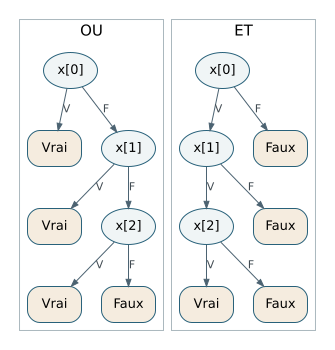
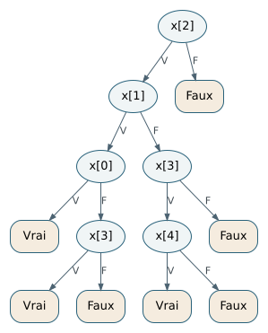
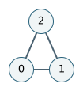
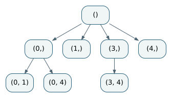
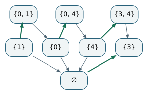
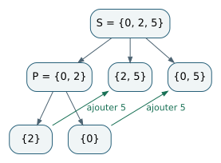
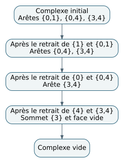

# ENS de Lyon — Second concours · Informatique 2026 · Corrigé guidé

*Corrigé rédigé par IA, non officiel. Signalez toute erreur.*

**Rédaction** · modèle exact non renseigné (famille GPT-6) · effort non renseigné · vitesse non renseignée

**Révision** · GPT-6.2 Astra Ultra · vitesse non renseignée · 26 novembre 2026

## Présentation du sujet

Cette composition de trois heures relie les arbres de décision, les fonctions booléennes positives et les complexes simpliciaux. Les quatre parties forment une démonstration du critère de Kahn–Saks–Sturtevant. Les questions d’algorithme emploient les opérations de l’énoncé et ses coûts, en particulier la consultation d’un dictionnaire en temps constant. [Sujet officiel](https://banques-ecoles.fr/cms/wp-content/uploads/2026/08/26_2cc_sujet_info.pdf) · [Index des écrits de la banque](https://banques-ecoles.fr/cms/filieres-universitaires-second-concours-scientifique/les-annales-et-rapports-des-jurys-2/)

Dans les programmes, les noms `Leaf`, `Node` et leurs accesseurs désignent les primitives de l’énoncé. La file `deque` est celle de `collections`. Dans les arbres de décision, l’enfant gauche correspond à la valeur vraie.

## I. Fonctions booléennes

Un arbre de décision mesure les données qu’il faut réellement examiner sur une entrée. Son coût maximal est sa hauteur.

### Question 1

> [!INDICATION]
> Lister les indices possibles du premier terme d'une fenêtre de longueur trois.

> [!INDICATION]
> Un test réussi suffit à décider, tandis qu'un test échoué laisse les fenêtres suivantes ouvertes.

#### Solution

Une suite de trois cases consécutives peut commencer uniquement aux indices 0, 1 et 2. Si l'une des trois fenêtres est entièrement vraie, on peut conclure immédiatement. Si la boucle se termine, chacune a échoué. L'algorithme examine au plus neuf valeurs.

```python
def consecutifs(x):
    for v in range(3):
        if x[v] and x[v + 1] and x[v + 2]:
            return True
    return False
```

### Question 2

> [!INDICATION]
> Pour le « ou », que se passe-t-il dès le premier vrai ?

> [!INDICATION]
> Construire les deux arbres en respectant la convention gauche pour vrai et droite pour faux.

#### Solution

Notons $N(v,L,R)$ le nœud d'étiquette $v$, avec $L$ pris en cas de valeur vraie et $R$ en cas de valeur fausse. Notons $V,F$ les deux feuilles. Des arbres possibles sont
$$T_{\mathrm{ou}}=N(0,V,N(1,V,N(2,V,F))),\qquad
T_{\mathrm{et}}=N(0,N(1,N(2,V,F),F),F).$$
Le premier s'arrête au premier vrai, le second au premier faux. Le dernier test tranche lorsque les deux premiers n'ont pas permis de conclure.



### Question 3

> [!INDICATION]
> Suivre seulement le fils sélectionné par l'entrée.

> [!INDICATION]
> Combien d'indices distincts peuvent apparaître sur ce chemin ?

#### Solution

À chaque itération, le sous-arbre courant a la même valeur sur $x$ que l'arbre initial. La définition de la décision donne directement le bon fils. À la feuille, il reste à renvoyer son étiquette. Un chemin interroge des indices distincts, donc au plus $n$ tests coûtant chacun un temps constant. Le temps est $O(n)$ et la mémoire auxiliaire constante.

```python
def evaltree(t, n, x):
    while not isLeaf(t):
        if x[getLabel(t)]:
            t = getLeft(t)
        else:
            t = getRight(t)
    return getValue(t)
```

### Question 4

> [!INDICATION]
> Quel indice appartient à tous les triplets possibles ?

> [!INDICATION]
> Une fois cette case vraie, la valeur de la case 1 décide si le problème restant est un « ou » ou un « et ».

#### Solution

Tous les triplets admissibles contiennent la case 2. Testons-la d'abord. Si elle est fausse, renvoyons faux. Si elle est vraie, testons la case 1. Lorsque 1 est vraie, un triplet existe exactement si la case 0 ou la case 3 est vraie. Lorsque 1 est fausse, le seul triplet possible est $(2,3,4)$, donc il reste à calculer le « et » des cases 3 et 4. Les deux sous-arbres de « ou » et « et » ont hauteur deux. L'arbre a hauteur quatre et ne répète aucun indice sur un chemin.



## II. Une approche énumérative

Compléter un arbre et le condenser sont deux opérations distinctes. L’énumération doit permettre des ordres de test différents dans les deux sous-arbres.

### Question 5

> [!INDICATION]
> Partir de l'arbre à trois nœuds internes proposé pour la fonction conditionnelle.

> [!INDICATION]
> À la fin de chaque branche, quel indice reste libre et comment l'interroger sans changer le résultat ?

#### Solution

Dans l'arbre initial de $\mathrm{cond}$, la racine teste 0. Si la réponse est vraie, testons 1 pour connaître la sortie $b=x[1]$, puis testons 2 en mettant la même feuille $b$ des deux côtés. Si la réponse à la racine est fausse, testons 2 pour obtenir $b=x[2]$, puis testons 1 avec la même feuille $b$ des deux côtés. On a ajouté un test dont le résultat n'influence pas la sortie. Chacun des huit chemins teste maintenant les trois indices une fois et l'arbre complet représente toujours $\mathrm{cond}$.

Avec $N$ et les feuilles $V,F$ de la question 2, posons $D_v(b)=N(v,b,b)$. L'arbre complet s'écrit
$$N\bigl(0, N(1,D_2(V),D_2(F)), N(2,D_1(V),D_1(F))\bigr).$$

### Question 6

> [!INDICATION]
> Un nœud peut ne devenir redondant qu'après simplification de ses descendants.

> [!INDICATION]
> Condensez les deux enfants avant de tester si la racine peut être remplacée.

#### Solution

Condensons les enfants avant leur père. Si les deux résultats sont des feuilles de même valeur, ce père calcule une constante. On le remplace par cette feuille. Dans les autres cas, on reconstruit le nœud avec les deux résultats.

```python
def condense(t, n):
    if isLeaf(t):
        return t
    left = condense(getLeft(t), n)
    right = condense(getRight(t), n)
    if isLeaf(left) and isLeaf(right):
        if getValue(left) == getValue(right):
            return left
    return Node(getLabel(t), left, right)
```

Par induction, les sous-arbres rendus sont concis et leur valeur est conservée. Le seul nouveau lieu possible de redondance est alors la racine, que l'algorithme traite explicitement. Aucun chemin n'acquiert de test supplémentaire. Chaque nœud initial est visité une fois et occasionne un nombre borné d'opérations, d'où $O(\#t)$.

### Question 7

> [!INDICATION]
> Choisir la prochaine variable parmi celles qui n'ont pas encore été testées, séparément à chaque nœud.

> [!INDICATION]
> À profondeur maximale l'affectation complète impose l'étiquette. Avant cette profondeur, combiner tous les enfants gauches avec tous les enfants droits.

#### Solution

Les tableaux de travail représentent l'affectation de la branche courante et les indices déjà interrogés. Chacun des indices encore libres peut devenir la racine suivante. Ses deux sous-problèmes donnent des listes d'arbres que l'on combine librement.

```python
def enumtrees(f, n):
    x = [False] * n
    used = [False] * n

    def extend(depth):
        if depth == n:
            return [Leaf(f(x))]
        trees = []
        for v in range(n):
            if used[v]:
                continue
            used[v] = True
            x[v] = True
            lefts = extend(depth + 1)
            x[v] = False
            rights = extend(depth + 1)
            used[v] = False
            for left in lefts:
                for right in rights:
                    trees.append(Node(v, left, right))
        return trees

    return extend(0)
```

Au niveau $n$, l'affectation est complète et une unique feuille est possible, étiquetée par $f(x)$. Par induction sur le nombre de coordonnées libres, toute paire d'arbres renvoyés pour un indice racine donne un arbre complet correct sur les entrées de la branche. Inversement, chaque arbre complet correct possède une de ces racines et deux enfants figurant dans les listes correspondantes. Ils sont reconstruits ensemble. Les entrées fixées par les ancêtres sont conservées. Les cases libres sont toujours réaffectées avant leur lecture à une feuille.

Pour contrôler l’exhaustivité sur une petite dimension, notons $a_n$ le nombre d’arbres complets distincts pour une fonction fixée. À la racine on a $n$ choix, puis $a_{n-1}$ constructions pour chacune des deux restrictions, indépendamment. Ainsi $a_0=1$, $a_n=n a_{n-1}^2$ et $a_3=12$. Les valeurs de la fonction imposent les étiquettes des feuilles pour chacune de ces structures.

## III. Fonctions positives et complexes simpliciaux

Une entrée acceptée devient une face en prenant les positions fausses. La croissance de la fonction se traduit par la stabilité des faces par passage à un sous-ensemble.

### Question 8

> [!INDICATION]
> Les faces représentent les indices faux, y compris lorsque cette liste d'indices est vide.

> [!INDICATION]
> Quel unique support ferait échouer le « ou » ?

#### Solution

Le support des cases fausses peut être n'importe quelle partie de $\{0,1,2\}$ sauf la partie entière, puisque le « ou » exige au moins une case vraie. Ainsi
$$K_{\mathrm{ou}}^3=\{\varnothing,\{0\},\{1\},\{2\},\{0,1\},\{0,2\},\{1,2\}\}.$$
Il s'agit des trois sommets et des trois arêtes d'un triangle, avec la face vide et sans la face à trois sommets.



### Question 9

> [!INDICATION]
> Énumérer un support d'indices faux en ajoutant exclusivement des indices croissants.

> [!INDICATION]
> Réutiliser la même liste de booléens et restaurer une seule case au retour de chaque appel.

#### Solution

On part de la liste entièrement vraie. Les indices que l'on met à faux sont ajoutés dans l'ordre strictement croissant, si bien que chaque support est atteint par un seul chemin. À un support rejeté, la positivité de $f$ implique le rejet de toutes ses extensions. C'est cette hypothèse de la partie 3 qui assure la structure de complexe.

```python
def makecmpl(f, n):
    x = [True] * n

    def visit(start):
        if not f(x):
            return None
        children = {}
        for v in range(start, n):
            x[v] = False
            child = visit(v + 1)
            x[v] = True
            if child is not None:
                children[v] = child
        return children

    return visit(0)
```

Un support accepté sans extension donne le dictionnaire vide, tandis qu'un support rejeté donne le marqueur d'absence. Le retour à la racine distingue donc aussi le complexe vide du complexe réduit à sa face vide. La liste $x$ est partagée et restaurée sur place. Chaque passage de boucle correspond à l'appel d'un nouvel ensemble d'indices. Il y en a au plus $2^n$ et le travail hors appels, recherches et évaluations se facture en temps constant par passage, selon le modèle de l'énoncé. Avec $f$ de coût constant, le temps total vaut $O(2^n)$.

### Question 10

> [!INDICATION]
> Placer dans chaque élément de file le chemin courant et le sous-arbre correspondant.

> [!INDICATION]
> Les enfants d'une face ont exactement un sommet de plus. Combien coûte la création du tuple de cet enfant ?

#### Solution

Une file associe à chaque face atteinte son tuple et son dictionnaire d'extensions. Le parcours en largeur retire toutes les faces de taille $k$ avant de retirer celles de taille $k+1$.

```python
def makefaces(cmpl):
    if cmpl is None:
        return []
    waiting = deque()
    waiting.append(((), cmpl))
    faces = []
    while waiting:
        face, children = waiting.popleft()
        faces.append(face)
        for v in children:
            waiting.append((face + (v,), children[v]))
    return faces
```

Les clés d'un sous-arbre prolongent la face par un indice plus grand. Chaque face non vide a un unique préfixe obtenu en supprimant son dernier indice, elle est donc mise en file une seule fois. La concaténation du tuple coûte au plus $O(n)$ par face. Les consultations et opérations de file sont constantes. Le coût est $O(n\,\#K)$ pour $K$ non vide et constant pour le complexe vide.



### Question 11

> [!INDICATION]
> Compter par cardinal et réserver une place à la face vide.

> [!INDICATION]
> Le signe du terme vide est négatif dans la caractéristique réduite du sujet.

#### Solution

Le complexe annoncé comporte une face vide, quatre faces à un sommet et trois à deux sommets. Sa caractéristique d'Euler réduite vaut donc $-1+4-3=0$. Ce résultat est compatible avec la stratégie de hauteur quatre de la question 4. L'implication du théorème seule ne permettrait pas de déduire la non-évasivité de cette valeur nulle.

## IV. Couplages de Morse

Le graphe est orienté vers le bas sur les inclusions immédiates, sauf sur les liens du couplage. L’acyclicité permet de retirer certaines paires de faces.

### Question 12

> [!INDICATION]
> Établir les incidences arête–sommet puis sommet–face vide avant de dessiner les flèches.

> [!INDICATION]
> Retourner uniquement les quatre flèches portées par le couplage.

#### Solution

Les quatre arcs montants du couplage sont $\{1\}\to\{0,1\}$, $\{0\}\to\{0,4\}$, $\{4\}\to\{3,4\}$ et $\varnothing\to\{3\}$. Les six arcs descendants sont
$$\{0,1\}\to\{0\},\quad\{0,4\}\to\{4\},\quad\{3,4\}\to\{3\},$$
$$\{0\}\to\varnothing,\quad\{1\}\to\varnothing,\quad\{4\}\to\varnothing.$$
Cela donne toutes les couvertures : chaque arête a deux sommets, chaque sommet couvre la face vide. Le dessin distingue leurs orientations.



### Question 13

> [!INDICATION]
> Recréer n sous-tuples de longueur n pour chaque face risque de perdre un facteur n.

> [!INDICATION]
> Toute facette obtenue sans retirer le maximum est l'extension, par ce maximum, d'une facette du préfixe.

#### Solution

Pour éviter de reconstruire une longue suite à chaque suppression d'un sommet, attribuons un identifiant entier à chaque face, en ne construisant son tuple qu'une seule fois. Pour chaque identifiant, conservons ses extensions par un dernier sommet et la liste de ses facettes, c'est-à-dire des sous-faces ayant un sommet de moins.

```python
def makehasse(cmpl, m):
    if cmpl is None:
        return {}

    faces = [()]
    subtrees = [cmpl]
    extensions = [{}]
    parents = [(-1, -1)]
    ids = {(): 0}
    i = 0
    while i < len(faces):
        for v in subtrees[i]:
            child = faces[i] + (v,)
            j = len(faces)
            faces.append(child)
            subtrees.append(subtrees[i][v])
            extensions.append({})
            extensions[i][v] = j
            parents.append((i, v))
            ids[child] = j
        i += 1

    partner = [-1] * len(faces)
    for lower, upper in m:
        partner[ids[lower]] = ids[upper]
    facets = [[]]
    outgoing = [[] for face in faces]
    for j in range(1, len(faces)):
        parent, v = parents[j]
        lower_ids = [parent]
        for low in facets[parent]:
            lower_ids.append(extensions[low][v])
        facets.append(lower_ids)
        for i in lower_ids:
            if partner[i] == j:
                outgoing[i].append(faces[j])
            else:
                outgoing[j].append(faces[i])
    return {face: outgoing[i] for i, face in enumerate(faces)}
```

Soit $S=P\cup\{v\}$ où $v$ est le plus grand sommet. Ses facettes sont $P$ et les $F\cup\{v\}$ pour toutes les facettes $F$ de $P$. Ces extensions de $F$ existent par fermeture du complexe et s'obtiennent par une consultation de dictionnaire sur le sommet $v$. Le parcours initial a créé tous les identifiants par taille croissante. La seconde boucle trouve donc les facettes de $P$ déjà calculées. Elle traite chaque incidence une seule fois et l'oriente vers le haut exactement si elle appartient au couplage. Dans cette boucle sur les incidences, les accès se font par identifiants entiers. Les listes de voisins contiennent des références aux tuples déjà construits. Le dictionnaire de sortie prend chaque face comme clé une seule fois. Créer les tuples coûte au total $O(n\,\#K)$. Il y a au plus $n$ incidences par face et au plus $\#K/2$ couples. Le temps total est ainsi $O(n\,\#K)$ pour un complexe non vide, avec retour immédiat pour le vide.



### Question 14

> [!INDICATION]
> Quel sommet peut figurer en tête d'un ordre qui respecte tous les arcs ?

> [!INDICATION]
> Pour éviter les parcours répétés, maintenir les degrés entrants et la file des nouvelles sources.

#### Solution

Supprimons successivement les sommets dont le degré entrant est nul. À chaque suppression, on diminue les degrés entrants des voisins sortants. Le compteur détermine si tous les sommets ont été atteints.

```python
def isacyclic(adj):
    incoming = {}
    for v in adj:
        incoming[v] = 0
    for v in adj:
        for w in adj[v]:
            incoming[w] += 1
    queue = deque()
    for v in adj:
        if incoming[v] == 0:
            queue.append(v)
    count = 0
    while queue:
        v = queue.popleft()
        count += 1
        for w in adj[v]:
            incoming[w] -= 1
            if incoming[w] == 0:
                queue.append(w)
    return count == len(adj)
```

Une source ne peut appartenir à un cycle, donc un cycle initial survit à toutes les suppressions de ses sommets extérieurs. Réciproquement, si le graphe restant est non vide et sans source, suivre des prédécesseurs fait nécessairement répéter un sommet et fournit un cycle. Le résultat vaut donc vrai exactement sur les graphes acycliques, y compris le graphe vide. Chaque sommet entre en file au plus une fois et chaque arc est lu deux fois. Le temps est $O(\#V+\#E)$.

### Question 15

> [!INDICATION]
> Une orientation acyclique finie et non vide possède une source. De quel côté de son couple cette source se trouve-t-elle ?

> [!INDICATION]
> Si deux sommets distincts pouvaient s'ajouter simultanément à la source, qu'impliquerait la fermeture par sous-faces ?

#### Solution

Raisonnons par récurrence sur le nombre de faces. Le complexe vide convient. Sinon, le diagramme fini acyclique possède une source $\tau$. La perfection et l'absence d'arc entrant imposent que $\tau$ soit le membre inférieur de son unique couple $(\tau,\sigma)$. Toute autre coface immédiate de $\tau$ enverrait un arc descendant vers $\tau$. Ainsi $\sigma$ est sa seule coface immédiate.

Toute face strictement plus grande contenant $\tau$ contient une coface immédiate de $\tau$. Si elle avait au moins deux sommets de plus que $\tau$, on pourrait ajouter séparément chacun de ces deux sommets et obtenir deux cofaces immédiates, contradiction. Par conséquent $\sigma$ est maximale et c'est la seule face contenant strictement $\tau$. On peut enlever le couple par effondrement élémentaire. Le couplage restant est parfait et son diagramme est le sous-graphe induit sur les faces restantes, donc acyclique. On termine par récurrence.



### Question 16

> [!INDICATION]
> Séparer les faces selon qu'elles contiennent l'indice testé à la racine.

> [!INDICATION]
> Un arc montant peut-il changer ce premier indice si le dernier test porte sur une autre coordonnée ?

#### Solution

La perfection suit de l'hypothèse admise : toute face apparaît dans un couple et le couplage interdit les doubles utilisations. Prouvons l'acyclicité par récurrence sur $n$. Pour $n=1$, il n'y a que l'arc montant $\varnothing\to\{0\}$. Pour $n>1$, soit $v$ le premier indice testé à la racine. Les couples montants ne changent que le dernier indice testé. Celui-ci diffère de $v$. Ils restent donc dans une même classe de faces, selon que $v$ est présent ou absent.

Tout arc entre les deux classes descend en supprimant $v$. Un cycle ne pourrait donc pas les parcourir toutes les deux. Dans la classe sans $v$, les paires et les orientations sont celles du sous-arbre gauche puisque la réponse sur $v$ est vraie. Dans la classe avec $v$, enlever $v$ de toutes les faces identifie les orientations à celles du sous-arbre droit. Ces sous-arbres sont complets sur les $n-1$ indices restants, que l'on peut renuméroter. Les deux diagrammes sont acycliques par récurrence, d'où le résultat.


### Question 17

> [!INDICATION]
> Compléter l'arbre court en dessous de chacune de ses feuilles en préservant sa sortie.

> [!INDICATION]
> Regarder les deux supports regroupés par le dernier test, puis comparer les signes de leurs contributions à la caractéristique.

#### Solution

Choisissons un arbre représentant $f$ de hauteur strictement inférieure à $n$. Sous chaque feuille, ajoutons des tests des indices encore libres, dans un ordre fixé sur la branche, jusqu'à atteindre la hauteur $n$. Les nouvelles feuilles portent toutes la valeur de l'ancienne feuille. Le dernier test ajouté sur chaque chemin est donc indifférent à la valeur de $f$.

Pour chaque couple $(\tau_c,\sigma_c)$ de l'arbre complet, les deux entrées ayant ces supports de cases fausses ne diffèrent que sur ce dernier test. Elles ont la même image : ou bien les deux faces appartiennent à $K_f^n$, ou bien aucune n'y appartient. Le couplage de 16 se restreint donc à un couplage parfait et acyclique du complexe. Par 15, celui-ci s'effondre jusqu'au complexe vide. À chaque retrait, les deux faces ont des tailles consécutives et leurs contributions à $\widetilde\chi$ s'annulent. Comme $\widetilde\chi(\varnothing)=0$, on obtient $\widetilde\chi(K_f^n)=0$. La positivité garantit que l'ensemble de départ est bien un complexe.

## Bilan

Le critère est à sens unique. Une caractéristique réduite non nulle certifie que tout arbre devra lire tous les bits sur au moins une entrée. La preuve part, en sens inverse, d’un arbre qui économise un test sur chaque branche, puis construit un couplage parfait qui annule les contributions à la caractéristique.

**Remarque finale du sujet.** Le théorème donne aussi sa contraposée. Une caractéristique d’Euler réduite non nulle impose l’évasivité. La dernière page pose ensuite comme question ouverte l’évasivité de toute fonction positive, faiblement symétrique et non triviale. La question 17 établit le critère sur la caractéristique d’Euler. Pour conclure dans le cadre plus général de la remarque, il faudrait un argument supplémentaire.
