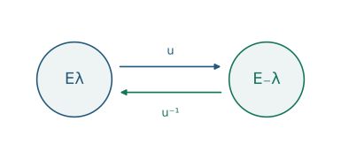
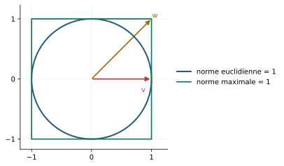
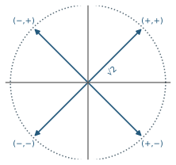
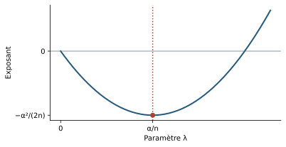
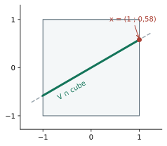
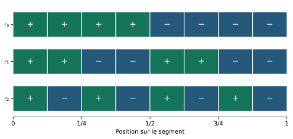

# ENS de Lyon — Mathématiques · Second concours 2026 · Corrigé guidé

*Corrigé rédigé par IA, non officiel. Signalez toute erreur.*

**Rédaction** · modèle exact non renseigné (famille GPT-6) · effort non renseigné · vitesse non renseignée

**Révision (tour 1)** · modèle exact non renseigné (famille GPT-6) · effort non renseigné · vitesse non renseignée

**Révision (tour 2)** · GPT-6.2 Astra Ultra · vitesse non renseignée

**Révision** · GPT-6.2 Astra Ultra · vitesse non renseignée · 26 novembre 2026

## Présentation du sujet

L’épreuve de trois heures de la filière universitaire comporte un exercice sur des endomorphismes complexes et un problème sur les sommes signées de vecteurs. La dernière question présente une contradiction dans le choix des coefficients. Le corrigé traite la formulation imprimée et la variante cohérente avec le reste du problème. [Sujet officiel](https://banques-ecoles.fr/cms/wp-content/uploads/2026/08/26_2cc_sujet_math.pdf)

## Exercice — Endomorphismes qui anticommutent

Pour une valeur propre non nulle, son opposée joue le même rôle. La restriction à l’image permet de raisonner même quand la diagonalisabilité est inconnue.

### Question 1

> [!INDICATION]
> Prendre le déterminant des deux membres de la relation d’anticommutation.

> [!INDICATION]
> Un signe moins devant une matrice de taille n multiplie son déterminant par une puissance de −1.

#### Solution

Le déterminant de $fu=-uf$ donne $\det(f)\det(u)=(-1)^n\det(u)\det(f)$. Les deux déterminants sont non nuls, donc $(-1)^n=1$ et $n$ est pair.

### Question 2a

> [!INDICATION]
> Appliquer f à u(x) lorsque x est un vecteur propre.

> [!INDICATION]
> Pour obtenir une égalité de dimensions, utiliser aussi l’inverse de u.

#### Solution

Si $f(x)=\lambda x$, alors $f(u(x))=-u(f(x))=-\lambda u(x)$. Ainsi $u$ envoie $E_\lambda=\ker(f-\lambda I)$ dans $E_{-\lambda}$. Son inverse anticommute aussi avec $f$, car $u^{-1}f=-fu^{-1}$. Sa restriction envoie donc $E_{-\lambda}$ dans $E_\lambda$. Les deux restrictions sont des isomorphismes réciproques, d’où l’égalité des dimensions, y compris pour $\lambda=0$.

### Question 2b

> [!INDICATION]
> Le rang d’un endomorphisme diagonalisable est la somme des dimensions des espaces propres non nuls associés à des valeurs propres non nulles.

> [!INDICATION]
> Regrouper une valeur propre et son opposée.

#### Solution

La diagonalisabilité donne $\operatorname{Im}f=\bigoplus_{\lambda\ne0}E_\lambda$, somme sur les valeurs propres non nulles. Celles-ci se répartissent en paires distinctes $\{\lambda,-\lambda\}$, chacune contribuant $2\dim E_\lambda$ au rang d’après 2a. Leur somme est paire. Le noyau, dont la dimension est libre, ne contribue pas au rang.

### Question 3a

> [!INDICATION]
> Comparer la somme des dimensions de l’image et du noyau à la dimension totale.

> [!INDICATION]
> Sur l’image, le noyau de la restriction est précisément l’intersection donnée.

#### Solution

Posons $F=\operatorname{Im} f$, $K=\ker f$ et $r=\dim F$. Par le théorème du rang, $\dim F+\dim K=n$. Leur intersection étant nulle, $E=F\oplus K$. L’espace $F$ est stable par $f$ et le noyau de $f_{|F}$ vaut $F\cap K=\{0\}$. Comme $F$ est de dimension finie, $f_{|F}$ est un automorphisme. En juxtaposant une base de $F$ et une base de $K$, on obtient la matrice $\operatorname{diag}(A,0)$ avec $A\in\mathrm{GL}_r(\mathbb C)$. Si $r=0$, le bloc $A$ est vide.

### Question 3b

> [!INDICATION]
> L’image de f est-elle stable par l’endomorphisme inversible u ?

> [!INDICATION]
> Restreindre aux deux endomorphismes de l’image le raisonnement par le déterminant.

#### Solution

L’image $F$ est stable par $u$ car $u(f(x))=-f(u(x))$. La restriction $u_{|F}$ est injective, donc bijective sur $F$. Les restrictions de $u$ et de $f$ à $F$ sont ainsi deux automorphismes qui anticommutent. En appliquant la question 1 sur $F$, on obtient $r=\dim F$ pair. Si $F=\{0\}$, le résultat est immédiat.

## Problème — Préliminaires

Deux comparaisons préparent les constructions du problème : les normes maximale et euclidienne, puis les séries de l’exponentielle et du cosinus hyperbolique.

### Question 1a

> [!INDICATION]
> Encadrer la somme des carrés des coordonnées par le carré du plus grand module.

> [!INDICATION]
> Pour la borne supérieure, compter le nombre de termes de cette somme.

#### Solution

Chaque carré $|v_i|^2$ est au plus $\|v\|_\infty^2$ et l’un d’eux atteint ce maximum. Ainsi $\|v\|_\infty^2\le\sum_{i=1}^d|v_i|^2\le d\|v\|_\infty^2$. Prendre les racines carrées donne les deux inégalités.

### Question 1b

> [!INDICATION]
> Pour une égalité, permettre à une seule coordonnée de contribuer à la somme.

> [!INDICATION]
> Pour l’autre égalité, chercher des coordonnées ayant toutes même module.

#### Solution

Pour $v=e_1$, les deux normes valent $1$. Pour $w=(1,\ldots,1)$, la norme infinie vaut $1$ et la norme euclidienne $\sqrt d$. Ces exemples restent valables en dimension un.

### Question 2a

> [!INDICATION]
> Séparer les facteurs pairs et impairs de la factorielle de 2k.

> [!INDICATION]
> Les seuls facteurs pairs donnent déjà tout le membre de gauche.

#### Solution

Les facteurs pairs de $(2k)!$ ont pour produit $2\cdot4\cdots(2k)=2^k k!$ et les facteurs impairs restants sont tous au moins égaux à un. Le produit vide traite $k=0$.

### Question 2b

> [!INDICATION]
> Écrire les développements en série du cosinus hyperbolique et de l’exponentielle.

> [!INDICATION]
> Comparer les coefficients des mêmes puissances paires.

#### Solution

Pour tout $\lambda\in\mathbb R$ les termes pairs $\lambda^{2k}$ sont positifs ou nuls. La comparaison terme à terme des deux séries convergentes donne
$$\cosh\lambda=\sum_{k=0}^\infty\frac{\lambda^{2k}}{(2k)!}\le\sum_{k=0}^\infty\frac{(\lambda^2/2)^k}{k!}=e^{\lambda^2/2}.$$

## I — Deux constructions probabilistes

Tirer les signes au hasard permet de contrôler une moyenne quadratique, puis la probabilité que l’une des coordonnées soit trop grande.

### Question 3a

> [!INDICATION]
> Développer le carré de la norme comme un produit scalaire.

> [!INDICATION]
> Pour deux indices distincts, utiliser l’indépendance et l’espérance d’un signe symétrique.

#### Solution

Les $T_j$ sont des signes, donc $\|X\|_2\le\sum_j\|v_j\|_2$ est bornée. Développons le carré :
$$\mathbb E\|X\|_2^2=\sum_{j,k=1}^n\mathbb E(T_jT_k)\langle v_j,v_k\rangle=\sum_{j=1}^n\|v_j\|_2^2.$$
En effet, pour $j\ne k$, l’indépendance et les espérances nulles donnent $\mathbb E(T_jT_k)=0$, et $T_j^2=1$.

### Question 3b

> [!INDICATION]
> Une variable réelle à support fini peut-elle être partout strictement supérieure à sa moyenne ?

> [!INDICATION]
> Majorer chaque norme au carré par le carré de la plus grande.

#### Solution

Les $2^n$ choix de signes sont équiprobables. Au moins l’un des carrés de norme est inférieur ou égal à leur moyenne $\sum_j\|v_j\|_2^2$, elle-même au plus $n\max_j\|v_j\|_2^2$. Prendre les racines carrées fournit les signes cherchés.

### Question 3c

> [!INDICATION]
> Chercher des vecteurs pour lesquels aucun terme croisé n’apparaît dans la norme au carré.

> [!INDICATION]
> L’hypothèse n ≤ d permet de prendre n vecteurs orthonormés.

#### Solution

Si $n\le d$, prendre $v_j=e_j$ pour $1\le j\le n$. Pour tous les signes, les $n$ premières coordonnées de la somme valent $\pm1$ et les autres sont nulles. Sa norme vaut donc exactement $\sqrt n$, tandis que chaque $v_j$ a pour norme un. On atteint l’égalité pour chaque choix.

### Question 4a

> [!INDICATION]
> L’exponentielle de la somme est un produit de variables indépendantes.

> [!INDICATION]
> Pour un signe symétrique, une moyenne d’exponentielles fait apparaître le cosinus hyperbolique.

#### Solution

Comme $|Z|\le\sum_j|a_j|\le n$, l’exponentielle a une espérance finie. Par indépendance et symétrie,
$$\mathbb E e^{\lambda Z}=\prod_{j=1}^n\frac{e^{\lambda a_j}+e^{-\lambda a_j}}2\le\exp\!\left(\frac{\lambda^2}{2}\sum_j a_j^2\right)\le e^{n\lambda^2/2}.$$
La première majoration utilise la question 2b.

### Question 4b

> [!INDICATION]
> Comparer les événements avant et après application d’une exponentielle croissante.

> [!INDICATION]
> Utiliser Markov sur la variable positive ainsi obtenue.

#### Solution

Pour $\lambda>0$, l’événement $Z>\alpha$ entraîne $e^{\lambda Z}>e^{\lambda\alpha}$. L’inégalité de Markov appliquée à la variable positive $e^{\lambda Z}$, puis 4a, donnent $\mathbb P(Z>\alpha)\le e^{-\lambda\alpha}\mathbb E e^{\lambda Z}\le e^{n\lambda^2/2-\lambda\alpha}$.

### Question 4c

> [!INDICATION]
> Trouver le minimum de l’exposant en fonction du paramètre positif.

> [!INDICATION]
> Passer d’une queue à deux queues en utilisant la symétrie de la loi.

#### Solution

Le minimum du trinôme $n\lambda^2/2-\lambda\alpha$ sur $\lambda>0$ est atteint en $\lambda=\alpha/n$ et vaut $-\alpha^2/(2n)$. La variable $-Z$ a la même loi que $Z$, par symétrie de la famille de signes. Additionner les deux queues donne $\mathbb P(|Z|>\alpha)\le2e^{-\alpha^2/(2n)}$.

### Question 5a

> [!INDICATION]
> Écrire une coordonnée de la somme vectorielle comme somme réelle signée.

> [!INDICATION]
> Reporter dans la borne exponentielle l’inégalité stricte imposée à α.

#### Solution

Fixons $i$. La coordonnée $\pi_i(X)$ est une somme du type $Z$, avec $a_j=\pi_i(v_j)\in[-1,1]$. Si $\alpha>\sqrt{2n\ln(2d)}$, alors $2e^{-\alpha^2/(2n)}<1/d$. La question 4c donne donc la borne stricte demandée.

### Question 5b

> [!INDICATION]
> Écrire l’événement sur la norme maximale comme une réunion.

> [!INDICATION]
> La probabilité de l’union est au plus la somme des probabilités de ses membres.

#### Solution

L’événement $\{\|X\|_\infty>\alpha\}$ est la réunion des $d$ événements $\{|\pi_i(X)|>\alpha\}$. Par sous-additivité sa probabilité est strictement inférieure à $d/d=1$. Avec une probabilité strictement positive, toutes les coordonnées satisfont donc simultanément $|\pi_i(X)|\le\alpha$. L’indépendance entre coordonnées n’est pas nécessaire.

### Question 6

> [!INDICATION]
> Diviser tous les vecteurs par leur plus grande norme infinie si elle est positive.

> [!INDICATION]
> Prendre le minimum sur les signes avant de faire décroître α jusqu’au seuil.

#### Solution

Posons $M=\max_j\|v_j\|_\infty$. Si $M=0$, tout choix convient. Sinon, appliquer 5b aux vecteurs $v_j/M$. Le minimum $m$ des normes de leurs sommes signées existe puisque le nombre de choix est fini. Il vérifie $m\le\alpha$ pour tout $\alpha>\sqrt{2n\ln(2d)}$, donc aussi $m\le\sqrt{2n\ln(2d)}$. Le choix réalisant ce minimum, suivi d’une multiplication par $M$, donne la borne au seuil exact.

## II — Le cas général

Dans le cube des coefficients, on cherche une relation linéaire dont le plus grand nombre possible de coordonnées soient déjà des signes.

### Question 7a

> [!INDICATION]
> Le cube est compact et un sous-espace de dimension finie est fermé.

> [!INDICATION]
> Maximiser une forme linéaire continue sur leur intersection non vide.

#### Solution

$V$ est fermé car c’est un sous-espace de dimension finie. L’ensemble $\Sigma=V\cap[-1,1]^n$ est fermé et borné dans $\mathbb R^n$, donc compact. Il contient $0$. La forme linéaire continue $x'\mapsto\langle x',y\rangle$ atteint son maximum sur ce compact non vide.

### Question 7b

> [!INDICATION]
> Distinguer les coordonnées saturées des autres, et les composantes nulles de z.

> [!INDICATION]
> La distance restante au bord, divisée par la vitesse de la coordonnée, donne un rayon de déplacement.

#### Solution

Pour $j$ dans l’ensemble $J$ des coordonnées saturées de $x$, $z_j=0$, donc ces coordonnées restent à $\pm1$. Pour chaque $j\notin J$ tel que $z_j\ne0$, le nombre $(1-|x_j|)/|z_j|$ est strictement positif. Prendre $\delta$ égal au minimum de ces nombres s’il en existe, et à $1$ sinon. Pour $|t|\le\delta$, l’inégalité triangulaire donne $|x_j+tz_j|\le1$ pour tout $j$ et $x+tz\in V$ par linéarité. Ainsi $x+tz\in\Sigma$.

Dans la définition imprimée de $J$, la variable $j$ désigne un indice de coordonnée. Il faut donc lire $J=\{j\in\{1,\ldots,n\}: |x_j|=1\}$. Cette lecture donne aussi un sens au cardinal de $J$ utilisé en question 8.

### Question 7c

> [!INDICATION]
> Tester le maximum au bout de chaque demi-segment obtenu en 7b.

> [!INDICATION]
> Les deux variations de la forme linéaire ont des signes contraires.

#### Solution

La maximalité de $x$ donne $\langle x\pm\delta z,y\rangle\le\langle x,y\rangle$. Les deux inégalités imposent $\delta\langle z,y\rangle\le0$ et $-\delta\langle z,y\rangle\le0$. Comme $\delta>0$, il vient $\langle y,z\rangle=0$.

### Question 8a

> [!INDICATION]
> Combien de conditions linéaires indépendantes au plus impose la nullité des coordonnées de J ?

> [!INDICATION]
> Utiliser un vecteur non nul du noyau pour sortir de l’orthogonal à l’intérieur de toute boule.

#### Solution

L’application $V\to\mathbb R^{|J|}$ donnant les coordonnées indexées par $J$ a pour noyau $V_J$. Le théorème du rang donne $\dim V_J\ge k-|J|>0$. Ainsi $V_J^\perp$ est un sous-espace fermé propre de $\mathbb R^n$. Son complément est ouvert. Toute boule centrée en un point de $V_J^\perp$ contient un point obtenu en ajoutant un multiple suffisamment petit et non nul d’un vecteur de $V_J\setminus\{0\}$. Ce point est hors de $V_J^\perp$, d’où la densité.

### Question 8b

> [!INDICATION]
> Appliquer la loi de De Morgan.

> [!INDICATION]
> Partir d’une boule ouverte et intersecter les ouverts denses un à un.

#### Solution

Le complément de la réunion est l’intersection des ouverts denses $\mathbb R^n\setminus V_J^\perp$. Il n’y a qu’un nombre fini de parties $J$. Toute boule ouverte non vide rencontre le premier ouvert dense en un ouvert non vide, qui rencontre le deuxième en un ouvert non vide, et ainsi de suite. L’intersection finale rencontre toute boule : elle est dense et ouverte. Si la famille est vide, le complément est tout l’espace.

### Question 8c

> [!INDICATION]
> Choisir une direction de maximisation en dehors de tous les orthogonaux considérés.

> [!INDICATION]
> Si les coordonnées saturées étaient trop peu nombreuses, appliquer 7c au sous-espace correspondant.

#### Solution

Choisir $y$ dans l’ouvert dense de 8b et un maximiseur $x$ donné par 7a. Si son ensemble $J$ de coordonnées saturées avait cardinal strictement inférieur à $k$, 7b et 7c donneraient $\langle y,z\rangle=0$ pour tout $z\in V_J$, en contradiction avec $y\notin V_J^\perp$. Ainsi $x$ possède au moins $k$ coordonnées dans $\{-1,1\}$. Le cas $k=0$ est immédiat.

### Question 9

> [!INDICATION]
> Identifier une application linéaire dont l’espace des relations entre les vecteurs est le noyau.

> [!INDICATION]
> Quelle est son image et que donne le théorème du rang ?

#### Solution

L’application linéaire $L:\mathbb R^n\to\mathbb R^d$, $L(\lambda)=\sum_j\lambda_jv_j$, a pour image $\operatorname{Vect}(v_1,\ldots,v_n)$. L’ensemble proposé est son noyau, donc un sous-espace de dimension $n-r$, où $r=\dim\operatorname{Vect}(v_1,\ldots,v_n)\le\min(n,d)$.

### Question 10

> [!INDICATION]
> Partir d’une relation linéaire avec beaucoup de coefficients déjà égaux à des signes.

> [!INDICATION]
> Arrondir au signe le plus proche les seuls coefficients encore libres.

#### Solution

D’après 8c et 9, choisir $x\in\ker L\cap[-1,1]^n$ avec au moins $n-r$ coordonnées saturées. Arrondir chaque $x_j$ au signe le plus proche (l’un ou l’autre si $x_j=0$). Les coordonnées saturées restent inchangées et $|\varepsilon_j-x_j|\le1$. Puisque $L(x)=0$, pour la norme donnée,
$$\left\|\sum_j\varepsilon_jv_j\right\|=\left\|\sum_{j:\,|x_j|<1}(\varepsilon_j-x_j)v_j\right\|\le r\max_j\|v_j\|\le d\max_j\|v_j\|.$$
Le nombre de coordonnées à arrondir explique pourquoi la borne ne dépend plus de $n$.

## III — Séries vectorielles

Pour construire une série convergente, il faut contrôler les sommes partielles à l’intérieur de chaque bloc et aux extrémités des blocs.

### Question 11

> [!INDICATION]
> Écrire un terme général comme différence de deux sommes partielles successives.

> [!INDICATION]
> Prendre la norme pour neutraliser le signe.

#### Solution

Si les sommes partielles $S_k$ de la série signée convergent, alors leur différence $S_k-S_{k-1}=\varepsilon_k a_k$ tend vers zéro. Comme $|\varepsilon_k|=1$, $\|a_k\|=\|\varepsilon_k a_k\|\to0$.

### Question 12

> [!INDICATION]
> Une suite de termes positifs décroît ici vers zéro.

> [!INDICATION]
> Utiliser des signes alternés et le critère correspondant.

#### Solution

Prendre $\varepsilon_k=(-1)^k$. Les nombres $1/\ln(k+2)$ sont positifs, décroissants et tendent vers zéro. Le critère des séries alternées donne la convergence, le reste après le terme d’indice $N$ étant en module au plus $1/\ln(N+3)$.

### Question 13

> [!INDICATION]
> Constituer des blocs dont le plus grand terme est dominé par une suite géométrique.

> [!INDICATION]
> Contrôler d’abord les sommes aux extrémités des blocs, puis les écarts à l’intérieur de chaque bloc.

#### Solution

Choisir des entiers strictement croissants $N_1,N_2,\ldots$ tels que $\sup_{k\ge N_j}\|a_k\|\le2^{-j}$. La partie finie avant $N_1$ reçoit des signes arbitraires. Sur chaque bloc $[N_j,N_{j+1}[$, le théorème admis donne des signes tels que **toutes** les sommes partant du début du bloc aient une norme au plus $2d\,2^{-j}$. Fixer ces choix une fois pour toutes.

En particulier les sommes de blocs entiers forment une série absolument convergente dans $\mathbb R^d$, espace complet. Les sommes partielles aux fins de blocs ont donc une limite. Entre deux fins de blocs, l’écart avec la somme au début du bloc est au plus $2d\,2^{-j}$, qui tend vers zéro. Toutes les sommes partielles convergent ainsi vers la même limite.

### Question 14

> [!INDICATION]
> Tester d’abord le choix identiquement nul avec les coefficients imprimés.

> [!INDICATION]
> Pour de vrais signes, construire des fonctions en escalier qui réalisent toutes les configurations finies.

#### Solution

**Tel qu’imprimé**, l’énoncé demande la divergence pour toute suite à valeurs dans $\{0,1\}$. Le choix $\varepsilon_k=0$ pour tout $k$ donne la série nulle, uniformément convergente pour toute famille. Le contre-exemple demandé avec cet alphabet est impossible.

Avec les signes $\{-1,1\}$ des questions 11 à 13, considérons les fonctions en escalier $r_k(t)=(-1)^{\lfloor 2^{k+1}t\rfloor}$ sur $[0,1[$, prolongées en $1$ par leur valeur à gauche, puis $f_k=r_k/(k+1)$. Elles sont continues par morceaux et $\|f_k\|_\infty=1/(k+1)\to0$. Sur les $2^{N+1}$ intervalles dyadiques de longueur $2^{-(N+1)}$, le vecteur $(r_0,\ldots,r_N)$ prend toutes les suites de $N+1$ signes. En effet $r_k$ dépend du $(k+1)$-ième chiffre binaire du numéro de l’intervalle, écrit sur $N+1$ chiffres depuis la gauche.

Fixons maintenant une suite de signes $(\varepsilon_k)$. Pour chaque $N$, l’un des intervalles dyadiques réalise exactement $(\varepsilon_0,\ldots,\varepsilon_N)$. Sur cet intervalle, les $N+1$ termes de la somme partielle $S_N=\sum_{k=0}^N\varepsilon_k f_k$ sont positifs. En combinant cette observation avec l’inégalité triangulaire, on obtient
$$\|S_N\|_\infty=\sum_{k=0}^N\frac1{k+1}\longrightarrow+\infty.$$
Toute suite uniformément convergente de fonctions bornées est bornée pour la norme uniforme. La série ne converge donc pas en norme uniforme, quel que soit le choix des signes.

Par exemple, si les trois premiers signes sont $(+1,-1,+1)$, les points de $[1/4,3/8[$ portent précisément ce triplet. En ces points, la troisième somme partielle vaut $1+1/2+1/3=11/6$. À chaque rang, le point qui réalise la norme peut dépendre du choix des signes et du rang.

## Bilan

Avec la norme euclidienne, des directions orthogonales peuvent imposer une somme de taille proportionnelle à la racine carrée du nombre de vecteurs. En dimension fixée, les relations entre les vecteurs permettent un arrondi dont le coût dépend du rang. Dans un espace de fonctions, les signes dyadiques rendent au contraire possible la réalisation simultanée de tout motif fini.
