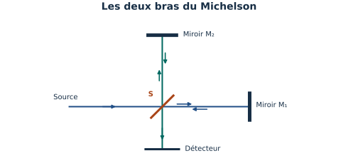
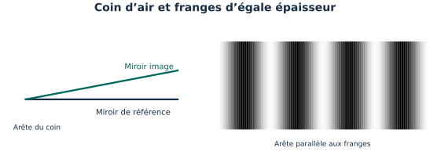
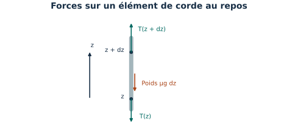
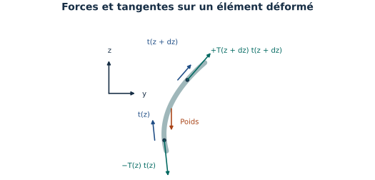
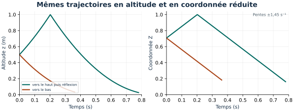
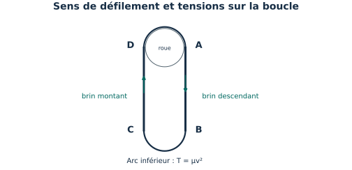
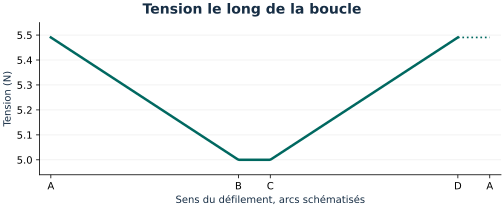
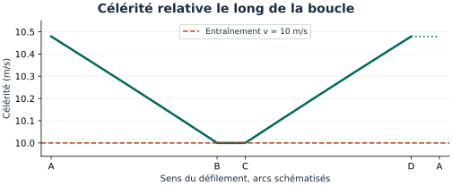
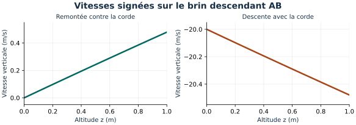
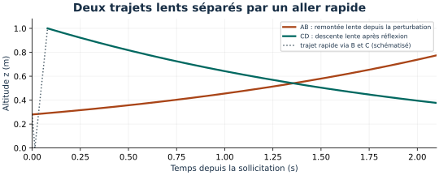

# ENS de Lyon, second concours universitaire — Physique 2026 · Corrigé brut

*Corrigé rédigé par IA, non officiel. Signalez toute erreur.*

**Rédaction** · modèle exact non renseigné (famille GPT-6) · effort non renseigné · vitesse non renseignée

**Révision (tour 1)** · modèle exact non renseigné (famille GPT-6) · effort non renseigné · vitesse non renseignée

**Révision (tour 2)** · GPT-6.2 Astra Ultra · vitesse non renseignée

**Révision (tour 3)** · GPT-6.2 Astra Ultra · vitesse non renseignée · 26 novembre 2026

[Sujet et figures officiels](https://banques-ecoles.fr/cms/wp-content/uploads/2026/08/26_2cc_sujet_physique.pdf) · [Rapport du jury de l’écrit](https://banques-ecoles.fr/cms/wp-content/uploads/2026/07/26_2cc_rap_ePhy.pdf)

Le sujet de trois heures, sans calculatrice, numérote séparément le questionnaire et le problème. Le jury attribue 20 % au questionnaire. Sa remarque préliminaire mentionne la thermodynamique, alors que les pages 3 à 6 du sujet traitent des ondes sur une corde pesante.

## 1. Questionnaire

### Question A1

La séparatrice S partage le faisceau incident entre les deux miroirs. Au retour, les deux faisceaux se recombinent vers le détecteur, comme indiqué sur le schéma.

### Question A2

Les franges sont **rectilignes, parallèles à l’arête du coin et équidistantes**. Elles sont localisées au voisinage du plan des miroirs conjugués.

### Question A3

Pour un fluide newtonien incompressible de viscosité uniforme soumis à la pesanteur,
$$\rho\big[\partial_t\mathbf u+(\mathbf u\!\cdot\!\boldsymbol\nabla)\mathbf u\big]=-\boldsymbol\nabla p+\eta\,\Delta\mathbf u+\rho\mathbf g,\qquad \boldsymbol\nabla\!\cdot\mathbf u=0.$$

### Question A4

Pour la convention $e^{i\omega t}$, **$Z_C=1/(i\omega C)$**.

### Question A5

**$\boldsymbol\Pi=\mathbf E\times\mathbf H$**, soit $\boldsymbol\Pi=\mathbf E\times\mathbf B/\mu_0$ dans le vide, en $\mathrm{W\,m^{-2}}$.

### Question A6

Les rayons lumineux sont **proches de l’axe optique et faiblement inclinés** sur celui-ci (rayons paraxiaux).

### Question A7

**$i\hbar\,\partial_t\psi=\widehat H\psi$**, avec $\widehat H=-\hbar^2\Delta/(2m)+V$ pour une particule non relativiste dans un potentiel scalaire.

### Question A8

Une lumière résonante excite sélectivement certaines transitions. Après des cycles d’absorption et de relaxation, la population s’accumule dans les états peu ou pas excités par cette lumière. Une polarisation circulaire peut ainsi orienter des moments angulaires atomiques.

### Question A9

À la température de coexistence, **$\ell_{\mathrm{vap}}=h_{\mathrm{vapeur}}-h_{\mathrm{liquide}}$** en $\mathrm{J\,kg^{-1}}$. C’est l’énergie thermique reçue par kilogramme vaporisé à pression constante.

### Question A10

Pour un point $O$ de l’axe fixe $\Delta$, **$\mathbf L_O=\int\overrightarrow{OM}\times\mathbf v(M)\,dm$**. Sa projection sur l’axe est $L_\Delta=J_\Delta\omega$, avec $J_\Delta=\int r_\perp^2\,dm$.

## 2. Propagation d’ondes transverses dans une corde pesante

### Question B1

La masse linéique est $\mu=dm/d\ell$. Pour cette corde homogène, **$\mu=m/L=0{,}050\ \mathrm{kg\,m^{-1}}$**.

### Question B2

Au sommet, la tension soutient tout le poids, $T(L)=mg\simeq0{,}49\ \mathrm N$. À l’extrémité libre, **$T(0)=0$**.

### Question B3

Au repos, la partie supérieure tire l’élément vers le haut avec $+T(z+dz)\mathbf e_z$. La partie inférieure le tire vers le bas avec $-T(z)\mathbf e_z$. Son poids est $-\mu g\,dz\,\mathbf e_z$.

### Question B4

L’équilibre impose $T(z+dz)-T(z)-\mu g\,dz=0$, donc $T'(z)=\mu g$. Avec $T(0)=0$, on obtient **$T(z)=\mu gz=\alpha z$**, où $\alpha=\mu g\simeq0{,}49\ \mathrm{N\,m^{-1}}$. À chaque coupe, la tension soutient le poids de la longueur située au-dessous.

### Question B5

Les trois forces sont $+T(z+dz)\mathbf t(z+dz)$ au bord supérieur, $-T(z)\mathbf t(z)$ au bord inférieur et $-\mu g\,dz\,\mathbf e_z$ au centre de masse. Les deux vecteurs tangents unitaires pointent vers les altitudes croissantes. La force au bord inférieur est opposée à la tangente locale.

### Question B6

Le poids a une composante nulle suivant $Oy$. La deuxième loi de Newton donne, au premier ordre en $dz$,
$$
\mu\,dz\,\partial_t^2y(z,t)=T(z+dz)t_y(z+dz,t)-T(z)t_y(z,t).
$$
La dérivée temporelle est prise à l’altitude matérielle de repos de cet élément.

### Question B7

Le vecteur tangent orienté vers le haut est $\mathbf t=(\mathbf e_z+\partial_z y\,\mathbf e_y)/\sqrt{1+(\partial_z y)^2}$. Lorsque $|\partial_z y|\ll1$, **$t_y\simeq\partial_z y$**. Pour une bosse de largeur $\lambda$ et d’amplitude $a$, cela demande $a/\lambda\ll1$.

### Question B8

On divise le bilan de la question 6 du problème par $dz$ et on fait tendre $dz$ vers zéro. En utilisant $t_y\simeq\partial_z y$, on trouve
$$\boxed{\mu\,\partial_t^2y=\partial_z\big[T(z)\,\partial_z y\big]}. $$

### Question B9

Il vient $\mu y_{tt}=T'y_z+Ty_{zz}=\mu g y_z+\mu gz y_{zz}$, soit **$y_{tt}=g(y_z+zy_{zz})$**.

### Question B10

À l’altitude $z$, les ordres de grandeur sont $|y_z|\sim a/\lambda$ et $|y_{zz}|\sim a/\lambda^2$. Le rapport du terme dû au gradient de tension au terme de courbure est donc d’ordre $\lambda/z$. Si **$\lambda\ll z$**, la tension varie peu sur la bosse. On obtient $y_{tt}\simeq gz\,y_{zz}$. Cette approximation locale cesse d’être justifiée au voisinage de l’extrémité libre.

### Question B11

Avec $Z=\sqrt{z/L}$, écrivons $Y(Z,t)=y(LZ^2,t)$. On a
$$
\partial_z y=\frac{Y_Z}{2LZ},\qquad
\partial_z^2y=\frac{Y_{ZZ}}{4L^2Z^2}-\frac{Y_Z}{4L^2Z^3}.
$$
L’équation approchée de la question 10 devient $Y_{tt}=[g/(4L)](Y_{ZZ}-Y_Z/Z)$. Si $|Y_Z|\ll Z|Y_{ZZ}|$, le second terme est négligeable. Une bosse de largeur $\Delta Z$ vérifie cette condition pour $\Delta Z\ll Z$, soit $\Delta Z/Z\simeq\lambda/(2z)\ll1$. Si l’on transforme directement l’équation complète de la question 9, le terme du premier ordre apparaît avec le signe opposé, $Y_{tt}=[g/(4L)](Y_{ZZ}+Y_Z/Z)$. Il reste du même petit ordre dans le régime retenu. On obtient **$Y_{tt}\simeq c_0^2Y_{ZZ}$**, avec **$c_0=\tfrac12\sqrt{g/L}$**.

### Question B12

Dans l’équation de d’Alembert à coefficients constants, chaque profil se conserve le long de $Z\mp c_0t=\mathrm{constante}$. Ainsi $dZ/dt=\pm c_0$ pour ses maxima. Comme $Z$ est sans dimension, $c_0$ est une **pseudo-célérité en $\mathrm{s^{-1}}$**. La célérité physique locale est $|dz/dt|=2LZc_0=\sqrt{gz}$, en $\mathrm{m\,s^{-1}}$.

### Question B13

Avec $L=1\ \mathrm m$, **$c_0=\sqrt{9{,}81}/2\simeq1{,}57\ \mathrm{s^{-1}}$**, soit environ $1{,}6\ \mathrm{s^{-1}}$.

### Question B14

L’opérateur s’écrit $(\partial_t-c_0\partial_Z)(\partial_t+c_0\partial_Z)$. Avec $u=Z-c_0t$ et $w=Z+c_0t$, l’équation donne $Y_{uw}=0$. Une intégration en $u$, puis en $w$, donne la solution générale **$Y(Z,t)=F(Z-c_0t)+G(Z+c_0t)$**. Le premier profil se déplace vers les $Z$ croissants, le second vers les $Z$ décroissants.

### Question B15

La condition $y(L,t)=Y(1,t)=0$ impose une **réflexion avec inversion du déplacement**. À l’attache, l’onde réfléchie est l’opposée de l’onde incidente. Une bosse incidente repart donc comme un creux, même si la trajectoire du maximum en valeur absolue paraît seulement changer de sens.

### Question B16

Posons $Z_0=\sqrt{z_0/L}$. Pour un déplacement **imposé en $z_0$** et des ondes sortantes, avant toute réflexion,
$$
y_\uparrow(z,t)=a\exp\!\left[-\frac{(t-(Z-Z_0)/c_0)^2}{\tau^2}\right]\quad(z\ge z_0),
$$
$$
y_\downarrow(z,t)=a\exp\!\left[-\frac{(t-(Z_0-Z)/c_0)^2}{\tau^2}\right]\quad(z\le z_0).
$$
Chaque côté reproduit le signal à la source après le temps de parcours $|Z-Z_0|/c_0$. S’il s’agissait au contraire d’une bosse initiale prescrite sur toute la corde avec vitesse initiale nulle, sa décomposition de d’Alembert comporterait deux demi-profils. Une seule valeur temporelle en un point ne fixe pas deux amplitudes indépendantes sur la droite entière.

### Question B17

Les deux branches de la figure 2 gauche partent de $z_0\simeq0{,}50\ \mathrm m$. La première monte en accélérant et atteint l’attache vers $t\simeq0{,}20\ \mathrm s$, puis redescend en ralentissant. L’autre quitte directement la source vers le bas et ralentit également. Ces courbes ne sont pas rectilignes. Le modèle $|dz/dt|=\sqrt{gz}$ explique la vitesse plus grande en haut. Entre deux réflexions, il prévoit $z(t)=L(Z_0\pm c_0t)^2$.

### Question B18

La figure 2 droite montre des branches presque rectilignes en $Z=\sqrt{z/L}$. Elles ont des pentes de signes opposés et de valeurs absolues proches. La branche montante se réfléchit à $Z=1$ et sa pente change de signe. Le profil simplifié prédit précisément ces droites caractéristiques.

### Question B19

Sur la branche descendante après réflexion, on lit approximativement $(0{,}20\ \mathrm s,1{,}00)$ et $(0{,}75\ \mathrm s,0{,}22)$. La pente en valeur absolue est $(1{,}00-0{,}22)/(0{,}75-0{,}20)\simeq1{,}4\ \mathrm{s^{-1}}$. La branche directe fournit environ $(0{,}71-0{,}21)/0{,}35\simeq1{,}4\ \mathrm{s^{-1}}$. **$c_{0,\mathrm{exp}}\simeq1{,}4$ à $1{,}5\ \mathrm{s^{-1}}$**, du même ordre que les $1{,}57\ \mathrm{s^{-1}}$ théoriques, légèrement supérieurs aux pentes lues. Un ajustement linéaire sur les marqueurs du panneau droit donne $-1{,}44\,\mathrm{s^{-1}}$ pour les 19 carrés de la branche directe et $-1{,}42\,\mathrm{s^{-1}}$ pour les 32 cercles de la branche réfléchie entre 0,22 et 0,75 s. Sur la branche montante, les 16 premiers cercles avant 0,195 s donnent $+1{,}28\,\mathrm{s^{-1}}$. La dispersion entre branches et la fenêtre de lecture comptent dans la comparaison avec $1{,}57\,\mathrm{s^{-1}}$.

### Question B20

Prenons $z=0$ aux jonctions B et C et $z=L$ aux points A et D. Le mouvement matériel a une vitesse constante sur chaque portion rectiligne, donc son accélération y est nulle. L’équilibre d’un tronçon y donne toujours $dT/dz=\mu g$. Comme $T(0)=T_O=\mu v^2$, il vient, **sur AB et CD**, $T(z)=\mu(v^2+gz)$. En bas $T_O=5{,}0\ \mathrm N$, et en haut $T(L)\simeq5{,}49\ \mathrm N$.

### Question B21

Sur AB, la tension décroît linéairement de $5{,}49$ à $5{,}00\ \mathrm N$ dans le sens du défilement. Elle est constante sur l’arc BC selon l’hypothèse du sujet. Elle croît linéairement de $5{,}00$ à $5{,}49\ \mathrm N$ sur CD. A et D sont au même niveau et ont la même tension. L’arc supérieur DA est en contact avec la roue, de diamètre supposé petit. Le graphe le raccorde au niveau des deux extrémités dans cette idéalisation. Un profil fin sur la zone de contact nécessiterait les efforts distribués exercés par la roue.

### Question B22

La célérité **relative à la corde** est $c(z)=\sqrt{v^2+gz}$ sur les deux brins. Elle passe de $\sqrt{100+9{,}81}\simeq10{,}48\ \mathrm{m\,s^{-1}}$ à $v=10\ \mathrm{m\,s^{-1}}$ sur AB, reste égale à $v$ sur BC et remonte à $10{,}48$ sur CD. Le graphe de $c$ se trouve au-dessus de celui de $v$ sur les brins, sauf à leurs extrémités inférieures.

### Question B23

Avec $+\mathbf e_z$ vers le haut, le brin AB descend à $-v$. Les deux vitesses **algébriques** dans le laboratoire sont
$$v_{l,\uparrow}=c(z)-v=\sqrt{v^2+gz}-v,\qquad v_{l,\downarrow}=-c(z)-v=-\sqrt{v^2+gz}-v.$$
La première part de zéro en B et atteint environ $+0{,}48\ \mathrm{m\,s^{-1}}$ en A. La seconde part de $-20$ et atteint $-20{,}48\ \mathrm{m\,s^{-1}}$. Les valeurs absolues exprimeraient les vitesses sans leur direction.

### Question B24

Une impulsion sur AB lance une onde qui remonte lentement contre le défilement, à $c-v$, et une onde qui descend très vite dans le sens du défilement, à $c+v$. La première accélère en montant puisque la tension augmente. La seconde franchit l’arc inférieur dans le sens du mouvement et remonte rapidement sur CD vers la roue. Si le contact avec la roue impose la déflexion transverse, elle s’y réfléchit et redescend alors lentement sur CD, contre son entraînement, à la vitesse $c-v$. Sur ce trajet descendant, sa vitesse diminue à l’approche de la boucle inférieure.

### Question B25

L’équation d’onde a deux familles de caractéristiques, ce qui permet à une sollicitation locale d’émettre dans les deux sens par rapport à la corde. Sur la figure 4, le pointillé inférieur part de la flèche. Le pointillé supérieur apparaît près de la roue, après le début de la séquence. La branche initialement rapide peut parcourir AB vers le bas, BC, puis CD vers le haut avant de se réfléchir sur la roue. Cette réflexion donne une deuxième **trace lente**, sur le brin montant vu en projection. Les deux courbes visibles peuvent ainsi provenir de la même sollicitation du seul brin AB.

### Question B26

Les clichés sont juxtaposés à pas de temps égal. La trace inférieure jaune s’élève depuis le point d’impact et sa pente augmente légèrement en valeur absolue. C’est le trajet lent sur AB, vers des tensions croissantes. La trace supérieure verte descend à partir de la roue. Sa pente diminue en valeur absolue, en accord avec $c-v$ décroissant vers le bas sur CD. Près du bas, $c-v=gz/(\sqrt{v^2+gz}+v)\simeq gz/(2v)$. Sur CD la branche lente suit donc $dz/dt\simeq-gz/(2v)$ et s’approche de B–C avec un temps caractéristique $2v/g\simeq2{,}0\ \mathrm{s}$. Cela explique l’aplatissement de la trace descendante. La portion rapide à environ $20\ \mathrm{m\,s^{-1}}$ est trop brève pour dessiner une trajectoire comparable dans la série. La figure 4 indique que les clichés sont équidistants en temps, sans donner leur cadence. La pente des pointillés décrit une tendance, mais cette seule photographie ne donne pas une vitesse absolue en mètres par seconde. La projection superpose les deux brins. Le rapprochement des courbes sur l’image ne nécessite aucune collision des ondes sur un même brin.

