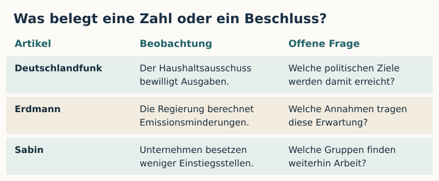
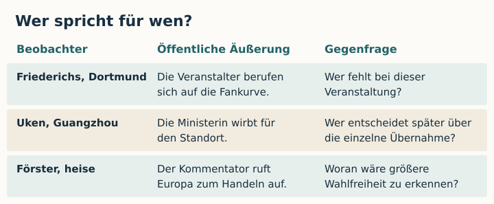

# ENS de Lyon · Série SES (B/L) · Allemand oral 2026 — Corrigé brut partiel

*Corrigé rédigé par IA, non officiel. Signalez toute erreur.*

**Rédaction** · GPT-6.2 Astra Ultra · vitesse non renseignée

Le fascicule identifie huit articles sans fournir les feuillets distribués. Les articles de Deutschlandfunk, Focus et heise ont été lus en entier. Pour les cinq articles de Die Zeit, les explications portent sur les passages publiquement consultables. Les limites des éventuelles coupes de l’ENS restent inconnues.

[Les huit textes du fascicule, p. 9](https://www.ens-lyon.fr/sites/default/files/2026-11/Fascicule%20SES%202026.pdf#page=9) · [Rapport d’allemand, p. 16 et suivantes](https://www.ens-lyon.fr/sites/default/files/2026-10/Fascicule%20SES%202026.pdf#page=16)

## 1. Deutschlandfunk, „Wo die deutsche Verteidigungsfähigkeit ins Stocken gerät“, 21. März

Die Überschrift fragt nach Hindernissen. Wer nur an fehlendes Geld denkt, bekommt bereits am Anfang einen Einwand zu hören. 2022 kündigte Olaf Scholz ein Sondervermögen von 100 Milliarden Euro an, 2025 änderten sich die Regeln für die Kreditaufnahme. Beides macht politische Prioritäten sichtbar. Ein bewilligter Betrag zeigt jedoch zunächst, wozu eine Regierung ermächtigt worden ist. Er sagt wenig darüber aus, wie lange eine öffentliche Aufgabe dauert oder welche Zustimmung sie findet.

Der Beitrag trennt mehrere Fragen, die im Wort *Zeitenwende* leicht zusammenfallen. Parlamentsbeschlüsse folgen einem anderen Rhythmus als die Umsetzung. Beim Personal wiederum steht ein Ziel für die kommenden Jahre neben freiwilligen Eintritten, altersbedingten Austritten und dem Protest junger Menschen. Auch wer jedes Jahr neue Beschäftigte gewinnt, vergrößert deshalb seine Belegschaft nicht automatisch im selben Umfang. Die Gegenüberstellung der Stimmen macht einen weiteren Konflikt hörbar. Einzelne Fachleute verlangen mehr Tempo, ein Abgeordneter der Linken bestreitet die Notwendigkeit zusätzlicher Rüstung. Im letzten Abschnitt geht es um die politische Verantwortung für eine begründete Prioritätensetzung. Daran lässt sich der publizistische Aufbau erkennen. Auf die Frage nach den verfügbaren Mitteln folgt die schwierigere Frage, wofür die Gesellschaft sie verwenden will.

**Nachfrage.** Beweist die Zahl der Demonstrierenden, dass eine ganze Generation den Wehrdienst ablehnt? Sie belegt die Mobilisierung gegen eine mögliche Pflicht. Über die Einstellung aller jungen Menschen gibt sie keine repräsentative Auskunft.

[Article de presse](https://www.deutschlandfunk.de/aufruestung-deutschland-bundeswehr-wehrpflicht-verteidigungsfaehigkeit-100.html)

## 2. Hauke Friederichs, *Die Zeit*, 12. Februar · FCAS

Le fascicule imprime « Europas Rüstungsprojekt zerbröselt ». L’article en ligne porte le titre au pluriel, « Europas Rüstungsprojekte zerbröseln ». L’auteur, la date et le dossier FCAS concordent.

Am Anfang steht ein gemeinsames politisches Versprechen. Deutschland und Frankreich wollen mit weiteren europäischen Partnern ein großes Industrieprojekt verwirklichen. Friederichs fragt, warum gerade der Anspruch, unabhängiger zu werden, Konflikte zwischen den Partnern verschärft. *Gemeinsam* hat für die beteiligten Akteure unterschiedliche Folgen. Eine Regierung denkt an die politische Handlungsfähigkeit Europas, ein Unternehmen an die Arbeit seiner Beschäftigten und seine Stellung gegenüber Konkurrenten. Aus dem Konflikt zwischen Airbus und Dassault wird deshalb eine Frage an die Regierungen. Wer soll in einer gemeinsamen Einrichtung entscheiden und wer dauerhaft an der Wertschöpfung beteiligt bleiben?

Eine im Februar erörterte Möglichkeit bestand darin, zwei unterschiedliche Flugzeuge im Rahmen einer gemeinsamen Kooperation vorzusehen. Für die Textanalyse zählt die politische Logik dieser Idee. Ein Kompromiss kann den institutionellen Rahmen erhalten und zugleich den ursprünglichen Anspruch verkleinern. So wird verständlich, warum der publizierte Titel mehrere Projekte ins Spiel bringt. Der konkrete Streit erscheint als ein Beispiel für die Kosten nationaler Industriepolitik innerhalb eines europäischen Vorhabens. **Nachfrage.** Warum sollte man hier das Datum nennen? Der Autor analysiert am 12. Februar eine offene Entscheidung. Eine spätere Nachricht darf nicht als Wissen der damals Handelnden ausgegeben werden.

[Article de presse](https://www.zeit.de/politik/deutschland/2026-02/fcas-kampfjet-programm-ruestung-frankreich)

## 3. Elena Erdmann, *Die Zeit*, „So gut ist das neue Klimaschutzprogramm wirklich“, 25. März

Das Wort *wirklich* kündigt eine Prüfung an. Die Bundesregierung rechnet mit einer Einsparung von rund 27 Millionen Tonnen CO₂. Die bis 2030 verbliebene Lücke beziffert der Artikel auf rund 25 Millionen Tonnen. Ein rascher Vergleich scheint den Erfolg schon zu beweisen. Doch die erste Zahl bezeichnet eine erwartete Wirkung von Maßnahmen. Sie ist keine Messung von Emissionen, die bereits vermieden worden wären.

Die journalistische Prüfung verschiebt deshalb die Frage von der Summe zu ihren Voraussetzungen. Für den Ausbau erneuerbarer Energien gibt es eine positive fachliche Einschätzung. Schwieriger sind Verkehr und Gebäude. Wenn ein Anreiz einen Umstieg fördern soll und eine andere Entscheidung zugleich die bisherige Nutzung begünstigt, können die Effekte eines Maßnahmenbündels kleiner ausfallen als die Wirkung seiner Einzelteile. Die abschließende Bewertung durch den Expertenrat betrifft außerdem den gesetzlichen Maßstab für ein Klimaschutzprogramm. Ein Fortschritt in einem Sektor und eine unzureichende Gesamtbegründung können gleichzeitig vorliegen.

**Nachfrage.** Was müsste man wissen, um aus den beiden Zahlen ein Urteil abzuleiten? Man müsste wissen, mit welchen Annahmen die Einsparungen berechnet wurden, bis wann die Maßnahmen wirken und wie stark sie einander verstärken oder abschwächen. Diese Fragen erklären, warum die Autorin mehrere Fachstimmen heranzieht.

[Article de presse](https://www.zeit.de/wissen/umwelt/2026-03/klimaschutzprogramm-bundesregierung-klimaziele-strafen-massnahmen) · [Stellungnahme des Expertenrats](https://expertenrat-klima.de/publikationen/stellungnahme-zum-entwurf-des-klimaschutzprogramms-2026)

## 4. Timo Büchner, *Die Zeit*, „Soziokultur im Fadenkreuz“, 31. März

Ein selbstverwalteter Jugendclub hat einen Namen, eine Adresse und Unterhaltskosten. Er ist aber auch ein Ort, an dem Menschen einander begegnen, die im öffentlichen Leben sonst wenig Raum haben. Büchners Beitrag untersucht, was mit einem Gemeinwesen geschieht, wenn solche Orte unter rechtsextremen Druck geraten. Der Titel übersetzt die Bedrohung in ein drastisches Bild. Für das Verständnis ist wichtig, dass die Betroffenen dennoch als organisierte Akteure erscheinen.

Das Leipziger Conne Island und die MONOM Stiftung machen auf die Situation aufmerksam und verbinden ihre Kampagne mit konkreter Unterstützung. Der Artikel unterscheidet zwischen dem gesammelten Geld und dem Teil, der zu diesem Zeitpunkt bereits ausgezahlt war. Die Beispiele aus Schwarzenberg und Cottbus geben diesen Angaben ein Ziel. Die Namen weiterer Zentren machen wiederum sichtbar, dass verschiedene lokale Geschichten in einem überregionalen Bündnis zusammenkommen. In der Selbstbeschreibung der Kampagne richtet sich die Hilfe an Orte der Kultur, der Kritik und der Solidarität. Der Bericht gewinnt dadurch eine Frage, die über den Einzelfall hinausweist. Wo eine Stadt einen Treffpunkt verliert, geht auch eine Möglichkeit zum öffentlichen Widerspruch verloren.

**Nachfrage.** Warum sollte man Spenden als Beleg für Vernetzung, aber vorsichtig als Beleg für Erfolg behandeln? Die Sammlung zeigt, dass Unterstützung mobilisiert wurde. Aus ihrer Höhe allein lässt sich weder die langfristige Finanzierung noch die Sicherheit eines einzelnen Standorts ablesen.

[Article de presse](https://www.zeit.de/gesellschaft/2026-03/rechtsextreme-bedrohung-jugendzentrum-alles-beginnt-im-zentrum-conne-island) · [Selbstdarstellung der Kampagne](https://www.allesbeginntimzentrum.org/)

## 5. Hauke Friederichs, *Die Zeit*, „Verteidigen wie die »Gelbe Wand«“, 22. Mai

Auf der Dortmunder Südtribüne erwartet man ein Fußballpublikum. Friederichs trifft dort auf einen kleinen, ausgewählten Kreis aus Unternehmen, Verein und Bundeswehr. Gerade die Leere der großen Tribüne macht die Szene aussagekräftig. Die Gäste können den Ruf des Ortes für sich in Anspruch nehmen, während die Menschen, durch die er entstanden ist, bei dieser Veranstaltung kaum zu Wort kommen.

Die Wendung vom gemeinsamen Verteidigen überträgt den Zusammenhalt einer Fankurve auf eine politische Forderung. Ein Bild, das eine große Zahl von Menschen aus eigener Erfahrung kennt, soll Zustimmung zu einer anderen Sache plausibel machen. Die Reportage prüft die Übertragung, indem sie an den früheren Protest von Fans gegen die Partnerschaft mit Rheinmetall erinnert. Als einige einen Teil eines Spiels lang schwiegen, setzten sie gerade die gewöhnliche Lautstärke der Tribüne als Zeichen des Widerspruchs ein. Die beiden Gesten verwenden denselben Raum auf gegensätzliche Weise. Aus der Einladung des Vereins kann der Beobachter keine Zustimmung der gesamten Anhängerschaft ableiten.

**Nachfrage.** Ist der Titel eine Aussage des Journalisten über das Land? Er greift eine Formulierung der Veranstaltung auf. Der Bericht über den ausgewählten Teilnehmerkreis und den Widerspruch der Fans schafft Abstand zu dieser Formel.

[Article de presse](https://www.zeit.de/politik/deutschland/2026-05/rheinmetall-bvb-signal-iduna-park-veranstaltung-ruestungspolitik) · [Stellungnahmen der BVB-Fanabteilung](https://fanabteilung.bvb.de/de/de/stellungnahmen.html)

## 6. Marlies Uken, *Die Zeit*, „Katherina Reiches gefährlicher Flirt mit chinesischen Investoren“, 29. Mai

In Guangzhou wirbt die deutsche Wirtschaftsministerin um Investitionen. Die Reporterin vergleicht ihren Auftritt mit der Arbeit einer Marketingchefin. Das Bild passt zum Lob des deutschen Standorts. Es lässt zugleich die Frage entstehen, wem dieselbe Ministerin später Bedingungen stellen muss. Die Bundesregierung hat das Unternehmertreffen mit angestoßen. Sie entscheidet aber auch über die Prüfung einzelner Übernahmen, wenn Sicherheitsinteressen berührt werden.

Der Fall Cosco macht die Doppelrolle anschaulich. Eine frühere Minderheitsbeteiligung im Hamburger Hafen, die Prüfung einer wesentlich größeren Beteiligung an einem Logistikunternehmen und die öffentliche Bitte des Konzernchefs um Zustimmung sind drei verschiedene Vorgänge. Wer sie vermischt, schreibt der Ministerin einen Beschluss zu, den die Autorin am 29. Mai gerade noch offen sieht. Der Titel fasst diese Spannung in ein Verhältnis von Anziehung und Risiko. Es lässt sich kritisch fragen, ob das Bild vom Flirt den Blick zu sehr auf eine Person lenkt. Das Problem steckt auch in den unterschiedlichen Aufgaben des Ministeriums und in der wirtschaftlichen Verflechtung beider Länder.

**Nachfrage.** Widerspricht jede Einzelfallprüfung der Werbung um Investitionen? Nein. Eine Einladung an Unternehmen legt noch nicht fest, welche Beteiligung in welcher Branche genehmigt werden kann. Entscheidend ist, ob die Kriterien für alle Betroffenen nachvollziehbar bleiben.

[Article de presse](https://www.zeit.de/wirtschaft/unternehmen/2026-05/china-investitionen-deutschland-cosco-huawei-vw-xpeng) · [Ankündigung der Reise durch das Ministerium](https://www.bundeswirtschaftsministerium.de/Redaktion/DE/Pressemitteilungen/2026/05/20260527-ministerin-reiche-reist-nach-china.html)

## 7. Thomas Sabin, *Focus*, „Paradoxer Arbeitsmarkt“, 24. Mai

Ein Land sucht Fachkräfte und bringt zugleich qualifizierte Berufsanfänger monatelang nicht in Beschäftigung. Sabin stellt die Erfahrungen einzelner Bewerber neben Arbeitslosenzahlen und Aussagen des Ökonomen Clemens Fuest. Man kommt der Auflösung des scheinbaren Widerspruchs näher, wenn man die Frage ändert. Wer sucht wen, an welchem Ort und zu welchem Zeitpunkt der beruflichen Laufbahn?

Ein Unternehmen kann seine Stammbelegschaft halten und bei Neueinstellungen zögern. Beschäftigte erleben dann relativ viel Kontinuität, während für Außenstehende ein früher gangbarer Zugang entfällt. Für Berufsanfänger in Verwaltung oder Marketing kann bereits eine geringere Zahl an Einstiegsstellen entscheidend sein. Gleichzeitig bestehen offene Stellen etwa in der Pflege und im Handwerk. Die Qualifikationen und die Arbeitsorte lassen sich nicht beliebig austauschen. Auch der Abbau von Industriearbeit betrifft Zulieferer und Regionen anders als der Aufbau neuer Beschäftigung in öffentlichen Einrichtungen. Der Artikel verbindet also eine konjunkturelle Schwäche mit strukturellen Veränderungen.

**Nachfrage.** Warum ist eine Stellenausschreibung keine Einstellung? Eine Anzeige dokumentiert einen Suchvorgang, ein Arbeitsvertrag dessen möglichen Abschluss. Weniger ausgeschriebene Einstiegsstellen können eine Hürde sichtbar machen. Sie sagen allein noch nichts über die spätere Beschäftigung sämtlicher Hochschulabsolventen.

[Article de presse](https://www.focus.de/finanzen/news/deutschlands-paradoxer-arbeitsmarkt-wir-erleben-aktuell-einen-wandel-vom-fachkraeftemangel-zum-einstellungsstopp_aa838d62-623e-42be-b3c3-6ead6af71a90.html)

## 8. Moritz Förster, *heise*, „Europa, schau auf Frankreich!“, 13. April

Ein Imperativ und eine direkte Anrede machen bereits aus der Überschrift eine Aufforderung. Der Verfasser eines ausdrücklich als Kommentar gekennzeichneten Textes beurteilt die französische Digitalpolitik nach ihrer Fähigkeit, Wahlmöglichkeiten für öffentliche Einrichtungen zu schaffen. Zuständigkeiten und Fristen sind ihm deshalb wichtiger als die Ankündigung einer allgemeinen Strategie. Der geplante Wechsel bei der Digitalbehörde DINUM und die Vorhaben der französischen Krankenversicherung zeigen zwei verschiedene Größenordnungen einer solchen Umstellung.

Der Kern der Argumentation liegt beim Wechsel zwischen Anbietern. Auch die Abhängigkeit von einem einzigen europäischen Anbieter könnte für eine Verwaltung teuer sein. Wenn Programme gemeinsame offene Standards verwenden, muss eine Behörde bei einem Wechsel weniger Arbeit doppelt leisten. Darauf baut Försters wirtschaftspolitische These auf. Ein großer öffentlicher Auftraggeber kann über seine Nachfrage beeinflussen, welche Angebote überhaupt entwickelt werden. Der Autor erkennt die Kosten des Übergangs an. Beschäftigte brauchen benutzbare Werkzeuge, und Zeitpläne garantieren kein Ergebnis. Für ihn sind diese Einwände Gründe, die Umsetzung zu beobachten. Sie nehmen dem Versuch nicht seinen politischen Wert.

**Nachfrage.** Welcher Befund würde die These des Kommentars schwächen? Wenn ein Umstieg trotz der angekündigten Standards neue dauerhafte Abhängigkeiten erzeugte oder die Beschäftigten die vorgesehenen Werkzeuge nicht sinnvoll einsetzen könnten, wäre das Versprechen größerer Wahlfreiheit empirisch zu prüfen.

[Article de presse](https://www.heise.de/meinung/Europa-schau-auf-Frankreich-11254323.html)

