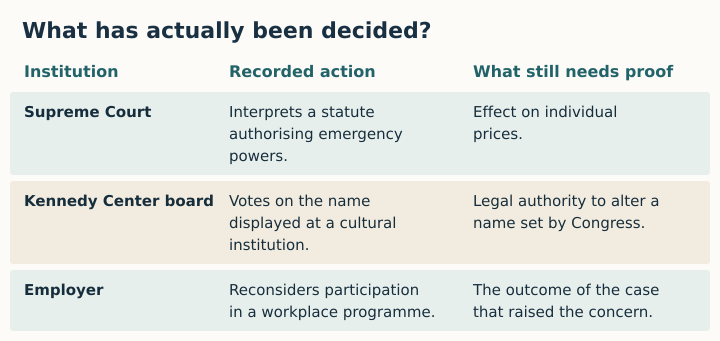
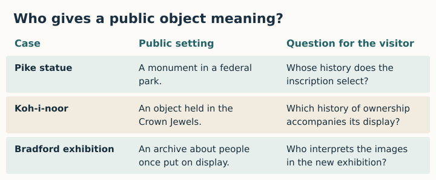
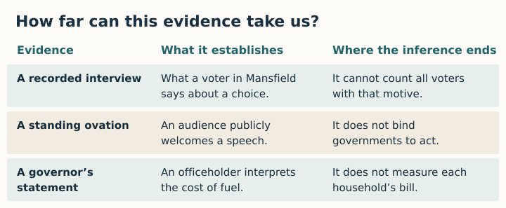
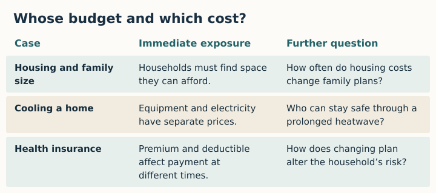

# ENS de Lyon · Série SES (B/L) · Anglais oral 2026 — Corrigé guidé partiel

*Corrigé rédigé par IA, non officiel. Signalez toute erreur.*

**Rédaction** · GPT-6.2 Astra Ultra · vitesse non renseignée

Le fascicule énumère 49 articles aux pages 10 à 12, sans reproduire les feuillets distribués. Les deux éditions commentent 36 textes publiés consultés en entier et proposent 11 préparations limitées aux passages, titres ou sources complémentaires identifiés. Pour les numéros 32 et 33, seule la référence du jury a été retrouvée. Les coupes exactes de l’épreuve restent inconnues.

[Fascicule, p. 10 à 12](https://www.ens-lyon.fr/sites/default/files/2026-11/Fascicule%20SES%202026.pdf#page=10) · [Rapport d’anglais, p. 19 à 22](https://www.ens-lyon.fr/sites/default/files/2026-10/Fascicule%20SES%202026.pdf#page=19)

## Préparer vingt minutes sur un article

Le jury a entendu 49 candidats. Il distingue une introduction avec synthèse (huit minutes au plus), une question et l’annonce du plan (environ une minute), une analyse (dix minutes) et une conclusion (une minute). Le jury demande d’annoncer les trois parties de l’analyse. En citant le feuillet, donnez le numéro de ligne et laissez une brève pause. Durant la préparation, réservez une page à ce qui est arrivé, une autre à la manière dont l’article demande au lecteur de le juger. Le jour de l’oral, les deux pages servent à des moments différents de l’exposé.

### Attribuer un propos avant de le discuter

Tracez trois colonnes, *author*, *source quoted*, *institution with the power to decide*. Pour l’article sur le Kennedy Center, la journaliste de CNN, les membres du conseil, les personnes contestant le vote et le Congrès ne parlent pas avec la même autorité. Répétez en anglais une phrase qui restitue le vote, puis une phrase qui explique ce que le nom d’un établissement culturel prétend rendre durable. Le rapport prend précisément cet article pour montrer comment élargir une question de prestige personnel à celle de la possibilité de redéfinir la mémoire publique.

Faites le même exercice sur les textes portant sur les tarifs douaniers et les opérations militaires décidées par la présidence. Une déclaration politique, un vote du Congrès et une décision de la Cour suprême sont trois actes distincts. Pour chaque verbe dont le sujet serait *America*, essayez de nommer une institution ou une personne identifiable. Replacez ensuite l’énoncé à la date où le journaliste écrivait. *Lawmakers disputed the president’s authority to act* formule l’objet d’un désaccord. Pour affirmer qu’un tribunal l’a tranché, il faut pouvoir nommer la juridiction et sa décision.

### Choisir ce que l’on lit et synthétiser ce qui reste

Après la première lecture, sélectionnez une ou deux phrases où un changement devient visible. Dans un article d’actualité, la transition peut être le passage du fait initial à des réactions discordantes. Dans un éditorial, ce sera parfois l’endroit où l’auteur cesse de constater pour demander une action. Dans un reportage, essayez de retrouver ce qui, dans une voix singulière, fait naître une question plus large. Au lieu de traduire toutes les citations, reformulez la fonction d’une seule et expliquez ce que les autres y ajoutent. Une phrase entendue sur un campus ou lors d’une manifestation n’est jamais, à elle seule, un sondage.

### Construire dix minutes d’analyse

Sur la mémoire de l’esclavage, la restitution d’un diamant ou l’exposition de Bradford, partez d’un objet précis. Qui l’expose aujourd’hui ? Qui peut raconter les circonstances historiques qui lui ont donné ce statut ? Les réponses varient suivant que l’objet est un monument public, un bijou de la Couronne ou une photographie de personnes déjà exposées autrefois. Une introduction toute faite sur le colonialisme ferait perdre ces différences. L’entretien peut vous demander de passer de l’objet à une institution. Préparez une phrase qui permette ce déplacement.

Sur les questions économiques, notez l’unité mesurée avant d’associer deux chiffres. Un tarif douanier est une taxe dont l’incidence peut se répartir entre plusieurs acteurs. Le prix affiché d’une assurance et la somme acquittée après une aide n’expriment pas la même chose. Dans un texte sur le logement et les projets de famille, une intention rapportée en entretien et une évolution statistique des naissances n’ont pas la même portée. Une analyse gagne en force lorsqu’elle désigne la donnée qui lui manque pour franchir l’étape suivante.

### Distinguer les angles là où les sujets se ressemblent

Les articles sur l’IA portent sur des décisions très différentes. Un artiste peut interroger la rémunération, un journaliste spécialisé le choix de réalisateurs, une entreprise les conséquences d’une décision administrative. Refaites l’annonce de plan pour deux articles en n’employant *technology* qu’une fois. Dans le dossier britannique, les textes sur Reform UK donnent la parole à des élus, à des électeurs ou à des chroniqueurs. Une réserve telle que *this judgment is the columnist’s, whereas the interviews establish…* indique ce que vous êtes en mesure de défendre.

### Répondre sans perdre le fil du texte

Évitez de reprendre toute la synthèse à une question précise. Nommez un détail, expliquez ce qu’il révèle, puis indiquez la limite. *This anecdote tells us how one family understood its choice. The writer would need a different kind of evidence to establish how common the experience was.* Si le jury reprend une erreur, reformulez sans vous enfermer dans la première version. Il attire notamment l’attention sur la distinction entre un emploi dénombrable et *information*, sur la prononciation du titre d’un journal et sur la différence entre *who* et *which*. La conclusion doit pouvoir s’énoncer en une phrase qui répond à votre propre question, suivie d’une précision qui appartient à cet article.

## 1. Matt Brown, Associated Press · Restoring the Albert Pike statue

Returning a bronze figure to its pedestal sounds like putting something back the way it was. Brown makes the reader ask which past is being restored. Congress authorised the monument in 1898, decades after the Confederacy's defeat. Its Masonic sponsors commemorated Pike without naming his Confederate service on the statue. Protesters pulled it down in 2020. Its reinstallation in Washington is a further decision about public memory, taken in the political circumstances of 2025.

The dispute over location helps explain why an object that survives its removal can still provoke disagreement. To a supporter, putting it back repairs damage and preserves history. To Eleanor Holmes Norton, placement in a public park confers an honour that a museum could examine without granting. Changing the setting changes what an institution does with the same evidence. The story also complicates any claim that criticism is a recent invention. Some Union veterans and Northern politicians objected when monuments of this kind were first being erected. **Discussion.** What would displaying the statue alongside its original inscription reveal? A visitor could see both the identity its sponsors chose to commemorate and the part of Pike’s history they left to others to recover.

**Trois étapes à développer à l’oral.**

1. Who commissioned the memorial and what its inscription selects.
2. How the park gives an object public authority.
3. What a new decision to reinstall it commemorates.

[Référence de presse](https://apnews.com/article/3b0e8fd940a6bb6432992bb615b66336)

## 2. BBC · Jimmy Kimmel leaves the air after comments about Charlie Kirk

The BBC reconstructs a sequence. Kimmel makes remarks about political reactions to Charlie Kirk's killing. The chair of the Federal Communications Commission publicly criticises him. A broadcaster operating local stations objects, and ABC suspends the programme. These actors have different powers. An elected president, the head of a regulator, an affiliate and the network need not issue the same instruction for their decisions to affect the same broadcast.

That distinction makes the question of free speech harder and more precise. Television networks regularly make editorial decisions. Here, the timing of a regulator's intervention raises the question of how freely a private outlet can decide when it anticipates official consequences. The article quotes criticism of the original remarks as well as objections to pressure on broadcasters. A reader can consider the two issues separately. The September report catches the dispute at the moment of suspension. Its wording describes the position then, without settling the show's ultimate fate. **Discussion.** Does defending a broadcaster's freedom require endorsing the monologue? The two claims concern different judgments, the content of a remark and who should decide whether it goes out.

**Trois étapes à développer à l’oral.**

1. Who heard the remarks and who objected.
2. Who actually suspended the programme.
3. How regulatory pressure can affect editorial judgment.

[Référence de presse](https://www.bbc.com/news/articles/c203n52x1y9o)

## 3. BBC · Federal agencies and Anthropic

The president's announcement turns a disagreement between a supplier and a customer into a question about the purchasing power of the federal government. The Pentagon insists that it should be able to make any lawful use of a product it buys. Anthropic wants contractual limits on uses it considers unacceptable, including mass domestic surveillance. Each side appeals to accountability, but each locates the decisive judgment in a different place.

The BBC distinguishes several instruments. A direction to agencies about what they buy, a supply-chain designation and a firm's promise of a legal challenge do different things. The report combines named public statements with the assessment of an unnamed former official. That assessment helps explain the unusual situation. It does not carry the legal force of a ruling. The conflict illustrates a broader feature of public procurement. The state can regulate a market and be one of its most important customers, while a private firm's control over a product can give its decisions public consequences. **Discussion.** What would be lost if this were presented solely as a clash between two personalities? The risks borne by other agencies and contractors, and the question of who writes enforceable limits into a public contract, would disappear.

**Trois étapes à développer à l’oral.**

1. The purchase contract and its disputed conditions.
2. The state as customer and regulator.
3. Who can be held accountable for the eventual use of a product.

[Référence de presse](https://www.bbc.com/news/articles/cn48jj3y8ezo)

## 4. Ruth Clegg, BBC · Online appearance ratings

Clegg begins with a person describing his own appearance as if he were marking a piece of work. His followers can watch, comment and return for another instalment. The number looks objective because different people can use the same scale. Yet the scale itself rests on judgments about what bodies are supposed to look like. The article's question is how an ordinary wish for confidence can become a public system of comparison.

Personal testimony makes the attraction of belonging to an online community intelligible. It cannot establish that a rating measures health, character or even an agreed idea of beauty. Expert concerns matter precisely because a platform can reward striking claims and repeated demonstrations without investigating them. A reporting voice that listens closely to participants can also ask who benefits when they keep finding faults. That question puts the attention economy alongside the supposed language of self-improvement. **Discussion.** What do the scores tell us reliably? They tell us that participants have learned a shared vocabulary and that their posts attract responses. They supply no sound basis for assessing a person's worth.

**Trois étapes à développer à l’oral.**

1. How an opinion is made to look like a measurement.
2. Who gains a following or an income from comparison.
3. What the interviewees can establish about its effects.

[Référence de presse](https://www.bbc.com/news/articles/cx28z4zypkno)

## 5. Stephen Sheard and Amy Garcia, BBC · A Bradford social media trial

A Bradford school pupil says her phone is how she meets friends after school. The phrase matters because removing screen time can also remove a form of social contact. Other pupils in the initial study have different starting points and reactions. One hopes for a chance to spend time outside. Another anticipates having to work out what to do during time previously occupied online. The quotations turn an apparent choice between the Internet and the real world into a question about what alternatives are available.

The article introduces a research design as it begins. More than two hundred pupils are involved in the initial phase, and a larger trial is planned. Time limits and a night-time curfew are interventions. Sleep and wellbeing are among the outcomes researchers hope to examine. A hope voiced by a pupil does not anticipate the result. Nor does participation tell us that each pupil will experience the same change. **Discussion.** What additional question would you ask the researchers? It would matter to know what pupils do with the time that becomes available, and whether losing access to a particular conversation affects them differently from spending less time with a feed.

**Trois étapes à développer à l’oral.**

1. What participants give up during the trial.
2. What in-person conversation changes for them.
3. How far a local experiment can travel.

[Référence de presse](https://www.bbc.com/news/articles/cdxpkxl5wqgo)

## 6. John Laurenson, BBC · A social feed that carries fewer friends

The article starts by looking over someone's shoulder. A succession of posts and advertisements tells us plenty about what she might watch or buy, but very little about what her friends did today. Other interviewees make a distinction that a count of hours online would conceal. They still exchange messages privately while becoming spectators on platforms once closely identified with their social circle.

Laurenson connects this experience to a change in how content is selected. A recommendation can reach a user who has never chosen to follow its creator. That widens the potential audience for a small business, while requiring owners to become performers or editors if they want to be seen. Advertising revenue helps explain the appeal of an uninterrupted stream of engaging material. The comparison with television therefore gets part of the story right. The difference is that each viewer experiences a different programme, adjusted as the viewing goes on. **Discussion.** Does this show that online friendship has collapsed? The evidence suggests a relocation of communication and a change in who gets public attention. It would take different evidence to show that people maintain fewer friendships overall.

**Trois étapes à développer à l’oral.**

1. How recommendations displace updates from friends.
2. Why attention is valuable to the platform.
3. What users seek elsewhere when the purpose of a feed changes.

[Référence de presse](https://www.bbc.com/worklife/article/20260520-how-social-media-ceased-to-be-social)

## 7. Kevin Breuninger, CNBC · Tariffs and emergency powers

The headline interprets a Supreme Court defeat as a blow to a defining economic policy. The legal question in *Learning Resources v. Trump* is more specific. Did the International Emergency Economic Powers Act authorise the president to impose the tariffs at issue? The Court's answer on 20 February was no. A reader should keep separate the desirability of a tax on imports and the statutory authority to impose it.

The distinction explains why an institutional decision can matter to a business audience before all its economic consequences can be measured. Importers need to know which rules apply, while the government may seek to pursue parts of its policy under another law. A ruling on this emergency statute does not settle the validity of every tariff already in force or determine what an individual consumer will pay. The judgment also tests the political claim that an emergency creates its own authority. Its scope depends on what Congress enacted. **Discussion.** Did the justices decide that tariffs cannot serve economic policy? Their decision concerns the power delegated by a particular statute. The policy argument survives, but it must confront that limit.

**Trois étapes à développer à l’oral.**

1. Which emergency statute the case concerned.
2. Why a tariff calls for authority from Congress.
3. Which economic and legal questions the ruling leaves open.

*Portée vérifiée. Titre de CNBC et arrêt rendu le 20 février. Article intégral indisponible.*

[Référence de presse](https://www.cnbc.com/2026/02/20/supreme-court-trump-tariffs-ruling.html) · [Arrêt de la Cour suprême](https://www.law.cornell.edu/supremecourt/text/24-1287)

## 8. Lora Kolodny, Ari Levy and Samantha Subin, CNBC · Contractors react to the Anthropic decision

This report takes up the public dispute from the perspective of companies which have to make purchasing decisions before the legal controversy has ended. Interviews with people working with defence contractors show why firms can stop using a service even while its provider contests the government's action. The potential cost of jeopardising a government contract changes a business decision today, independently of what a court may decide later.

One interviewee speaks about companies in an investment portfolio. That evidence has a clear strength and a clear limit. It gives the journalists access to choices usually made out of public sight, but a group of companies connected to one investor cannot represent every firm supplying the government. The report thus illuminates an indirect form of economic power. A federal decision affects a network of suppliers, including businesses to which the president never gave an individual order. **Discussion.** Why distinguish a firm's stated reason from the quality of the software? An announced switch can be evidence of regulatory uncertainty and dependence on public contracts even if it tells us nothing about which product the firm thought worked best.

**Trois étapes à développer à l’oral.**

1. How the federal customer changes a supplier's calculation.
2. How contractors respond before a dispute is resolved.
3. What interviews with one network can establish.

[Référence de presse](https://longbridge.com/en/news/277793961)

## 9. Betsy Klein, CNN · A vote to rename the Kennedy Center

The vote to add Donald Trump's name to the Kennedy Center raises three questions. What does the board say it decided? What can it put on the institution's website? Who has the legal authority to change the name of a congressionally designated memorial? In the interval between a vote and a legal settlement, a new heading is already visible to the public. Symbolic action can move faster than a determination of the authority behind it.

Klein places the vote in the context of the board's earlier reconstitution and Trump's appointment as its chair. A claim of unanimous support therefore prompts questions about who was in a position to speak or vote. Personal prestige provides one interpretation of the initiative. Another concerns cultural institutions as places where a government can associate its priorities with national memory. The original congressional designation gives that ambition an institutional limit. **Discussion.** Why does the existing name matter to the argument? A performing arts venue and a memorial can occupy the same building. The board's role in running the former does not automatically establish its authority to redefine the latter.

**Trois étapes à développer à l’oral.**

1. Who chose the Kennedy Center's name in law.
2. What the board voted to do.
3. What naming a public cultural institution allows a president to claim.

[Référence de presse](https://kesq.com/news/national-politics/cnn-us-politics/2025/12/18/kennedy-center-board-votes-to-rename-it-trump-kennedy-center/)

## 10. Sarah Owermohle, CNN · A change to federal childhood vaccination guidance

CNN reports an announcement in January 2026 about the categories used in the United States childhood vaccination schedule. Some recommendations would continue to apply routinely, while others would be presented as decisions for clinicians and families to discuss. That distinction is the event being reported. The article does not say that changing the category makes a vaccine unavailable or that evidence about a disease has suddenly changed.

The report tests the government's comparison with other countries and gives space to clinicians concerned about how the change would be understood in practice. A promise of continued insurance coverage and a clear message to families answer different questions. A service can remain covered while an unfamiliar recommendation makes it harder to know what conversation to initiate. The correction appended to the published report matters, too. It identifies an earlier error about which recommendations had changed, reminding the reader why precise classification is essential. **Discussion.** How would you introduce this text at an exam held later in the year? Say what officials announced and what concerns were voiced at that date. Claims about a later schedule would need fresh evidence.

**Trois étapes à développer à l’oral.**

1. How the categories of recommendation change.
2. Whose judgment parents are asked to trust.
3. What the reported disagreement reveals about federal guidance.

[Référence de presse](https://abc17news.com/cnn-health/2026/01/05/us-overhauls-childhood-vaccine-schedule-to-recommend-fewer-shots/)

## 11. Hannah Britt, *Daily Mirror* · Angela Scanlon and safety in public space

The title supplied by the jury turns Angela Scanlon's account of being afraid after dark into a celebrity revelation. Other listings of the interview foreground her support for measures to protect women. There are at least two different journalistic stories in these formulations. One invites a reader to find out what a familiar television personality has admitted. The other asks the reader to consider why access to an ordinary public space might feel conditional.

A comment by a well-known person can make a recognisable experience discussable. It cannot by itself tell readers how frequent a particular offence is, how it should be defined, or whether a given law would prevent it. The choice of the word *confession* in the exam heading is worth questioning. It normally suggests disclosing a fault, yet the speaker is describing fear about something someone else might do. **Discussion.** What further evidence would turn a personal interview into an assessment of public policy? The wording and scope of a measure, evidence about its enforcement and the accounts of people whose experiences differ from the interviewee's. This preparation concerns the documented headline and public presentation of the interview.

**Trois étapes à développer à l’oral.**

1. How a celebrity interview frames fear.
2. Who appears to bear responsibility in the headline.
3. What evidence would test a demand for public action.

*Portée vérifiée. Titre du fascicule et présentation publique de l’interview.*

[Référence de presse](https://www.mirror.co.uk/3am/celebrity-news/strictly-angela-scanlon-jess-phillips-37145421)

## 12. Hanna Merzbach, NPR · Housing costs and plans for a family

Two things change when Grace Moreno and her husband move to Wyoming. He finds better-paid work, but their rent rises sharply. The details of a family's budget make clear why an increase in earnings alone can tell a misleading story about its capacity to bring up children. Moreno's decision about her family is her own. The reporter does not need to turn it into a universal response to make it part of a demographic question.

Other households and a demographer help separate three issues. Some people change their plans because of costs. Some hold particular ideas about the home they would like to provide before becoming parents. And a region can gain population through migration while residents have fewer children. The article therefore treats housing as both an economic constraint and a condition people attach to a desired future. **Discussion.** Would declining births in a particular county prove the article's explanation? They would establish a change in births. To explain it, researchers would also need evidence about who lives there and how their circumstances or intentions changed. The ENS prints 21 October 2026. The matching NPR report was circulating on public radio in October 2025, before the oral.

**Trois étapes à développer à l’oral.**

1. Where housing enters a family's decision.
2. Why individual stories carry explanatory weight.
3. What would establish a population-wide effect.

[Référence de presse](https://www.opb.org/article/2025/10/31/families-say-cost-of-housing-means-they-ll-have-fewer-or-no-children/)

## 13. Frank Langfitt, NPR · Animal costumes at a No Kings protest

The headline uses the opening of a joke. The report then puts the reader among people in animal costumes near the National Gallery in Washington. A demonstrator explains why he wanted to wear one. He fears for the future of elections but wants observers to question claims that a crowd like this one presents a threat. The incongruous costume carries a political argument without printing that argument on a placard.

Langfitt includes a dismissive response from Trump and asks how an apparently frivolous gesture enters a serious struggle over the way a protest will be seen. Comparison with a protest involving toys in Russia gives the reader another case in which official action looked very different once the object being confronted was visible. There are limits to the analogy. A costume cannot establish how representative a crowd is or settle the truth of every claim about the event. It can change what a photograph allows a viewer to imagine. **Discussion.** Whose interpretation does the joke support? The interviews give the demonstrators a chance to explain its purpose, while the president’s response shows that political opponents can supply their own punchline.

**Trois étapes à développer à l’oral.**

1. What a costume does to the public image of a demonstration.
2. Who circulates the picture afterwards.
3. What political message a memorable image can obscure.

[Référence de presse](https://www.vpm.org/npr-news/2025-10-24/a-frog-a-lobster-and-a-unicorn-walked-into-a-no-kings-protest/)

## 14. Julie Depenbrock and Leila Fadel, NPR · School drills and the experience of safety

The reporters visit a school during a drill required by the state. Adults want children to feel safe and prepared, yet the exercise also asks them to imagine an event most will never experience. The tension explains why the piece gives space to a teacher's emotions as well as to administrators who have to carry out the requirement. A routine can feel ordinary at an institutional level and deeply unsettling in a particular family.

The perspectives in the report answer different questions. A school official can explain the intended purpose of the exercise. A pupil or teacher can describe how it felt. A researcher can ask what evidence exists about its benefits and psychological costs. None of these forms of knowledge replaces the others. The nearby community’s recent experience of violence further limits what one visit could show about every school in the United States. **Discussion.** What makes the final testimony significant if it does not provide a nationwide measure? It makes the cost of the word *normal* audible. Readers can then ask what institutions ought to evaluate when a practice becomes routine.

**Trois étapes à développer à l’oral.**

1. What adults expect preparation to accomplish.
2. What pupils experience inside the exercise.
3. What evidence would distinguish reassurance from lasting anxiety.

[Référence de presse](https://www.vpm.org/npr-news/2025-10-28/lockdown-drills-are-a-fact-of-life-in-u-s-schools-what-does-that-mean-for-students/)

## 15. Sam Gringlas, NPR · Military action in Iran and authority in Congress

This is a report about constitutional responsibility. The launch of strikes prompts renewed interest in a congressional effort to limit sustained military action. The article distinguishes the congressional power to declare war from the president's responsibilities as commander in chief. That distinction explains the dispute without settling every question about a particular executive action.

Gringlas assembles reactions that do not fall neatly along party lines. Some lawmakers defend the president's latitude to respond. Others argue that a representative vote is precisely what a consequential choice requires. The verbs matter. To praise an action after it has occurred is different from authorising it in advance. A lawmaker can also oppose a particular resolution because of its wording without making a general claim that Congress has no part to play. **Discussion.** Why do the reactions matter if the strikes had already begun? They concern future limits, public accountability and what a subsequent vote would mean. Their significance goes beyond approval or disapproval of an event that is over.

**Trois étapes à développer à l’oral.**

1. Who decides when force may be used.
2. How members of Congress explain disagreement.
3. What oversight remains possible after an executive decision.

[Référence de presse](https://thepublicsradio.org/npr/iran-strikes-were-launched-without-approval-from-congress-deeply-dividing-lawmakers/)

## 16. Associated Press, PBS News · Protests after the death of Renee Nicole Good

The report moves between a death in Minneapolis, local responses and the federal officials defending an immigration operation. The first task for a reader is to attribute claims carefully. The death and the presence of federal agents are reported facts. An official account of the encounter, an eyewitness description and the conclusions drawn by protesters are claims made from different positions. The Associated Press presents a dispute over which institution can command public trust in accounting for what happened.

A demand by state or city officials that federal agents leave also raises a question about authority. Local officials speak for a community experiencing the consequences of federal policy, but immigration enforcement is a federal responsibility. That mismatch makes the public response more than a clash of political personalities. For residents, a debate ostensibly about national borders has entered the ordinary spaces of a city. **Discussion.** Why should an oral commentary name the woman who died? It keeps a concrete human event from disappearing behind abstract terms such as *jurisdiction*. The jury dates this item 28 January. The publisher's matching report of 8 January is identifiable by its title and byline.

**Trois étapes à développer à l’oral.**

1. Which accounts of Good's death were public at the time.
2. Why city and federal officials speak from different positions.
3. How an independent inquiry could earn trust.

[Référence de presse](https://www.pbs.org/newshour/nation/watch-live-noem-holds-news-conference-after-deadly-shooting-by-ice-in-minneapolis)

## 17. Associated Press, PBS News · Venezuela and the capture of Nicolás Maduro

The opening establishes what Washington announced and what was still uncertain in Venezuela. Capturing a head of state, claiming authority to bring him before a United States court and claiming the power to determine a country's future are distinct acts. The news report places them in close proximity because the administration's statements invite the reader to connect them. That makes it all the more important to ask which assertion each piece of evidence supports.

The authors set reactions in Caracas beside statements from the United States and questions about the legal basis of the action. The comparison with the US intervention in Panama supplies a historical precedent for the capture of a leader. A precedent in the sense of an earlier event does not, by itself, amount to legal authorisation. Nor does a US statement establish political consent inside Venezuela. **Discussion.** Why might a news headline attribute the claim of capture to the United States? In the first reports of a fast-moving event, telling readers who announced something is a way to distinguish an attributed statement from what a reporter has independently observed.

**Trois étapes à développer à l’oral.**

1. What the US government announced.
2. Which questions about sovereignty the announcement raised.
3. What reporting could establish about Venezuela's future.

[Référence de presse](https://www.pbs.org/newshour/world/us-strikes-venezuela-and-says-its-leader-maduro-has-been-captured-and-flown-out-of-the-country)

## 18. Alice Miranda Ollstein, *Politico* · An appellate ruling and the prospect of Supreme Court review

The headline names both a judicial action and a possible next step. On 1 May, a federal appeals court restricted access by mail to mifepristone, an abortion medication. A temporary appellate order, a final decision after full litigation and an eventual Supreme Court ruling are different legal events. The headline's sporting metaphor for a future confrontation places an unresolved case in a continuing political story.

The controversy concerns the reach of a federal regulator's decisions across state lines and the practical effect of a national order. Calling the restrictions sweeping is a judgment about the people and places an order might affect, not a description of how the full litigation must end. A useful question is why different groups seek different venues for the dispute, from agency rulemaking to federal court. **Discussion.** Is the reference to the Supreme Court a report of a Supreme Court decision? It is a prediction about where the challenge may go. It makes clear what was at stake without supplying a later outcome. The original headline and the documented ruling support this preparation. The contest excerpt and the full paywalled report have not been established.

**Trois étapes à développer à l’oral.**

1. What the appeals court was asked to review.
2. What an interim decision changes in practice.
3. Why a possible Supreme Court hearing leaves the outcome open.

*Portée vérifiée. Titre de Politico et dépêche AP sur la décision à la date du sujet.*

[Référence de presse](https://www.politico.com/news/2026/05/01/appeals-court-approves-sweeping-abortion-pill-restrictions-teeing-up-scotus-showdown-00903298) · [Dépêche AP sur la décision](https://apnews.com/article/40d60a9bf6212480e527480757b603c3)

## 19. Eleni Courea, *The Guardian* · Who counts as British?

A YouGov survey for the IPPR finds that 36 per cent of respondents consider being born British necessary to be truly British, compared with 19 per cent in 2023. The headline draws attention to the increase. The report also says a majority still define national belonging more broadly. The size of the change and the size of the group are different facts, and both are relevant.

The article distinguishes birthplace from ancestry and from citizenship understood as conduct. Respondents asked what makes a good British citizen can name such things as obeying the law or raising considerate children. The answer to one question cannot simply be substituted for an answer to another. Courea also reports a thinktank's call for a political response. That recommendation is a separate step from the poll's findings. **Discussion.** Has the survey measured who is legally a citizen? It measures how respondents draw boundaries around identity. That may influence politics, but it is not a test of nationality law.

**Trois étapes à développer à l’oral.**

1. How the survey defines the traits under discussion.
2. Which respondents changed and on which measure.
3. What the trend can establish about public definitions of nationality.

[Référence de presse](https://www.theguardian.com/uk-news/2025/dec/29/number-people-britons-must-be-born-in-uk-rising-study)

## 20. Anna Whitelock, *The Guardian* · The monarchy and transparency

Whitelock opens with the king's public discussion of his cancer. Such disclosure has changed expectations of what a monarch can say about private experience. The author asks whether the institution is equally willing to answer questions about public money. A personal disclosure may prompt sympathy while leaving institutional accountability untouched.

The essay sets a Victorian defence of royal mystery against the demands of a public with less deferential habits. Polls can show that support varies or declines. They do not on their own establish why, or which reform would reverse it. That further claim belongs to the historian writing the column. She presents openness about finances as a test of the monarchy's ability to anticipate change rather than responding only when criticism forces it to do so. **Discussion.** Must transparency mean publishing every private detail? The article itself provides grounds for a narrower distinction. People can ask how an institution is financed without claiming a right to every aspect of an individual's health.

**Trois étapes à développer à l’oral.**

1. What the royal household has disclosed.
2. When personal privacy becomes a question of public accountability.
3. How the columnist tests the limits of voluntary transparency.

[Référence de presse](https://www.theguardian.com/commentisfree/2025/dec/30/charles-cancer-royal-family-finances-monarchy-transparency)

## 21. Kirsty Major, *The Guardian* · Labour and political influencers

Inviting online creators into Downing Street looks novel because it makes visible a change in who mediates political information. Major asks whom a government fails to reach if it speaks only through established political journalists. A creator who normally explains personal finance can make a change in pay policy intelligible to an audience that sought practical advice rather than political news.

The arrangement has a second side. A creator's credibility comes from a relationship of trust with followers. An invitation from government can provide access while also making it harder to ask an unwelcome question. The interviewees' own accounts help the writer explore where they draw that line. A message may be accurate about what a policy changes and still leave out the most important criticism of it. **Discussion.** Is the difference between a creator and a political reporter just the size of the audience? Their audiences may expect different things. Independence, disclosure of the relationship and the freedom to challenge what one is shown are questions for either form of journalism.

**Trois étapes à développer à l’oral.**

1. Why campaigns seek an influencer's audience.
2. What changes when political access depends on invitation.
3. What disclosure would allow a viewer to judge independence.

[Référence de presse](https://www.theguardian.com/commentisfree/2026/feb/20/labour-no-10-influencers-content-creators-social-media)

## 22. Kiran Stacey, *The Guardian* · Fees for European students

The headline identifies a dispute about fees as a potential obstacle to the UK's attempt to improve relations with the European Union. The same proposal looks different depending on the institution doing the reckoning. A lower price may expand opportunities for an individual student while reducing the income a university currently receives from an international place.

The reported financial estimate is explicitly conditional. If EU students were charged the same tuition as home students, what would change for university budgets? One must specify whether the claim concerns the charge per place, total fee income or the additional enrolment a lower price might attract. Diplomatic concessions meanwhile need not be balanced within the university sector alone. They may be exchanged for benefits in a different part of a wider negotiation. **Discussion.** Does agreement on the desirability of closer UK–EU relations resolve the issue? It establishes an objective. Institutions can agree on that objective and still disagree over the distribution of costs proposed to achieve it.

**Trois étapes à développer à l’oral.**

1. How a tuition-fee category affects a student's choice.
2. How altered fees could affect university income.
3. Why universities cannot decide the terms of an international agreement.

[Référence de presse](https://www.theguardian.com/politics/2026/mar/15/row-tuition-fees-cut-european-students-threatens-starmer-eu-reset)

## 23. Jesse Hassenger, *The Guardian* · Film-makers experimenting with AI

Hassenger begins with an awkward fit between a film and its production. In Steven Soderbergh's *The Christophers*, an artist and a forger bring the value of authorship into question. The use of AI in making images for a film about authenticity adds a question that viewers might otherwise leave behind at the end of the story.

From this example the writer considers what celebrated directors mean when they describe an emerging tool as a creative opportunity. References to previous digital innovations make it possible to ask which worries are familiar and which conditions are new. Lowering a cost may make film-making accessible to some people while weakening the bargaining position of others whose work it draws on. The standing of a director does not settle either issue. **Discussion.** What difference is there between explaining a choice and endorsing it? A critic can identify what a technique contributes to one film while still questioning the ownership, labour arrangements or promotional claims surrounding its wider adoption.

**Trois étapes à développer à l’oral.**

1. How directors describe a specific use of a tool.
2. Which parts of production still depend on human choices.
3. Why the case for one use does not settle questions about authorship.

[Référence de presse](https://www.theguardian.com/film/2026/apr/21/ai-film-soderbergh-aronofsky)

## 24. Hannah Ellis-Petersen, *The Guardian* · The Koh-i-noor

A question to the mayor of New York about a possible conversation with King Charles brings a diamond in London back into the news. The distinction between what Mamdani said he would raise and what he actually discussed matters. The report records the public suggestion and the responses to it. It does not claim confirmation of the private conversation.

The diamond's long journey across the subcontinent makes its history more complicated than a movement between two modern national capitals. Yet naming earlier transfers cannot by itself dispose of the question of Britain's acquisition under colonial rule. The smallness of the object helps account for the strength of the image in the headline. A stone in a cabinet can concentrate disputes about empire, ownership and who has the power to acknowledge a loss. **Discussion.** Why include contrasting reactions in New York and India? One comment can be judged as a breach of diplomatic courtesy in one setting and as overdue recognition of a historical claim in another.

**Trois étapes à développer à l’oral.**

1. How the diamond changed hands.
2. How its setting turns possession into a public story.
3. Why competing claims complicate any single account of restitution.

[Référence de presse](https://www.theguardian.com/world/2026/may/05/koh-i-noor-diamond-colonialism-controversy-king-charles-us-visit)

## 25. Sundus Abdi, *The Guardian* · Bradford's exhibition and the Somali participants of 1904

The advertisements for the 1904 exhibition promised visitors a chance to observe Somali people living and working. The original attraction turned ordinary activities into a paid spectacle. Abdi asks what a museum can do with this history without repeating the same unequal distribution between those who look and those who are looked at.

The new curators question whether the term *human zoo* captures the entire story. It names the colonial conditions under which people were displayed, but it can also encourage modern viewers to think the Somali participants had no purposes or decisions of their own. Research into the participants and involvement of Somali voices in interpreting the records change what can be asked of the surviving material. The apparent neutrality of an old poster is itself part of the evidence. Its promises tell us what promoters expected visitors to want. **Discussion.** Why is naming a participant historically different from counting visitors? The former can recover a life. The latter measures the scale and commercial appeal of the spectacle. Both are relevant to explaining Bradford's role.

**Trois étapes à développer à l’oral.**

1. How an exhibition in 1904 staged its subjects.
2. How descendants can question an archive's point of view.
3. What a museum owes people as it displays those images again.

[Référence de presse](https://www.theguardian.com/uk-news/2026/may/09/bradford-exhibition-to-revisit-live-somali-display)

## 26. Libby Brooks, *The Guardian* · Anas Sarwar after the Holyrood election

The SNP has won a fifth consecutive Holyrood election. Labour ties with Reform UK for second place after its worst result since devolution. In that setting Anas Sarwar asks other party leaders not to spend the coming parliament arguing principally about Nigel Farage. The request has a strategic difficulty. To warn that Reform is setting the terms of debate, Sarwar must talk about Reform again.

Brooks reports his attempt to define what an opposition party can do. Holding the SNP accountable and seeking cooperation on particular issues would give Labour an identifiable parliamentary function. Questions about his own leadership and the position of Keir Starmer show that he is speaking to audiences beyond Holyrood. His account of what motivates his rival is a campaigning politician's judgment, not a finding established by an election result. **Discussion.** How does the headline divide responsibility? Sarwar invites other leaders to act collectively, while the election leaves him accountable for what his own party will contribute.

**Trois étapes à développer à l’oral.**

1. How electoral results alter political authority.
2. Which choices Sarwar presents as necessary.
3. What parliamentary arithmetic allows a party leader to deliver.

[Référence de presse](https://www.theguardian.com/politics/2026/may/10/anas-sarwar-labour-scotland-holyrood-farage-reform-snp)

## 27. Sacha Hilhorst, *The Guardian* · Speaking to Reform voters in Mansfield

The fascicle spells the surname « Hillhorst ». The published byline is Sacha Hilhorst. The author draws on intermittent ethnographic research over five years in a former mining town. Conversations with people who once voted Labour reveal attachments that cannot be read off a map of the latest election. Disillusionment with institutions can coexist with support for collective provision or sharper criticism of economic inequality.

The strength of this kind of evidence lies in the conjunctions a single speaker can reveal. A respondent may express suspicion of both major parties and still want government to take responsibility for employment or services. The author's examples challenge the easy opposition between progressive cities and reactionary post-industrial towns. They do not turn one locality into a representative sample of every Reform voter. Nor does understanding someone's mixed commitments require ignoring the implications of the party's programme. **Discussion.** Who is the *you* in the published title? The imagined reader already has an expectation about these voters. The reporting is designed to make that reader test an assumption, not simply acquire another electoral label.

**Trois étapes à développer à l’oral.**

1. What interviewees say matters in their towns.
2. How voting for a party can coexist with disagreement.
3. What a researcher can conclude from interviews in Mansfield.

[Référence de presse](https://www.theguardian.com/commentisfree/2026/may/18/reform-voters-progressive-post-industrial-northern-england)

## 28. Nesrine Malik, *The Guardian* · Political rhetoric and local relationships

Malik treats the language used by newly prominent Reform figures as a matter of social consequence. The issue for her is what happens between neighbours when an idea formerly condemned at national level starts to sound acceptable in a council chamber or an ordinary conversation. Coming from an elected representative, a remark can carry an institutional weight it would not have carried as an isolated insult.

The column connects reported examples of abuse with proposals about spending, asylum accommodation and diversity posts. Those examples and the author's interpretation have to be kept distinct. A particular quotation documents something someone reportedly said. The prediction that normalisation changes the behaviour of others is a broader argument about how public norms work. Malik asks national politicians to take responsibility for the terms they lend legitimacy. **Discussion.** How does this article differ from Hilhorst's column published the same day? Hilhorst asks readers to listen to competing commitments within voters’ experience. Malik follows what party language and power can do to communities. These are different questions and use different kinds of evidence.

**Trois étapes à développer à l’oral.**

1. Which image of the neighbourhood a campaign invokes.
2. How everyday relationships complicate that picture.
3. What happens to trust when a political message travels home.

[Référence de presse](https://www.theguardian.com/commentisfree/2026/may/18/reform-uk-neighbours-immigration-ethnic-minorities)

## 29. Jess Harwood, *The Guardian* · An artist at a concert considers AI

Harwood goes alone to a concert and finds herself watching, among other things, another audience member's unrestrained pleasure. This frame gives the essay a standard by which to judge art. The time someone spends making something and the time someone else spends responding to it are part of what art does. If efficiency were the only test, both could be mistaken for wasted effort.

An offer to build a tool trained in Harwood's style makes the question personal. The proposed convenience would let the artist produce more quickly, but it might remove the activity that makes working worthwhile. Her vocabulary of anger belongs to an opinion column and to a practitioner who draws by hand. Calling a use of AI theft makes an ethical claim about appropriation. It is not a court's finding about a specified transaction. **Discussion.** Why return to the concert after addressing a researcher’s offer? The pleasure of an encounter between people provides a positive account of what the artist values, beyond a list of objections to a technology.

**Trois étapes à développer à l’oral.**

1. What an artist notices at a concert.
2. Why consent and payment shape her response to the images.
3. How her account changes the terms of judging artistic value.

[Référence de presse](https://www.theguardian.com/technology/commentisfree/2026/may/28/ai-art-is-boring-soulless-theft-visual-artist)

## 30. Polly Toynbee, *The Guardian* · Reading Alan Milburn's report

Toynbee argues that what looked like a study of young people outside employment and education has turned into a diagnosis of a much wider failure. The phrase *a generation* changes where responsibility is placed. Instead of treating the young as a group that lacks the right attitude, the column looks at unequal starting points, public provision and the conditions under which people leave school.

The writer invokes earlier British social investigations to suggest that describing a problem can become a political event. She also distinguishes the first part of the Milburn report, which establishes its diagnosis, from recommendations yet to come. The analogy to Beveridge expresses a wish for what political actors might make of the report. It does not mean Milburn has already issued or implemented an equivalent programme. **Discussion.** Why does the title address readers who associate Labour reform with Tony Blair? It tries to redirect a dispute about a party's past towards evidence about young people's present circumstances.

**Trois étapes à développer à l’oral.**

1. What Milburn's findings say about young people.
2. Who had the power to shape their opportunities.
3. Which political choices would follow only after diagnosis.

[Référence de presse](https://www.theguardian.com/commentisfree/2026/may/28/alan-milburn-youth-unemployment-labour-tony-blair)

## 31. Frances Ryan, *The Guardian* · Unequal access to cooling

Ryan remembers enjoying hot weather before her own experience of disability made heat a danger rather than a holiday. The unexpected confession at the end is that she has bought an air conditioner for her bedroom. Her ability to pay gives her immediate protection that many readers facing similar risks do not have. The apparent contradiction between climate concern and personal cooling becomes an argument about how the costs of adaptation are shared.

The article widens the frame to people who cannot alter the buildings they occupy, including those in schools or care homes. Buying a device is therefore no universal solution. A response may concern building design, public facilities or energy costs as much as the consumer's choice. The writer's admission of mixed feelings is evidence of an unequal situation, rather than grounds for dismissing the concern as hypocrisy. **Discussion.** Why ask who controls the room as well as who can pay? Owning equipment only protects someone who can install it, use it and meet the cost of running it.

**Trois étapes à développer à l’oral.**

1. Why heat imposes unequal health burdens.
2. How purchase costs and running costs restrict access.
3. Whose experience belongs in decisions about adaptation.

[Référence de presse](https://www.theguardian.com/commentisfree/2026/may/29/people-disabilities-heatwaves-uncomfortable-safe-climate-crisis)

## 32. Susan Flockhart, The Herald · Technology and the privacy of people nearby

**Title only.** The title names two ways of looking at other people, then addresses potential users directly. The future tense makes a forecast sound certain before the article has shown the evidence. An examiner might ask whose privacy is at stake when one person decides whether to adopt a device. The bystander may have had no part in that decision. The equipment at issue, the opening example and the scope of Flockhart’s prediction require the missing text.

## 33. Angus Long, The Journal · The case against trigger warnings

**Title only.** The heading gives the conclusion emphatically. For the oral, one would need to establish what the writer means by a warning, which audience he has in mind and how he justifies the claim that a warning serves no purpose. Advance information can serve several purposes, including allowing a reader to decide when to approach a subject. The headline alone gives no evidence that Long examines that distinction or cites any particular study. The full column has yet to be identified.

## 34. The Lancet, editorial board · Testing a health secretary’s record

The medical journal measures Robert F Kennedy Jr’s first year in office against promises he made to his own staff, to senators and to the public. This gives the editorial an argumentative advantage. Before asking readers to adopt the journal’s view of good health policy, it asks whether a secretary who promised openness has made decisions more open to scrutiny. The removal of a longstanding public-comment policy soon after his speech supplies a concrete test. The loss of access to public datasets raises another question. How can people outside government evaluate even a good decision if they can no longer inspect its basis?

The editorial connects trust to the conditions under which knowledge is produced. Dismissals, funding choices and reduced access to records can have consequences long after any one announcement has been forgotten. Some of the losses cited are already measurable. The impact on future scientific work is an assessment for which the journal gives reasons. The conclusion addresses Congress, turning a professional judgment into a demand for public oversight. **Discussion.** How much does the opening poll prove? It documents a decline that began before Kennedy took office and explains the force of his promise. It cannot by itself measure his performance.

**Trois étapes à développer à l’oral.**

1. Which promises supply the journal's criteria.
2. How the public-comment decision tests one promise.
3. What Congress can do when the evidence for policy grows harder to inspect.

[Référence de presse](https://pubmed.ncbi.nlm.nih.gov/41763727/) · [Éditorial de The Lancet repris par Portside](https://portside.org/node/39088/printable/print)

## 35. Fidel Martinez and Carlos De Loera, Los Angeles Times · Who gains from the Super Bowl halftime show?

**Public portions of the newsletter.** By putting a question about the winner in a headline about halftime, the writers apply the language of competition to a performance outside the game. Bad Bunny’s appearance put a Puerto Rican artist before a vast audience. Yet the answer supplied in the title directs attention to the organisation that selected him. As reported by the writers, Xavier Gutierrez takes the NFL’s decision to keep the booking despite criticism as an example of sport’s capacity to include. The newsletter places this choice alongside an earlier, much less convincing effort by the league to address Latino fans.

How might the same booking produce recognition and revenue? For some viewers, hearing Spanish on this stage can make a familiar culture publicly visible. For the league, those viewers also constitute an audience to retain and grow. Each interpretation asks a different question of the same performance. **Discussion.** What evidence would establish a durable change? Scheduling, investment and opportunities for Latino participants after the show would say more about institutional commitment than audience attention on a single night. The published passages consulted establish the comparison and Gutierrez’s view, without supplying the full sequence of the newsletter.

**Trois étapes à développer à l’oral.**

1. Who received artistic recognition.
2. Whom the NFL seeks to reach through the booking.
3. What would distinguish a lasting commitment from a successful show.

*Portée vérifiée. Passages publics de la chronique du Los Angeles Times.*

[Référence de presse](https://www.latimes.com/delos/newsletter/2026-02-13/bad-bunny-super-bowl-halftime-show-nfl-global-expansion)

## 36. Emma G. Fitzsimmons, The New York Times · Zohran Mamdani’s election in New York City

**Headline and independent confirmation of the result.** The title reports a municipal election outcome on 4 November 2025. An Associated Press race call independently confirms the winner and describes Mamdani as a Democrat who identifies as a democratic socialist. This is the distinction to preserve in an introduction. One label names his party affiliation, the other his declared political outlook. A city election also has a specific jurisdiction. The result gives the winning candidate a mandate to govern New York City within the powers of its mayor.

The verb in the headline records a change in who will hold office. An account of the reasons for victory would need campaign reporting, interviews or comparisons of voting patterns. The result alone establishes none of those explanations. **Discussion.** Can a candidate win an election before all ballots have been certified? A news organisation can project that outcome while the official count and certification follow their own procedures. This notice covers the verified event. The exact argument, interviews and text of Fitzsimmons’s article remain unavailable.

**Trois étapes à développer à l’oral.**

1. What an election result establishes.
2. What a party label and an ideological label each mean.
3. What evidence could explain the coalition that produced the result.

*Portée vérifiée. Titre du fascicule et résultat de l’élection confirmé par Associated Press.*

[Résultat vérifié par Associated Press](https://apnews.com/article/070d5b6e5544cfe6809ade6fa8b8b74a)

## 37. Martina Stevis-Gridneff and Ian Austen, The New York Times · Canada at Davos

**Published opening, jury’s suggested question and original speech.** The scene is a standing ovation for Mark Carney at the World Economic Forum. The physical response is news because the speech behind it is unusually stark. A Canadian prime minister describes a rupture in the system that an ally of the United States had strong reasons to uphold. The headline sets a display of confidence beside anxiety about national survival. The reporters’ published opening links that tension to Greenland and to the position of countries with less power than the United States.

The jury proposes asking how the change in American foreign policy challenges an international order based on rules. First, a partner can no longer take the direction of its principal ally for granted. Canada’s exposure gives a traditionally abstract question about alliances immediate economic and political consequences. Second, power can displace law when an economy’s links to others become a means of exerting pressure. Carney acknowledges in his speech that the previous system already applied its principles unevenly. Third, he calls for countries of intermediate size to cooperate where their interests and values coincide. On Greenland, supporting the right of its people to decide their future provides a concrete test. Shared action would give each participant more room than a separate accommodation with the stronger power. **Discussion.** Does the ovation achieve that? It records agreement in the room. Agreements, trade choices and continuing cooperation would reveal how far that agreement travels. The detailed proposals here come from Carney’s speech and the jury’s outline. The complete newspaper article is unavailable.

**Trois étapes à développer à l’oral.**

1. How a changing US policy unsettles allies.
2. How economic power can displace rules.
3. Why middle powers might seek a collective response.

*Portée vérifiée. Début de l’article repris par Der Standard, rapport du jury et discours intégral de Davos.*

[Référence de presse](https://www.derstandard.at/story/3000000305001/canada-flexes-on-global-stage-with-an-eye-to-its-own-survival) · [Discours de Mark Carney à Davos](https://www.pm.gc.ca/en/news/speeches/2026/01/20/principled-and-pragmatic-canadas-path-prime-minister-carney-addresses)

## 38. The New York Times, editorial board · Who should establish what happened in Minneapolis?

The editorial board starts from an obligation that becomes particularly pressing when someone dies at the hands of the state. Officials should account for what happened and make the evidence available for scrutiny. In the death of Alex Jeffrey Pretti, the board contrasts swift official accusations with recordings examined by several news organisations. It makes a strong claim about the credibility of the first official statements while keeping the precise circumstances of the death open to investigation. The ability to reject an unsupported account need not depend on having reached a final legal conclusion.

The collective voice matters. A newspaper speaking in its institutional capacity offers an argument about a second institution, Congress. Hearings, powers to obtain evidence and the budget are three ways for legislators to exercise oversight. The demand also extends beyond one case to the treatment of peaceful protesters and the scope left for state investigators. A statement by a Republican senator broadens the political basis for a joint inquiry. **Discussion.** Why mention the death of Renee Good earlier that month? The comparison supports a claim about a pattern in official communication. The two deaths require distinct investigations and distinct findings.

**Trois étapes à développer à l’oral.**

1. What the recordings challenge.
2. Why premature official judgments damage trust.
3. Which powers make Congress a possible independent investigator.

[Référence de presse](https://www.sanjuandailystar.com/post/the-trump-administration-is-lying-to-our-faces-congress-must-act)

## 39. Sherelle Jacobs, The Telegraph · Explaining the appeal of the manosphere

Jacobs takes Louis Theroux’s documentary as an occasion to ask what explains the appeal of online communities built around hostility to women. She condemns conduct shown in the film and acknowledges that Theroux lets his subjects speak. Her dispute concerns explanation. Individual trauma, she argues, cannot account for all the attraction of a public movement. She moves from the documentary to schools and to a broader claim about a society in which different groups have learnt to express dissatisfaction through the language of grievance.

The title takes a risk with the word *point*. A listener has to distinguish three claims. Young men may experience a loss of status. Influencers may exploit that feeling. Their explanation of whom to blame can still be false. Jacobs sees a failure to recognise loss alongside gains in equality as one reason the message finds an audience. The column presents an interpretation, supported in part by observations about the film and political language. It would take evidence about recruitment and audience motives to establish how representative it is. **Discussion.** What does the tentative *might* in the title allow the writer to do? It invites readers to consider a grievance without requiring them to accept the influencers’ answers.

**Trois étapes à développer à l’oral.**

1. What the documentary offers as an explanation.
2. Why Jacobs shifts from individuals to a changing society.
3. What evidence would test how online communities attract an audience.

[Référence de presse](https://www.telegraph.co.uk/news/2026/03/26/awful-truth-toxic-men-might-just-have-point/)

## 40. Kate Maltby, The Telegraph · Elizabeth I, fiction and historical evidence

A letter prepared before Elizabeth’s birth announced the arrival of a prince. Maltby opens with this detail because it captures a political expectation before anyone knew the child’s identity. The cost to her mother of failing to produce the expected heir gives that expectation a history. The columnist then turns to the television drama *Majesty*. Its makers acknowledge its fictional status. Her objection concerns the earlier legend on which it draws and the assumptions through which a modern audience might understand Elizabeth’s achievements.

Maltby examines Bram Stoker’s handling of a particular piece of evidence. A hostile investigator interpreted Elizabeth’s refusal to discuss a distressing episode in her youth as concealment. Stoker used that silence to support a much later tale about a substitution. Once we consider the risks the young Elizabeth faced in speaking, there is a more immediate explanation for her silence. The column’s strongest historical point concerns the route from document to legend. A failure to conform to expectations about women who rule cannot establish someone’s identity. **Discussion.** Can an invented drama still be significant to a historian? Yes. It can show which stories about rulers a later audience finds persuasive. Claims about the Tudor monarch herself need evidence from her historical setting.

**Trois étapes à développer à l’oral.**

1. What the birth announcement reveals about succession.
2. How Stoker turned an archival silence into a legend.
3. What a drama and a historical claim each require of the audience.

[Référence de presse](https://www.telegraph.co.uk/news/2026/04/01/claiming-elizabeth-i-was-trans-is-misogyny/)

## 41. Zoe Strimpel, The Telegraph · Tradwife imagery and the missing career

Strimpel begins with a counterexample to a picture of domestic success. Her grandmother had a comfortable household and family support but lost the opportunity to pursue a career in chemistry. Remembering a specific ambition gives substance to the word *choice*. The article compares that experience with strikingly polished pictures of domestic work online. Editing, a talent for storytelling and a successful business help produce the impression of an effortless life. The viewer sees an elaborate meal. The creator also sees a product, a brand and an audience.

The columnist acknowledges that she enjoys some of this material. That admission makes her criticism more exact. Enjoying a performance does not commit the viewer to the claim that every woman belongs in the domestic role on display. The Nevada research cited concerns an association between young men’s views of the trend and hostile attitudes towards women. It cannot disclose what any particular couple believes or explain every woman’s reasons for watching. By returning to her grandmother, Strimpel identifies the cost she sees in prescribing one way of life. **Discussion.** Why does income matter to the argument? Some of the most visible promoters have a paying career in showing their followers an image of financial dependence.

**Trois étapes à développer à l’oral.**

1. Which possibility was closed to the grandmother.
2. How the influencer earns money by staging domesticity.
3. What the Nevada study can tell us about approval of the trend.

[Référence de presse](https://www.telegraph.co.uk/news/2026/04/11/the-trouble-and-strife-with-the-tradwife-way-of-life/)

## 42. Khaled Hassan, The Telegraph · The public meaning of masculinity

Hassan starts from a definition of liberal society as one that makes room for people to exercise judgment. He argues that opposition to sexism in Britain has become indiscriminate and can stigmatise qualities he values. The strongest complication comes from his own childhood. An adult in his family expected him to take responsibility for his mother’s safety when he was still a boy. He recalls the burden of that demand. The anecdote makes it possible to distinguish a freely assumed responsibility from the same role imposed on a child.

How does he move from this experience to a judgment about British society? Advertising, responses to a recent documentary and conversations supply illustrations of a perceived double standard. They show what the writer has encountered. Describing traits as inherent or claiming that his examples represent a whole country requires additional evidence. A candidate can take the claim of alienation seriously while asking whether a quality such as courage belongs exclusively to one gender. **Discussion.** What does the word *toxic* do in the headline? It turns a familiar label back on the attitudes that the columnist believes have become intolerant.

**Trois étapes à développer à l’oral.**

1. What childhood responsibility meant to Hassan.
2. How he uses contemporary examples to argue for a double standard.
3. Where the move from personal experience to general explanation needs testing.

[Référence de presse](https://www.telegraph.co.uk/news/2026/04/18/western-societys-prejudice-against-masculinity-is-becoming/)

## 43. Mario Ledwith, The Times · What would rejoining the EU involve?

**Published passages and treaty text.** The conditional in Ledwith’s title changes the question from whether re-entry is desirable to what it would involve. His account asks readers to consider how much has changed since the UK left, among the member states as well as in Britain. The published passages identify freedom of movement, Northern Ireland arrangements and trade agreements as concrete areas in which renewed membership would raise questions.

Article 49 of the Treaty on European Union supplies the institutional framework for understanding the conditional. An eligible European state applies to the Council. Unanimous agreement in the Council, consultation of the Commission and the consent of the European Parliament are required. The conditions of admission are agreed between the member states and the applicant, and that agreement is subject to ratification in each contracting state. Domestic enthusiasm is therefore one part of a process involving many other parties. **Discussion.** Would an improvement in UK–EU relations establish that accession was under way? Cooperation on a particular policy is possible without an application. The newspaper’s exact account of prospective negotiations beyond the passages identified remains unavailable.

**Trois étapes à développer à l’oral.**

1. Which relationships Brexit changed.
2. Which institutions must consider a new application.
3. Which issues would have to be settled by agreement and ratification.

*Portée vérifiée. Passages publics de l’article et procédure prévue à l’article 49 du traité.*

[Référence de presse](https://www.thetimes.com/uk/politics/article/how-would-the-uk-rejoin-the-eu-tjx3hldd6) · [Article 49 du traité sur l’Union européenne](https://eur-lex.europa.eu/legal-content/EN/TXT/?uri=CELEX:12016M049)

## 44. Megan McArdle, The Washington Post · What can a university reasonably promise?

McArdle begins by addressing an imagined reader who objects to calling a university a business. Her answer draws on observable practices such as marketing, admissions and the search for customers. She then asks what happens when the environment that sustained growth changes. A shrinking pool of potential students, weaker public trust and pressure on research funding make the combination of promises universities have made harder to sustain. Drawing on a report from Yale, she describes institutions trying to be selective and inclusive, luxurious and affordable, all at once.

The frozen-yogurt analogy is a claim about the buyer as well as the seller. A product promising an improbable combination of pleasures and benefits appeals because people want that combination. The columnist assigns part of the responsibility to a public that asked universities to solve problems extending well beyond their ability to teach and conduct research. The analogy has limits. The value of a degree, or of research whose returns come years later, cannot be measured as neatly as the contents of a dessert. **Discussion.** Why include grade inflation? It gives the author an example of an attractive sign of success that can become less informative as an institution relies on it more heavily.

**Trois étapes à développer à l’oral.**

1. How institutions came to promise incompatible benefits.
2. Why the public welcomed those promises.
3. Where the frozen-yogurt analogy illuminates and where it breaks down.

[Référence de presse](https://www.washingtonpost.com/opinions/2026/04/19/yale-report-shows-colleges-universities-face-reckoning/)

## 45. Tiago Ventura, Time · A word about fuel prices becomes the story

*Peanuts* is a metaphor of scale. What counts as a small expense depends on whose income is paying for it. Ventura places Trump’s remark during a visit to a White House construction site beside the price per gallon reported by the American Automobile Association. Democratic politicians then interpret the word from the standpoint of constituents. The journalist identifies the speakers, including the president, who gives a security objective as his overriding priority. Their claims are competing judgments about which costs deserve public attention.

The second part of the report asks how a change in fuel prices reaches people who may not even drive. An economist points to the cost of moving goods to shops. The argument moves from an immediately visible price to the less visible contribution it can make to other prices. The account also identifies other pressures on prices. That qualification matters when a political speaker attributes an entire change to a single decision. **Discussion.** What can a poll on the economy add? It measures an assessment held by respondents at a particular time. It cannot isolate the effect of one remark on their votes.

**Trois étapes à développer à l’oral.**

1. Who considers the price increase small.
2. How energy costs travel beyond the petrol station.
3. What polling can measure about public responsibility for the economy.

[Référence de presse](https://time.com/article/2026/05/20/democrats-criticize-trump-dismissing-soaring-gas-prices-iran-war-fallout/)

## 46. Jessica Guynn, USA Today · Workplace networks and a disputed retreat

**Author’s public account of her reporting.** Guynn opens up a familiar image of professional life. An apparently informal afternoon in a club may be where a future sponsor or colleague is found. Women’s networks developed in some workplaces to provide comparable access to contacts. The question prompted by a federal lawsuit against a Coca-Cola distributor over a women’s retreat is therefore both legal and practical. What counts as equal access when the benefits at stake are informal? The filing itself is an allegation, and its existence does not settle the merits.

Guynn quotes an expert who notes that employers can change their behaviour before they know what a court will decide. This gives the controversy a second time scale. The duration of a case differs from the time it takes for a company to cancel a planned meeting. The reporter also identifies a plausible loss for people who used these networks to find mentors. **Discussion.** How could someone investigate that effect? Compare actual changes to employers’ programmes and participants’ opportunities over time, and establish why managers made those decisions. The journalist’s own public post identifies these questions and her interviewees. The complete feature was unavailable.

**Trois étapes à développer à l’oral.**

1. What an informal career network can offer.
2. Which issue the federal complaint raises.
3. How uncertainty can change employers' decisions before a judgment.

*Portée vérifiée. Présentation publique de Jessica Guynn et identification de son enquête.*

[Référence de presse](https://www.usatoday.com/story/money/2026/04/15/trump-dei-crackdown-targets-women-networking/89426934007) · [Présentation de l’enquête par Jessica Guynn](https://www.linkedin.com/posts/jessicaguynn_new-girls-clubs-took-on-the-old-boys-now-activity-7450208865066987521-dcIh)

## 47. Sara Pequeño, USA Today · Opposition to California’s proposed billionaire tax

**Headline and published opening.** The headline gives the opposition of rich Californians as a reason to support the proposed tax. That inversion turns the likely objection into the author’s starting point. The opening places it alongside growing voter support for higher taxes on the wealthiest Americans. At an oral exam, it is worth pausing over the shift in scale. General support for a principle at national level and approval for the design of a particular state measure answer different questions.

How could a columnist move from one to the other? She would need to identify the people liable, the base on which the levy would be assessed and the public purposes its proceeds would support. These are questions for testing the headline’s claim, rather than verified stages of Pequeño’s unavailable argument. **Discussion.** Does opposition from the people who would pay prove that a tax is fair or effective? It shows that interests are at stake. Fairness and likely receipts each call for a further argument. The proposition was under discussion when the article appeared.

**Trois étapes à développer à l’oral.**

1. What group the headline addresses.
2. How opposition becomes part of the case for the tax.
3. Which facts would let a reader assess fairness and receipts separately.

*Portée vérifiée. Titre et début de la chronique.*

[Référence de presse](https://www.usatoday.com/story/opinion/columnist/2026/05/06/california-tax-billionaires-newsom-steyer-election/89879558007/) · [Début de la chronique référencé par RealClearPolitics](https://www.realclearpolitics.com/2026/05/06/the_rich_hate_cas_billionaire_tax_thats_why_we_need_it_698954.html)

## 48. Dace Potas, USA Today · A columnist challenges a political ally

**Title and attributed standfirst.** Potas’s word *betraying* presupposes an earlier promise or relationship of trust. The public introduction identifies the group as anti-abortion voters who had regarded Trump as their champion. It describes his inaction on medication policy as leaving conservative states to press their case. The political charge is intelligible precisely because it comes from the standpoint of a disappointed supporter. An opponent making a different demand could describe the same absence of action in different terms.

The controversy also separates several sorts of decision-maker. A president can state priorities, an agency has responsibility for its rules, states can challenge an agency, and courts review the claims put before them. The closely related court report listed as subject 18 illustrates why a temporary order and a final ruling should be distinguished. **Discussion.** What does the headline establish about voters? It establishes whom the writer claims to speak for. Evidence of how a wider group reacted would require more than one opinion column. The remaining argument and its examples could not be verified.

**Trois étapes à développer à l’oral.**

1. Whose earlier expectations the headline invokes.
2. Which decisions belong to a president, an agency or a court.
3. Why one columnist cannot speak for an entire voting bloc.

*Portée vérifiée. Titre et présentation attribuée à USA Today.*

[Référence de presse](https://www.usatoday.com/story/opinion/columnist/2026/05/19/supreme-court-abortion-pill-mifepristone-trump-pro-life/90093273007/) · [Présentation attribuée à USA Today](https://ground.news/article/abortion-pill-lawsuit-leaves-trump-silent)

## 49. Chris Brennan, USA Today · The cost of keeping health insurance

**Attributed published excerpt.** Brennan argues that a policy can survive as a statute while its practical value to policyholders changes. He identifies the expiry of enhanced assistance at the end of 2025 and draws on an analysis by KFF. Someone choosing insurance initially sees the premium, part of which may be covered by a subsidy. The deductible is a different exposure, the amount a person may have to pay for covered care before the plan starts sharing certain costs. A household that switches plans to keep its monthly bill manageable can end up more exposed when it needs care.

The author assigns political responsibility for letting the subsidy expire. The word *letting* matters because a benefit can end under an existing timetable without a majority voting to repeal the whole scheme. His evidence of a change in average deductibles helps identify a burden, though an average does not describe every enrollee’s experience. **Discussion.** What would a convincing comparison of two families require? Their assistance, premiums, chosen plans and use of services would all affect the comparison. The excerpt ends during the discussion of plan changes, and the full closing argument is unavailable.

**Trois étapes à développer à l’oral.**

1. How the expiry of a subsidy affects the monthly bill.
2. How a change of plan can increase later exposure to costs.
3. How the columnist assigns responsibility for letting aid expire.

*Portée vérifiée. Extrait attribué à Chris Brennan.*

[Référence de presse](https://www.usatoday.com/story/opinion/columnist/2026/05/27/healthcare-costs-blame-trump-affordable-care-act/90198503007/) · [Extrait de la chronique](https://qoshe.com/usa-today/chris-brennan-/republicans-couldn-t-replace-obamacare-so-they-made-it-more-expensive-/188574508)

