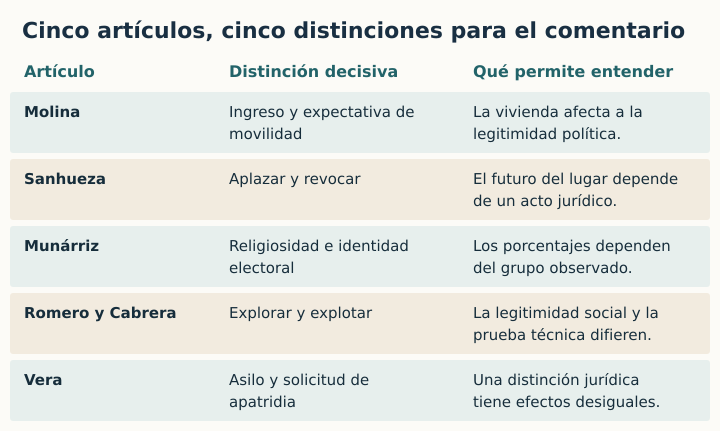

# ENS de Lyon · Série SES (B/L) · Espagnol (oral) 2026 — Corrigé brut

*Corrigé rédigé par IA, non officiel. Signalez toute erreur.*

**Rédaction** · GPT-6.2 Astra Ultra · vitesse non renseignée

L’ENS de Lyon demande une explication en langue étrangère d’un texte contemporain hors programme relatif à la civilisation d’une aire linguistique. Le jury recense cinq tirages et cinq prestations. Les articles sont présentés dans l’ordre du fascicule. Le fascicule fournit les références de presse. Les éditions du corrigé s’appuient sur les articles publiés par les journaux. Les limites d’une éventuelle coupe dans les exemplaires remis aux candidats restent inconnues.

[Fascicule officiel, p. 13](https://www.ens-lyon.fr/sites/default/files/2026-11/Fascicule%20SES%202026.pdf#page=13) · [Rapport du jury, p. 23](https://www.ens-lyon.fr/sites/default/files/2026-10/Fascicule%20SES%202026.pdf#page=23)

[Molina · El País](https://elpais.com/opinion/2026-02-19/la-clase-media-no-es-un-invento-facha.html) · [Sanhueza · El País Chile](https://elpais.com/chile/2026-03-30/kast-anula-la-construccion-de-un-sitio-de-memoria-para-las-victimas-de-la-dictadura-de-pinochet-en-colonia-dignidad.html) · [Munárriz · El País](https://elpais.com/espana/2026-04-04/el-pp-y-vox-extreman-su-pelea-por-un-voto-catolico-cada-vez-mas-derechizado.html) · [Romero et Cabrera · América Futura](https://elpais.com/america-futura/2026-05-20/agua-si-oro-no-la-consigna-que-puso-en-jaque-el-modelo-minero-de-republica-dominicana.html) · [Vera · La Vanguardia](https://www.lavanguardia.com/politica/20260415/11513613/gobierno-deja-fuera-regularizacion-migrantes-saharauis-solicitantes-apatridia.html)

## 1. Estefanía Molina, «La clase media no es un invento facha»

En esta columna de *El País* del 19 de febrero de 2026, la palabra provocadora del título señala una disputa dentro de la izquierda. ¿Qué se pierde cuando se pasa de preguntar por qué se ha debilitado la clase media a afirmar que en España nunca existió?

Molina empieza por reconocer un criterio de clase según el cual los asalariados que carecen de medios de producción pertenecen a la clase trabajadora. Cambia después la pregunta. Para evaluar la estabilidad de una democracia, también importa qué futuro cree tener una familia que vive de su trabajo. Si estudiar, trabajar y recurrir a servicios públicos permite llevar una vida más segura que la de los padres, es más fácil considerar que las reglas merecen conservarse. La clase media nombra aquí una expectativa de autonomía además de una posición social. El ascensor social del artículo tiene puertas públicas. Sin ellas, la posibilidad de subir depende cada vez más de quiénes sean los padres.

La vivienda condensa el contraste entre dos generaciones políticas. En 2011 los indignados del 15-M temían quedar fuera de la propiedad. Ahora, escribe Molina, a muchos jóvenes apenas les alcanza para una habitación alquilada. El contraste da contenido a una tesis sobre el cambio de beneficiario de la impugnación política, de Podemos a Vox. Los indicadores sobre salarios reales, renta disponible y poder adquisitivo permiten introducir una escala de varias décadas. Sus períodos y sus medidas son distintos. Además, una cifra sobre jóvenes varones dispuestos a contemplar opciones autoritarias no describe a toda la juventud ni establece por sí sola que el precio del alquiler determine el voto. La periodista enlaza indicios y formula una interpretación política.

La acusación más dura se dirige a quienes celebran la subida del salario mínimo sin preguntarse cuántas trayectorias por encima de ese umbral siguen abiertas. La columnista considera que la promesa de prosperar mediante el esfuerzo y los servicios públicos pertenecía a la socialdemocracia. Si ésta la abandona, otros discursos prometen movilidad por otras vías, incluidas las figuras digitales que elogian el éxito individual. La palabra del título adquiere así un segundo sentido. Descalificar una aspiración como cosa de derechas podría acabar dejándola efectivamente en manos de la derecha.

**Pregunta. ¿La autora define la clase media por una renta determinada?** No fija un umbral estadístico. Su definición política y generacional incluye la capacidad de proyectarse en el tiempo. Precisamente esa amplitud permite la hipótesis sobre la legitimidad democrática y obliga a distinguirla de una medida de ingresos.

## 2. Ana María Sanhueza, la decisión sobre Colonia Dignidad

El 30 de marzo de 2026, *El País Chile* relata el anuncio del ministro de Vivienda Iván Poduje sobre el proyecto de expropiación de Colonia Dignidad. ¿Por qué una decisión presentada como ajuste presupuestario abre una disputa sobre la relación del Estado chileno con su pasado?

Lo primero es precisar el acto que se discute. Bajo Gabriel Boric se había firmado en julio de 2025 un decreto para expropiar 117 hectáreas y crear un sitio de memoria. La nueva administración de José Antonio Kast anuncia que revocará ese decreto. La noticia recoge un anuncio ministerial y las razones aducidas. No describe la demolición de un museo ya construido. Poduje invoca un recorte solicitado a los ministerios, un presupuesto de Vivienda ya comprometido y el coste de expropiar una zona que incluye viviendas. Su comparación con la rehabilitación de casas y canchas invita a los lectores a valorar el gasto en función de otros usos posibles.

La periodista reconstruye luego por qué esas hectáreas concretas no son sustituibles por cualquier otro solar. En el enclave alemán que dirigió Paul Schäfer hubo abusos y, durante la dictadura de Pinochet, detenciones, torturas y desapariciones. La información distingue hechos documentados de indicios sobre el paradero de otras víctimas. La antigua residencia de Schäfer, la documentación hallada y las pesquisas judiciales hacen del lugar una fuente material además de un posible espacio de conmemoración. Convertirlo en un monumento nacional, buscar personas desaparecidas y expropiar para crear un sitio público son operaciones distintas. El Gobierno de Kast mantiene el plan de búsqueda que cita la noticia. Ese detalle impide reducir todas las políticas de memoria a una sola orden de cancelación.

El exministro Jaime Gajardo distingue aplazar de revocar. Aceptar que no haya dinero hoy no implica deshacer el instrumento que orientaba la política de mañana. Poduje responde que gobernar exige establecer prioridades e invoca también los derechos humanos de los niños que viven hacinados. Ambos interlocutores emplean un vocabulario moral, pero sus unidades de comparación difieren. Uno toma por referencia gastos sociales intercambiables. El otro, una obligación situada hacia víctimas identificables y un proceso institucional de varios gobiernos. La noticia permite entender por qué decir que una decisión es meramente presupuestaria constituye ya una interpretación de lo que está en juego.

**Pregunta. ¿Qué detalle matiza la idea de una ruptura completa?** La continuidad anunciada del plan de búsqueda. Sirve para aislar el objeto preciso de la controversia, la revocación del proyecto de expropiación y sus consecuencias para este lugar de memoria.

## 3. Ángel Munárriz, el PP, Vox y el voto católico

En su análisis publicado el 4 de abril de 2026, en Semana Santa, Munárriz parte de varias intervenciones políticas de marzo. Dos partidos pueden apoyar una misma iniciativa en defensa de cristianos perseguidos y acusarse después de traicionar valores católicos. ¿Por qué la caída de la proporción de creyentes en España no ha reducido en igual medida la importancia electoral del catolicismo?

El artículo distingue dos preguntas estadísticas. Una se refiere al porcentaje de católicos entre quienes votan a cada partido. La otra pregunta qué partido escogerían los ciudadanos que se identifican como católicos. Confundir los denominadores convertiría una encuesta en un retrato equivocado del electorado. Los datos del CIS citados apuntan a la pérdida de transversalidad de la identificación católica y a un peso relativamente mayor de la derecha en ese grupo. Sin embargo, el PSOE conserva una parte de las preferencias de los entrevistados católicos. La práctica religiosa, la edad y la simple identificación tampoco designan grupos idénticos. Cuando se comparan las preferencias de practicantes jóvenes con las del conjunto, hay que nombrar de qué grupo se habla.

En la interpretación de los especialistas consultados, la salida del nacionalcatolicismo hizo que la separación de la política y la religión pudiera aparecer como signo de modernidad, también a la derecha. Vox recupera un vocabulario religioso públicamente explícito, con frecuencia para identificar nación, civilización y herencia cristiana. Ello no impide que ataque a parte de la jerarquía eclesial cuando su postura sobre la inmigración choca con la línea del partido. El calificativo de anticatólico, utilizado por un diputado popular contra Vox, deja ver una competición por la definición de la palabra más que una disputa por contar practicantes.

El PP conserva referencias a la democracia cristiana y se ve interpelado por el éxito de Vox entre ciertos electores jóvenes. Los gestos en las fiestas religiosas y las declaraciones sobre inmigración permiten observar cómo el lenguaje de identidad pasa a la competición por políticas públicas. El artículo recoge además un uso distinto desde la izquierda, la cita de palabras pontificias sobre migración o justicia social. Esto no equivale a organizar una estrategia explícita de captación del voto católico. La secularización puede avanzar al mismo tiempo que se intensifica el valor político de una identidad más concentrada y más discutida.

**Pregunta. ¿El activismo religioso de Vox implica obediencia al episcopado?** La crítica de Abascal al alto clero ofrece un contraejemplo. El periodista distingue el uso identitario del cristianismo y la relación del partido con una institución que puede discrepar de él.

## 4. Nathalia Romero y Kenny Cabrera, «Agua sí, oro no»

Publicado en *América Futura* el 20 de mayo de 2026, el reportaje parte de la suspensión del proyecto minero Romero en la República Dominicana. ¿Qué significa que un proyecto en fase de exploración pierda su viabilidad social antes de que haya una evaluación técnica definitiva contraria a él?

El presidente Luis Abinader anuncia la suspensión el 4 de mayo. La consigna de los manifestantes, convertida en título, ofrece al lector una alternativa entre dos recursos. Para entender por qué parece convincente en San Juan, los periodistas bajan de la declaración presidencial al turno de riego de un agricultor. En una provincia clave para el abasto de habichuelas, el agua de la presa de Sabaneta sostiene miles de hectáreas agrícolas. Allí donde cada agricultor tiene que esperar su turno, el riesgo para una cuenca pesa de otra manera que en una estimación nacional de ingresos mineros. El testimonio local permite comprender el rechazo sin dar por probada una contaminación que el proyecto todavía no ha producido.

La empresa canadiense GoldQuest y los portavoces comunitarios discrepan sobre la credibilidad de las garantías del proyecto. El reportaje recuerda otros conflictos mineros de América Latina, pero un precedente regional no demuestra que el mismo daño vaya a repetirse en este yacimiento. Lo que sí explica es por qué la promesa empresarial de compatibilidad entre minería y agua se encuentra con una experiencia colectiva de desconfianza. Los periodistas recogen también dudas sobre posibles vínculos entre un antiguo asesor público y la empresa, además de la respuesta ministerial. Importa mantener juntas la alegación y su impugnación.

Una licencia para explorar no equivale a una autorización para explotar. Tampoco basta la oposición de vecinos para borrar automáticamente todos los derechos asociados a una inversión. El recorrido por el amparo preventivo, la licencia ambiental y el posible arbitraje internacional abre una pregunta de soberanía. ¿En qué momento pueden las comunidades intervenir de manera significativa, y qué evidencia necesitaría el Estado para justificar una suspensión? Dos partes pueden invocar la misma decisión judicial, una para exigir precaución y otra para reclamar base técnica. La fuerza del reportaje consiste en dejar coexistir el logro político de la protesta y la incertidumbre jurídica que se abre después. El agua representa aquí una economía ya existente, no sólo una promesa de conservación para el futuro.

**Pregunta. ¿La decisión presidencial prueba que el proyecto era técnicamente inviable?** Abinader subraya el rechazo social. El texto distingue la legitimidad política perdida, la exploración y las evaluaciones ambientales. La suspensión pone en primer plano quién define los riesgos aceptables.

## 5. Joaquín Vera, la regularización y los solicitantes saharauis de apatridia

En *La Vanguardia* del 15 de abril de 2026, Joaquín Vera compara el proyecto inicial de regularización extraordinaria con el texto aprobado por el Gobierno español. ¿Cómo puede una distinción entre procedimientos jurídicos, redactada sin mencionar una nacionalidad, tener consecuencias tan concentradas en una población?

La primera versión incluía a solicitantes de protección internacional y a quienes habían solicitado el reconocimiento de la condición de apátrida. A raíz del dictamen del Consejo de Estado, el texto aprobado excluye a estos últimos de esa vía mientras mantienen su solicitud. El Consejo es un órgano consultivo. La decisión corresponde al Gobierno. El término *apatridia* designa la situación de quien no es considerado nacional por ningún Estado conforme a su legislación. Pedir que se reconozca ese estatuto no es lo mismo que solicitar asilo ni que haber obtenido ya uno de esos estatutos. La distinción resulta material porque los documentos provisionales y la posibilidad de trabajar durante la tramitación no funcionan de manera idéntica.

El argumento oficial es que existe un procedimiento específico y conviene evitar solapamientos. Tener una vía separada puede sonar como una protección. Para la persona que espera años y no tiene autorización de trabajo, puede significar vivir en una situación precaria. Vera introduce cifras para medir la diferencia de escala. Las previsiones generales sobre permisos se cuentan por cientos de miles, mientras que las solicitudes anuales de apatridia se cuentan por miles. El porcentaje aproximado de solicitantes saharauis que cita procede de fuentes policiales. El periodista advierte que no dispone de una estadística oficial desglosada por origen. Hay que resistirse a convertir aquella estimación en una cifra administrativa exacta.

La polémica llega al interior de la coalición. Tesh Sidi, diputada de Sumar, interpreta la modificación como una exclusión dirigida a los saharauis y vinculada a Marruecos. Esa acusación sitúa el conflicto en el trasfondo del Sáhara Occidental, antigua colonia española. La noticia no ofrece una demostración independiente de que Rabat haya pedido la modificación. La intervención final de CEAR devuelve la atención a la elección práctica del solicitante, que tendría que renunciar al trámite de apatridia si quisiera intentar acogerse a la otra vía en las condiciones descritas. El interés del artículo reside en hacer visible cómo una política concebida en términos de expedientes puede producir efectos duraderos sobre el trabajo, la residencia y la posibilidad de documentar la propia situación.

**Pregunta. ¿Dice el artículo que se haya abolido el estatuto de apátrida?** Sigue existiendo. Lo que cambia es la compatibilidad con la vía extraordinaria descrita por el periodista mientras una persona tramita ese reconocimiento.

