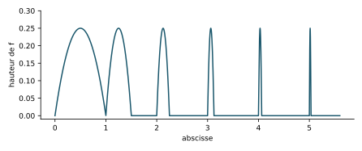
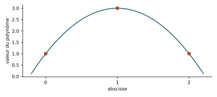
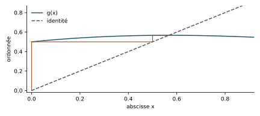
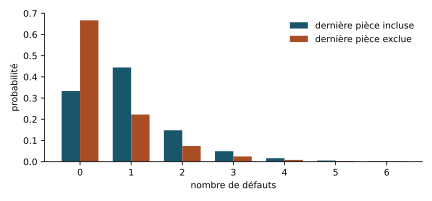

# ENS de Lyon B/L — Oral de mathématiques 2026 · Corrigé guidé

*Corrigé rédigé par IA, non officiel. Signalez toute erreur.*

**Rédaction** · GPT-6.2 Astra Ultra · vitesse non renseignée

**Révision (tour 1)** · GPT-6.2 Astra Ultra · vitesse non renseignée · 26 novembre 2026

Le jury a interrogé 41 candidats et candidates. La préparation dure une heure pour les deux exercices de chaque planche. Le candidat présente les deux exercices dans l’ordre de son choix. Sur les trente minutes de l’oral, il dispose d’au plus quinze minutes pour exposer son travail avant les questions du jury. L’annexe officielle présente les quinze planches de 1 à 15. Le fascicule des épreuves orales y renvoie en page 17. Les trente exercices et leurs 214 questions sont traités.

[Annexe des planches](https://www.ens-lyon.fr/sites/default/files/2026-11/Math%C3%A9matiques%20-%20s%C3%A9rie%20Sciences%20%C3%89conomiques%20et%20Sociales%20session%202026.pdf) · [Rubrique de mathématiques du jury](https://www.ens-lyon.fr/sites/default/files/2026-10/Fascicule%20SES%202026.pdf#page=13) · [Fascicule des oraux, p. 17](https://www.ens-lyon.fr/sites/default/files/2026-11/Fascicule%20SES%202026.pdf#page=17)

Le jury demande de prouver la convergence d’une série ou d’une intégrale avant de la manipuler. Dans la planche 11, la convergence de la série des logarithmes détermine si le produit des probabilités conditionnelles reste positif. Dans la planche 14, le signe et l’intégrabilité du reste permettent de justifier le passage à la limite.

## Planche 1 · Exercice 1 — Deux projecteurs

[Annexe 2026, p. 2](https://www.ens-lyon.fr/sites/default/files/2026-11/Math%C3%A9matiques%20-%20s%C3%A9rie%20Sciences%20%C3%89conomiques%20et%20Sociales%20session%202026.pdf#page=2)

### Question 1a

> [!INDICATION]
> Appliquer le produit nul à un antécédent.

#### Solution

Si $y=g(x)$, alors $f(y)=f(g(x))=0$ par $AB=0$. Ainsi $\operatorname{Im}g\subset\ker f$.

### Question 1b

> [!INDICATION]
> Utiliser deux fois le même projecteur.

#### Solution

Pour $y=g(x)$, $g(y)=g^2(x)=y$. Réciproquement, $g(y)=y$ implique $y\in\operatorname{Im}g$. L’image est non nulle puisque $B\ne0$, donc $1$ est bien une valeur propre.

### Question 1c

> [!INDICATION]
> Multiplier une combinaison représentant l’identité par chaque projecteur.

#### Solution

Si $I=sA+tB$, en multipliant par $A$ puis $B$ à droite, on obtient $A=sA$ et $B=tB$. Ces matrices étant non nulles, $s=t=1$. La réciproque est immédiate.

### Question 2a

> [!INDICATION]
> Exclure le rang maximal à l’aide de l’autre image.

#### Solution

Le rang de $f$ est au moins un. Le noyau contient l’image non nulle de $g$, donc en dimension deux le théorème du rang impose $\operatorname{rg}f=1$.

### Question 2b

> [!INDICATION]
> Décomposer le plan suivant les deux images.

#### Solution

De même $\operatorname{rg}g=1$. Si $y$ est dans les deux images, alors $f(y)=y$ et $f(y)=0$, donc $y=0$. Les deux droites engendrent le plan. Sur chacune $f+g$ agit comme l’identité, d’où $A+B=I_2$.

### Question 2c

> [!INDICATION]
> Garder une troisième direction fixe pour le complément.

#### Solution

En dimension trois, les matrices diagonales $A=\operatorname{diag}(1,0,0)$ et $B=\operatorname{diag}(0,1,0)$ satisfont les hypothèses, et leur somme annule la troisième direction.

### Question 3a

> [!INDICATION]
> Substituer B égal à l’identité moins A dans les deux expressions de la puissance.

#### Solution

On a $M=\mu I+(\lambda-\mu)A$. Comparer le carré de cette expression à $\mu^2 I+(\lambda^2-\mu^2)A$ donne $(\lambda-\mu)^2(A^2-A)=0$. Donc $A^2=A$, puis $B^2=(I-A)^2=B$ et $AB=BA=A-A^2=0$.

### Question 3b

> [!INDICATION]
> Inverser séparément sur les deux images.

#### Solution

Le produit de $M$ avec $A/\lambda+B/\mu$ dans chacun des deux ordres vaut $A+B=I$. Les deux valeurs étant non nulles, cette expression est $M^{-1}$.

### Question 3c

> [!INDICATION]
> Décomposer un vecteur en ses composantes dans les images.

#### Solution

Chaque $x=Ax+Bx$ et les images sont en somme directe car $A$ fixe son image et annule celle de $B$. Sur ces deux sous-espaces non nuls $M$ agit respectivement par $\lambda$ et $\mu$. Ce sont exactement ses valeurs propres.

## Planche 1 · Exercice 2 — Une loi géométrique transformée

[Annexe 2026, p. 2](https://www.ens-lyon.fr/sites/default/files/2026-11/Math%C3%A9matiques%20-%20s%C3%A9rie%20Sciences%20%C3%89conomiques%20et%20Sociales%20session%202026.pdf#page=2)

### Question 1

> [!INDICATION]
> Sommer les masses de rang impair.

#### Solution

Écrivons $r=1-p$. Alors $\mathbb P(X\text{ impair})=p\sum_{j\ge0}r^{2j+1}=pr/(1-r^2)=r/(1+r)$.

### Question 2a

> [!INDICATION]
> Distinguer les entiers pairs et les deux classes impaires modulo quatre.

#### Solution

Pour $X$ pair, $Y=0$. Pour $X=2j+1$, $Y=j(-1)^j$. Ainsi $\mathbb P(Y=0)=1/(1+r)+pr$ (on ajoute $X=1$), $\mathbb P(Y=2m)=pr^{4m+1}$ pour $m\ge1$, et $\mathbb P(Y=-(2m+1))=pr^{4m+3}$ pour $m\ge0$. Les autres valeurs ont une probabilité nulle.

### Question 2b

> [!INDICATION]
> Dériver la série géométrique dans son disque de convergence.

#### Solution

On a $|Y|\le(X+1)/2$, intégrable pour une loi géométrique. Les valeurs impaires de $X$ donnent $\mathbb EY=pr\sum_{j\ge0}j(-r^2)^j=-pr^3/(1+r^2)^2$, par $\sum jz^j=z/(1-z)^2$ pour $|z|<1$.

## Planche 2 · Exercice 1 — Une suite d’intégrales

[Annexe 2026, p. 3](https://www.ens-lyon.fr/sites/default/files/2026-11/Math%C3%A9matiques%20-%20s%C3%A9rie%20Sciences%20%C3%89conomiques%20et%20Sociales%20session%202026.pdf#page=3)

### Question 1

> [!INDICATION]
> Comparer les intégrandes successifs.

#### Solution

Pour $0\le t\le1$, $(1+t^4)^{-n}$ est positif et décroît avec $n$. La suite $u_n$ est décroissante, minorée par zéro, donc converge vers un réel $\ell\ge0$.

### Question 2a

> [!INDICATION]
> Partager l’intégrale au point a.

#### Solution

Sur $[0,a]$ l’intégrande est au plus $1$. Sur $[a,1]$ il est au plus $(1+a^4)^{-n}$. Ainsi $u_n\le a+(1-a)(1+a^4)^{-n}\le a+(1+a^4)^{-n}$.

### Question 2b

> [!INDICATION]
> Fixer a avant de faire tendre n vers l’infini.

#### Solution

Comme $1+a^4>1$, le terme géométrique tend vers zéro et $\ell\le a$ pour tout $a\in(0,1)$.

### Question 2c

> [!INDICATION]
> Faire tendre le point de partage vers zéro.

#### Solution

En prenant $a\downarrow0$, on obtient $0\le\ell\le0$, donc $\ell=0$.

### Question 3a

> [!INDICATION]
> Intégrer par parties en prenant une primitive de 1.

#### Solution

La dérivée de $(1+t^4)^{-n}$ vaut $-4nt^3(1+t^4)^{-n-1}$. L’intégration par parties donne $u_n=[t(1+t^4)^{-n}]_0^1+4n\int_0^1 t^4(1+t^4)^{-n-1}dt$, avec terme au bord $2^{-n}$.

### Question 3b

> [!INDICATION]
> Écrire le numérateur comme différence de deux termes.

#### Solution

Avec $t^4=(1+t^4)-1$, l’intégrale précédente vaut $u_n-u_{n+1}$. On en déduit $u_{n+1}-u_n=1/(n2^{n+2})-u_n/(4n)$.

### Question 3c

> [!INDICATION]
> Sommer les différences successives.

#### Solution

La relation donne $\sum_{n=1}^N u_n/n=4(u_1-u_{N+1})+\sum_{n=1}^N 1/(n2^n)$. Le dernier terme a une limite par comparaison géométrique et $u_{N+1}\to0$. La série positive converge.

### Question 4

> [!INDICATION]
> Garder la petite zone où l’intégrande est uniformément minoré.

#### Solution

Sur $0\le t\le n^{-1/4}$, $(1+t^4)^n\le(1+1/n)^n\le e$. Donc $u_n\ge e^{-1}n^{-1/4}$. La série de Riemann de cet ordre diverge, donc $\sum u_n$ diverge.

## Planche 2 · Exercice 2 — Somme des matrices d’un groupe fini

[Annexe 2026, p. 4](https://www.ens-lyon.fr/sites/default/files/2026-11/Math%C3%A9matiques%20-%20s%C3%A9rie%20Sciences%20%C3%89conomiques%20et%20Sociales%20session%202026.pdf#page=4)

### Question 1a

> [!INDICATION]
> Exploiter la bijection donnée.

#### Solution

Lorsque $i$ parcourt les indices, $\varphi_k(A_i)$ parcourt exactement une fois tous les éléments de $G$. La somme de ces matrices est donc $S$.

### Question 1b

> [!INDICATION]
> Sortir la matrice commune à gauche.

#### Solution

Par distributivité $S=\sum_i A_kA_i=A_k S$.

### Question 1c

> [!INDICATION]
> Sommer l’identité sur k.

#### Solution

On a $S^2=(\sum_k A_k)S=\sum_k S=pS$.

### Question 1d

> [!INDICATION]
> Former le projecteur S divisé par p.

#### Solution

Pour toute colonne $x$, $Sx/p$ appartient à $\ker(S-pI)$ et $x-Sx/p$ à $\ker S$ par $S^2=pS$. Leur somme est $x$. Dans l’intersection $Sx=0=px$, donc $x=0$ et la somme est directe.

### Question 1e

> [!INDICATION]
> Choisir une base adaptée à la décomposition.

#### Solution

Juxtaposons une base du premier noyau, de dimension $m$, et une base du second. Avec ces colonnes dans $P$, $P^{-1}SP=\operatorname{diag}(pI_m,0_{n-m})$, également pour $m=0$ ou $m=n$.

### Question 1f

> [!INDICATION]
> Calculer la trace dans cette base.

#### Solution

Par invariance par similitude, $\operatorname{Tr}(S)=pm$. Le quotient par $p$ est l’entier naturel $m$.

Avec $G=\{I_2,\operatorname{diag}(1,-1)\}$, on trouve $S=\operatorname{diag}(2,0)$, donc $\operatorname{Tr}(S)/2=1$. Avec $G=\{I_2,-I_2\}$, la somme est nulle et le quotient vaut zéro. L’entier naturel peut donc effectivement s’annuler.

### Question 2

> [!INDICATION]
> Comparer le caractère fixe à la moyenne sur G.

#### Solution

Si $A_k x=x$ pour tous $k$, alors $Sx=px$. Inversement si $Sx=px$, $A_kx=A_kSx/p=Sx/p=x$ par 1b, pour tout $k$.

## Planche 3 · Exercice 1 — Valeurs propres aléatoires

[Annexe 2026, p. 5](https://www.ens-lyon.fr/sites/default/files/2026-11/Math%C3%A9matiques%20-%20s%C3%A9rie%20Sciences%20%C3%89conomiques%20et%20Sociales%20session%202026.pdf#page=5)

### Question 1

> [!INDICATION]
> Utiliser les directions somme et différence.

#### Solution

Les colonnes $(1,1)^T$ et $(1,-1)^T$ forment une base propre, de valeurs $X+Y$ et $X-Y$. Comme la géométrique usuelle prend ses valeurs dans $\{1,2,\ldots\}$, $Y>0$ et ainsi $A=X+Y$, $B=X-Y$.

### Question 2

> [!INDICATION]
> Les variables indépendantes ont une covariance nulle.

#### Solution

Pour $r=1-p$, $X$ et $Y$ ont chacune une variance $r/p^2$. Leurs seconds moments sont finis. Donc $\operatorname{Var}A=\operatorname{Var}B=2r/p^2$ par indépendance.

### Question 3

> [!INDICATION]
> Développer la covariance des deux combinaisons.

#### Solution

La bilinéarité et la symétrie donnent $\operatorname{Cov}(A,B)=\operatorname{Var}X-\operatorname{Var}Y=0$.

### Question 4

> [!INDICATION]
> La plus petite somme possible fixe les deux valeurs tirées.

#### Solution

Sur $A=2$, de probabilité $p^2>0$, on a nécessairement $B=0$. Pourtant $\mathbb P(B=1)\ge\mathbb P(X=2,Y=1)>0$. Ainsi $\mathbb P(B=0\mid A=2)=1>\mathbb P(B=0)$ et les deux variables sont dépendantes.

### Question 5

> [!INDICATION]
> Conditionner sur le plus petit des deux indices pour un écart positif.

#### Solution

Pour $k\ge0$, $\mathbb P(B=k)=\sum_{j\ge1}p^2r^{j+k-1+j-1}=p^2r^k/(1-r^2)$. Par symétrie des variables indépendantes de même loi, pour tout entier relatif $k$ la masse est $pr^{|k|}/(2-p)$.

## Planche 3 · Exercice 2 — Série alternée et intégrale logarithmique

[Annexe 2026, p. 5](https://www.ens-lyon.fr/sites/default/files/2026-11/Math%C3%A9matiques%20-%20s%C3%A9rie%20Sciences%20%C3%89conomiques%20et%20Sociales%20session%202026.pdf#page=5)

### Question 1

> [!INDICATION]
> Comparer les valeurs absolues à une série de Riemann.

#### Solution

Pour $n\ge1$, $(2n+1)^{-3}\le n^{-3}$ et $\sum n^{-3}$ converge. La série demandée converge même absolument.

### Question 2a

> [!INDICATION]
> Comparer séparément aux deux extrémités.

#### Solution

Près de zéro, $t^{1/2}\ln^2t\to0$, donc l’intégrande est dominé par $t^{-1/2}$, intégrable. À l’infini $\ln^2t=o(t^{1/2})$, et l’intégrande est dominé par $t^{-3/2}$. Ailleurs il est continu, ce qui donne les deux convergences.

### Question 2b

> [!INDICATION]
> Inverser la variable dans la partie située au-dessus de 1.

#### Solution

Avec $x=1/t$, $dt=-dx/x^2$, $1+t^2=(1+x^2)/x^2$ et $\ln^2t=\ln^2x$. On obtient $\int_1^\infty \ln^2t/(1+t^2)dt=J$ et $I=2J$.

### Question 3a

> [!INDICATION]
> Utiliser la comparaison obtenue pour le logarithme seul.

#### Solution

Pour $0<t\le1$, $0\le t^{2n}\ln^2t\le\ln^2t$. Cette dernière fonction est intégrable par la comparaison de 2a. L’intégrale définissant $u_n$ converge.

### Question 3b

> [!INDICATION]
> Transformer le logarithme en variable d’intégration.

#### Solution

La substitution $s=-\ln t$ donne $u_n=\int_0^\infty s^2 e^{-(2n+1)s}ds$. Deux intégrations par parties, les termes polynomiaux fois l’exponentielle tendant vers zéro à l’infini, donnent $u_n=2/(2n+1)^3$.

### Question 3c

> [!INDICATION]
> Employer la somme géométrique finie et majorer son reste intégré.

#### Solution

Développons $1/(1+t^2)=\sum_{k=0}^N(-t^2)^k+(-t^2)^{N+1}/(1+t^2)$. Après multiplication par $\ln^2t$ et intégration, le reste est majoré en valeur absolue par $u_{N+1}\to0$. Ainsi $J=2\sum_{k\ge0}(-1)^k/(2k+1)^3$, et la somme vaut $I/4$.

## Planche 4 · Exercice 1 — Matrices et transposition

[Annexe 2026, p. 6](https://www.ens-lyon.fr/sites/default/files/2026-11/Math%C3%A9matiques%20-%20s%C3%A9rie%20Sciences%20%C3%89conomiques%20et%20Sociales%20session%202026.pdf#page=6)

### Question 1

> [!INDICATION]
> Lire les égalités diagonales.

#### Solution

Une matrice antisymétrique réelle vérifie $a_{ii}=-a_{ii}$ pour tout $i$. Sa diagonale est nulle, donc sa trace aussi.

### Question 2

> [!INDICATION]
> Écrire les parties symétrique et antisymétrique.

#### Solution

Pour tout $M$, $M=(M+M^T)/2+(M-M^T)/2$. Les deux termes appartiennent respectivement à $S_n$ et $A_n$. Une matrice de l’intersection vérifie $M=-M$ et est nulle, d’où la somme directe.

### Question 3a

> [!INDICATION]
> Écrire l’équation comme un noyau.

#### Solution

L’application $M\mapsto M+M^T-2\operatorname{Tr}(M)I_n$ est linéaire. Son noyau $E$ est un sous-espace.

### Question 3b

> [!INDICATION]
> Prendre la trace dans l’équation.

#### Solution

Si $M\in E$, $2\operatorname{Tr}M=2n\operatorname{Tr}M$ et $n\ge2$, donc sa trace est nulle et $M+M^T=0$. Réciproquement toute matrice antisymétrique a trace nulle d’après 1 et vérifie l’équation. Ainsi $E=A_n$.

### Question 4

> [!INDICATION]
> Déterminer la partie symétrique.

#### Solution

L’équation impose $(M+M^T)/2=(\operatorname{Tr}M/n)I_n$. Toute solution est donc somme d’un scalaire et d’une matrice antisymétrique. Réciproquement chaque $cI_n+K$ avec $K\in A_n$ a trace $nc$ et convient. On obtient $E'=\mathbb RI_n\oplus A_n$.

## Planche 4 · Exercice 2 — Décroissance et intégrabilité

[Annexe 2026, p. 6,7](https://www.ens-lyon.fr/sites/default/files/2026-11/Math%C3%A9matiques%20-%20s%C3%A9rie%20Sciences%20%C3%89conomiques%20et%20Sociales%20session%202026.pdf#page=6)

### Question 1a

> [!INDICATION]
> Intégrer la minoration sur la demi-longueur de droite.

#### Solution

Pour $x/2\le t\le x$, $f(t)\ge f(x)\ge0$. Ainsi $0\le(x/2)f(x)\le\int_{x/2}^x f(t)dt$.

### Question 1b

> [!INDICATION]
> Utiliser la queue d’une intégrale convergente positive.

#### Solution

Le majorant est au plus $\int_{x/2}^\infty f(t)dt\to0$. En multipliant par deux, on obtient $xf(x)\to0$.

### Question 2

> [!INDICATION]
> Chercher une primitive logarithmique.

#### Solution

La fonction $g$ est continue positive décroissante et $xg(x)=x/[(x+2)\ln(x+2)]\to0$. Sa primitive $\ln\ln(t+2)$ tend vers $+\infty$. L’intégrale diverge, ce qui donne le contre-exemple.

### Question 3a

> [!INDICATION]
> Contrôler le raccordement aux deux extrémités.

#### Solution

Sur $[0,1]$, $h(t)=t(1-t)$ est continue et ses valeurs en $0,1$ sont nulles. Son prolongement par zéro est donc continu sur toute la droite.

### Question 3b

> [!INDICATION]
> Sur une bande unitaire, la partie entière est constante.

#### Solution

Pour $n\le t<n+1$, la formule est $f(t)=h(2^n(t-n))$. Son support dans cette bande est contenu dans $[n,n+2^{-n}]$.

### Question 3c

> [!INDICATION]
> Vérifier aussi les limites aux entiers.

#### Solution

La formule de 3b donne la continuité sur chaque bande ouverte et la positivité au sens large. À un entier $n\ge1$ la valeur et la limite à droite valent $h(0)=0$. À gauche la limite est $h(2^{n-1})=0$, y compris lorsque $n=1$. La continuité à droite en zéro suffit sur le domaine demandé.

### Question 3d

> [!INDICATION]
> Changer d’échelle dans la bande.

#### Solution

Avec $u=2^k(t-k)$, l’intégrale vaut $2^{-k}\int_0^{2^k}h(u)du=2^{-k}\int_0^1h(u)du$ car $h$ s’annule pour $u>1$.

### Question 3e

> [!INDICATION]
> Sommer les aires géométriques.

#### Solution

On a $\int_0^1u(1-u)du=1/6$. Pour tout entier $n\ge1$, $\int_0^n f=(1/6)\sum_{k=0}^{n-1}2^{-k}=(1-2^{-n})/3$. La positivité permet d’encadrer toute intégrale tronquée entre celles des entiers voisins. L’intégrale converge et vaut $1/3$.

### Question 3f

> [!INDICATION]
> Évaluer la fonction au sommet de chaque pic.

#### Solution

Pour $a_n=n+2^{-n-1}$, $2^n(a_n-n)=1/2$, donc $f(a_n)=1/4$ et $a_n f(a_n)\to+\infty$. Ainsi $xf(x)$ ne tend pas vers zéro, malgré l’intégrabilité de $f$.

## Planche 5 · Exercice 1 — Perturbation d’une matrice diagonale

[Annexe 2026, p. 8](https://www.ens-lyon.fr/sites/default/files/2026-11/Math%C3%A9matiques%20-%20s%C3%A9rie%20Sciences%20%C3%89conomiques%20et%20Sociales%20session%202026.pdf#page=8)

### Question 1a

> [!INDICATION]
> Additionner les images des vecteurs canoniques.

#### Solution

$f(w)=nw$ avec $w=(1,\ldots,1)\ne0$, donc la valeur propre associée est $n$.

### Question 1b

> [!INDICATION]
> Normaliser un générateur de l’image.

#### Solution

Toute image vaut $f(u)=(\sum_i u_i)w$ et $w=f(e_1)$. L’image a pour base orthonormée le seul vecteur $w/\sqrt n$.

### Question 1c

> [!INDICATION]
> Décomposer une colonne de somme nulle.

#### Solution

Le noyau est formé des colonnes de somme nulle. Chacune vaut $\sum_{i=2}^nu_i(e_i-e_1)$. Les coefficients d’une combinaison nulle se lisent sur les coordonnées $2$ à $n$, donc la famille est libre et forme une base.

### Question 1d

> [!INDICATION]
> Traduire la somme des coordonnées par un produit scalaire.

#### Solution

$\ker f=w^\perp$ et $\operatorname{Im}f=\mathbb Rw$, donc, en dimension finie, $\operatorname{Im}f=(\ker f)^\perp$.

### Question 1e

> [!INDICATION]
> Orthonormaliser dans le noyau.

#### Solution

Une base orthonormée du noyau, obtenue par Gram–Schmidt, est formée de vecteurs propres de valeur zéro. En lui adjoignant $w/\sqrt n$ de valeur propre $n$, on obtient la base demandée.

### Question 1f

> [!INDICATION]
> Appliquer Cauchy–Schwarz à la somme des coordonnées.

#### Solution

$\|f(u)\|=|\langle u,w\rangle|\|w\|\le\|u\|\|w\|^2=n\|u\|$.

### Question 2a

> [!INDICATION]
> Examiner les éléments diagonaux.

#### Solution

Tous les $a_i\ge m>n$ sont non nuls, donc $d$ admet l’inverse $e_i\mapsto e_i/a_i$.

### Question 2b

> [!INDICATION]
> Comparer les carrés des normes.

#### Solution

$\|d(u)\|^2=\sum_i a_i^2u_i^2\ge m^2\sum_i u_i^2$. Prendre la racine donne le résultat.

### Question 2c

> [!INDICATION]
> Appliquer l’inégalité précédente à l’image réciproque.

#### Solution

Avec $u=d^{-1}v$, on trouve $\|d^{-1}v\|\le\|v\|/m$.

### Question 2d

> [!INDICATION]
> Combiner les deux constantes.

#### Solution

Si $u\ne0$, $\|f(u)\|\le n\|u\|<m\|u\|\le\|d(u)\|$.

### Question 2e

> [!INDICATION]
> Rechercher le noyau de la somme.

#### Solution

Si $g(u)=0$, alors $d(u)=-f(u)$, ce qui imposerait l’égalité de leurs normes. Par 2d seul $u=0$ est possible. L’endomorphisme injectif d’un espace de dimension finie est bijectif.

## Planche 5 · Exercice 2 — Inversion d’une fonction logarithmique

[Annexe 2026, p. 8](https://www.ens-lyon.fr/sites/default/files/2026-11/Math%C3%A9matiques%20-%20s%C3%A9rie%20Sciences%20%C3%89conomiques%20et%20Sociales%20session%202026.pdf#page=8)

### Question 1a

> [!INDICATION]
> Calculer la dérivée et les limites sur la bonne branche.

#### Solution

Sur $(1,+\infty)$, $g'(x)=\ln x(\ln x+2)>0$. La fonction continue croît de $0$ à $+\infty$ aux deux extrémités, donc y réalise la bijection demandée.

### Question 1b

> [!INDICATION]
> Prendre le logarithme de l’identité inverse.

#### Solution

On a $h(x)>1$ et $x=h(x)\ln^2 h(x)$. En prenant les logarithmes naturels on obtient $\ln x=\ln h(x)+2\ln\ln h(x)$.

### Question 1c

> [!INDICATION]
> Comparer un réel qui diverge et son logarithme.

#### Solution

Lorsque $x\to\infty$, $h(x)\to\infty$. Pour $y=\ln h(x)$, $\ln y=o(y)$. L’identité précédente donne $\ln x\sim y=\ln h(x)$.

### Question 1d

> [!INDICATION]
> Revenir à l’égalité multiplicative exacte.

#### Solution

Puisque $h(x)=x/\ln^2h(x)$, le résultat 1c donne $h(x)\sim x/(\ln x)^2$. On applique l’équivalence dans ce quotient positif.

### Question 2

> [!INDICATION]
> Intégrer sur la demi-droite puis utiliser la parité.

#### Solution

La fonction est positive au sens large, continue par morceaux hors de zéro et nulle hors de $(-1/e,1/e)$. Sur $(0,1/e)$, $2f(x)=1/[x(\ln x)^2]$ a pour primitive $-1/\ln x$, de limite zéro en $0^+$ et de valeur $1$ en $1/e$. Par parité l’intégrale totale de $f$ vaut $1$, donc c’est une densité.

## Planche 6 · Exercice 1 — Collection de trois jetons

[Annexe 2026, p. 9](https://www.ens-lyon.fr/sites/default/files/2026-11/Math%C3%A9matiques%20-%20s%C3%A9rie%20Sciences%20%C3%89conomiques%20et%20Sociales%20session%202026.pdf#page=9)

### Question 1

> [!INDICATION]
> Conditionner sur la couleur du premier jeton.

#### Solution

Quel que soit le premier jeton, à chacun des tirages suivants la probabilité de le retrouver est $1/3$. Ainsi, pour $n\ge2$, $\mathbb P(Y=n)=(1/3)^{n-2}(2/3)$, et $Y$ ne prend aucune autre valeur avec probabilité positive.

### Question 2a

> [!INDICATION]
> Compter les tirages après le premier.

#### Solution

$X=Y-1$ est le nombre d’essais jusqu’au premier succès, de probabilité $2/3$. Il suit la loi géométrique sur les entiers strictement positifs de paramètre $2/3$.

### Question 2b

> [!INDICATION]
> La translation modifie seulement l’espérance.

#### Solution

$\mathbb EY=1+3/2=5/2$ et $\operatorname{Var}Y=(1/3)/(2/3)^2=3/4$.

### Question 3

> [!INDICATION]
> Après la découverte du deuxième jeton, attendre la couleur manquante.

#### Solution

Pour $m\le n$, la probabilité jointe est nulle. Pour $m>n\ge2$, elle vaut $(1/3)^{n-2}(2/3)(2/3)^{m-n-1}(1/3)$, car les tirages intermédiaires peuvent donner l’un des deux types déjà rencontrés.

### Question 4

> [!INDICATION]
> Fixer le dernier type puis interdire sa présence avant le dernier tirage.

#### Solution

Pour $m\ge3$, en fixant le type découvert au rang $m$, le préfixe de longueur $m-1$ doit employer les deux autres types et chacun au moins une fois. Il y a $2^{m-1}-2$ préfixes et trois choix du dernier jeton. Donc $\mathbb P(Z=m)=(2^{m-1}-2)/3^{m-1}$. Cette expression s’obtient aussi en sommant 3 sur $2\le n<m$. Elle est nulle pour $m<3$.

### Question 5

> [!INDICATION]
> Découper la durée en deux temps d’attente.

#### Solution

Conditionnellement au passé au rang $Y$, les prochains tirages ont chacun probabilité $1/3$ de donner le troisième type. $Z-Y$ suit donc la loi géométrique de paramètre $1/3$, de moyenne $3$. Les deux temps sont intégrables et $\mathbb EZ=5/2+3=11/2$.

## Planche 6 · Exercice 2 — Une transformée intégrale

[Annexe 2026, p. 9](https://www.ens-lyon.fr/sites/default/files/2026-11/Math%C3%A9matiques%20-%20s%C3%A9rie%20Sciences%20%C3%89conomiques%20et%20Sociales%20session%202026.pdf#page=9)

### Question 1

> [!INDICATION]
> Examiner la queue de l’intégrale.

#### Solution

Pour $x>0$, $t/(x^2+t^2)\sim 1/t$ à l’infini, avec des fonctions positives. L’intégrale diverge, donc la constante un n’appartient pas à $E$.

### Question 2a

> [!INDICATION]
> Vérifier continuité, bornitude et intégrabilité pour tout paramètre.

#### Solution

$\varphi(t)=t/(1+t^2)$ est continue, bornée par $1/2$. Pour $x>0$ l’intégrande $t^2/[(x^2+t^2)(1+t^2)]$ est continu sur $[0,+\infty)$ et équivalent à $t^{-2}$ à l’infini. Il est intégrable, donc $\varphi\in E$.

### Question 2b

> [!INDICATION]
> Chasser les deux dénominateurs.

#### Solution

L’identité équivaut à $t^2(1-x^2)=a(x^2+t^2)+bx^2(1+t^2)$. L’identification donne $a=1$, $b=-1$. La substitution vérifie l’égalité partout où les dénominateurs sont non nuls.

### Question 2c

> [!INDICATION]
> Intégrer les deux fractions simples.

#### Solution

Pour $x>0$, $x\ne1$, on a $(1-x^2)\psi(x)=\pi/2-x^2\pi/(2x)$ grâce à la primitive arctangente. Après simplification, $\psi(x)=\pi/[2(1+x)]$.

### Question 2d

> [!INDICATION]
> Utiliser la dérivée de la fraction qui a un dénominateur quadratique.

#### Solution

À $x=1$, $\psi(1)=\int_0^\infty t^2/(1+t^2)^2dt$. En prenant $u=t$ et $dv=t(1+t^2)^{-2}dt$, le terme $[-t/(2(1+t^2))]_0^\infty$ est nul et il reste $\frac12\int_0^\infty (1+t^2)^{-1}dt=\pi/4$.

### Question 2e

> [!INDICATION]
> Réunir le cas isolé et la formule simplifiée.

#### Solution

La valeur en $1$ coïncide avec $\pi/[2(1+1)]$. La formule rationnelle $\pi/[2(1+x)]$ vaut donc sur toute la demi-droite ouverte. Sa dérivée $-\pi/[2(1+x)^2]$ y est continue.

### Question 3a.i

> [!INDICATION]
> Choisir la précision un dans la définition de la limite.

#### Solution

Comme $f(t)\to\ell$, il existe $A>0$ tel que $t>A$ implique $|f(t)-\ell|<1$, d’où les deux inégalités larges annoncées.

### Question 3a.ii

> [!INDICATION]
> Séparer un segment compact de la queue.

#### Solution

Sur $[0,A]$, $|f|$ atteint un maximum fini par continuité. Pour $t>A$, $|f(t)|\le|\ell|+1$. Le maximum de ces deux bornes convient globalement.

### Question 3b

> [!INDICATION]
> Comparer en valeur absolue après avoir fixé le signe.

#### Solution

Si $\ell\ne0$, $f$ a finalement le signe de $\ell$ et $t f(t)/(x^2+t^2)\sim \ell/t$ pour tout $x>0$. Par comparaison avec l’intégrale harmonique de signe constant, l’intégrale diverge. Donc $f\notin E$.

### Question 3c

> [!INDICATION]
> Chercher une décroissance logarithmique trop lente.

#### Solution

La limite zéro ne suffit pas. Ainsi $f(t)=1/\ln(2+t)$ est continue bornée et tend vers zéro, mais l’intégrande positif est équivalent à $1/(t\ln t)$, d’intégrale divergente. En revanche $f=0$ appartient à $E$.

## Planche 7 · Exercice 1 — Points critiques dans le plan

[Annexe 2026, p. 10](https://www.ens-lyon.fr/sites/default/files/2026-11/Math%C3%A9matiques%20-%20s%C3%A9rie%20Sciences%20%C3%89conomiques%20et%20Sociales%20session%202026.pdf#page=10)

### Question 1

> [!INDICATION]
> Dériver le facteur polynomial et le facteur exponentiel.

#### Solution

Pour $f_n=(x^n-y)e^{x-y}$, on trouve $\partial_x f_n=(nx^{n-1}+x^n-y)e^{x-y}$ et $\partial_y f_n=(-1-x^n+y)e^{x-y}$.

### Question 2a

> [!INDICATION]
> Éliminer y grâce à la seconde équation.

#### Solution

Pour $n=2$, l’annulation de la seconde dérivée partielle d’ordre un impose $y=x^2+1$. La première donne alors $2x-1=0$. L’unique point critique est $(1/2,5/4)$.

### Question 2b

> [!INDICATION]
> Poser une variable qui transforme la dépendance en y en une fonction d’une seule variable.

#### Solution

Posons $t=x^2-y$. Alors $f_2=t e^t e^{x-x^2}$. Comme $te^t\ge-1/e$ par dérivation et $x-x^2\le1/4$, on a $f_2\ge-e^{-3/4}$. L’égalité a lieu exactement pour $t=-1$ et $x=1/2$, soit au point trouvé en 2a. C’est un minimum strict, même global.

### Question 3a

> [!INDICATION]
> Les deux équations de dérivée sont opposées.

#### Solution

Pour $n=1$, les deux dérivées s’annulent exactement lorsque $1+x-y=0$. L’ensemble critique est la droite $y=x+1$.

### Question 3b

> [!INDICATION]
> Déterminer le signe de la dérivée.

#### Solution

$\phi'(t)=(1+t)e^t$ est négative pour $t<-1$, positive pour $t>-1$. La fonction a un minimum global en $-1$, de valeur $-1/e$.

### Question 3c

> [!INDICATION]
> Identifier l’argument de l’exponentielle.

#### Solution

Pour tout couple réel, $f_1(x,y)=(x-y)e^{x-y}=\phi(x-y)$.

### Question 3d

> [!INDICATION]
> Chercher quand cet argument atteint la valeur minimisante.

#### Solution

Sur la droite critique, $x-y=-1$, donc $f_1=-1/e$. Partout ailleurs $f_1\ge-1/e$ par 3b. Chaque point critique est ainsi un minimum global.

## Planche 7 · Exercice 2 — Une forme linéaire et un vecteur

[Annexe 2026, p. 10](https://www.ens-lyon.fr/sites/default/files/2026-11/Math%C3%A9matiques%20-%20s%C3%A9rie%20Sciences%20%C3%89conomiques%20et%20Sociales%20session%202026.pdf#page=10)

### Question 1

> [!INDICATION]
> Décomposer la formule en deux applications linéaires.

#### Solution

Avec $s=u(a)$, $f=sI-a\,u$ est linéaire, car $x\mapsto u(x)a$ l’est. Son domaine et son codomaine sont $E$.

### Question 2a

> [!INDICATION]
> Substituer a dans la définition.

#### Solution

$f(a)=u(a)a-u(a)a=0$.

### Question 2b

> [!INDICATION]
> Examiner séparément la valeur de la forme en a.

#### Solution

Si $s=0$, $f(x)=-u(x)a$, donc $\ker f=\ker u$ et $f(\ker u)=\{0\}$. Si $s\ne0$, $f(x)=0$ équivaut à $x=(u(x)/s)a$, d’où $\ker f=\mathbb Ra$ par 2a. Sur $\ker u$, $f=sI$, si bien que $f(\ker u)=\ker u$.

### Question 3a

> [!INDICATION]
> Observer où l’image est envoyée.

#### Solution

Si $s=0$, l’image est contenue dans $\mathbb Ra$ et $f(a)=0$, donc $f^2=0$. Toute valeur propre vérifie $\lambda^2=0$. Comme $a\ne0$ appartient au noyau, $0$ est effectivement propre.

### Question 3b

> [!INDICATION]
> Une matrice diagonale n’ayant que la valeur propre zéro est nulle.

#### Solution

Ici $f\ne0$ car $u$ et $a$ sont non nuls. Ainsi une base propre ne peut exister alors que la seule valeur propre est zéro.

### Question 3c

> [!INDICATION]
> Choisir un vecteur où la forme est non nulle.

#### Solution

L’image de $f=-a\,u$ est exactement $\mathbb Ra$ puisque $u(E)=\mathbb R$. Son rang est un et $(a)$ est une base de son image.

### Question 3d

> [!INDICATION]
> Composer explicitement.

#### Solution

$f(f(x))=-u(x)f(a)=0$ pour tout $x$, donc $f\circ f=0$.

### Question 4a

> [!INDICATION]
> Séparer la droite du noyau de la forme.

#### Solution

Si $s\ne0$, $a\notin\ker u$. L’espace est la somme directe $\mathbb Ra\oplus\ker u$ (décomposer $x$ avec la composante $u(x)a/s$). Sur ces espaces $f$ vaut respectivement zéro et $sI$. Les espaces propres sont $E_0=\mathbb Ra$ et $E_s=\ker u$, tous deux non nuls car $n\ge2$.

### Question 4b

> [!INDICATION]
> Réunir une base de chacun des deux espaces propres.

#### Solution

Leur somme directe étant $E$, cette réunion forme une base propre. L’endomorphisme est diagonalisable.

## Planche 8 · Exercice 1 — Transformation d’une variable à densité

[Annexe 2026, p. 11](https://www.ens-lyon.fr/sites/default/files/2026-11/Math%C3%A9matiques%20-%20s%C3%A9rie%20Sciences%20%C3%89conomiques%20et%20Sociales%20session%202026.pdf#page=11)

### Question 1a

> [!INDICATION]
> Intégrer sur le support indiqué.

#### Solution

$e^x-1$ est positif sur $(0,1)$ et son intégrale vaut $e-2>0$. Pour que la masse totale soit un, il faut et suffit que $c=1/(e-2)$.

### Question 1b

> [!INDICATION]
> Intégrer la densité jusqu’au seuil.

#### Solution

La fonction $F$ vaut $0$ pour $x\le0$, $c(e^x-1-x)$ pour $0<x<1$, puis $1$ pour $x\ge1$.

### Question 2a

> [!INDICATION]
> Inverser la transformation croissante sur le support de X.

#### Solution

Presque sûrement $Y=1/(1-X)>1$. Pour $y>1$, $Y\le y$ équivaut à $X\le1-1/y$. Ainsi $G(y)=F(1-1/y)$ si $y>1$ et zéro sinon.

### Question 2b

> [!INDICATION]
> Dériver sur les deux intervalles.

#### Solution

$G$ est continue et de classe $C^1$ par morceaux. Une densité vaut $c(e^{1-1/y}-1)/y^2$ pour $y>1$ et zéro ailleurs.

### Question 2c

> [!INDICATION]
> Examiner la queue du premier moment.

#### Solution

Le produit de $y$ par la densité est équivalent à $c(e-1)/y>0$ à l’infini. L’intégrale diverge, donc $Y$ n’a pas d’espérance finie.

### Question 3a

> [!INDICATION]
> Utiliser le caractère borné de X.

#### Solution

Pour tout entier $n\ge0$, $0\le X^n\le1$ presque sûrement. Ainsi $u_n=\mathbb E X^n$ existe et est fini, avec $u_0=1$.

### Question 3b

> [!INDICATION]
> Majorer directement l’intégrale du moment.

#### Solution

$0\le u_n\le c(e-1)\int_0^1x^n dx=c(e-1)/(n+1)$. Ainsi $u_n\to0$.

### Question 3c

> [!INDICATION]
> Appliquer Markov à la variable positive.

#### Solution

Pour tout $\varepsilon>0$, $\mathbb P(X^n\ge\varepsilon)\le u_n/\varepsilon\to0$.

### Question 4a

> [!INDICATION]
> Intégrer la partie exponentielle par parties.

#### Solution

Écrivons $A_n=\int_0^1x^ne^x dx$, d’où $u_n=c(A_n-1/(n+1))$. Par parties $A_{n+1}=e-(n+1)A_n$. En substituant, $u_{n+1}=c(e-1)-(n+1)u_n-c/(n+2)=1-(n+1)u_n+c(n+1)/(n+2)$, car $c(e-2)=1$.

### Question 4b

> [!INDICATION]
> Appliquer la relation aux rangs zéro et un.

#### Solution

$u_1=c/2$, puis $u_2=1-c/3$. Donc $\mathbb EX=c/2$ et $\operatorname{Var}X=1-c/3-c^2/4$.

## Planche 8 · Exercice 2 — Interpolation de Lagrange

[Annexe 2026, p. 11](https://www.ens-lyon.fr/sites/default/files/2026-11/Math%C3%A9matiques%20-%20s%C3%A9rie%20Sciences%20%C3%89conomiques%20et%20Sociales%20session%202026.pdf#page=11)

### Question 1a

> [!INDICATION]
> Étudier le noyau de l’évaluation.

#### Solution

L’application $Q\mapsto(Q(a_0),\ldots,Q(a_n))$ est linéaire. Un polynôme de degré au plus $n$ ayant ces $n+1$ racines distinctes est nul. L’application est injective entre espaces de même dimension $n+1$, donc bijective. Chaque liste a un unique interpolateur.

### Question 1b

> [!INDICATION]
> Annuler toutes les valeurs sauf au nœud choisi.

#### Solution

$L_k(X)=\prod_{i\ne k}(X-a_i)/(a_k-a_i)$ est bien défini, de degré au plus $n$, et prend les valeurs $\delta_{kj}$ en $a_j$. Par unicité c’est le polynôme cherché.

### Question 2

> [!INDICATION]
> Utiliser les images par l’isomorphisme d’évaluation.

#### Solution

Les $L_k$ ont pour images les vecteurs de la base canonique de $\mathbb R^{n+1}$. Ils forment donc une base de $\mathbb R_n[X]$.

### Question 3

> [!INDICATION]
> Calculer les coordonnées du monôme par ses valeurs aux nœuds.

#### Solution

Les polynômes $X^p$ et $\sum_k a_k^p L_k$ de degré au plus $n$ prennent tous deux la valeur $a_i^p$ au nœud $a_i$. Ils coïncident par 1a. Pour $p=0$, on évalue le polynôme constant $1$ en tout point.

### Question 4a

> [!INDICATION]
> Relire le nombre de nœuds indiqué et distinguer les deux lectures.

#### Solution

Le sujet imprimé donne $n=3$ et seulement $a_0=0,a_1=1,a_2=2$. Littéralement, il reste $a_3=d\notin\{0,1,2\}$ et les trois premiers polynômes cubiques valent $L_k=\ell_k(X)(X-d)/(k-d)$, où $\ell_0=(X-1)(X-2)/2$, $\ell_1=-X(X-2)$ et $\ell_2=X(X-1)/2$. Pour l’interpolation quadratique à trois nœuds demandée juste après, les trois polynômes de base sont précisément ces $\ell_k$.

### Question 4b

> [!INDICATION]
> Interpoler les trois valeurs dans l’espace quadratique demandé.

#### Solution

Le polynôme $P=\ell_0+3\ell_1+\ell_2=1+2\ell_1=1+4X-2X^2$ a les valeurs $1,3,1$ en $0,1,2$. Son unicité dans $\mathbb R_2[X]$ résulte de 1a.

Si l’on conservait un quatrième nœud libre comme dans la lecture littérale de 4a, les trois valeurs données permettraient toute la famille $1+4X-2X^2+cX(X-1)(X-2)$ dans $\mathbb R_3[X]$. La condition de degré au plus deux de 4b impose $c=0$.

## Planche 9 · Exercice 1 — Intégrales de Wallis et somme des inverses des carrés

[Annexe 2026, p. 12](https://www.ens-lyon.fr/sites/default/files/2026-11/Math%C3%A9matiques%20-%20s%C3%A9rie%20Sciences%20%C3%89conomiques%20et%20Sociales%20session%202026.pdf#page=12)

### Question 1a

> [!INDICATION]
> Faire apparaître une différence de deux fractions.

#### Solution

$1/[n(n-1)]=1/(n-1)-1/n$. La somme de $2$ à $N$ vaut $1-1/N$, donc la série converge et sa somme vaut $1$.

### Question 1b

> [!INDICATION]
> Garder le premier terme à part.

#### Solution

Pour $n\ge2$, $0<n^{-2}\le1/[n(n-1)]$. Par comparaison et 1a, $\sum_{n\ge1}n^{-2}$ converge et sa somme est au plus $1+1=2$.

### Question 2a

> [!INDICATION]
> Comparer le sinus à sa corde.

#### Solution

Le sinus est concave sur $[0,\pi/2]$ puisque sa dérivée seconde est $-\sin t\le0$. Son graphe est au-dessus de la corde des extrémités, donc $\sin t\ge2t/\pi$.

### Question 2b

> [!INDICATION]
> Élever l’inégalité précédente au carré.

#### Solution

En multipliant $t^2\le(\pi^2/4)\sin^2t$ par $\cos^{2k}t\ge0$ et en intégrant, on obtient $0\le J_k\le(\pi^2/4)(I_k-I_{k+1})$ grâce à $\sin^2=1-\cos^2$.

### Question 2c

> [!INDICATION]
> Intégrer par parties en laissant un seul facteur cosinus à intégrer.

#### Solution

Dans $I_{k+1}$, prenons $u=\cos^{2k+1}t$, $dv=\cos t\,dt$. Aux deux bornes $u\sin t=0$. Alors $I_{k+1}=(2k+1)\int\cos^{2k}t\sin^2t\,dt=(2k+1)(I_k-I_{k+1})$, d’où le rapport $(2k+1)/(2k+2)$.

### Question 2d

> [!INDICATION]
> Diviser l’encadrement par l’intégrale positive.

#### Solution

L’intégrande de $I_k$ est continue positive près de zéro, donc $I_k>0$. Par 2b et 2c, $0\le J_k/I_k\le\pi^2/[4(2k+2)]\to0$.

### Question 3a

> [!INDICATION]
> Dériver deux fois la puissance de cosinus.

#### Solution

Pour $v(t)=\cos^{2k}t$, $v''=2k(2k-1)\cos^{2k-2}t-4k^2\cos^{2k}t$. Pour $k\ge1$, deux intégrations par parties donnent $\int_0^{\pi/2} t^2 v''dt=2I_k$, puisque $t^2v'$ et $tv$ s’annulent aux bornes. En remplaçant $v''$ puis en divisant par deux, $I_k=-2k^2J_k+k(2k-1)J_{k-1}$.

### Question 3b

> [!INDICATION]
> Normaliser l’identité par l’intégrale au même rang.

#### Solution

Divisons par $2k^2I_k$. Avec $I_k/I_{k-1}=(2k-1)/(2k)$, on obtient $J_{k-1}/I_{k-1}-J_k/I_k=1/(2k^2)$.

### Question 3c

> [!INDICATION]
> Sommer la différence puis calculer le rapport de rang zéro.

#### Solution

La somme de $1/k^2$ pour $1\le k\le N$ est $2(J_0/I_0-J_N/I_N)$. Par 2d le dernier terme tend vers zéro. $I_0=\pi/2$ et $J_0=(\pi/2)^3/3$, donc $\sum_{k\ge1}k^{-2}=\pi^2/6$.

## Planche 9 · Exercice 2 — Sommes et partage d’une loi de Poisson

[Annexe 2026, p. 12](https://www.ens-lyon.fr/sites/default/files/2026-11/Math%C3%A9matiques%20-%20s%C3%A9rie%20Sciences%20%C3%89conomiques%20et%20Sociales%20session%202026.pdf#page=12)

### Question 1a

> [!INDICATION]
> Utiliser les moments d’une loi de Poisson et l’indépendance.

#### Solution

Par linéarité l’espérance de $X_1+X_2$ vaut $\lambda_1+\lambda_2$. Sa variance a la même valeur car chaque variance vaut son paramètre et la covariance est nulle.

### Question 1b

> [!INDICATION]
> Convoluer les deux masses.

#### Solution

Pour $k\ge0$, la probabilité est $e^{-(\lambda_1+\lambda_2)}\sum_{j=0}^k\lambda_1^j\lambda_2^{k-j}/[j!(k-j)!]=e^{-(\lambda_1+\lambda_2)}(\lambda_1+\lambda_2)^k/k!$ par le binôme. C’est la loi de Poisson de paramètre $\lambda_1+\lambda_2$.

### Question 2a

> [!INDICATION]
> Sommer sur la valeur du total.

#### Solution

Pour $k\ge0$, la formule des probabilités totales donne $\mathbb P(X=k)=e^{-\lambda}(\lambda p)^k/k!\,\sum_{j\ge0}[\lambda(1-p)]^j/j!=e^{-\lambda p}(\lambda p)^k/k!$. Ainsi $X$ suit la loi de Poisson de paramètre $\lambda p$.

### Question 2b

> [!INDICATION]
> Échanger succès et échecs à total fixé.

#### Solution

Conditionnellement à $Y=m$, $Z=m-X$ est binomiale de paramètres $m,1-p$. Le même calcul qu’en 2a donne $Z\sim\mathcal P(\lambda(1-p))$.

### Question 2c

> [!INDICATION]
> Examiner le cas où le total est nul.

#### Solution

On a $X\le Y$ presque sûrement. Ainsi $\mathbb P(X>0\mid Y=0)=0$, tandis que $\mathbb P(Y=0)>0$ et $\mathbb P(X>0)=1-e^{-\lambda p}>0$. $X$ et $Y$ sont dépendantes.

## Planche 10 · Exercice 1 — Racines de l’unité

[Annexe 2026, p. 13](https://www.ens-lyon.fr/sites/default/files/2026-11/Math%C3%A9matiques%20-%20s%C3%A9rie%20Sciences%20%C3%89conomiques%20et%20Sociales%20session%202026.pdf#page=13)

### Question 1

> [!INDICATION]
> Distinguer la raison égale à un.

#### Solution

Pour $p=0$ ou $p=n$, $s_p=n$. Si $0<p<n$, $z=\omega^p\ne1$ et $z^n=1$. La somme géométrique $\sum_{k=1}^nz^k=z(1-z^n)/(1-z)$ est nulle.

### Question 2a

> [!INDICATION]
> Prendre la partie réelle.

#### Solution

La somme de $\omega^k$ pour $0\le k<n$ vaut zéro par 1, car elle parcourt les mêmes termes. Sa partie réelle est la somme de cosinus demandée.

### Question 2b

> [!INDICATION]
> Factoriser par l’exponentielle de la demi-somme.

#### Solution

En notant $s=(\theta_1+\theta_2)/2$, $d=(\theta_1-\theta_2)/2$, $e^{i\theta_1}-e^{i\theta_2}=e^{is}(e^{id}-e^{-id})=2i e^{is}\sin d$.

### Question 2c

> [!INDICATION]
> Calculer le carré de la longueur d’une corde.

#### Solution

Par 2b, $|\omega^k-1|^2=4\sin^2(k\pi/n)=2-2\cos(2k\pi/n)$. En sommant, les cosinus disparaissent par 2a et il reste $2n$.

### Question 3a

> [!INDICATION]
> Utiliser la norme de la somme avant de sommer les normes.

#### Solution

$\sum_{k=0}^{n-1}(a+\omega^kb)=na$ par 1. L’inégalité triangulaire donne $n|a|\le\sum_k|a+\omega^kb|$.

### Question 3b

> [!INDICATION]
> Multiplier par un complexe de module un et permuter les indices.

#### Solution

On a $|a+\omega^kb|=|b+\omega^{-k}a|$. Les classes de $-k$ parcourent toutes les classes modulo $n$, ce qui donne la même somme après échange de $a,b$.

### Question 3c

> [!INDICATION]
> Appliquer la même majoration aux deux nombres.

#### Solution

Par 3a et 3b la somme majore à la fois $n|a|$ et $n|b|$. Sa division par $n$ majore donc leur moyenne $(|a|+|b|)/2$.

## Planche 10 · Exercice 2 — Série binomiale et reste intégral

[Annexe 2026, p. 14](https://www.ens-lyon.fr/sites/default/files/2026-11/Math%C3%A9matiques%20-%20s%C3%A9rie%20Sciences%20%C3%89conomiques%20et%20Sociales%20session%202026.pdf#page=14)

### Question 1a

> [!INDICATION]
> Comparer à la somme entière d’une ligne du triangle de Pascal.

#### Solution

Tous les coefficients binomiaux sont positifs et $\binom{2n}{n}\le\sum_{k=0}^{2n}\binom{2n}k=2^{2n}=4^n$.

### Question 1b

> [!INDICATION]
> Majorer la valeur absolue du terme général.

#### Solution

Pour $|x|<1$, $|\binom{2n}n x^n/4^n|\le |x|^n$. La série géométrique de droite converge, ce qui donne la convergence absolue.

### Question 2a

> [!INDICATION]
> Dériver une puissance strictement positive et avancer d’un rang.

#### Solution

$(1-x)^{-1/2}$ est $C^\infty$ pour $x<1$. À chaque dérivation le facteur s’accroît de $(2n+1)/2$ et l’exposant décroît d’une unité. Par récurrence $\phi^{(n)}(x)=(2n)!/[4^nn!]\,(1-x)^{-(2n+1)/2}$, la formule initiale étant celle de $\phi$.

### Question 2b

> [!INDICATION]
> Faire une intégration par parties dans le reste précédent.

#### Solution

Pour $n=0$, $\phi(x)=\phi(0)+\int_0^x\phi'(t)dt$. Posons $R_n=\int_0^x(x-t)^n\phi^{(n+1)}(t)dt/n!$. Par parties, $R_n=x^{n+1}\phi^{(n+1)}(0)/(n+1)!+R_{n+1}$, également pour $x<0$ avec intégrale orientée. Or $\phi^{(k)}(0)/k!=\binom{2k}k/4^k$. Cela établit par récurrence l’identité avec la somme de $k=0$ à $n$ et le reste $R_n$.

### Question 3a

> [!INDICATION]
> Multiplier par un dénominateur positif.

#### Solution

Pour $0\le t\le x<1$, $x-t\ge0$ et $x-t\le x(1-t)$ car $t(1-x)\ge0$. Ainsi $0\le(x-t)/(1-t)\le x$.

### Question 3b

> [!INDICATION]
> Regrouper la puissance de rang n dans le quotient précédent.

#### Solution

Le coefficient $\phi^{(n+1)}(0)/n!=(n+1)\binom{2n+2}{n+1}/4^{n+1}$ est au plus $n+1$. Donc $0\le R_n\le(n+1)x^n\int_0^x(1-t)^{-3/2}dt\to0$ pour $0\le x<1$. La borne vaut aussi zéro pour $x=0$ et $n\ge1$.

### Question 4

> [!INDICATION]
> Passer à la limite dans la formule avec reste.

#### Solution

Par 2b et 3b, pour $0\le x<1$, $\sum_{n\ge0}\binom{2n}n x^n/4^n=\phi(x)=1/\sqrt{1-x}$.

## Planche 11 · Exercice 1 — Une urne à renforcement

[Annexe 2026, p. 15](https://www.ens-lyon.fr/sites/default/files/2026-11/Math%C3%A9matiques%20-%20s%C3%A9rie%20Sciences%20%C3%89conomiques%20et%20Sociales%20session%202026.pdf#page=15)

### Question 1

> [!INDICATION]
> Développer les probabilités conditionnelles en quotients.

#### Solution

Posons $C_j=\bigcap_{i=1}^j A_i$. Pour $2\le j\le p$, $\mathbb P(A_j\mid C_{j-1})=\mathbb P(C_j)/\mathbb P(C_{j-1})$. Les dénominateurs sont positifs car $C_{p-1}\subset C_{j-1}$. Leur produit avec $\mathbb P(A_1)$ se simplifie en $\mathbb P(C_p)$. Pour $p=1$ l’égalité est immédiate.

### Question 2

> [!INDICATION]
> Comparer deux événements de survie successifs.

#### Solution

$B_{n+1}\subset B_n$, donc $u_n=\mathbb P(B_n)$ décroît et est minorée par zéro. La suite converge.

### Question 3

> [!INDICATION]
> Compter les boules présentes après k tirages blancs.

#### Solution

Après $k$ tirages blancs, il y a $2^k$ blanches et une noire. La probabilité conditionnelle d’un nouveau blanc vaut $2^k/(2^k+1)$. La formule de 1 donne $u_n=\prod_{k=0}^{n-1}2^k/(2^k+1)$.

### Question 4a

> [!INDICATION]
> Identifier une intersection décroissante.

#### Solution

Ne jamais s’arrêter équivaut à obtenir une boule blanche à toutes les étapes. Ainsi $B=\bigcap_{n\ge1}B_n$ et, par continuité décroissante, $\mathbb P(B)=\lim_n u_n$.

### Question 4b

> [!INDICATION]
> Comparer le logarithme positif à son argument diminué de un.

#### Solution

$0\le\ln(1+2^{-k})\le2^{-k}$. Par comparaison géométrique la série converge.

### Question 4c

> [!INDICATION]
> Prendre les logarithmes du produit fini avant le passage à la limite.

#### Solution

$\ln u_n=-\sum_{k=0}^{n-1}\ln(1+2^{-k})$ tend vers une valeur finie $-S$. La continuité de l’exponentielle donne $\mathbb P(B)=e^{-S}>0$.

La précision numérique peut se contrôler sans faire un produit infini. Pour $n\ge1$, $0\le\sum_{k=n}^{\infty}\ln(1+2^{-k})\le2^{1-n}$. La probabilité cherchée est donc entre $u_ne^{-2^{1-n}}$ et $u_n$. À $n=15$, les deux bornes sont proches de $0{,}20971$ et $0{,}20973$. L’arrêt n’est donc pas presque sûr.

## Planche 11 · Exercice 2 — Formes linéaires et transvection

[Annexe 2026, p. 15,16](https://www.ens-lyon.fr/sites/default/files/2026-11/Math%C3%A9matiques%20-%20s%C3%A9rie%20Sciences%20%C3%89conomiques%20et%20Sociales%20session%202026.pdf#page=15)

### Question 1

> [!INDICATION]
> Déterminer le rang d’une forme non nulle.

#### Solution

Son image est un sous-espace non nul de $\mathbb R$, donc de dimension un. Le théorème du rang donne $\dim\ker\phi=n-1$.

### Question 2a

> [!INDICATION]
> Fixer le premier argument du produit scalaire.

#### Solution

La linéarité du second argument montre que $\psi_v$ est linéaire. Son noyau est précisément $v^\perp=\{x:\langle v,x\rangle=0\}$.

### Question 2b

> [!INDICATION]
> Lire les coordonnées sur les vecteurs canoniques.

#### Solution

Pour $v=(\phi(e_1),\ldots,\phi(e_n))$, $\phi(x)=\sum_i x_i\phi(e_i)=\langle v,x\rangle$. Ce vecteur est non nul car $\phi\ne0$. Tout autre représentant doit avoir les mêmes coordonnées en testant chaque $e_i$.

### Question 3a

> [!INDICATION]
> Étudier le carré de la différence à l’identité.

#### Solution

Posons $N(x)=\phi(x)u$. Comme $\phi(u)=0$, $N^2=0$, donc toute valeur propre de $f=I+N$ vaut $1$. Son espace propre est $\ker N=H=\ker\phi$ puisque $u\ne0$, de dimension $n-1$.

### Question 3b

> [!INDICATION]
> Comparer la dimension du seul espace propre à la dimension ambiante.

#### Solution

Comme $n-1<n$, il n’existe pas de base propre et $f$ n’est pas diagonalisable.

### Question 3c

> [!INDICATION]
> Placer une direction transverse en première position et le vecteur ajouté en deuxième.

#### Solution

Pour le représentant $v$ de 2b, prenons comme premier vecteur $v/\|v\|^2$, de valeur $1$ par $\phi$. Prenons ensuite $u$ et complétons-le en une base de $H$. Le premier vecteur est envoyé sur lui-même plus $u$, les autres sont fixes. La matrice est donc l’identité avec la seule entrée supplémentaire $\alpha=1$ en position $(2,1)$.

### Question 3d

> [!INDICATION]
> Inverser l’identité plus un opérateur de carré nul.

#### Solution

$(I+N)(I-N)=(I-N)(I+N)=I$. Donc $f$ est bijectif et $f^{-1}(x)=x-\phi(x)u$, de la forme annoncée en remplaçant $u$ par $-u$.

## Planche 12 · Exercice 1 — Itération d’une fonction rationnelle en l’exponentielle

[Annexe 2026, p. 17](https://www.ens-lyon.fr/sites/default/files/2026-11/Math%C3%A9matiques%20-%20s%C3%A9rie%20Sciences%20%C3%89conomiques%20et%20Sociales%20session%202026.pdf#page=17)

### Question 1a

> [!INDICATION]
> Dériver le produit dans h.

#### Solution

$h'(x)=-(1+x)e^x$. La fonction croît jusqu’à $-1$ puis décroît, avec $h(-1)=1+e^{-1}$, $\lim_{x\to-\infty}h(x)=1$ et $\lim_{x\to+\infty}h(x)=-\infty$.

### Question 1b

> [!INDICATION]
> Relier le signe de la dérivée de g à celui de h.

#### Solution

$g'(x)=h(x)/(1+e^x)^2$. Par 1a, $h$ est strictement positive jusqu’à son unique zéro $\alpha$, puis négative. Ainsi $g$ croît de $-\infty$ à $g(\alpha)$, puis décroît vers $0$ en $+\infty$. L’unique extremum est le maximum $g(\alpha)=\alpha$, puisque $\alpha e^\alpha=1$.

### Question 1c

> [!INDICATION]
> Localiser le changement de signe.

#### Solution

$h(0)=1>0$ et $h(1)=1-e<0$, donc $0<\alpha<1$ par continuité et unicité du zéro.

### Question 1d

> [!INDICATION]
> Prendre les images des deux extrémités du segment.

#### Solution

Sur $I=[0,\alpha]$, $g$ est croissante, $g(0)=1/2>0$ et $g(\alpha)=\alpha$. Donc $g(I)=[1/2,\alpha]\subset I$.

### Question 2a

> [!INDICATION]
> Faire une récurrence à partir de zéro.

#### Solution

$u_0=0\in I$. Si $u_n\in I$, alors $u_{n+1}=g(u_n)\in I$ par 1d. Tous les termes y appartiennent.

### Question 2b

> [!INDICATION]
> Étudier la différence à l’identité.

#### Solution

$g(x)-x=h(x)/(1+e^x)\ge0$ sur $I$. La suite est croissante majorée par $\alpha$, donc converge. Par continuité sa limite est fixe, donc annule $h$. L’unique possibilité est $\alpha$.

## Planche 12 · Exercice 2 — Choix caché d’un jeton

[Annexe 2026, p. 17,18](https://www.ens-lyon.fr/sites/default/files/2026-11/Math%C3%A9matiques%20-%20s%C3%A9rie%20Sciences%20%C3%89conomiques%20et%20Sociales%20session%202026.pdf#page=17)

### Question 1a

> [!INDICATION]
> Séparer les deux jetons équiprobables.

#### Solution

Pour le jeton équilibré $J_1$, les $n$ résultats valent tous un avec probabilité $2^{-n}$. Pour $J_2$ la probabilité est un. Donc $\mathbb P(V_n)=(1+2^{-n})/2$.

### Question 1b

> [!INDICATION]
> Appliquer Bayes après avoir calculé la probabilité de l’observation.

#### Solution

$\mathbb P(E\mid V_n)=2^{-n}/(1+2^{-n})=1/(2^n+1)\to0$. Une série de uns rend le jeton à deux faces numérotées un de plus en plus probable.

### Question 2a

> [!INDICATION]
> Identifier le seul jeton pouvant donner un zéro.

#### Solution

Pour $n\ge1$, il faut choisir $J_1$, tirer $n-1$ fois un puis zéro. La probabilité est $\mathbb P(X=n)=2^{-(n+1)}$.

### Question 2b

> [!INDICATION]
> Compléter la masse sur les rangs positifs.

#### Solution

$\sum_{n\ge1}2^{-(n+1)}=1/2$, donc $\mathbb P(X=0)=1/2$ suivant la convention de l’énoncé.

### Question 3a

> [!INDICATION]
> Traiter le premier tirage à part.

#### Solution

Avec $J_1$, la contribution vaut $2^{-(n+1)}$ pour tout $n\ge1$. Avec $J_2$, $Y=1$. Ainsi $\mathbb P(Y=1)=3/4$ et $\mathbb P(Y=n)=2^{-(n+1)}$ pour $n\ge2$.

### Question 3b

> [!INDICATION]
> Sommer ces probabilités.

#### Solution

$3/4+\sum_{n\ge2}2^{-(n+1)}=1$, d’où $\mathbb P(Y=0)=0$.

### Question 4a

> [!INDICATION]
> Distinguer le jeton constant et la première apparition de la seconde valeur.

#### Solution

Le premier résultat apparaît au rang un, donc le maximum est au moins un. Le jeton constant donne un. Pour tout $n\ge2$, un préfixe de $n-1$ faces identiques puis la face opposée réalise $S=n$. Ainsi $S(\Omega)=\mathbb N^*$.

### Question 4b

> [!INDICATION]
> Le cas où la seconde valeur n’apparaît jamais est presque sûrement celui du jeton constant.

#### Solution

Le jeton $J_2$ donne toujours $S=1$. Avec $J_1$, la probabilité de ne jamais changer de symbole est $\lim_{m\to\infty}2^{1-m}=0$. Ainsi $\mathbb P(S=1)=1/2=\mathbb P(X=0)$.

### Question 4c

> [!INDICATION]
> Pour un rang au moins deux, compter les deux préfixes terminés par le changement.

#### Solution

Pour $n\ge2$, $\mathbb P(S=n)=(1/2)\,2\,2^{-n}=2^{-n}$. Cette formule vaut aussi en $n=1$. $S$ est géométrique de paramètre $1/2$ sur $\mathbb N^*$, de moyenne $2$ et de variance $2$.

### Question 5

> [!INDICATION]
> Examiner le plus petit des deux rangs dans chaque cas.

#### Solution

Avec $J_2$, $T=0$. Avec $J_1$, les deux valeurs apparaissent presque sûrement, et la première observée a rang un, donc $T=1$ presque sûrement. Ainsi $T$ est de Bernoulli de paramètre $1/2$, avec moyenne $1/2$ et variance $1/4$.

## Planche 13 · Exercice 1 — Contraction d’une intégrale de queue

[Annexe 2026, p. 19](https://www.ens-lyon.fr/sites/default/files/2026-11/Math%C3%A9matiques%20-%20s%C3%A9rie%20Sciences%20%C3%89conomiques%20et%20Sociales%20session%202026.pdf#page=19)

### Question 1

> [!INDICATION]
> Distinguer la queue gaussienne et le pôle intérieur.

#### Solution

À $+\infty$, $f(t)=e^{-t^2}/[2(1+t)]$ est positive et dominée par $e^{-t}$ pour $t\ge1$. Sur tout segment de $(-1,\infty)$ elle est continue. À droite de $-1$, elle est équivalente à $e^{-1}/[2(t+1)]$, d’intégrale divergente. Pour $x\le-1$ l’intégrale rencontre ce pôle, donc elle converge exactement pour $x>-1$.

### Question 2a

> [!INDICATION]
> Dériver par rapport à la borne inférieure.

#### Solution

Sur $[0,+\infty)$, $F'(x)=-f(x)<0$. La fonction est strictement décroissante et positive.

### Question 2b

> [!INDICATION]
> Utiliser la convergence de l’intégrale impropre.

#### Solution

La queue d’une intégrale convergente tend vers zéro. Donc $F(x)\to0$ à l’infini.

### Question 3a

> [!INDICATION]
> Conserver le signe par la récurrence.

#### Solution

$x_0=1>0$. Si $x_n>0$, $F(x_n)$ est une intégrale convergente d’une fonction strictement positive sur une demi-droite. Elle est positive. Tous les termes sont donc bien définis et strictement positifs.

### Question 3b

> [!INDICATION]
> Comparer une fonction décroissante à la droite identité.

#### Solution

$F(x)-x$ est continue strictement décroissante, positive en zéro et de limite $-\infty$. Elle possède un unique zéro $\alpha>0$.

### Question 3c

> [!INDICATION]
> Majorer la dérivée entre deux points positifs.

#### Solution

Pour $t\ge0$, $|F'(t)|=e^{-t^2}/[2(1+t)]\le1/2$. Par l’inégalité des accroissements finis appliquée à $x_n,\alpha$, $|x_{n+1}-\alpha|\le|x_n-\alpha|/2$.

### Question 3d

> [!INDICATION]
> Itérer l’inégalité précédente.

#### Solution

$|x_n-\alpha|\le2^{-n}|1-\alpha|\to0$. Ainsi $x_n\to\alpha$.

### Question 3e

> [!INDICATION]
> Sommer les erreurs géométriques plutôt que les termes séparément.

#### Solution

$|S_n-(n+1)\alpha|\le |1-\alpha|\sum_{k=0}^n2^{-k}\le2|1-\alpha|$. Comme $\alpha>0$, on trouve $S_n\sim n\alpha$.

## Planche 13 · Exercice 2 — Noyau et image pour une valeur propre

[Annexe 2026, p. 19](https://www.ens-lyon.fr/sites/default/files/2026-11/Math%C3%A9matiques%20-%20s%C3%A9rie%20Sciences%20%C3%89conomiques%20et%20Sociales%20session%202026.pdf#page=19)

### Question 1

> [!INDICATION]
> Écrire la matrice dans une base propre.

#### Solution

Si $\lambda$ est l’unique valeur propre d’un endomorphisme diagonalisable, $f=\lambda I$. Alors $\ker(f-\lambda I)=E$ et son image est nulle, d’où la somme directe.

### Question 2a

> [!INDICATION]
> Utiliser le théorème du rang et la somme des espaces propres.

#### Solution

Par diagonalisabilité, la dimension de la somme des autres espaces propres vaut $n-\dim E_\lambda$. C’est le rang de $f-\lambda I$ par le théorème du rang.

### Question 2b

> [!INDICATION]
> Trouver explicitement un antécédent.

#### Solution

Pour $u\in E_{\lambda_i}$, $(f-\lambda I)(u/(\lambda_i-\lambda))=u$ car $\lambda_i\ne\lambda$. Ainsi $u$ appartient à l’image.

### Question 2c

> [!INDICATION]
> Comparer l’inclusion aux dimensions.

#### Solution

L’image contient la somme des autres espaces propres par 2b et en a la dimension par 2a. Elle est donc égale à cette somme. La décomposition en espaces propres fournit $E=\ker(f-\lambda I)\oplus\operatorname{Im}(f-\lambda I)$.

### Question 3

> [!INDICATION]
> Prendre une matrice nilpotente de rang un.

#### Solution

Pour $f(x,y)=(y,0)$ et $\lambda=0$, le noyau et l’image sont tous deux la droite $\mathbb R(1,0)$. Leur somme n’est ni directe ni égale au plan.

## Planche 14 · Exercice 1 — Une intégrale logarithmique

[Annexe 2026, p. 20](https://www.ens-lyon.fr/sites/default/files/2026-11/Math%C3%A9matiques%20-%20s%C3%A9rie%20Sciences%20%C3%89conomiques%20et%20Sociales%20session%202026.pdf#page=20)

### Question 1a

> [!INDICATION]
> Utiliser l’équivalent du logarithme au voisinage de un.

#### Solution

$\ln x\sim x-1$ en $1$, donc $f(x)=\ln x/(1-x)\to-1$. Le prolongement par $f(1)=-1$ est continu sur $(0,+\infty)$.

### Question 1b

> [!INDICATION]
> Utiliser l’équivalent de l’exponentielle moins un en zéro.

#### Solution

$e^x-1\sim x$ en zéro, donc $g(x)=x/(e^x-1)\to1$. Le prolongement continu pose $g(0)=1$.

### Question 1c

> [!INDICATION]
> Comparer l’exponentielle à sa tangente.

#### Solution

Pour $x>0$, $e^x\ge1+x$, donc $0<g(x)\le1$.

### Question 2a

> [!INDICATION]
> Examiner uniquement l’extrémité zéro après le prolongement en un.

#### Solution

Sur $(0,+\infty)$, $f$ est continue et $L$ est dérivable de dérivée $f$. Près de zéro $|f(t)|\sim|\ln t|$, intégrable car $t\ln t-t$ admet une limite finie. Ainsi $L(0)$ existe.

### Question 2b

> [!INDICATION]
> Changer de variable d’abord sur une intégrale tronquée.

#### Solution

Dans $L(0)=\int_0^1[-\ln t/(1-t)]dt$, posons $x=-\ln t$. Alors $t=e^{-x}$ et la borne zéro devient l’infini. Après passage à la limite, $L(0)=\int_0^\infty x/(e^x-1)dx=\int_0^\infty g(x)dx$.

### Question 3

> [!INDICATION]
> Intégrer par parties sur un intervalle borné.

#### Solution

Pour $k\ge1$, une primitive de $xe^{-kx}$ est $-(x/k+1/k^2)e^{-kx}$. Sa limite en $+\infty$ est zéro, d’où $\int_0^\infty xe^{-kx}dx=1/k^2$.

### Question 4a

> [!INDICATION]
> Multiplier numérateur et dénominateur par l’exponentielle.

#### Solution

Pour $x>0$, $xe^{-(n+1)x}/(1-e^{-x})=[x/(e^x-1)]e^{-nx}=g(x)e^{-nx}$.

### Question 4b

> [!INDICATION]
> Utiliser le majorant uniforme de g.

#### Solution

Par 1c, l’intégrande est entre zéro et $e^{-nx}$, intégrable sur la demi-droite pour $n\ge1$. L’intégrale converge.

### Question 4c

> [!INDICATION]
> Intégrer ce même majorant.

#### Solution

La valeur de l’intégrale est entre zéro et $1/n$. Sa limite est donc zéro.

### Question 5a

> [!INDICATION]
> Employer la formule géométrique finie.

#### Solution

Pour $x>0$, $g(x)=xe^{-x}/(1-e^{-x})=\sum_{k=1}^n xe^{-kx}+xe^{-(n+1)x}/(1-e^{-x})$. Tous les termes sont intégrables par 3 et 4b. L’intégration donne la décomposition de $L(0)$ demandée.

### Question 5b

> [!INDICATION]
> Faire disparaître le reste.

#### Solution

Les questions 3 et 4c donnent $L(0)=\sum_{k\ge1}k^{-2}=\pi^2/6$, valeur admise dans la planche.

## Planche 14 · Exercice 2 — Attente de deux piles consécutifs

[Annexe 2026, p. 20](https://www.ens-lyon.fr/sites/default/files/2026-11/Math%C3%A9matiques%20-%20s%C3%A9rie%20Sciences%20%C3%89conomiques%20et%20Sociales%20session%202026.pdf#page=20)

### Question 1

> [!INDICATION]
> Compter les plus courts préfixes possibles.

#### Solution

Il faut au moins deux tirages, donc $a_1=0$. Deux piles donnent $a_2=(2/3)^2=4/9$.

### Question 2

> [!INDICATION]
> Classer les suites d’après le début du jeu.

#### Solution

Les trois cas sont face au premier lancer, puis pile-face et pile-pile aux deux premiers lancers. Ils sont disjoints et couvrent toutes les suites, donc $\{\overline A_1,A_1\cap\overline A_2,A_1\cap A_2\}$ est une famille complète.

### Question 3a

> [!INDICATION]
> Repartir de zéro après la dernière face du préfixe.

#### Solution

Pour $n\ge3$, pile-pile entraîne déjà l’arrêt au rang deux. Une face initiale (probabilité $1/3$) laisse $n-1$ lancers avant l’arrêt. Un préfixe pile-face (probabilité $2/9$) en laisse $n-2$. L’indépendance donne $a_n=a_{n-1}/3+2a_{n-2}/9$.

### Question 3b

> [!INDICATION]
> Résoudre la récurrence d’ordre deux.

#### Solution

Les racines de $r^2-r/3-2/9$ sont $2/3$ et $-1/3$. Les valeurs $a_1=0,a_2=4/9$ donnent $a_n=(4/9)[(2/3)^{n-1}-(-1/3)^{n-1}]$ pour $n\ge1$.

### Question 4

> [!INDICATION]
> Sommer les deux suites géométriques.

#### Solution

$\mathbb P(X<\infty)=\sum_{n\ge1}a_n=(4/9)(3-3/4)=1$. Le jeu se termine presque sûrement.

À trois lancers, seule la suite face-pile-pile donne un premier arrêt au troisième lancer, de probabilité $4/27$, conforme à la récurrence. Pour vérifier indépendamment l’arrêt presque sûr, découpons les tirages en paires disjointes. Ne jamais voir deux piles consécutifs impose qu’aucune de ces paires ne soit pile-pile. Après $m$ paires cette dernière probabilité vaut $(5/9)^m$, qui tend vers zéro.

## Planche 15 · Exercice 1 — Pièces défectueuses et premier type A

[Annexe 2026, p. 21](https://www.ens-lyon.fr/sites/default/files/2026-11/Math%C3%A9matiques%20-%20s%C3%A9rie%20Sciences%20%C3%89conomiques%20et%20Sociales%20session%202026.pdf#page=21)

### Question 1

> [!INDICATION]
> Reconnaître le premier succès dans des essais indépendants.

#### Solution

Pour $k\ge1$, $\mathbb P(X=k)=b^{k-1}a$. $X$ suit la loi géométrique de paramètre $a$ sur les entiers strictement positifs. Son espérance vaut $1/a$ et sa variance $b/a^2$.

### Question 2

> [!INDICATION]
> Conditionner sur le nombre total de pièces, en comptant la pièce A.

#### Solution

Conditionnellement à $X=k$, les défauts des $k$ pièces sont indépendants de leurs types et chacun a probabilité $p$. Ainsi $D\mid(X=k)$ est binomiale de paramètres $k,p$. Pour $n\ge1$, la formule des probabilités totales donne $u_n=\sum_{k=n}^\infty\binom{k}{n}p^n(1-p)^{k-n}b^{k-1}a$, exactement la formule imprimée.

### Question 3

> [!INDICATION]
> Séparer la première pièce A défectueuse des cas où le processus continue.

#### Solution

Notons $q=1-p$, $s=1-bq$. Une première pièce B défectueuse contribue $bp\,u_n$ à $u_{n+1}$, une première pièce B conforme $bq\,u_{n+1}$. Une première pièce A défectueuse donne $D=1$ sur un événement de probabilité $ap$. On obtient donc $s u_{n+1}=bp\,u_n+ap\,\mathbf1_{\{n=0\}}$. La récurrence imprimée est vraie pour $n\ge1$. Au rang zéro, le terme $ap$ est strictement positif et indispensable.

### Question 4

> [!INDICATION]
> Calculer la masse en zéro directement, puis distinguer la queue de la loi.

#### Solution

Le premier tirage donne $u_0=aq+bq\,u_0$, soit $u_0=aq/s$. Posons $r=bp/s<1$, puisque $s-bp=a>0$. La question 3 donne $u_1=ap/s^2$, puis $u_n=(ap/s^2)r^{n-1}$ pour $n\ge1$. Seule la suite à partir du rang un est géométrique. Avec $a=p=1/2$, $u_0=1/3$ et $u_1=4/9$, ce qui contredit déjà une suite géométrique décroissante dès zéro.

### Question 5

> [!INDICATION]
> Décaler les masses exactes et conditionner pour l’espérance.

#### Solution

$\mathbb P(D+1=1)=aq/s$ et $\mathbb P(D+1=k)=(ap/s^2)r^{k-2}$ pour $k\ge2$. Avec la convention de 2, $\mathbb ED=\mathbb E[pX]=p/a$. La conclusion géométrique suggérée correspondrait au décompte des défauts *avant* la première A, excluant la dernière pièce : le nombre de défauts antérieurs plus un serait alors géométrique de paramètre $a/s$ et son espérance moins un vaudrait $bp/a$. Dans cette convention la binomiale de la question 2 aurait $k-1$ essais.

Une vérification indépendante consiste à conditionner la fonction génératrice à $X$. Avec $q=1-p$, on obtient $G_D(z)=a(q+pz)/[1-b(q+pz)]$ pour $0\le z\le1$. À $z=1$ elle vaut 1. Sa dérivée en 1 donne $p/a$ et son développement en zéro redonne $u_0=aq/(1-bq)$ puis $u_1=ap/(1-bq)^2$. Le numérateur contient le facteur de la dernière pièce, dont dépend la réponse à cette question.

## Planche 15 · Exercice 2 — Une matrice antisymétrique en dimension trois

[Annexe 2026, p. 21](https://www.ens-lyon.fr/sites/default/files/2026-11/Math%C3%A9matiques%20-%20s%C3%A9rie%20Sciences%20%C3%89conomiques%20et%20Sociales%20session%202026.pdf#page=21)

### Question 1

> [!INDICATION]
> Trouver un mineur non nul et un vecteur du noyau.

#### Solution

Le mineur principal supérieur d’ordre deux vaut $c^2\ne0$. Par calcul $M\omega=0$ et $\|\omega\|=1$. Le rang est donc au moins deux et strictement inférieur à trois, soit exactement deux.

### Question 2

> [!INDICATION]
> Transposer dans le produit scalaire.

#### Solution

On a $M^T=-M$, donc $\langle Mu,v\rangle=\langle u,M^Tv\rangle=-\langle u,Mv\rangle$ pour tous $u,v$.

### Question 3

> [!INDICATION]
> Tester une valeur propre réelle sur son vecteur propre.

#### Solution

Pour $Mu=\lambda u$, $u\ne0$, la question 2 donne $\lambda\|u\|^2=-\lambda\|u\|^2$, donc $\lambda=0$. Son espace propre est $\mathbb R\omega$ par le rang et $M\omega=0$.

### Question 4

> [!INDICATION]
> Placer la direction du noyau en dernier et choisir l’orientation dans son orthogonal.

#### Solution

Posons $d=\sqrt{a^2+c^2}>0$, $e_1=(c,0,-a)/d$, $e_3=\omega$ et $e_2=Me_1=(-ab,d^2,-bc)/d$. Les deux premiers sont orthogonaux à $\omega$ et l’un à l’autre par produit scalaire direct. De plus $\|e_2\|^2=b^2+d^2=1$, et $e_1,e_3$ sont unitaires. Cela donne une base orthonormée avec $Me_3=0$.

### Question 5

> [!INDICATION]
> Calculer l’image du second vecteur.

#### Solution

On a $Me_1=e_2$, $Me_3=0$ et, par multiplication, $Me_2=(-c,0,a)/d=-e_1$. La matrice dans cette base est $\left(\begin{smallmatrix}0&-1&0\\1&0&0\\0&0&0\end{smallmatrix}\right)$.

### Question 6

> [!INDICATION]
> Élever au carré la matrice précédente.

#### Solution

Dans cette base, $\phi^2$ a pour matrice diagonale $\operatorname{diag}(-1,-1,0)$. L’endomorphisme est donc diagonalisable sur $\mathbb R$.

### Question 7

> [!INDICATION]
> Utiliser les deux premières directions de la base.

#### Solution

Tout $u\perp\omega$ est combinaison de $e_1,e_2$, qui sont propres de $\phi^2$ pour $-1$. Par linéarité $\phi^2(u)=-u$.
