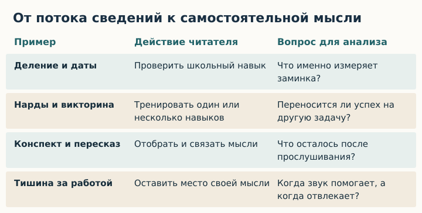

# ENS de Lyon · Série SES (B/L) · Russe (oral) 2026 — Corrigé brut

*Corrigé rédigé par IA, non officiel. Signalez toute erreur.*

**Rédaction** · GPT-6.2 Astra Ultra · vitesse non renseignée

L’ENS de Lyon demande une explication en langue étrangère d’un texte contemporain hors programme relatif à la civilisation d’une aire linguistique. Le jury identifie le tirage de la candidate de série SES. Le texte de travail est l’article de Piotr Andreïev publié dans Нож le 10 juin 2026. Le fascicule fournit les références de presse. Les éditions du corrigé s’appuient sur les articles publiés par les journaux. Les limites d’une éventuelle coupe dans les exemplaires remis aux candidats restent inconnues.

[Fascicule officiel, p. 14](https://www.ens-lyon.fr/sites/default/files/2026-11/Fascicule%20SES%202026.pdf#page=14) · [Rapport du jury, p. 24](https://www.ens-lyon.fr/sites/default/files/2026-10/Fascicule%20SES%202026.pdf#page=24)

[Andreïev · Нож](https://knife.media/vylechit-razum-kak-izbavitsya-ot-oshusheniya-degradaczii-uma/)

## Пётр Андреев. Что мы умеем делать с информацией?

### Представление статьи

Десятого июня 2026 года журнал «Нож» опубликовал статью Петра Андреева о чувстве, которое многим знакомо. Читатель получает больше сведений, чем прежде, а в конце дня ему трудно сказать, что именно он понял и запомнил. Автор обращается к человеку, который пользуется поисковиком, слушает подкасты и, возможно, поручает некоторые задачи искусственному интеллекту. Слово «ощущение» в заголовке существенно. Журналист начинает с тревоги читателя. Он не обследовал этого человека и не ставит ему диагноз. Как из опасения «я глупею» получается разговор о том, что значит мыслить самому?

Вначале Андреев предлагает вспомнить школу. Получится ли выполнить деление в столбик, назвать годы правления Петра Великого или даты жизни Пушкина, не заглядывая в телефон? Эффект этих вопросов зависит от аудитории. Для людей, которые учились в русскоязычной школе, указанные имена входят в запас знаний, считавшийся общим. Человеку предлагают узнать себя в моменте заминки. Для этого годится и карандаш, и пример из школьного курса истории. Тут легко перейти от наблюдения к гораздо более сильному выводу, чем оно позволяет. Если я забыл дату, это свидетельствует прежде всего о судьбе конкретного навыка. О том, что произошло с моим умом в целом, мы узнаём гораздо меньше.

И сам Андреев вносит существенную поправку. Навык, которым редко пользуются, может ослабеть, когда его функцию берёт на себя инструмент. Зато освобождается время для более сложной работы. Искусственный интеллект способен подготовить расшифровку или помочь упорядочить большой объём данных. Вопрос о полном отключении от интернета возникает как преувеличение, которое едва ли устроит даже тревожного читателя. Здесь становится заметной исходная проблема статьи. Если я отдал машине повторяющуюся операцию, сумею ли я распорядиться результатом и освобождённым временем?

### От списка полезных занятий к проверке их смысла

Следующая часть статьи напоминает колонку с привычными советами. Автор возвращается к режиму сна, движению и питанию, затем предлагает вспомнить о шахматах или собрать команду для игры «Что? Где? Когда?». Упоминание телевикторины, в которой ответ обсуждает команда, превращает общие рекомендации в культурно узнаваемую сцену. Рассуждение приобретает научную окраску, когда появляется понятие нейропластичности, способности нервной системы меняться под воздействием опыта. Ссылка на нейрофизиологов работает здесь как ссылка на авторитет. Сам журналист не приводит читателю протокол исследования, позволяющий приписать каждому занятию точно измеримый эффект.

Особенно показателен пример с нардами. Если играть каждый день, можно стать хорошим игроком в нарды. Из этого ещё не следует, что любое трудное решение в другой сфере дастся легче. Так автор сам ставит предел слишком удобному обещанию интеллектуальной тренировки. Он говорит о разнообразии занятий, включая изучение языков, встречи за пределами привычного круга и чтение. На примере родного языка задача выходит за рамки накопления новых слов. Попытка обойтись без канцелярских оборотов заставляет услышать, что именно мы говорим готовой формулой и можем ли выразить мысль по-другому.

Но как выглядит жизнь человека, который попробует буквально выполнить каждую рекомендацию? В статье появляются курсы, клубы, приложения, подкасты, расписание на неделю. Ритм перечисления становится почти комическим. Можно превратить уход за своим вниманием в ещё один бесконечный поток заданий. Тогда человек снова будет занят с утра до вечера и опять не сумеет вспомнить, чему он научился. Поэтому самый интересный поворот у Андреева связан со сменой вопроса. Вместо того чтобы искать следующий источник информации, читателю предлагают посмотреть, что осталось от предыдущего.

### Записать, пересказать, выдержать паузу

Первый опыт очень прост. Вспомним подкаст, услышанный в первой половине прошлого года. В памяти могут остаться яркие подробности, но сможем ли мы воспроизвести связь между ними? Запись собственными словами требует выбора. Чтобы сделать короткий конспект, надо решить, что в рассказе было главным, какой пример его подтверждал и как он связан со следующим. Заголовок о ручке возвращает школьный образ в новом значении. Речь идёт о самостоятельном действии, которое можно выполнить и в электронных заметках. Любовь к старым тетрадям здесь, пожалуй, менее важна, чем право самому решать, какие слова в них попадут.

Другой опыт напоминает о ребёнке, который пересказывал бабушке урок. Кнопка пересылки избавляет взрослого от необходимости построить фразу. Но рассказать услышанное собеседнику или записать голосовое сообщение — уже другая работа. Можно обнаружить, что эффектный ролик, особенно с теорией заговора, держался лишь на интонации и монтаже. Стоит попробовать изложить его содержание, и приходится заново искать основания для вывода. Показательно, что голосовое сообщение тоже цифровой инструмент. Одно устройство может поощрять и механическое распространение материала, и усилие по его самостоятельной переработке.

В конце рассматривается фоновый звук во время однообразной работы. Автор признаёт, что музыка иногда помогает человеку снизить напряжение и приступить к делу. Однако это не значит, что любой дополнительный стимул улучшает сосредоточенность. В заключительной мысли даже монотонный труд приобретает ценность. Пока слух не занят чужой речью, у человека может возникнуть собственное соображение. Перед нами характерный парадокс журналистского жанра. Текст, который сам претендует на несколько минут нашего внимания, предлагает потом это внимание освободить.

Таким образом, статью можно прочитать как критику привычки измерять ум количеством потреблённого содержания. Её сильнейшие примеры позволяют читателю проверить себя в ограниченной, понятной ситуации. Там же, где ощущение превращается в универсальное суждение о состоянии мозга, полезно спросить, какие доказательства потребовались бы для такого вывода. Практическая ценность статьи в том, что читатель может поставить гораздо более точный вопрос уже сейчас. После очередной передачи могу ли я объяснить другому человеку хотя бы одну мысль и рассказать, на чём она основана?

### Вопросы комиссии

**Почему автор вспоминает и Пушкина, и деление в столбик?** Это два разных следа общей школьной подготовки, память о факте и освоенный порядок действий. Замешательство в обоих случаях создаёт эффект узнавания. Оно не даёт общей оценки интеллекта человека.

**Предлагает ли журналист отказаться от технологий?** Он признаёт пользу автоматической расшифровки и даже предлагает отправить голосовое сообщение вместо пересылки готового ролика. Для него важно, что делает сам пользователь.

**Почему нарды служат оговоркой?** На их примере видно различие между успехом в конкретной игре и переносом умения на другие задачи. Рекомендация пробовать разное возникает именно после этой оговорки.

**Какую мысль вы бы стали проверять отдельно?** Например, влияние фоновой музыки на работу. Статья признаёт различия между людьми и между началом работы и длительной концентрацией. Для более общего вывода понадобились бы сопоставимые задачи и наблюдения.

