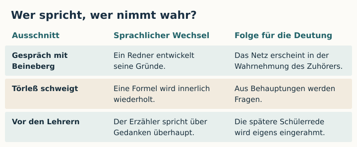
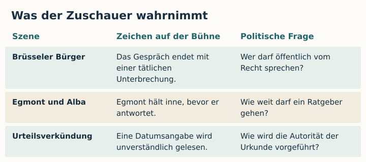
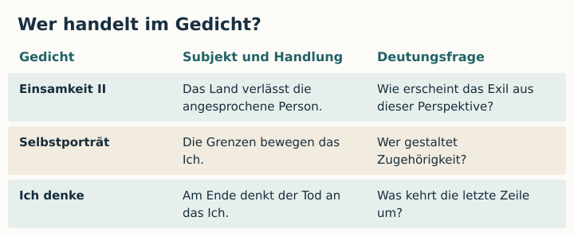
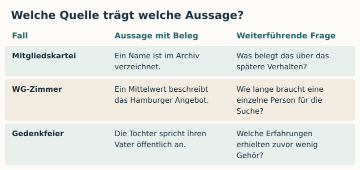

# ENS de Lyon · Séries A/L · Allemand oral 2026 — Corrigé brut partiel

*Corrigé rédigé par IA, non officiel. Signalez toute erreur.*

**Rédaction** · GPT-6.2 Astra Ultra · vitesse non renseignée

Le fascicule recense 12 billets littéraires et 34 articles de presse dans quatre séries ou exercices. Les bornes des huit passages de Musil et Goethe sont vérifiées. Dix des douze poèmes d’Ausländer ont été lus dans des témoins identifiés. Pour Papier, le titre du témoin disponible reste incertain, et le texte d’Altenheim manque. Parmi les articles, 12 versions publiées ont été lues en entier et 20 notices portent sur des passages accessibles, une version dans une autre langue ou un document apparenté. Pour P3 et P28, seul le titre du fascicule est attesté. Les coupes de presse distribuées ne sont pas publiées.

[Fascicule d’allemand, p. 2–5](https://www.ens-lyon.fr/sites/default/files/2026-11/Allemand%202026.pdf#page=2) · [Rapport d’allemand, p. 25–38](https://www.ens-lyon.fr/sites/default/files/2026-10/Allemand%202026.pdf#page=25)

## Lettres et arts · Presse

## P1. Deutsche Welle · Nofretete in Berlin und in Gizeh

Elizabeth Grenier nimmt die Eröffnung des neuen Museums in Gizeh zum Anlass, die Geschichte der Büste erneut zu erzählen. Der Fund von 1912 und die Fundteilung sind für diese Geschichte wichtig, erschöpfen aber die Frage der Berechtigung nicht. Selbst ein nach den damaligen Vorschriften vollzogener Vorgang kann unter politischen Bedingungen zustande gekommen sein, in denen die Beteiligten ungleiche Möglichkeiten hatten. Zu unterscheiden sind deshalb die Behauptung rechtmäßigen Besitzes, die historische Untersuchung des Vorgangs und die heutige Entscheidung darüber, wo das Objekt gezeigt wird.

Warum hat eine Reproduktion in diesem Streit eine so aufschlussreiche Stellung? Die Form des Gesichts könnte in beiden Ländern zu sehen sein. Die Attraktion, mit einem einzigartigen Gegenstand für ein Museum zu werben, bliebe an einem Ort. Der Historiker Jürgen Zimmerer schlägt vor, in Berlin gerade diese Geschichte der Überführung und der Rückgabeforderungen auszustellen. Damit erhielte auch der leere gewordene Platz eine konkrete historische Aussage. **Nachfrage.** Wer erhebt hier eine Forderung? Einzelne ägyptische Stimmen, deutsche Historiker und die Institution, welche die Büste besitzt, sprechen aus verschiedenen Positionen. Ein Kommentar sollte sie benennen.

[Notice de presse](https://amp.dw.com/de/nofretete-restitution-%C3%A4gypten-petition-berlin/a-74636617)

## P2. Die Zeit · Deutschlands mögliche Rolle nach dem Pariser Gipfel

Die Frageform der Überschrift lenkt die Aufmerksamkeit auf einen noch offenen politischen Prozess. Von Bedeutung ist das Modalverb *kann*. Ein Vorschlag unter Verbündeten ist weder eine bereits eingegangene Garantie noch deren Umsetzung. Aus der Berichterstattung zum Pariser Gipfel vom Januar lässt sich eine Leitfrage entwickeln. Wie lässt sich der Ukraine eine glaubwürdige Perspektive geben, wenn hinter gemeinsamen Erklärungen unterschiedliche nationale Entscheidungen stehen? Der Gegenstand ist die politische Verbindlichkeit solcher Zusagen.

Für eine Antwort sollte man auseinanderhalten, wer konsultiert wird, wer sich öffentlich äußert und wer rechtlich über eine Beteiligung entscheidet. Auch die Ukraine ist als politisches Gegenüber in einem Bericht über ihre Zukunft zu benennen. **Nachfrage.** Woran würde man eine Veränderung gegenüber einer Absichtserklärung erkennen? An den ausdrücklich festgelegten Beteiligten, Bedingungen und Zuständigkeiten. Hier ist der veröffentlichte Zeitungsnachweis des Beitrags belegt. Die vollständige Darstellungsfolge des Artikels ist offen.

[Notice de presse](https://www.zeit.de/politik/ausland/2026-01/paris-gipfel-sicherheitsgarantien-ukraine-deutschland-faq)

## Langues vivantes LV1 · Littérature

## Robert Musil · Das Netz der Begründungen (S. 87–90)

Im Gespräch über Reiting und Basini hört Törleß zunächst nur mit halbem Ohr zu. Das ist erzählerisch entscheidend. Der Leser erhält Beinebergs Rede im Wortlaut und zugleich einen Eindruck davon, wie ungleichmäßig sein Zuhörer sie aufnimmt. Dem gelassenen Sprecher steht ein innerlich zitternder Törleß gegenüber. Erst als Beineberg erklärt, was er über Reiting weiß, gewinnen die vermeintlich weit hergeholten Ideen für den Zuhörer eine konkrete Gestalt. In der Vorstellung von der Spinne laufen Haltung, Sprache und Beziehung zusammen. Wer noch über Möglichkeiten nachzudenken scheint, hat den anderen gedanklich schon gefangen.

Die Rede über Reiting legt einen sozialen Unterschied frei. Ein Ausschluss aus dem Institut würde seine Aussichten empfindlich treffen, weil seine Mutter ihm keinen vergleichbaren Weg finanzieren kann. Beineberg behandelt Wissen über diese Lage wie einen Besitz. Bei Basini verschiebt sich seine Begründung abermals. Auf die Frage nach der Anzeige folgt der Anspruch, selbst über eine Strafe zu entscheiden. Erst auf Törleß’ Nachfrage fällt das Wort, das den behaupteten Erziehungszweck durchkreuzt. Die Pausen vor dem Schluss lassen hören, dass Beineberg auch die Wirkung seiner Worte auf den Zuhörer berechnet. Törleß erschrickt und möchte den Zustand zugleich auskosten. Seine Wahrnehmung zeigt die Gefahr, ohne ihn von seiner Mitverantwortung zu entlasten.

**Nachfrage.** Wer entwirft das Bild vom Netz? Es gehört zunächst zu Törleß’ Wahrnehmung. Musils Erzähler kann dadurch zeigen, wie das abstrakte Kalkül für den Zuhörer plötzlich körperlich greifbar wird.

[Texte de Musil](https://www.gutenberg.org/ebooks/34717)

## Robert Musil · Eine Begründung, in der Basinis Stimme fehlt (S. 90–93)

Der Satz über Törleß’ vorsichtiges Schweigen nimmt Beineberg die Möglichkeit, die Wirkung seiner Rede zuverlässig einzuschätzen. Also redet er weiter. Ausgerechnet während er den Unterschied zwischen sich und Reiting erläutert, wird sichtbar, was sie verbindet. Reiting möchte über einen anderen Menschen verfügen. Beineberg beansprucht für sein eigenes Handeln einen höheren inneren Zweck. In beiden Erklärungen entscheidet das Bedürfnis desjenigen, der Macht hat. Wie Basini die Lage erlebt, soll für die Entscheidung bedeutungslos sein.

Die verschiedenen Stimmen lassen sich auch dort unterscheiden, wo sie dasselbe Wort verwenden. Beineberg erklärt die bloß äußerliche Ähnlichkeit der Menschen zum Grund, Basini jede Rücksicht zu versagen. Törleß wiederholt die Wendung innerlich. Für ihn bezeichnet sie nun ein Wahrnehmungsproblem. Er erkennt ein Gesicht, hinter dem ihm ein zweites zu stehen scheint, und kann sich in den erkannten Menschen gerade deshalb nicht sicher hineindenken. Aus der Behauptung des Redners werden am Schluss offene Fragen des Zuhörers. Diesen Wechsel hörbar zu machen ist präziser, als beiden Figuren dieselbe Weltanschauung zuzuschreiben. Die Wirkung bleibt beunruhigend. Auch die Selbstbeobachtung des Zuhörers gibt Basini keine Stimme.

**Nachfrage.** Wozu dient die Wiederholung? Sie markiert den Augenblick, in dem eine fremde Formel in Törleß’ Denken eingeht und dabei ihre Funktion verändert.

[Texte de Musil](https://www.gutenberg.org/ebooks/34717)

## Robert Musil · Zwei Arten des Sehens vor der Schulinstanz (S. 223–226)

Der anfangs erwartete Augenblick des klaren Sprechens führt zunächst zu einer Unterbrechung. Bevor Törleß vor den Lehrern das Wort ergreift, unterscheidet die Erzählerstimme zwischen einem Gedanken, dessen logische Folge man jederzeit wiederholen kann, und einem Gedanken, dessen Wahrheit man in einer bestimmten Lage empfindet. Der Satz weitet die Perspektive über den Schüler hinaus zum unbestimmten *man*. Die verblühende Blume erklärt die Differenz sinnlich. Die Form kann erhalten bleiben, obwohl Duft und Farbe verschwunden sind.

Wie lässt sich eine solche Erfahrung vor einer Institution bezeugen, die verständliche Gründe erwartet? Törleß beruft sich auf die irrationalen Zahlen. Was er innerhalb der mathematischen Zusammenhänge nachvollziehen kann, befremdet ihn, sobald er es aus einer anderen Richtung ansieht. Die Mathematik liefert ein Modell für den Wechsel der Betrachtungsweise. Die eingeschobene Erzählerbemerkung über die beinahe dichterische Inspiration relativiert die Souveränität dieser erstaunlich gewandten Rede. Auch ihr Ausklang bleibt doppeldeutig. Törleß erwartet, künftig zwischen den Sichtweisen wechseln zu können. Dass niemand ihn am Gehen hindert, ist eine Handlung auf der Ebene der Schule. Ob die Lehrer ihn verstanden haben oder wie sie die Verantwortung gegenüber Basini beurteilen, bleibt damit offen.

**Nachfrage.** Worin besteht der Fortschritt? Törleß muss keine der beiden Erfahrungen mehr zur einzig möglichen machen. Das erklärt seinen neuen Ton, ohne die zurückliegenden Handlungen nachträglich zu rechtfertigen.

[Texte de Musil](https://www.gutenberg.org/ebooks/34717)

## Johann Wolfgang Goethe · Die Verfassung auf der Straße (II. Aufzug, S. 33–36)

Vansen beruft sich auf Urkunden, Bücher und den früheren Besitzer dieser Schriftstücke. Die Erinnerung an eine Bibliothek begründet seinen Anspruch, vor Handwerkern über Recht zu sprechen. Was er erzählt, betrifft jedoch den Alltag aller Anwesenden. Dass die Städte der Niederlande unterschiedliche Rechte besitzen, soll zeigen, dass auch der gemeinsame Landesherr an überkommene Bindungen gebunden ist. Der Hinweis auf das tägliche Brot erklärt, warum solche Fragen trotz ihrer Bedeutung selten verhandelt werden.

Das Theater macht aus einer Geschichte über politische Vertretung eine Probe dieser Vertretung im Kleinen. Wer darf für die Brüsseler Bürger sprechen? Der Zimmermeister beansprucht hinreichendes Wissen für jeden Bürger. Jetter möchte mehr erfahren. Andere fordern Vansen zum Weitererzählen auf. Wenn mehrere Stimmen als *das Volk* auftreten, ergibt sich diese vorläufige Einheit erst aus den wechselnden Reaktionen. Die Frage nach den neuen Bischöfen verleiht dem alten Recht eine gegenwärtige Brisanz. Am Ende stehen der Ruf nach Egmont und Oranien und die tätliche Unterbrechung durch den Seifensieder dicht nebeneinander. Die letzte Bühnenanweisung beendet eine Debatte, die mit der Berufung auf schriftlich verbürgte Rechte eingesetzt hat.

**Nachfrage.** Warum wäre es ein Fehler, hier von einer gesichtslosen Menge zu sprechen? Die Berufsbezeichnungen, Einwürfe und wechselnden Bündnisse lassen verschiedene Interessen innerhalb einer Bürgerschaft hörbar werden.

[Texte de Goethe](https://www.gutenberg.org/ebooks/2146)

## Johann Wolfgang Goethe · Wer entscheidet, was Frieden ist? (IV. Aufzug, S. 81–84)

Egmont erscheint als loyaler Amtsträger vor Alba und erwartet Befehle des Königs. Alba bietet ihm scheinbar eine andere Rolle an. Der König wolle Rat. Ob eine Beratung noch möglich ist, wenn das Heer bereits angekommen ist und der König fernbleibt, wird zur dramatischen Frage. Für Alba ist die Ruhe im Land unzureichend, solange sie vom guten Willen der Bewohner abhängt. Egmont hält ebendiesen Willen für die tragfähigste Sicherheit eines Königs. Dasselbe Wortfeld von Treue und Ordnung verdeckt zunächst zwei gegensätzliche Vorstellungen vom Regieren.

Der Streit um eine Begnadigung macht den Unterschied praktisch fassbar. Alba erwartet von Strafe Abschreckung. Egmont hofft, Vertrauen könne die gestörte Bindung erneuern. Die Regentin, deren politisches Geschick Egmont verteidigt, ist dafür ein konkretes Beispiel. Einen Wendepunkt setzt die Bühnenanweisung vor seiner letzten längeren Antwort. Die aufsteigende Erregung wird sichtbar, dann gewinnen Pause und Selbstbeherrschung Zeit. Egmont berichtet nun, welchen Verdacht man über die Absichten des Königs äußere. Der prächtige Teppich am Schluss verwandelt ein Argument in eine Bühnensituation im Kleinen. Die sichtbare religiöse Darstellung kann den Blick auf denjenigen verstellen, der dahinter auf seinen Vorteil wartet.

**Nachfrage.** Gibt Egmont seine Loyalität mit dieser Kritik auf? Er unterscheidet den Dienst am König von der Zustimmung zu jedem Mittel, das im Namen des Königs eingesetzt wird.

[Texte de Goethe](https://www.gutenberg.org/ebooks/2146)

## Johann Wolfgang Goethe · Ein Gespräch, das Gehorsam verlangt (IV. Aufzug, S. 85–88)

Alba fragt, ob Egmont dasselbe vor dem König sagen würde. Egmont nimmt die Herausforderung beim Wort. Gerade die Gegenwart eines Königs sollte es einem treuen Ratgeber ermöglichen, offen zu sprechen. Aus dieser Antwort entsteht eine Rede an den abwesenden Herrscher. Das Gleichnis von Herde, Zugtier und Pferd unterscheidet Formen des Führens. Wer dem eigenwilligen Tier etwas abverlangt, muss zuerst seine Reaktionen kennen. Auf die Provinzen bezogen, wird aus dem scheinbar einfachen Bild ein Argument für die Rücksicht auf örtliche Verfassungen und Erfahrung.

Die Szene stellt zugleich die Grenze des Gleichnisses aus. Wer oben sitzt und wer geführt wird, bleibt selbst in Egmonts Gegenbild vorgegeben. Sein politischer Spielraum liegt in der Art des Regierens, nicht in der Abschaffung der Monarchie. Alba antwortet schließlich, er habe keinen Auftrag, Gründe erneut zu prüfen. Sein Wort für das Verhältnis zwischen Herrscher und Volk ist Gehorsam. So erklärt sich Egmonts bitteres Schlussbild vom Erschüttern der Luft. Er hat wirklich gesprochen und seine Stimme hat den Raum erreicht. Das Verfahren war jedoch so eingerichtet, dass seine Argumente nichts mehr verändern konnten.

**Nachfrage.** Welches Wort aus Albas Rede verändert rückwirkend den Anfang des Gesprächs? Der fehlende *Auftrag* zur Prüfung zeigt, wie wenig die anfängliche Aufforderung zur Beratung gewährleistete.

[Texte de Goethe](https://www.gutenberg.org/ebooks/2146)

## Johann Wolfgang Goethe · Klärchen findet keine öffentliche Stimme (V. Aufzug, S. 91–95)

Klärchen beginnt mit einer Überzeugung über andere Menschen. Weil sie Egmont lieben, müssten sie zu seiner Rettung bereit sein. Nur die Stimme fehle, die das bereits gemeinsame Wollen in Worte fasst. Das Theater erlaubt, die Probe aufs Exempel unmittelbar zu beobachten. Während sie Nachbarn anspricht und aus dem einzelnen Ich ein handelndes Wir machen will, beantwortet der Zimmermeister ihren Appell mit einer Frage über das vermeintliche Kind. Die Zuhörer sehen sie an, blicken beiseite und scheuen schließlich selbst Egmonts Namen. Zwischen ihrer Deutung der Gesichter und der sichtbaren Reaktion auf der Bühne wächst der Abstand.

Wie wird aus dieser politischen Enttäuschung eine persönliche? Die Hinweise auf Fenster, Türen und grüßende Hände machen die frühere Ehrung wieder gegenwärtig. Jede damals leicht mögliche Geste erscheint nun unter anderen Bedingungen. Klärchen hält auch die eigenen Arme in diese stumme Gegenüberstellung. Die Anklage gegen die Zurückweichenden schließt die eigene Ohnmacht ein. Nach dem Abgang der Bürger bleiben nur noch zwei Menschen im Gespräch. Das knappe letzte *Gut* antwortet auf Brackenburgs Vorschlag, heimzugehen. Der jähe Verlust an sprachlichem Raum lässt hörbar werden, wie eine öffentliche Rede vereinsamt.

**Nachfrage.** Warum sollte man Klärchens anfängliches Wir mit veränderter Betonung lesen? Es ist zuerst ein Versprechen und wird mit jeder ausbleibenden Antwort stärker zu einer erhofften Gemeinsamkeit.

[Texte de Goethe](https://www.gutenberg.org/ebooks/2146)

## Johann Wolfgang Goethe · Urteil vor Publikum (V. Aufzug, S. 105–108)

Egmont erwacht und versucht an Haltung und Blicken der Eintretenden abzulesen, was sie bringen. Silva hält dem erwachenden Gefangenen die formelle Sprache eines Urteils entgegen. Egmont unterbricht schon die Formel der übertragenen Gewalt. Kann der König dieses Recht überhaupt übertragen? Noch während der Gefangene die Zuständigkeit bestreitet, setzen Verlesen und Abgang das Urteil auf der Bühne als vollendete Tatsache durch. Eine bemerkenswerte Anweisung betrifft das Publikum direkt. Datum und Jahr sollen akustisch unverständlich bleiben. Die Urkunde behauptet höchste Genauigkeit, während ihre Vermittlung als hörbarer Vorgang in den Vordergrund rückt.

Mit Silvas Abgang verändert das begrenzte Licht den Raum. Erst nach einem Augenblick bemerkt Egmont Ferdinand, Albas Sohn. Das Urteil über ihn selbst wird nun zum Ausgangspunkt seines Urteils über den Vater. Die Erinnerung an einen öffentlichen Wettbewerb gibt dem Vorwurf persönlicher Eifersucht ein anschauliches Motiv. Sie belegt Egmonts Sicht, ohne sie in eine neutrale Erklärung von Albas Politik zu verwandeln. An Ferdinand richtet sich zuletzt eine andere Möglichkeit moralischer Autorität. Ein Sohn könnte den Vater achten wollen und dennoch Scham über seine Handlungen empfinden.

**Nachfrage.** Wieso gehört das Licht zur Auslegung? Es macht aus der offiziellen Verlesung eine Begegnung zweier Menschen mit ungleichen Handlungsmöglichkeiten. Die Bemerkung „6. Aufzug“ in der Liste des Juryberichts ist ein Versehen. Das Stück hat fünf Aufzüge, und die Kerkerszene gehört zum fünften.

[Texte de Goethe](https://www.gutenberg.org/ebooks/2146)

## Rose Ausländer · Erinnerte und weitergegebene Worte (S. 12, 16, 41)

**1. Alte Zigeunerin.** Der erste Satz stellt den Tod der Frau fest, der zweite erinnert an ihr Lebensversprechen. Der Widerspruch bringt die Erinnerung in Bewegung. Zwischen dem Stacheldraht und den beiden unruhigen Sonnen in den Augen der Frau liegen zwei verschiedene Arten, eine Reise zu sehen. Ihre Worte tragen das Ich über den Atlantik und wieder zurück. Im Traum begleitet es die Verstorbene bis zu einem dunklen Fluss. Die beiden Wege trennen sich dort. Wer zurückströmt, kehrt in die eigene, noch fieberhaft gegenwärtige Geschichte zurück. Beim Vorlesen verdient der Wechsel vom erzählten Vergangenen zur Bewegung des Schlusses mehr Aufmerksamkeit als eine Festlegung der Figur auf den historisch belasteten Ausdruck im Titel.

**2. Einsamkeit II.** Die Erfüllung einer Weissagung wird vorangestellt. Danach erhält das kommende Unglück die Form einer Anrede. Auffällig handelt zunächst das Land selbst. Es wird die angesprochene Person verlassen. Diese Umkehrung lässt Vertreibung und Verlust anders erscheinen als die Schilderung einer freiwilligen Abreise. Die geschlossenen Lippen und die fremden Lippen machen die Störung sprachlicher Verständigung körperlich vorstellbar. Ausgerechnet die Einsamkeit wird zum handelnden Gegenüber, das lieben und umarmen kann. Der Schluss verwandelt die Sprache des Trostes in eine Erfahrung der Verlassenheit.

**3. Worte.** Hier tritt das Ich mit einer Gabe vor mehrere Angesprochene. Die knappe Ankündigung trägt die ganze lockere Reihe von Herkunftsangaben. Die Bäume verweisen auf das Buchenland, die Wellen auf die Überfahrt, Brücken und Paläste auf Venedig. Die tanzende Jugend in Israel erweitert die Landschaft um menschliche Bewegung. Erst der letzte Herkunftsort ist keiner auf einer Landkarte. Der Frieden gehört grammatisch zum Traum des Sprechers. Darin liegt der Abstand zwischen der weitergegebenen Hoffnung und einer behaupteten Wirklichkeit.

**Zusammenschau.** In jedem Gedicht verändert jemand seine Stellung zur Sprache. Ein Ich empfängt Worte, ein Du hört seine Zukunft vorausgesagt, ein Ich trägt anderen Worte zu. Die drei Sprecherpositionen ergeben ein Gespräch zwischen den für die Prüfung zusammengestellten Gedichten. Die Auswahl und Reihenfolge des Reclam-Bandes stammen vom Herausgeber Helmut Braun.

[Deux premiers poèmes, p. 103 du PDF](https://phbl-opus.phlb.de/frontdoor/deliver/index/docId/1384/file/ral_gesamt_erstauflage_red.pdf#page=103) · [Worte dans Adalbertusforum](https://www.adalbertuswerk.de/wp-content/uploads/2017/01/23_3_2001_September_Internet.pdf)

## Rose Ausländer · Wer kann eine Lebensgeschichte erzählen? (S. 23, 68, 94)

**1. Biographische Notiz.** Der Titel weckt die Erwartung von Daten und Stationen. Das Gedicht beginnt dagegen mit dem Vollzug des Redens. Der Pruth und die brennende Nacht treten in eine bildliche Beziehung, in der ein Fluss zum Gegenüber der Zerstörung wird. Baum- und Vogelbilder speichern nicht einfach eine idyllische Herkunft. Ihr Klang und der verstummte Gesang machen eine beschädigte Landschaft hörbar. Mit dem gelben Stern wechselt die Stimme vom Ich zum Wir der Verfolgten. In der Folge der Kontinente verliert Europa seine vermeintliche Eindeutigkeit als Heimat. Die letzten Verben unterscheiden zwischen an einem Ort wohnen und überhaupt leben.

**2. Selbstporträt.** Die ersten knappen Selbstbezeichnungen nennen jüdische Zugehörigkeit, Sprache und das politische Zeichen der schwarzgelben Fahne. Sie ergeben kein unbewegtes Bild. Eine grammatische Verschiebung erklärt warum. Die Grenzen sind das Subjekt einer Bewegung, die das Ich aus der angestammten Stellung verdrängt. Der Rhythmus der nachgestellten Bezeichnungen für verschiedene Bevölkerungen führt diese Bewegung weiter. Im letzten Abschnitt erhält Europa ein Du. Die Geburt, von der das Ich träumt, liegt vor ihm. Ein Selbstporträt kann also auch zeigen, was jemand erst werden möchte.

**3. Ich denke.** Das Verb ordnet eine Reihe unterschiedlicher Erinnerungen. Kindheit, erste Liebe, Orte, gelesene Autoren, die Erfahrung des Ghettos und die Abhängigkeit von anderen Menschen im Alter stehen nebeneinander. Diese Offenheit der Reihe erlaubt, Gegensätzliches zu erinnern, ohne es gleichzusetzen. Die Ohnmacht des Körpers und die fortdauernde Kraft des Denkens markieren einen Umschlag. Am Schluss ist der Tod das grammatische Subjekt und das bisher sprechende Ich das Objekt seines Denkens. Der wiederholte Satz hat seine Richtung gewechselt.

**Zusammenschau.** Der erste Text fragt, wovon ein Überlebender sprechen kann, der zweite, was das Ich mit sich geschehen sieht, der dritte, wer wen im Gedächtnis hält. Über die Pronomen und Satzsubjekte lassen sich die drei Antworten bis in die letzten Zeilen verfolgen.

[Biographische Notiz et ses variantes, p. 91 du PDF](https://phbl-opus.phlb.de/frontdoor/deliver/index/docId/1384/file/ral_gesamt_erstauflage_red.pdf#page=91) · [Selbstporträt, p. 103 du PDF](https://phbl-opus.phlb.de/frontdoor/deliver/index/docId/1384/file/ral_gesamt_erstauflage_red.pdf#page=103) · [Ich denke, p. 11 du PDF](https://phbl-opus.phlb.de/frontdoor/deliver/index/docId/1384/file/ral_gesamt_erstauflage_red.pdf#page=11)

## Rose Ausländer · Was geschieht auf dem Blatt? (S. 29, 33, 35)

**1. Treffen.** Der Papierbogen wird zuerst zum Schneefeld. Die schreibenden Finger haben als Pfeile ein Ziel. Aus der räumlichen Vorstellung des Bestimmungsorts wird durch eine geringe Lautverschiebung ein Wort, das man erst im Schreiben findet. Die Reise der Wörter besitzt ein eigenes Zeitmaß. Am Schluss erweist sich der Punkt als Satzzeichen und als Ort einer Begegnung mit dem Wort eines Du. Die sprachliche Verdichtung führt damit von der scheinbar einsamen Hand zum Gegenüber.

**2. Papier.** Der Titel auf S. 33 ist durch das Juryprotokoll gesichert. Ein Ausländer zugeschriebenes, separat gedrucktes Kurzgedicht setzt beim Papier als Material an und entfaltet den Weg, den es zu Sinnbildern und zu Menschen eröffnen kann. Dieser Druck gibt allerdings nicht den Titel *Papier* an. Ob es sich um genau dieselbe Fassung wie auf S. 33 handelt, bleibt offen. Für das vorgelegte Exemplar wäre zu prüfen, mit welchem Wort das Material in Bewegung gerät und ob am Ende ein menschlicher Adressat erscheint. Eine Versfolge für die Seite des Reclam-Bandes lässt sich daraus nicht sicher ableiten.

**3. Unbeschriebenes Blatt.** In der bis zum angegebenen Schluss belegten Fassung ist die weiße Fläche ein gefräßiges Tier. Die Haut und ihre anziehenden Poren bereiten eine Begegnung vor, in der sich der Schreibende mit großer Intensität mitteilt. Mund und Ohr erhalten Funktionen, die gewöhnlich zu verschiedenen Vorgängen gehören. Ein Ohr soll etwas aufnehmen, hier wird es gefüllt. Das zugleich geduldige, stumme Tier kann aufnehmen, ohne zu antworten. Der letzte Gegensatz umfasst Lust und Verzweiflung, zwei Empfindungen, die in dasselbe Schreiben eingehen.

**Zusammenschau.** Zwischen erstem und drittem Text bleibt eine Spannung bestehen. Einmal eröffnet das Blatt eine Begegnung mit dem Wort des Du. Einmal erscheint es als ein Gegenüber, das die Erfahrung aufnimmt und schweigt. Die genaue Stellung des mittleren Gedichts in diesem Vergleich muss am Prüfungsdruck überprüft werden.

[Treffen](https://www.duesseldorf-entdecken.de/rose-auslaender/) · [Témoin sans intitulé assuré pour Papier](https://trinitatis-bonn.ekir.de/wp-content/uploads/2023/06/2016-Predigtreihe_Rose-Auslnder.pdf) · [Unbeschriebenes Blatt I](https://interkulturelleslehrbuch.blogspot.com/)

## Rose Ausländer · Alter und Blick (S. 90–92)

**1. Altenheim.** Für das Gedicht auf S. 90 sind Titel und Seitenzuweisung durch das Juryprotokoll gesichert. Der Wortlaut konnte nicht überprüft werden. Beim Lesen wäre zu klären, ob der institutionelle Name ein Zimmer, eine Gruppe von Menschen oder die Perspektive eines einzelnen Bewohners eröffnet. Die biographische Tatsache, dass Ausländer im Nelly-Sachs-Haus lebte, identifiziert weder eine Sprecherfigur noch die Haltung dieses Gedichts.

**2. Porträt eines Greises.** Der Eingang bringt Gesicht und Grafik zusammen. Oberflächen werden allmählich zu Zeichen. Falten lassen vergangene Erfahrungen ahnen, ohne ihren Inhalt für den Betrachter verfügbar zu machen. Das wiederholte Schönheitsurteil trifft ausdrücklich auf das als hässlich Wahrgenommene. Der Herbst und die eingemeißelten Gedanken setzen Zeit in eine vorstellbare Oberfläche um. Schließlich wechselt das Gedicht von der Beschreibung zur direkten Frage. Das Wort *Mitmensch* bindet den Betrachtenden an den Betrachteten. Den Mann anzusprechen ist etwas anderes, als sein Gesicht vollständig entziffert zu haben.

**3. Spiegelbild.** Die knappe Aufforderung am Anfang rückt den eigenen Körper in die Stellung eines Gegenstands, den man zur Kenntnis nehmen soll. Aus dieser Schau entsteht eine Frage in der ersten Person. Das sprechende Ich erscheint im eigenen Blick zugleich als Du. Die Antwort arbeitet mit dem Wechsel von Sein zu Werden. Erst die kurzen Schlusszeilen geben dem Werden seine Richtung und sein Ziel. Der Zeilenfall lässt das Altern als zeitlichen Vorgang entstehen, den eine unbewegte Spiegelfläche zunächst kaum zu zeigen scheint.

**Zusammenschau.** Das Porträt beginnt bei einem anderen, das Spiegelbild beim eigenen Körper. Beide Gedichte führen von einer scheinbar lesbaren Oberfläche zu einer Frage, die einen Menschen angeht. Für *Altenheim* bleibt die Art des Blicks am Original zu bestimmen.

[Intitulé chez Reclam](https://www.reclam.de/produktdetail/regenwoerter-9783150089590) · [Porträt eines Greises, Archives sociales suisses](https://e-perabt.sozialarchiv.ch/pdf/9804.pdf) · [Spiegelbild, p. 102 du PDF](https://phbl-opus.phlb.de/frontdoor/deliver/index/docId/1384/file/ral_gesamt_erstauflage_red.pdf#page=102)

## Langues vivantes LV1 · Presse

## P3. Der Tagesspiegel · Nato-Ostflanke

**Nur die Juryangabe.** Die sehr kurze Bezeichnung nennt eine Region des Bündnisses und den 26. August 2025. Mehrere zeitnahe Beiträge behandeln verschiedene Ereignisse. Keiner ließ sich zweifelsfrei als genau dieser Prüfungsartikel identifizieren. Für die Einleitung lässt sich erklären, dass der Ausdruck die Perspektive des Bündnisses auf seine östlichen Mitgliedstaaten bezeichnet. Ob hier eine innenpolitische Debatte, ein diplomatisches Treffen oder ein anderes Ereignis den konkreten Anlass gab, bleibt am fehlenden Text zu bestimmen.

## P4. Der Tagesspiegel · Özdemirs Erfolg in Baden-Württemberg

Der Kommentar entwickelt ein Paradox. Einer grünen Partei gelingt ein Erfolg mit einem Kandidaten, der im Wahlkampf seine Distanz zur Bundespartei betont. Der Rückstand gegenüber der CDU zu Beginn des Jahres macht die Veränderung erklärungsbedürftig. Die Selbstinszenierung als eigenständiger Vertreter des Landes und der Bezug auf dessen Wirtschaftsstruktur bieten eine konkretere Erklärung als Popularität allein. Der Vergleich der Landesgrünen mit der bayerischen CSU macht sichtbar, welchen Anspruch auf regionale Verankerung Özdemir erhebt.

Von einem Wahlabend führt der Artikel zu möglichen Folgen in Berlin. Die CDU muss den Verlust eines Vorsprungs erklären, die SPD ihr schwaches Ergebnis, und auch die Grünen müssen fragen, wie weit sich der erfolgreiche Kurs übertragen lässt. Der Autor schreibt noch unter dem Eindruck von Hochrechnungen. Ein Erfolg beim Wahlvolk, eine parlamentarische Mehrheit und die spätere Arbeit als Regierungschef sind drei unterschiedliche Etappen. **Nachfrage.** Weshalb taucht Friedrich Merz in einem Landeswahlkommentar auf? Als Kanzler und CDU-Chef hat er ein Interesse sowohl an der eigenen Partei als auch an der Stabilität seines Koalitionspartners im Bund.

[Notice de presse](https://www.tagesspiegel.de/landtagswahl-in-baden-wurttemberg-ozdemirs-last-minute-erfolg-sturzt-cdu-und-spd-in-die-krise-15330650.html)

## P5. Unternehmerverbände und Gespräche mit der AfD

Die Frage, ob die Wirtschaft mit der AfD reden soll, macht aus sehr verschiedenen Akteuren einen scheinbar einheitlichen Sprecher. Ein einzelner Unternehmer, ein Verband mit Mitgliedern unterschiedlicher Auffassungen und ein gewähltes Parlament haben verschiedene Aufgaben. Eine Einladung zu einer Veranstaltung kann deshalb mehr bedeuten als die Bereitschaft, eine öffentliche Aussage einer Partei zur Kenntnis zu nehmen. Sie verleiht Zugang und kann als Zeichen der Anerkennung verstanden werden.

Die bibliographische Schwierigkeit betrifft die Grundlage dieses Kommentars. Ein am selben Tag auffindbarer FAZ-Artikel trägt den genauen Titel und bespricht die Entscheidung des Verbands der Familienunternehmer sowie den Widerspruch anderer Unternehmer. Das Lyoner Heft nennt dagegen *Die Zeit*. Der FAZ-Anfang dient hier als Vergleich, die Identität mit der Prüfungsfassung bleibt offen. **Nachfrage.** Warum wäre die einfache Gegenüberstellung von Reden und Schweigen ungenau? Man kann eine Partei öffentlich kritisieren, ohne ihr das Forum eines Verbands anzubieten. Umgekehrt ist aus einer Begegnung allein noch keine Übereinstimmung in einer Sachfrage abzuleiten.

[Article homonyme de la FAZ](https://www.faz.net/aktuell/wirtschaft/soll-die-wirtschaft-mit-der-afd-reden-oder-nicht-110791155.html)

## P6. Frankfurter Allgemeine Zeitung · Der Wind weht von rechts

Der Doppelsinn der Überschrift verbindet einen Energieträger mit einer politischen Richtung. Der veröffentlichte Anfang führt zunächst nach Davos. Ein Auftritt, von dem die Zuhörer eine außenpolitische Erklärung erwarten, wird zum Anlass, die Windkraft anzugreifen. Danach richtet der Bericht den Blick auf eine Veranstaltung der AfD. Deren Publikum und die dort vorgetragenen Behauptungen sind zwei verschiedene Gegenstände der Berichterstattung.

Die Metapher vom Drehen passt zu beiden. Wer Zustimmung bei einer Veranstaltung beobachtet, hat etwas über die Wirkung politischer Rede erfahren. Zur Beurteilung einer Behauptung über Kosten oder Umweltwirkungen braucht man hingegen einen Vergleichsmaßstab und überprüfbare Daten. **Nachfrage.** Warum ist der Einstieg über einen amerikanischen Politiker sinnvoll? Er zeigt, wie ein energiepolitischer Gegenstand grenzüberschreitend zu einem Erkennungszeichen werden kann. Die einzeln geprüften Aussagen und die weitere Reportage sind im zugänglichen Anfang nicht vollständig nachzuvollziehen.

[Notice de presse](https://www.faz.net/aktuell/wirtschaft/klima-nachhaltigkeit/afd-zur-windkraft-wie-die-partei-fakten-verdreht-accg-110829819.html)

## P7. Frankfurter Allgemeine Zeitung · Eurovision in Wien

Das erste Stück des Wiener ESC-Tagebuchs beginnt vor dem eigentlichen Wettbewerb. Die Proben haben bereits stattgefunden, während das offizielle Begrüßungsereignis erst bevorsteht. Diese zeitliche Verschiebung verrät etwas über das Format. Was für das Fernsehpublikum an einem Abend sichtbar wird, ist für die Gastgeberstadt längst ein Ereignis mit eigenem Kalender. Auch das Jubiläum schafft eine zweite Zeitebene, auf der die Stadt ein europäisches Medienereignis als Geschichte inszeniert.

Die Form des Tagebuchs erlaubt der Zeitung, Orte, sichtbare Vorbereitungen und Erwartungen zu schildern, bevor sie über Ergebnisse berichten kann. Ein Kandidat sollte die Atmosphäre des öffentlichen Empfangs von den bisher nur eingeschränkt sichtbaren Proben unterscheiden. **Nachfrage.** Ist ein gut vorbereitetes Stadtbild schon ein Beleg für allgemeine Begeisterung? Es zeigt zunächst, wie Veranstalter und Stadt wahrgenommen werden möchten. Was Anwohner oder teilnehmende Künstler darüber denken, erfordert andere Stimmen. Besprochen ist der öffentliche Beginn des Beitrags vom 10. Mai.

[Notice de presse](https://www.faz.net/aktuell/gesellschaft/eurovision-song-contest/esc-tagebuch-aus-wien-1-das-70-jubilaeum-wird-hunderten-veranstaltungen-begangen-accg-200817489.html)

## P8. Frankfurter Allgemeine Zeitung · Katherina Reiche als Ruhestörerin

Der sichtbare Anfang des Porträts setzt mit einer Selbstbeschreibung ein. Wirtschaftsministerin Reiche vergleicht sich bei der Vorstellung einer gesenkten Prognose mit Kassandra. Wer diese antike Figur aufruft, erhebt einen doppelten Anspruch. Die Warnung sei ernst zu nehmen, doch die Warnerin müsse damit rechnen, kein Gehör zu finden. Die Überschrift verschiebt den Blick von der Richtigkeit der Prognose auf die Wirkung des öffentlichen Auftretens.

Für einen Kanzler kann eine Ministerin dadurch zugleich Unterstützung und Schwierigkeit sein. Teile der CDU erkennen in ihren Positionen einen früher von Merz vertretenen Kurs wieder. In einer Koalition muss derselbe Kurs mit anderen Prioritäten vereinbart werden. **Nachfrage.** Ist das Wort *Ruhestörerin* automatisch ein Vorwurf? Seine Wertung hängt davon ab, welche Ruhe gestört wird. Es kann eine notwendige Warnung oder die Belastung gemeinsamer Handlungsfähigkeit bezeichnen. Wie das Porträt im weiteren Verlauf zwischen beiden Möglichkeiten urteilt, ist durch den frei zugänglichen Anfang nicht entschieden.

[Notice de presse](https://www.faz.net/aktuell/politik/inland/katherina-reiche-hilfe-oder-belastung-fuer-merz-accg-200898602.html)

## P9. Frankfurter Allgemeine Zeitung · Die Schweizer Abstimmung zur Bevölkerungszahl

Der Einstieg zitiert einen Vertreter der SVP. Es ist wichtig, seine Wertung darüber, wer ins Land komme, als Aussage des Politikers wiederzugeben. Die Zeitung beschreibt eine konkrete Volksinitiative. Eine Obergrenze für die ständige Wohnbevölkerung würde eine statistische Größe in ein politisches Ziel verwandeln. Wer dieses Ziel unterstützt oder ablehnt, muss auch sagen, welche Folgen die zu seiner Einhaltung nötigen Entscheidungen für das Zusammenleben und die Wirtschaft hätten.

Der Text erscheint am Abstimmungstag. In der zugänglichen Einleitung ist das Resultat eine offene Frage. Eine Zahl über die Staatsangehörigkeit der Wohnbevölkerung beantwortet eine andere Frage als die nach künftiger Nettozuwanderung. **Nachfrage.** Warum würde eine Gleichsetzung von Ausländeranteil und neuer Zuwanderung die Debatte verzerren? Auch Menschen, die seit Jahren im Land leben, können ohne Schweizer Staatsangehörigkeit zur ständigen Wohnbevölkerung gehören. Der Kommentar bezieht sich auf den öffentlichen Artikelanfang.

[Notice de presse](https://www.faz.net/aktuell/politik/ausland/schweizer-volksinitiative-nur-noch-zehn-millionen-einwohner-accg-200918094.html)

## P10. taz · Reue nach dem Angriff auf die Gedenkstätte Ahlem

Die auffallend umgangssprachliche Überschrift setzt Distanz zwischen die eigene Sprache des Gerichtsberichts und die Behauptung des Angeklagten. Die Verurteilung zu einer Freiheitsstrafe auf Bewährung ist ein berichtetes Urteil. Ob aus den Worten eines Angeklagten ein dauerhafter Bruch mit seinem früheren Umfeld folgt, bleibt eine andere Frage. Indem der Artikel frühere Verbindungen, Aussagen vor Gericht und Einwände gegen das dargestellte Selbstbild nebeneinanderlegt, ermöglicht er dem Leser, die behauptete Veränderung zu prüfen.

Die beschädigten Kränze haben für die Beurteilung der Tat nicht nur einen Materialwert. An diesem Ort und am Gedenktag richten sich solche Handlungen auch gegen die öffentliche Erinnerung an die Opfer des Nationalsozialismus. **Nachfrage.** Darf ein Gerichtsreporter Zweifel an gezeigter Reue äußern? Er kann nachprüfbare Widersprüche benennen und Aussagen einander zuordnen. Die gerichtliche Entscheidung und sein Urteil über die Glaubwürdigkeit bleiben als unterschiedliche Ebenen kenntlich zu machen.

[Notice de presse](https://taz.de/Angriff-auf-NS-Gedenkstaette-Ahlem/%216115014/)

## P11. taz · Neue Partner für kritische Rohstoffe

Der Text beginnt mit einer beinahe komischen Begegnung zweier Minister auf dem Weg in die USA. Aus einer Reiseszene entwickelt sich eine Frage staatlicher Handlungsfähigkeit. Für Rohstoffpolitik wäre in Deutschland eigentlich das Wirtschaftsressort zuständig. Eine Einladung des amerikanischen Finanzministers an seine Amtskollegen entscheidet aber mit darüber, wer tatsächlich am Tisch sitzt. So lässt sich an der Verteilung der Rollen ablesen, wie Abhängigkeit auch innerhalb eines Bündnisses entsteht.

Die Konzentration bei kritischen Rohstoffen macht die Suche nach weiteren Partnern verständlich. Doch Zusammenarbeit mit Washington bedeutet für die Beteiligten nicht dasselbe. Klingbeil betont, Mindestpreise sollten niemanden allein wegen der Herkunft ausschließen. Deutschland unterhält seinerseits Beziehungen zu China. Die Frage lautet also, ob eine Abhängigkeit verringert werden kann, ohne lediglich den politischen Spielraum gegenüber einem anderen Partner zu verlieren. **Nachfrage.** Wozu dient der ironische Anfang? Er macht das Nebeneinander deutscher Zuständigkeiten und die Macht des Einladenden anschaulich, bevor die wirtschaftlichen Einzelheiten folgen.

[Notice de presse](https://taz.de/Zugang-zu-kritischen-Rohstoffen/%216145010/)

## P12. taz · Europas Möglichkeiten und sein politischer Wille

Mario Draghis Warnung eröffnet die Frage, ob die EU äußeren Druck gemeinsam beantworten kann. Der Artikel entwickelt diese Frage in zwei Stufen. Zunächst gibt es Instrumente, mit denen die Union auf wirtschaftlichen Zwang reagieren könnte. Dann stellt sich die politische Frage, wer bereit wäre, ihrer Anwendung zuzustimmen. Besonders deutlich wird die zweite Stufe im Unterschied zwischen Frankreich und anderen Regierungen, die ihre Beziehungen zu Washington nicht weiter belasten wollen.

So erklärt sich das wiederholte *könnten* im Vorspann. Der Konjunktiv stellt eine Fähigkeit in Aussicht und macht zugleich hörbar, was zu ihrer Verwirklichung fehlt. Der Text erwägt, dass eine Gruppe von Staaten vorangeht. Das könnte Handeln erleichtern, schafft jedoch eine neue Frage der Vertretung. **Nachfrage.** Ist eine Entscheidung einiger Mitgliedstaaten automatisch eine Entscheidung der EU? Dazu muss man wissen, ob die Beteiligten innerhalb einer gemeinsamen Zuständigkeit handeln und wen der Beschluss tatsächlich bindet.

[Notice de presse](https://taz.de/Kann-die-EU-auch-ohne-die-USA/%216151013/)

## P13. taz · Zusammenarbeit und Abgrenzung im Europaparlament

Die Kontroverse dreht sich um den Unterschied zwischen einer Abstimmung und der Arbeit, die ihr vorausgeht. Dass mehrere Fraktionen demselben Antrag zustimmen, beweist für sich allein noch keine Absprache. Der Bericht untersucht den Vorwurf, dass konservative und weit rechts stehende Kräfte zuvor gemeinsam an Vorlagen arbeiteten. Daraus erklärt sich das Gewicht der Reaktionen auf Aussagen und Verhalten der Europäischen Volkspartei. Die Debatte über die Rückführungsverordnung ist zugleich eine Debatte über die Bedingungen, unter denen Mehrheiten zustande kommen.

Der Titel spielt mit dem Unterschied zwischen einer Richtungsangabe und der Verstärkung *recht extrem*. Für das mündliche Referat sind die Aussagen genau zuzuordnen. Wenn ein Politiker eine personelle Konsequenz fordert und diese an die Bestätigung eines Berichts knüpft, ist die Forderung selbst eine Tatsache, die zugrunde liegende Bedingung jedoch gerade noch strittig. **Nachfrage.** Weshalb wird in diesem Zusammenhang der deutsche Kanzler angesprochen? Parteipolitische Zusagen im Inland erzeugen Erwartungen an das Handeln politischer Verbündeter auf europäischer Ebene.

[Notice de presse](https://taz.de/Brandmauer-im-Europaparlament/%216162517/)

## P14. taz · Deutschlandticket und Entlastung an der Tankstelle

Der Kommentar vergleicht öffentliche Ausgaben, an die in der politischen Debatte offenbar unterschiedliche Maßstäbe angelegt werden. Die Finanzierung des Deutschlandtickets erscheint umstritten. Eine befristete Entlastung beim Kraftstoff soll dagegen kurzfristig möglich sein. Nanja Boenisch legt dabei ausdrücklich Wert auf die Bezugszeiträume. Erst wenn man zwei Monate Entlastung und ein Jahr Bundesmittel für das Ticket richtig bezeichnet, wird aus zwei großen Summen ein nachvollziehbarer Vergleich.

Wem nützt welche Hilfe? Das Ticket verbessert die Wahlmöglichkeiten von Menschen mit erreichbarem Nahverkehr. Wer auf ein Auto angewiesen ist, kann sich dadurch nicht ohne Weiteres von steigenden Preisen entlasten. Der Text räumt diesen Einwand ein und stellt trotzdem die Verteilung staatlicher Prioritäten zur Diskussion. **Nachfrage.** Was belegt die Gegenüberstellung über Klimapolitik? Sie zeigt, welche Verkehrsmittel die jeweilige Maßnahme unmittelbarer begünstigt. Ihre gesamte Emissionswirkung hinge zusätzlich davon ab, wie Reisende ihr Verhalten ändern.

[Notice de presse](https://taz.de/Streit-um-Deutschlandticket/%216171208/)

## Langues vivantes LV2 · Presse

## P15. Deutsche Welle · Geschichte in einer Berliner Wohnung

Wie lässt sich das Fehlen von Freiheit erzählen, ohne mit einer Definition von Freiheit zu beginnen? Die DW-Reportage über *The Berlin Apartment* beschreibt eine Spielhandlung, in der die Spuren eines Gebäudes historische Zeitebenen verbinden. 2020 begleitet das Schulkind Dilara seinen Vater Malik bei der Renovierung einer Wohnung. Fundstücke verweisen auf frühere Bewohner. Wer spielt, lernt die politische Ordnung einer Epoche zunächst über das kennen, was eine Person im eigenen Zimmer tun, aufbewahren oder öffentlich sagen kann.

Die gleichbleibende Adresse gibt den wechselnden Lebenslagen ein gemeinsames Maß. Dabei bleibt die Wohnung ein gestalteter Erzählraum. Die Entscheidung eines Spielers ist kein Beleg dafür, dass ein Mensch unter den Bedingungen der NS-Herrschaft oder im geteilten Berlin dieselben Möglichkeiten hatte. **Nachfrage.** Welche Form der historischen Erkenntnis bietet das Spiel? Ein Gegenstand kann eine Frage an die Vergangenheit auslösen und das Interesse an Quellen wecken. Für die Darstellung wurde die am 26. November erschienene englischsprachige DW-Fassung von Kristina Reymann-Schneider geprüft. Der genaue deutsche Prüfungswortlaut ist offen.

[Reportage de DW en anglais](https://amp.dw.com/en/berlin-apartment-video-game-lets-users-live-german-history/a-74906726)

## P16. Deutschlandfunk · Was eine Mitgliedskarte beweisen kann

Die Digitalisierung der NSDAP-Karteien bringt historische Quellen in den Bereich einer privaten Suchanfrage. Plötzlich kann ein Name aus der eigenen Familiengeschichte in einem staatlichen Archiv auftauchen. In der Überschrift stehen eine bürokratische und eine moralische Beschreibung einander gegenüber. Der systematisch angelegte Artikel macht unterschiedliche historische Urteile sichtbar. Der Beitritt kann als Zeichen von Zustimmung gewertet werden. Zugleich reicht das Vorhandensein einer Karte nicht aus, um die gesamte Lebensgeschichte, die Motive und das Handeln ihres Trägers zu erklären.

Welche Aufgabe hat hier die Quellenkritik? Sie fragt zunächst, wozu die Karte angelegt wurde. Danach kann sie den Eintrag mit anderen Dokumenten über dieselbe Person vergleichen. Selbst die umgekehrte Frage ist wichtig. Ob jemand im NS-System Macht ausübte, lässt sich nicht zuverlässig aus dem Fehlen einer Mitgliedskarte beantworten. **Nachfrage.** Welche Veränderung hat das Internet bewirkt? Mehr Menschen können die Frage überhaupt stellen. Die Bedingungen für eine belastbare historische Antwort erfüllt die Suchmaske allein nicht. Der Kommentar stützt sich auf den veröffentlichten Aufbau und die öffentlich zugänglichen Aussagen der Fachleute.

[Notice de presse](https://www.deutschlandfunk.de/nsdap-mitgliederkartei-us-nationalarchiv-digital-100.html)

## P17. Der Spiegel · Sophie Garbe über symbolische Parität

Der Heftnachweis und der zugängliche Vorspann nennen einen konkreten Anlass. Zum ersten Mal soll nach dem Willen von Politikern eine Frau Bundespräsidentin werden. Garbe begrüßt diesen Gedanken und fragt gleichzeitig, nach welchem Maßstab die Männer der Regierungskoalition ihren eigenen Anteil daran bewerten. Der Vorschlag für ein sichtbares Amt kann eine Wirkung als öffentliches Zeichen haben. Verändert sich deshalb bereits, wer in den Parteien regelmäßig über Kandidaturen, Zuständigkeiten und politische Karrieren entscheidet?

Das kurze Wort *Pose* im gedruckten Titel richtet die Aufmerksamkeit auf eine öffentliche Geste und ihr Publikum. Eine überzeugende Analyse muss diese Kritik von einer Ablehnung der möglichen Kandidatin trennen. **Nachfrage.** Welcher Vergleich könnte die Behauptung einer Doppelmoral stützen? Man könnte untersuchen, wer in denselben Parteien Kandidatinnen für tatsächlich zu vergebende Posten auswählt. Das ist ein Prüfmaßstab für die These. Welche Beispiele Garbe im gesamten, nicht verfügbaren Leitartikel abwägt, bleibt offen.

[Notice de presse](https://www.spiegel.de/politik/deutschland/bundespraesidentin-eine-frau-fuer-dieses-amt-vorschlagen-und-sich-dafuer-feiern-das-ist-billig-kommentar-a-355ed875-1a31-4fd6-84d7-38348ff050ce) · [Heft 9 du Spiegel](https://www.spiegel.de/spiegel/print/index-2026-9.html)

## P18. Der Spiegel · Eine Lehramtsstudentin als Stütze der Schule

Sophie Burkharts Beitrag für Heft 16 porträtiert Maria-Isabel Kreutzenbeck, die seit Jahren unterrichtet, obwohl ihre Ausbildung noch nicht abgeschlossen ist. Im Heft rückt der Satz ihrer Kollegen die Abhängigkeit der Schule in den Vordergrund. Aus dem Lob für eine einzelne Person entsteht eine Frage nach den Bedingungen, unter denen öffentlicher Unterricht überhaupt stattfinden kann. Eine Ersatzlösung, die regelmäßig gebraucht wird, ist längst Teil des normalen Betriebs geworden.

Gerade das macht den Wechsel zwischen Porträt und Strukturanalyse schwierig. Die Studentin kann kompetent und engagiert sein. Die Anerkennung ihres Einsatzes beantwortet dennoch nicht die Frage, ob Ausbildung, Betreuung und Beschäftigung auf Dauer in ein tragfähiges Verhältnis kommen. **Nachfrage.** Wer spricht in der Formulierung des Juryhefts? Es sind die Kollegen im Lehrerzimmer. Ihre Anerkennung ist eine situierte Aussage über die Schule, kein bundesweiter Nachweis über Unterrichtsqualität. Die herangezogenen Quellen sind die Verlagsbeschreibung, der Artikelanfang und das Inhaltsverzeichnis von Heft 16.

[Notice de presse](https://www.spiegel.de/panorama/bildung/lehrermangel-wie-studierende-als-ersatzlehrer-die-schulen-am-laufen-halten-a-6dc47dcc-14b6-4bd0-9e85-51e37bd93e7a) · [Heft 16 du Spiegel](https://www.spiegel.de/spiegel/print/index-2026-16.html)

## P19. Der Standard · Österreichs Neutralität siebzig Jahre später

Zum Nationalfeiertag wird die Präsentation des Bundesheers selbst zum Gegenstand der Zeitung. Der zugängliche Artikelanfang achtet auf die Sprache des angekündigten Spektakels. Die Art, wie ein Ereignis zur Ansicht gebracht werden soll, verspricht dem Zuschauer einen besonderen Überblick. Die Frage der Autoren nach dem Verhältnis von Neutralität, öffentlicher Selbstdarstellung und Sicherheit reicht jedoch über einen Feiertag hinaus. Die historische Entscheidung von 1955 wird hier aus der Perspektive eines anderen Europas betrachtet.

Der gedruckte Titel *Trügerische Sicherheit* stellt eine Behauptung in den Raum, die digitale Überschrift formuliert sie als Frage an ein kollektives Wir. Wer zum Wir gehören soll, ist bereits eine Auslegungsfrage. **Nachfrage.** Belegt die Beliebtheit einer Feier, dass sich die Bevölkerung über die politische Bedeutung der Neutralität einig ist? Sie kann Interesse am Ereignis belegen. Für verschiedene Vorstellungen von Neutralität bräuchte man Äußerungen und weiterführende Befunde. Die Ausführung ist auf den zugänglichen Anfang des Beitrags begrenzt.

[Notice de presse](https://www.derstandard.de/story/3000000292944/wie-sicher-sind-wir-auf-unserer-neutralen-insel)

## P20. Der Standard · Vier Frauenleben in Mascha Schilinskis Film

Die Filmkritik zu *In die Sonne schauen* beschreibt einen ostdeutschen Bauernhof, auf dem über ein Jahrhundert verteilt vier Frauenleben miteinander in Beziehung treten. Der gemeinsame Schauplatz erleichtert den Vergleich, ohne dass daraus eine einzige durchgehende Biographie würde. Die kleine Alma beobachtet im ersten Abschnitt den Alltag der Familie. Die Kritik weist auf den Einfluss historischer Fotografien hin. Der Blick eines Kindes und Bilder, denen man sonst die Funktion eines Dokuments zuschreiben würde, wirken hier in einer filmischen Gestaltung zusammen.

Die Überschrift macht das Sehen zu einer Tätigkeit, zu der Mut gehört. Ein Kommentar kann deshalb fragen, wessen Wahrnehmung einen Zugang zur Vergangenheit eröffnet und wie diese Perspektive im Film hergestellt wird. **Nachfrage.** Was gewinnt die Zeitung mit dem Hinweis auf Cannes und Berlin? Er situiert die öffentliche Entdeckung der Regisseurin und die Konkurrenz der Festivals. Er ersetzt die Begründung eines ästhetischen Urteils nicht. Die genannten Beobachtungen stammen aus dem zugänglichen Anfang der Rezension.

[Notice de presse](https://www.derstandard.at/story/3000000294868/in-die-sonne-schauen-die-leben-deutscher-toechter)

## P21. Die Presse · Welche Zukunft hat der Nationalstaat?

Der Artikel setzt zwei Stimmen junger österreichischer Abgeordneter nebeneinander. Für den einen ermöglicht nationale Souveränität politische Verantwortung in der Nähe der Bevölkerung. Für die andere kann Österreich in Krisen gerade durch einen weiteren europäischen Zusammenschluss an Handlungsfähigkeit gewinnen. Die Gegenüberstellung macht deutlich, dass beide sich auf Demokratie und Wirksamkeit berufen. Ihr Unterschied liegt auch darin, auf welcher politischen Ebene sie diese Ziele verwirklicht sehen.

Die anschließende historische Perspektive verhindert, dass das nationale Wir als zeitlos erscheint. Der Zerfall Österreich-Ungarns hinterließ ein Gemeinwesen, dessen Selbstverständnis erst entstehen musste. Der spätere EU-Beitritt gehört deshalb zu einer längeren Geschichte wechselnder Zugehörigkeiten. **Nachfrage.** Muss das Argument für eine europäische Föderation jede regionale oder nationale Identität auflösen? Eine Föderation verteilt Zuständigkeiten zwischen Ebenen. Ob daraus größere Nähe zu den Betroffenen entsteht, hängt von der konkreten Aufgabe ab. Genau das macht aus dem Streit um zwei Schlagwörter eine politische Frage.

[Notice de presse](https://www.diepresse.com/20233168/hat-der-nationalstaat-noch-eine-zukunft)

## P22. Die Zeit · 3.850 Mal Deutschland im Museum

Christian Staas bezieht die Zahl in der Überschrift auf die Exponate der neuen Dauerausstellung im Bonner Haus der Geschichte. Das scheinbar abzählbare Deutschland des Titels ist ein kuratorisch hergestelltes Bild. Jedes Exponat kann auf etwas größeres verweisen, seine Nachbarschaft zu anderen Dingen bestimmt aber mit, welche Geschichte daraus wird. Die Öffnung für Themen wie Einwanderung und rechte Gewalt verändert nicht nur, was sichtbar wird. Sie kann auch ältere Erzählungen darüber verändern, wer als handelnde Person zur Nachkriegsgeschichte gehört.

Eine Rezension muss folglich zwischen der Auskunft über die Auswahl und dem Urteil über deren Wirkung unterscheiden. **Nachfrage.** Erfasst eine höhere Zahl von Objekten automatisch mehr Perspektiven? Mehr Dinge können aus demselben Blickwinkel gesammelt worden sein. Entscheidend wären Fragen an ihre Herkunft, die zugehörigen Stimmen und ihre Anordnung. Die Vorbereitung beruht auf der veröffentlichten Vorstellung des Artikels, nicht auf einer rekonstruierten Führung durch die gesamte Ausstellung.

[Notice de presse](https://www.zeit.de/2025/53/haus-geschichte-bonn-eroeffnung-dauerausstellung-deutschland)

## P23. Die Zeit · Niko Lamprecht über Geschichtsunterricht

Der zugängliche Interviewtitel zitiert eine Verwechslung zwischen Erich Honecker und Adolf Hitler. Gerade ihre Auffälligkeit macht sie zu einem zugespitzten Eingang in die Debatte über historische Bildung. Sie bezeichnet keine Gleichsetzung der beiden Regime. Sie verweist auf die Schwierigkeit, Personen, Herrschaftssysteme und Zeitabschnitte zu unterscheiden. Wer nur die Namen korrigiert, hat die pädagogische Frage noch nicht beantwortet.

Der Hinweis auf Berlin ist bedeutsam, weil die deutsche Teilung an vielen Orten der Stadt erfahrbar wird. Sichtbare Spuren unterrichten allerdings nicht von selbst. Wie könnte man an ihnen plausibel machen, welche Entscheidungen zu welcher Zeit getroffen wurden? **Nachfrage.** Wäre eine einprägsame Verwechslung ein zuverlässiges Maß für die Kenntnisse einer ganzen Altersgruppe? Sie kann eine Lehrkraft zu einer Diagnose anregen. Die Häufigkeit des Problems müsste mit anderem Material geprüft werden. Die konkreten Aussagen des vollständigen Interviews konnten nicht überprüft werden.

[Notice de presse](https://www.zeit.de/wissen/2026-01/niko-lamprecht-bildungssenatorin-ddr-geschicht-bildung-lehrplan)

## P24. Die Zeit · Len Scales über deutsche Identität im Mittelalter

Die doppelte Verwendung von *Deutsche* in der Überschrift erzeugt eine produktive Schwierigkeit. Wer sind die Menschen, deren Deutscherwerden erst erklärt werden soll? Die Ausgangsgruppe darf nicht schon stillschweigend als moderner Nationalstaat vorgestellt werden. Das Heilige Römische Reich, regionale Bindungen, Herrschaftsrechte und Sprachgebrauch bilden verschiedene Formen von Zugehörigkeit. Eine kann für Beteiligte wichtig sein, ohne die anderen auszuschließen.

Die öffentlich zugängliche Vorstellung des Artikels verbindet diese historische Frage mit späteren politischen Deutungen. Wer heute eine scheinbar ungebrochene Herkunft erzählt, wählt aus den mittelalterlichen Möglichkeiten eine bestimmte Linie aus. **Nachfrage.** Welche Quelle würde zeigen, dass eine Bezeichnung für Zeitgenossen tatsächlich Gewicht hatte? Etwa ihre konkrete Verwendung in einer zeitgenössischen Auseinandersetzung, verbunden mit der Frage, wer wen und aus welchem Anlass so bezeichnete. Die Belege, die Scales im vollständigen Artikel im Einzelnen auswählt, sind im verfügbaren Teil nicht enthalten.

[Notice de presse](https://www.zeit.de/2026/22/deutsche-identitaet-mittelalter-heiliges-roemisches-reich-geschichte)

## P25. Die Zeit · Moritz Müller-Wirth bespricht Ronald Rengs Fußballbuch

Ein Rückblick auf die Fußballweltmeisterschaft von 2006 erscheint vor einem neuen Turnier. Die Rezension von Ronald Rengs *Der deutsche Sommer* kann deshalb nach einem Ereignis und nach der späteren Erinnerung daran fragen. Die Überschrift behauptet ein kollektives Gefühl und setzt mit dem Wort *plötzlich* einen Einschnitt. Bei beiden Wörtern lohnt sich eine Pause. Wer ist in diesem Wir enthalten? Und wird eine gesellschaftliche Veränderung erst im Rückblick einem einzigen Sommer zugeschrieben?

Bei der Vorstellung muss die Stimme des Buchautors von der des Rezensenten getrennt werden. Das Buch rekonstruiert einen vergangenen Sommer, die Besprechung prüft seinen Blick darauf aus einer späteren Gegenwart. **Nachfrage.** Wäre die Wiederkehr von Fahnen bei einem Turnier schon ein Beweis für die Wiederholung desselben Lebensgefühls? Ein Zeichen kann wiederkehren, obwohl seine Bedeutung für verschiedene Menschen und Generationen wechselt. Die zugänglichen Teile sichern Gegenstand und Leitfrage der Rezension. Ihr vollständiges Urteil bleibt offen.

[Notice de presse](https://www.zeit.de/2026/23/der-deutsche-sommer-ronald-reng-fussball-wm-2006)

## P26. Focus · Bettina Weiguny und die Machtfrage im Beruf

Der Titel *Willkommen in der Kampfzone* lässt sich über den Presseauftritt von Christina Sontheim-Leven der Focus-Ausgabe 39 zuordnen. Dort ist der Beitrag vom 19. September verzeichnet, zusammen mit weiteren Beiträgen zum Buch *Machtgebiete*. Dieser Zusammenhang erlaubt eine begrenzte Vorbereitung auf die Wortwahl im Titel. Eine Begrüßung verspricht Zugang. Die Metapher für das Gebiet, zu dem Zugang gewährt wird, lässt zugleich Konflikte um Einfluss und Zugehörigkeit erwarten.

Für das tatsächliche Gespräch wäre genau zu prüfen, wer die Metapher verwendet, worin die Beteiligten einen Machtgewinn sehen und welche Rolle formelle Positionen im Verhältnis zu informellen Netzwerken spielen. **Nachfrage.** Was wäre ein belastbares Beispiel für Macht? Eine nachweisbare Entscheidungsbefugnis lässt sich genauer beschreiben als der bloße Eindruck, jemand trete selbstsicher auf. Die berufliche Einordnung und der Titel sind belegt. Ein konkreter Ratschlag oder eine bestimmte Episode aus dem nicht verifizierten Hefttext lässt sich daraus nicht ableiten.

[Référence au numéro 39 chez Christina Sontheim-Leven](https://sontheimleven.de/in-den-medien)

## P27. Focus · Klaus Zierer über Gleichheit und Leistung

Zierer formuliert eine Diagnose der Bildungspolitik. Mehr Ausgaben führten seiner Ansicht nach nicht zu besseren Lernergebnissen, weil der Leistungsanspruch aus der Schule verdrängt werde. Der Titel gibt diese Diagnose als bewusst provozierenden Vergleich wieder. Wer ihn erklärt, muss das Vergleichskriterium offenlegen. Gleichheit der Chancen, gleiche Anforderungen und gleiche Ergebnisse bezeichnen jeweils etwas anderes. Aus einer Veränderung der Messwerte lässt sich daher noch nicht ohne weiteres auf die Wirkung einer einzelnen Reform schließen.

Der Autor führt Beispiele wie vereinfachte Lektüre und den Streit um unangekündigte Tests an. Darin zeigt sich, wie eng ein Urteil über Leistung mit einer Vorstellung vom Zweck der Schule verbunden ist. **Nachfrage.** Kann man eine Maßnahme zugunsten benachteiligter Kinder mit hohen Anforderungen verbinden? Ja, wenn sie den Zugang zu einer anspruchsvollen Aufgabe verbessert und der Erfolg weiterhin an nachvollziehbaren Kriterien gemessen wird. Damit ist eine prüfbare Gegenfrage an Zierers Diagnose formuliert. Die Seite nennt Focus 12/2026 und zeigt als Ausgabedatum den 15. März. Das Lyoner Heft nennt den 13. März.

[Notice de presse](https://www.focusplus.de/wissen/bildungsexperte-warnt-tiefste-krise-seit-nachkriegszeit-10742)

## P28. Neue Zürcher Zeitung · Die Schweiz ist Avantgarde

**Nur die Juryangabe.** Das Heft nennt Benedict Neff und den 14. November 2025. Der genaue Beitrag konnte unter der angegebenen Überschrift nicht zweifelsfrei identifiziert werden. *Avantgarde* bedeutet, dass jemand einer Entwicklung vorangeht, und verlangt schon deshalb nach einer Vergleichsgruppe und nach einem Kriterium. Welcher Bereich gemeint ist, wer verglichen wird und ob der Titel die Stimme des Autors oder eines Gesprächspartners wiedergibt, sind am fehlenden Text zu klären.

## P29. WDR · Özdemirs Wahlerfolg aus unterschiedlichen Blickwinkeln

Der WDR fragt nach dem Erfolg eines Politikers, der sich selbst als anatolischen Schwaben bezeichnet. Die mögliche Wahl des Sohns türkischer Arbeitsmigranten zum Ministerpräsidenten kann als öffentlich sichtbare Veränderung wahrgenommen werden. Sie führt aber nicht zu einer einheitlichen Reaktion aller Menschen mit einer familiären Verbindung zur Türkei. Ein Redaktionsleiter von WDR Cosmo und ein Sozialwissenschaftler kommen zu Wort. Der Artikel stellt verschiedene Formen der Identifikation und auch politische Distanz nebeneinander.

Der Ausdruck *die Community* in der Frage hätte eine einfache Antwort nahelegen können. Die Berichterstattung über den Erfolg des Kandidaten gewinnt an Genauigkeit, indem sie die Voraussetzungen dieser Frage selbst untersucht. Biographische Ähnlichkeit, Stolz auf einen sichtbaren Aufstieg und Zustimmung zu politischen Positionen lassen sich auseinanderhalten. **Nachfrage.** Was unterscheidet den Beitrag vom Wahlkommentar des *Tagesspiegel*? Beim WDR ist die Erfahrung gesellschaftlicher Zugehörigkeit das Thema. Die Landeswahl bildet dafür den Anlass.

[Notice de presse](https://www1.wdr.de/nachrichten/cem-oezdemir-wahrnehmung-tuerkische-community-nrw-100.html)

## Sciences humaines · Presse

## P30. Die Zeit · Dirk Asendorpf über die Bedeutung von Offshore-Windparks

Der Titel zitiert eine Stimme, die eine veränderte Epoche ausruft. Der zugängliche Artikelanfang und der Jurybericht bestimmen den Gegenstand genauer. Es geht um große Windparks auf See und die Bedeutung, die eine zuverlässige Energieversorgung für eine Gesellschaft hat. Gerade weil Windräder im öffentlichen Gespräch oft zuerst als Klimathema erscheinen, verdient diese Verschiebung Beachtung. Die Energiewende verändert auch die Institutionen, die sich über öffentliche Verantwortung verständigen müssen.

Der Satz in der Überschrift leistet zweierlei. Er beschreibt eine Wahrnehmung der Gegenwart und fordert dazu auf, bisherige Annahmen zu prüfen. Er ist die wiedergegebene Einschätzung eines Sprechers. **Nachfrage.** Belegt diese Formulierung bereits einen förmlich festgestellten Kriegszustand? Nein. In der Äußerung geht es um die veränderte Einschätzung von Risiken und die Frage, welche Verantwortung daraus entsteht. Die Erläuterung bleibt auf den belegten Artikelanfang und den vom Jurybericht bestätigten Gegenstand beschränkt.

[Notice de presse](https://www.zeit.de/2026/15/offshore-windparks-infrastruktur-cyberangriffe-sabotage-schutz)

## P31. Frankfurter Allgemeine Zeitung · Merz, Macron und europäische Produkte

Der Bericht vor einem Sondergipfel der 27 fragt, was europäische Wettbewerbsfähigkeit konkret heißen soll. Macron möchte europäische Produkte in bestimmten strategischen Bereichen bevorzugen. Merz betont unter anderem den Binnenmarkt, weniger Bürokratie und erschwingliche Energie. Die Unterschiede betreffen also nicht bloß die Persönlichkeiten zweier Regierungschefs. Wer eine europäische Herkunft zur Voraussetzung für einen öffentlichen Auftrag macht, verändert den Zugang zu einer Nachfrage, die der Staat selbst erzeugt.

Der Jurybericht nennt ausdrücklich den Protektionismus als einen oft übersehenen Punkt. Man kann damit erklären, warum eine europäische Präferenz für einen heimischen Hersteller ein Anreiz sein kann, während derselbe Hersteller für seine Vorprodukte auf Handel mit Drittländern angewiesen ist. Gegen die gemeinsame Zielsetzung kann eine einzelne Maßnahme sehr unterschiedliche Wirkungen entfalten. **Nachfrage.** Was verrät die Zukunftsfrage am Ende des Vorspanns über die Darstellungsform? Der Text bereitet den Gipfel vor. Er benennt Positionen, ohne dem noch ausstehenden Ergebnis vorzugreifen. Grundlage sind der veröffentlichte Anfang und der Jurybericht.

[Notice de presse](https://www.faz.net/aktuell/wirtschaft/mehr-wirtschaft/merz-macron-und-made-in-eu-110834937.html)

## P32. Frankfurter Allgemeine Zeitung · Politische Bilder für erneuerbare Energie

Der Artikel beschreibt eine Kampagne für erneuerbare Energien, deren computergenerierte Bilder auf visuelle Konventionen der extremen Rechten zurückgreifen. Gerade diese Spannung ist nach dem Jurybericht zentral. Vertraute Landschaftsbilder und die Darstellung einer vermeintlich einheitlichen nationalen Gemeinschaft lassen sich zunächst anders einordnen als die energiepolitische Forderung, für die sie werben. Für die Analyse zählt deshalb, was man in den Bildern erkennt, wer sie verbreitet und welche Umdeutung die Urheber mit ihnen verbinden.

Eine solche Umdeutung ist vom Wissen des Betrachters abhängig. Fällt in einer erneuten Verbreitung der ursprüngliche Kontext weg, kann ein Bild die übernommenen Vorstellungen bestätigen. Die journalistische Frage nach dem Preis der Kampagne gewinnt hier ihre Schärfe. Sie betrifft die Folgen einer Aufmerksamkeit, die auf historisch belasteten Zeichen beruht. **Nachfrage.** Ließe sich die Absicht der Urheber aus der Bildwirkung bei einem einzelnen Leser ableiten? Beides verlangt getrennte Belege. Der Artikelanfang dokumentiert die Spannung. Der Jurybericht bestätigt sie als Kern der Prüfungsaufgabe.

[Notice de presse](https://www.faz.net/aktuell/feuilleton/medien-und-film/medienpolitik/memes-fuer-gruene-energie-social-media-kampagne-heimatstrom-accg-200787310.html)

## P33. taz · Linn Bertelsmeier über die Wohnungssuche in Hamburg

Elf Studienanfänger sitzen bei ihrem ersten Treffen in einem Hamburger Café. Sie kennen sich kaum, können aber von einer gemeinsamen Erfahrung erzählen. Mit dieser Gesprächsszene führt die Reportage die Wohnungssuche als eine Art unfreiwillige Eintrittsprüfung ins Studium ein. Hennis Zwischenlösungen lassen erkennen, dass eine vorläufige Adresse das Problem noch nicht löst. Wer bereits Geld, Kontakte oder ein Gästezimmer vor Ort hat, kann dieselbe Suche unter anderen Bedingungen beginnen.

Der Artikel setzt die Stimmen der Betroffenen in Beziehung zum ermittelten Durchschnittspreis eines WG-Zimmers von 650 Euro und zur politischen Antwort des Asta. Die Unterschiede zwischen diesen drei Quellen sind wichtig. Die jungen Leute zeigen, was die Suche praktisch bedeutet. Der Vergleichswert sagt etwas über einen Markt. Der Asta begründet die Forderung, selbst bezahlbaren Wohnraum zu schaffen. **Nachfrage.** Weshalb entscheidet diese Frage mit über Bildungschancen? Ein Studienplatz eröffnet noch keinen verlässlichen Zugang zum Studium, wenn die Person in seiner Nähe auf Dauer nicht wohnen kann.

[Notice de presse](https://taz.de/Studenten-auf-WG-Suche-Zimmer-in-Hamburg-sind-so-teuer-wie-noch-nie/%216167240/)

## P34. taz · Friedrich Kraft über die Erinnerung an Mehmet Kubaşık

Die Gedenkveranstaltung in Dortmund führt vom Ort, an dem Mehmet Kubaşık am 4. April 2006 ermordet wurde, zum Mahnmal für die Opfer des NSU. Die Bewegung durch die Stadt verbindet eine persönliche Adresse und ein öffentliches Gedächtnis. Den Mittelpunkt der Reportage bildet die Rede seiner Tochter Gamze. Sie wendet sich an ihren Vater als Du. Die vergangenen zwanzig Jahre erhalten dadurch eine andere Bedeutung, als sie ein Jahrestag auf einem Kalender zum Ausdruck bringen könnte.

Die Rede bleibt nicht im persönlichen Familiengedächtnis stehen. Sie erinnert auch daran, wie lange die Angehörigen auf eine rassistische Tat aufmerksam machten, während Ermittlungen und Verdächtigungen sich gegen das Umfeld der Opfer richteten. Deshalb hat das heutige Gedenken zwei Aufgaben. Es nennt das Opfer und nimmt die Erfahrung derer ernst, denen lange kein Gehör geschenkt wurde. **Nachfrage.** Welche Funktion hat das türkische Wort *Baba* in der Überschrift? Die zitierte Anrede bewahrt das Verhältnis der Sprecherin zum Ermordeten. Das Mahnmal bekommt damit eine hörbare persönliche Stimme.

[Notice de presse](https://taz.de/Dortmund-erinnert-an-Mehmet-Kubasik/%216168521/)

