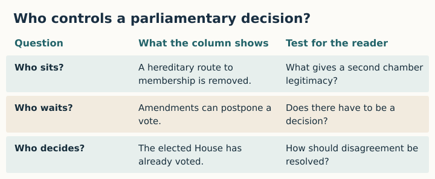
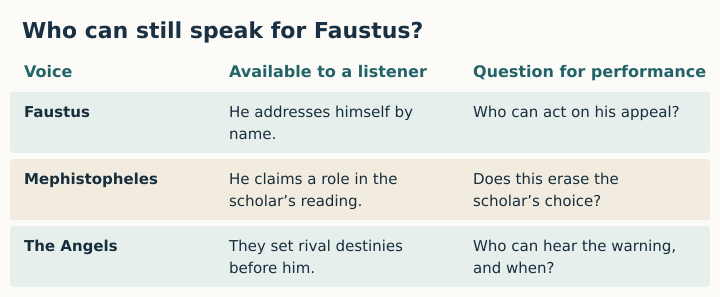
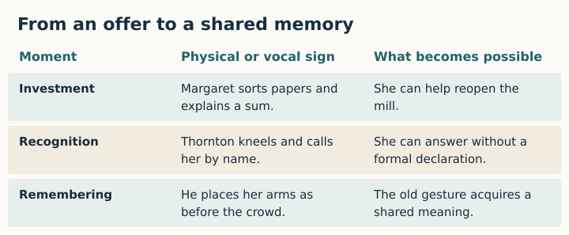
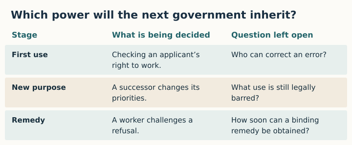
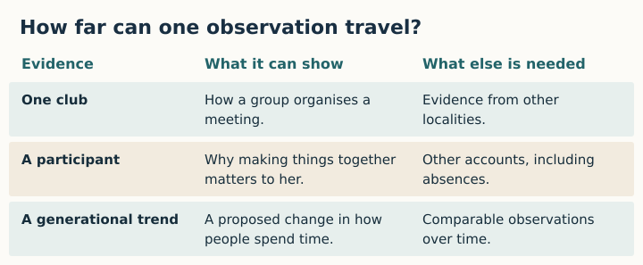

# ENS de Lyon · Séries A/L · Anglais oral 2026 — Corrigé guidé partiel

*Corrigé rédigé par IA, non officiel. Signalez toute erreur.*

**Rédaction** · GPT-6.2 Astra Ultra · vitesse non renseignée

Le répertoire officiel donne 178 références et aucune coupure de presse. Sur les 45 passages littéraires identifiables, 43 sont commentés sur le texte et deux poèmes de Brooks sur les observations du jury. Pour les 133 articles, 65 notices utilisent une version publiée et 10 un passage publié. Pour 16 autres, un document de contexte ou une notice est distingué du texte du concours. Les 42 derniers sont abordés à partir de leur intitulé. La coupe effectivement remise aux candidats reste inconnue pour les 133 articles.

Le rapport, p. 37, indique que le jury avait sélectionné et préparé 52 textes littéraires. Le répertoire publié en novembre en énumère 45 avec des repères vérifiables. Aucun billet additionnel ne peut être identifié par cette différence de nombres. La pagination des livres renvoie à l’édition du répertoire. Les graphies et la numérotation peuvent varier entre éditions.

Les 178 billets suivent l’ordre du répertoire. Cinq d’entre eux comportent une prise de parole développée et un bref échange, à prolonger à partir du document distribué.

[Sujets et références, p. 2–11](https://www.ens-lyon.fr/sites/default/files/2026-11/Anglais%202026.pdf#page=2) · [Rapports des cinq épreuves orales, p. 32–79](https://www.ens-lyon.fr/sites/default/files/2026-10/Anglais%202026.pdf#page=32)

## Préparer l’oral avec le document distribué

### Situer le billet et construire sa question

Retrouvez d’abord votre série. En Lettres et arts, le jury demande une introduction et une synthèse de huit minutes au plus, puis environ douze minutes de commentaire et dix minutes de discussion. En presse LV1, il donne une fourchette de six à huit minutes pour l’introduction avec synthèse et de douze à quatorze pour le commentaire, dans la limite totale de vingt minutes. En LV2, la synthèse elle-même prend environ cinq minutes et le commentaire onze à douze. En sciences humaines, le jury propose également environ onze à douze minutes de commentaire et demande de faire ressortir le contexte politique, économique ou social nécessaire à la compréhension de l’article. En littérature, les vingt minutes servent à l’explication du passage. Réservez un temps réel aux derniers vers ou aux dernières répliques, même si vous connaissez particulièrement bien son ouverture.

Dans la marge de votre exemplaire, écrivez un nom à côté de chaque voix qui prend en charge une affirmation importante. Dans une dépêche, le titre peut résumer une déclaration contestée. Dans un éditorial, l’institution qui signe construit une position commune. Dans une chronique signée, la position de l’auteur peut différer de celle que l’on associe habituellement à son journal. Identifiez ensuite une relation assez précise pour être discutée. Dans le billet 13, retarder un scrutin est un moyen de peser sur son issue. Dans le billet 124, un système créé par un gouvernement pourrait servir un successeur. Dans le billet 151, un témoignage local soutient une hypothèse sur un groupe beaucoup plus large. Chacune de ces relations donne lieu à une vraie question.

### Lire, synthétiser, commenter

Pour la synthèse de presse, retrouvez l’événement ou la proposition qui a suscité l’article, la réponse qu’y apporte son auteur, puis le moyen qu’il emploie pour convaincre. Reformulez en anglais, sans effacer l’attribution. *The minister says that the decision protects workers* laisse ouverte une question que *the decision protects workers* aurait déjà tranchée. Relevez au brouillon le statut du fait à la date de parution. Une mesure annoncée peut avoir été votée ultérieurement, mais le journaliste ne pouvait alors constater cet effet. Revenez à la coupure distribuée pour choisir les verbes et les temps.

Pour la lecture à voix haute, marquez l’emplacement de départ, les mots à accentuer et le moment où vous reprendrez la parole en votre nom. Lisez assez pour faire entendre une articulation avant de l’expliquer. En sciences humaines, le rapport suggère cinq ou six lignes maximum pour cet extrait. Pour l’explication littéraire, il préfère un passage assez long pour faire entendre une interprétation. Dans le billet 55, la précision des comptes de Margaret et les appels très courts de Thornton appellent des rythmes différents. Faites entendre la différence, puis expliquez ce qu’elle permet de comprendre.

Pour passer de la synthèse au commentaire, reprenez un élément dont la portée reste à déterminer. Une baisse de l’inflation alimentaire décrit le rythme d’augmentation des prix, tandis qu’un acheteur paie le prix atteint. Dans le billet 149, cette distinction rend intelligible la persistance d’une inquiétude. Dans le billet 116, différenciez la part des voix, le nombre de sièges et les alliances possibles avant d’évaluer le pouvoir de négociation d’un parti. Une connaissance extérieure sert lorsqu’elle permet d’expliquer pourquoi deux faits de l’article ne sont pas équivalents.

### Expliquer un texte littéraire et répondre au jury

Demandez-vous qui peut voir, entendre ou connaître chacun des faits que le passage met en scène. Au théâtre, la place du spectateur peut lui donner un avantage décisif sur un personnage. Dans un roman, une description apparemment neutre peut emprunter l’échelle de valeurs de quelqu’un qui regarde. Dans un poème, une reprise du premier vers peut être une transformation de la question initiale. Notez l’amorce, un changement décisif et la dernière unité de sens. Faites porter votre commentaire sur ce que le déplacement de l’un à l’autre change pour le lecteur, en renvoyant aux lignes de votre exemplaire.

Les relances après chaque billet se travaillent à deux. L’un formule en anglais une réponse de trente secondes, puis l’autre réclame un indice précis ou propose un contre-exemple. Si une objection vous conduit à affiner l’interprétation, formulez la révision entière en anglais. *The headline suggests a change in voters’ preferences. The figures in this paragraph actually measure the opinions of union members only.* Pour un billet connu seulement par son intitulé, effectuez l’exercice avec une question à vérifier sur l’exemplaire. Une formule suggestive du titre permet de préparer une piste, mais seule la suite du texte autorise à en faire la thèse de l’auteur.

## Lettres et arts · Analyse de presse

[Rapport de cette épreuve, p. 32](https://www.ens-lyon.fr/sites/default/files/2026-10/Anglais%202026.pdf#page=32)

### 1. “Revealed: The emails the Government Tried to Hide from Public over Kneecap Funding Decision”, Garrett Hargan (02/03/2026)

Belfast Telegraph · Intitulé, référence et date du répertoire.

How does a decision about public money become an argument about public access to evidence? The title promises emails, a government decision and a dispute about disclosure. A grant for an artist, an official explanation for withholding it and an allegation that material was concealed are three different objects of proof. An oral introduction should keep the band, the decision makers and the person seeking the records distinct. Only the distributed evidence could establish who knew what and when.

**Relance proposée pour l’entraînement.** Which sentence in the emails, if present on the handout, would establish intention as well as the fact that information was withheld?

[Répertoire de Lyon, p. 2](https://www.ens-lyon.fr/sites/default/files/2026-11/Anglais%202026.pdf#page=2)

### 2. “Keir Starmer’s digital ID cards are just a State power grab that will leave us as the mercy of hackers”, David Davis (08/10/2025)

Daily Mail · Intitulé, référence et date du répertoire.

David Davis’s headline moves from a technology to a claim about state power. Distinguish the argument about requiring a credential from the argument about protecting personal information. A system can reduce one form of fraud and still impose a new burden on someone who must prove a right to work. An analysis of the full piece would ask which loss Davis illustrates and what arrangement he regards as an adequate alternative.

**Relance proposée pour l’entraînement.** What is the difference between needing to establish one's identity and giving an authority power to keep or reuse the evidence?

[Répertoire de Lyon, p. 2](https://www.ens-lyon.fr/sites/default/files/2026-11/Anglais%202026.pdf#page=2)

### 3. “The MAHA Movement is Mad about the Weedkiller Glyphosate and Trump’s EPA” (28/04/2026)

NPR · Version publiée consultée, limites de la coupure inconnues.

The NPR report begins with a protest outside the Supreme Court while the justices hear a case involving Roundup. The protesters include allies of the health secretary whose political alliance with Trump did not settle their disagreement with the administration over pesticides. The opening makes that internal division visible before a reader has to judge any technical claim. Separate the question before the court from campaigners’ statements about health. Their slogans demonstrate a political break, while the effects they allege call for a different form of evidence.

**Relance proposée pour l’entraînement.** Why might supporters who agree about health policy disagree about the agency that should act?

[Répertoire de Lyon, p. 2](https://www.ens-lyon.fr/sites/default/files/2026-11/Anglais%202026.pdf#page=2) · [Version publiée consultée, limites de la coupure inconnues](https://www.nhpr.org/2026-04-28/the-maha-movement-is-mad-about-the-weedkiller-glyphosate-and-trumps-epa)

### 4. “Labour has weaponised law to thwart democracy”, Gordon Rayner (15/01/2026)

The Daily Telegraph · Intitulé, référence et date du répertoire.

The accusation in Gordon Rayner’s headline turns a law into a weapon and assigns democracy the role of victim. To test the metaphor, identify the legal measure, the institution empowered to apply it and the democratic process said to be frustrated. A party may object to a rule it could not overturn without showing that the rule defeated popular government. The full article must establish which claim is being made.

**Relance proposée pour l’entraînement.** What would a court have to do for the charge of thwarting democracy to be justified?

[Répertoire de Lyon, p. 2](https://www.ens-lyon.fr/sites/default/files/2026-11/Anglais%202026.pdf#page=2)

### 5. “In That Glamorous Party Set There Was No Telling Tales”, Sophia Money-Coutts (14/02/2026)

The Daily Telegraph · Intitulé, référence et date du répertoire.

Sophia Money-Coutts’s title makes silence a feature of belonging to a fashionable social circle. Reconstruct the exchange implied by that silence. An invitation offers access, while discretion helps preserve the value of future invitations. A useful question is how a writer can make a culture of confidentiality public. Distinguish attributed testimony, observation and retrospective inference before assigning knowledge of a particular event to any member of the group.

**Relance proposée pour l’entraînement.** If silence was the rule in this circle, on what evidence could a reporter establish it?

[Répertoire de Lyon, p. 2](https://www.ens-lyon.fr/sites/default/files/2026-11/Anglais%202026.pdf#page=2)

### 6. “Once an ‘outsider’ party, Reform plants its flag in the centre”, Gordon Ranyer (20/02/2026)

The Daily Telegraph · Intitulé, référence et date du répertoire.

The two spatial images in the title describe different kinds of political success. An outsider can gain members or seats while maintaining the claim to be excluded by an establishment. Planting a flag at the centre might describe the location of voters, policies or media attention. Identify the measure the article uses before deciding whether Reform has moved or whether the parties around it have changed position.

**Relance proposée pour l’entraînement.** Does winning a seat at the centre of public debate mean that a party has become politically centrist?

[Répertoire de Lyon, p. 2](https://www.ens-lyon.fr/sites/default/files/2026-11/Anglais%202026.pdf#page=2)

### 7. “The Prime Minister’s position is scarcely credible. He cannot survive; Are we meant to believe that not one minister knew about this?”, Tom Morris (17/04/2026)

The Daily Telegraph · Intitulé, référence et date du répertoire.

The proposed article combines a prediction about the prime minister’s future with a rhetorical question about what ministers knew. Those are not equivalent claims. Collective responsibility concerns what officeholders must answer for in public, while individual knowledge calls for evidence about time and access to information. In a commentary, ask when a disputed account ceases to be credible and who is in a position to test it.

**Relance proposée pour l’entraînement.** What would turn a columnist’s judgement about the prime minister’s credibility into a parliamentary fact?

[Répertoire de Lyon, p. 2](https://www.ens-lyon.fr/sites/default/files/2026-11/Anglais%202026.pdf#page=2)

### 8. “Charlie Kirk Challenged Liberals Until the Day He Was Murdered” (11/09/2025)

The Economist · Intitulé, référence et date du répertoire.

The Economist’s headline frames Charlie Kirk through argument with liberals and through the violent event that ended his life. It therefore invites two different forms of judgement, about the speaker’s record and about the principle that political disagreement should remain safe. An obituary may combine chronological narrative with a retrospective assessment of influence. Read the transitions closely rather than assuming that describing a death also endorses the deceased’s views.

**Relance proposée pour l’entraînement.** What kind of interaction does the verb “challenged” assume, and who gets to give an account of it?

[Répertoire de Lyon, p. 2](https://www.ens-lyon.fr/sites/default/files/2026-11/Anglais%202026.pdf#page=2)

### 9. “Inside the Movement Challenging – and Disrupting – ICE” (29/01/2026)

The Economist · Notice d’un contributeur institutionnel.

The cited research centre confirms that this article draws on evidence about activists opposing ICE. A network of observers, a public protest and a legal challenge use different means to hold an agency to account. The title itself places challenging beside disrupting. An oral analysis should ask where reporting documents that change in activity and whose judgement the second verb expresses. The centre’s notice confirms its contribution and supplies no substitute for the magazine’s complete argument.

**Relance proposée pour l’entraînement.** How would you tell a participant’s account from a reporter’s observation?

[Répertoire de Lyon, p. 2](https://www.ens-lyon.fr/sites/default/files/2026-11/Anglais%202026.pdf#page=2) · [Notice d’un contributeur institutionnel](https://cece.american.edu/article-inside-the-movement-challenging-and-disrupting-ice/)

### 10. “What Happens If Trump Uses Independence to Set his Sights on Scotland?”, Neil Mackay (10/01/2026)

The Glasgow Herald · Intitulé, référence et date du répertoire.

The title is a counterfactual question about Scottish independence and an American president. Begin by stating what would have to happen for its scenario to arise. A people’s claim to decide its constitutional status, recognition by another government and leverage exercised by a larger ally belong to different relationships. What evidence would make the imagined scenario politically informative? Its appearance as a headline establishes neither a presidential plan nor an agreed Scottish response.

**Relance proposée pour l’entraînement.** What would Scotland’s constitutional position have to be for the headline's hypothetical situation to arise?

[Répertoire de Lyon, p. 2](https://www.ens-lyon.fr/sites/default/files/2026-11/Anglais%202026.pdf#page=2)

### 11. “Now we know what patriotism means to Shabana Mahmood – can she harness that to unite rather than divide us?”, Gaby Hinsliff (30/09/2025)

The Guardian · Version publiée consultée, limites de la coupure inconnues.

Hinsliff begins with England’s colours displayed openly and with a mood that complicates the assumption that flags always signify the same politics. Her support for Mahmood’s attempt to speak about belonging is qualified by her reading of proposed immigration restrictions. Extending the wait for settlement can redefine who gets to feel securely part of the country. The commentary should therefore follow the movement from a shared symbol to an administrative timetable. It explains how the policy may divide people whom the language of patriotism invites to identify together.

**Relance proposée pour l’entraînement.** How could the same appeal to patriotism sound welcoming to one listener and exclusive to another?

[Répertoire de Lyon, p. 2](https://www.ens-lyon.fr/sites/default/files/2026-11/Anglais%202026.pdf#page=2) · [Version publiée consultée, limites de la coupure inconnues](https://www.theguardian.com/commentisfree/2025/sep/30/shabana-mahmood-labour-conference-immigration)

### 12. “The next archbishop of Canterbury has no time to waste in making change – this is what she will be up against”, Martine Oborne (05/10/2025)

The Guardian · Version publiée consultée, limites de la coupure inconnues.

Oborne welcomes the choice of Sarah Mullally and immediately has to ask what one appointment can change. Becoming the first woman to hold an office carries a symbolic force independent of the powers attached to it. The article situates the news within a church whose members disagree about who should exercise religious authority and which relationships may be blessed. The writer’s account of the experience Mullally brings gives her praise a prospective function. It builds the case that this particular officeholder can confront disagreement rather than simply represent a milestone.

**Relance proposée pour l’entraînement.** Which changes could an archbishop initiate personally and which would require institutional agreement?

[Répertoire de Lyon, p. 2](https://www.ens-lyon.fr/sites/default/files/2026-11/Anglais%202026.pdf#page=2) · [Version publiée consultée, limites de la coupure inconnues](https://www.theguardian.com/commentisfree/2025/oct/05/archbishop-of-canterbury-sarah-mullally-change)

### 13. “So long, hereditary peers – but the Lords is still full of absurd anachronisms”, Polly Toynbee (13/03/2026)

The Guardian · Version publiée consultée, limites de la coupure inconnues.

Toynbee describes the removal of hereditary peers as an accomplishment and makes the manner of resistance an argument for further reform. The dispute about observing the Salisbury convention raises a precise question. How far should an unelected chamber obstruct a measure promised in the winning party’s manifesto? Her example of delays to another bill turns concern about hereditary privilege into a wider objection to procedure. One can grant the democratic case against inheritance and still ask what expertise or protection for minorities a revised chamber should retain.

**A passage to develop in performance**

When can a parliament be prevented from making a decision without anyone voting against it? Polly Toynbee poses that problem through the departure of hereditary peers from the House of Lords. She welcomes their departure and thinks the Labour government has understated what it achieved. But her column actually devotes more space to the way they left than to their departure. Resistance, she argues, shows a defect in the institution which removing one route to membership will not cure.

Listen first to the change of voice. By quoting peers who defended hereditary membership, Toynbee lets the reader hear the institution speak for itself. One peer fears a chamber left to political insiders, among whom he includes himself. His admission supplies a pointed joke, but it also leaves a serious difficulty for the columnist. If inheritance confers no right to legislate, political appointment does not suddenly make a house representative. Her argument gains something from allowing that problem into a column whose verdict on inheritance is already clear.

Next she asks the reader to notice time. An election produced a majority for a party which promised this reform. The Salisbury convention gives an opposition in the Lords a reason to let such a commitment pass. Its force, however, depends on people accepting a constraint. According to Toynbee, warnings of procedural obstruction helped secure life peerages for some hereditary peers. Her other example concerns a different bill. Repeated amendments and long speeches can prevent a vote, even where a majority of those who have already voted in the Commons favour change. The power to determine *whether* a decision is reached can matter as much as the power to vote for or against it.

There is a genuine difficulty here for someone who values representative government. Delay can help a minority obtain a hearing or alert the Commons to bad wording. It can also let a small minority prevent a decision indefinitely. The columnist’s illustrations make a case for asking how to tell those uses apart. A useful test would be whether opponents must eventually persuade a majority in a recorded vote. Her conclusion presses for reform of the chamber as a whole. It leaves her readers with a question that survives the particular reform she celebrates: what democratic authority should a second chamber have when it disagrees with the first?

**An examiner might ask, “Would election necessarily solve the problem of delay?”** No. It would change the basis of membership. An elected chamber could still have procedures permitting delay, and might claim a stronger mandate for using them. Composition and rules of debate require separate answers.

**Relance proposée pour l’entraînement.** Why can a chamber that normally revises legislation exercise political power just by taking time?

[Répertoire de Lyon, p. 2](https://www.ens-lyon.fr/sites/default/files/2026-11/Anglais%202026.pdf#page=2) · [Version publiée consultée, limites de la coupure inconnues](https://www.theguardian.com/commentisfree/2026/mar/13/so-long-hereditary-peers-house-of-lords-anachronisms)

### 14. “Yes, the king’s US visit will go down in history: it marked the death throes of an old era”, Nesrine Malik (04/05/2026)

The Guardian · Version publiée consultée, limites de la coupure inconnues.

Malik takes a royal visit, an occasion conventionally read through successful gestures, as evidence about the weaknesses of the relationship being celebrated. The contrast works because diplomatic ceremony has an audience and because the participants do not exercise equivalent constitutional powers. Ask what the king’s capacity to embody continuity allows the visit to show, and which decisions would still be made elsewhere. The writer’s retrospective language invites the reader to recognise the end of an era while it is still being publicly enacted.

**Relance proposée pour l’entraînement.** What does the columnist take as evidence that an era is ending when the visit itself seems to celebrate continuity?

[Répertoire de Lyon, p. 2](https://www.ens-lyon.fr/sites/default/files/2026-11/Anglais%202026.pdf#page=2) · [Version publiée consultée, limites de la coupure inconnues](https://www.theguardian.com/commentisfree/2026/may/04/king-charles-us-visit-donald-trump-history-end-era)

### 15. “Donald Trump Links Greenland Threats to Nobel Snub” (20/01/2026)

The Guardian (USA) · Version publiée consultée, limites de la coupure inconnues.

The Guardian reports a message to Norway’s prime minister connecting Trump’s position on Greenland with the failure to receive the Nobel Peace Prize. First establish who can speak for Norway and who awards the prize. They are separate authorities. A claim made in a message and the response it produces can be reported without adopting the writer’s explanation of territorial rights. The episode also raises an issue of scale. A personal grievance is presented in language with consequences for governments and for Greenlanders’ right to speak about their own future.

**Relance proposée pour l’entraînement.** How would you separate the contents of a message, its diplomatic effects and an observer’s account of its motive?

[Répertoire de Lyon, p. 3](https://www.ens-lyon.fr/sites/default/files/2026-11/Anglais%202026.pdf#page=3) · [Version publiée consultée, limites de la coupure inconnues](https://www.theguardian.com/us-news/2026/jan/19/donald-trump-greenland-threats-nobel-prize-snub-letter)

### 16. “Elon Musk piggybacks Tommy Robinson and brings his troll show to Britain after being banished from the White House”, John Bowden (15/09/2025)

The Independent · Version publiée consultée, limites de la coupure inconnues.

Bowden follows an American platform owner’s intervention in British politics through his public association with Tommy Robinson. The vivid verb in the headline gives the relationship a direction, but it need not mean that the two men share a programme or constituency. Compare the audience made accessible by a platform with the organisation needed to secure votes. The report itself distinguishes known public acts from speculation about Musk’s motives, including his attitude towards regulation. Preserve that distinction when assessing influence from outside the country.

**Relance proposée pour l’entraînement.** How does participation by video alter what it means to address a political gathering?

[Répertoire de Lyon, p. 3](https://www.ens-lyon.fr/sites/default/files/2026-11/Anglais%202026.pdf#page=3) · [Version publiée consultée, limites de la coupure inconnues](https://www.the-independent.com/news/world/americas/us-politics/elon-musk-uk-tommy-robinson-b2827033.html)

### 17. “Keir Starmer Should Have Done More To Tackle Rise of Reform, Green Party Leader Claims”, Archie Mitchell (29/09/2025)

The Independent · Version publiée consultée, limites de la coupure inconnues.

The headline attributes the criticism of Starmer to the Green leader. The reporter also observes encounters with voters, which can show how the politician presents himself without measuring the national strength of his appeal. The contest matters because an opponent to Labour’s left is diagnosing a challenge to it from the right. Compare his account of what Labour should have done with the incentives he faces when speaking to prospective Green supporters. A claim about Reform’s rise can also serve as an argument for the speaker’s own party.

**Relance proposée pour l’entraînement.** Why does the identity of the person criticising Labour matter to the reader’s assessment of the claim?

[Répertoire de Lyon, p. 3](https://www.ens-lyon.fr/sites/default/files/2026-11/Anglais%202026.pdf#page=3) · [Version publiée consultée, limites de la coupure inconnues](https://www.independent.co.uk/news/uk/politics/zack-polanski-keir-starmer-green-labour-reform-b2835825.html)

### 18. “BBC Says Sorry but Rejects Trump’s Demand for $1bn” (14/11/2025)

The Independent · Version publiée consultée, limites de la coupure inconnues.

The BBC’s apology and its refusal to accept the demand for compensation respond to different questions. An editorial decision can be acknowledged as misleading without conceding that the available evidence meets the requirements of a legal claim. The report attributes the statements of the chair and the president, allowing the reader to distinguish the corporation’s responsibility to its audience from the financial liability alleged by a complainant. A productive final question is whether correcting an error in public can preserve editorial independence when an outside political actor demands a particular outcome.

**Relance proposée pour l’entraînement.** What exactly did the broadcaster concede, and which part of the legal claim remained disputed?

[Répertoire de Lyon, p. 3](https://www.ens-lyon.fr/sites/default/files/2026-11/Anglais%202026.pdf#page=3) · [Version publiée consultée, limites de la coupure inconnues](https://www.independent.co.uk/news/uk/home-news/bbc-donald-trump-apology-legal-threat-b2864955.html)

### 19. “President’s Vision of World Based on Might Lingers on”, Sam Kiley (22/01/2026)

The Independent · Intitulé, référence et date du répertoire.

The headline proposes that a view of international relations centred on might will outlast a particular event or decision. Ask who is said to hold that view and in what form it might endure. Continued military or economic power is different from acceptance of the claim that power alone confers legitimacy. Without the distributed passage, the precise states, institutions and precedents used to argue for continuity remain questions for close reading.

**Relance proposée pour l’entraînement.** How would evidence of a single unequal negotiation differ from evidence of a durable rule of international affairs?

[Répertoire de Lyon, p. 3](https://www.ens-lyon.fr/sites/default/files/2026-11/Anglais%202026.pdf#page=3)

### 20. “Where has all this fawning over Trump got you, Nigel?”, Sean O’Grady (11/03/2026)

The Independent · Version publiée consultée, limites de la coupure inconnues.

O’Grady’s address to Nigel Farage sounds like a question with an answer already supplied. The pop-fan comparison makes the asymmetry of attention comic. A politician who gains status by appearing close to the American president also risks making an unsuccessful bid for recognition publicly visible. The article’s treatment of a visit to Mar-a-Lago gives the argument a test. Being at the resort and being received or supported by the president are different achievements. The reader is encouraged to evaluate political usefulness through a performance of embarrassment.

**Relance proposée pour l’entraînement.** What would count as a political return on Farage’s expressions of support?

[Répertoire de Lyon, p. 3](https://www.ens-lyon.fr/sites/default/files/2026-11/Anglais%202026.pdf#page=3) · [Version publiée consultée, limites de la coupure inconnues](https://www.independent.co.uk/voices/nigel-farage-donald-trump-petrol-oil-reform-b2935484.html)

### 21. “Pope Leo to Trump: ‘I Have No Fear’”, Daniel J. Wakin (15/04/2026)

The New York Times · Intitulé, référence et date du répertoire.

The quotation attached to Pope Leo places a declaration about fear within an exchange with the American president. Differentiate moral authority, which depends on a public willing to listen, from the legal and diplomatic powers of a head of state. A report might use the surrounding questions to establish whether the remark is a personal response or a statement on a policy. The short quotation alone cannot identify every measure at issue or establish the Vatican’s full position.

**Relance proposée pour l’entraînement.** What authority does a pope invoke by discussing fear in a public exchange with a president?

[Répertoire de Lyon, p. 3](https://www.ens-lyon.fr/sites/default/files/2026-11/Anglais%202026.pdf#page=3)

### 22. “The Political Malpractice of Elon Musk”, Ross Douthat (25/04/2026)

The New York Times · Version publiée consultée, limites de la coupure inconnues.

Douthat begins with a Senate setback for voter-identification legislation. The issue had received extensive attention, including on Musk’s social network, yet lacked even fifty Republican votes. The columnist then compares the failure to translate publicity into a majority with the disappointing budgetary effect of the Department of Government Efficiency. His charge of political malpractice turns on a contrast between the unusual resources Musk could command and the way he used them. It leaves room for the observation that Trump bears primary responsibility for his administration’s choices.

**Relance proposée pour l’entraînement.** What, in the columnist’s account, prevented attention to the voting bill from turning into votes in the Senate?

[Répertoire de Lyon, p. 3](https://www.ens-lyon.fr/sites/default/files/2026-11/Anglais%202026.pdf#page=3) · [Version publiée consultée, limites de la coupure inconnues](https://www.sltrib.com/opinion/commentary/2026/04/28/opinion-when-history-trump-20-is/)

### 23. “24 Years After 9/11, Alliances Fractured” (11/09/2025)

USA Today · Intitulé, référence et date du répertoire.

The anniversary in the title supplies a before and an after. For the label fractured alliances to carry historical weight, an oral analysis needs to distinguish a treaty, military cooperation over a particular operation and popular identification with an ally. Those relationships can change at different speeds. Ask which coalition the article takes as its starting point and whether developments described in the present amount to a break in commitment or to disagreement within an enduring alliance.

**Relance proposée pour l’entraînement.** Is a disagreement among allies sufficient evidence that their alliance has ceased to operate?

[Répertoire de Lyon, p. 3](https://www.ens-lyon.fr/sites/default/files/2026-11/Anglais%202026.pdf#page=3)

### 24. “Kirk’s Death Draws Grief, Condemnation”, Melissa Galbraith, Dan Morrison (12/09/2025)

USA Today (US Edition) · Dépêche distincte de Reuters, avec d’autres auteurs.

The repertoire attributes its USA Today story to Melissa Galbraith and Dan Morrison. A separate Reuters report interviews young Americans across ideological lines about the same death. It suggests a distinction worth testing in the assigned article: one can oppose a speaker’s politics and see his killing as an attack on a freedom that also protects one’s own speech. That convergence need not imply agreement about his legacy. Individual quotations show how particular people experienced an event. They cannot by themselves measure the distribution of opinion among young Americans. The interviews in Reuters cannot be attributed to the USA Today reporters.

**Relance proposée pour l’entraînement.** What is the difference between condemning a political killing and endorsing the victim’s political legacy?

[Répertoire de Lyon, p. 3](https://www.ens-lyon.fr/sites/default/files/2026-11/Anglais%202026.pdf#page=3) · [Dépêche distincte de Reuters, avec d’autres auteurs](https://www.investing.com/news/politics-news/kirks-death-prompts-shock-grief-across-gen-z-ideological-lines-4236710)

## Langues vivantes · Explication littéraire en LV1

[Rapport de cette épreuve, p. 36](https://www.ens-lyon.fr/sites/default/files/2026-10/Anglais%202026.pdf#page=36)

### 25. Doctor Faustus, scene 1, lines 1–73

Faustus addresses himself by name and orders himself to choose a discipline. The man who would command the elements first has to persuade his own listener. Each book brings an authority onstage. Latin definitions allow a scholar to establish mastery of logic and medicine, then to dismiss both by the same test. Medicine can preserve a city and still leave its physician mortal. In the biblical argument, attend to where the reader stops. He selects the punishment for sin without following the possibility of forgiveness. The two Angels make the choice visible to the audience. The speech about ruling nature which closes this particular extract belongs to the Evil Angel. What sounded like private intellectual independence has become a contest over whose language Faustus will adopt.

**Relance proposée pour l’entraînement.** Where does Faustus stop reading his biblical source, and whose line ends the set passage?

[Répertoire de Lyon, p. 4](https://www.ens-lyon.fr/sites/default/files/2026-11/Anglais%202026.pdf#page=4) · [Texte dramatique, quarto de 1616, numérotation propre à l’édition du jury](https://www.gutenberg.org/ebooks/811)

### 26. Doctor Faustus, scene 1, lines 74–143

The opening question describes appetite already satisfied by an idea. Faustus next uses future auxiliaries to acquire gold, knowledge and political power in imagination. The list expands geographically faster than any human being can travel. Valdes and Cornelius offer him a society in which this scale of ambition sounds almost ordinary. Listen for the change of pronoun. An invitation to join two experienced men turns what Faustus had conceived as his own project into a collective enterprise. Its promises can be tested theatrically. Vast riches remain invisible, while three scholars capable of reinforcing one another’s confidence are plainly there. Faustus asks for a demonstration, yet claims the joys of possession before he has received anything. That gap carries the audience into the next stage of his education.

**Relance proposée pour l’entraînement.** Which shift from the singular to the plural makes the fantasy of power sound like a practical undertaking?

[Répertoire de Lyon, p. 4](https://www.ens-lyon.fr/sites/default/files/2026-11/Anglais%202026.pdf#page=4) · [Texte dramatique, quarto de 1616, numérotation propre à l’édition du jury](https://www.gutenberg.org/ebooks/811)

### 27. Doctor Faustus, scene 3, lines 1–69

Night turns a scholar’s experiment into theatre. Faustus names the setting, gives directions and attempts to control the appearance of the figure who answers him. His request for a friar’s shape is also a joke directed at a recognizable religious habit. The larger reversal follows in the conversation. An order obtains an immediate change of costume, but the spirit explains that Faustus has misunderstood the cause of his appearance. His service belongs to Lucifer. Ask which speaker has actually learned something by the end. Faustus can ask successive questions about Lucifer’s former state, while the spirit answers in the language of loss. Repeating Lucifer’s name at the ends of the final lines turns a theological account into a declaration of shared fate. Stop there for this ticket. The question about the location of hell belongs to the overlapping passage that follows.

**Relance proposée pour l’entraînement.** What does the newcomer’s first account of his appearance do to Faustus’s understanding of the encounter?

[Répertoire de Lyon, p. 4](https://www.ens-lyon.fr/sites/default/files/2026-11/Anglais%202026.pdf#page=4) · [Texte dramatique, quarto de 1616, numérotation propre à l’édition du jury](https://www.gutenberg.org/ebooks/811)

### 28. Doctor Faustus, scene 3, lines 52–112

Here the exchange begins with Faustus proclaiming his allegiance. In associating damnation with Elysium he makes a Christian threat sound like a welcome meeting with classical philosophers. Mephistopheles speaks from another kind of knowledge. To have known heaven is precisely what makes deprivation present everywhere. His presence before Faustus is compatible with suffering hell. The audience can therefore see the witness and hear him questioned without having to imagine a change of scenery. The proposed bargain gives this paradox a practical test. Faustus treats the spirit’s misery as weakness and anticipates years of unlimited service. At the close he is the one waiting for someone else to return. The interval between order and answer exposes the dependence beneath the claim to mastery.

**Relance proposée pour l’entraînement.** How could Mephistopheles be in hell while apparently standing in front of the audience?

[Répertoire de Lyon, p. 4](https://www.ens-lyon.fr/sites/default/files/2026-11/Anglais%202026.pdf#page=4) · [Texte dramatique, quarto de 1616, numérotation propre à l’édition du jury](https://www.gutenberg.org/ebooks/811)

### 29. Doctor Faustus, scene 5, lines 1–68

The opening self-address resembles the beginning of the play, but the question now concerns the possibility of turning back. The two Angels give incompatible interpretations of what remains possible. Notice how easily Faustus can construe his own despair as a religious certainty. The bargain takes a material form when he prepares to write. His blood stops flowing and momentarily interrupts the document. What looks to him like an obstacle to completing the transaction can look to the audience like a last warning. Mephistopheles helps remove the difficulty. The closing aside gives spectators access to a calculation withheld from Faustus. He believes the spirit will serve his purposes, while the spirit values the service it has just performed by the soul it expects to obtain.

**Relance proposée pour l’entraînement.** How do the actions required of the actor’s hand complicate a declaration of absolute resolve?

[Répertoire de Lyon, p. 4](https://www.ens-lyon.fr/sites/default/files/2026-11/Anglais%202026.pdf#page=4) · [Texte dramatique, quarto de 1616, numérotation propre à l’édition du jury](https://www.gutenberg.org/ebooks/811)

### 30. Doctor Faustus, scene 5, lines 73–137

A formula associated with Christ’s last words announces the completion of a very different deed. Faustus reads clauses and specifies conditions, drawing on professional skills he once dismissed. The writing that appears on his own body resists that legal confidence, and the diversions supplied by the devils draw his attention elsewhere. The discussion of hell then asks whether knowledge can pass from a witness to an unwilling hearer. Faustus imagines that a person conversing with him must be outside hell. Mephistopheles can stand in the study and still testify to damnation. The final claim takes its force from the visible actor who makes it. A production can leave him beside Faustus at that moment. The audience sees the evidence that the scholar has equipped himself to explain away.

**Relance proposée pour l’entraînement.** Which words leave open the possibility that completing the deed has failed to settle the theological question?

[Répertoire de Lyon, p. 4](https://www.ens-lyon.fr/sites/default/files/2026-11/Anglais%202026.pdf#page=4) · [Texte dramatique, quarto de 1616, numérotation propre à l’édition du jury](https://www.gutenberg.org/ebooks/811)

### 31. Doctor Faustus, scene 7, lines 1–73

Looking up at the heavens prompts regret. Faustus can see the order he has lost, and he can blame the spirit standing beside him for the loss. The exchange then becomes an examination in astronomy. Mephistopheles answers technical questions accurately enough for Faustus to object that a student could have supplied much the same information. This is a significant disappointment for someone who abandoned ordinary learning in search of secrets. The decisive question concerns creation itself. It changes the relation between competence and authority. The servant can name positions and motions yet must refuse a question which would direct attention to God. Faustus sends him away in anger. The abrupt change of tone brings the earlier possibility of repentance back into a conversation the scholar tried to conduct as a test of expertise.

**Relance proposée pour l’entraînement.** Why should the scholar who asks about the heavens take an interruption as an answer?

[Répertoire de Lyon, p. 4](https://www.ens-lyon.fr/sites/default/files/2026-11/Anglais%202026.pdf#page=4) · [Texte dramatique, quarto de 1616, numérotation propre à l’édition du jury](https://www.gutenberg.org/ebooks/811)

### 32. Doctor Faustus, scene 7, lines 96–158

The infernal visitors offer Faustus the task of questioning the Seven Deadly Sins. The arrangement resembles a succession of comic performers introducing themselves, with changes in diction, appetite and manner. Each vice makes an occupation of its own excess. The spectator within the play becomes an important second subject. Faustus eagerly questions the performers and reports how much he enjoys the sight. External spectators can attend to the same jokes while recognizing his pleasure as one of the means by which he is kept from thinking about repentance. A book and a promised visit extend the entertainment into the future. Notice the shrinking distance between scholar and playgoer. A man who hoped to command every form of knowledge willingly accepts a programme chosen and arranged for him.

**Relance proposée pour l’entraînement.** What sort of spectatorship do the successive figures require, and what question does their show displace?

[Répertoire de Lyon, p. 4](https://www.ens-lyon.fr/sites/default/files/2026-11/Anglais%202026.pdf#page=4) · [Texte dramatique, quarto de 1616, numérotation propre à l’édition du jury](https://www.gutenberg.org/ebooks/811)

### 33. Doctor Faustus, Chorus 2 and scene 8, lines 1–51

The Chorus can transport an audience farther in a few lines than any stage machinery could carry its actors. Its description places Faustus above the earth, travelling in search of astronomical knowledge. The scene that follows brings the travellers down to a precise destination and finally into the pope’s private space. Mephistopheles becomes a guide, while Faustus recounts what they have seen and asks about the surroundings. The inventory of impressive places and objects lets a speaker claim the authority of someone who has been there. A listener can also hear how easily a journey of inquiry turns into collecting sights. Follow the change of scale from the heavens to Rome and its visible marvels. It prepares a comic use of supernatural access without making that later action part of this extract.

**Relance proposée pour l’entraînement.** Who gets to describe the journey before the traveller claims authority over what he saw?

[Répertoire de Lyon, p. 4](https://www.ens-lyon.fr/sites/default/files/2026-11/Anglais%202026.pdf#page=4) · [Texte dramatique, quarto de 1616, numérotation propre à l’édition du jury](https://www.gutenberg.org/ebooks/811)

### 34. Doctor Faustus, scene 9, lines 1–78

This episode shifts power through costumes, access and timing. Faustus and his companion have made the cardinals’ identities available for impersonation. The real cardinals find that telling their master what they know gives them little protection once an earlier performance has determined what he expects to hear. The captive Bruno and the pope’s claims over him give the trick a political setting. Spectators can track two sets of appearances while those onstage must judge on incomplete evidence. Listen also to the vocabulary of feasting. The banquet promises an ordered distribution of rank and hospitality, but a guest who can intervene unseen can upset that order. The closure on a troublesome banquet reduces a grand assertion of authority to the management of a decidedly awkward occasion.

**Relance proposée pour l’entraînement.** Why is a spectator able to understand a disturbance that the diners themselves cannot explain?

[Répertoire de Lyon, p. 4](https://www.ens-lyon.fr/sites/default/files/2026-11/Anglais%202026.pdf#page=4) · [Texte dramatique, quarto de 1616, numérotation propre à l’édition du jury](https://www.gutenberg.org/ebooks/811)

### 35. Doctor Faustus, scene 11, lines 30–99

A window allows Benvolio to remain partly outside the courtly spectacle and make his doubts audible. Below him the emperor asks for a display of Alexander and his companion. The difference in height gives a sceptical observer an apparently privileged position, though it also makes him exceptionally visible to the audience. Faustus must negotiate the terms of his own performance. What he offers is a likeness rather than the historical body brought back to life. Listen to the contrast between the emperor’s desire to see and the running commentary which anticipates disappointment. The jokes about horns make disbelief legible as a challenge between men. By the close, public entertainment has acquired a personal wager. What happens to Benvolio next belongs to a second ticket.

**Relance proposée pour l’entraînement.** What changes when predictions about a spectacle become interruptions audible to the audience?

[Répertoire de Lyon, p. 4](https://www.ens-lyon.fr/sites/default/files/2026-11/Anglais%202026.pdf#page=4) · [Texte dramatique, quarto de 1616, numérotation propre à l’édition du jury](https://www.gutenberg.org/ebooks/811)

### 36. Doctor Faustus, scene 11, lines 100–167

A trumpet signal introduces Alexander and Darius. The display makes ancient military power available as a show for another emperor, and a detail on the woman’s body offers a particularly intimate test of recognition. To treat the episode simply as a demonstration of supernatural skill would miss its second audience. Benvolio is himself turned into an exhibit when the horns become visible. Watching the actors watch him changes the meaning of the earlier banter. A court that can reward a successful performer can also turn humiliation into a collective amusement. The appeal to the emperor establishes who has the authority to request relief. Faustus closes under the sign of service to Carolus. His public triumph has made him useful to somebody else’s glory.

**Relance proposée pour l’entraînement.** How would the meaning of an imperial request change if the audience could hear only the emperor?

[Répertoire de Lyon, p. 4](https://www.ens-lyon.fr/sites/default/files/2026-11/Anglais%202026.pdf#page=4) · [Texte dramatique, quarto de 1616, numérotation propre à l’édition du jury](https://www.gutenberg.org/ebooks/811)

### 37. Doctor Faustus, scene 12, lines 38–106

The conspirators begin as spectators who can see Faustus approaching. They make his apparent death a spectacle of their own and speak as if a convincing visible result settled the matter. The theatrical reversal works through a simple fact of performance. An actor who has been still can rise and speak again. The scholar reminds his opponents that they have misunderstood the term of his bargain. For this limited period its protection releases him from an ordinary consequence without releasing him from the end of the contract. The arrival of soldiers and the infernal display broaden a private quarrel into a noisy scene of collective confusion. A production could let the comedy register before its implications. The temporary advantage on which Faustus relies belongs to the very agreement that will undo him.

**Relance proposée pour l’entraînement.** Where does the apparent victory change its meaning for those watching and for those acting?

[Répertoire de Lyon, p. 4](https://www.ens-lyon.fr/sites/default/files/2026-11/Anglais%202026.pdf#page=4) · [Texte dramatique, quarto de 1616, numérotation propre à l’édition du jury](https://www.gutenberg.org/ebooks/811)

### 38. Doctor Faustus, scene 17, lines 48–109

The question Faustus addresses to himself opens a contest between possible interpreters of his life. The Old Man offers a language of grace, while Mephistopheles treats hesitation as a breach of allegiance. Faustus’s capacity to choose is the subject on which neither side will relinquish its claim. The appearance of Helen turns that dispute into an act of looking. Classical allusions enlarge her beauty until individual features seem to contain whole histories. Yet the person addressed gives no account of herself. Her theatrical presence allows Faustus to say what he longs to believe about a kiss, a soul and an afterlife. End with that disparity. The speaker can make a brilliant scene out of desire precisely when his power to shape the terms of his own future is dwindling.

**Relance proposée pour l’entraînement.** At which moment does the language of desire begin to compete with the possibility of repentance?

[Répertoire de Lyon, p. 4](https://www.ens-lyon.fr/sites/default/files/2026-11/Anglais%202026.pdf#page=4) · [Texte dramatique, quarto de 1616, numérotation propre à l’édition du jury](https://www.gutenberg.org/ebooks/811)

### 39. Doctor Faustus, scene 18, lines 49–125

The scholars imagine that a friend can still look up and ask for mercy. For a moment their conversation gives the ending an ordinary human scale. They can stay near him or pray, even though they cannot make his last decision for him. The Angels then make two futures visible. The Good Angel describes a place that might have been his, while the Evil Angel orders him to look at suffering. These different kinds of spectacle ask who controls the meaning of a sight. Faustus once welcomed infernal entertainment as proof that he was being served. He now asks to see no more and discovers that the show continues without his consent. The prediction of confusion closes this extract. The final hour has yet to be spoken through.

**Relance proposée pour l’entraînement.** Who can see and hear the alternatives presented to Faustus, and what does that do to a spectator’s judgement?

[Répertoire de Lyon, p. 4](https://www.ens-lyon.fr/sites/default/files/2026-11/Anglais%202026.pdf#page=4) · [Texte dramatique, quarto de 1616, numérotation propre à l’édition du jury](https://www.gutenberg.org/ebooks/811)

### 40. Doctor Faustus, scene 18, lines 109–179

The opening command belongs to the Evil Angel. Taking the first address to Faustus for the beginning of his soliloquy would conceal the transition from an imposed display to a voice left alone with the clock. Faustus tries to make language alter time itself. Commands give way to appeals, imagined escapes and offers to undergo punishment provided it has an end. The audience experiences the paradox in real time. Each attempt to hold the moment occupies more of the hour available. Shakespearean parallels are less revealing here than the return to Faustus’s own opening self-address. The scholar who could put down a book and turn to another discipline now offers to destroy the books that promised mastery. His last call still names the spirit whose testimony he refused to credit.

**Relance proposée pour l’entraînement.** How could an actor mark the changing relation between clock time and the length of a spoken line?

[Répertoire de Lyon, p. 4](https://www.ens-lyon.fr/sites/default/files/2026-11/Anglais%202026.pdf#page=4) · [Texte dramatique, quarto de 1616, numérotation propre à l’édition du jury](https://www.gutenberg.org/ebooks/811)

### 41. North and South, pp. 17–18

July at Helstone seems to offer Margaret the freedom she missed in London. Gaskell lets the sensual force of that pleasure register in the fern giving way beneath her foot. The hint of cruelty complicates the idyll even before domestic discontent intrudes. The pleasure is felt by someone moving freely outdoors, whereas her mother has had years in which to experience the limitations of this household. Follow the weather into September. The rain obliges Margaret to stay indoors and brings into view the social isolation that the beauty of a walk could conceal. The closing reference to people of the family’s own level of cultivation sounds like a measurement made within a particular class. The narrator has let us experience a place and then ask whose experience gave it its apparently self-evident value.

**Relance proposée pour l’entraînement.** How does one observer’s standard of culture become visible as a standard rather than a universal fact?

[Répertoire de Lyon, p. 4](https://www.ens-lyon.fr/sites/default/files/2026-11/Anglais%202026.pdf#page=4) · [Texte du roman, passage repéré entre les bornes indiquées](https://standardebooks.org/ebooks/elizabeth-gaskell/north-and-south)

### 42. North and South, pp. 24–26

Margaret wants a drawing of the cottages before they disappear. Henry Lennox sees a potential subject but immediately considers where to sit. Watch what happens to the positions of artist and model. The tree trunk becomes her throne and the bonnet an object she can discard while drawing. For him, Margaret herself begins to offer a more interesting likeness. The dialogue makes their different intentions audible without requiring an explicit declaration of love. A practical remark may answer a question about art while disappointing an unspoken hope about intimacy. As the conversation turns towards the clothes in which someone might sit for a portrait, notice who controls how a person is seen. The cottages that occasioned the outing recede behind the exchange between the two observers.

**Relance proposée pour l’entraînement.** Where does a small interruption in conversation change what can be said about the people involved?

[Répertoire de Lyon, p. 4](https://www.ens-lyon.fr/sites/default/files/2026-11/Anglais%202026.pdf#page=4) · [Texte du roman, passage repéré entre les bornes indiquées](https://standardebooks.org/ebooks/elizabeth-gaskell/north-and-south)

### 43. North and South, pp. 58–59

The move north begins with hotel expenses that have exceeded Mr. Hale’s expectations. This detail gives an economic purpose to the journey before Milton appears on the horizon. Plans, letters and introductions connect a family seeking a house with men whose local authority could help them find one. The lead-coloured cloud then makes it possible to recognise the town before entering it. Distinguish this first impression from a narrator’s final verdict. The travellers see the sky through the contrast offered by the place they have just left. Inside the town, dress and movement permit a comparison with a similar class in London. The shift from a cloud viewed at a distance to differences between individual groups within it is the beginning of a more exact social education.

**Relance proposée pour l’entraînement.** How do the first impressions of a place prepare the comparison with London that closes the passage?

[Répertoire de Lyon, p. 4](https://www.ens-lyon.fr/sites/default/files/2026-11/Anglais%202026.pdf#page=4) · [Texte du roman, passage repéré entre les bornes indiquées](https://standardebooks.org/ebooks/elizabeth-gaskell/north-and-south)

### 44. North and South, pp. 61–63

Margaret opens a door and goes into what she believes is an ordinary call upon her father. A change in focalisation makes her entrance quite different for Thornton. He is used to giving orders and had resented the waste of a market day, yet he sits down when asked. For her, the words that usually come readily are delayed. For him, even her manner of carrying out the duties of a hostess can suggest a claim to superiority. The reference to the house he has already examined makes the misunderstanding more painful. He had attempted a useful service before either could guess how the other would regard it. The final judgement of superciliousness belongs to a mind interpreting signs. It asks the reader to compare the inference with the earlier view of Margaret’s hesitation.

**Relance proposée pour l’entraînement.** Can you retell the first meeting twice, once with the information available to each observer?

[Répertoire de Lyon, p. 4](https://www.ens-lyon.fr/sites/default/files/2026-11/Anglais%202026.pdf#page=4) · [Texte du roman, passage repéré entre les bornes indiquées](https://standardebooks.org/ebooks/elizabeth-gaskell/north-and-south)

### 45. North and South, pp. 65–67

The boxes inside and the fog outside frustrate the effort to make a new home. The mist can enter through an open door, so a boundary the women are working to establish cannot keep the atmosphere of Milton out. Mrs. Hale asks whether they are really to live here. Margaret tries a reassuring comparison with London, but her mother remembers the friends behind its fog. The social difference alters the perceived quality of the same weather. Dixon joins in, then interrupts herself when she sees what Margaret is lifting. An act of care can coexist with a judgement which the daughter finds deeply unwelcome. At night Margaret allows herself an image of escape across a bright sea. Its colours recover a freedom she has not allowed herself to express at her mother’s bedside.

**Relance proposée pour l’entraînement.** Which detail would you choose to connect an industrial town to the memory of a different landscape?

[Répertoire de Lyon, p. 4](https://www.ens-lyon.fr/sites/default/files/2026-11/Anglais%202026.pdf#page=4) · [Texte du roman, passage repéré entre les bornes indiquées](https://standardebooks.org/ebooks/elizabeth-gaskell/north-and-south)

### 46. North and South, pp. 107–109

Frederick’s letter is physically fading, and Margaret tries to assess the degree to which a writer close to an event might have exaggerated another man’s faults. Her mother’s way of remembering brings a person before her again, almost as if he were in the room. The scene thus offers two imperfect routes into family history, a document and an intensely present memory. Neither disposes of the moral question of disobedience. A principle that initially sounds clear becomes more difficult once rank gives one person power over another who cannot appeal or defend himself. Margaret’s final distinction turns on behalf of whom the disobedient person acts. The grammar of a general judgement grows out of the effort to read one brother’s particular case. Its emotional force survives even where the evidence remains contestable.

**Relance proposée pour l’entraînement.** How does reading a private letter change Margaret’s understanding of responsibility beyond herself?

[Répertoire de Lyon, p. 4](https://www.ens-lyon.fr/sites/default/files/2026-11/Anglais%202026.pdf#page=4) · [Texte du roman, passage repéré entre les bornes indiquées](https://standardebooks.org/ebooks/elizabeth-gaskell/north-and-south)

### 47. North and South, pp. 160–162

The Hales arrive early and see the drawing room with its covers removed. Its splendour is a preparation for being looked at and an expression of Mrs. Thornton’s sense of what is due to an occasion. Industrial business reaches the drawing room in conversation before the factory itself is described. Fanny recoils from steam, oil and noise. Her brother cannot treat those things simply as defects in the setting of a visit, since his daily authority and responsibilities are tied to them. A shift of bodily position closes the extract. Thornton turns away from the young ladies to speak to Mr. Hale. Gaskell makes the movement a conscious effort, which tells us that ease of conversation and freedom from feeling are quite different. Polite conduct can redirect attention without settling the private question of where it was first drawn.

**Relance proposée pour l’entraînement.** Whose judgement is the reader invited to revise as the group rearranges itself?

[Répertoire de Lyon, p. 4](https://www.ens-lyon.fr/sites/default/files/2026-11/Anglais%202026.pdf#page=4) · [Texte du roman, passage repéré entre les bornes indiquées](https://standardebooks.org/ebooks/elizabeth-gaskell/north-and-south)

### 48. North and South, pp. 179–181

A pebble changes what the public sees before anybody can establish who meant to hit whom. Margaret’s perception becomes a sheet of light, and the figure who had interposed herself is suddenly dependent on Thornton’s arm. The industrial confrontation continues in front of witnesses who can read the same act as courage, intimacy or an insult to their own intentions. Attend to the way the crowd leaves and the master holds his position. His stillness fulfils a public expectation of resolve. The closing bodily reaction supplies another account of what the incident has cost him. Even after insisting that Margaret has spoken to him, he trembles. That sequence prevents a romantic interpretation from cancelling either the violence of the industrial dispute or the difference between public performance and private fear.

**Relance proposée pour l’entraînement.** Why can a gesture made before witnesses acquire two incompatible meanings?

[Répertoire de Lyon, p. 4](https://www.ens-lyon.fr/sites/default/files/2026-11/Anglais%202026.pdf#page=4) · [Texte du roman, passage repéré entre les bornes indiquées](https://standardebooks.org/ebooks/elizabeth-gaskell/north-and-south)

### 49. North and South, pp. 216–217

A sob almost escapes Margaret before she realises that Dixon is looking through her drawers. The scent of lavender brings domestic routine intensely into a moment in which difficult news is being delayed. Dixon’s concern takes the form of controlling when Margaret should hear about Bessy. The arrival of Mary Higgins then asks a question which good intentions on the part of a servant cannot answer for a friend. Would Dixon’s presence amount to the same recognition as Margaret’s own visit? Mary’s hesitation gives the social distinction emotional weight. The extract ends on an unusual way of keeping a promise. Margaret goes away quickly to deny herself the opportunity of changing her mind. Decisiveness does not reveal an absence of fear. It is the practical arrangement by which she makes action possible despite it.

**Relance proposée pour l’entraînement.** Which detail conveys the distance between an immediate emotion and what an observer can see?

[Répertoire de Lyon, p. 4](https://www.ens-lyon.fr/sites/default/files/2026-11/Anglais%202026.pdf#page=4) · [Texte du roman, passage repéré entre les bornes indiquées](https://standardebooks.org/ebooks/elizabeth-gaskell/north-and-south)

### 50. North and South, pp. 236–238

Mrs. Hale wants Margaret to ask Mrs. Thornton to visit. The prospect of Frederick’s secret return immediately changes the household calculations, from locks to servants and possible helpers. Love for an absent son appears as a set of small decisions about who may cross the threshold. A disagreement over Margaret’s use of a local expression then places another boundary inside the same family. Her mother hears a provincialism which might shock Aunt Shaw, while Margaret has acquired the words through contact with people who know exactly what it means to be short of work. Language is therefore one record of the daughter’s changing attachments. At the end she must actually approach Mrs. Thornton. The difficulty of initiating the conversation makes visible the effort carried quietly through the practical arrangements at home.

**Relance proposée pour l’entraînement.** Which part of the exchange could be heard quite differently by someone unaware of the family situation?

[Répertoire de Lyon, p. 4](https://www.ens-lyon.fr/sites/default/files/2026-11/Anglais%202026.pdf#page=4) · [Texte du roman, passage repéré entre les bornes indiquées](https://standardebooks.org/ebooks/elizabeth-gaskell/north-and-south)

### 51. North and South, pp. 372–374

The machinery metaphor now describes a London household where everything appears to run smoothly. The reader acquainted with Milton has learned to look for human arrangements behind apparent automatic motion. Here the order of the day belongs largely to Edith and to the people who arrange comfort for her. Invitations promise distraction, yet Margaret can find no simple cure for loss in a succession of agreeable engagements. Her work of remembering takes place beside other people’s leisure and is difficult for them to recognise. Follow the movement from the household’s smooth wheels to an account of Margaret’s physical state. An observer can describe her as tired or delicate without seeing how much the inactivity itself contributes to the exhaustion. Comfort and the opportunity to live purposefully do not coincide.

**Relance proposée pour l’entraînement.** How does the movement of a vehicle organise what can be perceived or remembered?

[Répertoire de Lyon, p. 4](https://www.ens-lyon.fr/sites/default/files/2026-11/Anglais%202026.pdf#page=4) · [Texte du roman, passage repéré entre les bornes indiquées](https://standardebooks.org/ebooks/elizabeth-gaskell/north-and-south)

### 52. North and South, pp. 389–391

Margaret returns to see Susan and learns that the child is at school. Mr. Bell’s nostalgic case for a natural education at home sounds plausible among familiar cottages. Gaskell then tests that language against what the visitors hear about a neighbour’s cruelty to a cat. The disturbing part for Margaret is not only the act but the way it can be recounted without an imaginative sense of the animal’s suffering. The villagers’ own disagreements cannot simply be reduced to a contest between London learning and rural ignorance. The owner’s grievance concerns the choice of her animal, while Margaret wants the entire practice questioned. At the close the soft green landscape retains its beauty without relieving her distress. The place of childhood supplies evidence against the very idealisation that brought the visitors back.

**Relance proposée pour l’entraînement.** Which judgement about kindness survives the sight of the suffering animal, and which judgement becomes harder to sustain?

[Répertoire de Lyon, p. 4](https://www.ens-lyon.fr/sites/default/files/2026-11/Anglais%202026.pdf#page=4) · [Texte du roman, passage repéré entre les bornes indiquées](https://standardebooks.org/ebooks/elizabeth-gaskell/north-and-south)

### 53. North and South, pp. 392–394

The altered parsonage initially hurts less than Margaret expected. Its difference from the house she remembers deprives recollection of an exact object on which to fasten. For the new inhabitants, improvements and children’s activities supply ordinary reasons for the changes that touch the visitor most closely. The tour is thus an encounter between two distinct calendars of family life. Bell reacts sharply to what he takes for a lack of delicacy. Margaret can acknowledge the pain without requiring strangers to maintain a museum of her childhood. The brief attention to the girl helping in the hayfield at the close opens the view still further. People who were never central to Margaret’s remembered Helstone have tasks of their own. Departing becomes an opportunity to notice who continues living there.

**Relance proposée pour l’entraînement.** Which material alteration to the parsonage makes the idea of simply coming home impossible?

[Répertoire de Lyon, p. 4](https://www.ens-lyon.fr/sites/default/files/2026-11/Anglais%202026.pdf#page=4) · [Texte du roman, passage repéré entre les bornes indiquées](https://standardebooks.org/ebooks/elizabeth-gaskell/north-and-south)

### 54. North and South, pp. 418–420

The opening sentence supplies Milton’s machines with muscle, noise and apparently limitless energy. The next movement withdraws the very agency the metaphor bestowed. Iron and steam cannot give their labour an aim. Men have made choices, and competition gives the consequences of those choices a momentum that can seem impersonal. Thornton’s difficulty sharpens the distinction. Speculation might offer relief, but a decision about other people’s money tests what he believes commercial honour requires. His dealings with Higgins also make the possible loss of the mill much more than a private wound to pride. A relation of authority has unexpectedly given him access to people whose feelings he has learned to recognise. The argument about industrial character grows out of financial vulnerability at precisely the moment his public power may disappear.

**Relance proposée pour l’entraînement.** Where does a report of the progress of a business become an account of human relations?

[Répertoire de Lyon, p. 4](https://www.ens-lyon.fr/sites/default/files/2026-11/Anglais%202026.pdf#page=4) · [Texte du roman, passage repéré entre les bornes indiquées](https://standardebooks.org/ebooks/elizabeth-gaskell/north-and-south)

### 55. North and South, pp. 435–436

Margaret initially speaks the language of probability, recovery and a financial offer mediated by Mr. Lennox. Her struggle to be allowed to finish also gives her control of a conversation in which the conventional division between active suitor and passive woman is unsettled. As Thornton understands what her help means, touch and silence begin to do work that neither speaker’s calculations can accomplish. The Helstone roses make another crossing possible. An industrialist has gone looking for a place associated with her past. The final exchange then lets two relatives who are absent enter the dialogue through imagined exclamations. The lovers can laugh because they can now hear the prejudices that once separated them without adopting those judgements as their own. The comic symmetry closes the book while preserving the other social voices outside the room.

**A passage to develop in performance**

The wife of a mill owner might seem an unsurprising figure at the end of a Victorian novel. The woman who supplies the capital on which the mill can reopen is a more unexpected figure. Gaskell makes those two possible futures emerge in the same conversation. The problem is how Margaret and Thornton can discover what each means when both have good reason to protect the other from embarrassment.

At first Margaret has the longest speeches. She has a precise sum to invest, knows the interest it earns, and explains why Thornton could offer her a better return. The awkwardness of her delivery coexists with the competence of her proposal. She asks him to let her finish. The reader sees her search among papers whose security provisions could protect a lender. At this stage the paper she cannot immediately find matters as much as the documents she can explain. An action which belongs to a negotiation gives her a reason to keep her eyes lowered. Gaskell thus creates two simultaneous kinds of suspense. Will Thornton accept the proposal, and will he recognise a feeling it would be unkind to force her to declare?

Thornton’s reply is startlingly short. He says her name. In performance, leave enough silence after it for Margaret to have time to look up and hide her face again. The second call brings him physically closer. He kneels to bring his mouth level with her ear. After the third call she turns towards him while her face is still covered. Recognition has occurred before either has given the other the conventional answer to a proposal. When she does speak she expresses unworthiness, and he answers with his own sense of it. Neither character claims the superior position offered by an earlier misunderstanding.

The embrace then repeats the position in which Margaret once shielded him from an angry crowd. Thornton asks whether she remembers, and each recalls having wronged the other. The earlier public gesture had been interpreted in conflicting ways. Repeating it makes a different account possible without erasing the history that made it difficult. The dead roses are further physical evidence of a private attachment. Margaret has to discover where they came from. The final exchange gives her and Thornton the imagined voices of Aunt Shaw and Mrs Thornton. Their imitation of disapproval is a new joint performance. Even the relatives who would separate the pair can briefly be brought into the same conversation.

**An examiner might ask, “Does the romance make the money irrelevant?”** The arrangement remains the condition under which Thornton can resume work. Its figures also give Margaret a precise and credible reason for initiating the meeting. The two plots converge in what she can do as well as in what she can feel.

**Relance proposée pour l’entraînement.** At what point do the terms of a sound investment become a language in which two people can recognise each other?

[Répertoire de Lyon, p. 4](https://www.ens-lyon.fr/sites/default/files/2026-11/Anglais%202026.pdf#page=4) · [Texte du roman, passage repéré entre les bornes indiquées](https://standardebooks.org/ebooks/elizabeth-gaskell/north-and-south)

### 56. Brooks, “kitchenette building”, p. 3

The first-person plural makes a shared dwelling audible. A dream has to make itself heard alongside words for rent and for the claims other people make upon the inhabitants. It also has to find room among smells. The poem asks a question about what a dream could do under these conditions, granting it colour and movement before asking who would have time to receive it. The return to the shared bathroom gives the ending its precision. Lukewarm water is desirable because someone else may reach it first. Neither the inhabitants nor the poem has simply failed to imagine. An urgent collective calculation interrupts the very act of imagining that the reader has just witnessed.

**Relance proposée pour l’entraînement.** Why does the turn to the bathroom make the previous question about dreaming more urgent?

[Répertoire de Lyon, p. 4](https://www.ens-lyon.fr/sites/default/files/2026-11/Anglais%202026.pdf#page=4) · [Poème dans la reproduction de Selected Poems](https://artascommunity.wordpress.com/wp-content/uploads/2017/08/brooks-selected-poems.pdf)

### 57. Brooks, “the ballad of chocolate Mabbie”, p. 7

Waiting outside the school gates gives seven-year-old Mabbie a privileged view of Willie Boone and a very limited power over what happens next. The refrain makes the scene return with a difference. Gates that initially promise joy also stand between the child and something to which she longs to belong. The contrast with the other girl makes colour a condition of romantic recognition inside a world whose rhyme and repetition first sound like a children’s song. Listen to the speaker’s changing relation to the child. Collective sympathy briefly claims Mabbie for the listeners. The repeated name at the end returns her to herself. The formal pleasure of anticipating the rhyme is therefore complicated by the knowledge of what the child can now anticipate.

**Relance proposée pour l’entraînement.** Whose expectations give the ballad its movement and who has the power to disappoint them?

[Répertoire de Lyon, p. 4](https://www.ens-lyon.fr/sites/default/files/2026-11/Anglais%202026.pdf#page=4) · [Poème dans la reproduction de Selected Poems](https://artascommunity.wordpress.com/wp-content/uploads/2017/08/brooks-selected-poems.pdf)

### 58. Brooks, “The Sundays of Satin-Legs Smith”, pp. 12–14

Begin at the bath, where a second-person question challenges an observer who might want to prescribe Smith’s taste. Which fragrances would that observer allow him and what pleasures could they offer in their place? The invitation to inspect the closet quite literally puts an audience beside its owner. The expanding inventory makes him answerable to nobody’s rule of good taste, while the precision of his own selections shows that his freedom has rules. The stanza about dressing turns individual garments into parts of a highly deliberate performance. At the close, the trouser legs are made to reach their narrowest point exactly where the wearer wishes. Elegance involves a power to shape appearance and a vulnerability to the judgement that heightens the need to shape it. The voice which challenges our judgement does not require us to pretend that Smith invented every convention on his body.

**Relance proposée pour l’entraînement.** How does a detail of dress turn taking a bath into a question about being looked at?

[Répertoire de Lyon, p. 5](https://www.ens-lyon.fr/sites/default/files/2026-11/Anglais%202026.pdf#page=5) · [Poème dans la reproduction de Selected Poems](https://artascommunity.wordpress.com/wp-content/uploads/2017/08/brooks-selected-poems.pdf)

### 59. Brooks, “The Sundays of Satin-Legs Smith”, pp. 16–17

Start with the restaurant vendors and the music that actually reaches someone walking through their neighbourhood. A list of European composers tempts the reader into making a judgement about what Smith lacks. The poem turns the question towards the conditions under which anyone comes to love a piece of music. Family discipline, meals, embarrassment and gifts long forgotten all enter the act of listening. His confidence that his responses are entirely his own sits beside a crowd of other people’s hungers and voices. The outing with a woman and the conventions of dress and cinema carry that argument into leisure. The courteous words at the close belong to the polished surface of the occasion. By then the poem has equipped its listener to hear how much history the surface contains.

**Relance proposée pour l’entraînement.** What changes when a poem that has studied Smith begins to speak to a reader?

[Répertoire de Lyon, p. 5](https://www.ens-lyon.fr/sites/default/files/2026-11/Anglais%202026.pdf#page=5) · [Poème dans la reproduction de Selected Poems](https://artascommunity.wordpress.com/wp-content/uploads/2017/08/brooks-selected-poems.pdf)

### 60. Brooks, “gay chaps at the bar”, p. 22

The wartime epigraph places a remembered social scene beside an experience its participants could not rehearse. In the sonnet a plural voice recalls knowing how to order, calculate, converse and time a gesture. The vocabulary of accomplishment almost makes a curriculum of sociability. The turn arrives when that fluent group must imagine how to become isolated individuals. Their prior knowledge includes the speech recognised and rewarded in a racially ordered society. Its value is real, but it does not supply a language for confronting death. Musical power in the closing image is precisely what the speakers cannot call on. The poem’s own control of line and rhythm makes that confessed lack of a performance especially acute.

**Relance proposée pour l’entraînement.** Which skills did the speakers have before the experience for which they had no training?

[Répertoire de Lyon, p. 5](https://www.ens-lyon.fr/sites/default/files/2026-11/Anglais%202026.pdf#page=5) · [Poème dans la reproduction de Selected Poems](https://artascommunity.wordpress.com/wp-content/uploads/2017/08/brooks-selected-poems.pdf)

### 61. Brooks, “still do I keep my look, my identity …”, p. 23

A question of personal identity becomes a close study of posture. The body has a characteristic way of moving and bearing stillness which survives changes of feeling, rank and clothing. Repetition turns the proposition over rather than allowing it to settle into a slogan. Even involuntary movement may reveal a particular person, despite everything that violence or grief can impose. Read the place of death in the developing argument. The claim has to meet the case in which almost every sign of an acting will has disappeared. Pauses in the last lines make the reader look again at what remains visible. The poem offers a bodily form of recognition in a sequence whose military world is capable of treating people as interchangeable.

**Relance proposée pour l’entraînement.** Why insist on a continuing identity when the body and the capacity to speak are under pressure?

[Répertoire de Lyon, p. 5](https://www.ens-lyon.fr/sites/default/files/2026-11/Anglais%202026.pdf#page=5) · [Poème dans la reproduction de Selected Poems](https://artascommunity.wordpress.com/wp-content/uploads/2017/08/brooks-selected-poems.pdf)

### 62. Brooks, “love note I: surely”, pp. 27–28

The adverb repeated at the start of successive claims sounds confident only until one asks why it must be uttered so often. The addressee is imagined speaking and touching as before, with none of the ceremonious distance that would signal a change in the relationship. The poem lets this confident reconstruction proceed until the adverb itself breaks off. A vocabulary of certainty becomes an object which the speaker can examine and find wanting. The turn to what men deliver this morning and will deliver tomorrow brings wartime violence into the most intimate expectation. The closing series of very short judgements makes room for doubt about a person and even about a flower. The scale of the damage is measured through the small things that certainty once sustained.

**Relance proposée pour l’entraînement.** How would you perform an address to someone whose response the audience cannot hear?

[Répertoire de Lyon, p. 5](https://www.ens-lyon.fr/sites/default/files/2026-11/Anglais%202026.pdf#page=5) · [Poème dans la reproduction de Selected Poems](https://artascommunity.wordpress.com/wp-content/uploads/2017/08/brooks-selected-poems.pdf)

### 63. Brooks, “throwing out the flowers”, pp. 35–36

The jury places the scene in relation to Thanksgiving and to segregation. A familiar public festival can make communal gratitude sound almost automatic. Ask who has grounds to give thanks in the America to which the poem refers and what histories the shared ceremony can leave unexamined. The disposal named by the title can be approached as an everyday act whose place in a larger social ritual needs explaining. This is a reading of the evidence identified in the jury report. For a line-by-line performance, the whole poem is needed to determine who initially speaks, what the flowers refer to at each point and where the final change of tone occurs.

**Relance proposée pour l’entraînement.** What evidence would you need before turning the disposal of flowers into an account of a particular relationship?

[Répertoire de Lyon, p. 5](https://www.ens-lyon.fr/sites/default/files/2026-11/Anglais%202026.pdf#page=5) · [Lecture partielle sur les observations précises du jury, texte intégral non vérifié](https://www.ens-lyon.fr/sites/default/files/2026-10/Anglais%202026.pdf#page=43)

### 64. Brooks, “The Anniad”, pp. 38–39

The repeated invitation to think makes the listener participate in creating the heroine. Her material situation and the abundance of her imagination occupy the same short lines. A featherbed is both a place where a particular body lies and the setting for an expansive catalogue of colour and romance. Annie’s paladin has attributes which scarcely fit into one man. At the mirror, imagination meets the pressure to bring brown skin and dark hair into conformity with someone else’s idea of beauty. The man who appears has a complex relation to the hero she has invented. The claim about dominion at the close checks the apparent scale of the transformation. The form has conferred epic attention on the woman without granting her the freedom of an epic conqueror.

**Relance proposée pour l’entraînement.** How does the first invitation to imagine Annie make the reader responsible for the image that follows?

[Répertoire de Lyon, p. 5](https://www.ens-lyon.fr/sites/default/files/2026-11/Anglais%202026.pdf#page=5) · [Texte de The Anniad, bornes du répertoire repérées](https://blackclassicismsp18.wordpress.com/wp-content/uploads/2018/01/brooks_anniad.pdf)

### 65. Brooks, “The Anniad”, pp. 40–41

The light which gives the opening its direction follows the man’s path. Annie dignifies the modest room into which he leads her by converting it in imagination into a chapel. Religious vocabulary shifts from a description of a building to an account of her own manner of seeing. Silver and candlelight temporarily transform what was grey. An intruding power then arrives through an altered sound pattern. Accumulating hard consonants and short verbs replace the careful work of domestic adornment. The man is named, disciplined and absorbed into columns of others. The rhythm of the military signal supplants the rhythm of courtship. The final overseas destination is heard from within the poem the woman’s imagination initially seemed able to furnish. War has acquired the power to order both movement and metaphor.

**Relance proposée pour l’entraînement.** How does the departure alter what Annie can know about the man she has imagined?

[Répertoire de Lyon, p. 5](https://www.ens-lyon.fr/sites/default/files/2026-11/Anglais%202026.pdf#page=5) · [Texte de The Anniad, bornes du répertoire repérées](https://blackclassicismsp18.wordpress.com/wp-content/uploads/2018/01/brooks_anniad.pdf)

### 66. Brooks, “The Anniad”, pp. 43–44

A rejection opens this ticket. A woman and a room are refused together, as if rejecting the setting could also erase the history of the relationship. Place that interruption against the poem’s earlier work of turning a room into a chapel. Annie’s attempts to find consolation now move through a series of changing colours and seasons. Even attractive sensations can register cold, and a search for spring brings with it a multitude of mischievous or disturbing presences. The final fragrance of affection and sunshine sounds inviting. Calling it a fume also makes its substance uncertain. An oral reading can keep both effects audible. For this extract the question is what imaginative labour is required to sustain an appearance of renewal after rejection.

**Relance proposée pour l’entraînement.** Who does the opening refusal exclude, and does the speaking voice keep that position throughout?

[Répertoire de Lyon, p. 5](https://www.ens-lyon.fr/sites/default/files/2026-11/Anglais%202026.pdf#page=5) · [Texte de The Anniad, bornes du répertoire repérées](https://blackclassicismsp18.wordpress.com/wp-content/uploads/2018/01/brooks_anniad.pdf)

### 67. Brooks, “The Anniad”, pp. 48–49

A mouth preparing another farewell begins the final movement. The woman can still take the man’s physical frailty into her care. Chores such as washing cups and hair then occupy a scale of time that conventional heroic narrative seldom records. The reader who first met her amid invitations to think is addressed again when her youth and exhaustion are brought into sharp proximity. The fact that she is only twenty-four makes the apparent age of the scene startling. Colour drains from the seasonal imagery, but the verbs of the last stanza keep her active. At the close, a stately dance takes place in the space of a kitchenette and in the time of recollection. This is an ending a performance should allow to remain difficult. What has been lost is palpable alongside her continuing power to give memory its own form.

**Relance proposée pour l’entraînement.** How can the conventional pleasures of a dance give shape to the work of remembering?

[Répertoire de Lyon, p. 5](https://www.ens-lyon.fr/sites/default/files/2026-11/Anglais%202026.pdf#page=5) · [Texte de The Anniad, bornes du répertoire repérées](https://blackclassicismsp18.wordpress.com/wp-content/uploads/2018/01/brooks_anniad.pdf)

### 68. Brooks, “the sonnet-ballad”, p. 51

The first question, addressed to a mother, returns intact at the end of the poem. Between the two occurrences the speaker imagines the beloved’s departure for war as the intervention of a rival. Death acquires seductive habits and a body capable of attracting the man. The figure makes a public event painfully intelligible in the language of a young person’s attachment. It also exposes how little authority that language gives the person left behind. Future auxiliaries present his departure as a certainty, although the opening address still hopes for an answer about happiness. Listen for the collision of forms named in the title. Narrative and refrain make the story singable. The sonnet brings it to an exact closure while the renewed question leaves the speaker waiting.

**Relance proposée pour l’entraînement.** What does the return of the first question disclose about the speaker’s search for an answer?

[Répertoire de Lyon, p. 5](https://www.ens-lyon.fr/sites/default/files/2026-11/Anglais%202026.pdf#page=5) · [Texte du sonnet, Academy of American Poets](https://poets.org/anthology/poems-399)

### 69. Brooks, “the ballad of the light-eyed little girl”, pp. 56–57

The jury identifies a child who could not keep her pigeon alive and draws attention to a possible connection between falling and elevation. Read the two movements together. A listener may first take the ballad form and a child’s central role as promises of simplicity. A world in which the child cannot protect what she loves puts those expectations under pressure. The jury also describes an interpretation which moved from the vulnerability of the child to the capacity of her gaze to transform how the world is perceived. These are specific questions for working on the poem when it is in hand. The published report does not establish the precise wording, metre or sequence of every stanza, so those features are left open here.

**Relance proposée pour l’entraînement.** Which details concerning the girl and the bird come from the jury, and what would the wording of the ballad still need to establish?

[Répertoire de Lyon, p. 5](https://www.ens-lyon.fr/sites/default/files/2026-11/Anglais%202026.pdf#page=5) · [Lecture partielle sur les observations précises du jury, texte intégral non vérifié](https://www.ens-lyon.fr/sites/default/files/2026-10/Anglais%202026.pdf#page=43)

## Langues vivantes · Analyse de presse en LV1

[Rapport de cette épreuve, p. 46](https://www.ens-lyon.fr/sites/default/files/2026-10/Anglais%202026.pdf#page=46)

### 70. “So, We’re Not Allowed to Criticize the Michael Jackson Biopic?”, Candice Frederick (02/05/2026)

Bloomsberg · Notice bibliographique EBSCO.

Frederick’s first-person plural asks who is entitled to criticise a biographical film. A viewer may admire a performer, dislike a feature of the movie and object to the narrowness of the life it presents. These judgements have different objects. A strong commentary would identify the particular response to criticism which prompts the opening question and the audience the writer invites into that plural. The bibliographical record identifies Bloomberg Opinion despite the spelling in the repertoire.

**Relance proposée pour l’entraînement.** Does disagreement about a biopic concern what it depicts, the conditions under which it was produced, or the freedom to criticise it?

[Répertoire de Lyon, p. 5](https://www.ens-lyon.fr/sites/default/files/2026-11/Anglais%202026.pdf#page=5) · [Notice bibliographique EBSCO](https://www.ebsco.com/articles/biography/7079ec74-a789-54e6-aaf6-bf6b4fe6f5de/so-we-re-not-allowed-to-criticize-the-michael-jackson-biopic)

### 71. “’My attempt at being pro-family has failed’ – Nigel Farage (18/02/2026)

Nation.Cymru · Version publiée consultée, limites de la coupure inconnues.

Farage’s apparent admission of failure occurs while he defends Reform’s position on the two-child benefit limit. The contradiction worth exploring is between the family as an object of praise and the entitlements available to particular families. An interviewer can use an earlier promise to demand an explanation for a later policy. The politician can reply that he has changed priorities without accepting the interviewer’s definition of what it means to support families.

**Relance proposée pour l’entraînement.** How does the quotation about personal failure change the political meaning of a decision about family benefits?

[Répertoire de Lyon, p. 5](https://www.ens-lyon.fr/sites/default/files/2026-11/Anglais%202026.pdf#page=5) · [Version publiée consultée, limites de la coupure inconnues](https://nation.cymru/news/my-attempt-at-being-pro-family-has-failed-nigel-farage/)

### 72. “Vance says death of Minnesota woman killed by ICE was ‘a tragedy of her own making’” (08/01/2026)

NBC News · Dépêche distincte sur la même déclaration.

The quotation attributes responsibility for a fatal encounter in Minnesota to the woman who died. It is Vance’s characterisation. An examination of the NBC report should separate what journalists establish independently, what an official says happened and what conclusion the official draws about responsibility. The ethical and political question concerns the power of a senior officeholder to frame the event before readers have considered evidence from other witnesses.

**Relance proposée pour l’entraînement.** Who attributes responsibility in the headline, and what other kinds of evidence could bear on the event?

[Répertoire de Lyon, p. 5](https://www.ens-lyon.fr/sites/default/files/2026-11/Anglais%202026.pdf#page=5) · [Dépêche distincte sur la même déclaration](https://fortune.com/2026/01/08/vance-on-woman-shot-and-killed-by-ice-a-tragedy-of-her-own-making/)

### 73. “Could Andrew Mountbatten-Windsor’s arrest bring down the British monarchy?”, Joe Coghlan, How Nolan, Lisa J. Hackett (20/02/2026)

The Conversation · Version publiée consultée, limites de la coupure inconnues.

The Conversation treats a scandal involving Andrew Mountbatten-Windsor as a test of a larger institution. Its historical discussion of the press helps explain why managing the boundary between private conduct and public office has become more difficult. An arrest has a specific legal meaning and cannot establish guilt. The separate constitutional question is whether a monarchy dependent on symbolic trust can contain damage by distancing itself from one relative. A shift in the technology of publicity can alter that calculation without altering succession law.

**Relance proposée pour l’entraînement.** How could a private individual’s conduct affect an institution that claims continuity through succession?

[Répertoire de Lyon, p. 5](https://www.ens-lyon.fr/sites/default/files/2026-11/Anglais%202026.pdf#page=5) · [Version publiée consultée, limites de la coupure inconnues](https://eveningreport.nz/2026/02/20/could-andrew-mountbatten-windsors-arrest-bring-down-the-british-monarchy-276508/)

### 74. “How immigrants hoping for a better life in Britain came to be viewed as ‘colonisers’ or ‘invaders’”, Simon Peplow (20/02/2026)

The Conversation · Passage publié consulté, reste de la coupure inconnu.

Peplow’s title reverses two words usually associated with invasion and imperial expansion. Applying them to people arriving in search of a better life changes who appears powerful and who appears threatened. Find who uses each label and where the historian quotes it critically. A historical account of how a vocabulary acquired force is different from a finding that the vocabulary describes the people concerned. The full passage would be needed to identify the stages of that change.

**Relance proposée pour l’entraînement.** Who uses the terms placed in quotation marks, and what assumptions about belonging do those labels smuggle in?

[Répertoire de Lyon, p. 5](https://www.ens-lyon.fr/sites/default/files/2026-11/Anglais%202026.pdf#page=5) · [Passage publié consulté, reste de la coupure inconnu](https://www.tolerance.ca/ArticleExt.aspx?ID=597801&L=en)

### 75. “A tradwife who looks after her family, makes jam and runs a social media empire? Sounds like a lot of hard work to me”, Tanya Gold (05/04/2026)

The Daily Mail · Intitulé, référence et date du répertoire.

Gold’s question sets the traditional image of a housewife against the labour needed to run a media business. Making preserves may be domestic work, a demonstration for paying viewers or both at once. The joke depends on leaving the second kind of work out of the original ideal. In the examination passage, look for signs of the distinction between the person’s everyday life, the performance presented to an audience and the business which earns revenue from presenting it.

**Relance proposée pour l’entraînement.** What counts as work if a supposedly private domestic performance earns advertising revenue?

[Répertoire de Lyon, p. 5](https://www.ens-lyon.fr/sites/default/files/2026-11/Anglais%202026.pdf#page=5)

### 76. “The new SCOTUS term will reshape America’s constitution” (02/10/2025)

The Economist · Version publiée consultée, limites de la coupure inconnues.

The Economist opens by noting that a familiar phrase about checks and balances does not appear in the Constitution. The omission is an invitation to look at the arrangements that give the phrase meaning. Previous decisions on presidential immunity help explain the stakes of a new term, although they do not determine how the justices will vote in each case. Follow the shift between constitutional text, a court’s interpretation and the practical change in who can restrain a president.

**Relance proposée pour l’entraînement.** Which distinction between a pending case and an existing precedent matters most to the argument?

[Répertoire de Lyon, p. 5](https://www.ens-lyon.fr/sites/default/files/2026-11/Anglais%202026.pdf#page=5) · [Version publiée consultée, limites de la coupure inconnues](https://napco4courtleaders.org/2025/10/the-new-scotus-term-looks-to-reshape-americas-constitution/)

### 77. “Pity the AVOCADOs” (03/12/2025)

The Economist · Présentation de l’auteur, Duncan Robinson.

The Economist’s compressed label invites sympathy for a group whose circumstances can disappear behind an income bracket. The author’s public discussion of the piece identifies the combined burden of taxation and student loan repayments. When a graduate receives an extra pound, the marginal amount retained may differ substantially from the figure suggested by the income-tax schedule alone. That is a distinct question from household wealth or average lifetime contributions. Check the definition and the worked example against the examination text before extending the label.

**Relance proposée pour l’entraînement.** What happens to the account of graduate debt when borrowers are introduced by a humorous acronym?

[Répertoire de Lyon, p. 5](https://www.ens-lyon.fr/sites/default/files/2026-11/Anglais%202026.pdf#page=5) · [Présentation de l’auteur, Duncan Robinson](https://www.linkedin.com/posts/duncan-robinson-5914a846_pity-the-avocados-activity-7403758386338746370-Mzq2)

### 78. “America’s Supreme Court should strike down Donald Trump’s tariffs (11/12/2025)

The Economist · Passage publié consulté, reste de la coupure inconnu.

The editorial’s opening rests its objection to the tariffs on the constitutional allocation of taxing powers. A reader need not decide whether a tariff helps domestic industry in order to ask which branch may impose it. The modal verb in the headline marks a judgement about what the Supreme Court ought to do. It should not be converted into a report of a decision already delivered. The next question is which statutory delegation supporters of presidential authority invoke.

**Relance proposée pour l’entraînement.** Which power has Congress delegated, and why is its statutory boundary more important here than whether tariffs are popular?

[Répertoire de Lyon, p. 5](https://www.ens-lyon.fr/sites/default/files/2026-11/Anglais%202026.pdf#page=5) · [Passage publié consulté, reste de la coupure inconnu](https://www.linkedin.com/posts/the-economist_americas-supreme-court-should-strike-down-activity-7406098224593178624-owFf)

### 79. “Donald Trump is giving psychedelic medicines a welcome boost” (23/04/2026)

The Economist · Version publiée consultée, limites de la coupure inconnues.

A message from a podcaster to Trump supplies the opening anecdote in the published article. The surprising coalition of advocates matters to the piece’s account of how an unfamiliar policy acquires an audience. The approving adjective in the headline is an editorial judgement. Political endorsement, permission to carry out research and evidence of clinical benefit are separate stages. Explain what the writer claims about changing access to research without presenting an individual testimonial as a medical finding.

**Relance proposée pour l’entraînement.** How would you distinguish a proposal to investigate a treatment from evidence that it benefits a particular patient?

[Répertoire de Lyon, p. 5](https://www.ens-lyon.fr/sites/default/files/2026-11/Anglais%202026.pdf#page=5) · [Version publiée consultée, limites de la coupure inconnues](https://www.hindustantimes.com/world-news/donald-trump-is-giving-psychedelic-medicines-a-welcome-boost-101776997883253.html)

### 80. “Is America entering a new era of McCarthyism?”, Christopher Grimes (19/09/2025)

The Financial Times · Version publiée consultée, limites de la coupure inconnues.

The comparison with McCarthyism asks what features of an earlier period justify the analogy. Public denunciation, employment consequences and a government investigation are distinguishable mechanisms. The same atmosphere of fear can arise through a different combination of them. The question marks a historical hypothesis. Closely identify who makes accusations, who can impose consequences and whether the people affected have a meaningful opportunity to respond before making a claim about the United States as a whole.

**Relance proposée pour l’entraînement.** What would you need to demonstrate before applying a historical term such as McCarthyism to a contemporary episode?

[Répertoire de Lyon, p. 5](https://www.ens-lyon.fr/sites/default/files/2026-11/Anglais%202026.pdf#page=5) · [Version publiée consultée, limites de la coupure inconnues](https://middleeasttransparent.com/is-america-entering-a-new-era-of-mccarthyism/)

### 81. “How the American dream turned out to be pay to play”, Brooke Masters (12/11/2025)

The Financial Times · Intitulé, référence et date du répertoire.

The phrase pay to play transfers a commercial rule to the American promise of opportunity. A fee that anyone faces may still have unequal consequences if wealthy families can advance it and poorer families cannot. Conversely, showing that wealth improves a person’s chances does not by itself establish that a particular advantage was purchased. The commentary should reconstruct the mechanism, identify what kind of mobility is at stake and ask who is counted among those who gain access.

**Relance proposée pour l’entraînement.** How does a fee at the point of entry affect the promise that achievement depends on merit?

[Répertoire de Lyon, p. 5](https://www.ens-lyon.fr/sites/default/files/2026-11/Anglais%202026.pdf#page=5)

### 82. “It’s time to end Britain’s first-past-the-post election lottery”, Vernon Bogdanor (06/03/2026)

The Financial Times · Intitulé, référence et date du répertoire.

Bogdanor’s metaphor of a lottery makes a claim about the relation between votes and parliamentary seats under first past the post. Two parties can obtain similar national vote shares and win very different numbers of constituencies if their supporters are distributed differently. Outcomes can be difficult to predict without the counting rule itself being random. Determine which objection the author develops, and which value a proposed alternative would favour, before endorsing the demand for reform.

**Relance proposée pour l’entraînement.** Can an election be uncertain in advance yet systematically favour some parties over others?

[Répertoire de Lyon, p. 6](https://www.ens-lyon.fr/sites/default/files/2026-11/Anglais%202026.pdf#page=6)

### 83. “How Brexit made Britain a European country”, Janan Ganesh (27/05/2026)

The Financial Times · Intitulé, référence et date du répertoire.

Ganesh puts a paradox in the headline. Leaving a political institution might make certain features of British political life look more like those of other European countries. The United Kingdom’s geographical position has of course never depended on EU membership. A convincing account would identify a specific dimension of convergence, such as a party system or an economic problem, and then test whether Brexit caused it or simply made it easier to see.

**Relance proposée pour l’entraînement.** Which meaning of “European” makes the apparent paradox about Brexit possible?

[Répertoire de Lyon, p. 6](https://www.ens-lyon.fr/sites/default/files/2026-11/Anglais%202026.pdf#page=6)

### 84. “This is modern Britain – where a princess pleading for children’s rights seems almost radical”, Gaby Hinsliff (21/11/2025)

The Guardian · Version publiée consultée, limites de la coupure inconnues.

A royal appeal for children’s rights is presented as unusually radical in the political circumstances the columnist describes. The surprise depends on a reversal of expectations. A hereditary institution is conventionally associated with continuity, yet its language of care may sound more demanding than the language of elected officeholders. Distinguish the power to draw attention from the power to allocate money or create an entitlement. The comparison becomes more exact once those powers are located.

**Relance proposée pour l’entraînement.** What makes saying something about children unusual when the speaker belongs to the royal family?

[Répertoire de Lyon, p. 6](https://www.ens-lyon.fr/sites/default/files/2026-11/Anglais%202026.pdf#page=6) · [Version publiée consultée, limites de la coupure inconnues](https://www.theguardian.com/commentisfree/2025/nov/21/modern-britain-childrens-rights-royals-government)

### 85. “Vance says Minnesota’s Medicaid funds halted as part of Trump’s ‘war on fraud’”, Lauren Gambino (26/02/2026)

The Guardian · Version publiée consultée, limites de la coupure inconnues.

The Guardian attributes the announcement of a temporary halt in Minnesota Medicaid funding to Vance. A federal payment, the state administration of a programme and a patient’s treatment are different points in the chain. Alleged fraud supplies the administration’s justification, while withholding money can also affect recipients unconnected with the allegation. Look for the duration, the authority invoked and the reply from Minnesota before judging whether the article demonstrates effective oversight or a use of fiscal power in a political dispute.

**Relance proposée pour l’entraînement.** Who could experience the effects of a funding suspension before any individual case of fraud was determined?

[Répertoire de Lyon, p. 6](https://www.ens-lyon.fr/sites/default/files/2026-11/Anglais%202026.pdf#page=6) · [Version publiée consultée, limites de la coupure inconnues](https://www.theguardian.com/us-news/2026/feb/25/jd-vance-minnesota-medicaid)

### 86. “Wales has been hit by a political earthquake – and the UK government is in a very tricky position”, Will Hayward (11/05/2026)

The Guardian · Version publiée consultée, limites de la coupure inconnues.

The columnist’s earthquake metaphor locates the disruption in Wales but its consequences in the relationship with Westminster. A party’s electoral success can give its leader negotiating authority without settling the division of constitutional powers. An administration in London may fear that either granting or refusing more powers will strengthen a rival’s case. Follow that dilemma through the interests of Welsh voters, the devolved government and the UK executive. The article’s predictions are conditional judgements about their interaction.

**Relance proposée pour l’entraînement.** How does a result in a devolved election affect the choices facing ministers at Westminster?

[Répertoire de Lyon, p. 6](https://www.ens-lyon.fr/sites/default/files/2026-11/Anglais%202026.pdf#page=6) · [Version publiée consultée, limites de la coupure inconnues](https://www.theguardian.com/commentisfree/2026/may/11/wales-political-earthquake-uk-government-plaid-cymru-keir-starmer-labour)

### 87. “’Worry no longer, I am back’ – Tony Blair’s Why I Have Always Been Right About Everything, digested by John Crace”, John Crace (27/05/2026)

The Guardian · Version publiée consultée, limites de la coupure inconnues.

The imagined first-person voice of Tony Blair signals satire. A claim about what Blair privately thinks cannot be obtained simply by quoting the parody as a statement he made. The joke depends on a voice which treats successive international events as opportunities to confirm its own earlier wisdom. Compare its formulas of personal certainty with an identifiable public role. The reader’s pleasure comes partly from recognising a style and partly from the distance between that recognition and the officeholder’s account of himself.

**Relance proposée pour l’entraînement.** Which change in tone would be lost if the piece were treated as a set of verbatim quotations from Blair?

[Répertoire de Lyon, p. 6](https://www.ens-lyon.fr/sites/default/files/2026-11/Anglais%202026.pdf#page=6) · [Version publiée consultée, limites de la coupure inconnues](https://www.theguardian.com/books/2026/may/27/tony-blair-labour-essay-digested-read-john-crace)

### 88. “Nicola’s only crime was to love too much. And to not notice the Jaguar on the drive”, John Crace (31/05/2026)

The Guardian · Version publiée consultée, limites de la coupure inconnues.

The headline attributes an almost implausible lack of awareness to Nicola and places a visible Jaguar on the drive. The contrast gives the satirist a way to examine a public performance of innocence. Notice the reported emotional gestures and the gap between the imagined explanation and what a reader might ordinarily overlook. The availability of a comic inference does not establish criminal guilt. Political accountability, legal responsibility and the conventions of a satirical sketch require different standards of proof.

**Relance proposée pour l’entraînement.** What gives an ordinary possession such as a car a role in a political satire?

[Répertoire de Lyon, p. 6](https://www.ens-lyon.fr/sites/default/files/2026-11/Anglais%202026.pdf#page=6) · [Version publiée consultée, limites de la coupure inconnues](https://www.theguardian.com/politics/2026/may/31/nicola-sturgeon-interview-peter-murrell-snp-politics-sketch)

### 89. “Trump’s tone-deaf displays are turning off voters” (06/11/2025)

The Los Angeles Times · Version publiée consultée, limites de la coupure inconnues.

A phrase such as tone-deaf treats public appearances as encounters with an audience whose expectations may be misread. Before claiming a change in voting intention, identify whether the author adduces polling, interviews or a judgement about one staged event. A voter who dislikes the performance may still approve a policy or support the candidate. The headline’s claim about reception is therefore stronger than a close description of what Trump displayed.

**Relance proposée pour l’entraînement.** What evidence would be needed to connect public displays to changes in voter support?

[Répertoire de Lyon, p. 6](https://www.ens-lyon.fr/sites/default/files/2026-11/Anglais%202026.pdf#page=6) · [Version publiée consultée, limites de la coupure inconnues](https://www.aol.com/news/calmes-trumps-tone-deaf-displays-110300067.html)

### 90. “The Roots of Trans Fanaticism”, Rich Lowry (22/09/2025)

The National Review · Version publiée consultée, limites de la coupure inconnues.

The National Review title makes judgement precede explanation. Its description of a movement as fanatical asks readers to treat disagreement as a defect in their opponents’ reasoning. Identify the people and assertions actually cited, and resist turning a selected example into a claim about every trans person. The relevant political question concerns who can define the terms of a public debate. A commentary can test a writer’s argument and its evidence without repeating a hostile characterisation as an established fact.

**Relance proposée pour l’entraînement.** Which step in Lowry’s reasoning moves from an individual allegation to a claim about an entire group?

[Répertoire de Lyon, p. 6](https://www.ens-lyon.fr/sites/default/files/2026-11/Anglais%202026.pdf#page=6) · [Version publiée consultée, limites de la coupure inconnues](https://www.nationalreview.com/articles/the-roots-of-trans-fanaticism)

### 91. “The Anti-ICE Insurgency”, Riche Lowry (14/01/2026)

The National Review · Intitulé, référence et date du répertoire.

Calling opposition to ICE an insurgency places a potentially varied set of actions inside a single political and legal category. Distinguish criticism, public monitoring, peaceful protest and conduct alleged to be unlawful. Ask which specific acts the writer documents and whose vocabulary supplies the label. A comparison with the Economist title on the same agency in Lettres et Arts is useful in preparation, but the examination commentary must establish how this particular author argues.

**Relance proposée pour l’entraînement.** How does the noun “insurgency” redistribute credibility before the reader has encountered the evidence?

[Répertoire de Lyon, p. 6](https://www.ens-lyon.fr/sites/default/files/2026-11/Anglais%202026.pdf#page=6)

### 92. “Louis Theroux stares down the manosphere”, Nicholas Harris (11/03/2026)

The New Statesman · Entretien distinct avec Louis Theroux.

The profile’s title turns the documentarian’s encounter with the manosphere into a confrontation. Interview footage, editing and the journalist’s account of that encounter are three distinct layers. A difficult question for documentary is whether letting an influencer perform before the camera exposes his methods of persuasion or offers him another audience. Identify which production decision the article actually describes. The term names diverse online spaces and cannot stand in for an analysis of a specific exchange.

**Relance proposée pour l’entraînement.** What can the choice of interview subjects reveal, and what can it never establish about the scale of an online movement?

[Répertoire de Lyon, p. 6](https://www.ens-lyon.fr/sites/default/files/2026-11/Anglais%202026.pdf#page=6) · [Entretien distinct avec Louis Theroux](https://agc-worker.hallowen.workers.dev/tv-and-radio/2026/mar/07/louis-theroux-interview-inside-the-manosphere-2026-documentary)

### 93. “Is it time for Labour’s first female leader?”, Ailbhe Rea (27/05/2026)

The New Statesman · Autre entretien traitant du même débat.

The question about Labour leadership can be tested at several levels. A party may have had women in senior office and still have a history of selection procedures that put women at a disadvantage. The reader needs to know whether the writer discusses an acting leader, a permanent leader or a hypothetical future contest. A related interview on sexism in the party helps formulate the distinction but cannot supply the argument of this particular article.

**Relance proposée pour l’entraînement.** How do you distinguish a barrier to selection from a claim about what a particular leader would do?

[Répertoire de Lyon, p. 6](https://www.ens-lyon.fr/sites/default/files/2026-11/Anglais%202026.pdf#page=6) · [Autre entretien traitant du même débat](https://www.theguardian.com/politics/2026/may/25/labour-never-had-female-leader-sexist-jess-phillips)

### 94. “Charlie Kirk Was Practicing Politics the Right Way”, Ezra Klein (11/09/2025)

The New York Times · Version publiée consultée, limites de la coupure inconnues.

Ezra Klein’s argument about Kirk distinguishes a willingness to meet political opponents in public from agreement with what he told them. That distinction permits a writer on the left to value a particular form of encounter without endorsing the organisation or its programme. Consider what changes when the exchange is held before an audience and then distributed online. The public event can make adversaries answerable to each other, while the edited performance may reward a different skill.

**A passage to develop in performance**

Can a political columnist praise a practice while opposing many of the causes it served? Ezra Klein writes following Charlie Kirk’s killing. He begins with the possibility of taking part in political life without fear of violence. This is a claim about the conditions under which argument can exist. It gives the piece a different starting point from a tribute that would ask the reader to adopt the dead speaker’s beliefs.

Klein chooses an activity that might at first appear ordinary. A speaker goes to a campus where many people disagree with him and lets opponents ask questions in public. For the columnist there is value in the structure of the encounter. A person must be present, can be contradicted and has to respond in hearing of other people. Those conditions distinguish the activity from a conversation confined to friends or a message that can be sent without receiving an answer. The distinction does not establish that the questions were equally easy for each participant, or that the audience was indifferent to the outcome. An exchange can be real and unequal at the same time.

The headline's approving formula is therefore both effective and vulnerable. It can be read as an endorsement of Kirk’s entire political practice. A closer reading asks what exactly Klein means to defend. Consider, for example, the difference between a dispute on a campus and a video of one segment circulated to a much larger public. In the room, the possibility of a reply helps make the encounter political. In circulation, selection and framing can make it appear that one side has already won. That is an objection to an idealised picture of public debate, but it does not eliminate the liberty to speak and answer on which the original encounter depends.

The immediate context also matters. A political killing changes what prospective participants have to fear. People may withdraw from public meetings even if no government has restricted their speech. This gives the argument a reach beyond the case of one public figure. One can dispute the quality of Kirk’s contributions, defend the right of others to challenge them, and insist that violence dismantles the very conditions in which disagreement could continue. The most interesting question raised by the column is how to defend those conditions for people whose politics one finds deeply objectionable.

**An examiner might ask, “Is every invitation to debate equally valuable?”** No. Formats distribute time and authority differently and an invitation may be designed for spectacle. Distinguishing good formats from bad ones still presupposes that participants can meet and disagree safely.

**Relance proposée pour l’entraînement.** How can Klein defend an activity without endorsing everything said by the person who practised it?

[Répertoire de Lyon, p. 6](https://www.ens-lyon.fr/sites/default/files/2026-11/Anglais%202026.pdf#page=6) · [Version publiée consultée, limites de la coupure inconnues](https://www.sltrib.com/opinion/commentary/2025/09/11/charlie-kirk-was-practicing/)

### 95. “Now the Left Cares About Free Speech Again”, Bret Stephens (23/09/2025)

The New York Times · Version publiée consultée, limites de la coupure inconnues.

The charge of inconsistency treats the left as a continuing speaker across several disputes about speech. Inspect the examples. Do the same people demand protection in one case and reject it in another, or has the author assembled different factions under one name? Equally important is the difference between state punishment and the decisions of private employers or publishers. The rhetoric of hypocrisy is strongest where comparable actors, rules and forms of pressure can be shown.

**Relance proposée pour l’entraînement.** What comparison across different cases would make a claim of inconsistent support for free speech convincing?

[Répertoire de Lyon, p. 6](https://www.ens-lyon.fr/sites/default/files/2026-11/Anglais%202026.pdf#page=6) · [Version publiée consultée, limites de la coupure inconnues](https://nationalnewsbrief.com/now-the-left-cares-about-free-speech-again/)

### 96. “Life, Liberty and the Pursuit of Unhappiness”, Nicholas Kristof (14/01/2026)

The New York Times · Version publiée consultée, limites de la coupure inconnues.

Kristof rewrites the American formula about the pursuit of happiness. His published column cites the Social Progress Index, on which the United States ranks thirty-second among 171 countries. The comparison makes a claim to national pre-eminence answerable to several features of life besides national wealth. An index is itself a construction. Its dimensions and weights affect how a country compares with its peers. Distinguish the data supporting the comparison from the judgement that a country ought to give particular dimensions greater political priority.

**Relance proposée pour l’entraînement.** Who chooses the criteria when political wellbeing is expressed by an index rather than an anecdote?

[Répertoire de Lyon, p. 6](https://www.ens-lyon.fr/sites/default/files/2026-11/Anglais%202026.pdf#page=6) · [Version publiée consultée, limites de la coupure inconnues](https://gvwire.com/2026/01/16/life-liberty-and-americas-pursuit-of-unhappiness/)

### 97. “Western Civ Can Save Us – Again”, Bret Stephens (17/02/2026)

The New York Times · Intitulé, référence et date du répertoire.

The title turns a course of study or cultural tradition into an agent capable of rescue. The word again is particularly demanding. It presupposes an earlier crisis, a previous intervention and enough similarity to justify repetition. A commentary should identify the works or institutions that count as Western civilisation for this author and ask who is included in the first-person plural. Confidence in a tradition is not yet an explanation of what reading or teaching it would change.

**Relance proposée pour l’entraînement.** What specifically is included in the writer’s idea of a civilisation, and who decides?

[Répertoire de Lyon, p. 6](https://www.ens-lyon.fr/sites/default/files/2026-11/Anglais%202026.pdf#page=6)

### 98. “The Case for Returning the Koh-i-Noor Diamond Has a New Backer: Mamdani”, John Yoon, Hari Kumar (30/04/2026)

The New York Times · Passage publié consulté, reste de la coupure inconnu.

A debate over returning the Koh-i-Noor involves a physical object whose successive transfers do not have the same legal or political meaning. The article’s news hook is Mamdani’s support, not a change of title brought about by a New York politician. Track who can express an opinion, who currently holds the diamond and who could negotiate a transfer. The controversy then becomes a question about present authority and historical evidence rather than a simple contest in national feeling.

**Relance proposée pour l’entraînement.** Who can publicly endorse restitution, who holds the item and who could agree to its return?

[Répertoire de Lyon, p. 6](https://www.ens-lyon.fr/sites/default/files/2026-11/Anglais%202026.pdf#page=6) · [Passage publié consulté, reste de la coupure inconnu](https://republicofmining.com/2026/04/30/the-case-for-returning-the-koh-i-noor-diamond-has-a-new-backer-mamdani-by-john-yoon-and-hari-kumar-new-york-times-april-30-2026/)

### 99. “Abortion Providers Forced to Adapt After Court Blocks Pill Access by Mail” (02/05/2026)

The New York Times · Intitulé, référence et date du répertoire.

The report concerns providers responding to a court ruling affecting access by mail. Identify the court, the order’s scope and whether it changes a rule temporarily or finally. Then ask what adaptation means for institutions and for patients who live far from services. A report of consequences is different from a claim that the ruling settled the national legal position. A commentary can focus on jurisdiction, distance and access without turning a news story into individual medical advice.

**Relance proposée pour l’entraînement.** What changes for patients when a ruling affects a means of delivery rather than the legal status of every form of care?

[Répertoire de Lyon, p. 6](https://www.ens-lyon.fr/sites/default/files/2026-11/Anglais%202026.pdf#page=6)

### 100. “NYC Mayor-Elect Zohran Mamdani sticks to his socialist guns in fire-breathing victory speech”, Matt Troutman (05/11/2025)

The New Yorker · Version publiée consultée, limites de la coupure inconnues.

The headline characterises Mamdani’s victory speech before the quoted speaker has been heard. Separate his claim to have received a mandate from the reporter’s metaphors about guns and fire. Winning a mayoral election authorises officeholding, while delivering a programme can require cooperation over budgets, legislation and administration. Listen for which people the speech includes within its electoral victory and then ask how the headline guides readers towards a particular judgement about their choice.

**Relance proposée pour l’entraînement.** Which political labels belong to the reporter and which can be attributed to the speaker?

[Répertoire de Lyon, p. 6](https://www.ens-lyon.fr/sites/default/files/2026-11/Anglais%202026.pdf#page=6) · [Version publiée consultée, limites de la coupure inconnues](https://www.aol.com/articles/nyc-mayor-elect-zohran-mamdani-072721198.html)

### 101. “It’s time for Parliament to become a museum”, Patience Wheatcroft (22/04/2026)

The New World · Intitulé, référence et date du répertoire.

Turning Parliament into a museum can be a proposal about the use of a building, a metaphor for an institution’s age or a provocation combining both. Ask what would remain available to the public in a museum and where legislative work would go. Physical access, conservation and the responsiveness of representatives are different problems. The quotation of the full argument would determine whether the author is challenging the design of a workplace or the political culture it sustains.

**Relance proposée pour l’entraînement.** Could the argument about Parliament concern the building, the institution, or their relationship?

[Répertoire de Lyon, p. 6](https://www.ens-lyon.fr/sites/default/files/2026-11/Anglais%202026.pdf#page=6)

### 102. “My problem with Rivals? It’s making the Tories look human again”, Lucy Reade (18/05/2026)

The New World · Intitulé, référence et date du répertoire.

The title of this column on *Rivals* stages an objection to sympathetic representation. Fiction can give a political figure ordinary motives and weaknesses without asking viewers to vote for the party. The distinction matters to a writer worried about what audiences will take away from a drama. Test whether the alleged effect follows from casting, narrative perspective or a critical response outside the programme. A character’s humanity cannot by itself establish what political idea the series legitimises.

**Relance proposée pour l’entraînement.** How might a drama invite sympathy for characters without asking viewers to adopt their party’s positions?

[Répertoire de Lyon, p. 6](https://www.ens-lyon.fr/sites/default/files/2026-11/Anglais%202026.pdf#page=6)

### 103. “Why the US should annex Greenland”, Roger Kimball (06/01/2026)

The Spectator · Version publiée consultée, limites de la coupure inconnues.

Kimball’s opening invokes manifest destiny and earlier American territorial acquisitions. A historical analogy can explain a tradition of expansion while still failing to justify repeating it. The population of Greenland has its own claim to decide its political future. Distinguish an argument about strategic access from an argument for transferring sovereignty. The columnist’s normative headline encourages the audience to move from the first to the second, making that inference a central object of analysis.

**Relance proposée pour l’entraînement.** Whose consent would need consideration in evaluating the columnist’s proposed change in sovereignty?

[Répertoire de Lyon, p. 6](https://www.ens-lyon.fr/sites/default/files/2026-11/Anglais%202026.pdf#page=6) · [Version publiée consultée, limites de la coupure inconnues](https://spectator.com/article/the-case-for-america-annexing-greenland/?edition=us)

### 104. “The rise of toxic femininity”, Toby Young (21/01/2026)

The Spectator · Version publiée consultée, limites de la coupure inconnues.

Young’s title reverses a familiar expression about masculinity. The opening takes a government initiative aimed at a particular social problem as the occasion to ask whose conduct is being criticised. A defensible comparison would require comparable behaviour, consequences and evidence on both sides. Invoking a whole sex can conceal the particular actors involved. The commentary should analyse what the reversal is intended to make conspicuous and what evidence the author offers for the scale of the alleged phenomenon.

**Relance proposée pour l’entraînement.** What could establish a collective trend independently of the columnist’s choice of individual examples?

[Répertoire de Lyon, p. 6](https://www.ens-lyon.fr/sites/default/files/2026-11/Anglais%202026.pdf#page=6) · [Version publiée consultée, limites de la coupure inconnues](https://spectator.com/article/the-rise-of-toxic-femininity/)

### 105. “Is it time to scrap the NHS?”, Druin Burch (01/04/2026)

The Spectator · Version publiée consultée, limites de la coupure inconnues.

The comparison of the NHS with a national religion asks why some reforms are politically difficult even to propose. It also risks treating disagreement about funding or access as mere faith. NHS can refer to public financing, public provision or a guarantee of access at the point of need. Ask which feature Burch wants changed and what would replace it. That precision separates a proposal for institutional reform from a headline announcing the end of the entire system.

**Relance proposée pour l’entraînement.** How would your answer differ if “the NHS” meant its method of financing rather than its hospitals?

[Répertoire de Lyon, p. 6](https://www.ens-lyon.fr/sites/default/files/2026-11/Anglais%202026.pdf#page=6) · [Version publiée consultée, limites de la coupure inconnues](https://spectator.com/article/is-it-time-to-scrap-the-nhs/)

### 106. “Marmalade doesn’t belong to the EU”, Olivia Potts (22/04/2026)

The Spectator · Version publiée consultée, limites de la coupure inconnues.

Potts begins with apparent redundancy in the phrase citrus marmalade. Everyday British usage, historical recipes and regulatory definitions need not draw the same boundaries. Her authority as someone who makes the preserve gives a dispute about names a tangible object. The national or European framing adds a political stake, but a rule governing a commercial label need not settle what people may cook or call something in their own kitchens. The distinction is the basis for a precise account of the humour.

**Relance proposée pour l’entraînement.** How can the regulation of a food name become a story about national belonging?

[Répertoire de Lyon, p. 6](https://www.ens-lyon.fr/sites/default/files/2026-11/Anglais%202026.pdf#page=6) · [Version publiée consultée, limites de la coupure inconnues](https://spectator.com/?edition=us&p=658062)

### 107. “How Adolescence became the toast of Hollywood by ‘demonising’ Britain’s boys”, Chris Harvey (12/01/2026)

The Telegraph · Intitulé, référence et date du répertoire.

The US reception of a British television drama and the claim that it demonises boys are distinct subjects. An award or favourable review can show cultural reach. It cannot establish that the account of British teenagers is accurate, or that all boys are represented by a fictional character. The quotation marks in the headline invite one to identify the speaker making the accusation. A close reading should ask how entertainment reporting links a transatlantic success to a domestic argument about social responsibility.

**Relance proposée pour l’entraînement.** Who is being quoted when the headline says “demonising”, and what evidence would a disagreement about representation need?

[Répertoire de Lyon, p. 6](https://www.ens-lyon.fr/sites/default/files/2026-11/Anglais%202026.pdf#page=6)

### 108. “Will the SNP now succeed in breaking our precious Union?”, Alan Cochrane (08/05/2026)

The Telegraph · Intitulé, référence et date du répertoire.

Alan Cochrane calls the Union precious before asking whether the SNP will break it. The first-person possessive recruits readers into an attachment which an advocate of independence may understand very differently. Election results, a mandate to seek a referendum and the legal authority to hold one are distinct stages. Trace which stage an example supports. The title’s future tense then becomes a prediction to test, instead of a report that Scotland’s constitutional status has already changed.

**Relance proposée pour l’entraînement.** Who is included in the possessive in “our precious Union”, and who might hear the phrase differently?

[Répertoire de Lyon, p. 6](https://www.ens-lyon.fr/sites/default/files/2026-11/Anglais%202026.pdf#page=6)

### 109. “’Working class students like me pay the most to go to university’”, Shehab Khan (09/05/2026)

The Times · Intitulé, référence et date du répertoire.

The quotation makes the student’s class position part of the evidence. A course can have the same fee for everybody while the amount eventually paid varies with borrowing, interest and earnings over time. Living costs can also force one student to borrow where another receives family support. Identify which of these mechanisms the author invokes. A powerful first-person example can reveal a feature of the system and still require comparative data to establish the superlative in the headline.

**Relance proposée pour l’entraînement.** How could two students facing the same fee end up paying different amounts over their lifetimes?

[Répertoire de Lyon, p. 7](https://www.ens-lyon.fr/sites/default/files/2026-11/Anglais%202026.pdf#page=7)

### 110. “Trump wants his face on $250 bill” (26/05/2026)

The Times · Article distinct sur la proposition de billet.

A proposal to place a living politician on a banknote raises questions about political memory and the authority to decide a currency’s design. The proposed denomination itself also merits attention. A commemorative proposal, an enacted change and a note in everyday circulation would have different significance. Carefully attribute desire in the headline: the claim concerns what Trump wants. The wording does not prove a new bill has been legally approved or that it has been issued.

**Relance proposée pour l’entraînement.** How does a suggestion about the design of a banknote become news before any note is issued?

[Répertoire de Lyon, p. 7](https://www.ens-lyon.fr/sites/default/files/2026-11/Anglais%202026.pdf#page=7) · [Article distinct sur la proposition de billet](https://nymag.com/intelligencer/article/donald-trump-250-dollar-bill.html)

### 111. “Writers Are Going to Extremes to Prove They Didn’t Use AI”, Te-Ping Chen (06/05/2026)

The Wall Street Journal · Version publiée consultée, limites de la coupure inconnues.

Chen reports that some writers deliberately leave signs of imperfection or preserve evidence of the writing process. This inverts a familiar editorial expectation. A polished sentence can bring suspicion rather than credit. A dated draft, an account of revision and testimony about a process can support authorship, but each answers a different question. A detector’s output is not direct observation of how a sentence was written. The shift in who is expected to prove what is more interesting here than an attempt to identify some invariably human style.

**Relance proposée pour l’entraînement.** What could a saved draft show about authorship, and what would it be unable to prove?

[Répertoire de Lyon, p. 7](https://www.ens-lyon.fr/sites/default/files/2026-11/Anglais%202026.pdf#page=7) · [Version publiée consultée, limites de la coupure inconnues](https://www.tovima.com/wsj/writers-are-going-to-extremes-to-prove-they-didnt-use-ai/)

### 112. “The Riskiest Gig in Public Speaking Is a College Graduation”, Douglas Belkin (09/05/2026)

The Wall Street Journal · Notice de l’article et de son objet.

A graduation address has several audiences at once. Graduates and families celebrate a particular class, an institution speaks about its values, and words may later circulate without the occasion that shaped them. What counts as risk is different for a guest, a university president and a protesting student. The headline’s comparison with other speaking engagements needs evidence about those stakes. A commentary should ask how the author moves from a particular unfortunate invitation or response to the general claim.

**Relance proposée pour l’entraînement.** What conflict of obligations makes a graduation speaker’s audience different from the audience for a campaign speech?

[Répertoire de Lyon, p. 7](https://www.ens-lyon.fr/sites/default/files/2026-11/Anglais%202026.pdf#page=7) · [Notice de l’article et de son objet](https://www.wsj.com/us-news/education/college-graduation-speakers-commencement-controversies-c6ad4d7e)

### 113. “The Left needs a socialism litmus test”, Chris Talgo (29/05/2026)

The Washington Examiner · Passage publié consulté, reste de la coupure inconnu.

Talgo treats socialism as a category whose political meaning has changed and proposes a test for those on the left. The metaphor of a litmus test promises a simple result from a potentially complicated set of commitments. A candidate may support public ownership in one area and private provision in another. Determine whether the writer uses socialism to describe institutions, party identity or electoral strategy. The definition matters before one can decide what the proposed test would establish.

**Relance proposée pour l’entraînement.** Would the proposed test classify policies, groups of voters or the people who call themselves socialists?

[Répertoire de Lyon, p. 7](https://www.ens-lyon.fr/sites/default/files/2026-11/Anglais%202026.pdf#page=7) · [Passage publié consulté, reste de la coupure inconnu](https://www.washingtonexaminer.com/restoring-america/patriotism-unity/4585345/left-socialism-litmus-test/)

### 114. “Yes, California should junk its woke admissions standards” (31/05/2026)

The Washington Examiner · Passage publié consulté, reste de la coupure inconnu.

The opening connects concern about students’ preparation with an argument about admissions in California. The headline has already attached a pejorative political label to the standards under discussion. To test the reasoning, ask how readiness was measured, which institutions or cohorts were examined and how an admissions rule might cause the result. A correlation between a policy change and reports from classrooms does not establish the effect of that policy without a relevant comparison.

**Relance proposée pour l’entraînement.** What other change might explain a difference in preparation between two cohorts of students?

[Répertoire de Lyon, p. 7](https://www.ens-lyon.fr/sites/default/files/2026-11/Anglais%202026.pdf#page=7) · [Passage publié consulté, reste de la coupure inconnu](https://www.washingtonexaminer.com/opinion/4587100/california-right-to-junk-woke-admissions-standards/)

### 115. “What the Supreme Court wants to pretend about democracy”, T. R. Johnson (06/05/2026)

The Washington Post · Version publiée consultée, limites de la coupure inconnues.

Johnson starts from the Court’s treatment of voting rights and recalls decisions on preclearance and partisan districting. His point concerns a view of democracy in which ordinary political competition may appear to correct its own distortions. Yet rules about access to voting and the drawing of districts partly determine which groups can exercise electoral power in the first place. The headline’s verb attributes a pretence to the institution. Explain how the writer infers that position from judicial decisions, keeping a columnist’s account of their combined effect distinct from the language of any one judgement.

**Relance proposée pour l’entraînement.** What would you have to read in a judgement before accepting the claim that the Court is pretending?

[Répertoire de Lyon, p. 7](https://www.ens-lyon.fr/sites/default/files/2026-11/Anglais%202026.pdf#page=7) · [Version publiée consultée, limites de la coupure inconnues](https://www.washingtonpost.com/opinions/2026/05/06/supreme-court-is-treating-democracy-like-market/)

## Langues vivantes · Analyse de presse en LV2

[Rapport de cette épreuve, p. 61](https://www.ens-lyon.fr/sites/default/files/2026-10/Anglais%202026.pdf#page=61)

### 116. “Greens Could Be ‘Kingmakers’ in Wales as Leader Reveals Power-Sharing Demands”, Josiah Mortimer (07/04/2026)

Byline Times · Version publiée consultée, limites de la coupure inconnues.

Byline Times examines circumstances in which a small party might help determine the composition of a Welsh government. The modal verb matters. Influence depends on the seat distribution and on what other parties will accept. A leader can state negotiating conditions before knowing whether the votes exist to insist upon them. Distinguish entering a coalition from supporting an administration on particular issues. The reported reluctance about some arrangements says something about the price of cooperation as well as its electoral possibility.

**Relance proposée pour l’entraînement.** Which combinations of seats could give a comparatively small party bargaining power?

[Répertoire de Lyon, p. 7](https://www.ens-lyon.fr/sites/default/files/2026-11/Anglais%202026.pdf#page=7) · [Version publiée consultée, limites de la coupure inconnues](https://bylinetimes.com/2026/04/07/greens-wales-elections-senedd-coalition-leader-power-sharing-demands/)

### 117. “What Kimmel shows: Trump is unapologetically embracing the heavy hand of government”, Aaron Blake (18/09/2025)

CNN · Intitulé, référence et date du répertoire.

Aaron Blake’s headline uses the Kimmel controversy to raise a wider question about executive pressure on expression. A network’s decision, an official’s public criticism and a regulator’s legal powers are separate matters. Influence may work through anticipation even where nobody issues a binding order. A defensible account would establish who spoke or acted first and which decision makers described feeling pressure. The phrase heavy hand is a judgement about the relationship the writer believes that sequence reveals.

**Relance proposée pour l’entraînement.** How would you distinguish a broadcaster’s contractual decision from pressure applied by a government?

[Répertoire de Lyon, p. 7](https://www.ens-lyon.fr/sites/default/files/2026-11/Anglais%202026.pdf#page=7)

### 118. “How the left’s embrace of Mamdani could doom Democrats nationwide”, Liz Peek (28/10/2025)

Fox News · Version publiée consultée, limites de la coupure inconnues.

Liz Peek’s column presents the treatment of a New York mayoral candidate as a strategic test for national Democrats. The argument depends on a transfer from one electorate to others. Voters who choose a mayor under local conditions need not represent voters in a national election. Notice how the verbs of yielding and leadership assign responsibility to party officials, even when support for a candidate might also come from below. Identify whose alternative electoral coalition the writer is implicitly imagining.

**Relance proposée pour l’entraînement.** Why might the voters needed for a city race differ from those needed for a national majority?

[Répertoire de Lyon, p. 7](https://www.ens-lyon.fr/sites/default/files/2026-11/Anglais%202026.pdf#page=7) · [Version publiée consultée, limites de la coupure inconnues](https://www.foxnews.com/opinion/liz-peek-how-lefts-embrace-mamdani-could-doom-democrats-nationwide)

### 119. “After Charlie Kirk’s murder, some Republicans talk revival as others seek retribution”, Stephen Fowler (22/09/2025)

NPR · Version publiée consultée, limites de la coupure inconnues.

Fowler juxtaposes speeches at Kirk’s memorial rather than assigning the same reaction to an entire party. His widow speaks of forgiveness in the language of Christian faith. Trump publicly says he disagreed with the way Kirk regarded his opponents. The report also distinguishes new requests to form local chapters, a figure attributed to the organisation, from calls to hold a broader political camp responsible for the killing. Coexistence at a memorial makes the contrast observable. It does not show which response most Republican voters endorsed.

**Relance proposée pour l’entraînement.** What is the difference between celebrating a shared political identity and advocating retaliation in its name?

[Répertoire de Lyon, p. 7](https://www.ens-lyon.fr/sites/default/files/2026-11/Anglais%202026.pdf#page=7) · [Version publiée consultée, limites de la coupure inconnues](https://www.ideastream.org/npr-news/2025-09-22/after-charlie-kirks-murder-some-republicans-talk-revival-as-others-seek-retribution)

### 120. “The Epstein Scandal Finally Takes Down a Politician – Just not an American one”, Helen Lewis (13/09/2025)

The Atlantic · Intitulé, référence et date du répertoire.

The Atlantic’s juxtaposition of an American scandal with a non-American political consequence raises a comparative question about accountability. A dismissal from public office, an electoral defeat and a legal finding are quite different meanings of being taken down. Ask which link in the chain the article establishes, from a disclosure to a response by a particular institution. The nationality of the first officeholder to face a consequence does not by itself measure the seriousness of evidence concerning anyone else.

**Relance proposée pour l’entraînement.** What institutional differences could explain different political consequences in two countries?

[Répertoire de Lyon, p. 7](https://www.ens-lyon.fr/sites/default/files/2026-11/Anglais%202026.pdf#page=7)

### 121. “Pete Hegseth’s Attack on Harvard”, Tom Nichols (09/02/2026)

The Atlantic · Autre organe de presse sur la décision concernant Harvard.

Nichols’s title describes a conflict with Harvard as an attack. Related reporting locates a concrete issue in the Pentagon’s relationship with the university over training and educational programmes. A government department has choices about where to send staff and spend money. The further question is when these choices become a means to discipline an institution for its ideas. Do not transfer a justification given in a related news report to the columnist without checking the selected passage.

**Relance proposée pour l’entraînement.** What is at stake for students if a dispute between institutions affects an existing training arrangement?

[Répertoire de Lyon, p. 7](https://www.ens-lyon.fr/sites/default/files/2026-11/Anglais%202026.pdf#page=7) · [Autre organe de presse sur la décision concernant Harvard](https://www.theguardian.com/us-news/2026/feb/06/harvard-military-pete-hegseth)

### 122. “Beyond Zohran Mamdani: Social media amplifies the politics of feelings”, Merlyna Lim (27/11/2025)

The Conversation · Version publiée consultée, limites de la coupure inconnues.

Lim’s heading uses Mamdani as an entry point to the politics of feeling on social media. A message can circulate because it expresses a recognisable emotion without persuading users to adopt a programme or making them turn out to vote. Distinguish the platform’s capacity to make an expression visible, the network through which people encounter it and the electoral choice eventually made. The word beyond requires an account of what might travel to another campaign and what remains specific to New York.

**Relance proposée pour l’entraînement.** Which features of an online message encourage feelings to travel beyond the people who agree with its claims?

[Répertoire de Lyon, p. 7](https://www.ens-lyon.fr/sites/default/files/2026-11/Anglais%202026.pdf#page=7) · [Version publiée consultée, limites de la coupure inconnues](https://carleton.ca/news/story/social-media-amplifies-politics-of-feelings/)

### 123. “How Charlie Kirk turned campuses into cultural battlefields – and ushered in Trump’s assault on universities”, Alice Speri (13/09/2025)

The Guardian · Version publiée consultée, limites de la coupure inconnues.

Speri follows Kirk’s campus campaigning from Turning Point’s original ambitions to a broader political confrontation over universities. The battlefield metaphor directs attention to a place in which encounters can be staged for spectators who may never be present on campus. Ask how a filmed dispute travels from a student audience to political actors with the power to govern higher education. The claim about a prelude to Trump’s policies requires intermediate links. Chronology by itself would not establish organisational continuity or presidential intent.

**Relance proposée pour l’entraînement.** Which developments preceded the activist and which changes does the reporter attribute specifically to his work?

[Répertoire de Lyon, p. 7](https://www.ens-lyon.fr/sites/default/files/2026-11/Anglais%202026.pdf#page=7) · [Version publiée consultée, limites de la coupure inconnues](https://www.theguardian.com/us-news/2025/sep/13/charlie-kirk-campus-culture-wars)

### 124. “The case against digital ID cards: imagine how a Reform government could use them”, Gaby Hinsliff (26/09/2025)

The Guardian · Version publiée consultée, limites de la coupure inconnues.

Hinsliff tests a proposal for digital identification by imagining a government with political aims different from the current one. The example turns a question of trust in Starmer into a question of institutional design. An information system created for a particular purpose can survive the minister who proposed it. Who can change the permitted purposes, and where could a person challenge a decision based on the record? An imagined Reform administration illustrates an argument about the continuing reach of public power. It is not a prediction of an election result.

**A passage to develop in performance**

A proposal to check a newly hired worker’s identity might seem to be about a single act at the start of a job. Gaby Hinsliff’s objection is that creating the means of checking identity is itself a lasting political act. Her column asks Labour’s supporters to imagine this power in the hands of a party with priorities they do not share. The change in the identity of the minister, rather than a change in the sophistication of the technology, drives the argument.

First consider what the government is trying to persuade its audience to accept. In Hinsliff’s account, controlling access to paid work is supposed to reduce employment of people who lack permission to work. A phone-based identity document is the proposed instrument. Those are distinct propositions. Agreeing that an employer should check an applicant’s right to work does not settle what record should be created, who should control it or how a worker could correct a mistake. Other countries’ use of identity cards supplies a comparison. It does not by itself establish that the political and administrative arrangements in each country are interchangeable.

The columnist next asks her reader to think forward. The reader who trusts the present government might have thought the question was whether its stated goal was acceptable. An imagined successor makes the practical limits on the power more important than that first assurance. Purposes can change. An additional check can be imposed on someone whose status is lawful, and the time needed to correct a record may matter to a person waiting to start work. These are ways of testing the design of a proposed institution. They should be stated as possibilities and questions unless the article presents evidence that the particular harm has already occurred.

Hinsliff anticipates a reply from readers who may regard this as an inflated fear. That anticipation is important to her tone. She is trying to persuade people who may recognise Labour’s political difficulty but remain uneasy about the remedy. A strong response would therefore name a safeguard and explain its consequences. For example, an accessible way to seek prompt human review would answer one objection about errors. It would leave open who can change the purposes for which identification is demanded. The column’s counterfactual does not tell us who will win an election. It asks what it would be prudent to authorise before we know.

**An examiner might ask, “Could safeguards change your conclusion?”** Yes, if they specify who may request the information, give a person an effective remedy and can survive a change in ministers. The burden of showing that these protections are workable is part of the debate about the proposal.

**Relance proposée pour l’entraînement.** Which safeguard would still protect an applicant if a later government assigned a new purpose to a digital ID?

[Répertoire de Lyon, p. 7](https://www.ens-lyon.fr/sites/default/files/2026-11/Anglais%202026.pdf#page=7) · [Version publiée consultée, limites de la coupure inconnues](https://www.theguardian.com/commentisfree/2025/sep/26/digital-id-cards-reform-government-civil-liberties-trump-america)

### 125. “’It’s Andy or bust’: MPs could keep Starmer in place to give Burnham time to return”, Jessica Elgot, Kiran Stacey (24/04/2026)

The Guardian · Version publiée consultée, limites de la coupure inconnues.

Elgot and Stacey report MPs considering whether delay might give Andy Burnham time to return. Anonymous statements grant access to a calculation the speakers may be unwilling to own publicly. They also limit what a reader can know about the number or influence of the group. Distinguish a preference for one successor from an available procedure for choosing him. Some politicians might support a prime minister’s temporary survival because of the constraints on a rival, rather than because they endorse the prime minister’s leadership.

**Relance proposée pour l’entraînement.** What has to happen institutionally before a prospective leader can become a plausible immediate successor?

[Répertoire de Lyon, p. 8](https://www.ens-lyon.fr/sites/default/files/2026-11/Anglais%202026.pdf#page=8) · [Version publiée consultée, limites de la coupure inconnues](https://www.theguardian.com/politics/2026/apr/24/its-andy-or-bust-could-burnhams-return-to-parliament-save-starmer)

### 126. “Labour is facing wipeout in its final stronghold. Why? It’s housing, housing, housing”, Aditya Chakrabortty (30/04/2026)

The Guardian · Version publiée consultée, limites de la coupure inconnues.

Chakrabortty uses the history of council building in Labour London to challenge an electoral story told chiefly through leaders and slogans. Housing supplies a durable link between decisions by an administration and the daily costs faced by voters. A decline in building can be documented separately from its alleged effect at the ballot box. The repeated word in the title makes the latter explanation sound decisive. A commentary should ask what evidence connects a particular housing experience with a changed vote.

**Relance proposée pour l’entraînement.** What local evidence would connect housing pressures to a voter’s choice of party?

[Répertoire de Lyon, p. 8](https://www.ens-lyon.fr/sites/default/files/2026-11/Anglais%202026.pdf#page=8) · [Version publiée consultée, limites de la coupure inconnues](https://www.theguardian.com/commentisfree/2026/apr/30/labour-wipeout-local-elections-london-housing)

### 127. “How Trump’s immigration crackdown is affecting everyday Americans, according to a new AP-NORC poll”, Linley Sanders, Tim Sullivan, Mike Catalini (06/05/2026)

The Los Angeles Times · Version publiée consultée, limites de la coupure inconnues.

An AP-NORC poll offers a way to ask how immigration enforcement reaches citizens and residents beyond those directly targeted. Responses about personal experience, responses about acquaintances and approval of policy measure different things. Identify the population interviewed and the wording before saying how common an effect is. A reported association with party identification does not show that enforcement changed those parties’ supporters in equal measure. A figure belongs to the question it actually answers.

**Relance proposée pour l’entraînement.** Does the poll show what respondents experienced, what they believe others experienced, or what policy they favour?

[Répertoire de Lyon, p. 8](https://www.ens-lyon.fr/sites/default/files/2026-11/Anglais%202026.pdf#page=8) · [Version publiée consultée, limites de la coupure inconnues](https://conven.org/blogs/how-trumps-immigration-crackdown-is-affecting-everyday-americans-according-to-a-new-ap-norc-poll/)

### 128. “Westminster’s authority over Scotland is dissolving”, Chris Deerin (16/01/2026)

The New Statesman · Intitulé, référence et date du répertoire.

Westminster’s authority can mean legal competence, practical ability to secure compliance or public acceptance of decisions made in London. A government might retain the first while losing some of the third. The title’s image of dissolution describes a process, making the starting point and evidence of change particularly important. Ask which authority the writer finds in decline and whether a dispute over a single issue establishes a broader change in Scotland’s relationship to the United Kingdom.

**Relance proposée pour l’entraînement.** What would distinguish a decline in the perceived legitimacy of Westminster from a loss of legal powers?

[Répertoire de Lyon, p. 8](https://www.ens-lyon.fr/sites/default/files/2026-11/Anglais%202026.pdf#page=8)

### 129. “The Women Who Believe That Women Should Lose the Right to Vote”, Vivian Yee (02/04/2026)

The New York Times · Intitulé, référence et date du répertoire.

The headline puts the advocates’ identity alongside their wish to withdraw a right from people including themselves. That juxtaposition can draw readers into an apparent paradox. The task is to recover the reasoning of the women actually interviewed and the writer’s account of how representative they are. Publicly arguing against women’s political participation is itself a form of participation. Noticing that tension is more revealing than treating a small group as a reliable portrait of women or of conservative voters generally.

**Relance proposée pour l’entraînement.** How far can interviews with a selected group illuminate an argument without measuring its popularity?

[Répertoire de Lyon, p. 8](https://www.ens-lyon.fr/sites/default/files/2026-11/Anglais%202026.pdf#page=8)

### 130. “How King Charles can restore the monarchy”, Lee Cohen (20/10/2025)

The Observer · Version publiée consultée, limites de la coupure inconnues.

Lee Cohen makes restoration depend upon standards of conduct inside the royal family. The distinction between full public duty and selective association with royal status matters to his argument. If an institution claims to represent public service, privileges that appear detached from obligations can weaken its justification. Yet restoring esteem and restoring political powers are entirely different projects. Examine who in the article is empowered to define service and whether the case for stricter boundaries reaches beyond a judgement about particular relatives.

**Relance proposée pour l’entraînement.** What can a monarch change by personal conduct without amending the constitution?

[Répertoire de Lyon, p. 8](https://www.ens-lyon.fr/sites/default/files/2026-11/Anglais%202026.pdf#page=8) · [Version publiée consultée, limites de la coupure inconnues](https://spectator.com/article/how-king-charles-can-restore-the-monarcy/)

### 131. “Reform is turning into the Tories 2.0 – and that is a tragedy”, Tim Stanley (23/02/2026)

The Telegraph · Chronique distincte de The Observer, 1er février.

The title that Lyon attributes to Tim Stanley describes Reform as a second version of the Conservatives and calls that a tragedy. The comparison invites a question about what would count as continuity: leaders changing parties, shared policies or the loss of an alternative for voters. A different Observer column about defections illustrates the first possibility. Its evidence and argument cannot be assigned to Stanley. On the examination copy, identify the feature he treats as decisive before explaining why he regrets it.

**Relance proposée pour l’entraînement.** Which would better support the “2.0” description, a transfer of prominent individuals or evidence of programme continuity?

[Répertoire de Lyon, p. 8](https://www.ens-lyon.fr/sites/default/files/2026-11/Anglais%202026.pdf#page=8) · [Chronique distincte de The Observer, 1er février](https://observer.co.uk/news/columnists/article/reform-is-turning-into-a-recycling-centre-for-toxic-conservative-waste-products)

### 132. “How Tommy Robinson won the battle for Maga’s heart”, Colin Freeman (23/04/2026)

The Telegraph · Version publiée consultée, limites de la coupure inconnues.

Freeman reports the circulation of support for Tommy Robinson across the Atlantic. A visit, a favourable interview and the approval of an American political organiser show different degrees of connection. The metaphor of winning a movement’s heart blurs those degrees and can make MAGA sound like a unitary body. Compare named public actions with a rumour attributed to sources. The reader can acknowledge an increasingly visible relationship without assuming that every American supporter or official has endorsed it.

**Relance proposée pour l’entraînement.** What would it take to distinguish support from selected prominent Americans from support among all of MAGA?

[Répertoire de Lyon, p. 8](https://www.ens-lyon.fr/sites/default/files/2026-11/Anglais%202026.pdf#page=8) · [Version publiée consultée, limites de la coupure inconnues](https://malaysia.news.yahoo.com/tommy-robinson-won-battle-maga-090000701.html)

### 133. “Trump rails against election results before Democrats romp to victories”, Maegan Vazquez, Amy B. Wang, Emily Davies (04/11/2025)

The Washington Post · Version publiée consultée, limites de la coupure inconnues.

The Washington Post sets the timing of Trump’s statements against four contests which Democrats subsequently won. The ordering matters. A complaint issued before returns are known cannot have been caused by a particular final tally. It may shape how supporters interpret later news. Reporters can establish when the messages appeared and which candidates won. Interpreting the results as a verdict on national leadership requires an additional comparison with local candidates, turnout and previous results.

**Relance proposée pour l’entraînement.** In what order did claims about the election and the reported results become public?

[Répertoire de Lyon, p. 8](https://www.ens-lyon.fr/sites/default/files/2026-11/Anglais%202026.pdf#page=8) · [Version publiée consultée, limites de la coupure inconnues](https://www.washingtonpost.com/elections/2025/11/04/trump-mamdani-jewish-voters-new-york/)

### 134. “Even now, America can’t rally. What has Trump done?”, Theodore R. Johnson (11/03/2026)

The Washington Post · Article ultérieur sur des meetings, distinct de la chronique.

The word rally can name an organised event and the capacity of a country to come together. The printed headline leaves both possibilities available. A separate report about Trump’s campaign rallies concerns the audience, music and performance of actual events, and cannot settle which meaning Johnson develops. In preparing the assigned text, identify the speaker behind the first-person national perspective and the specific event around which the writer believes Americans could or should have united.

**Relance proposée pour l’entraînement.** Which sense of “rally” are you using, and which evidence would distinguish it from a public demonstration?

[Répertoire de Lyon, p. 8](https://www.ens-lyon.fr/sites/default/files/2026-11/Anglais%202026.pdf#page=8) · [Article ultérieur sur des meetings, distinct de la chronique](https://www.washingtonpost.com/politics/2026/11/02/trump-last-midterm-rally-marks-end-political-era//)

## Sciences humaines · Analyse de presse

[Rapport de cette épreuve, p. 66](https://www.ens-lyon.fr/sites/default/files/2026-10/Anglais%202026.pdf#page=66)

### 135. “Why Starmer still can’t move on from the Mandelson mess”, Laura Kuenssberg (18/04/2026)

BBC · Version publiée consultée, limites de la coupure inconnues.

Kuenssberg asks why an appointment controversy continues to limit Starmer after the original decision. The chronology includes further questions his team put to Mandelson and their satisfaction with the answers then offered. That distinguishes vetting at the time from later assessments informed by new disclosures. An account of accountability can ask what decision makers could reasonably have checked, whose assurances they accepted and what prompted them to revisit the matter. It need not attribute earlier knowledge simply because a fact later became public.

**Relance proposée pour l’entraînement.** Which questions about an appointment can persist after a minister has addressed the immediate news?

[Répertoire de Lyon, p. 9](https://www.ens-lyon.fr/sites/default/files/2026-11/Anglais%202026.pdf#page=9) · [Version publiée consultée, limites de la coupure inconnues](https://www.bbc.co.uk/news/articles/c4gd7kxdk37o)

### 136. “Why Trump accepting Machado’s Nobel Peace Prize is no laughing matter”, Aaron Blake (16/01/2026)

CNN · Version publiée consultée, limites de la coupure inconnues.

Blake distinguishes the ceremony of receiving a medal from the power to confer the Nobel Peace Prize. The recipient designated by the awarding body and the current holder of a physical object need not be the same person. The writer asks readers to consider a disparity of political power between the two participants. Distinguish a visible gesture and its public interpretation from an unverified claim about Machado’s private motive. The very possibility of perceived pressure gives the ceremony diplomatic significance even without settling that question.

**Relance proposée pour l’entraînement.** What can the transfer of an object signal when the authority to designate a prizewinner remains elsewhere?

[Répertoire de Lyon, p. 9](https://www.ens-lyon.fr/sites/default/files/2026-11/Anglais%202026.pdf#page=9) · [Version publiée consultée, limites de la coupure inconnues](https://www.egyptindependent.com/why-trump-accepting-machados-nobel-peace-prize-is-no-laughing-matter/)

### 137. “How Marxist activists will flood schools with radical propaganda, even targeting dinner ladies”, Eleanor Harding, Julie Henry (23/05/2026)

Daily Mail · Passage publié consulté, reste de la coupure inconnu.

The Daily Mail headline stretches from ideological activism to the work of school catering staff. The widened range supplies the image of an institution being flooded. Look for the material actually circulated, who produced it and how many schools received or used it. An invitation to an event and a compulsory item in a curriculum confer radically different authority. The choice of the term propaganda belongs to the report’s framing and needs examination alongside the activists’ own account.

**Relance proposée pour l’entraînement.** What difference would it make if an intention announced at a conference had yet to be implemented in any school?

[Répertoire de Lyon, p. 9](https://www.ens-lyon.fr/sites/default/files/2026-11/Anglais%202026.pdf#page=9) · [Passage publié consulté, reste de la coupure inconnu](https://www.blacknews.uk/how-marxist-activists-will-flood-schools-with-radical-propaganda-even-targeting-dinner-ladies)

### 138. “Fly-on-the-wall film makes Melania a lightning rod for criticism”, Lauren Fedor, Rafe Rosner-Uddin (31/01/2026)

Financial Times · Intitulé, référence et date du répertoire.

Calling a film fly-on-the-wall suggests unmediated observation. A film about a public figure still requires decisions about access, framing, editing and distribution. The headline shifts attention from the events on screen to criticism attracted by Melania Trump herself. Separate reviewers’ judgements of the film from questions about political image-making or the terms under which filming occurred. Their coexistence is exactly what can make the apparent promise of unobtrusive observation controversial.

**Relance proposée pour l’entraînement.** How does a documentary’s promise to provide access affect judgements about who controlled the images?

[Répertoire de Lyon, p. 9](https://www.ens-lyon.fr/sites/default/files/2026-11/Anglais%202026.pdf#page=9)

### 139. “Why Americans dread AI”, Edward Luce (12/05/2026)

Financial Times · Intitulé, référence et date du répertoire.

Edward Luce’s use of dread asks the reader to explain an emotion about a technology whose uses vary widely. Fear of losing a job, uncertainty about the use of personal data and mistrust of companies directing investment are different objects of concern. If an opinion poll is cited, establish what respondents were asked. The writer must also explain a national frame. A survey of Americans can establish their recorded attitudes without showing that they are uniquely fearful.

**Relance proposée pour l’entraînement.** What particular loss do people in the article fear, and does the evidence measure the intensity or the distribution of that fear?

[Répertoire de Lyon, p. 9](https://www.ens-lyon.fr/sites/default/files/2026-11/Anglais%202026.pdf#page=9)

### 140. “UK should rejoin EU, says Sadiq Khan as France opens door to return to Single Market”, Nicholas Cecil (19/03/2026)

London Standard · Intitulé, référence et date du répertoire.

The report gives Sadiq Khan’s preference for rejoining the European Union alongside discussion of access to its single market. The two institutional arrangements have different requirements. The London mayor can argue for either course without being able to negotiate a UK treaty. A French statement of openness is likewise one government’s contribution, rather than a decision by the EU as a whole. These distinctions reveal how the newspaper assembles several political signals into a single news development.

**Relance proposée pour l’entraînement.** Which steps separate the mayor’s preference, participation in the single market and EU membership?

[Répertoire de Lyon, p. 9](https://www.ens-lyon.fr/sites/default/files/2026-11/Anglais%202026.pdf#page=9)

### 141. “Hochul proposes weakening New York’s climate law”, Marie J. French (20/03/2026)

Politico · Passage publié consulté, reste de la coupure inconnu.

Politico reports a governor’s proposed change to New York’s climate law. The verb proposed keeps executive preference separate from legislative enactment. To assess the headline’s claim of weakening, identify precisely what would change: a deadline, a target, the means of measuring emissions or the powers available to enforce it. A promise to achieve the same end at lower immediate cost must be compared with the expected emissions under each timetable. Neither a press conference nor the label attached by opponents settles that comparison.

**Relance proposée pour l’entraînement.** If a legal target changes, what else would you need to know to estimate actual changes in emissions?

[Répertoire de Lyon, p. 9](https://www.ens-lyon.fr/sites/default/files/2026-11/Anglais%202026.pdf#page=9) · [Passage publié consulté, reste de la coupure inconnu](https://www.eenews.net/articles/hochul-proposes-weakening-new-yorks-climate-law/)

### 142. “The Murder of The Washington Post”, Ashley Parker (04/02/2026)

The Atlantic · Version publiée consultée, limites de la coupure inconnues.

Parker’s title gives a newspaper the status of a victim and suggests that its decline was caused by identifiable decisions. Distinguish the reporting institution, its individual journalists and the business that finances them. Losing a bureau, a specialist beat or an experienced editor can have effects readers discover only when a later story goes uncovered. A persuasive account of responsibility must separate the commercial pressures shared across the industry from decisions particular to the ownership and management of this paper.

**Relance proposée pour l’entraînement.** What work formerly performed by reporters is at risk in Parker’s account, and how might a reader notice its absence?

[Répertoire de Lyon, p. 9](https://www.ens-lyon.fr/sites/default/files/2026-11/Anglais%202026.pdf#page=9) · [Version publiée consultée, limites de la coupure inconnues](https://www.daily-sun.com/opinion/855786)

### 143. “Sourdough and submission in the name of God: How tradwife content fuses femininity with anti-feminist ideas”, Arie Perliger, Catherine Jarry (19/09/2025)

The Conversation · Version publiée consultée, limites de la coupure inconnues.

The Conversation article links images of domestic production to religious and political claims about women’s roles. A loaf of bread can be a household object, a filmed performance and the source of advertising revenue. The analysis should locate the transition between those roles. What looks like withdrawal from paid work may require a substantial business operation and an audience supplied by a digital platform. This does not identify the motives of every woman who enjoys domestic craft. It explains how a particular genre can carry a wider political message.

**Relance proposée pour l’entraînement.** Which aspects of domestic life become political when a social-media account presents them as a model for every woman?

[Répertoire de Lyon, p. 9](https://www.ens-lyon.fr/sites/default/files/2026-11/Anglais%202026.pdf#page=9) · [Version publiée consultée, limites de la coupure inconnues](https://religionnews.com/2025/09/22/sourdough-and-submission-in-the-name-of-god-how-tradwife-content-fuses-femininity-with-anti-feminist-ideas/)

### 144. “A contemporary history of Britain’s far right – and how it helps explain why so many people went to the Unite the Kingdom rally in London”, Aaron Edwards (24/09/2025)

The Conversation · Intitulé, référence et date du répertoire.

A contemporary history of Britain’s far right promises to explain a present event by tracing organisations and audiences over time. Continuity in slogans may coexist with changes in the routes through which people are recruited or hear about an event. Ask which institutions survive, which organisers have changed and what evidence connects an audience today to an earlier movement. Neither a crowd photograph nor a historical parallel is enough to assign the same motives to everybody who attends.

**Relance proposée pour l’entraînement.** Which parts of the earlier history would you need to keep distinct to explain the contemporary attraction of Reform?

[Répertoire de Lyon, p. 9](https://www.ens-lyon.fr/sites/default/files/2026-11/Anglais%202026.pdf#page=9)

### 145. “Trump’s Greenland grab is part of a new space race – and the stakes are getting higher”, Anna Marie Brennan (22/01/2026)

The Conversation · Version publiée consultée, limites de la coupure inconnues.

The Conversation connects interest in Greenland with a wider competition in space. The geographical location of infrastructure can matter to states even when the assets it supports operate far above the ground. That is an explanation of strategic interest, not a justification for acquiring another people’s territory. Identify the particular relationship the author establishes between infrastructure, surveillance or communications and political power. Then ask what alternative forms of cooperation would deliver a strategic benefit without equivalent claims over sovereignty.

**Relance proposée pour l’entraînement.** How can the importance of a geographic location affect a negotiation without settling a question of sovereignty?

[Répertoire de Lyon, p. 9](https://www.ens-lyon.fr/sites/default/files/2026-11/Anglais%202026.pdf#page=9) · [Version publiée consultée, limites de la coupure inconnues](https://india.timesofnews.com/entertainment/space-technology/trumps-greenland-grab-is-part-of-a-new-space-race-and-the-stakes-are-getting-higher.html)

### 146. “Presidential words can turn the unthinkable into the thinkable – for better or for worse”, Stephanie A. (Sam) Martin (08/04/2026)

The Conversation · Version publiée consultée, limites de la coupure inconnues.

The wording of a presidential statement can change what supporters and opponents think is possible before it changes any law. A previously marginal proposal may become something journalists ask other politicians to endorse or reject. The headline’s qualification allows for beneficial as well as damaging changes in public imagination. In a close reading, compare the setting of a speech, the office from which it was made and the responses that can actually be observed. A striking phrase alone is insufficient evidence of a lasting change.

**Relance proposée pour l’entraînement.** What kind of evidence would support the claim that a president has changed what the public considers possible?

[Répertoire de Lyon, p. 9](https://www.ens-lyon.fr/sites/default/files/2026-11/Anglais%202026.pdf#page=9) · [Version publiée consultée, limites de la coupure inconnues](https://cobbcountycourier.com/2026/04/presidential-words-can-turn-the-unthinkable-into-the-thinkable-%E2%88%92-for-better-or-for-worse/)

### 147. “Who wants a partner to toady to them? Quite a lot of people” (05/03/2026)

The Economist · Intitulé, référence et date du répertoire.

A question about flatterers in a relationship could easily turn preferences into moral types. The constructive distinction is between what people report wanting in the abstract and how they respond when agreement feels like support. If a study is cited, establish the wording, who chose the sample and whether the choice concerned a hypothetical person or a lasting partnership. Sympathy for reassurance does not necessarily imply a general preference for a partner who never disagrees.

**Relance proposée pour l’entraînement.** How would a researcher distinguish a preference for a supportive partner from a preference for deference?

[Répertoire de Lyon, p. 9](https://www.ens-lyon.fr/sites/default/files/2026-11/Anglais%202026.pdf#page=9)

### 148. “What nobody clutching their Oscar this weekend will tell you” (12/03/2026)

The Economist · Intitulé, référence et date du répertoire.

The Oscar ceremony gives a columnist a setting in which public gratitude and private calculation may diverge. The phrase about what nobody will tell the viewer promises access to something concealed, so the basis of that access matters. Are participants speaking off the record, is the author drawing an inference from industry practice, or is the line a comic exaggeration? The audience’s familiarity with acceptance speeches creates an expectation the writer can challenge without proving that every winner privately believes the same thing.

**Relance proposée pour l’entraînement.** What might an awards ceremony conceal about the people whose work produced the winning film?

[Répertoire de Lyon, p. 10](https://www.ens-lyon.fr/sites/default/files/2026-11/Anglais%202026.pdf#page=10)

### 149. “America faces another grocery-price shock” (10/05/2026)

The Economist · Version publiée consultée, limites de la coupure inconnues.

A grocery-price shock can result from a disruption earlier in a supply chain even when the shelf label is where households first encounter it. Distinguish a rise in the rate of inflation from prices remaining high after that rate slows. A household spending a greater share of income on food bears a different burden from a wealthier household facing the same prices. The prospective language in the headline requires a cause and a time horizon, rather than a retrospective description of a bill already paid.

**Relance proposée pour l’entraînement.** Why can a decline in the rate of food inflation leave a family’s shopping basket as expensive as before?

[Répertoire de Lyon, p. 10](https://www.ens-lyon.fr/sites/default/files/2026-11/Anglais%202026.pdf#page=10) · [Version publiée consultée, limites de la coupure inconnues](https://www.livemint.com/global/america-faces-another-grocery-price-shock-11778480132605.html)

### 150. “Labour’s “battle for ideas” is a skirmish over small differences” (21/05/2026)

The Economist · Autre chronique, d’Aaron Bastani dans UnHerd.

The printed heading contrasts a battle with a skirmish and thereby questions the substantive distance between rival Labour proposals. Compare measures affecting the same people under comparable assumptions, rather than contrasting only the language used by the factions. Politicians can disagree intensely about leadership even where the fiscal room they allow themselves produces similar policies. Another newspaper’s call for a battle of ideas is a useful contrast in preparation but does not establish which proposals the Economist considered.

**Relance proposée pour l’entraînement.** What tests of economic success do competing participants in Labour’s debate propose?

[Répertoire de Lyon, p. 10](https://www.ens-lyon.fr/sites/default/files/2026-11/Anglais%202026.pdf#page=10) · [Autre chronique, d’Aaron Bastani dans UnHerd](https://unherd.com/2026/05/labours-battle-of-ideas/)

### 151. “’Crafts are like medicine!’: Gen Z and the rapid rise of cosy hobbies”, Tara Russell (04/09/2025)

The Guardian · Version publiée consultée, limites de la coupure inconnues.

A cafe near Leith Walk gives the Guardian a place to observe people making things together before it speaks of a generational trend. Shared craft offers conversation and a recurring meeting time as well as an object to take home. The phrase about medicine is an interviewee’s metaphor for an experience. It is not a clinical claim. Examine how the reporter moves between individual accounts of connection and the larger proposition that young people are changing their leisure habits.

**A passage to develop in performance**

There is a revealing change of scale in Tara Russell’s feature. In Edinburgh we can see pieces of fabric, beads and crochet hooks on a table. A few sentences later we are being asked to consider a change in the habits of young people across Britain. How does one move from what the reporter saw to what the article suggests about a generation?

Start with the local details. A café near Leith Walk provides space for a club whose activities change from one meeting to the next. The project is not dependent on every member already being an accomplished craftsperson. There is something to do with one’s hands while conversation is getting started. The organiser describes how isolation helped prompt the club, and explains why making or repairing an object can change a person’s sense of its worth. The scene thus supplies a possible explanation for the attraction of these meetings: a common task makes company available without making conversation a performance in its own right.

The reporter then ranges beyond this group. She mentions pastimes with histories much longer than the recent interest in them, and gives room to the way participants describe switching off. That choice complicates the word “new”. Crochet is an old skill. A young person may discover it in a new social setting or during a period when much leisure is spent looking at screens. The novelty may therefore lie in how people organise time together or in what an activity allows them to put aside, as much as in the objects they make. Similarly, the comparison with medicine in the heading is one participant’s way of describing how an activity feels. It does not establish that craft treats a medical condition.

Finally, consider how much each kind of evidence can show. A person can explain what an evening meant to her. A researcher can suggest mechanisms by which repeated participation supports social ties. Neither alone measures how common the practice has become in an age group. A rise in attendance at particular clubs would add another kind of evidence, but would still leave questions about who has the money, time and nearby space to attend. An account of leisure becomes most interesting here precisely because the café retains its particularity. We can test the broader claim against what actually happens at one table, and still allow that other young people will find company elsewhere.

**An examiner might ask, “Does the reporter’s scene prove a trend?”** It gives the proposed trend a plausible form and a human explanation. Evidence collected over time and across more than one setting would be needed to measure the scale of the change.

**Relance proposée pour l’entraînement.** Which sentence would you read aloud to mark the move from one table in Edinburgh to a story about an entire generation?

[Répertoire de Lyon, p. 10](https://www.ens-lyon.fr/sites/default/files/2026-11/Anglais%202026.pdf#page=10) · [Version publiée consultée, limites de la coupure inconnues](https://www.theguardian.com/lifeandstyle/2025/sep/04/crafts-are-like-medicine-gen-z-and-the-rapid-rise-of-cosy-hobbies)

### 152. “UK migration could be negative this year – how will that hit the economy?”, Phillip Inman (14/02/2026)

The Guardian · Version publiée consultée, limites de la coupure inconnues.

Net migration is the balance of arrivals and departures, so a negative figure may conceal large movements in both directions. Its economic effects also depend on who moves. The Guardian uses universities, building firms and health services to show that the loss of students, employees and local demand would not be distributed evenly. A think tank’s forecast about a hypothetical balance is a conditional calculation. It should be distinguished from the reported decision of particular universities to merge or employers’ descriptions of an immediate shortage.

**Relance proposée pour l’entraînement.** Can net migration fall below zero even in a year when many people arrive in the country?

[Répertoire de Lyon, p. 10](https://www.ens-lyon.fr/sites/default/files/2026-11/Anglais%202026.pdf#page=10) · [Version publiée consultée, limites de la coupure inconnues](https://www.theguardian.com/uk-news/2026/feb/14/uk-migration-negative-economy)

### 153. “King Charles visits Trump: what are the potential pitfalls for the monarch?”, Caroline Davies (27/04/2026)

The Guardian · Version publiée consultée, limites de la coupure inconnues.

The state visit requires a constitutional monarch to communicate without appearing to determine foreign policy independently of ministers. A speech before Congress has American, British and international audiences who may read a courteous gesture differently. The Guardian’s prospective report works through these risks before the performance occurs. A phrase describing a potential diplomatic difficulty should remain conditional. For an oral comparison, contrast expectations surrounding the visit with the retrospective verdict of the Malik column, without treating the two as the same piece.

**Relance proposée pour l’entraînement.** How can a public gesture acquire political significance when the visitor must observe constitutional restraint?

[Répertoire de Lyon, p. 10](https://www.ens-lyon.fr/sites/default/files/2026-11/Anglais%202026.pdf#page=10) · [Version publiée consultée, limites de la coupure inconnues](https://www.theguardian.com/uk-news/2026/apr/27/king-charles-visits-trump-what-are-the-potential-pitfalls-for-the-monarch)

### 154. “Swinney will call vote on referendum powers after Scottish elections”, Severin Carrell (27/04/2026)

The Guardian · Version publiée consultée, limites de la coupure inconnues.

Swinney promises a vote seeking the powers to call a referendum. The report recalls the Supreme Court ruling of 2022 precisely because such a vote in the Scottish Parliament does not itself confer those powers. There are therefore two political acts to explain: asserting a mandate to request a transfer and persuading the UK government to agree. Quoting a predicted majority answers the first issue only. The distinction gives a constitutional dispute concrete form for an audience unfamiliar with devolution.

**Relance proposée pour l’entraînement.** Who could authorise the proposed referendum and what could a vote in the Scottish Parliament establish on its own?

[Répertoire de Lyon, p. 10](https://www.ens-lyon.fr/sites/default/files/2026-11/Anglais%202026.pdf#page=10) · [Version publiée consultée, limites de la coupure inconnues](https://www.theguardian.com/uk-news/2026/apr/27/john-swinney-referendum-powers-scottish-elections-snp)

### 155. “Keir Starmer makes late pitch to voters turning to Greens and Reform”, Jessica Elgot (06/05/2026)

The Guardian · Version publiée consultée, limites de la coupure inconnues.

Starmer’s appeal addresses voters considering parties on opposite sides of the conventional left-right division. The message tries to frame both alternatives through the consequences of a protest vote, though their supporters may have very different concerns. Distinguish local elections in England from elections to the Welsh legislature, which the article also discusses. The same result cannot simply be added to one national tally. A last-minute appeal shows which losses Labour fears before anyone can claim to know the actual outcome.

**Relance proposée pour l’entraînement.** What difficulty faces a message addressed simultaneously to voters moving towards the Greens and towards Reform?

[Répertoire de Lyon, p. 10](https://www.ens-lyon.fr/sites/default/files/2026-11/Anglais%202026.pdf#page=10) · [Version publiée consultée, limites de la coupure inconnues](https://www.theguardian.com/politics/2026/may/06/starmer-late-pitch-voters-labour-greens-reform-elections)

### 156. “Maybe Pete B. Hegseth should’ve paid more attention in school”, Andrew W. Shlomchik (30/03/2026)

The Harvard Crimson · Intitulé, référence et date du répertoire.

A student newspaper’s title addresses the US defence secretary through his educational history. The joke gives Harvard a relationship to the officeholder beyond simply being the institution facing criticism. Before assessing the force of the satire, identify what the writer says he should have learned and find the action offered as evidence that he did not. A claim about an alumnus’s conduct need not be a claim about every graduate or about the quality of a particular course.

**Relance proposée pour l’entraînement.** If a political insult invokes a school lesson, which part is an empirical correction and which part is mockery?

[Répertoire de Lyon, p. 10](https://www.ens-lyon.fr/sites/default/files/2026-11/Anglais%202026.pdf#page=10)

### 157. “Is this the end for Reform’s boy-king?”, Sam Elgar (17/03/2026)

The New Statesman · Intitulé, référence et date du répertoire.

Boy-king is a metaphor for authority whose apparent youth is meant to attract notice. The question about an ending changes the burden of proof. One needs an initial source of power and some account of how it has weakened, whether through organisational decisions, a changed set of supporters or publicity. The full article is needed to determine exactly whom the title designates and which of those changes Elgar describes. A nickname alone cannot establish a party’s internal chain of command.

**Relance proposée pour l’entraînement.** Who gains or loses authority when an editor describes a politician as a “boy-king”?

[Répertoire de Lyon, p. 10](https://www.ens-lyon.fr/sites/default/files/2026-11/Anglais%202026.pdf#page=10)

### 158. “Why Britain is so poor – and will get poorer”, Andrew O’Brien (28/04/2026)

The New Statesman · Intitulé, référence et date du répertoire.

O’Brien’s title makes a statement about present British poverty and a prediction of further decline. The measure of national income per person, median disposable household income and the proportion living below a poverty threshold tell different stories. Determine which the article uses and against whom it compares Britain. A forecast requires a further account of investment, productivity or distribution. Repeating a current ranking in the future tense does not establish the mechanism which will keep it in place.

**Relance proposée pour l’entraînement.** Which measure of poverty would allow a meaningful comparison across countries or across years?

[Répertoire de Lyon, p. 10](https://www.ens-lyon.fr/sites/default/files/2026-11/Anglais%202026.pdf#page=10)

### 159. “Democracy Dies in Broad Daylight”, David Remnick (08/02/2026)

The New Yorker · Version publiée consultée, limites de la coupure inconnues.

Remnick changes the Washington Post’s motto by replacing darkness with broad daylight. The point is that the public can watch the weakening of an institution without being able to prevent it. His own decade at the paper gives professional detail and emotional weight to his argument about ownership. The contrast between spending on a yacht and spending on reporting translates a budget into a choice of priorities. It is rhetorically powerful, though it does not make the two purchases interchangeable or independently establish a newspaper’s operating needs.

**Relance proposée pour l’entraînement.** Why might the public visibility of an institutional decision increase its political importance rather than reduce it?

[Répertoire de Lyon, p. 10](https://www.ens-lyon.fr/sites/default/files/2026-11/Anglais%202026.pdf#page=10) · [Version publiée consultée, limites de la coupure inconnues](https://www.newyorker.com/newsletter/the-daily/democracy-dies-in-broad-daylight)

### 160. “An Elegy for the Kennedy Center”, Alex Ross (19/03/2026)

The New Yorker · Version publiée consultée, limites de la coupure inconnues.

Ross begins from a visit to the Kennedy Center and writes in a form associated with mourning. He distinguishes damage to its physical fabric from an earlier loss of cultural substance, and explicitly asks what conditions predated presidential intervention. An arts critic is well placed to make the loss of a programme audible through a particular performance. Ask when a national institution is understood to have been lost. A sign or a building may survive after the relationships that gave it public meaning have altered.

**Relance proposée pour l’entraînement.** What can an account of performances and musicians register that an account of corporate governance might miss?

[Répertoire de Lyon, p. 10](https://www.ens-lyon.fr/sites/default/files/2026-11/Anglais%202026.pdf#page=10) · [Version publiée consultée, limites de la coupure inconnues](https://www.newyorker.com/culture/the-lede/an-elegy-for-the-kennedy-center)

### 161. “No President Should Have This Kind of Power”, The Editorial Board (24/09/2025)

The New York Times · Version publiée consultée, limites de la coupure inconnues.

The New York Times editorial board questions presidential authority after US forces killed people on boats in the Caribbean. Its argument deliberately distinguishes the truth of the administration’s allegations about the passengers from the legality of using lethal force against them. Even if the first proposition were established, the board contends that it would not supply all the authority required for the second. Observe how this concession lets the editorial make a constitutional argument without asking readers to accept an unproved account from either side.

**Relance proposée pour l’entraînement.** Which limit on presidential power would matter even to someone who welcomed this instance of its use?

[Répertoire de Lyon, p. 10](https://www.ens-lyon.fr/sites/default/files/2026-11/Anglais%202026.pdf#page=10) · [Version publiée consultée, limites de la coupure inconnues](https://www.armwoodopinion.com/2025/09/opinion-no-president-should-have-this.html?m=0)

### 162. “Being Latino in the United States Should Not Be a Crime”, The Editorial Board (27/10/2025)

The New York Times · Version publiée consultée, limites de la coupure inconnues.

The column distinguishes enforcement of immigration law from treating Latino identity as grounds for suspicion. One is a set of rules about legal status, the other a presumption extending to citizens and residents who may have no connection with an alleged violation. Test the writer’s examples against that distinction. A report that someone lawfully avoided a public place because of fear documents a change in ordinary freedom even if that individual was never detained. Personal experience and population-level estimates make different contributions to the argument.

**Relance proposée pour l’entraînement.** Which cues could be misread as evidence of legal status, and what does the editorial say follows for the people concerned?

[Répertoire de Lyon, p. 10](https://www.ens-lyon.fr/sites/default/files/2026-11/Anglais%202026.pdf#page=10) · [Version publiée consultée, limites de la coupure inconnues](https://www.sanjuandailystar.com/post/being-latino-in-the-united-states-should-not-be-a-crime)

### 163. “Texas University Closes Exhibition With Anti-ICE Artwork”, Michaela Towfighi (13/02/2026)

The New York Times · Intitulé, référence et date du répertoire.

News that a Texas university closed an exhibition containing anti-ICE artwork concerns a particular institutional decision. An image’s political content, a curator’s decision to include it and the administrators’ reason for closing a space are distinct. Establish whether the source quotes an official explanation or reports artists’ interpretations. Then ask what sort of independence a public university exhibition normally has. The title establishes a temporal conjunction and a thematic link, but cannot by itself establish every decision maker’s motive.

**Relance proposée pour l’entraînement.** Which reason for closing the exhibition is on the record and which would have to be inferred?

[Répertoire de Lyon, p. 10](https://www.ens-lyon.fr/sites/default/files/2026-11/Anglais%202026.pdf#page=10)

### 164. “A British Special Election Could Hardly Have Come at a Worse Time for Starmer”, Michael D. Shear, Stephen Castle (26/02/2026)

The New York Times · Version publiée consultée, limites de la coupure inconnues.

Shear and Castle write for readers who may know what a US special election is and need the British by-election’s political significance explained. A single constituency returns one member to the Commons. An inconvenient result can nevertheless affect MPs’ confidence in their leader or provide his opponents with a national story. The future conditional in the reporting belongs to the period before the result. Follow the explanation of why the timing matters independently of whether the vote can change the government’s parliamentary majority.

**Relance proposée pour l’entraînement.** How can a geographically small election become a particularly awkward national test of authority?

[Répertoire de Lyon, p. 10](https://www.ens-lyon.fr/sites/default/files/2026-11/Anglais%202026.pdf#page=10) · [Version publiée consultée, limites de la coupure inconnues](https://vocal.media/theSwamp/a-british-special-election-could-hardly-have-come-at-a-worse-time-for-starmer)

### 165. “Outside Kennedy Center, Jane Fonda and Joan Baez Raise Voices in Protest”, Sopan Deb (27/03/2026)

The New York Times · Intitulé, référence et date du répertoire.

A protest outside the Kennedy Center places performers usually encountered on stage in a space where they appear as political speakers. An audience attracted by Jane Fonda or Joan Baez may include people whom the dispute over arts governance would otherwise not reach. Distinguish a celebrity’s ability to publicise a disagreement from the power to reverse a board decision. A report of what the participants said is evidence of their position, and the number or composition of the crowd requires separate observation.

**Relance proposée pour l’entraînement.** How does the choice of a venue give a performance the character of a public intervention?

[Répertoire de Lyon, p. 10](https://www.ens-lyon.fr/sites/default/files/2026-11/Anglais%202026.pdf#page=10)

### 166. “Green Card Holders Targeted for Deportation by New ‘Removal Apparatus’”, Madeleine Ngo (14/05/2026)

The New York Times · Passage publié consulté, reste de la coupure inconnu.

The term removal apparatus in the title asks the reader to see a set of procedures as a coordinated system. A green card normally marks lawful permanent residence. Its holder’s position differs from that of a citizen and from that of a person with no permission to remain. A close analysis would identify the alleged legal grounds for removal, the stage reached in particular cases and any means of challenge. Being targeted by a policy is not the same event as a final removal order.

**Relance proposée pour l’entraînement.** Which forms of residence and which kinds of decision must be identified before assessing the scope of the headline?

[Répertoire de Lyon, p. 10](https://www.ens-lyon.fr/sites/default/files/2026-11/Anglais%202026.pdf#page=10) · [Passage publié consulté, reste de la coupure inconnu](https://www.nytimes.com/2026/05/14/us/politics/green-cards-immigration-deportation-trump.html)

### 167. “Andrew has brought the royals to a tipping point” (15/02/2026)

The Observer · Version publiée consultée, limites de la coupure inconnues.

The Observer’s editorial treats the handling of Andrew as a threshold for the royal family’s reputation. The phrase tipping point makes previous disclosures part of the evidence, raising the question why this particular moment might change attitudes that survived earlier scandals. Track the difference between a decision to distance the institution from a relative and a change in public support for the monarchy itself. A prediction about the second can be politically important without already constituting a measured shift in opinion.

**Relance proposée pour l’entraînement.** What evidence would justify an assertion that the monarchy has reached a threshold after which normal recovery is unlikely?

[Répertoire de Lyon, p. 10](https://www.ens-lyon.fr/sites/default/files/2026-11/Anglais%202026.pdf#page=10) · [Version publiée consultée, limites de la coupure inconnues](https://observer.co.uk/news/columnists/article/andrew-has-hit-the-royal-tipping-point)

### 168. “Scotland can be world leader on digital services, says former FM”, Andrew J Quinn (30/05/2026)

The Scotsman · Version publiée consultée, limites de la coupure inconnues.

The Scotsman reports former first minister Jack McConnell’s proposal about digital services. Scotland becoming a world leader is a forecast and an appeal for investment. One cannot derive it simply from the existence of a promising project. Identify which users the proposed services would serve, what powers fall to Scottish institutions and what comparison would establish leadership. His former office gives him experience and an audience, while also placing the proposal outside the immediate commitments of the current government.

**Relance proposée pour l’entraînement.** Which service and which population would let you test the claim of world leadership in digital provision?

[Répertoire de Lyon, p. 10](https://www.ens-lyon.fr/sites/default/files/2026-11/Anglais%202026.pdf#page=10) · [Version publiée consultée, limites de la coupure inconnues](https://www.scotsman.com/news/politics/scotland-can-be-world-leader-on-digital-services-says-former-fm-8651025)

### 169. “Rise of the online right: who are the dissenting disruptors?”, Tom Calver (25/04/2026)

The Sunday Times · Intitulé, référence et date du répertoire.

A profile of online dissenters must decide who counts among them and on what evidence the group is rising. A creator’s audience, links to a political party and electoral influence are different units of observation. The title’s pairing of dissent with disruption also invites a question about who sets the rules from which these speakers dissociate themselves. Test the journalist’s collective description against the positions and activities of the named individuals in the examination passage.

**Relance proposée pour l’entraînement.** How would you distinguish the size of an influencer’s audience from the ability to change its political choices?

[Répertoire de Lyon, p. 11](https://www.ens-lyon.fr/sites/default/files/2026-11/Anglais%202026.pdf#page=11)

### 170. “Western society’s prejudice against masculinity is becoming toxic”, Khaled Hassan (18/04/2026)

The Telegraph · Passage publié consulté, reste de la coupure inconnu.

The column’s central move is to turn a warning about damaging forms of masculinity into a warning about prejudice towards masculinity. These two propositions need not exhaust the possibilities. Institutions may acknowledge the needs of boys and men while still examining conduct that harms them or others. Ask which experiences Hassan describes and whether those examples establish a general Western prejudice. Distinguish a judgement about a cultural label from evidence of discrimination by a particular institution.

**Relance proposée pour l’entraînement.** Which definition of masculinity underlies the author’s claim, and what evidence might challenge that definition?

[Répertoire de Lyon, p. 11](https://www.ens-lyon.fr/sites/default/files/2026-11/Anglais%202026.pdf#page=11) · [Passage publié consulté, reste de la coupure inconnu](https://news.mensactivism.org/?q=node%2F37998)

### 171. “Britons becoming increasingly divided over ‘culture wars’”, Sanchez Manning (07/11/2025)

The Times · Intitulé, référence et date du répertoire.

The claim of increasing division requires comparison over time, not just disagreement in one poll. Establish whether the same questions were asked of comparable groups and whether division means respondents moving towards opposite extremes or a rising share who regard the issue as important. The phrase culture wars may combine subjects on which opinions move differently. A commentator should retain the issue labels and dates used by the survey before attributing a uniform movement to British society as a whole.

**Relance proposée pour l’entraînement.** Do the poll’s questions measure increasingly extreme views, stronger attachments or simply a greater awareness of disagreement?

[Répertoire de Lyon, p. 11](https://www.ens-lyon.fr/sites/default/files/2026-11/Anglais%202026.pdf#page=11)

### 172. “Looksmaxxing: the worrying new extreme teenage trend”, Jack Burke (13/03/2026)

The Times · Intitulé, référence et date du répertoire.

The article frames an online appearance trend among teenagers as a reason for concern. The useful questions concern platform recommendation, repeated comparison and the commercial interests behind content that promises improvement. A reporter’s examples might show genuine distress while leaving its prevalence uncertain. Discuss what schools, families and platforms can learn from the way attention is directed. A critique can explain social pressure and defend young people’s ability to participate safely online without reproducing appearance rankings or instructions.

**Relance proposée pour l’entraînement.** How would you report an online source of pressure without turning exceptional behaviour into a norm for teenagers?

[Répertoire de Lyon, p. 11](https://www.ens-lyon.fr/sites/default/files/2026-11/Anglais%202026.pdf#page=11)

### 173. “Labour is effective at damaging the country”, Jenni Russell (27/04/2026)

The Times · Intitulé, référence et date du répertoire.

Russell inverts a conventional defence of governmental competence. Being effective at damaging a country is a hostile judgement about consequences, not praise for the quality of administration. To evaluate it, separate the policy the government intended, the outcome the writer reports and the causal chain she proposes. A troubling outcome may follow from inherited conditions, an unforeseen external event or a design choice. The strength of the headline will depend on how well the article distinguishes these possibilities.

**Relance proposée pour l’entraînement.** Which baseline or comparison would permit a reader to judge the claim of economic or institutional damage?

[Répertoire de Lyon, p. 11](https://www.ens-lyon.fr/sites/default/files/2026-11/Anglais%202026.pdf#page=11)

### 174. “As many union members support Reform as Labour, reveals ‘damning’ poll”, Patrick Maguire (31/05/2026)

The Times · Enquête citée dans un autre journal et rectificatif.

A related report on the poll says union members were as likely to back Reform as Labour. That compares the preferences of individual respondents, rather than the positions of union executives or the wider electorate. A corrected account of the poll’s commissioning underlines why sponsor, sample and fieldwork should be checked against the original. A tie in the published estimates also leaves sampling uncertainty. It is politically striking as a challenge to assumed loyalties without proving that unions as institutions have changed sides.

**Relance proposée pour l’entraînement.** Does the poll describe individual union members or the official electoral choices of their organisations?

[Répertoire de Lyon, p. 11](https://www.ens-lyon.fr/sites/default/files/2026-11/Anglais%202026.pdf#page=11) · [Enquête citée dans un autre journal et rectificatif](https://www.independent.co.uk/news/uk/politics/trade-union-members-labour-reform-poll-b2986931.html)

### 175. “How YouTube Took Over the American Classroom”, Shalini Ramachandran (29/04/2026)

The Wall Street Journal · Passage publié consulté, reste de la coupure inconnu.

The Journal’s reporting, reproduced in a parental education forum, begins with a family in Wichita and a school-issued device. The point of entry matters. A rule parents apply to privately owned screens may have little effect on access provided for schoolwork. Teachers can value a chosen educational video while a platform’s broader recommendations create distractions that are harder to control. The question is who can select material and decide what plays next. A claim about classroom practice should distinguish those two decisions.

**Relance proposée pour l’entraînement.** Can a video log establish what a pupil watched, why a clip opened and what the pupil learned?

[Répertoire de Lyon, p. 11](https://www.ens-lyon.fr/sites/default/files/2026-11/Anglais%202026.pdf#page=11) · [Passage publié consulté, reste de la coupure inconnu](https://www.wsj.com/us-news/education/youtube-chromebooks-schools-children-brain-f151dfbb)

### 176. “Ken Griffin Says New York ‘Doesn’t Welcome Success’ Under Mamdani”, John McCormick, Will Parker (05/05/2026)

The Wall Street Journal · Autre compte rendu de la déclaration de Ken Griffin.

A public criticism by Ken Griffin concerns the treatment of success in New York under Mamdani. The quotation expresses the businessman’s judgement. It does not establish that every employer or resident shares it. Related reporting describes the mayor using one of Griffin’s properties in a public video, which helps explain why competing definitions of fair taxation became personal. In the Journal extract, identify whether prospective relocation, changed investment or a rhetorical threat supplies the evidence of economic consequences.

**Relance proposée pour l’entraînement.** What evidence of a change in the business climate would be independent of one prominent investor’s account?

[Répertoire de Lyon, p. 11](https://www.ens-lyon.fr/sites/default/files/2026-11/Anglais%202026.pdf#page=11) · [Autre compte rendu de la déclaration de Ken Griffin](https://www.aol.com/articles/york-city-doesn-t-welcome-235841000.html)

### 177. “’Rocket Dreams’ recounts the highs and lows of the billionaire space rare”, Shannon Stirone (17/09/2025)

The Washington Post · Version publiée consultée, limites de la coupure inconnues.

Stirone is reviewing Christian Davenport’s book about private space companies. Keep distinct the book’s account, the reviewer’s judgement of its comparative portraits and the public claims of the people profiled. A tortoise-and-hare contrast makes two approaches to risk and speed memorable, but the entry of elected officials and competition with China complicates any simple race between two billionaires. The printed repertoire has a typo in its last word. The published review concerns the space race.

**Relance proposée pour l’entraînement.** Which evaluations in the article belong to the reviewer and which claims about the space industry belong to the author of the book?

[Répertoire de Lyon, p. 11](https://www.ens-lyon.fr/sites/default/files/2026-11/Anglais%202026.pdf#page=11) · [Version publiée consultée, limites de la coupure inconnues](https://www.washingtonpost.com/books/2025/09/17/rocket-dreams-musk-bezos-review/)

### 178. “Tech bros like Bryan Johnson skewered in new Kara Swisher CNN longevity show”, David Oliver (08/04/2026)

USA Today · Présentation de la série par un producteur.

A television critic reviewing Kara Swisher’s series on longevity describes how a programme represents the people it interviews. Claims made by a participant, the filmmaker’s editorial choices and the reviewer’s interpretation belong to three levels. The headline promises satirical treatment of affluent technology figures, not validated medical advice. A useful topic for discussion is the difference between the capacity to buy time for expensive experiments and evidence that the broader public would benefit. The producer’s publicity does not replace Oliver’s review.

**Relance proposée pour l’entraînement.** What could watching one sequence establish about a show’s treatment of longevity claims that promotional remarks cannot?

[Répertoire de Lyon, p. 11](https://www.ens-lyon.fr/sites/default/files/2026-11/Anglais%202026.pdf#page=11) · [Présentation de la série par un producteur](https://www.linkedin.com/posts/j-h-adler_tech-bros-like-bryan-johnson-skewered-in-activity-7448437143980544000-RiH5)
